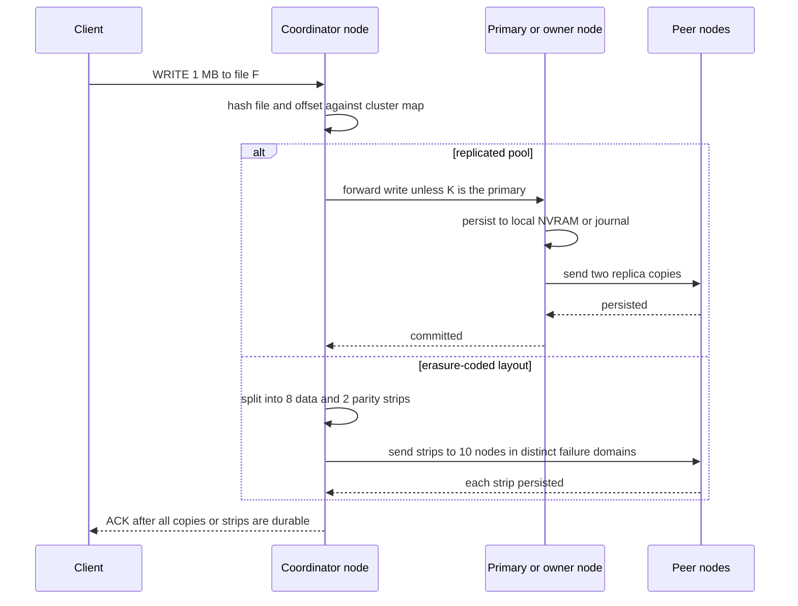
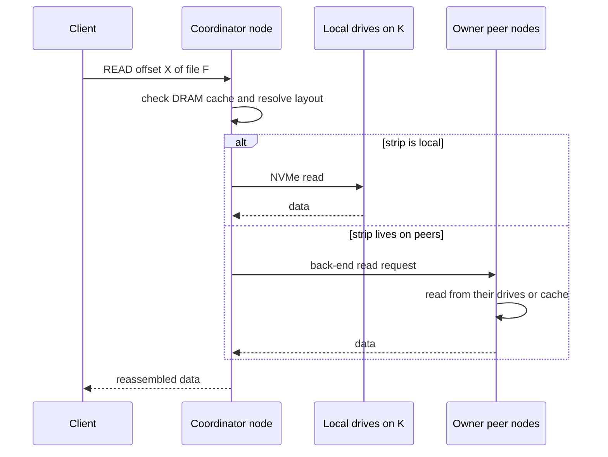
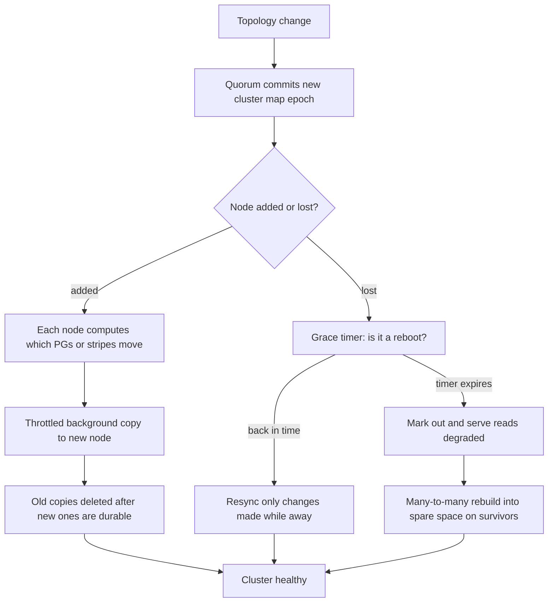
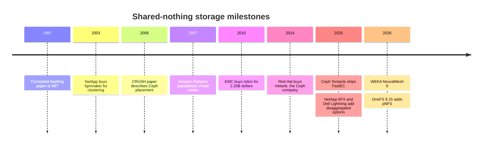

# 15. Scale-out shared-nothing clusters

> **Depth:** L2 · **Reading time:** ~9 min · **Last verified:** 2026-11-01
> **Prerequisites:** [Data protection and resilience](../01-storage-fundamentals/06-data-protection-and-resilience.md) · [Datacenter networking](../02-protocols-and-networking/10-datacenter-networking.md) · [Scale-up dual-controller arrays](14-scale-up-dual-controller.md)

## TL;DR

- **A shared-nothing cluster is identical servers that each own their CPUs, memory and drives.** The scaling unit is a whole node. PowerScale (Isilon), WEKA, Ceph, Qumulo and Nutanix work this way; ONTAP does at the level of HA pairs.
- **Placement is computed, not looked up.** A consistent-hashing ring or CRUSH-style function maps data to nodes, so adding a node moves only about 1/(N+1) of the data.
- **The network does the real work.** Replicas, erasure-coded fragments, forwarded reads and rebuilds travel east-west. At 16 nodes, ~94% of read bytes come from a peer.
- **The cluster heals itself.** An odd-numbered quorum owns the cluster map, lost nodes are rebuilt many-to-many, and a partition's minority side stops writing.
- **The walls are bundled scaling, rebuild storms, hot spots and node limits.** It is the incumbent design that [disaggregated systems](16-disaggregated-shared-everything.md) define themselves against.

## Why this matters for Everpure strategy

Most scale-out file and object storage Everpure competes against is shared-nothing. PowerScale is the unstructured-data incumbent, WEKA the software-defined challenger in GPU clusters, and Ceph the open-source default for operators building their own. Deals against PowerScale, WEKA or "Ceph on our own servers" turn on this chapter's strengths and walls.

The architecture also explains a partnership. Hyperconverged (HCI) clusters such as Nutanix are shared-nothing, so storage grows only when compute grows. In 2025 Pure Storage and Nutanix announced FlashArray as external storage for Nutanix AHV, Nutanix's first major certified external-storage integration[^1]. That deal sells against the bundled-scaling wall.

## Core concepts

### The idea in one picture

Each node is a full server: CPUs, DRAM cache, an NVRAM or journal device, and NVMe drives no other node can address. Clients connect to any node over the **front-end** network; nodes talk over a **back-end** network. A few nodes run a **quorum service**, the authoritative record of membership and ownership.

*Figure 15.1 — Data is never shared, only requested: reaching another node's bytes means asking its CPU over the back-end.*

**Semiconductor bridge: a multi-socket NUMA server.** Each socket has local DRAM; a remote access crosses UPI or Infinity Fabric to another socket's memory controller, slower and bandwidth-hungry. Shared-nothing storage is NUMA at datacenter scale. The coherence parallel is closer still. In directory-based coherence, every cache line has a *home node* whose directory tracks sharers, and a contended line serializes there. In a cluster, every object has an owner or primary node, and a hot key serializes on it the same way. [Chapter 16](16-disaggregated-shared-everything.md) is the UMA alternative.

### Where state and metadata live

Everything lives on the nodes. Data is striped across nodes under replication or erasure coding (EC); OneFS spreads data, metadata and parity across nodes, using Reed-Solomon EC for data and mirroring for metadata[^2]. Metadata (inodes, directories, block maps) is sharded too, and designs differ in how: WEKA spreads it across all nodes[^3], while Ceph's file layer adds separate metadata servers.

The one piece of state that cannot be sharded is the **cluster map**: membership, health and placement rules. Ceph keeps it in a few monitors that agree on changes by Paxos and majority vote[^4]. Nodes and smart clients cache the map and tag requests with its version (*epoch*), so stale views are caught.

### Placement: hash it, don't look it up

A central table of every object's location would become the bottleneck, so shared-nothing systems compute placement instead.

- **Consistent hashing** (Karger et al., 1997[^5]) puts nodes and keys on a ring; each key belongs to the next node clockwise. Amazon's Dynamo (2007) added many "virtual nodes" per server to even out load[^6].
- **CRUSH** (Weil et al., 2006[^7]) hashes objects into **placement groups** (PGs), then maps each PG to drives by walking a host-and-rack hierarchy under a rule such as "three copies in three racks". Anyone with the same map computes the same answer, and map changes move little data[^7].

*Figure 15.2 — Computed placement needs no directory and moves only about the new node's fair share of data.*

**Semiconductor bridge: address interleaving.** Memory controllers hash physical addresses across channels, banks and LLC slices so no channel becomes a hot spot; clusters hash keys across nodes for the same reason. The difference: a memory system never re-interleaves at run time, while a cluster must, under live I/O.

### Tracing a write

*Figure 15.3 — The ACK waits until every copy or strip is durable on peers, so write latency includes at least one back-end round trip.*

OneFS follows the EC branch: the node a client connects to computes parity and commits strips to peers, journaling in NVRAM. Ceph skips the coordinator: clients run CRUSH themselves and write to the primary OSD (the daemon managing one drive), which replicates and acknowledges once all copies are stored[^4].

**Worked example (east-west on writes).** A client writes 1 GB/s. Under three-way replication the primary sends 2 GB/s to replicas, plus up to 1 GB/s if the coordinator forwards first: 2–3 GB/s of back-end traffic. Under 8+2 EC the coordinator sends 10/8 = 1.25 GB/s of strips. Against roughly 4× in [DASE](16-disaggregated-shared-everything.md), shared-nothing is *cheaper* on writes; its cost shows up on reads.

### Tracing a read

*Figure 15.4 — Whichever node holds the data serves it; the coordinator mostly stitches together peers' answers.*

With data spread evenly over N nodes, a client finds only 1/N locally. At 16 nodes, 15/16 ≈ **94% of read bytes cross the back-end**, which must be sized at least as large as the front-end. Smart clients (Ceph's, WEKA's) skip this hop by reading straight from owners; Nutanix's data locality instead keeps a VM's data on its own node.

### Rebalancing: node add and node loss

*Figure 15.5 — Adding a node is a throttled migration; losing one starts a race to restore redundancy before a second failure.*

![Two-panel illustrative line chart. Panel A: when one node is added to N nodes, naive hash-mod-N placement moves about 80 to 98 percent of data, while consistent hashing or CRUSH moves 1/(N+1), falling from 20 percent at 4 nodes to under 2 percent at 64 nodes. Panel B, log scale: hours to rebuild one lost 80 percent full node with 8+2 erasure coding fall as the cluster grows, from about 82 hours at 10 nodes to about 3 hours at 252 nodes with 30.72 TB drives, and are four times longer with 122.88 TB drives.](../assets/charts/ch15-rebalance-rebuild.svg)

*Figure 15.6 — Illustrative: computed placement keeps adds cheap, but rebuild time grows with node size and shrinks only as clusters widen.*
Data: `data/ch15_rebalance_rebuild.csv`

Panel B's math: a node of 24 × 30.72 TB drives at 80% full holds 590 TB. Under 8+2 EC each rebuilt strip reads 8 strips and writes 1, so 9 bytes cross the network per byte restored. If each survivor donates 2 GB/s, a 10-node cluster restores 9 × 2 ÷ 9 = 2 GB/s: about **82 hours**. At 64 nodes it is ~12 hours; with 122.88 TB drives, four times longer.

### How it scales and where it hits walls

1. **Bundled scaling.** Each node adds fixed CPU, cache, capacity and ports. Capacity-heavy workloads pay for idle CPUs; throughput-heavy ones pay for idle terabytes. Mixed node pools only soften this.
2. **East-west amplification.** Reads cross the back-end (N−1)/N of the time; rebuilds multiply traffic by the code width.
3. **Rebuild storms.** Bigger drives make every node loss longer and noisier. At Facebook, recovering Reed-Solomon-coded data added more than 100 TB a day of cross-rack network traffic[^8]; locally repairable codes roughly halve repair traffic[^9].
4. **Hot spots.** Hashing spreads keys, not load. A million-file directory, or one checkpoint read by 1,000 GPUs, lands on its owner, like a contended line stalling at its home directory.
5. **Membership limits.** Failure detection and all-to-all connections grow with node count. PowerScale tops out at 252 nodes on an Ethernet leaf-spine back-end[^10]; ONTAP at 24 nodes for NAS and 12 for SAN[^11].

### Failure handling

| Failure | What happens | Blast radius / cost |
|---|---|---|
| Drive | Strips rebuilt from peers into spare space on many nodes | Small. Parallel rebuild; brief extra east-west load |
| Node | Grace timer, then many-to-many rebuild. OneFS +2d:1n survives 2 drives *or* 1 node; N+M EC needs ≥2M+1 nodes[^2] | 1/N of capacity and performance lost; hours to days to rebuild (Figure 15.6) |
| Back-end link or switch | Dual back-end fabrics with failover; a node cut off from peers is fenced out of the cluster | A flapping link can trigger repeated mark-out and resync churn |
| Front-end link | Client IPs move to surviving nodes (for example, OneFS SmartConnect) | Brief stall or reconnect for clients on that node |
| Partition (split brain) | Only the side holding a quorum majority keeps the map and accepts writes. 5 monitors tolerate 2 failures | The minority side goes read-only or offline, by design |

*Table 15.1 — There is no partner controller in this design: the cluster heals itself, and the price is rebuild traffic and a quorum that must be protected.*

### Pros, cons and fit

| | Shared-nothing strength | Shared-nothing weakness |
|---|---|---|
| Scaling | Linear add-a-node growth; commodity servers; no special fabric | Capacity and performance bundled; membership limits (24–252 nodes) |
| Performance | Local reads possible; writes cheaper on the network than DASE | Most reads hop through a peer unless clients are smart |
| Resilience | No single controller pair; parallel, many-to-many rebuild | Node loss is a big rebuild; partitions need quorum discipline |
| Efficiency | EC across nodes; per-TB software pricing | Small clusters need narrow stripes or replication (≥2M+1 nodes) |
| Lifecycle | Rolling, node-by-node upgrades; mixed generations | Every reboot creates a window of reduced redundancy |

*Table 15.2 — Shared-nothing trades bundled scaling and network-heavy recovery for simplicity, commodity hardware and no controller bottleneck.*

**Best fit:** large file shares, media and genomics archives, analytics lakes, HCI VM estates, and GPU clusters whose throughput-to-capacity need matches a server's built-in ratio; software-defined variants suit operators who pick their own servers. **Worst fit:** latency-critical block databases ([dual-controller arrays](14-scale-up-dual-controller.md) are simpler), very capacity-heavy archives (idle CPUs; see [object storage](18-object-storage-architecture.md)), sites under about 3–5 nodes, and namespaces that must outgrow the node limit.

### Cost and operational implications

Commodity hardware shifts value to software, which is why WEKA, Qumulo and Ceph vendors price per terabyte or node. Operations get harder in three places: back-end network sizing, free-space reserve (often one node's worth, to absorb a rebuild), and rolling upgrades that reboot nodes one by one. Incremental growth is the strong suit: add a node, rebalance, retire the oldest later.

## How Everpure approaches it vs. competitors

| System | Node model | Placement and protection | Notes |
|---|---|---|---|
| Dell PowerScale (OneFS) | 3–252 nodes, each with its own drives | Reed-Solomon EC across nodes; metadata mirrored[^2][^10] | OneFS 9.15 claims up to 35 GB/s reads per node on next-gen nodes and makes pNFS GA[^12] |
| WEKA NeuralMesh | Software on commodity or cloud servers | Stripes of 3–16 data plus 2–4 parity strips; N+4 aimed at 100+ servers[^13] | Data and metadata on all nodes; NeuralMesh 6 announced July 2026[^3][^14] |
| Ceph RADOS | OSD per drive, monitors for quorum | CRUSH placement; replicas or EC; "FastEC" in Tentacle (2025)[^7][^15] | Open source; Red Hat bought Inktank for ~US$175M in 2014[^16] |
| NetApp ONTAP cluster | HA pairs federated over a cluster interconnect | Each pair owns its aggregates; volumes move between pairs | Up to 24 NAS nodes[^11]; AFX (2025) moves ONTAP to shared media[^17] |
| Qumulo | Software on commodity or cloud nodes | Erasure-coded block layer across nodes [VERIFY: current protection scheme] | Became software-only under CEO Doug Gourlay (2024)[^18] |
| Nutanix | One controller VM per HCI node | Replication factor 2 or 3 across nodes[^19] | Supports FlashArray as external storage since 2025[^1] |
| Everpure FlashBlade//S | Chassis of 7–10 blades; each blade takes 1–4 DirectFlash Modules, so compute and capacity are sized separately | Global EC and flash management in Purity//FB; namespace split into "authorities" that run on blades[^20][^21] | Pure calls Purity//FB "partitioned-writer" and rejects the binary label[^22] [VERIFY: multi-chassis data placement] |

*Table 15.3 — Every major scale-out incumbent is shared-nothing at heart; Everpure's file platforms sit between the patterns rather than in one.*

Everpure sells no classic shared-nothing product. FlashArray is dual-controller ([Chapter 14](14-scale-up-dual-controller.md)). FlashBlade//S scales out blades in a chassis. Pure Storage describes Purity//FB as a "partitioned-writer" design and argues that the shared-nothing versus shared-everything label obscures more than it reveals[^22]. Metadata and write ownership are partitioned into "authorities" running on each blade, much like shared-nothing owners, while Purity manages DFM flash and NVRAM globally[^21][^20]. One Pure data sheet even calls FlashBlade "shared-nothing"[^23]. The fair summary is a partitioned scale-out design with pooled media management, not shared-everything in the DASE sense. FlashBlade//EXA splits metadata from data, yet its data nodes each own their NVMe, giving the data tier a shared-nothing flavour ([Chapter 16](16-disaggregated-shared-everything.md)).

The steelman for PowerScale is maturity: two decades of OneFS, a vast installed base, and now pNFS and a parallel "Lightning" tier on common hardware[^24]. For WEKA and Ceph it is freedom over hardware and clouds. Options a strategy team might evaluate, based on public information: attacking the bundled-scaling wall in HCI estates, and leading with rebuild-time and failure-domain math against large-drive clusters.

## History and trajectory

*Figure 15.7 — The algorithms date from 1997–2007; since 2025 incumbents have added disaggregated or parallel tiers beside them.*

EMC paid about US$2.25 billion for Isilon in 2010[^25]; NetApp paid ~US$300 million in stock for Spinnaker in 2003 to cluster beyond two nodes[^26]. Since 2025 the trend is hybridization: NetApp AFX[^17] and Dell Lightning[^24] add shared-media or parallel paths beside shared-nothing cores, while WEKA's NeuralMesh refines the mesh itself[^3].

## Numbers that matter

| Metric | Value | Context | Source / date |
|---|---|---|---|
| PowerScale maximum cluster | 252 nodes | Ethernet leaf-spine back-end | Dell InfoHub[^10], retrieved 2026-11 |
| ONTAP cluster maximum | 24 nodes NAS / 12 nodes SAN | Built from HA pairs | NetApp docs[^11] |
| WEKA stripe range | 3–16 data + 2–4 parity strips | Fixed at cluster formation | WEKA docs[^13] |
| OneFS N+M minimum nodes | 2M+1 | E.g., +2 needs ≥5 nodes | Dell InfoHub[^2] |
| Data moved on node add | ≈1/(N+1) | Versus ≈N/(N+1) for hash-mod-N | Worked example |
| Read bytes crossing back-end | (N−1)/N; 94% at 16 nodes | Non-smart clients, even spread | Worked example |
| Node rebuild time, 590 TB node | ~82 h at 10 nodes, ~12 h at 64 | 8+2 EC, 2 GB/s per survivor | Worked example (Figure 15.6) |
| Facebook EC recovery traffic | >100 TB/day | Cross-rack, (10,4) Reed-Solomon warehouse cluster | Rashmi et al., 2013[^8] |
| PowerScale per-node read | Up to 35 GB/s | Company-stated, next-gen node, OneFS 9.15 | Dell blog[^12] |

## Conversation playbook

**Questions for a PM**

1. *"Against PowerScale, where does FlashBlade win on architecture, not price?"* Strong: rebuild time on large drives, bundled-scaling waste, back-end cost; concedes PowerScale's installed base and pNFS moves.
2. *"Which customers does HCI's bundled scaling block, and how big is the Nutanix external-storage opportunity?"* Strong: segments by capacity-to-compute ratio and VMware-exit timing.
3. *"A neocloud says 'we'll just run Ceph'. What is our TCO counter?"* Strong: staff, rebuild windows, free-space reserve and watts per usable TB, not list price.

**Questions for an engineer**

1. *"Where is a write's persistence point, and how many back-end hops precede the ACK?"* Strong: names the NVRAM or journal, the fan-out and the failure-domain rule.
2. *"A 1 PB node dies at 80% full. How long until redundancy is restored, and what do clients see meanwhile?"* Strong: hours, rebuild throttle, degraded-throughput percentage.
3. *"How do you handle one file read by thousands of GPUs?"* Strong: metadata sharding, client caching or hot-data replication, not "we hash it".

**Don't say this:**

- "Shared-nothing has no network bottleneck." Most reads and every rebuild cross the back-end.
- "Add a node, get linear scaling." Only until hot keys, node limits or back-end bandwidth bite.
- "Ceph is free." The operators, spare capacity and rebuild risk are not.
- "ONTAP is fully shared-nothing." Drives belong to HA pairs, which federate.
- "Consistent hashing balances load." It balances *keys*, not skewed access.
- "FlashBlade//S is shared-everything, like VAST." Pure calls Purity//FB a partitioned-writer design: blades own slices of the namespace, while media management is global.

## Going deeper (optional, L3 pointers)

- Weil et al., "CRUSH" (SC'06); the Ceph architecture guide on peering and backfill.
- DeCandia et al., "Dynamo" (SOSP'07) on virtual nodes and sloppy quorums.
- Dell's OneFS technical overview; WEKA's redundancy docs; "XORing Elephants" (VLDB 2013).

## Key terms

- **Shared-nothing** — nodes own their CPU, memory and drives and cooperate only over the network.
- **Coordinator node** — the node a client contacts, which computes placement and fans out I/O.
- **Placement group (PG)** — Ceph's unit of placement and rebalancing.
- **Rebuild storm** — heavy east-west traffic while lost redundancy is restored.
- See the [glossary](../glossary.md) for the rest.

## Sources

[^1]: SDxCentral, "Nutanix partners with Pure Storage in latest VMware assault," 2025-05. https://www.sdxcentral.com/news/nutanix-partners-with-pure-storage-in-latest-vmware-assault/ (retrieved 2026-11-01).
[^2]: Dell Technologies InfoHub, "PowerScale OneFS Technical Overview: Data protection," n.d. https://infohub.delltechnologies.com/en-au/l/powerscale-onefs-technical-overview-1/data-protection-119 (retrieved 2026-11-01).
[^3]: Blocks & Files, "WEKA builds NeuralMesh for exascale AI," 2025-06-18. https://blocksandfiles.com/2025/06/18/weka-builds-neuralmesh-for-exascale-ai/ (retrieved 2026-11-01).
[^4]: Ceph documentation, "Architecture" (Reef), n.d. https://docs.ceph.com/en/reef/architecture/ (retrieved 2026-11-01).
[^5]: D. Karger et al., "Consistent Hashing and Random Trees: Distributed Caching Protocols for Relieving Hot Spots on the World Wide Web," STOC 1997. https://cs.brown.edu/courses/csci2950-u/f09/papers/chash97stoc.pdf (retrieved 2026-11-01).
[^6]: G. DeCandia et al., "Dynamo: Amazon's Highly Available Key-value Store," SOSP 2007. https://www.allthingsdistributed.com/files/amazon-dynamo-sosp2007.pdf (retrieved 2026-11-01).
[^7]: S. A. Weil, S. A. Brandt, E. L. Miller, C. Maltzahn, "CRUSH: Controlled, Scalable, Decentralized Placement of Replicated Data," SC'06, 2006-11. https://www.ssrc.ucsc.edu/Papers/weil-sc06.pdf (retrieved 2026-11-01).
[^8]: K. V. Rashmi et al., "A Solution to the Network Challenges of Data Recovery in Erasure-coded Distributed Storage Systems: A Study on the Facebook Warehouse Cluster," USENIX HotStorage 2013. https://www.usenix.org/conference/hotstorage13/workshop-program/presentation/rashmi (retrieved 2026-11-01).
[^9]: M. Sathiamoorthy et al., "XORing Elephants: Novel Erasure Codes for Big Data," VLDB 2013 (arXiv 1301.3791). https://arxiv.org/pdf/1301.3791 (retrieved 2026-11-01).
[^10]: Dell Technologies InfoHub, "Dell PowerScale: Considerations and Best Practices for Large Clusters — Cluster definitions," n.d. https://infohub.delltechnologies.com/en-au/l/dell-powerscale-considerations-and-best-practices-for-large-clusters/cluster-definitions (retrieved 2026-11-01).
[^11]: NetApp, "Cluster storage" (ONTAP concepts), n.d. https://docs.netapp.com/us-en/ontap/concepts/cluster-storage-concept.html (retrieved 2026-11-01).
[^12]: Dell Technologies, "PowerScale OneFS 9.15 strengthens Dell AI Data Platform foundations," n.d. (2026). https://www.dell.com/en-us/blog/powerscale-onefs-9-15-strengthens-dell-ai-data-platform-foundations/ (retrieved 2026-11-01).
[^13]: WEKA documentation, "Cluster capacity and redundancy management," n.d. https://docs.weka.io/weka-system-overview/cluster-capacity-and-redundancy-management (retrieved 2026-11-01).
[^14]: WEKA, "WEKA Debuts NeuralMesh 6 to Power Enterprise and Agentic AI Workloads at Production Scale," 2026-07-21. https://www.weka.io/news/neuralmesh-6-enterprise-agentic-ai (retrieved 2026-11-01).
[^15]: Ceph, "v20.2.0 Tentacle released," 2025. https://ceph.io/en/news/blog/2025/v20-2-0-tentacle-released (retrieved 2026-11-01).
[^16]: Data Center Knowledge, "Red Hat Acquires Ceph Open Storage Provider Inktank for $175 million," 2014-04-30. https://www.datacenterknowledge.com/data-storage/red-hat-acquires-ceph-open-storage-provider-inktank-for-175-million (retrieved 2026-11-01).
[^17]: Blocks & Files, "NetApp disaggregates ONTAP storage and provides an AI Data Engine," 2025-10-14. https://blocksandfiles.com/2025/10/14/netapp-disaggregates-ontap-storage-and-provides-an-ai-data-engine/ (retrieved 2026-11-01).
[^18]: GeekWire, "Former Arista and Cisco exec Douglas Gourlay named new CEO of data storage company Qumulo," 2024-07. https://www.geekwire.com/2024/former-arista-and-cisco-exec-douglas-gourlay-named-new-ceo-of-data-storage-company-qumulo/ (retrieved 2026-11-01).
[^19]: Nutanix Community, "Redundancy Factor vs Replication Factor," n.d. https://next.nutanix.com/how-it-works-22/redundancy-factor-vs-replication-factor-37486 (retrieved 2026-11-01).
[^20]: StorageNewsletter, "Pure Accelerate Techfest22: Pure Storage FlashBlade//S Platform," 2022-06-10. https://www.storagenewsletter.com/2022/06/10/pure-accelerate-techfest22-pure-storage-flashblade-s-platform/ (retrieved 2026-11-01).
[^21]: Everpure, "The Metadata Advantage: Scaling I/O performance for AI and HPC" (white paper), n.d. https://www.everpuredata.com/content/dam/pdf/en/white-papers/wp-meta-advantage-scaling-io-performance-flashblade-exa.pdf (retrieved 2026-11-01; seen via search summary).
[^22]: J. Emerson (Pure Storage), "The Storage Architecture Spectrum: Why 'Shared-nothing' Means Nothing," n.d. https://blog.everpuredata.com/perspectives/the-storage-architecture-spectrum-why-shared-nothing-means-nothing/ (retrieved 2026-11-01; seen via search summary, host not fetchable).
[^23]: Pure Storage, "FlashBlade for Media and Entertainment" (data sheet), n.d. https://www.purestorage.com/content/dam/pdf/en/datasheets/ds-flashblade-for-media-and-entertainment.pdf (retrieved 2026-11-01; seen via search summary).
[^24]: Blocks & Files, "Dell PowerScale gets struck by Lightning and goes parallel," 2025-11-17. https://www.blocksandfiles.com/ai-ml/2025/11/17/dell-powerscale-gets-struck-by-lightning-and-goes-parallel/1711291 (retrieved 2026-11-01).
[^25]: eWeek, "EMC Acquires Scale-Out NAS Maker Isilon for $2.25 Billion," 2010-11-15. https://www.eweek.com/storage/emc-acquires-scale-out-nas-maker-isilon-for-2.25-billion/ (retrieved 2026-11-01).
[^26]: The Register, "NetApp hoists $300m for Spinnaker," 2003-11-05. https://www.theregister.co.uk/2003/11/05/netapp_hoists_300m_for_spinnaker/ (retrieved 2026-11-01).
