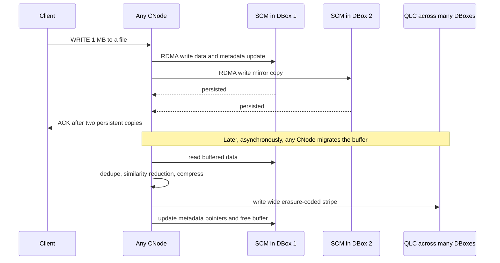
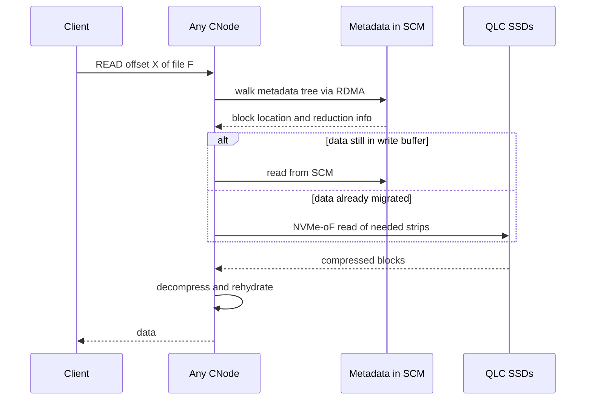
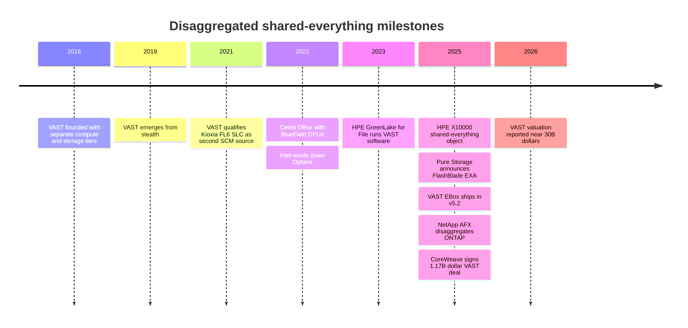

# 16. Disaggregated shared-everything architectures

> **Depth:** L2 · **Reading time:** ~10 min · **Last verified:** 2026-11-01
> **Prerequisites:** [Inside an SSD](../01-storage-fundamentals/03-inside-an-ssd.md) · [Block protocols and NVMe-oF](../02-protocols-and-networking/07-block-protocols.md) · [Scale-up dual-controller arrays](14-scale-up-dual-controller.md) · [Scale-out shared-nothing clusters](15-scale-out-shared-nothing.md)

## TL;DR

- **DASE splits a storage system into stateless compute nodes and shared enclosures of flash, joined by an NVMe-oF fabric.** Every compute node can read and write every SSD, so no node "owns" any data. VAST Data built the category and coined the acronym.
- **The trick is where state lives.** Data and all metadata sit on persistent media that every node shares: a small storage-class-memory (SCM) tier for the write buffer and metadata, and QLC flash for everything else. Compute nodes can fail, be added or be replaced without moving data.
- **Performance and capacity scale independently.** That matters most when a workload's throughput-to-capacity mix is far from what a fixed server bundles; near that ratio the advantage is small.
- **The walls are the fabric, the enclosure and the minimum size.** Every I/O crosses the back-end network. A whole enclosure is a failure domain. Wide, cheap erasure coding only kicks in at scale.
- **Disaggregation is becoming table stakes, but vendors implement it differently.** NetApp (AFX) and HPE (X10000) ship shared-media designs. Everpure's FlashBlade//EXA separates metadata from data but sends clients directly to data nodes, which makes it closer to a parallel file system than to pure DASE.

## Why this matters for Everpure strategy

VAST grew with neocloud AI clusters, buyers who want one namespace at hundreds of GB/s to several TB/s without paying for CPUs they don't need. In November 2025 CoreWeave signed a reported US$1.17 billion commercial agreement with VAST[^1], and in April 2026 Reuters reported a ~US$30 billion valuation[^2] (both *reported by press*). Each enterprise-AI deal Everpure competes in is now partly an argument about this architecture.

Everpure's answer, FlashBlade//EXA, was announced by Pure Storage in March 2025. It disaggregates differently[^3]. Judging that bet requires knowing what DASE gets right, where it is fragile, and whether a metadata/data split with a direct data path is a better trade or merely a different one. [Chapter 42](../06-industry-and-competition/42-vast-data.md) covers VAST as a company, and [Chapter 45](../06-industry-and-competition/45-head-to-head.md) covers the head-to-head.

## Core concepts

### The idea in one picture

Earlier architectures tie compute to media. A [dual-controller array](14-scale-up-dual-controller.md) puts two controllers in front of one shelf of drives. A [shared-nothing cluster](15-scale-out-shared-nothing.md) builds servers that each own their drives, so reaching another node's data means asking that node's CPU. DASE removes the ownership:

- **Compute nodes ("CNodes" in VAST's terms)** run the file, object and block protocols, data reduction and erasure coding. They hold no authoritative state.
- **Data enclosures ("DBoxes")** hold SSDs behind small, dumb-by-design fabric endpoints ("DNodes"). Each DBox has two of them for redundancy, and in VAST's Ceres DBox they are NVIDIA BlueField DPUs[^4].
- **The back-end fabric**, NVMe-oF over RDMA, makes every SSD look roughly local to every CNode[^5].

*Figure 16.1 — In DASE, compute is a stateless pool and all state lives on shared media, so every CNode is one fabric hop from every byte.*

**Semiconductor bridge: NUMA versus UMA.** Shared-nothing is NUMA. Each socket (node) has local memory (drives), and remote accesses go through the owner. DASE is UMA. Every core is equidistant from every memory bank, at the price of never being local. As with UMA, the interconnect becomes the critical resource. The chiplet parallel is just as useful. AMD separated compute dies from the I/O die so cores and memory/IO could scale and refresh on different cadences and processes. DASE does the same with CPUs, which follow Intel/AMD roadmaps, and NAND, which follows the flash cost curve.

### Where state and metadata live

DASE works only because a small, fast, persistent tier is shared by everyone. VAST began with Intel Optane SSDs as SCM and qualified Kioxia's SLC-based FL6 in 2021 as a second source[^6], a year before Intel announced the Optane wind-down[^7]. The SCM holds two things. The first is the **write buffer**. The second is **all metadata**: the file system tree, block maps and locks[^8]. The tier is tiny. A current DF-3060V2 DBox pairs 12 TB of SCM with 1,352 TB of QLC[^9], so SCM is 12 ÷ 1,364 ≈ **0.9% of raw capacity**.

Because metadata sits in shared persistent media, CNodes coordinate through it, not with each other: a lock is a write into SCM, much as cores coordinate through atomics on a shared last-level cache. No CNode-to-CNode cache-coherence traffic exists to scale. The cost is that every metadata lookup is a fabric round trip. RDMA NVMe-oF adds roughly 5–15 µs per access over a local drive[^5]. That is small next to a QLC read, which is on the order of 100 µs, but it is visible on metadata-heavy, small-file work (see [Chapter 21](21-metadata.md)).

### Tracing a write

*Figure 16.2 — A write is acknowledged once it is mirrored in SCM on two enclosures; reduction and wide-stripe erasure coding happen later, off the latency path.*

The persistence point is the mirrored SCM copy, with the two copies placed in different DBoxes and DNodes[^8][^10]. The expensive work happens during **migration**, when a CNode reduces data and lays it onto QLC in large stripes[^11]. Big sequential stripes match QLC's large program and erase units and keep write amplification low (see [Chapter 3](../01-storage-fundamentals/03-inside-an-ssd.md)). This is the storage version of a write-combining buffer.

**Worked example (fabric amplification).** A client writes 1 GB/s. The front-end network carries 1 GB/s. The back-end carries 2 GB/s into SCM for the two mirror copies, about 1 GB/s back out during migration, and about 1.03 GB/s into QLC once a 146+4 stripe is added. That is roughly **4 GB/s of back-end traffic per 1 GB/s of client writes**, before data reduction, which shrinks only the QLC leg. Sustained writes are therefore bounded by SCM write bandwidth and fabric capacity, not by QLC.

### Tracing a read

*Figure 16.3 — Any CNode can serve any read with no help from other CNodes, which is why adding CNodes scales read performance almost linearly until the fabric or media saturates.*

### How it scales and where it hits walls

Adding CNodes buys protocol and reduction horsepower without moving data. Adding DBoxes buys capacity and media bandwidth, and also makes erasure coding cheaper. VAST caps a stripe at twice the number of DBoxes when enclosure-level protection is on. A 20-DBox cluster therefore runs 36+4 stripes (10% overhead), and at 75+ DBoxes it reaches 146+4 (2.7%)[^10][^12]. Compare a typical shared-nothing 8+2 (20%). For 10 PB usable, 8+2 needs 10 ÷ 0.8 = 12.5 PB raw, while 146+4 needs 10 ÷ 0.973 ≈ 10.3 PB. That is **~18% fewer drives**, the largest single capacity-side saving.

*Figure 16.4 — Illustrative: decoupling pays off when the workload's throughput-to-capacity ratio is far from what a fixed server bundles; near that ratio, shared-nothing can be as cheap or cheaper.*
Data: `data/ch16_scaling.csv`

In panel A, 800 GB/s on 5 PB forces shared-nothing to buy 40 full nodes (cost 1,320); DASE buys 40 CNodes plus 16 DBoxes for media bandwidth (754). In panel B the gap at 30 PB is ~13%, almost all of it from erasure-coding efficiency. The walls:

1. **Fabric bandwidth.** All traffic is east-west on the back-end. A 1 TB/s read target needs ≥1 TB/s of back-end bisection bandwidth as well as front-end bandwidth, which means dozens of 400 GbE switch ports.
2. **Fabric cost and lock-in.** Back-end switches are usually specified, and sometimes supplied, by the vendor. NetApp supports only approved switches for the AFX back-end[^13].
3. **Enclosure blast radius.** A DBox holds hundreds of TB. Surviving its loss requires spreading each stripe thinly (see below).
4. **Minimum size.** Cheap, wide stripes and enclosure protection need many DBoxes. Small clusters pay more overhead or accept less resilience.
5. **SCM write ceiling.** The persistent tier is a shared write funnel, and supply has already been disrupted once.

### Failure handling

| Failure | What happens | Blast radius / cost |
|---|---|---|
| SSD | Rebuilt from erasure-coded strips. Locally decodable codes read ~1/4 of the stripe instead of all of it[^14]. Every CNode helps. | Small. Rebuild is many-to-many and fast. |
| CNode | Clients fail over to another CNode's address. No data lost, because the node had no authoritative state. | In-flight operations retried. Lose 1/N of compute. |
| DNode / DPU | Partner DNode in the same DBox keeps serving its SSDs. | Reduced enclosure bandwidth until replaced. |
| Whole DBox | Survivable only if each stripe has ≤2 strips per DBox ("DBox-HA", ≥8 DBoxes)[^12]. Rack-level protection needs ≥7 racks[^15]. | Without HA: data unavailable. With HA: higher erasure-coding overhead on small clusters. |
| Fabric link / switch | Dual fabrics and multipathing reroute. A partition between compute and media halts I/O on the affected side. | A switch pair is a shared dependency for everything. |

*Table 16.1 — DASE makes compute failures trivial and moves the risk to enclosures and the fabric.*

### Pros, cons and fit

| | DASE strength | DASE weakness |
|---|---|---|
| Scaling | Compute and capacity independent; no rebalancing when adding compute | Fixed cost floor: fabric and minimum enclosure count |
| Efficiency | Wide stripes (≈3–10% overhead), global reduction across all data | Gains need scale; small systems see little |
| Resilience | Compute failure is cheap; rebuilds are parallel | Enclosure and fabric are large shared failure domains |
| Performance | Uniform: any node, any data, one hop | Never local; extra µs per metadata access; back-end fabric amplification on writes |
| Lifecycle | Refresh CPUs and NAND on separate cycles | Proprietary enclosures/fabric specs; SCM supply dependency |

*Table 16.2 — The architecture trades locality and a higher entry cost for uniformity, efficiency at scale and cheap compute failures.*

**Best fit:** large shared namespaces read by many GPU nodes (training data, checkpoints, model repositories), mixed file and object estates where global reduction pays, and multi-tenant neocloud storage where demand shifts between throughput and capacity. **Worst fit:** small deployments under ~1 PB, latency-critical block databases that dual-controller arrays serve at a lower cost floor ([Chapter 14](14-scale-up-dual-controller.md)), and edge sites without a dedicated fabric.

### Cost and operational implications

Steady-state operations get simpler (no rebalancing when adding compute; CNode upgrades never touch media), while network engineering gets harder, because the back-end fabric is now storage. The commercial consequence is subtle. Because compute is stateless, it can be sold as software on someone else's servers, which is what VAST's EBox and its OEM and cloud routes do[^16]. Gross margin then depends on software pricing rather than on enclosure markup.

## How Everpure approaches it vs. competitors

| System | Compute / metadata tier | Data tier | Shared-everything? | Notes |
|---|---|---|---|---|
| VAST (CBox + DBox) | Stateless CNodes | DBoxes: SCM + QLC behind DPUs | Yes, the reference design | Metadata in shared SCM; any CNode reaches any SSD[^8] |
| VAST EBox | CNode and DNode software on one server | Same server's SSDs, pooled | Logically yes; physically converged | Gives up independent scaling for hyperscaler/cloud fit[^16] |
| Everpure FlashBlade//EXA | FlashBlade running Purity//FB as metadata core | Off-the-shelf data nodes (Purity//DN); DirectFlash nodes planned | **No.** Metadata/data split; clients read data nodes directly | pNFS: metadata over TCP, data over NFSv3/RDMA[^3][^17] |
| NetApp AFX | AFX 1K controllers running ONTAP | NX224 NVMe-oF shelves in one shared pool | Yes (shared pool) | Up to 128 controllers, 52 enclosures[^18][^13] |
| HPE Alletra MP X10000 | Containerized compute nodes | JBOF nodes | Yes ("SEDA") | Log-structured KV store; object plus native NFS since Release 4[^19][^20] |
| HPE GreenLake for File | VAST software on Alletra MP compute | Alletra MP JBOFs | Yes (VAST-based) | Launched 2023[^21] |
| Dell Lightning FS / PowerScale pNFS | Metadata server + storage nodes | Server-attached flash | No, parallel file system | pNFS with Flex Files layout[^22] |

*Table 16.3 — "Disaggregated" covers two distinct designs: shared media (VAST, NetApp, HPE) and split metadata with a direct data path (FlashBlade//EXA, Dell).*

**How close is FlashBlade//EXA to DASE?** It shares the motivation: scale metadata performance separately from data capacity and bandwidth. It differs on the key property. In EXA no compute tier can reach all media. Clients receive a layout from the metadata core and then talk directly to data nodes over RDMA[^17]. Architecturally that is the Lustre MDS/OSS pattern ([Chapter 17](17-parallel-file-systems.md)) with a far stronger metadata engine. The steelman for EXA is that it removes a hop. VAST's data path is client → CNode → DBox; EXA's is client → data node. EXA also reuses years of hardened Purity metadata code and lets customers source data-node hardware. Pure Storage reported that 60 data nodes exceeded 5 TB/s of reads, or ≥83 GB/s per node, scaling linearly[^3].

The steelman for VAST: shared media makes cluster-wide reduction, wide erasure codes and multi-protocol access natural. EXA's data-node protection also appears to be maturing. One hands-on review reported hardware HA with software erasure coding planned[^23] [VERIFY: current FlashBlade//EXA data-node protection scheme and release]. Options a strategy team might evaluate, based on public information: how fast DirectFlash-based data nodes close the media-efficiency gap, and whether EXA's design wins the >1 TB/s single-namespace deals while FlashBlade//S and FlashArray hold the enterprise.

## History and trajectory

*Figure 16.5 — A single start-up's design (2016–2019) became an industry pattern in 2025, when three incumbents shipped disaggregated systems within eight months.*

The roots are older: VAXclusters and Oracle RAC were "shared-disk" designs that choked on lock traffic and slow SANs. What changed was NVMe-oF making remote flash nearly local, and SCM giving a shared, persistent place for metadata[^24][^6]. Two trends point forward. Packaging is converging: VAST's EBox[^16] and Dell's Exascale "personalities" on common PowerEdge hardware[^25] blur the hardware line while keeping the logical split. And [CXL memory pooling](../02-protocols-and-networking/12-interfaces-and-emerging-tech.md) applies the same disaggregation logic one level down, inside the server.

## Numbers that matter

| Metric | Value | Context | Source / date |
|---|---|---|---|
| SCM share of DBox raw capacity | ~0.9% (12 TB vs 1,352 TB) | VAST DF-3060V2 | VAST KB[^9], retrieved 2026-11 |
| Widest VAST stripe / overhead | 146+4 / 2.7% | Needs ≥75 DBoxes with DBox-HA | VAST blog[^10] |
| DBox-HA minimum | 8 DBoxes | Stripe ≤ 2× DBox count | VAST KB[^12] |
| RDMA NVMe-oF latency adder | ~5–15 µs | Per access vs local NVMe | SNIA 2016[^5] |
| FlashBlade//EXA tested throughput | >5 TB/s with 60 data nodes | Company-stated; ≥83 GB/s per node | Everpure tech brief[^3] |
| NetApp AFX max scale | 128 controllers, 52 NX224 enclosures | Company-stated, >1 EB effective | Blocks & Files, 2025-10-14[^18] |
| Back-end traffic per client write | ~4× | Worked example above (2× mirror + migrate) | Worked example |
| VAST–CoreWeave agreement | US$1.17 B | Reported by press | Reuters, 2025-11-06[^1] |

## Conversation playbook

**Questions for a PM**

1. *"In which deals does EXA beat a shared-media design, and where does it lose?"* A strong answer names thresholds (throughput, GPU count, namespace size). It credits the direct data path and metadata performance, and it is candid about features that apply to the metadata core but not yet to data nodes.
2. *"What share of a 2 TB/s bill of materials is back-end networking, and who supplies the switches?"* A strong answer gives a percentage, port count and supplier, and says whether the customer's fabric can be reused.
3. *"What is the smallest configuration we can sell profitably against a VAST EBox?"* A strong answer knows the minimum node counts on both sides and where erasure-coding overhead and fixed fabric cost bite.

**Questions for an engineer**

1. *"Trace a write from client to persistence: how many fabric crossings, and in which failure domains do the two copies land?"* Strong: it gives the persistence point, the anti-affinity rule and the amplification factor.
2. *"An enclosure or data node dies at 80% full during a checkpoint. What does the client see, and for how long?"* Strong: it gives the degraded throughput percentage, the rebuild time and whether the outcome is unavailability or only slowdown.
3. *"Where is the serialization point for metadata: sharding, locks in shared memory, or an owner node?"* Strong: it gives a create/s figure for small files and what limits it.

**Don't say this:**

- "DASE eliminates east-west traffic." It moves all traffic onto the back-end fabric and multiplies it for writes.
- "Stateless compute means a node failure is free." It is cheap, not free: in-flight operations retry and capacity drops by 1/N.
- "FlashBlade//EXA is Everpure's version of VAST." It disaggregates metadata from data, but clients go directly to data nodes. Say "metadata/data split" instead.
- "Disaggregated is always cheaper." It is cheaper only when the workload is far from a server's built-in ratio, or at a scale where wide erasure codes apply.
- "This is new." Shared-disk clusters are 40 years old. What is new is NVMe-oF plus shared persistent metadata.

## Going deeper (optional, L3 pointers)

- VAST's architecture white paper and its KB pages on DBox-HA and rack resiliency (similarity reduction, locally decodable codes, stripe rules).
- Lockwood et al., PDSW'21, which benchmarks a VAST system independently[^8].
- Everpure's FlashBlade//EXA technical brief and "Metadata Advantage" white paper. NetApp's AFX technical reports on the Storage Availability Zone.
- For code theory: Huang et al., "Erasure Coding in Windows Azure Storage" (USENIX ATC 2012) on local reconstruction codes.

## Key terms

- **DASE** — disaggregated shared-everything: stateless compute sharing all media over a fabric.
- **CNode / DNode / DBox** — VAST's compute node, enclosure fabric endpoint and storage enclosure.
- **Storage-class memory (SCM)** — persistent media much faster than NAND, used here for write buffer and metadata.
- **Locally decodable code** — erasure code that rebuilds a strip from a subset of the stripe.
- **Enclosure blast radius** — the data affected when a whole shelf fails.
- See the [glossary](../glossary.md) for the rest.

## Sources

[^1]: Reuters (via AOL), "Exclusive: Nvidia-backed Vast Data inks $1.17 billion AI deal with CoreWeave," 2025-11-06. https://www.aol.com/articles/exclusive-nvidia-backed-vast-data-120456403.html (retrieved 2026-11-01).
[^2]: Reuters (via Yahoo Finance), "Nvidia-backed VAST Data valued at $30 billion in latest funding round," 2026-04. https://finance.yahoo.com/sectors/technology/articles/vast-data-valued-30-billion-151520245.html (retrieved 2026-11-01).
[^3]: Everpure, "Technical Brief: FlashBlade//EXA," n.d. (2025). https://www.everpuredata.com/content/dam/pdf/en/technical-briefs/tb-flashblade-exa.pdf (retrieved 2026-11-01).
[^4]: Blocks & Files, "VAST Data launches Ceres storage drive enclosure," 2022-03-22. https://blocksandfiles.com/?p=37064 (retrieved 2026-11-01).
[^5]: R. Davis (Mellanox), "Demonstrating NVMe Performance over Ethernet," SNIA Data Storage Innovation Conference, 2016. https://www.snia.org/sites/default/files/DSI/2016/presentations/stor_networks/Rob_Davis_Demonstrating_NVMe_Performance_Ethernet.pdf (retrieved 2026-11-01).
[^6]: Blocks & Files, "VAST Data lessens Optane SSD dependency," 2021-11-05. https://blocksandfiles.com/2021/11/05/vast-data-lessens-optane-ssd-dependency/ (retrieved 2026-11-01).
[^7]: Intel Corporation, "Form 10-Q for the quarter ended July 2, 2022," 2022-07. https://www.sec.gov/Archives/edgar/data/50863/000005086322000030/intc-20220702.htm (retrieved 2026-11-01).
[^8]: G. K. Lockwood et al., "New Challenges of Benchmarking All-Flash Storage for HPC," PDSW'21, 2021. https://pdsw.org/pdsw21/papers/ws_pdsw_paper_S2_P1_paper-lockwood.pdf (retrieved 2026-11-01).
[^9]: VAST Data Knowledge Base, "DBox DF-3015V2/DF-3060V2 Ceres Datasheet," n.d. https://kb.vastdata.com/docs/dbox-df-3015v2df-3060v2-ceres-datasheet (retrieved 2026-11-01).
[^10]: VAST Data, "Bringing rack-level resilience to VAST, part one," n.d. https://www.vastdata.com/blog/bringing-rack-level-resilience-to-vast-part-one (retrieved 2026-11-01).
[^11]: VAST Data Knowledge Base, "Data Reduction," n.d. https://kb.vastdata.com/documentation/docs/data-reduction (retrieved 2026-11-01).
[^12]: VAST Data Knowledge Base, "DBox High Availability," n.d. https://kb.vastdata.com/documentation/docs/dbox-high-availability (retrieved 2026-11-01).
[^13]: NetApp, "FAQ for AFX storage systems," n.d. https://docs.netapp.com/us-en/ontap-afx/faq-ontap-afx.html (retrieved 2026-11-01).
[^14]: VAST Data, "Glossary," n.d. https://vastdata.com/glossary (retrieved 2026-11-01).
[^15]: VAST Data Knowledge Base, "Rack Resiliency," n.d. https://kb.vastdata.com/documentation/docs/rack-resiliency (retrieved 2026-11-01).
[^16]: Blocks & Files, "VAST enters 2025 with consolidated EBox and GCP support," 2025-01-15. https://blocksandfiles.com/2025/01/15/vast-enters-2015-with-consolidated-ebox-and-gcp-support/ (retrieved 2026-11-01).
[^17]: Blocks & Files, "How Pure Storage developed its disaggregated FlashBlade//EXA system," 2025-04-17. https://blocksandfiles.com/2025/04/17/how-pure-storage-developed-its-disaggregated-flashblade-exa-system/ (retrieved 2026-11-01).
[^18]: Blocks & Files, "NetApp disaggregates ONTAP storage and provides an AI Data Engine," 2025-10-14. https://blocksandfiles.com/2025/10/14/netapp-disaggregates-ontap-storage-and-provides-an-ai-data-engine/ (retrieved 2026-11-01).
[^19]: Blocks & Files, "HPE Alletra X10000 analysis," 2025-02-13. https://blocksandfiles.com/2025/02/13/hpe-alletra-x10000-analysis/ (retrieved 2026-11-01).
[^20]: StorageReview, "HPE Alletra Storage MP X10000 Release 4 is GA, doubling to 16 nodes and 23PB raw and adding native NFS beside object," n.d. https://www.storagereview.com/news/hpe-alletra-storage-mp-x10000-release-4-is-ga-doubling-to-16-nodes-and-23pb-raw-and-adding-native-nfs-beside-object (retrieved 2026-11-01).
[^21]: HPCwire, "HPE taps VAST Data for fast file storage on GreenLake," 2023-04-04. https://www.hpcwire.com/2023/04/04/hpe-taps-vast-data-for-fast-file-storage-on-greenlake/ (retrieved 2026-11-01).
[^22]: Blocks & Files, "Dell PowerScale gets struck by Lightning and goes parallel," 2025-11-17. https://www.blocksandfiles.com/ai-ml/2025/11/17/dell-powerscale-gets-struck-by-lightning-and-goes-parallel/1711291 (retrieved 2026-11-01).
[^23]: World Wide Technology, "Hands-on with Everpure's FlashBlade//EXA," n.d. https://www.wwt.com/blog/hands-on-with-everpures-flashblade-exa (retrieved 2026-11-01).
[^24]: Blocks & Files, "VAST Data's universal filesystem," 2019-02-26. https://blocksandfiles.com/2019/02/26/vast-datas-universal-filesystem/ (retrieved 2026-11-01).
[^25]: StorageNewsletter, "Scale your AI ambitions with Dell storage and NVIDIA," 2026-03-27. https://www.storagenewsletter.com/2026/03/27/scale-your-ai-ambitions-with-dell-storage-and-nvidia/ (retrieved 2026-11-01).
