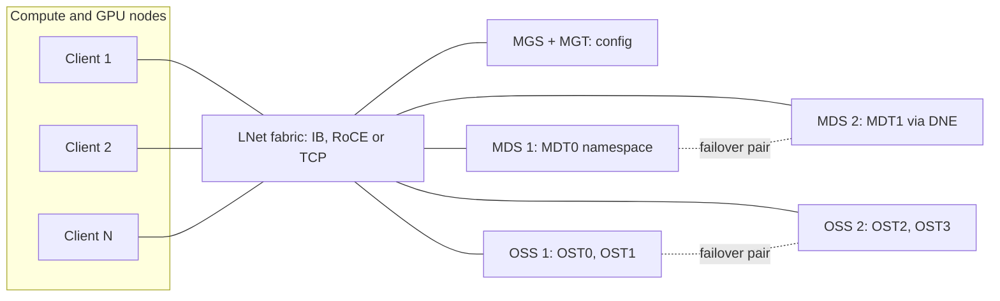
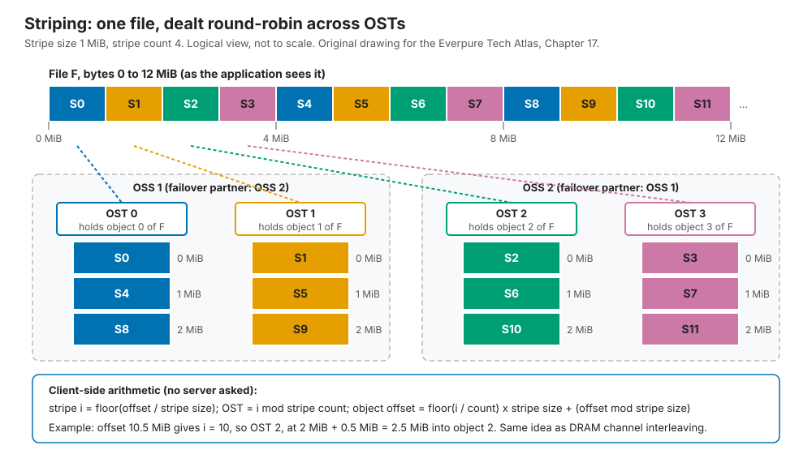
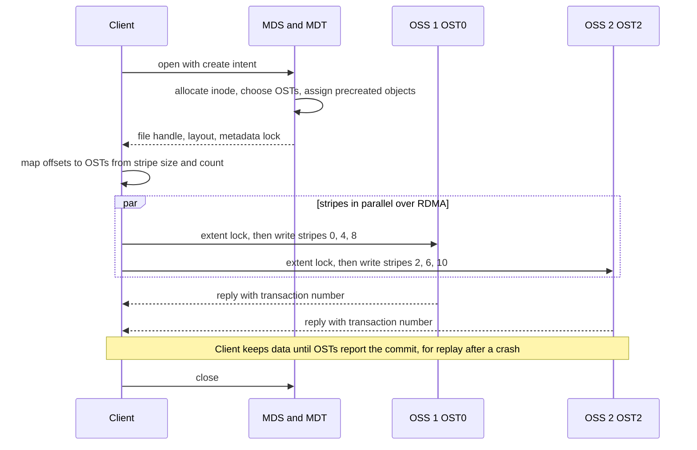
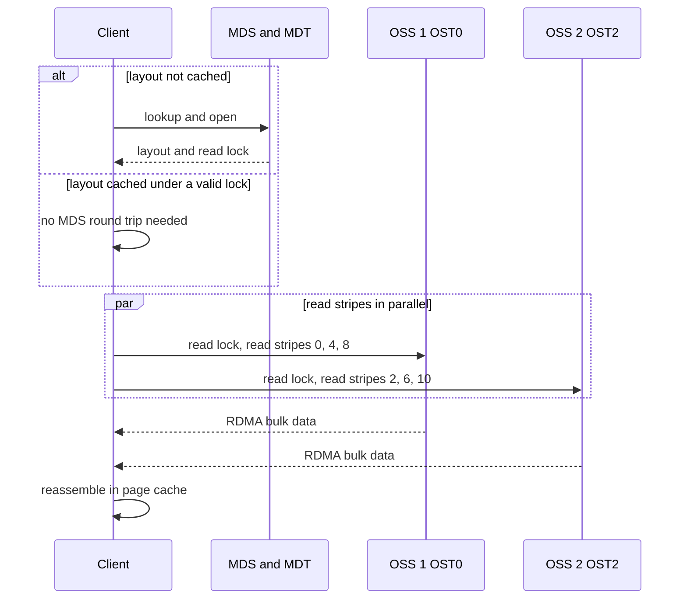
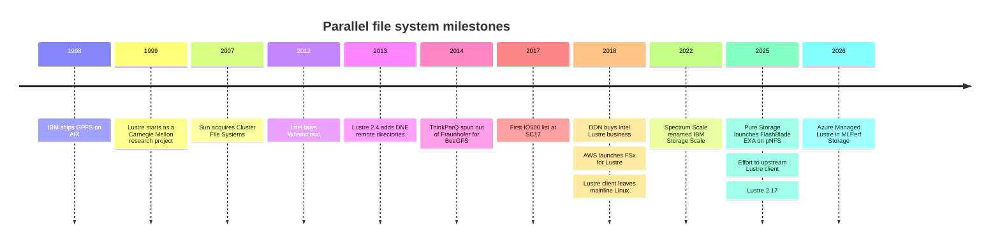

# 17. Parallel and distributed file systems

> **Depth:** L2 · **Reading time:** ~8 min · **Last verified:** 2026-11-01
> **Prerequisites:** [File protocols](../02-protocols-and-networking/08-file-protocols.md) · [Scale-out shared-nothing clusters](15-scale-out-shared-nothing.md) · [Disaggregated shared-everything](16-disaggregated-shared-everything.md)

## TL;DR
- **A parallel file system splits "where is it?" from "give me the bytes."** A metadata server (MDS) answers once per file; clients then stripe data directly across many object storage servers (OSSs), so bandwidth scales with OSS count.
- **The client is the smart part.** A kernel module on every compute node does the striping arithmetic, holds distributed locks and speaks native RDMA. That gives Lustre and IBM Storage Scale (GPFS) multi-TB/s, and makes them hard to run.
- **HPC built them and still runs on them.** Lustre is on more than 60% of the Top500[^1]. AI inherited them because early GPU clusters were built by HPC teams for checkpoint-heavy work.
- **The walls are metadata, small files and client management.** One MDS serialises its namespace, and every kernel upgrade waits for a matching client build.
- **The pattern is being rebuilt on standard clients.** pNFS designs such as Everpure's FlashBlade//EXA and Hammerspace keep the metadata/data split but use the Linux NFS client[^3], trading some POSIX coherency for easier operations.

## Why this matters for Everpure strategy
Every large AI storage deal is partly a referendum on the parallel file system. DDN sells Lustre as EXAScaler, IBM sells Storage Scale, and WEKA sells a parallel file system with a user-space client, all with NVIDIA certifications and HPC references. Buyers raised on Lustre judge everything by its bandwidth. Buyers who have *run* Lustre remember evictions, MDS hot spots and client builds.

FlashBlade//EXA copies Lustre's architecture (metadata on one tier, data streamed directly from data nodes) and swaps the proprietary client for pNFS[^3]. Whether that wins depends on which pain matters more to a buyer. [Chapter 8](../02-protocols-and-networking/08-file-protocols.md) covers the pNFS protocol; [Chapter 44](../06-industry-and-competition/44-ddn.md) covers DDN.

## Core concepts

### The components

Lustre is the reference design; the others are variations. It has five parts[^4]:

- **Clients** run a kernel module that presents an ordinary POSIX mount.
- **The MGS** (management server) holds cluster configuration; clients contact it at mount time.
- **The MDS** serves **MDTs** (metadata targets) holding the namespace: directories, inodes, permissions and each file's **layout**, the list of OST objects holding its data.
- **The OSS** serves **OSTs** (object storage targets): local ldiskfs or ZFS file systems on RAID-protected devices, holding file data as objects.
- **LNet** is the network layer: RDMA over InfiniBand or RoCE, or TCP, with routing between fabrics.

*Figure 17.1 — Lustre separates a small metadata tier from a wide data tier, and both sit behind the same RDMA fabric that clients reach directly.*

The ratio is the design: Frontier's Orion file system has 40 metadata servers and 450 storage servers behind a 679 PB namespace[^5], about one to eleven.

### Striping: memory interleaving for files

A layout has two main parameters: **stripe size**, the chunk size (commonly 1 MiB by default), and **stripe count**, how many OSTs the chunks are dealt across (commonly 1)[^6]. Both can be set per file or directory, and Progressive File Layouts (Lustre 2.10) widen the count as a file grows[^7].

*Figure 17.2 — The client computes which OST holds any byte without asking a server, exactly as a memory controller picks a DRAM channel from address bits.*

**Semiconductor bridge.** This is channel interleaving: a memory controller spreads consecutive lines across channels so a stream uses all of them. The failure modes match too. Interleave too finely and every access touches every bank; let an access stride align with the pattern and all clients hammer one OST, the "partition camping" GPU programmers know.

**Worked example (why stripe count matters).** Assume each OST sustains 5 GB/s (illustrative). A 405B-parameter checkpoint is about 6.5 TB. As one shared file with stripe count 1, it lands on one OST: 6.5 TB ÷ 5 GB/s ≈ 1,300 s, 22 minutes of idle GPUs. Stripe count 64 gives 320 GB/s and about 20 s. Wider is not free: every client then holds locks on every OST, and one slow OST stalls the write. Hence checkpoint libraries usually write one file per rank.

### Tracing a write

*Figure 17.3 — The MDS is touched at open and close; the bytes flow straight from client to many OSSs at once.*

OSTs grant byte-range **extent locks** through Lustre's distributed lock manager, so clients writing different ranges of one file proceed in parallel and stay coherent. That POSIX coherency for shared-file writes is what the kernel module buys; NFS's close-to-open model is weaker ([Chapter 8](../02-protocols-and-networking/08-file-protocols.md)).

### Tracing a read

*Figure 17.4 — With the layout cached, a read never touches the metadata server, which is why large sequential reads scale almost linearly with OSS count.*

**Semiconductor bridge.** The MDS is the directory or tag lookup before the data access; the cached layout is a TLB entry, and a lock callback is a TLB shootdown.

### Failure handling

| Failure | What happens | Blast radius / cost |
|---|---|---|
| Drive | RAID or ZFS under the OST rebuilds locally. Lustre itself does not see it. | Degraded OST bandwidth during rebuild; one slow OST slows every file striped over it. |
| OSS server | Its partner in the failover pair mounts the OSTs from shared, dual-ported storage. Clients reconnect and replay uncommitted requests[^8]. | I/O to those OSTs pauses for the recovery window, typically minutes. Pairs need shared enclosures and fencing. |
| MDS | Same pattern, with a standby or a DNE peer taking over the MDT. | Namespace operations stall cluster-wide while it recovers. |
| Client or its link | If a client misses a lock callback before the timer expires, the server **evicts** it and reclaims its locks[^9]. | Dirty data in that client's cache is lost, and applications see I/O errors. This is the most common operational complaint. |
| Whole OST lost | Data striped over it is gone unless the file was mirrored. File Level Redundancy has existed since Lustre 2.11, but it is opt-in[^7]. | Protection is per-server, not cross-server erasure coding as in [shared-nothing systems](15-scale-out-shared-nothing.md). |

*Table 17.1 — Classic Lustre protects data inside each server pair and relies on fast failover. The client, not the hardware, is the weakest link in daily operation.*

### Where it hits walls

1. **Metadata serialisation.** One MDT handles every create, open and stat in its part of the namespace. Distributed Namespace (DNE) added remote directories in 2.4 and directories striped across MDTs in 2.8[^7], yet ORNL still found shared-directory workloads bottlenecked on one MDT[^10]. Scaling holds only if the workload spreads out.
2. **Small files.** **Worked example:** a billion 100 KB images is 100 TB, which takes 100 s to read at 1 TB/s. At an illustrative 50,000 opens/s per MDT [VERIFY: representative per-MDT open rate on current hardware], the opens take 20,000 s (5.6 hours), 200 times longer. Data-on-MDT (2.11) keeps tiny files on the MDT to save a round trip[^7]. AI training looks exactly like this ([Chapter 21](21-metadata.md)).
3. **Client software management.** The client left mainline Linux in 2018; a 2025 effort aims to upstream it again[^11]. Until then every kernel or GPU-driver update waits for a matching client build.
4. **Kernel dependence and tenancy.** A kernel module on thousands of GPU nodes is a security and change-control burden neoclouds dislike, and multi-tenancy came late: Lustre 2.17 (December 2025) headlined dynamic nodemaps[^12].

### Pros, cons and fit

| | Strength | Weakness |
|---|---|---|
| Bandwidth | Near-linear with OSS count; RDMA end to end | Sensitive to stripe settings and to the slowest OST |
| Semantics | Full POSIX, coherent shared-file writes | Locks require eviction to resolve dead clients |
| Metadata | Simple and fast per MDT | Serialisation point; DNE needs workload cooperation |
| Cost | Open source (Lustre) on commodity or appliance hardware | Specialist staff; pair-wise HA hardware; little data reduction |
| Operations | Mature tooling, 25 years of HPC experience | Kernel client lifecycle; tuning is a craft |

*Table 17.2 — Parallel file systems trade operational simplicity for raw, coherent bandwidth.*

**Best fit:** large-file streaming (simulation output, checkpoints, video), many ranks writing one file, sites with an HPC operations team. **Worst fit:** billions of tiny files, multi-tenant clouds with mixed kernels, enterprise shares needing SMB, snapshots and data reduction, and small clusters where fixed MDS and failover-pair costs dominate.

### Why HPC built them and AI inherited them

Late-1990s simulations on thousands of nodes needed to dump memory simultaneously, and NFS's single head could not keep up. Lustre began as a Carnegie Mellon research project in 1999[^1]; IBM's GPFS shipped in 1998[^13]. Both pushed striping and locking into the client. The IO500 list, started at SC17, ranks systems by a geometric mean of bandwidth and metadata scores[^14]; Lustre accounts for nearly half its entries [VERIFY: search-summary only][^2].

Early AI training looked like HPC: synchronous jobs, giant checkpoints, InfiniBand, lab-trained buyers. So NVIDIA reference architectures and the clouds adopted parallel file systems: AWS launched FSx for Lustre in 2018[^15], Google's Managed Lustre runs DDN EXAScaler[^16], and Azure Managed Lustre entered MLPerf Storage in 2026[^17]. AI also brought what HPC tolerated badly: billions of small files, churning inference fleets and tenants who refuse kernel modules. WEKA, VAST and pNFS designs compete in that gap.

### Cost and operational implications

Lustre is free; expertise is not. Sites pay for appliance support (DDN, HPE) or a managed cloud service, buy paired servers on shared enclosures, accept RAID overhead (20% for 8+2) with little data reduction, and absorb hidden costs: GPU time lost to evictions and MDS stalls, and staff time tuning stripes.

## How Everpure approaches it vs. competitors

| System | Metadata design | Client / data path | Protection | AI positioning |
|---|---|---|---|---|
| Lustre / DDN EXAScaler | MDS/MDT, scaled by DNE | Kernel client, LNet RDMA | RAID under OSTs, failover pairs | AI400X-series appliances; Google Cloud Managed Lustre[^18][^16] |
| IBM Storage Scale (GPFS) | Distributed: any node can manage metadata, with token-based locking | Kernel client; shared-disk (NSD) or shared-nothing | RAID or erasure coding | NVIDIA-certified "AI Data Platform" (6.0.1, June 2026)[^13][^19] |
| BeeGFS (ThinkParQ) | Separate metadata services, namespace split by directory | Kernel client | Buddy mirroring of targets | v8.2 (Nov 2025) added background rebalancing[^20] |
| WEKA NeuralMesh | Metadata sharded into "buckets" across all nodes, with no dedicated MDS | User-space client, DPDK kernel bypass | Distributed erasure coding | Converged and cloud modes; KV-cache extension[^21][^22] |
| Hammerspace | Anvil metadata servers | pNFS Flex Files, stock Linux client | Delegated to underlying NFS storage | Parallel NFS co-developed for Meta's GenAI clusters[^23] |
| Everpure FlashBlade//EXA | FlashBlade metadata core running Purity | pNFS: metadata over NFSv4.1/TCP, data over NFSv3/RDMA to data nodes; stock client | Data-node scheme maturing [VERIFY: current data-node protection] | MLPerf Storage v3.0 checkpoint result[^3][^17] |

*Table 17.3 — Every design keeps the metadata/data split. They differ in where metadata lives, how heavy the client is, and who protects the data.*

**Is FlashBlade//EXA a parallel file system?** Architecturally, yes: the metadata core plays the MDS role, data nodes play the OSS role, and clients move bytes directly to data nodes[^3]. Two differences are deliberate. Metadata runs on Purity across a scale-out blade cluster rather than a single MDT, aimed at Lustre's main wall, and the client is stock Linux NFS. In MLPerf Storage v3.0, 30 EXA data nodes posted 877.5 GiB/s of checkpoint writes against Azure Managed Lustre's 642.2 GiB/s, on different configurations [VERIFY: figures read from chart captions][^17].

**Steelman the incumbents.** Lustre and Storage Scale give coherent shared-file writes that NFS does not, with decades of exascale references; Lustre's open-source license appeals to sovereign and lab buyers; WEKA sidesteps the MDS bottleneck by sharding metadata across every node. Options a strategy team might evaluate, based on public information: target HPC-heritage AI buyers whose main pain is client management and metadata; publish IO500-style metadata results alongside bandwidth; and address shared-file-write semantics early, before they become a late-stage objection.

## History and trajectory

*Figure 17.5 — Lustre survived four corporate owners. Its future now rests on cloud managed services and DDN, while standard-client designs attack it from below.*

Lustre has had four corporate homes: Cluster File Systems, Sun, Intel and DDN[^24][^25][^26]. In 2020 it ran 77 of the top 100 systems, with Spectrum Scale on 23[^27]. Going forward, clouds absorb the operational burden, upstreaming may end the kernel-module tax, and pNFS rebuilds the architecture on standard clients.

## Numbers that matter

| Metric | Value | Context | Source / date |
|---|---|---|---|
| Lustre share of Top500 | >60% of top 500; >65% of top 100 | ACM Transactions on Storage | ORNL et al., 2025-06[^1] |
| Orion (Frontier) namespace | 679 PB; 40 MDS vs 450 storage servers | Capacity tier 5.5 TB/s read; NVMe tier ~10 TB/s | OLCF[^5] |
| Default stripe size / count | 1 MiB / 1 | Common site default; tuned per directory | HPE, Lustre wiki[^6] |
| Single-OST vs 64-OST checkpoint | ~22 min vs ~20 s | 6.5 TB at 5 GB/s per OST (illustrative) | Worked example |
| Metadata vs data time, 1B small files | ~5.6 h vs 100 s | 50k opens/s per MDT (illustrative); 1 TB/s | Worked example |
| EXA checkpoint write, MLPerf v3.0 | 877.5 GiB/s | 30 data nodes; Azure Managed Lustre 642.2 GiB/s | StorageReview, 2026-09[^17] |
| Lustre on top 100 (2020) | 77 systems; Spectrum Scale 23 | HPE analysis | HPE, 2020-11[^27] |

## Conversation playbook
**Questions for a PM**

1. *"When a Lustre shop evaluates EXA, what is the first objection?"* Strong: names shared-file writes or POSIX locking, lists workloads where close-to-open is safe (per-rank checkpoints, read-mostly datasets), and cites a reference customer.
2. *"Do buyers value metadata rate or bandwidth more?"* Strong: gives EXA creates and opens per second at a stated size next to the bandwidth figure, tied to a billion-file dataset.
3. *"How do we beat Google or Azure Managed Lustre for cloud-adjacent buyers?"* Strong: covers data gravity, egress, price per TB/s and an as-a-service option.

**Questions for an engineer**

1. *"What is EXA's equivalent of a Lustre eviction? What does a client see if it hangs mid-write?"* Strong: layout recall, lease expiry, recovery time, fate of in-flight writes.
2. *"Does one hot directory scale across the metadata core?"* Strong: says whether a single directory spans blades, unlike Lustre's single-MDT limit.
3. *"Who sets stripe width, and can a bad user setting hurt neighbours?"* Strong: server-chosen layouts versus Lustre-style user tuning.

**Don't say this:**

- "Lustre is legacy." It runs most of the largest systems, and three hyperscalers sell it as a managed service.
- "Parallel file systems can't scale metadata." DNE, GPFS and WEKA distribute it; the question is how evenly the workload spreads.
- "pNFS is Lustre with NFS." It drops the kernel module but also Lustre's coherent shared-file locking.
- "Wider striping is always faster." It multiplies locks and makes the slowest OST everyone's problem.
- "GPFS is IBM's Lustre." GPFS has no dedicated metadata server; it uses distributed tokens on a shared-disk heritage.

## Going deeper (optional, L3 pointers)
- George et al., "Lustre Unveiled," ACM Transactions on Storage, 2025[^1]; ORNL, *Understanding Lustre Internals*, 2nd ed.[^4]
- Schmuck and Haskin, "GPFS: A Shared-Disk File System for Large Computing Clusters," FAST 2002[^13].
- Lustre's LDLM lock manager, imperative recovery and Progressive File Layouts; IOR and mdtest, the IO500 tools.

## Key terms
- **MDS / MDT** — metadata server and its target holding namespace and layouts.
- **OSS / OST** — object storage server and its targets holding file data.
- **MGS** — Lustre's configuration server.
- **LNet** — Lustre's RDMA-capable network layer.
- **Stripe size / count** — chunk size; number of OSTs a file spans.
- **DNE** — namespace spread across several MDTs.
- **Client eviction** — a server dropping an unresponsive client's locks.
- See the [glossary](../glossary.md) for the rest.

## Sources

[^1]: R. S. George, A. Dilger et al. (ORNL and others), "Lustre Unveiled: Evolution, Design, Advancements, and Current Trends," *ACM Transactions on Storage* 21(3), 2025-06. DOI 10.1145/3736583. https://www.ornl.gov/publication/lustre-unveiled-evolution-design-advancements-and-current-trends (retrieved 2026-11-01).
[^2]: SC25 Birds-of-a-Feather, "Lustre community BoF" abstract (OpenSFS), 2025-11. https://sc25.supercomputing.org/proceedings/bof/bof_pages/bof197.html (retrieved 2026-11-01; seen via search summary only).
[^3]: Everpure, "Technical Brief: FlashBlade//EXA," n.d. (2025). https://www.everpuredata.com/content/dam/pdf/en/technical-briefs/tb-flashblade-exa.pdf (retrieved 2026-11-01); Blocks & Files, "How Pure Storage developed its disaggregated FlashBlade//EXA system," 2025-04-17. https://blocksandfiles.com/2025/04/17/how-pure-storage-developed-its-disaggregated-flashblade-exa-system/ (retrieved 2026-11-01).
[^4]: Oak Ridge National Laboratory, "Understanding Lustre Internals, Second Edition" (covers Lustre 2.15), n.d. https://www.ornl.gov/publication/understanding-lustre-internals-second-edition (retrieved 2026-11-01); Lustre Wiki, "Lustre Architecture for Admins," n.d. https://wiki.lustre.org/index.php?oldid=5478&title=Lustre_Architecture_for_Admins (retrieved 2026-11-01).
[^5]: Oak Ridge Leadership Computing Facility, "Frontier User Guide" (Orion file system), n.d. https://docs.olcf.ornl.gov/systems/frontier_user_guide.html (retrieved 2026-11-01); S. Brim (ORNL), "Deep dive," ATPESC 2023 Track 7, 2023-08. https://extremecomputingtraining.anl.gov/wp-content/uploads/sites/96/2023/08/ATPESC-2023-Track-7-Talk-4-Brim-deep-dive.pdf (retrieved 2026-11-01).
[^6]: HPE, "Configure Striping on Lustre File Systems," n.d. https://www.hpe.com/psnow/resources/ebooks/a00113982en_us_v2/Configure_Striping_on_Lustre_File_Systems.html (retrieved 2026-11-01); Lustre Wiki, "Understanding Lustre Internals," n.d. https://wiki.lustre.org/index.php?diff=4077&oldid=4072&title=Understanding_Lustre_Internals (retrieved 2026-11-01).
[^7]: A. Dilger, "Lustre 2.8 and Beyond," OpenSFS LUG, 2015-04. https://www.opensfs.org/wp-content/uploads/2015/04/Lustre-2.8-and-Beyond_Dilger.pdf; A. Dilger, "Lustre 2.11 and Beyond," LUG 2017, 2017-06. https://opensfs.org/wp-content/uploads/2017/06/Thur05-DilgerAndreas-LUG2017-Lustre202.1120and20Beyond-FINAL.pdf (both retrieved 2026-11-01).
[^8]: Lustre Wiki, "Lustre Recovery Overview," n.d. https://wiki.lustre.org/Lustre_Recovery_Overview (retrieved 2026-11-01).
[^9]: Lustre Wiki, "Lustre Client Eviction Guide," n.d. https://wiki.lustre.org/Lustre_Client_Eviction_Guide (retrieved 2026-11-01); Lustre Wiki, "Lustre Resiliency: Understanding Lustre Message Loss and Tuning for Resiliency," n.d. https://wiki.lustre.org/Lustre_Resiliency:_Understanding_Lustre_Message_Loss_and_Tuning_for_Resiliency (retrieved 2026-11-01).
[^10]: J. Simmons et al. (ORNL), "Evaluation of DoM and DNE scaling," OpenSFS, 2021-05. https://www.opensfs.org/wp-content/uploads/Evaluation-of-DoM-SNE-scaling_Simmons_revised051821.pdf (retrieved 2026-11-01).
[^11]: The Register, "Linux 4.18-rc1 removes Lustre filesystem," 2018-06-18. https://www.theregister.com/2018/06/18/linux_4_18_rc_1_removes_lustre_filesystem/ (retrieved 2026-11-01); J. Edge, LWN.net, "Getting Lustre upstream," 2025-06-18. https://lwn.net/Articles/1025268 (retrieved 2026-11-01).
[^12]: Lustre.org, "Lustre 2.17.0 released," 2025-12. https://www.lustre.org/?p=777 (retrieved 2026-11-01).
[^13]: F. Schmuck and R. Haskin (IBM Almaden), "GPFS: A Shared-Disk File System for Large Computing Clusters," USENIX FAST 2002. https://www.usenix.org/legacy/events/fast02/full_papers/schmuck/schmuck.pdf (retrieved 2026-11-01); IBM, "Storage Scale 101: Basics and architecture," 2025. https://www.ibm.com/support/pages/system/files/inline-files/Storage%20Scale%20101%20-%20Basics%20and%20architecture%20(1).pdf (retrieved 2026-11-01).
[^14]: S. Ihara (DDN), "IO500 update," LAD 2023, 2023-10. https://www.eofs.eu/wp-content/uploads/2024/02/07-LAD2023-ShuichiIhara-1005-1.pdf (retrieved 2026-11-01); LANL et al., "IO-500 proposal," ISC 2017 BoF, 2017-06. https://www.vi4io.org/_media/17-isc-bof-io-500-proposal.pdf (retrieved 2026-11-01).
[^15]: AWS, "Introducing Amazon FSx for Lustre," 2018-11-28. https://aws.amazon.com/about-aws/whats-new/2018/11/amazon-fsx-lustre/ (retrieved 2026-11-01).
[^16]: DDN via Business Wire, "DDN Announces Collaboration with Google Cloud to Advance AI Initiatives with Google Cloud Managed Lustre and Infinia at Google Cloud Next 2025," 2025-04-09. https://www.businesswire.com/news/home/20250409046523/en/ (retrieved 2026-11-01).
[^17]: StorageReview, "MLPerf Storage v3.0: 877 GiB/s Checkpoints, a Cloud First, and a Leaderboard Turned Over," 2026-09. https://www.storagereview.com/news/mlperf-storage-v3-0-877-gib-s-checkpoints-a-cloud-first-and-a-leaderboard-turned-over (retrieved 2026-11-01); HPCwire, "Everpure Leads MLPerf Storage Tests for Large Model Checkpointing and KV Cache," 2026-09-02. https://hpcwire.com/off-the-wire/everpure-leads-mlperf-storage-tests-for-large-model-checkpointing-and-kv-cache (retrieved 2026-11-01).
[^18]: DDN, "DDN Boosts AI Storage Leadership with EXAScaler 6," n.d. https://www.ddn.com/press-releases/ddn-boosts-ai-leadership-with-exascaler-6 (retrieved 2026-11-01); DDN, "DDN launches AI400X3 and Infinia 2.1 at ISC 2025," 2025-06. https://www.ddn.com/blog/ddn-launches-ai400x3-and-infinia-2.1-at-isc-2025/ (retrieved 2026-11-01).
[^19]: IBM Community, "Introducing IBM Storage Scale 6.0.1 and Storage Scale System 7.0.1: An AI-Ready Data Platform," 2026-06-08. https://community.ibm.com/community/user/blogs/mike-kieran/2026/06/08/introducing-ibm-storage-scale-601-and-storage-scal (retrieved 2026-11-01).
[^20]: ThinkParQ, "ThinkParQ launches BeeGFS 8.2," 2025-11-12. https://thinkparq.com/wp-content/uploads/2025/11/ThinkParQ-launches-BeeGFS-8.2-.pdf (retrieved 2026-11-01).
[^21]: WEKA, "The WEKA Data Platform" (architecture white paper), n.d. https://weka.io/?p=39534 (retrieved 2026-11-01); WEKA, "Networking in WEKA" (docs v5.0), n.d. https://docs.weka.io/5.0/weka-system-overview/networking-in-wekaio (retrieved 2026-11-01).
[^22]: WEKA, "WEKA Introduces NeuralMesh," 2025-06-17. https://www.weka.io/company/weka-newsroom/press-releases/weka-introduces-neuralmesh/ (retrieved 2026-11-01).
[^23]: Hammerspace, "Hyperscale NAS," n.d. https://hammerspace.com/hyperscale-nas/ (retrieved 2026-11-01); Meta Engineering, "Building Meta's GenAI Infrastructure," 2024-03-12. https://engineering.fb.com/2024/03/12/data-center-engineering/building-metas-genai-infrastructure/ (retrieved 2026-11-01).
[^24]: InfoWorld, "Oracle to continue supporting Lustre" (Lustre acquired with Sun; Sun bought Cluster File Systems in 2007), 2010. https://www.infoworld.com/article/2624999/oracle-to-continue-supporting-lustre.html (retrieved 2026-11-01).
[^25]: The Register, "Intel buys Whamcloud," 2012-07-16. https://www.theregister.com/2012/07/16/intel_buys_whamcloud/ (retrieved 2026-11-01).
[^26]: TOP500.org, "DDN Acquires Lustre Business from Intel," 2018-06. https://www.top500.org/news/ddn-acquires-lustre-business-from-intel/ (retrieved 2026-11-01).
[^27]: HPE Community, "It's lonely at the top: Lustre continues to dominate top 100," 2020-11. https://community.hpe.com/t5/servers-systems-the-right/it-s-lonely-at-the-top-lustre-continues-to-dominate-top-100/ba-p/7109668 (retrieved 2026-11-01).
