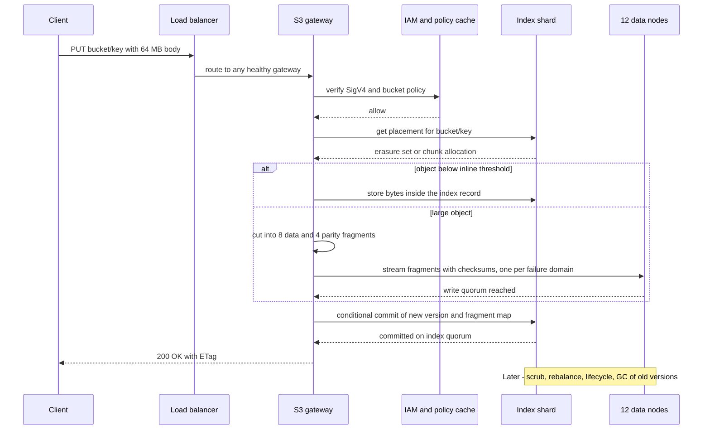
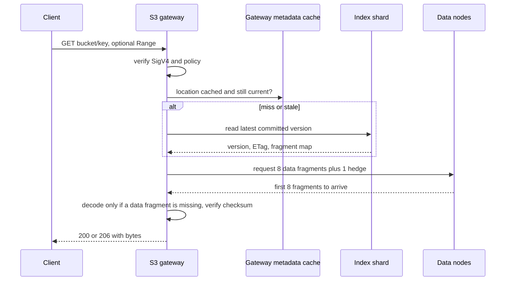
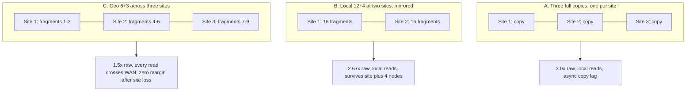
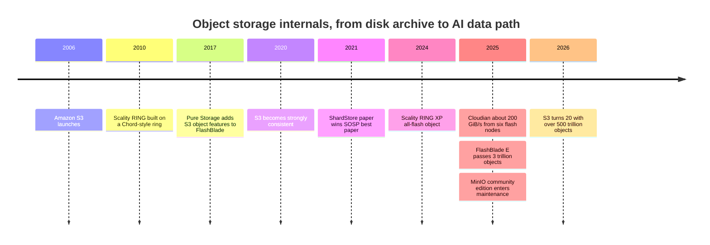

# 18. Object storage architecture

> **Depth:** L2 · **Reading time:** ~7 min · **Last verified:** 2026-11-01
> **Prerequisites:** [Object storage and S3](../02-protocols-and-networking/09-object-storage-and-s3.md) · [Data protection and resilience](../01-storage-fundamentals/06-data-protection-and-resilience.md) · [Scale-out shared-nothing clusters](15-scale-out-shared-nothing.md)

## TL;DR

- **An object store is three planes.** Stateless S3 gateways handle requests. An index maps each key to its fragments. Data nodes hold erasure-coded fragments. Background services (rebuild, scrubbing, lifecycle) run constantly behind them.
- **The index decides most outcomes.** Systems either keep a sharded metadata database (Cassandra, RocksDB, a distributed key-value store) or compute placement by hashing the key and store metadata next to the data (MinIO). The first makes LIST cheap. The second removes the database as a bottleneck but makes LIST a fan-out across the cluster.
- **Erasure coding across sites is the capacity lever.** 6+3 across three sites stores 1.5× raw, versus 2–3× for replication, and still survives a site loss. The price is WAN traffic on every read and a rebuild measured in days.
- **The scaling walls are object count, small objects and tail latency.** Disks, by contrast, are rarely the limit.
- **Object storage is moving from cheap-and-deep to fast.** All-flash object (FlashBlade, VAST, MinIO and Cloudian on NVMe, Scality RING XP, Dell ObjectScale XF960) now competes for AI data paths, so a design's metadata engine matters more than its $/TB.

## Why this matters for Everpure strategy

[Chapter 9](../02-protocols-and-networking/09-object-storage-and-s3.md) showed that S3 has become the default AI data interface. Behind the API, systems differ sharply. A fast S3 endpoint over a slow index still lists a billion keys slowly, and an HDD-era design with a flash front end still stalls on 4 KB objects. When an AI buyer compares FlashBlade with MinIO AIStor on NVMe, Cloudian HyperStore or Dell ObjectScale, the questions that decide the deal concern the internals: how many objects one bucket holds, what LIST costs, what a small PUT costs, and what happens when a node dies.

Pure Storage built FlashBlade as all-flash file and object when object storage still meant disk archives. The market has now caught up. The strategic question is whether FlashBlade's metadata engine stays a differentiator now that every competitor also ships object storage on flash.

## Core concepts

### The idea in one picture

*Figure 18.1 — Gateways, index and data nodes scale independently: gateways for request rate, the index for object count and LIST, data nodes for capacity and bandwidth.*

- **Front end.** Gateways terminate HTTPS, verify SigV4 and policy, choose placement, and do erasure coding. They hold no durable state, so a load balancer can send any request to any gateway.
- **Index.** This is a replicated, sharded table keyed by bucket + key + version. It records size, ETag, tags and the fragment map. It is sorted, so LIST is a range scan.
- **Data nodes.** These are servers full of drives. Each runs a local engine that maps fragments to disk extents. At AWS this engine is **ShardStore**, a key-value store written in roughly 40,000 lines of Rust and validated with "lightweight formal methods"[^1]. It is LSM-tree-based but keeps shard data outside the tree to limit write amplification[^2].

AWS has not published S3's index design, but the scale it must serve is public: over 500 trillion objects and over 200 million requests per second as of March 2026[^3].

### Where metadata lives: a database or a hash

Two families exist:

1. **Separate metadata database.** Cloudian HyperStore keeps object metadata in Cassandra, and stores small objects there too[^4]. NetApp StorageGRID keeps metadata in Cassandra with three copies per site[^5]. Ceph RGW keeps each bucket's index in RocksDB-backed omap entries, sharded and resharded automatically above 100,000 objects per shard[^6][^7]. FlashBlade runs a distributed key-value database across its blades[^8].
2. **Computed placement, metadata beside data.** MinIO hashes the full object name to pick one **erasure set** of 2–16 drives. The same object always maps to the same set, and there is no metadata database[^9][^10]. Objects under about 128 KiB are stored inline in the metadata file[^11]. Scality RING similarly places keys on a Chord-style ring[^12]. Ceph's own data layer, CRUSH, belongs here too ([Chapter 15](15-scale-out-shared-nothing.md)).

**Semiconductor bridge: page table versus set-associative cache.** An index database is a page table, and the gateway's metadata cache is its TLB. A lookup is flexible, so data can live anywhere and move freely, but each miss costs a walk. Hash placement is a set-associative cache: bits of the address choose the set and no table is consulted. The trade-off is the same as in a cache. You cannot enumerate a cache in address order. That is why LIST on a hash-placed store fans out to every erasure set and merge-sorts the replies.

### ★ Tracing a PUT

*Figure 18.2 — Data becomes durable first and visible second: the index commit is the single point where a new version appears to every reader.*

**Worked example (write amplification).** A 64 MB PUT with 8+4 coding writes 12 fragments of 8 MB, which is 96 MB or 1.5×. The gateway's NIC carries 64 MB in and 96 MB out, so gateways need about 2.5× the client bandwidth in NIC capacity. Now take a 4 KB object with the same code. Each fragment would be 512 B, but drives write whole sectors, so it is padded to 4 KiB: 48 KiB on disk (12×) and 12 drive writes for one PUT. That is why systems inline small objects in the index (MinIO, Cloudian), or mirror them and erasure-code later once a large chunk fills. Dell ObjectScale triple-mirrors data until its 128 MB chunk is full, then converts to 12+4[^13].

### ★ Tracing a GET

*Figure 18.3 — A GET waits for the slowest of k fragment reads, so tail latency comes from the wide stripe, not the average drive.*

**Worked example (tail latency).** Suppose each node has a 1% chance of a 100 ms stall. Waiting for 8 specific fragments means 1 − 0.99⁸ ≈ 7.7% of GETs stall. If the gateway asks 9 nodes and uses the first 8, a GET stalls only when two nodes are slow at once: 1 − (0.99⁹ + 9 × 0.01 × 0.99⁸) ≈ 0.34%. Hedged reads trade 12% more back-end reads for a 20× better tail. The analogy is a wide DRAM access that waits on the slowest bank.

### Erasure coding across nodes and sites

**Semiconductor bridge: chipkill.** Server ECC spreads each codeword's symbols across DRAM chips, so losing a whole chip is correctable. An object store spreads each stripe across nodes, racks or sites, so losing a whole failure domain is correctable. The wider the spread, the cheaper the protection and the more expensive each reconstruction.

*Figure 18.4 — Geo-dispersed erasure coding halves raw capacity against replication but puts the WAN on every read and every rebuild.*

| 10 PB usable | Raw capacity | Survives site loss? | Normal GET | Rebuild after a site loss |
|---|---|---|---|---|
| A. 3 copies, 3 sites | 30 PB | Yes, with 2 copies left | Local | Re-copy 10 PB |
| B. 12+4 per site, 2 sites | 26.7 PB | Yes, plus 4 node losses | Local | Re-copy 10 PB from one site |
| C. 6+3 across 3 sites | 15 PB | Yes, with zero remaining margin | ≥3 of 6 fragments over WAN | Read 10 PB over WAN to rebuild 5 PB |

*Table 18.1 — Worked example: geo-EC saves 15 PB of raw capacity per 10 PB usable but leaves the system unprotected during a multi-day rebuild.*

NetApp's StorageGRID documents the 1.5× figure for 6+3 across three sites. It requires a pool of at least three sites, and it advises against multi-site pools above 100 ms of inter-site latency[^14][^15]. Rebuilding one site's fragments pulls twice the lost data over the WAN[^16]. In case C, 5 PB lost means 10 PB moved: at 100 Gb/s (12.5 GB/s) that takes 800,000 s, about **9.3 days**. AWS spreads S3 Standard across at least three Availability Zones in a region, a design target of eleven nines of durability[^17]. Metro-distance zones keep the cross-site latency penalty small.

### How it scales and where it hits walls

1. **Index and LIST.** Object count, not bytes, sets index size. Illustrative assumption: at ~500 bytes per record with 3 replicas, 100 billion objects need ~150 TB of flash just for the index. LIST throughput depends on index design and client parallelism. Pure Storage listed a 67-billion-object FlashBlade bucket in about 43 hours with a parallel Go client[^18]. That is 67e9 ÷ 154,800 s ≈ **433,000 keys/s**, or roughly 433 LIST pages per second. Single-threaded at 20 ms per page, the same job would take ~15.5 days.
2. **Small objects.** They multiply metadata records, drive I/Os and fixed per-request overhead (see the 12× example above).
3. **Hot shards.** Sequential key names (timestamps) concentrate writes on one index range, which is why systems split or reshard. Ceph blocks writes to a bucket briefly while it reshards[^6].
4. **Background debt.** Scrubbing, rebuild, lifecycle expiry and garbage collection share the same drives and network as client traffic.

### Failure handling

| Failure | What happens | Cost |
|---|---|---|
| Drive | Fragments rebuilt from k survivors onto many drives in parallel | Background bandwidth; degraded reads decode on the fly |
| Data node | Its fragments are rebuilt elsewhere; GETs read other fragments meanwhile | Rebuild traffic ≈ k × lost data |
| Gateway | Load balancer drops it; clients retry | In-flight requests retried; no data at risk |
| Index replica | Quorum continues on the remaining replicas | Lose quorum and the shard's keys become unwritable, even though the data is intact |
| Network partition | The minority side cannot commit; quorum rules prevent split-brain | Writes fail on one side, which is CAP in practice ([Ch 20](20-distributed-systems-fundamentals.md)) |
| Site | Replication fails over; geo-EC serves degraded reads | See Table 18.1 |

*Table 18.2 — Data-node failures are routine; losing index quorum is the outage that matters.*

### Pros, cons and fit

| | Strength | Weakness |
|---|---|---|
| Scale | Hundreds of trillions of objects, exabytes, no directory tree to lock | Object count stresses the index; LIST is the slowest operation |
| Efficiency | Wide and geo erasure codes (1.3–1.5×) on commodity servers | Small objects defeat erasure coding and need inlining or packing |
| Resilience | Node and site loss survivable by design | Rebuilds are long and wide; index quorum is a single point of logic |
| Performance | Bandwidth scales with nodes; parallel range GETs | Per-request fixed cost; tail latency from wide stripes |
| Semantics | Immutable whole objects, simple consistency | No in-place updates, no rename, thin metadata |

*Table 18.3 — Object storage trades rich semantics for scale and capacity efficiency.*

**Best fit:** AI datasets packed into large shards, checkpoints, lakehouse tables, backup and archive targets, and media repositories. **Worst fit:** databases and VMs that need in-place writes, millions of tiny files that are renamed often, and POSIX tools that need directory semantics.

### From cheap-and-deep to fast

HDD-era object stores were built around about 100–200 random IOPS per drive. Their designs batch data into large chunks, keep metadata on a small flash slice and accept tens of milliseconds. Flash removes the IOPS-per-TB constraint, so metadata and small objects can share fast media. Three forces make flash affordable for object storage: falling QLC $/TB, AI pipelines reading and writing through S3, and RDMA paths into GPU memory ([Chapter 9](../02-protocols-and-networking/09-object-storage-and-s3.md)). The public signals are vendor-stated and not directly comparable:

- MinIO reported 325 GiB/s of GETs from 32 NVMe nodes[^19].
- Cloudian reported ~200 GiB/s from six flash nodes[^20].
- Scality claims microsecond-level 4 KB latency for RING XP[^21].
- Dell positions the all-flash XF960 for AI[^22].
- A single FlashBlade//E array passed 3 trillion objects[^23].

### Cost and operational implications

Software-defined object storage on dense HDD servers remains the lowest $/TB. Its hidden cost is operational: index clusters to repair and compact, rebalancing, scrub bandwidth and multi-site networking. StorageGRID's per-site metadata capacity is set by its smallest storage node[^5]. Licensing can shift under customers. MinIO's community edition entered maintenance mode in December 2025, which pushed users toward the paid AIStor[^24]. Appliances charge more per TB and remove most of that operational work. See [Chapter 19](19-software-defined-and-hci.md) for the business-model trade-off.

## How Everpure approaches it vs. competitors

| System | Index / metadata | Placement and protection | Media | Public data point |
|---|---|---|---|---|
| Everpure FlashBlade | Distributed key-value metadata across blades, shared with NFS/SMB | NVRAM write staging, then wide N+2 erasure coding across blades[^8][^25] | All-flash (DirectFlash) | 3 T objects on one //E[^23]; 67 B-key LIST in ~43 h[^18] |
| AWS S3 | Not published | ≥3 AZs; ShardStore on each storage node[^1][^17] | Mostly not disclosed | 500 T+ objects, 200 M+ req/s[^3] |
| MinIO AIStor | None; `xl.meta` beside data | Hash to 2–16-drive erasure set[^10] | NVMe or HDD | 325 GiB/s GET, 32 nodes[^19] |
| Cloudian HyperStore | Cassandra; small objects inline[^4] | Replication or EC per policy | HDD and flash | ~35 GiB/s per node claimed[^20] |
| Ceph RGW | Sharded bucket index in RocksDB omap[^7] | RADOS objects of 4 MB; replicated or EC pools[^7] | Any | 100 k objects per index shard[^6] |
| NetApp StorageGRID | Cassandra, 3 copies per site[^5] | ILM rules; 6+3 across 3 sites[^14] | HDD and flash appliances | Geo-EC < 100 ms latency[^14] |
| Dell ObjectScale | Chunk-based store | 128 MB chunks, 12+4 or 10+2[^13] | XF960 all-flash[^22] | ECS heritage |
| Scality RING | Chord-style key ring[^12] | Replication or EC | RING XP all-flash[^21] | µs-level 4 KB latency claimed |

*Table 18.4 — Every vendor now has a flash object story; they differ in where the index lives and how protection crosses failure domains.*

FlashBlade's distinguishing bet is that object metadata is a database problem worth solving in flash and NVRAM, shared with file. An analyst report describes writes mirrored to NVRAM on two other blades before acknowledgement[^8] [VERIFY: current Purity//FB write path]. The steelman for software-defined rivals is that they offer cheaper capacity, geo-dispersed EC across three sites, and servers the customer chooses. FlashBlade's multi-site protection is replication between arrays rather than geo-EC [VERIFY: FlashBlade multi-site object options in 2026]. Options a strategy team might evaluate, based on public information: publish LIST and small-object benchmarks as differentiators, and decide whether all-flash object at archive-like $/TB (FlashBlade//E with DeepReduce) can win deals that MinIO or Ceph win today on HDD.

## History and trajectory

*Figure 18.5 — Object storage spent 15 years optimising for cheap disk; since 2024 the competition has moved to flash, latency and object count.*

Before 2020, S3's own semantics allowed lazy, eventually consistent indexes. Strong consistency ([Chapter 9](../02-protocols-and-networking/09-object-storage-and-s3.md)) made every vendor's index a linearisable database. Pure Storage announced object features for FlashBlade in 2017[^26], and AWS's 2021 ShardStore paper showed that even hyperscalers rebuild the storage-node engine[^1]. Looking ahead, indexes are absorbing tables, vectors and richer metadata ([Chapter 33](../05-ai-storage/33-rag-vector-lakehouse.md)), so the index is becoming the product.

## Numbers that matter

| Metric | Value | Context | Source / date |
|---|---|---|---|
| S3 scale | >500 T objects, >200 M req/s | Hundreds of exabytes | AWS, 2026-03[^3] |
| S3 Standard durability design | 11 nines, ≥3 AZs | Region-level dispersal | AWS docs[^17] |
| ShardStore size | ~40,000 lines of Rust | S3 storage-node engine | SOSP 2021[^1] |
| MinIO erasure set | 2–16 drives; inline < ~128 KiB | Hash placement, no metadata DB | MinIO docs/blog[^10][^11] |
| Ceph RGW reshard trigger | 100,000 objects per index shard | Dynamic resharding | Ceph docs[^6] |
| Geo-EC 6+3 over 3 sites | 1.5× raw; < 100 ms between sites | vs 2× for two-site replication | NetApp docs[^14] |
| FlashBlade LIST | 67 B keys in ~43 h ≈ 433 k keys/s | Parallel client, one bucket | Pure Storage blog[^18] |
| Geo-EC site rebuild | ~9.3 days at 100 Gb/s | 5 PB lost, 10 PB moved | Worked example |
| Hedged read tail | 7.7% → 0.34% stalled GETs | 8 of 9 fragments, 1% node stall | Worked example |

## Conversation playbook

**Questions for a PM**

1. *"What is the largest bucket by object count in production, and what is LIST throughput on it?"* A strong answer gives objects, keys per second and the client parallelism used, and compares those figures with a named competitor.
2. *"Where do we lose object deals to MinIO, Ceph or Cloudian?"* A strong answer names price per TB at multi-PB scale, geo-EC across sites and server choice. It then explains where flash, small-object and LIST performance change the outcome.
3. *"What share of FlashBlade capacity is accessed through S3 rather than NFS?"* A strong answer gives a trend and the workloads behind it (lakehouse, checkpoints, KV cache).

**Questions for an engineer**

1. *"Trace a 4 KB PUT: where do the bytes land, how many drive writes, and when is it erasure-coded?"* Strong: inline or staging path, amplification factor, conversion trigger.
2. *"What happens to LIST and to writes when one index shard gets hot?"* Strong: how the split or reshard works, whether writes block, and how long it takes.
3. *"How is tail latency bounded on a wide stripe?"* Strong: hedged or speculative reads, fragment-size choice, p99 figures by object size.

**Don't say this:**

- "Object storage is cheap and slow." It is increasingly flash-based and feeds GPUs.
- "Erasure coding across sites is free durability." It costs WAN on every read and a multi-day exposed rebuild.
- "Object stores have no metadata bottleneck." The index is the bottleneck; LIST exposes it.
- "MinIO uses a metadata database." It deliberately does not; that is both its strength and its LIST cost.
- "AWS S3 runs on X." Its internals are mostly unpublished; cite ShardStore and stop.

## Going deeper (optional, L3 pointers)

- Bornholt et al., "Using Lightweight Formal Methods to Validate a Key-Value Storage Node in Amazon S3," SOSP 2021[^1]; Andy Warfield's FAST '23 keynote on operating S3.
- MinIO `docs/distributed/DESIGN.md` (erasure sets, SipHash placement); Ceph RGW deep-dive series (bucket index, head/tail objects).
- NetApp StorageGRID ILM and erasure-coding guidance; Dell ObjectScale chunk-store architecture papers.

## Key terms

- **Gateway**, **metadata index**, **erasure set**, **inline object**, **bucket index sharding**, **geo-distributed erasure coding**, **hedged read**, **scrubbing**, **lifecycle policy**, **ShardStore**. Definitions in the [glossary](../glossary.md).

## Sources

[^1]: J. Bornholt et al., "Using Lightweight Formal Methods to Validate a Key-Value Storage Node in Amazon S3," SOSP 2021, 2021-10. https://www.cs.utexas.edu/~bornholt/papers/shardstore-sosp21.pdf ; Amazon Science, "AWS team wins best-paper award for work on automated reasoning," 2021. https://amazon.science/blog/aws-team-wins-best-paper-award-for-work-on-automated-reasoning (both retrieved 2026-11-01).
[^2]: The Stack, "AWS ShardStore and S3," n.d. https://www.thestack.technology/aws-shardstore-s3/ (retrieved 2026-11-01).
[^3]: AWS News Blog, "Twenty years of Amazon S3 and building what's next," 2026-03. https://aws.amazon.com/blogs/aws/twenty-years-of-amazon-s3-and-building-whats-next/ (retrieved 2026-11-01).
[^4]: Evaluator Group (Futurum), "Cloudian HyperStore," product brief, n.d. https://futurumgroup.com/wp-content/uploads/documents/EGPR_Cloudian_HyperStore.pdf (retrieved 2026-11-01).
[^5]: NetApp, "What is a Storage Node?" and "Manage object metadata storage," StorageGRID documentation, n.d. https://docs.netapp.com/us-en/storagegrid/primer/what-storage-node-is.html ; https://docs.netapp.com/us-en/storagegrid-120/admin/managing-object-metadata-storage.html (both retrieved 2026-11-01).
[^6]: Ceph, "RGW Dynamic Bucket Index Resharding," Squid documentation, n.d. https://docs.ceph.com/en/squid/radosgw/dynamicresharding/ (retrieved 2026-11-01).
[^7]: Ceph.io, "Ceph Object Storage Deep Dive Series, Parts 1 and 2," 2025. https://ceph.io/en/news/blog/2025/rgw-deep-dive-1/ ; https://ceph.io/en/news/blog/2025/rgw-deep-dive-2 (both retrieved 2026-11-01).
[^8]: Evaluator Group (Futurum), "Pure Storage FlashBlade," product brief, n.d. (2023). https://futurumgroup.com/wp-content/uploads/documents/EGPR_PureStorage_FlashBlade-6.pdf (retrieved 2026-11-01).
[^9]: MinIO, "Deployment Architecture," documentation, n.d. https://docs.min.io/community/minio-object-store/operations/concepts/architecture.html ; MinIO, "Enterprise architecture," n.d. https://min.io/product/enterprisearchitecture (both retrieved 2026-11-01).
[^10]: MinIO, "Distributed server design guide," GitHub `docs/distributed/DESIGN.md`, n.d. https://github.com/minio/minio/blob/master/docs/distributed/DESIGN.md (retrieved 2026-11-01).
[^11]: MinIO, "Working with Small Objects in AI/ML workloads," n.d. https://www.min.io/blog/minio-optimizes-small-objects (retrieved 2026-11-01).
[^12]: The Register, "Scality RING technology," 2010-11-02. https://www.theregister.com/2010/11/02/scality_ring_technology/ (retrieved 2026-11-01).
[^13]: Dell Technologies Info Hub, "Erasure coding," Dell ObjectScale Overview and Architecture, n.d. https://infohub.delltechnologies.com/en-us/l/dell-objectscale-overview-and-architecture/erasure-coding-7/ (retrieved 2026-11-01).
[^14]: NetApp, "Advantages, disadvantages, and requirements for erasure coding," StorageGRID documentation, n.d. https://docs.netapp.com/us-en/storagegrid/ilm/advantages-disadvantages-and-requirements-for-ec.html (retrieved 2026-11-01).
[^15]: NetApp, "Guidelines for creating storage pools," StorageGRID documentation, n.d. https://docs.netapp.com/us-en/storagegrid/ilm/guidelines-for-creating-storage-pools.html (retrieved 2026-11-01).
[^16]: USPTO, "Restoration of erasure-coded data via data shuttle in distributed storage system," US Patent 9,830,221, n.d. https://image-ppubs.uspto.gov/dirsearch-public/print/downloadPdf/9830221 (retrieved 2026-11-01).
[^17]: AWS, "Data protection in Amazon S3," Amazon S3 User Guide, n.d. https://docs.aws.amazon.com/AmazonS3/latest/userguide/DataDurability.html (retrieved 2026-11-01).
[^18]: Pure Storage (republished by Everpure), "How to List 67 Billion Objects in 1 Bucket," n.d. https://blog.purestorage.com/purely-technical/listing-67-billion-objects-in-1-bucket ; https://blog.everpuredata.com/purely-technical/listing-67-billion-objects-in-1-bucket/ (both retrieved 2026-11-01).
[^19]: MinIO, "Updated NVMe Benchmark: 2.6Tbps+ for READS," n.d. https://www.min.io/blog/nvme-benchmark (retrieved 2026-11-01).
[^20]: Cloudian, "Breakthrough: Cloudian HyperStore Delivers 200GB/s Object Storage Performance for AI Workloads," n.d. (2025). https://cloudian.com/blog/object-storage-performance-for-ai-workloads/ (retrieved 2026-11-01).
[^21]: Scality, "Scality RING XP: the fastest object storage," press release, 2024-10-30. https://www.scality.com/press-releases/scality-ring-xp-fastest-object-storage (retrieved 2026-11-01).
[^22]: Dell Technologies, "Power AI Innovation: All-Flash ObjectScale XF960 with 4.1," 2025. https://www.dell.com/en-us/blog/power-ai-innovation-all-flash-objectscale-xf960-with-4-1/ (retrieved 2026-11-01).
[^23]: Pure Storage, "FlashBlade Surpasses 3 Trillion Objects, Reimagining What's Possible for Scale," n.d. (reported October 2025 [VERIFY: publication date]). https://blog.purestorage.com/products/flashblade-surpasses-3-trillion-pure-storage/ (retrieved 2026-11-01).
[^24]: Linuxiac, "MinIO Ends Active Development, Steers Users Toward Paid AIStor," 2025-12. https://linuxiac.com/minio-ends-active-development/ (retrieved 2026-11-01).
[^25]: StorageNewsletter, "Pure Accelerate Techfest22: Pure Storage FlashBlade//S Platform," 2022-06-10. https://www.storagenewsletter.com/2022/06/10/pure-accelerate-techfest22-pure-storage-flashblade-s-platform/ (retrieved 2026-11-01).
[^26]: ChannelBuzz, "Pure Storage makes multiple object storage announcements around FlashBlades," 2017-06. https://channelbuzz.ca/2017/06/pure-storage-makes-multiple-object-storage-announcements-around-flashblades-21750/ (retrieved 2026-11-01).
