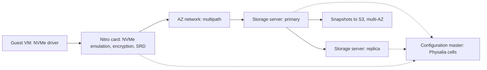
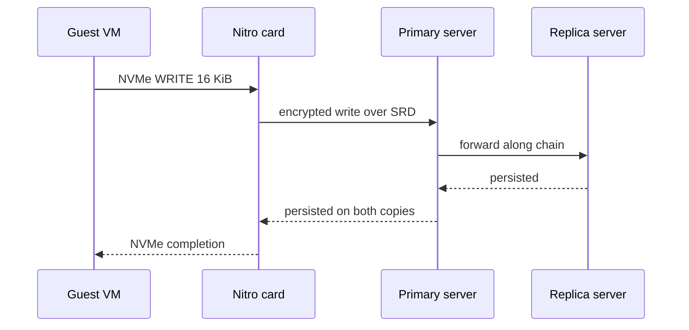
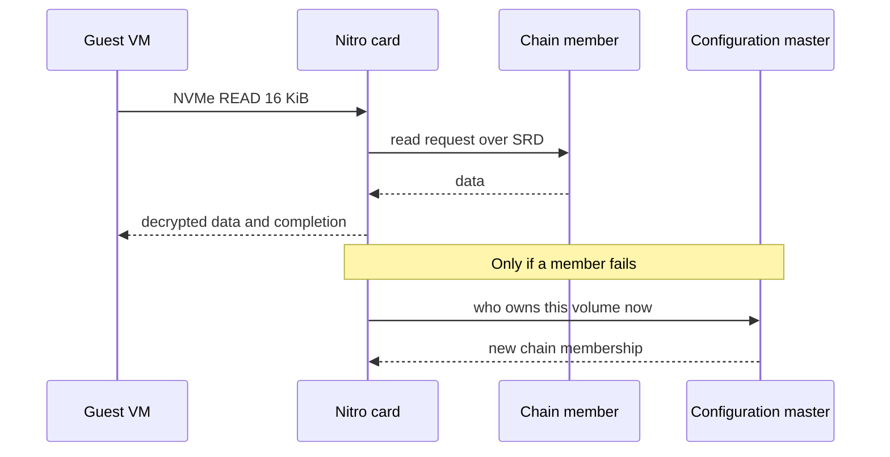
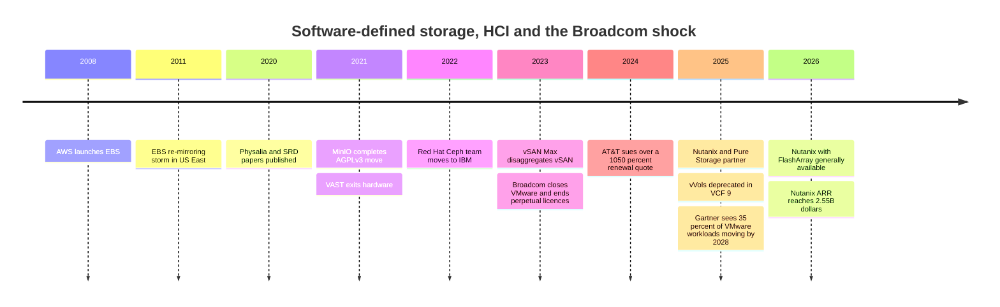

# 19. Software-defined storage and HCI

> **Depth:** L2 · **Reading time:** ~7 min · **Last verified:** 2026-11-01
> **Prerequisites:** [Scale-up dual-controller arrays](14-scale-up-dual-controller.md) · [Scale-out shared-nothing clusters](15-scale-out-shared-nothing.md) · [Block protocols and NVMe-oF](../02-protocols-and-networking/07-block-protocols.md) · [Data protection and resilience](../01-storage-fundamentals/06-data-protection-and-resilience.md)

## TL;DR

- **Software-defined storage (SDS) sells the storage OS without the box** (Ceph, MinIO, VAST, WEKA). **Hyperconverged infrastructure (HCI)** runs it on the same nodes as the VMs (Nutanix, vSAN).
- **HCI's wall is coupled scaling.** Every node adds compute and capacity in a fixed ratio, stranding whatever the estate did not need.
- **Cloud block storage is SDS at hyperscale.** EBS replicates volumes inside one Availability Zone, with a separate configuration service and Nitro-card offload.
- **Broadcom's VMware licensing reset (from December 2023) reopened "HCI vs. array"** and pushed customers toward Nutanix, public cloud and external arrays.
- **Software-only buys margin %, no NAND inventory and fast iteration; appliances buy gross profit per deal and control of the media.**

## Why this matters for Everpure strategy

Everpure (NYSE: P, formerly PSTG) earns most of its revenue from appliances built on its own DirectFlash modules. Yet it already runs every other model here: Portworx (Kubernetes SDS), Purity on cloud instances, and a Meta DirectFlash technology licence with no Everpure hardware[^1].

Broadcom forces the choice: every VMware renewal must stay on vSAN, switch HCI stacks, or split compute from storage. Everpure's May 2025 Nutanix partnership, with FlashArray as external storage for the AHV hypervisor, is a bet on the third[^2].

## Core concepts

### Three ways to package the same software

![Three-column diagram. Appliance: application servers connect over a SAN or NAS network to a vendor-built box containing two controllers running the storage OS and shared vendor-qualified media. Software-defined storage: application servers connect over Ethernet to a pool of commodity servers, each running storage software over its own drives. HCI: no separate storage tier; each node runs VMs and hypervisor, storage software and local drives, linked by a cluster network that carries replica writes. A bottom row explains what scales together in each model.](../assets/diagrams/ch19-hci-sds-appliance.svg)

*Figure 19.1 — The software is similar in all three; what changes is who supplies hardware and what must scale together.*

In the **appliance** model ([Chapter 14](14-scale-up-dual-controller.md)) one vendor designs, qualifies, ships and supports the whole box. **SDS** runs on commodity servers from a **hardware compatibility list (HCL)**, usually as a [shared-nothing cluster](15-scale-out-shared-nothing.md). **HCI** folds storage into the hypervisor cluster: each node gives CPU and memory to a storage service (Nutanix's controller VM, or vSAN inside the ESXi kernel) that replicates each VM's writes to other nodes' drives.

**Semiconductor bridge.** An appliance vendor is an IDM: it owns design and integration, carries inventory and captures integration margin. A software-only vendor is an IP licensor like Arm, collecting a high-margin fee on hardware others build. VAST's "Gemini" model is fabless: VAST specifies the hardware, a manufacturing partner sells it to the customer at cost, and VAST books only software[^3].

### Where HCI hits the wall

**State and metadata.** Data sits on node-local drives (replication factor 2–3, or erasure coding across nodes); metadata is distributed across the cluster. A node is at once compute host, storage target and metadata participant, so losing it touches all three.

**Worked example: stranded resources.** An illustrative node has 64 cores and 8 × 15.36 TB SSDs (123 TB raw, ~61 TB usable at RF2). An estate needs 400 cores and 2 PB usable. Sized for compute, ⌈400 ÷ 64⌉ = 7 nodes give only ~430 TB. Sized for capacity, ⌈2,000 ÷ 61⌉ = 33 nodes give 2,112 cores, 81% idle. Under per-core subscriptions such as VMware Cloud Foundation (VCF), idle cores still need licences; VCF's bundled 1 TiB of vSAN per core[^4] [VERIFY: search-summary only] softens this without fixing it. The fix is un-converging: Nutanix storage-only and compute-only nodes; vSAN Max (2023), a storage-only cluster of up to 8.6 PB that other clusters mount[^5]; or an external array behind HCI compute[^2]. Each concedes HCI's one-building-block promise.

Two more walls follow. **East-west amplification:** at RF2 every write crosses the cluster network again, and rebuilding a failed 123 TB node at ~5 GB/s of spare bandwidth takes 123,000 ÷ 5 ≈ 6.8 hours. **Noisy neighbours:** busy VMs starve the storage service on their own node.

| Failure | HCI (Nutanix / vSAN-style) | EBS-style cloud block |
|---|---|---|
| Drive | Rebuild that drive's data from replicas on other nodes; VMs keep running | Invisible to tenant; storage fleet re-replicates |
| Node | VMs restart elsewhere (hypervisor HA) **and** its data re-replicates; two recoveries at once | Storage server loss: chain reconfigured, new replica re-mirrored; brief I/O pause |
| Storage controller | CVM or kernel module failure: I/O redirected to another node's storage service | Nitro card failure is a host failure; volume can attach to a new instance |
| Network link / partition | Minority side loses quorum; a split cluster can halt writes | Chain cannot complete writes until configuration service picks a new replica set[^6] |

*Table 19.1 — HCI couples application and data recovery on the same nodes; cloud block moves that complexity into a control plane.*

### Inside an EBS-style cloud block service

From AWS's public papers and docs: an EBS volume lives in one Availability Zone, replicated across several servers there[^7]. On Nitro instances the guest sees an ordinary NVMe device[^8], emulated by a Nitro card that turns block commands into network requests. Classic EBS keeps each volume on a **replication chain** (client → primary → replica). A separate **configuration master**, Physalia, records chain membership in a seven-node Paxos "cell" per volume, so one failure cannot strand many volumes' configuration[^6]. The io2 Block Express back end talks to Nitro over **Scalable Reliable Datagram (SRD)**[^9], a multipath transport in the Nitro card that sprays packets across many network paths[^10].

*Figure 19.2 — The configuration master sits off the data path and matters only when a chain changes.*

*Figure 19.3 — A write is acknowledged only after both chain copies persist it; network round trips, not flash, dominate latency.*

*Figure 19.4 — Reads need one copy; the configuration master must survive partitions, when membership changes.*

Block Express internals are public only at a high level, so the read diagram leaves the serving copy generic. AWS rates io2 Block Express at 256,000 IOPS, 4,000 MB/s and 64 TiB per volume, under 500 µs average for 16 KiB I/O, and 99.999% durability[^9]. The fleet-level lesson came in April 2011: a network change cut many volumes off from their replicas, all re-mirrored at once, and the "re-mirroring storm" exhausted the zone's spare capacity[^11]. It is the HCI rebuild problem at cloud scale: rate-limit repair and reserve capacity, or recovery becomes the outage.

### Pros, cons and fit

| | Appliance | SDS on commodity servers | HCI | Cloud block service |
|---|---|---|---|---|
| Strength | Predictable latency; one support owner; media co-design | Hardware choice; scale-out; no vendor box markup | One building block; simple ops for VM estates | No hardware; elastic; API-driven |
| Weakness | Box markup; vendor lock on media | Customer owns integration and HCL drift | Coupled scaling; rebuilds hit apps | Single-AZ volumes; egress and per-IOPS pricing |
| Best fit | Databases, mixed enterprise block, consolidation | Large object and file, AI data lakes, hyperscale | Edge, ROBO, mid-size VM clusters | Elastic cloud apps; dev/test |
| Worst fit | Very small sites; extreme-scale cheap capacity | Small teams without storage skills | Capacity-heavy or GPU-heavy estates | Steady, large, high-IOPS estates (cost) |
| Examples | FlashArray, PowerStore, NetApp AFF | Ceph, MinIO, VAST, WEKA, Portworx | Nutanix, vSAN | EBS, Azure Disk, Pure Storage Cloud Azure Native |

*Table 19.2 — No model dominates; fit depends on how stable the compute-to-capacity ratio is and who owns integration risk.*

### The business-model trade-off

| Dimension | Software-only subscription | Appliance | Cloud service |
|---|---|---|---|
| Gross margin structure | Very high %, on software revenue only (Nutanix non-GAAP 88.0%, FY2026)[^12] | Lower %, on full system revenue (Everpure product 66.2%, subscription 74.9%, Q2 FY27)[^13] | Bundled into the provider's service margin; per-GB-month and per-IOPS pricing |
| Support burden | Highest: any HCL server, firmware and NIC combination can fail | Lowest per system: vendor controls the whole bill of materials | Provider absorbs it; customer sees only the SLA |
| Hardware qualification matrix | Large (servers × drives × NICs × firmware), or narrowed with "ready node" programmes | Small and vendor-owned | Single fleet design per generation |
| NAND / component exposure | Passed to customer or OEM | On the vendor's P&L (Everpure raised prices on 2026-02-09 citing NAND costs)[^14] | On the provider's capex |
| Pricing power | Depends on lock-in: high for VMware (VCF), eroded for open-source-based products | Earned through efficiency (TB/W, data reduction) and lifecycle programmes | Strong for small users; weak against large customers who can repatriate |
| Public examples | Nutanix; VAST Gemini[^3]; WEKA; MinIO AIStor; IBM Storage Ceph | Everpure FlashArray/FlashBlade; Dell; NetApp; DDN appliances | AWS EBS; Pure Storage Cloud Azure Native[^15] |

*Table 19.3 — Software-only maximizes margin percentage and iteration speed; appliances maximize gross profit per deal and media control.*

**Worked example (illustrative split).** On a US$1M system, an appliance vendor books US$1M at 66%: **US$660k gross profit**. A software-only vendor might book US$400k at 88%: **US$352k**, with the OEM taking US$600k of hardware. In exchange it carries no inventory or NAND risk and ships on new CPUs and NICs as soon as OEMs do. Open source caps pricing from below; a free tier that is good enough must be fenced, as MinIO did with AGPLv3 in 2021[^16], a stripped community console in 2025[^17] and maintenance mode in December 2025[^18].

## How Everpure approaches it vs. competitors

Everpure's centre of gravity is the appliance, justified by DirectFlash's density and power advantage over commodity SSDs ([Chapter 26](../04-everpure/26-purity-and-directflash.md)). At the edges it runs software-only motions: Portworx, container-native SDS bought for about US$370M in 2020[^19]; Purity on cloud infrastructure[^15]; off-the-shelf FlashBlade//EXA data nodes ([Chapter 16](16-disaggregated-shared-everything.md)); and the Meta technology licence[^1].

Steelman the alternatives: Nutanix runs ~88% gross margins on US$2.55B ARR growing 16%[^12]; VAST scales on OEM supply chains without inventory[^3]; IBM's 2022 absorption of Red Hat's Ceph team[^20] keeps "free and good enough" alive. The appliance reply: HCL support is costly and AI-era power limits reward co-designed media. Options a strategy team might evaluate, based on public information: more "array behind someone else's HCI" partnerships; DirectFlash licensing as a repeatable IP business; and Portworx against VMware for VMs moving to Kubernetes.

## History and trajectory

*Figure 19.5 — SDS and HCI matured quietly; Broadcom's 2023 licensing reset made platform choice a board-level cost decision.*

EBS dates from 2008[^27]. Broadcom closed VMware on 22 November 2023, then ended perpetual licences and folded thousands of SKUs into two bundles, VCF and vSphere Foundation[^21]. AT&T's 2024 lawsuit cited a proposed 1,050% increase; it later settled[^22]. Much of the base paid: Broadcom reported ~US$27B of FY2025 infrastructure-software revenue and 87% VCF adoption among its top 10,000 customers[^23] [VERIFY: search-summary only].

Storage felt it. Gartner expects over a third of VMware workloads to move by 2028[^24]. Nutanix's FlashArray integration, its first major certified external storage, reached GA around the turn of 2026[^2][^25]. VCF 9 deprecated vVols, the main external-array hook[^26]. The trajectory is un-convergence: split node types, arrays behind HCI, Kubernetes-native SDS for VMs.

## Numbers that matter

| Metric | Value | Context | Source / date |
|---|---|---|---|
| Nutanix ARR / non-GAAP gross margin | US$2.55B (+16%) / 88.0% | FY2026, software-only HCI | Nutanix 8-K, 2026-08-26[^12] |
| Everpure product / subscription GM | 66.2% / 74.9% | Q2 FY27, appliance-centric | Q2 FY27 results, 2026-08[^13] |
| io2 Block Express per-volume max | 256K IOPS, 4,000 MB/s, 64 TiB | <500 µs average for 16 KiB; 99.999% durability | AWS docs[^9] |
| Physalia cell size | 7 nodes per volume | Paxos-replicated configuration | NSDI 2020[^6] |
| EBS daily I/O operations | >140 trillion | Fleet aggregate | AWS (Olson), 2024-08[^27] [VERIFY: search-summary only] |
| AT&T proposed VMware increase | 1,050% | Claim in court filing; settled | CIO Dive, 2024-09[^22] |
| VMware workloads moving by 2028 | >35% | Gartner forecast | The Register, 2025-09-11[^24] |
| HCI capacity-sized cluster idle cores | ~81% | 400 cores, 2 PB, 64-core nodes | Worked example |

## Conversation playbook

**Questions for a PM**

1. *"In a VMware renewal, when do we win behind Nutanix rather than against vSAN?"* Strong: capacity-heavy estates, stranded-core licence cost, data reduction; concedes edge and small clusters to HCI.
2. *"What is our gross profit per deal, not margin %, against a software-only rival?"* Strong: splits software and hardware dollars and says who carries NAND risk.
3. *"What breaks first if Purity ships as software on customer-chosen servers?"* Strong: HCL support cost, lost DirectFlash density, Evergreen economics.

**Questions for an engineer**

1. *"What happens to a database VM's p99 latency during an HCI node rebuild?"* Strong: rebuild bandwidth caps, throttling policy, time to full redundancy.
2. *"How does a cloud block service avoid a re-mirroring storm?"* Strong: reserved spare capacity, rate-limited repair, a small-blast-radius configuration service.
3. *"What does NVMe/TCP to an external array cost versus local HCI reads?"* Strong: tens of microseconds, weighed against avoided replica writes and data reduction.

**Don't say this:**

- "HCI is just SDS." It is SDS sharing nodes with applications; that coupling is its defining weakness.
- "Software-only is always better economics." Higher percentage, smaller revenue base, support shifted to the HCL.
- "EBS is a SAN in the cloud." It is a replicated service with a separate configuration plane, scoped to one zone.
- "Broadcom killed vSAN." VCF bundles vSAN capacity; some customers left VMware, others now own more vSAN.
- "Ceph is free." The software is; people, testing and hardware qualification are not.

## Going deeper (optional, L3 pointers)

- Brooker et al., NSDI 2020 (Physalia)[^6]; Shalev et al., IEEE Micro 2020 (SRD)[^10].
- AWS's April 2011 post-event summary on repair-traffic failure[^11].
- Weil et al., OSDI 2006, on Ceph and CRUSH (see [Chapter 15](15-scale-out-shared-nothing.md)).

## Key terms

- **SDS** — storage software sold apart from its hardware.
- **HCI** — compute, storage software and media in every node.
- **Stranded resources** — capacity or compute bought only because the node bundles it.
- **Chain replication** — writes flow along an ordered server chain; a configuration master tracks membership.
- See the [glossary](../glossary.md) for the rest.

## Sources

[^1]: SiliconANGLE, "Shares of Pure Storage jump on impressive earnings beat and strong guidance," 2024-12-03. https://siliconangle.com/2024/12/03/shares-pure-storage-jump-impressive-earnings-beat-strong-guidance/ (retrieved 2026-11-01).
[^2]: SDxCentral, "Nutanix partners with Pure Storage in latest VMware assault," 2025-05. https://www.sdxcentral.com/news/nutanix-partners-with-pure-storage-in-latest-vmware-assault/ (retrieved 2026-11-01).
[^3]: Blocks & Files, "VAST Data exits hardware business, pivots to software subscriptions," 2021-04-06. https://blocksandfiles.com/2021/04/06/vast-data-software-subscriptions-pivot/ (retrieved 2026-11-01); VAST Data, "What is Gemini," n.d. https://vastdata.com/what-is-gemini (retrieved 2026-11-01).
[^4]: Stackscale, "VMware licensing in 2026: what changed and what still applies," 2026. https://www.stackscale.com/blog/vmware-licensing-2026/ (retrieved 2026-11-01).
[^5]: TechTarget, "VMware vSAN Max disaggregates storage for hybrid cloud," 2023-08. https://www.techtarget.com/searchstorage/news/366549173/VMware-vSAN-Max-disaggregates-storage-for-hybrid-cloud (retrieved 2026-11-01).
[^6]: M. Brooker, T. Chen, F. Ping (AWS), "Millions of Tiny Databases," USENIX NSDI '20, 2020-02. https://www.usenix.org/conference/nsdi20/presentation/brooker (retrieved 2026-11-01).
[^7]: AWS, "Features and benefits of Amazon EBS volumes," Amazon EBS User Guide, n.d. https://docs.aws.amazon.com/ebs/latest/userguide/EBSFeatures.html (retrieved 2026-11-01).
[^8]: AWS, "Amazon EBS volumes and NVMe," Amazon EBS User Guide, n.d. https://docs.aws.amazon.com/ebs/latest/userguide/nvme-ebs-volumes.html (retrieved 2026-11-01).
[^9]: AWS, "Amazon EBS Provisioned IOPS SSD volumes," Amazon EBS User Guide, n.d. https://docs.aws.amazon.com/ebs/latest/userguide/provisioned-iops.html (retrieved 2026-11-01).
[^10]: L. Shalev, H. Ayoub, N. Bshara, E. Sabbag (AWS Annapurna Labs), "A Cloud-Optimized Transport Protocol for Elastic and Scalable HPC," IEEE Micro 40(6), 2020. https://doi.org/10.1109/MM.2020.3016891 (retrieved 2026-11-01).
[^11]: AWS, "Summary of the Amazon EC2 and Amazon RDS Service Disruption in the US East Region," 2011-04-29. https://aws.amazon.com/message/65648/ (retrieved 2026-11-01).
[^12]: Nutanix, "Form 8-K, Exhibit 99.1: Fourth quarter and fiscal 2026 financial results," 2026-08-26. https://www.sec.gov/Archives/edgar/data/0001618732/000117184326005752/exh_991.htm (retrieved 2026-11-01); Pulse 2.0, "Nutanix: Q4 operating margin nearly doubles to 9.2% as revenue and ARR grow 16%," 2026-08. https://pulse2.com/nutanix-q4-operating-margin-nearly-doubles-to-9-2-as-revenue-and-arr-grow-16/ (retrieved 2026-11-01).
[^13]: Everpure, "Everpure Announces Second Quarter Fiscal 2027 Financial Results," 2026-08-26. https://investor.everpuredata.com/news-and-events/press-releases/press-release-details/2026/Everpure-Announces-Second-Quarter-Fiscal-2027-Financial-Results/default.aspx (retrieved 2026-11-01); Investing.com, "Everpure Q2 FY27 slides," 2026-08. https://www.investing.com/news/company-news/everpure-q2-fy27-slides-38-revenue-growth-guidance-raised-sharply-93CH-4878054 (retrieved 2026-11-01).
[^14]: Alpha Spread, "P Q4-2026 Earnings Call," 2026-02-25. https://www.alphaspread.com/security/nyse/p/investor-relations/earnings-call/q4-2026 (retrieved 2026-11-01).
[^15]: Blocks & Files, "Pure Enterprise Data Cloud updates," 2025-09-26. https://blocksandfiles.com/2025/09/26/pure-enterprise-data-cloud-updates/ (retrieved 2026-11-01); Microsoft Learn, "Pure Storage Cloud overview," n.d. https://learn.microsoft.com/en-us/azure/partner-solutions/pure-storage/overview (retrieved 2026-11-01).
[^16]: MinIO, "From Open Source to Free and Open Source, MinIO is now fully licensed under GNU AGPLv3," 2021-05. https://blog.min.io/from-open-source-to-free-and-open-source-minio-is-now-fully-licensed-under-gnu-agplv3 (retrieved 2026-11-01).
[^17]: Blocks & Files, "MinIO removes management features from basic community edition object storage code," 2025-06-19. https://blocksandfiles.com/2025/06/19/minio-removes-management-features-from-basic-community-edition-object-storage-code/ (retrieved 2026-11-01).
[^18]: Linuxiac, "MinIO Ends Active Development, Steers Users Toward Paid AIStor," 2025-12. https://linuxiac.com/minio-ends-active-development/ (retrieved 2026-11-01).
[^19]: TechTarget, "Pure Storage acquires Portworx for container management," 2020-09. https://www.techtarget.com/searchstorage/news/252489099/Pure-Storage-acquires-Portworx-for-container-management (retrieved 2026-11-01).
[^20]: Ceph, "Red Hat's Ceph team is moving to IBM," 2022-10. https://ceph.io/en/news/blog/2022/red-hats-ceph-team-is-moving-to-ibm/ (retrieved 2026-11-01); IBM Newsroom, "IBM Redefines Hybrid Cloud Application and Data Storage Adding Red Hat Storage to IBM Offerings," 2022-10-04. https://newsroom.ibm.com/2022-10-04-IBM-Redefines-Hybrid-Cloud-Application-and-Data-Storage-Adding-Red-Hat-Storage-to-IBM-Offerings (retrieved 2026-11-01).
[^21]: SiliconANGLE, "Broadcom accelerates VMware transformation, killing off perpetual software licenses," 2023-12-12. https://siliconangle.com/2023/12/12/broadcom-accelerates-vmware-transformation-killing-off-perpetual-software-licenses/ (retrieved 2026-11-01); Computer Weekly, "Broadcom drops VMware perpetual licences and support," 2023-12. https://www.computerweekly.com/news/366563072/Broadcom-drops-VMware-perpetual-licences-and-support (retrieved 2026-11-01).
[^22]: CIO Dive, "AT&T, Broadcom spar over VMware price hikes in court battle," 2024-09. https://www.ciodive.com/news/att-broadcom-vmware-price-hikes-court-battle/728603/ (retrieved 2026-11-01); Channel Futures, "AT&T, VMware settle," 2024-11. https://channelfutures.com/channel-business/at-t-vmware-lawsuit-settled-vmware-loses-ingram-micro (retrieved 2026-11-01).
[^23]: Earnings-call summaries of Broadcom Q2 FY2025 and Q4 FY2025, via ROIC.ai transcripts, 2025. https://www.roic.ai/quote/AVGO/transcripts/2025-year/2-quarter (retrieved 2026-11-01).
[^24]: The Register, "VMware to lose 35 percent of workloads in three years," 2025-09-11. https://www.theregister.com/2025/09/11/gartner_vmware_migration_advice/ (retrieved 2026-11-01).
[^25]: StorageNewsletter, "Availability of Nutanix with Pure Storage FlashArray," 2026-01-02. https://www.storagenewsletter.com/2026/01/02/availability-of-nutanix-with-pure-storage-flasharray/ (retrieved 2026-11-01).
[^26]: TechTarget, "Broadcom discontinues vVols storage capability for VMware," 2025. https://www.techtarget.com/it-infrastructure/news/366627334/Broadcom-discontinues-vVols-storage-capability-for-VMware (retrieved 2026-11-01).
[^27]: M. Olson (AWS), "Continuous reinvention: A brief history of block storage at AWS," All Things Distributed, 2024-08. https://www.allthingsdistributed.com/2024/08/continuous-reinvention-a-brief-history-of-block-storage-at-aws.html (retrieved 2026-11-01).
