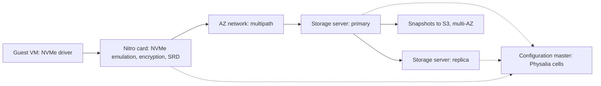
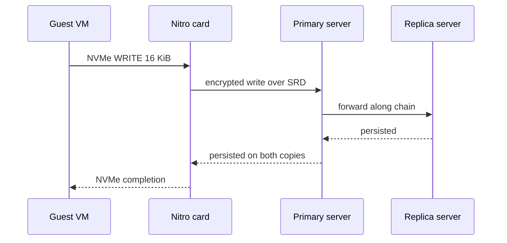
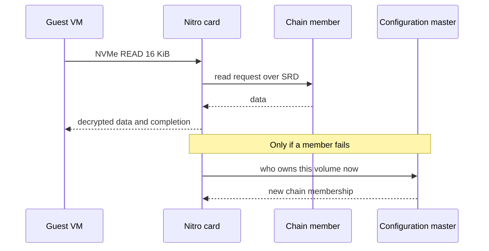
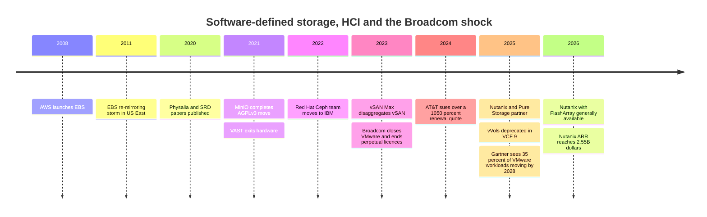

# 19. Software-defined storage and HCI

> **Depth:** L2 · **Reading time:** ~7 min · **Last verified:** 2026-11-01
> **Prerequisites:** [Scale-up dual-controller arrays](14-scale-up-dual-controller.md) · [Scale-out shared-nothing clusters](15-scale-out-shared-nothing.md) · [Block protocols and NVMe-oF](../02-protocols-and-networking/07-block-protocols.md) · [Data protection and resilience](../01-storage-fundamentals/06-data-protection-and-resilience.md)

## TL;DR

- **Software-defined storage (SDS) sells the storage operating system without the box.** Ceph, MinIO, VAST and WEKA software run on servers someone else builds. **Hyperconverged infrastructure (HCI)** goes further and runs that software on the same nodes as the virtual machines (Nutanix, vSAN).
- **HCI's wall is coupled scaling.** Each node adds compute and capacity in a fixed ratio, so a capacity-heavy or compute-heavy estate strands whatever it did not need, and per-core software licences charge for the stranded cores too.
- **Cloud block storage is SDS at hyperscale.** AWS EBS replicates each volume across storage servers inside one Availability Zone, uses a separate configuration service to repair replication chains, and offloads the client side to Nitro cards.
- **The Broadcom–VMware licensing reset (December 2023 onward) is the biggest demand shock in this market in a decade.** It pushed customers toward Nutanix, public cloud and external arrays, and turned "HCI vs. array" back into an open question.
- **Software-only and appliance are business models as much as architectures.** Software-only means higher gross margin %, no NAND inventory and fast iteration. Appliances mean more gross profit per deal, control of the media and a single support throat.

## Why this matters for Everpure strategy

Everpure (NYSE: P, formerly PSTG) earns most of its revenue from appliances. Its FlashArray and FlashBlade ship as integrated systems on its own DirectFlash modules. But the company already runs every other model in this chapter: Portworx is pure SDS for Kubernetes, Pure Storage Cloud Dedicated runs Purity on cloud instances, and the Meta DirectFlash deal is a technology licence with no Everpure hardware in it[^1]. Each new deal therefore raises the same strategy question: which business model fits it?

The Broadcom shock gives that question a deadline. Every VMware estate up for renewal must decide whether to stay on vSAN, move to another HCI stack, or split compute from storage. Everpure's May 2025 partnership with Nutanix, which uses FlashArray as external storage for Nutanix's AHV hypervisor, is a bet on the third option[^2].

## Core concepts

### Three ways to package the same software

![Three-column diagram. Appliance: application servers connect over a SAN or NAS network to a vendor-built box containing two controllers running the storage OS and shared vendor-qualified media. Software-defined storage: application servers connect over Ethernet to a pool of commodity servers, each running storage software over its own drives. HCI: no separate storage tier; each node runs VMs and hypervisor, storage software and local drives, linked by a cluster network that carries replica writes. A bottom row explains what scales together in each model.](../assets/diagrams/ch19-hci-sds-appliance.svg)

*Figure 19.1 — The storage software is the same in all three models; what changes is who supplies the hardware and what has to scale together.*

Every storage system is software running on CPUs, DRAM, NICs and media. The **appliance** model ([Chapter 14](14-scale-up-dual-controller.md)) has one vendor design, qualify, ship and support the whole box. **SDS** puts the same kind of software on commodity servers chosen from a **hardware compatibility list (HCL)**, usually as a [shared-nothing cluster](15-scale-out-shared-nothing.md). **HCI** collapses the storage tier into the hypervisor cluster. Each node gives part of its CPU and memory to a storage service: Nutanix runs a controller VM (CVM) on every node, and vSAN runs inside the ESXi kernel. Each VM's writes are replicated to other nodes' local drives.

**Semiconductor bridge.** An appliance vendor resembles an IDM: it owns the design and the "fab" (the integration), carries inventory, and captures integration margin. A software-only SDS vendor is closer to an IP licensor such as Arm. It ships a design that others turn into hardware, takes a high-margin royalty-like fee, and depends on its partners' supply chains. VAST's "Gemini" model sits in between, like a fabless house. VAST specifies the hardware and a manufacturing partner sells it to the customer at cost, while VAST books only the software[^3].

### Where HCI hits the wall

**State and metadata.** In HCI, data lives on node-local drives with a replication factor of 2 or 3, or with erasure coding across nodes. Metadata is distributed across the cluster (Nutanix) or held by an object-ownership scheme inside the hypervisor (vSAN). So a node is simultaneously a compute host, a storage target and a metadata participant, and losing it touches all three.

**Worked example: stranded resources.** Take an illustrative node with 64 cores and 8 × 15.36 TB SSDs (123 TB raw, ~61 TB usable at RF2). An estate needs 400 cores and 2 PB usable.

- Sized for compute: ⌈400 ÷ 64⌉ = 7 nodes. That gives only ~430 TB, far short of 2 PB.
- Sized for capacity: ⌈2,000 ÷ 61⌉ = 33 nodes = 2,112 cores, of which 81% sit idle.

Under per-core subscriptions such as VMware Cloud Foundation (VCF), those idle cores also need licences. VCF does include 1 TiB of vSAN per licensed core[^4] [VERIFY: search-summary only], so the bundle partly hides the problem rather than fixing it. The industry fixes it by un-converging. Nutanix offers storage-only and compute-only nodes. VMware's vSAN Max (2023) builds a storage-only vSAN cluster that other clusters mount, at up to 8.6 PB per cluster[^5]. Partnerships such as Nutanix with FlashArray hang an external array off HCI compute[^2]. Each fix concedes the original HCI promise of one building block for everything.

Coupled scaling causes two more walls. **East-west amplification:** at RF2 every client write crosses the cluster network once more, and rebuilding a failed 123 TB node re-replicates its whole contents across survivors. At ~5 GB/s of spare rebuild bandwidth, that takes roughly 123,000 ÷ 5 ≈ 6.8 hours. **Noisy neighbours:** a VM-heavy node starves its own storage service, so storage latency depends on how busy the applications are.

| Failure | HCI (Nutanix / vSAN-style) | EBS-style cloud block |
|---|---|---|
| Drive | Rebuild that drive's data from replicas on other nodes; VMs keep running | Invisible to tenant; storage fleet re-replicates |
| Node | VMs restart elsewhere (hypervisor HA) **and** its data re-replicates; two recoveries at once | Storage server loss: chain reconfigured, new replica re-mirrored; brief I/O pause |
| Storage controller | CVM or kernel module failure: I/O redirected to another node's storage service | Nitro card failure is a host failure; volume can attach to a new instance |
| Network link / partition | Minority side loses quorum; a split cluster can halt writes | Chain cannot complete writes until configuration service picks a new replica set[^6] |

*Table 19.1 — HCI couples application recovery and data recovery on the same nodes; a cloud block service separates them and moves the complexity into a control plane.*

### Inside an EBS-style cloud block service

AWS has described the architecture in public papers and docs. An EBS volume lives in one Availability Zone and is automatically replicated across several servers there[^7]. On Nitro instances, the guest sees an ordinary NVMe device[^8]. The NVMe controller is emulated by a Nitro card, which turns block commands into network requests. Classic EBS keeps each volume on a **replication chain** in which data flows client → primary → replica. A separate **configuration master**, Physalia, records who is in each chain. Each volume gets its own small Paxos-replicated "cell" of seven nodes, so that one failure cannot take out the configuration of many volumes[^6]. The newer io2 Block Express back end talks to Nitro over AWS's **Scalable Reliable Datagram (SRD)** protocol[^9]. SRD is a multipath transport implemented in the Nitro card, and it sprays packets across many network paths[^10].

*Figure 19.2 — The data path is client card → primary → replica; the configuration master is off the data path and is consulted only when a chain must change.*

*Figure 19.3 — A write is acknowledged only after both copies in the chain persist it; the network round trips, not the flash, dominate latency.*

*Figure 19.4 — Reads need one copy; the configuration master is touched only when membership changes, which is why it must stay available during partitions.*

AWS has published only a high-level view of how Block Express lays data out internally, so the read diagram leaves the serving copy generic. AWS rates io2 Block Express at up to 256,000 IOPS, 4,000 MB/s and 64 TiB per volume. It quotes average latency under 500 µs for 16 KiB I/O and 99.999% durability[^9]. The fleet-level lesson is AWS's April 2011 outage. A network change cut many volumes off from their replicas. They all tried to re-mirror at once, and the resulting "re-mirroring storm" exhausted spare capacity in the zone[^11]. That is the cloud-scale version of the HCI rebuild problem: repair traffic must be rate-limited and capacity reserved, or recovery itself becomes the outage.

### Pros, cons and fit

| | Appliance | SDS on commodity servers | HCI | Cloud block service |
|---|---|---|---|---|
| Strength | Predictable latency; one support owner; media co-design | Hardware choice; scale-out; no vendor box markup | One building block; simple ops for VM estates | No hardware; elastic; API-driven |
| Weakness | Box markup; vendor lock on media | Customer owns integration and HCL drift | Coupled scaling; rebuilds hit apps | Single-AZ volumes; egress and per-IOPS pricing |
| Best fit | Databases, mixed enterprise block, consolidation | Large object and file, AI data lakes, hyperscale | Edge, ROBO, mid-size VM clusters | Elastic cloud apps; dev/test |
| Worst fit | Very small sites; extreme-scale cheap capacity | Small teams without storage skills | Capacity-heavy or GPU-heavy estates | Steady, large, high-IOPS estates (cost) |
| Examples | FlashArray, PowerStore, NetApp AFF | Ceph, MinIO, VAST, WEKA, Portworx | Nutanix, vSAN | EBS, Azure Disk, Pure Storage Cloud Azure Native |

*Table 19.2 — No model dominates; the right one depends on how stable the workload's compute-to-capacity ratio is and who will own integration risk.*

### The business-model trade-off

| Dimension | Software-only subscription | Appliance | Cloud service |
|---|---|---|---|
| Gross margin structure | Very high %, on software revenue only (Nutanix non-GAAP 88.0%, FY2026)[^12] | Lower %, on full system revenue (Everpure product 66.2%, subscription 74.9%, Q2 FY27)[^13] | Bundled into the provider's service margin; per-GB-month and per-IOPS pricing |
| Support burden | Highest: any HCL server, firmware and NIC combination can fail | Lowest per system: vendor controls the whole bill of materials | Provider absorbs it; customer sees only the SLA |
| Hardware qualification matrix | Large (servers × drives × NICs × firmware), or narrowed with "ready node" programmes | Small and vendor-owned | Single fleet design per generation |
| NAND / component exposure | Passed to customer or OEM | On the vendor's P&L (Everpure raised prices on 2026-02-09 citing NAND costs)[^14] | On the provider's capex |
| Pricing power | Depends on lock-in: high for VMware (VCF), eroded for open-source-based products | Earned through efficiency (TB/W, data reduction) and lifecycle programmes | Strong for small users; weak against large customers who can repatriate |
| Public examples | Nutanix; VAST Gemini[^3]; WEKA; MinIO AIStor; IBM Storage Ceph | Everpure FlashArray/FlashBlade; Dell; NetApp; DDN appliances | AWS EBS; Pure Storage Cloud Azure Native[^15] |

*Table 19.3 — Software-only maximizes margin percentage and iteration speed; appliances maximize gross profit per deal and control of the media.*

**Worked example (illustrative split).** A customer budgets US$1M for a system. An appliance vendor books US$1M at 66%, which is **US$660k of gross profit**. A software-only vendor might book US$400k at 88%, or **US$352k**, while the server OEM books the US$600k of hardware. The higher percentage hides lower gross dollars. In exchange, the software vendor carries no inventory and no NAND-price risk, and it can ship on a new CPU or NIC as soon as the OEMs do. Open source caps pricing power from below: when a free tier is good enough, the vendor has to restrict it, as MinIO did by relicensing to AGPLv3 in 2021[^16], stripping the community console in 2025[^17] and putting the community edition into maintenance mode in December 2025[^18].

## How Everpure approaches it vs. competitors

Everpure's centre of gravity is the appliance, justified by DirectFlash. Managing raw NAND in Purity gives density and power advantages that a server full of commodity SSDs cannot match ([Chapter 26](../04-everpure/26-purity-and-directflash.md)). Around that core, Everpure runs software-only motions on its edges. Portworx is container-native SDS, bought for about US$370M in 2020[^19]. Cloud Dedicated and Azure Native put Purity on cloud infrastructure[^15]. FlashBlade//EXA uses off-the-shelf data nodes ([Chapter 16](16-disaggregated-shared-everything.md)). The Meta deal licenses the technology instead of selling boxes[^1].

The steelmen run in both directions. Nutanix shows that a software-only HCI vendor can run near-90% gross margins and grow ARR 16% to US$2.55B[^12]. VAST shows that software on partner hardware can scale with OEM supply chains (HPE, Cisco, Supermicro) without inventory risk[^3]. IBM's absorption of Red Hat's Ceph team in 2022[^20] keeps the "free and good enough" option alive at hyperscale. The appliance counter-argument is that coupled scaling and HCL support costs are real, and that AI-era power limits reward co-designed media. Options a strategy team might evaluate, based on public information: how far to push "array behind someone else's HCI" partnerships (Nutanix today, possibly others); whether DirectFlash licensing becomes a repeatable IP business beyond one hyperscaler; and how Portworx positions against VMware for VMs moving to Kubernetes.

## History and trajectory

*Figure 19.5 — HCI and SDS matured quietly for a decade; Broadcom's licensing reset in 2023 turned platform choice into a board-level cost decision.*

Broadcom closed its VMware acquisition on 22 November 2023. In December it stopped selling perpetual licences and support renewals and folded thousands of SKUs into two subscription bundles, VCF and vSphere Foundation[^21]. Price shocks followed. In a 2024 lawsuit, AT&T said it faced a proposed 1,050% annual increase; the case later settled[^22]. Broadcom's software results suggest that much of the installed base paid: reported infrastructure-software revenue was about US$27B in FY2025, and the company said 87% of its top 10,000 customers had adopted VCF[^23] [VERIFY: search-summary only].

The knock-on effects reached storage. Gartner expects more than a third of VMware workloads to move to other platforms by 2028[^24]. Nutanix's partnership with FlashArray, generally available around the turn of 2026, was its first major certified external-storage integration[^2][^25]. Broadcom deprecated vVols, the main hook external arrays used inside VMware, in VCF 9[^26]. That nudges VCF customers toward the vSAN capacity they already pay for, and nudges arrays toward VMFS, NFS and non-VMware hypervisors. The trajectory is un-convergence: compute-only and storage-only nodes, external arrays on HCI, and Kubernetes-native SDS for VMs.

## Numbers that matter

| Metric | Value | Context | Source / date |
|---|---|---|---|
| Nutanix ARR / non-GAAP gross margin | US$2.55B (+16%) / 88.0% | FY2026, software-only HCI | Nutanix 8-K, 2026-08-26[^12] |
| Everpure product / subscription GM | 66.2% / 74.9% | Q2 FY27, appliance-centric | Q2 FY27 results, 2026-08[^13] |
| io2 Block Express per-volume max | 256K IOPS, 4,000 MB/s, 64 TiB | <500 µs average for 16 KiB; 99.999% durability | AWS docs[^9] |
| Physalia cell size | 7 nodes per volume | Paxos-replicated configuration | NSDI 2020[^6] |
| EBS daily I/O operations | >140 trillion | Fleet aggregate | AWS (Olson), 2024-08[^27] [VERIFY: search-summary only] |
| AT&T proposed VMware increase | 1,050% | Claim in court filing; settled | CIO Dive, 2024-09[^22] |
| VMware workloads moving by 2028 | >35% | Gartner forecast | The Register, 2025-09-11[^24] |
| HCI capacity-sized cluster idle cores | ~81% | 400 cores, 2 PB, 64-core nodes | Worked example |

## Conversation playbook

**Questions for a PM**

1. *"In a VMware renewal, when do we win as external storage behind Nutanix rather than against vSAN?"* A strong answer names the triggers: capacity-heavy estates, the stranded-core licence cost of HCI, the need for data reduction or ransomware snapshots. It also admits where HCI's single building block wins, such as edge and small clusters.
2. *"What is our gross profit per deal, not gross margin %, against a software-only competitor?"* Strong: it separates software and hardware dollars and explains who carries NAND risk.
3. *"What breaks first if we sell Purity as software on customer-chosen servers?"* Strong: it names HCL support cost, the loss of DirectFlash density, and the effect on Evergreen economics.

**Questions for an engineer**

1. *"In HCI, what happens to a database VM's p99 latency during a node rebuild?"* Strong: it gives rebuild bandwidth caps, the throttling policy, and the time to restore full redundancy.
2. *"How does a cloud block service avoid a re-mirroring storm?"* Strong: it mentions reserved spare capacity, rate-limited repair, and a configuration service with a small blast radius.
3. *"What does NVMe/TCP to an external array cost in latency versus local HCI reads?"* Strong: it quotes tens of microseconds of network cost, then weighs that against avoided replica writes and data reduction.

**Don't say this:**

- "HCI is just SDS." HCI is SDS that shares nodes with the applications; coupling is the defining property and the main weakness.
- "Software-only is always better economics." It is a higher percentage on a smaller revenue base, and the support burden shifts to the HCL.
- "EBS is a SAN in the cloud." It is a replicated distributed service with a separate configuration plane, scoped to one Availability Zone.
- "Broadcom killed vSAN." VCF bundles vSAN capacity; Broadcom's changes arguably increased vSAN's installed footprint while pushing some customers off VMware entirely.
- "Ceph is free." The software is; the people, testing and hardware qualification are not.

## Going deeper (optional, L3 pointers)

- Brooker, Chen and Ping, "Millions of Tiny Databases," NSDI 2020, on Physalia and EBS chain replication[^6].
- Shalev et al., "A Cloud-Optimized Transport Protocol for Elastic and Scalable HPC," IEEE Micro 2020, on SRD[^10].
- AWS's April 2011 post-event summary, a classic on repair-traffic failure modes[^11].
- Weil et al., "Ceph: A Scalable, High-Performance Distributed File System," OSDI 2006, on CRUSH placement (see [Chapter 15](15-scale-out-shared-nothing.md)).

## Key terms

- **Software-defined storage (SDS)** — storage software sold separately from the hardware it runs on.
- **Hyperconverged infrastructure (HCI)** — compute, storage software and media combined in each cluster node.
- **Stranded resources** — capacity or compute bought only because the node bundles it.
- **Chain replication / configuration master** — replicating writes along an ordered chain of servers, with a separate service recording membership.
- **SRD** — AWS's multipath datagram transport in Nitro cards.
- See the [glossary](../glossary.md) for the rest.

## Sources

[^1]: SiliconANGLE, "Shares of Pure Storage jump on impressive earnings beat and strong guidance," 2024-12-03. https://siliconangle.com/2024/12/03/shares-pure-storage-jump-impressive-earnings-beat-strong-guidance/ (retrieved 2026-11-01).
[^2]: SDxCentral, "Nutanix partners with Pure Storage in latest VMware assault," 2025-05. https://www.sdxcentral.com/news/nutanix-partners-with-pure-storage-in-latest-vmware-assault/ (retrieved 2026-11-01).
[^3]: Blocks & Files, "VAST Data exits hardware business, pivots to software subscriptions," 2021-04-06. https://blocksandfiles.com/2021/04/06/vast-data-software-subscriptions-pivot/ (retrieved 2026-11-01); VAST Data, "What is Gemini," n.d. https://vastdata.com/what-is-gemini (retrieved 2026-11-01).
[^4]: Stackscale, "VMware licensing in 2026: what changed and what still applies," 2026. https://www.stackscale.com/blog/vmware-licensing-2026/ (retrieved 2026-11-01).
[^5]: TechTarget, "VMware vSAN Max disaggregates storage for hybrid cloud," 2023-08. https://www.techtarget.com/searchstorage/news/366549173/VMware-vSAN-Max-disaggregates-storage-for-hybrid-cloud (retrieved 2026-11-01).
[^6]: M. Brooker, T. Chen, F. Ping (AWS), "Millions of Tiny Databases," USENIX NSDI '20, 2020-02. https://www.usenix.org/conference/nsdi20/presentation/brooker (retrieved 2026-11-01).
[^7]: AWS, "Features and benefits of Amazon EBS volumes," Amazon EBS User Guide, n.d. https://docs.aws.amazon.com/ebs/latest/userguide/EBSFeatures.html (retrieved 2026-11-01).
[^8]: AWS, "Amazon EBS volumes and NVMe," Amazon EBS User Guide, n.d. https://docs.aws.amazon.com/ebs/latest/userguide/nvme-ebs-volumes.html (retrieved 2026-11-01).
[^9]: AWS, "Amazon EBS Provisioned IOPS SSD volumes," Amazon EBS User Guide, n.d. https://docs.aws.amazon.com/ebs/latest/userguide/provisioned-iops.html (retrieved 2026-11-01).
[^10]: L. Shalev, H. Ayoub, N. Bshara, E. Sabbag (AWS Annapurna Labs), "A Cloud-Optimized Transport Protocol for Elastic and Scalable HPC," IEEE Micro 40(6), 2020. https://doi.org/10.1109/MM.2020.3016891 (retrieved 2026-11-01).
[^11]: AWS, "Summary of the Amazon EC2 and Amazon RDS Service Disruption in the US East Region," 2011-04-29. https://aws.amazon.com/message/65648/ (retrieved 2026-11-01).
[^12]: Nutanix, "Form 8-K, Exhibit 99.1: Fourth quarter and fiscal 2026 financial results," 2026-08-26. https://www.sec.gov/Archives/edgar/data/0001618732/000117184326005752/exh_991.htm (retrieved 2026-11-01); Pulse 2.0, "Nutanix: Q4 operating margin nearly doubles to 9.2% as revenue and ARR grow 16%," 2026-08. https://pulse2.com/nutanix-q4-operating-margin-nearly-doubles-to-9-2-as-revenue-and-arr-grow-16/ (retrieved 2026-11-01).
[^13]: Everpure, "Everpure Announces Second Quarter Fiscal 2027 Financial Results," 2026-08-26. https://investor.everpuredata.com/news-and-events/press-releases/press-release-details/2026/Everpure-Announces-Second-Quarter-Fiscal-2027-Financial-Results/default.aspx (retrieved 2026-11-01); Investing.com, "Everpure Q2 FY27 slides," 2026-08. https://www.investing.com/news/company-news/everpure-q2-fy27-slides-38-revenue-growth-guidance-raised-sharply-93CH-4878054 (retrieved 2026-11-01).
[^14]: Alpha Spread, "P Q4-2026 Earnings Call," 2026-02-25. https://www.alphaspread.com/security/nyse/p/investor-relations/earnings-call/q4-2026 (retrieved 2026-11-01).
[^15]: Blocks & Files, "Pure Enterprise Data Cloud updates," 2025-09-26. https://blocksandfiles.com/2025/09/26/pure-enterprise-data-cloud-updates/ (retrieved 2026-11-01); Microsoft Learn, "Pure Storage Cloud overview," n.d. https://learn.microsoft.com/en-us/azure/partner-solutions/pure-storage/overview (retrieved 2026-11-01).
[^16]: MinIO, "From Open Source to Free and Open Source, MinIO is now fully licensed under GNU AGPLv3," 2021-05. https://blog.min.io/from-open-source-to-free-and-open-source-minio-is-now-fully-licensed-under-gnu-agplv3 (retrieved 2026-11-01).
[^17]: Blocks & Files, "MinIO removes management features from basic community edition object storage code," 2025-06-19. https://blocksandfiles.com/2025/06/19/minio-removes-management-features-from-basic-community-edition-object-storage-code/ (retrieved 2026-11-01).
[^18]: Linuxiac, "MinIO Ends Active Development, Steers Users Toward Paid AIStor," 2025-12. https://linuxiac.com/minio-ends-active-development/ (retrieved 2026-11-01).
[^19]: TechTarget, "Pure Storage acquires Portworx for container management," 2020-09. https://www.techtarget.com/searchstorage/news/252489099/Pure-Storage-acquires-Portworx-for-container-management (retrieved 2026-11-01).
[^20]: Ceph, "Red Hat's Ceph team is moving to IBM," 2022-10. https://ceph.io/en/news/blog/2022/red-hats-ceph-team-is-moving-to-ibm/ (retrieved 2026-11-01); IBM Newsroom, "IBM Redefines Hybrid Cloud Application and Data Storage Adding Red Hat Storage to IBM Offerings," 2022-10-04. https://newsroom.ibm.com/2022-10-04-IBM-Redefines-Hybrid-Cloud-Application-and-Data-Storage-Adding-Red-Hat-Storage-to-IBM-Offerings (retrieved 2026-11-01).
[^21]: SiliconANGLE, "Broadcom accelerates VMware transformation, killing off perpetual software licenses," 2023-12-12. https://siliconangle.com/2023/12/12/broadcom-accelerates-vmware-transformation-killing-off-perpetual-software-licenses/ (retrieved 2026-11-01); Computer Weekly, "Broadcom drops VMware perpetual licences and support," 2023-12. https://www.computerweekly.com/news/366563072/Broadcom-drops-VMware-perpetual-licences-and-support (retrieved 2026-11-01).
[^22]: CIO Dive, "AT&T, Broadcom spar over VMware price hikes in court battle," 2024-09. https://www.ciodive.com/news/att-broadcom-vmware-price-hikes-court-battle/728603/ (retrieved 2026-11-01); Channel Futures, "AT&T, VMware settle," 2024-11. https://channelfutures.com/channel-business/at-t-vmware-lawsuit-settled-vmware-loses-ingram-micro (retrieved 2026-11-01).
[^23]: Earnings-call summaries of Broadcom Q2 FY2025 and Q4 FY2025, via ROIC.ai transcripts, 2025. https://www.roic.ai/quote/AVGO/transcripts/2025-year/2-quarter (retrieved 2026-11-01).
[^24]: The Register, "VMware to lose 35 percent of workloads in three years," 2025-09-11. https://www.theregister.com/2025/09/11/gartner_vmware_migration_advice/ (retrieved 2026-11-01).
[^25]: StorageNewsletter, "Availability of Nutanix with Pure Storage FlashArray," 2026-01-02. https://www.storagenewsletter.com/2026/01/02/availability-of-nutanix-with-pure-storage-flasharray/ (retrieved 2026-11-01).
[^26]: TechTarget, "Broadcom discontinues vVols storage capability for VMware," 2025. https://www.techtarget.com/it-infrastructure/news/366627334/Broadcom-discontinues-vVols-storage-capability-for-VMware (retrieved 2026-11-01).
[^27]: M. Olson (AWS), "Continuous reinvention: A brief history of block storage at AWS," All Things Distributed, 2024-08. https://www.allthingsdistributed.com/2024/08/continuous-reinvention-a-brief-history-of-block-storage-at-aws.html (retrieved 2026-11-01).
