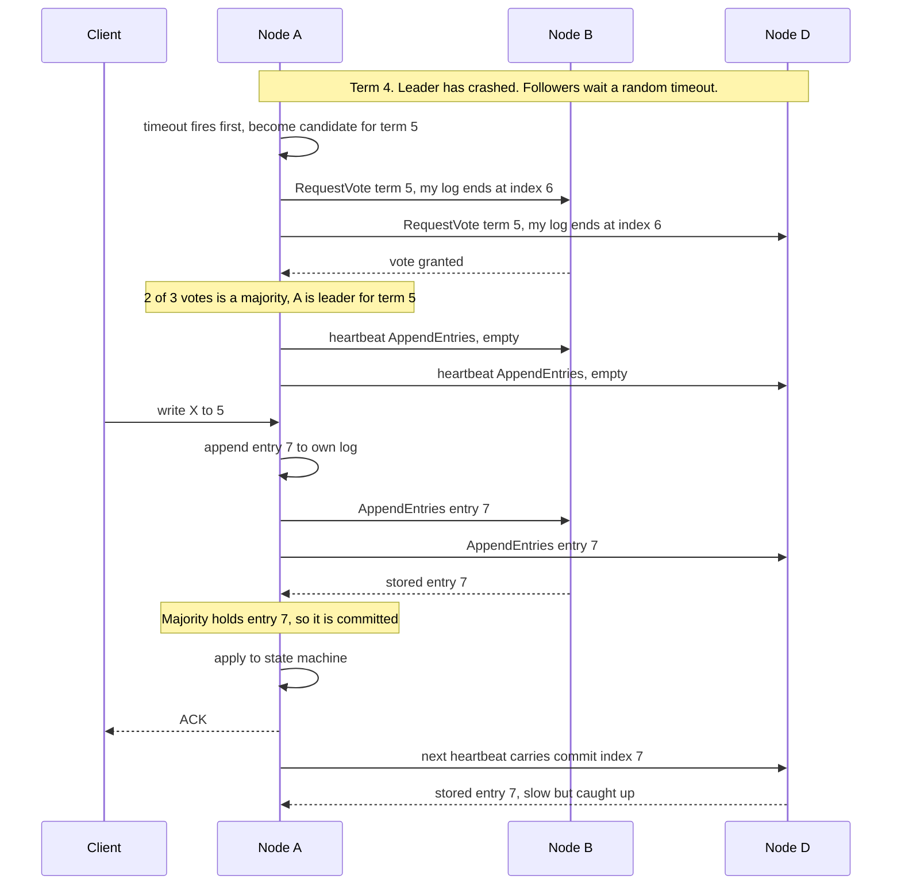
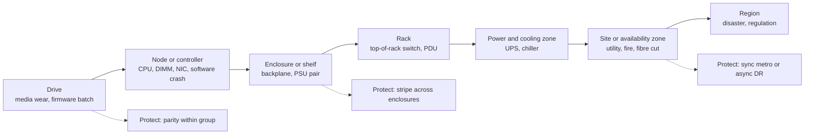
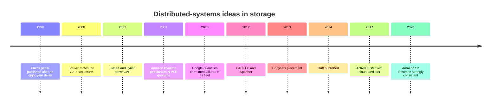

# 20. Distributed-systems fundamentals for storage

> **Depth:** L2 · **Reading time:** ~8 min · **Last verified:** 2026-11-01
> **Prerequisites:** [Data protection and resilience](../01-storage-fundamentals/06-data-protection-and-resilience.md) · [Object storage and S3](../02-protocols-and-networking/09-object-storage-and-s3.md) · [Scale-out shared-nothing clusters](15-scale-out-shared-nothing.md)

## TL;DR

- **With more than one copy, a system must define "the latest write": its consistency model.** Primary storage chooses strong consistency and pays in latency.
- **Consensus (Paxos, Raft) needs 2f+1 voters to survive f failures.** Two-site clusters therefore need a third vote, a witness, against split brain.
- **CAP in practice is PACELC.** The everyday trade is latency versus consistency, chosen per feature: sync metro picks consistency, async DR picks latency.
- **"Eleven nines" of durability is a model output, not a measurement.** Parity, rebuild time and assumed independence drive it; correlated failures are what lose data in practice.
- **Availability nines are measured; durability nines are modelled.** Ask which is quoted.

## Why this matters for Everpure strategy

Headline claims such as "zero RPO", "six nines", "11 nines durability" and "strongly consistent S3" each rest on a quorum rule, a failure model and a consistency choice. Knowing which separates an engineering guarantee from a marketing number. The stakes are rising: disaggregated and parallel systems ([Chapters 16](16-disaggregated-shared-everything.md) and [17](17-parallel-file-systems.md)) spread metadata and erasure codes across hundreds of nodes, where the hard engineering and the outage risk now live.

## Core concepts

### Consistency models: what a reader is promised

A consistency model is the contract about what a reader may see when copies disagree.

| Model | Promise to a reader | Cost | Who uses it |
|---|---|---|---|
| **Strong / linearizable** | Every read sees the latest acknowledged write, as if there were one copy | Each write waits for a quorum or synchronous mirror; minority side stops during a partition | Block arrays (FlashArray, PowerMax, ONTAP); metro clusters; Spanner; DynamoDB strongly consistent reads[^1] |
| **Strong read-after-write (per object)** | Once a PUT or DELETE is acknowledged, every later GET or LIST by any client reflects it; no multi-object transactions | Index commit must be a single linearisation point per key | Amazon S3 since Dec 2020, Azure Blob, GCS ([Chapter 9](../02-protocols-and-networking/09-object-storage-and-s3.md)) |
| **Causal** | If write B depends on write A, nobody sees B without A | Track dependencies (version vectors) | Some geo-distributed databases; rare as a storage product guarantee |
| **Close-to-open** | A file reopened after another client closes it shows that client's writes | Client caches revalidated on open | NFS ([Chapter 8](../02-protocols-and-networking/08-file-protocols.md)) |
| **Eventual** | All copies converge if writes stop; reads may be stale meanwhile | Cheapest and fastest; conflicts need resolution (last-writer-wins) | Cross-region and asynchronous replication; Dynamo-style stores at low quorum settings[^2] |

*Table 20.1 — Strong consistency is the norm inside one system or one metro; almost everything across regions is eventual.*

**Semiconductor bridge: MESI versus consensus.** MESI already enforces single-writer, multiple-reader per cache line, which is exactly the strong-consistency invariant. But a coherence fabric assumes no lost messages or independent core failures; a storage cluster must survive both. Consensus is coherence that tolerates faults. A directory maps onto a metadata server; an Exclusive line maps onto a lease or NFS delegation.

### Consensus at L2: Raft on a whiteboard

Paxos (published 1998)[^3] and Raft (2014)[^4] solve the same problem: replicas agree on one ordered log, so all apply the same commands in the same order. Ceph's monitors run Paxos and need a strict majority[^5]; DynamoDB replicates each partition with Multi-Paxos[^1].

*Figure 20.1 — Raft in two phases: a randomised timeout elects one leader per term by majority vote, then a write commits once a majority has logged it, so the slowest replica never sets latency.*

A strong whiteboard answer makes three points. **Terms** are a logical clock: a node seeing a higher term steps down, so a stale leader cannot commit. **Voters reject candidates with staler logs**, so a new leader holds every committed entry. **Commit needs a majority, not all**, so three nodes tolerate one failure.

### Quorum math: N, W, R

Leaderless, Dynamo-style systems use quorums directly[^2]. With N replicas, writes wait for W acknowledgements and reads query R. **W + R > N** makes every read overlap the latest write (N=3, W=2, R=2 is classic). **W > N/2** stops two conflicting writes both succeeding. N=3, W=1, R=1 is fast but only eventually consistent.

Surviving f failures needs 2f+1 voters, so four voters are no better than three[^5]. Without a majority you get **split brain**: both halves of a partitioned pair accept writes and diverge. Two-site clusters add a **witness** (or **mediator**): a data-less third vote, outside both sites' failure domains, that decides which side keeps serving.

### CAP and PACELC: what storage actually chooses

CAP (Brewer, 2000; proved by Gilbert and Lynch, 2002[^6]) says that during a partition a system gives up consistency or availability. Partitions are not optional, so it is not "pick two". Abadi's PACELC[^7] adds: *else*, trade latency against consistency.

Storage chooses per feature. Synchronous metro clusters are **PC/EC**: each write pays an inter-site round trip, and in a partition the side that loses the mediator race stops serving. Asynchronous DR is **PA/EL**: local acknowledgement, remote copy lags by the RPO. Spanner is formally CP, yet Brewer argued it exceeds five nines because Google's network rarely partitions[^8].

### Durability nines versus availability nines

**Availability** is the fraction of time data can be served; six nines is ~31.5 seconds of downtime a year, measurable from telemetry. Pure Storage (now Everpure) claimed 99.9999% across the FlashArray//m installed base in 2016, including upgrades, and repeats six nines for later FlashArrays[^9] (company-stated).

**Durability** is the probability of not losing data in a year. S3 is designed for eleven nines[^10]; Azure states 11, 12 and 16 nines for locally, zone- and geo-redundant storage[^11]. Nobody can observe a 10⁻¹¹ event on one system, so these are model outputs. (At 100 trillion objects it still implies ~1,000 losses a year.)

The standard model is **mean time to data loss (MTTDL)**. A group of n drives tolerating m failures loses data when m+1 failures overlap. With λ = AFR ÷ 8,766 h and μ = 1 ÷ rebuild time, MTTDL ≈ μᵐ ÷ [n(n−1)…(n−m) λᵐ⁺¹].

*Figure 20.2 — Illustrative model: extra parity moves durability by many nines, AFR and rebuild time by fewer, and correlated failures can erase the gain.*
Data: `data/ch20_durability.csv`

**Worked example** (10 PB usable, 30 TB drives, Backblaze's 2025 HDD AFR of 1.36%[^12]). RAID 6 (8+2) with a 42-hour single-spare rebuild models at **5.8 nines**. The same code rebuilt declustered in 4 hours reaches **7.8**: RAID 6 and 8+2 EC are identical maths, differing only in rebuild speed. Three-way replication reaches **9.0**; EC 16+4 reaches **15.1**. Device reliability helps less. Backblaze's SSDs ran at 0.9%[^13]; Everpure states 0.15% for DirectFlash Modules[^14] (NetApp disputes it[^15]). Cutting AFR from 1.36% to 0.15% adds 2.9 nines to RAID 6; moving from 8+2 to 16+4 adds 7.3. Rule of thumb: each tenfold cut in AFR is worth m+1 nines, each tenfold cut in rebuild time m. One caveat on the declustered lines: the model treats each group of k+m drives as independent. In a declustered layout, almost any m+1 failed drives share some stripe, which in this example costs back roughly three nines for 8+2 and five for 16+4. Rebuilding first the few stripes that have lost the most strips recovers much of that, and declustered systems generally do so.

### Correlated failures and failure domains

The model assumes independence. If each further failure during a rebuild is ten times likelier, because drives share a batch, firmware or power feed, MTTDL falls by 10ᵐ: the dashed line in Figure 20.2 shows 16+4 losing four nines. In 2019 HPE warned that certain SAS SSDs would die at exactly 32,768 power-on hours without a firmware fix[^16]. Drives installed together fail together. Google's 2010 fleet study named planned kernel upgrades a major source of correlated failure[^17]. Random replica placement compounds it; copyset placement cut modelled data-loss probability in a 5,000-node power outage from 99.99% to 0.15%[^18].

*Figure 20.3 — Each level up is rarer but takes out everything beneath it; protection is only as good as the highest domain a stripe or replica set spans.*

The design rule is anti-affinity: at most m strips of a stripe in any domain you intend to survive. Ceph's CRUSH map encodes the hierarchy; VAST's DBox-HA caps strips per enclosure ([Chapter 16](16-disaggregated-shared-everything.md)).

**Semiconductor bridge: FIT, AFR and chipkill.** One FIT is one failure per 10⁹ device-hours, so 1% AFR ≈ 0.01 ÷ 8,766 × 10⁹ ≈ **1,140 FIT**: Backblaze's 1.36% is ~1,550 FIT, a 0.15% module ~170. Erasure coding is chipkill one level up: Reed–Solomon across devices survives a dead chip or drive, until "independent" devices share a defect.

### Caching and tiering design

Storage caches face the CPU's write-back versus write-through choice, with durability added.

| Policy | Acknowledge when | Risk | Typical use |
|---|---|---|---|
| Write-through | Slower tier has persisted | Latency of the slow tier | Simple caches, client-side read caches |
| Write-back, volatile | Data is in DRAM cache | Loss on power or node failure | Unsafe for primary storage |
| Write-back, persistent and mirrored | Two NVRAM/SCM copies exist | Mirror link and NVRAM capacity | Dual-controller arrays ([Chapter 14](14-scale-up-dual-controller.md)); DASE SCM ([Chapter 16](16-disaggregated-shared-everything.md)) |
| Tiering (move, not copy) | Data placed by temperature | Fast tier may hold the only copy | Hot/cold flash and HDD/cloud tiers |

*Table 20.2 — Write-back is safe only when the cache is itself a durable, mirrored copy; a tier holding the only copy needs the same parity as any other.*

Read caches add a coherence cost: every client or node cache needs invalidation, leases or timeouts, which is why NFS settles for close-to-open.

## How Everpure approaches it vs. competitors

| System | Agreement mechanism | Partition / PACELC behaviour | Durability or availability claim |
|---|---|---|---|
| Everpure ActiveCluster (FlashArray) | Synchronous mirror, Pure1 Cloud Mediator or on-premises mediator; pre-election if mediator lost | PC/EC: up to 11 ms RTT between arrays; loser of mediator race stops serving the pod[^19] | Six nines availability, installed base (company-stated)[^9] |
| NetApp SnapMirror active sync / MetroCluster | ONTAP Mediator; ONTAP Cloud Mediator for SnapMirror active sync from ONTAP 9.17.1[^20] | PC/EC; automatic unplanned failover via mediator[^21] | See [Chapter 6](../01-storage-fundamentals/06-data-protection-and-resilience.md) |
| Ceph | Paxos monitors hold cluster map; CRUSH places data by failure domain | PC/EC inside a cluster; multisite asynchronous | Depends on pool rule and EC profile[^5] |
| Amazon S3 / DynamoDB | Replicated metadata; DynamoDB Multi-Paxos per partition | Strong within region; cross-region asynchronous | S3: designed for 11 nines[^10][^1] |
| Dynamo-style (Cassandra) | Leaderless quorums, tunable N/W/R | PA/EL by default; PC with QUORUM settings | Operator-defined |

*Table 20.3 — Nearly everyone converges on strong consistency inside a site and a witness for two-site clusters; claims differ in whether they are measured (availability) or modelled (durability).*

Everpure's distinctive choice was a cloud-hosted witness, removing the need for a third site[^19]. Steelman for rivals: NetApp has shipped a cloud mediator since ONTAP 9.17.1[^20], and Dell's SRDF family has three decades of deployments. An option a strategy team might evaluate, based on public information: publishing durability assumptions beside availability telemetry, making a modelled number defensible.

## History and trajectory

*Figure 20.4 — Theory came first; products adopted strong consistency and cloud witnesses once networks made the latency affordable.*

Direction: strong consistency wherever latency allows, wider codes with declustered rebuilds, cloud witnesses. AI scale puts metadata consensus and lease managers on the critical path ([Chapter 21](21-metadata.md)).

## Numbers that matter

| Metric | Value | Context | Source / date |
|---|---|---|---|
| HDD fleet AFR, 2025 | 1.36% | 344,196 drives; 1.55% in 2024 | Backblaze, 2026-02-12[^12] |
| SSD lifetime AFR | 0.9% | Backblaze boot SSDs to mid-2023 | The Register, 2023-09-26[^13] |
| DirectFlash Module AFR | 0.15% | Company-stated; disputed by NetApp | Everpure blog[^14][^15] |
| ActiveCluster max RTT | 11 ms | Synchronous, mediator-arbitrated | Everpure docs[^19] |
| S3 / Azure LRS / ZRS / GRS durability | 11 / 11 / 12 / 16 nines | Design targets, not SLAs | AWS[^10], Microsoft[^11] |
| FlashArray availability | 99.9999% (~31.5 s/yr) | Company-stated, measured on installed base | Pure Storage, 2016[^9] |
| AFR to FIT | 1% ≈ 1,140 FIT | 0.01 ÷ 8,766 h × 10⁹ | Worked example |
| RAID 6 vs 16+4 nines | ~5.8 vs ~15.1 | 10 PB, 1.36% AFR, 42 h vs 4 h rebuild | Worked example (Figure 20.2) |

## Conversation playbook

**Questions for a PM**

1. *"What is in the denominator of our six nines?"* Strong: installed-base telemetry, the outage definition, whether upgrades count, the window.
2. *"What do we tell a customer who asks for our durability number?"* Strong: a model with stated parity and rebuild times, plus the caveat that bugs and humans dominate real loss, hence SafeMode snapshots.
3. *"Where does the mediator run for a customer with no internet egress?"* Strong: an on-premises mediator VM in a third failure domain; pre-election if it is lost.

**Questions for an engineer**

1. *"Which FlashBlade or EXA components run consensus, with how many voters?"* Strong: names the service, quorum size and what stalls without a majority.
2. *"How long does rebuilding our largest DirectFlash Module take at 80% full under load?"* Strong: hours, throttle policy, declustered or not.
3. *"How do we prevent correlated failures?"* Strong: telemetry-staged firmware rollout, batch mixing, anti-affinity.

**Don't say this:**

- "CAP means pick two." Partitions are not optional.
- "Eleven nines means we never lose data." It models independent drive failures, not bugs or people.
- "A two-node cluster can vote." It needs a witness.
- "RAID 6 and 8+2 erasure coding differ in durability." Same code; rebuild speed and placement differ.
- "Eventual consistency is a bug." It is a deliberate latency trade.

## Going deeper (optional, L3 pointers)

- Raft paper[^4] and Lamport's "Paxos Made Simple".
- Ford et al.[^17] and Cidon et al.[^18] on correlated failures and placement; Abadi[^7] and Brewer[^8] on CAP.
- Greenan, Plank and Wylie (HotStorage 2010) on MTTDL's limits.

## Key terms

- **Raft / Paxos** — majority-based consensus on one ordered log.
- **Quorum (N/W/R)** — W + R > N makes reads see the latest write.
- **Linearizability** — behaves as if there were one copy.
- **PACELC** — partition: availability or consistency; else: latency or consistency.
- **Witness / mediator** — data-less third vote against split brain.
- **MTTDL** — modelled mean time to data loss.
- **FIT** — failures per 10⁹ device-hours.
- **Copyset** — node group holding all replicas of some chunks.
- See the [glossary](../glossary.md).

## Sources

[^1]: M. Elhemali et al., "Amazon DynamoDB: A Scalable, Predictably Performant, and Fully Managed NoSQL Database Service," USENIX ATC 2022, 2022-07. https://www.usenix.org/conference/atc22/presentation/elhemali (retrieved via search 2026-11-01).
[^2]: G. DeCandia et al., "Dynamo: Amazon's Highly Available Key-value Store," ACM SOSP 2007, 2007-10. https://www.allthingsdistributed.com/files/amazon-dynamo-sosp2007.pdf (retrieved 2026-11-01).
[^3]: L. Lamport, "The Part-Time Parliament," ACM Transactions on Computer Systems 16(2), 1998-05. https://www.microsoft.com/en-us/research/publication/part-time-parliament/ (retrieved 2026-11-01).
[^4]: D. Ongaro and J. Ousterhout, "In Search of an Understandable Consensus Algorithm," USENIX ATC 2014, 2014-06. https://www.usenix.org/conference/atc14/technical-sessions/presentation/ongaro (retrieved 2026-11-01).
[^5]: Ceph documentation (Reef), "Adding/Removing Monitors," n.d. https://docs.ceph.com/en/reef/rados/operations/add-or-rm-mons (retrieved via search 2026-11-01).
[^6]: S. Gilbert and N. Lynch, "Brewer's Conjecture and the Feasibility of Consistent, Available, Partition-Tolerant Web Services," ACM SIGACT News 33(2), 2002. https://dl.acm.org/doi/10.1145/564585.564601 (retrieved via search 2026-11-01).
[^7]: D. Abadi, "Consistency Tradeoffs in Modern Distributed Database System Design: CAP is Only Part of the Story," IEEE Computer, 2012-02. https://cs.umd.edu/~abadi/papers/abadi-pacelc.pdf (retrieved via search 2026-11-01).
[^8]: E. Brewer, "Spanner, TrueTime and the CAP Theorem," Google, 2017-02. https://research.google/pubs/pub45855/ (retrieved via search 2026-11-01).
[^9]: Pure Storage, "Pure Storage Introduces Petabyte-Scale Flash Storage for Cloud IT" (press release, FlashArray//m 99.9999% availability), 2016-10. https://www.everpuredata.com/company/news-and-events/press/ps_introduce_petabyte_scale_flash_storage_for_cloud.html (retrieved via search 2026-11-01).
[^10]: Amazon Web Services, "Data protection in Amazon S3" (S3 User Guide), n.d. https://docs.aws.amazon.com/AmazonS3/latest/userguide/DataDurability.html (retrieved via search 2026-11-01).
[^11]: Microsoft, "Azure Storage redundancy," n.d. https://learn.microsoft.com/en-us/azure/storage/common/storage-redundancy (retrieved via search 2026-11-01).
[^12]: Backblaze, "Backblaze Drive Stats for 2025," 2026-02-12. https://www.backblaze.com/blog/backblaze-drive-stats-for-2025/ ; corroborated by StorageReview, "Backblaze 2025 year-end drive stats: annual AFR falls to 1.36%," 2026-02. https://www.storagereview.com/news/backblaze-2025-year-end-drive-stats-annual-afr-falls-to-1-36-as-high-capacity-drives-dominate-fleet (retrieved via search 2026-11-01).
[^13]: The Register, "Backblaze SSD failure report," 2023-09-26. https://www.theregister.com/2023/09/26/ssd_failure_report_backblaze (retrieved via search 2026-11-01).
[^14]: Pure Storage blog, DirectFlash Module reliability post (DFM AFR 0.15% vs 0.90% for COTS SSDs), n.d. https://blog.purestorage.com/?p=143164 (retrieved via search 2026-11-01).
[^15]: NetApp, "Direct flash vs SSDs," n.d. https://www.netapp.com/blog/direct-flash-vs-ssds/ (retrieved via search 2026-11-01).
[^16]: Blocks & Files, "HPE issues firmware fix to stop SSD failure," 2019-11-25. https://www.blocksandfiles.com/flash/2019/11/25/hpe-issues-firmware-fix-to-to-stop-ssd-failure/1607574 (retrieved via search 2026-11-01).
[^17]: D. Ford et al., "Availability in Globally Distributed Storage Systems," USENIX OSDI 2010, 2010-10. https://www.usenix.org/conference/osdi10/availability-globally-distributed-storage-systems (retrieved via search 2026-11-01).
[^18]: A. Cidon et al., "Copysets: Reducing the Frequency of Data Loss in Cloud Storage," USENIX ATC 2013, 2013-06. https://www.usenix.org/conference/atc13/technical-sessions/presentation/cidon (retrieved via search 2026-11-01).
[^19]: Everpure Support, "ActiveCluster Introduction," n.d. https://support.everpuredata.com/r/activecluster/activecluster-introduction (retrieved via search 2026-11-01).
[^20]: NetApp, "What's new in ONTAP 9.17.1" (ONTAP release notes), n.d. https://docs.netapp.com/us-en/ontap/release-notes/whats-new-9171.html (retrieved 2026-11-01; seen via search summary).
[^21]: NetApp, "SnapMirror active sync overview" (ONTAP documentation), n.d. https://docs.netapp.com/us-en/ontap/snapmirror-active-sync/ (retrieved via search 2026-11-01).
