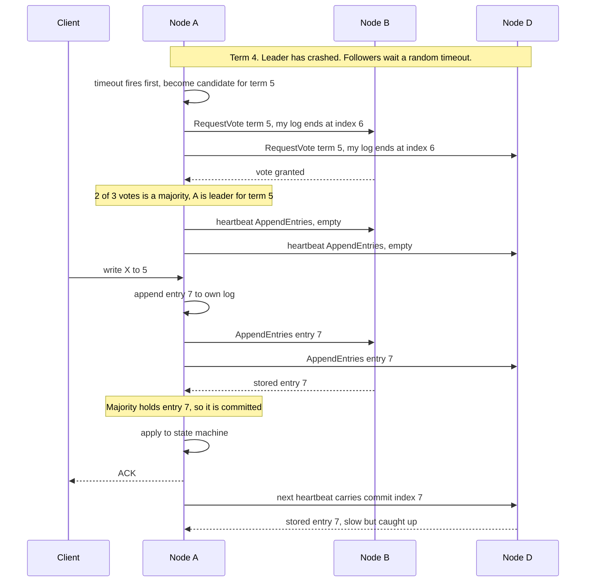
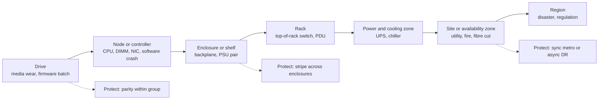
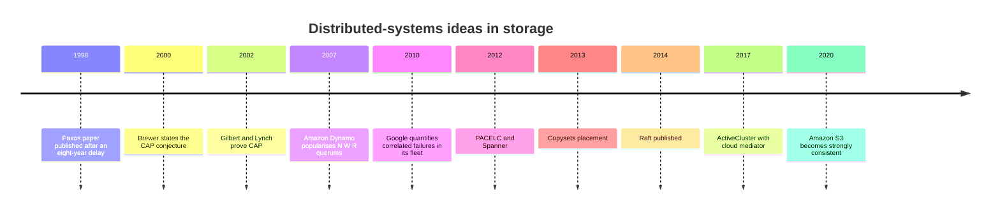

# 20. Distributed-systems fundamentals for storage

> **Depth:** L2 · **Reading time:** ~8 min · **Last verified:** 2026-11-01
> **Prerequisites:** [Data protection and resilience](../01-storage-fundamentals/06-data-protection-and-resilience.md) · [Object storage and S3](../02-protocols-and-networking/09-object-storage-and-s3.md) · [Scale-out shared-nothing clusters](15-scale-out-shared-nothing.md)

## TL;DR

- **Every storage system decides what "the latest write" means once copies live in more than one place.** That decision is its consistency model. Enterprise primary storage almost always chooses strong consistency and pays for it in latency and, during a partition, in availability.
- **Consensus (Paxos, Raft) is how a group of machines agrees on one ordered log despite crashes.** It needs a majority, so it needs 2f+1 voters to survive f failures. A two-site cluster therefore needs a third vote: a witness or mediator.
- **CAP in practice is PACELC.** Partitions are rare. The everyday trade is latency versus consistency, and it is chosen per feature: synchronous metro replication picks consistency, asynchronous disaster recovery picks latency.
- **"Eleven nines" of durability is a model output, not a measurement.** It depends mostly on rebuild time, parity count and the independence assumption. Correlated failures (shared firmware, batch, power) are what actually lose data.
- **Availability nines are different:** they can be measured from fleet telemetry. Ask which kind of nines is being quoted.

## Why this matters for Everpure strategy

The product claims a strategy team will hear most often are distributed-systems claims in disguise: "zero RPO metro clusters", "six nines availability", "11 nines durability", "strongly consistent S3", "no single point of failure". Each rests on a quorum rule, a failure model and a consistency choice. Knowing which lets the reader tell an engineering guarantee from a marketing number, and judge where a competitor's architecture is actually weaker rather than just described differently.

It also matters for the AI roadmap. Disaggregated systems ([Chapter 16](16-disaggregated-shared-everything.md)) and parallel file systems ([Chapter 17](17-parallel-file-systems.md)) spread state across dozens to hundreds of nodes, so their metadata services, lease managers and erasure codes are where the hard engineering, and the outage risk, live.

## Core concepts

### Consistency models: what a reader is promised

When data has several copies, a read can land on a copy that has not yet seen the latest write. A consistency model is the contract about what the reader may see.

| Model | Promise to a reader | Cost | Who uses it |
|---|---|---|---|
| **Strong / linearizable** | Every read sees the latest acknowledged write, as if there were one copy | Each write waits for a quorum or a synchronous mirror; minority side stops during a partition | Block arrays (FlashArray, PowerMax, ONTAP); metro clusters; Spanner; DynamoDB strongly consistent reads[^1] |
| **Read-after-write** | A writer immediately sees its own write; others see it once committed | Index commit must be a single linearisation point | Amazon S3 since Dec 2020, Azure Blob, GCS ([Chapter 9](../02-protocols-and-networking/09-object-storage-and-s3.md)) |
| **Causal** | If write B depends on write A, nobody sees B without A | Track dependencies (version vectors) | Some geo-distributed databases; rare as a storage product guarantee |
| **Close-to-open** | A file reopened after another client closes it shows that client's writes | Client caches are revalidated on open | NFS ([Chapter 8](../02-protocols-and-networking/08-file-protocols.md)) |
| **Eventual** | All copies converge if writes stop; reads may be stale meanwhile | Cheapest and fastest; conflicts need resolution (last-writer-wins) | Cross-region and asynchronous replication; Dynamo-style stores at low quorum settings[^2] |

*Table 20.1 — Strong consistency is the norm inside one system or one metro; almost everything across regions is eventual.*

**Semiconductor bridge: MESI versus consensus.** A multicore cache already solves "many copies, one truth". MESI enforces single-writer, multiple-reader per line: before a core writes, every other copy is invalidated. Storage strong consistency is the same invariant. The difference is the failure model. A coherence fabric assumes messages are never lost and cores never fail independently. A storage cluster must assume dropped packets, crashed nodes and partitions. Consensus is coherence that survives those faults. A directory-based protocol maps onto a metadata server, and an Exclusive line maps onto a lease or NFS delegation.

### Consensus at L2: Raft on a whiteboard

Paxos (Lamport, published 1998)[^3] and Raft (Ongaro and Ousterhout, 2014)[^4] solve the same problem: a group agrees on one ordered log of operations, so every replica applies the same commands in the same order. Raft was designed to be easier to teach, and it is what most new systems implement. Ceph's monitors run Paxos and need a strict majority to operate[^5]. DynamoDB replicates each partition with Multi-Paxos[^1].

*Figure 20.1 — Raft in two phases: a randomised timeout elects one leader per term by majority vote, then every write is committed once a majority has it in its log; the slowest replica never sets the latency.*

Four points make a strong whiteboard answer. **Terms** are a logical clock: a node that sees a higher term steps down, so a stale leader cannot commit. **Randomised timeouts** make split votes rare. **Voters refuse candidates with less up-to-date logs**, so a new leader always holds every committed entry. **Commit needs a majority, not all**, so a three-node group tolerates one failure and keeps median, not worst-case, latency.

### Quorum math: N, W, R

Leaderless (Dynamo-style) systems use quorums directly[^2]. With N replicas, a write waits for W acknowledgements and a read queries R replicas.

- **W + R > N** guarantees every read quorum overlaps the latest write quorum. N=3, W=2, R=2 is the classic setting.
- **W > N/2** guarantees two conflicting writes cannot both succeed.
- **N=3, W=1, R=1** is fast and available but only eventually consistent.

Majorities explain the odd numbers. Tolerating f failures needs 2f+1 voters, so a four-member group tolerates one failure, no better than three[^5]. **Split brain** is what happens without a majority rule: both halves of a partitioned pair keep accepting writes and diverge. Two-site clusters fix this with a **witness** (or **mediator**): a lightweight third vote, outside both sites' failure domains, that stores no data and only decides which side keeps serving.

### CAP and PACELC: what storage actually chooses

Brewer's CAP conjecture (2000), proved by Gilbert and Lynch in 2002[^6], says that during a network partition a system must give up either consistency or availability. It is often misread as "pick two of three". Partitions are not optional, so the real question is what happens when one occurs. Abadi's PACELC (2012)[^7] adds the more useful half: *else*, in normal operation, the trade is latency versus consistency.

Storage vendors choose per feature. A metro cluster with synchronous mirroring is **PC/EC**: every write pays a round trip to the other site, and during a partition the side that loses the mediator race stops serving. Asynchronous DR replication is **PA/EL**: writes are acknowledged locally and the far copy lags by the RPO. Google's Spanner is formally CP, but Brewer argued in 2017 that it exceeds five nines of availability because partitions are so rare in Google's network[^8]. The pragmatic lesson: invest in the network so that CP rarely costs availability.

### Durability nines versus availability nines

**Availability** is the fraction of time data can be served. Six nines (99.9999%) is about 31.5 seconds of downtime a year, and it can be measured from fleet telemetry. Pure Storage (now Everpure) claimed 99.9999% across the FlashArray//m installed base in 2016, including upgrades and maintenance, and has repeated six nines for later FlashArrays[^9] (company-stated).

**Durability** is the probability of not losing data in a year. Amazon S3 says it is designed for eleven nines[^10]. Azure states at least 11 nines for locally redundant, 12 for zone-redundant and 16 for geo-redundant storage[^11]. Nobody can observe a 10⁻¹¹ annual event on one system: these are outputs of a model like the one below. At 100 trillion objects, eleven nines still implies ~1,000 objects lost a year, so the figure is checkable only in aggregate at hyperscale.

The standard model is the **mean time to data loss (MTTDL)**. A group of n drives that survives m failures loses data only if m+1 failures overlap within rebuild windows. With per-drive failure rate λ = AFR ÷ 8,766 hours and repair rate μ = 1 ÷ rebuild time, MTTDL ≈ μᵐ ÷ [n(n−1)…(n−m) λᵐ⁺¹].

*Figure 20.2 — Illustrative model: extra parity moves durability by many nines, AFR and rebuild time by fewer, and correlated failures can erase the gain.*
Data: `data/ch20_durability.csv`

**Worked example.** Use Backblaze's 2025 hard-drive AFR of 1.36%[^12] and 10 PB usable on 30 TB drives. RAID 6 (8+2) with a 42-hour single-spare rebuild models at about **5.8 nines** for the whole system. The same 8+2 code rebuilt declustered in 4 hours reaches **7.8**: RAID 6 and 8+2 erasure coding are the same mathematics, and only rebuild speed differs. Three-way replication reaches **9.0**. EC 16+4 reaches **15.1**, because surviving four failures raises λ and μ to the fifth and fourth powers. Device reliability matters, but less than parity. Backblaze's SSDs ran at 0.9%[^13]; Everpure states 0.15% for its DirectFlash Modules[^14], a figure NetApp disputes[^15]. Cutting AFR from 1.36% to 0.15% adds about 2.9 nines to RAID 6 and 4.8 to 16+4, while moving from two to four parity strips adds 7.3. The rule of thumb: each tenfold cut in AFR is worth m+1 nines, each tenfold cut in rebuild time is worth m.

### Correlated failures and failure domains

The model assumes independent failures. Reality violates that. If each further failure during a rebuild is ten times likelier than baseline, because drives share a batch, firmware, enclosure or power feed, MTTDL falls by 10ᵐ. The dashed line in Figure 20.2 shows 16+4 losing four nines. In 2019 HPE warned that certain SAS SSDs would fail at exactly 32,768 power-on hours without a firmware fix[^16]. Drives installed together would have failed together, defeating any parity scheme. Google's 2010 study of its storage fleet found correlated failures essential to realistic availability models and named planned kernel upgrades as a major cause[^17]. Random placement makes it worse: with replicas scattered at random, almost any simultaneous loss of three nodes destroys some chunk. Copyset placement cut the modelled data-loss probability in a 5,000-node power outage from 99.99% to 0.15%[^18].

*Figure 20.3 — Each level up is rarer but takes out everything beneath it; a protection scheme is only as good as the highest domain its stripe or replica set spans.*

The design rule is anti-affinity: place no more than m strips of a stripe in any one domain you want to survive. Ceph's CRUSH map encodes the hierarchy explicitly; VAST's DBox-HA limits strips per enclosure ([Chapter 16](16-disaggregated-shared-everything.md)).

**Semiconductor bridge: FIT, AFR and chipkill.** One FIT is one failure per 10⁹ device-hours. An AFR of 1% is 0.01 ÷ 8,766 ≈ 1.14×10⁻⁶ per hour ≈ **1,140 FIT**, so Backblaze's 1.36% is about 1,550 FIT and a 0.15% module about 170 FIT. Drives are thousands of FIT, far above a logic die. Erasure coding is chipkill one level up: chipkill uses Reed–Solomon symbols spread across DRAM devices to survive a whole chip, and EC spreads strips across drives to survive a whole drive. Both fail the same way when the "independent" devices share a defect.

### Caching and tiering design

Storage caches face the CPU's write-back versus write-through choice, plus durability. **Write-through** acknowledges only after the slower tier persists. **Write-back** acknowledges once data is in the cache, which is safe only if the cache is persistent and mirrored. That is why dual-controller arrays mirror NVRAM before acknowledging ([Chapter 14](14-scale-up-dual-controller.md)), and why DASE mirrors writes across two SCM enclosures. Read caches carry a coherence problem: any client or node cache needs invalidation, leases or short timeouts, which is why NFS settles for close-to-open. **Tiering** moves data, rather than copying it, between media by temperature. A tier decision is a placement decision, so the tier's durability must match the data's: a fast tier holding the only copy needs the same parity as the slow one.

## How Everpure approaches it vs. competitors

| System | Agreement mechanism | Partition / PACELC behaviour | Durability or availability claim |
|---|---|---|---|
| Everpure ActiveCluster (FlashArray) | Synchronous mirror, Pure1 Cloud Mediator or on-premises mediator; pre-election if mediator lost | PC/EC: up to 11 ms RTT between arrays; loser of mediator race stops serving the pod[^19] | Six nines availability, installed base (company-stated)[^9] |
| NetApp SnapMirror active sync / MetroCluster | ONTAP Mediator; Cloud Mediator from ONTAP 9.17.1 | PC/EC; automatic unplanned failover via mediator[^20] | See [Chapter 6](../01-storage-fundamentals/06-data-protection-and-resilience.md) |
| Ceph | Paxos monitors hold cluster map; CRUSH places data by failure domain | PC/EC inside a cluster; multisite asynchronous | Depends on pool rule and EC profile[^5] |
| Amazon S3 / DynamoDB | Replicated metadata; DynamoDB Multi-Paxos per partition | Strong within region; cross-region asynchronous | S3: designed for 11 nines[^10][^1] |
| Dynamo-style (Cassandra) | Leaderless quorums, tunable N/W/R | PA/EL by default; PC with QUORUM settings | Operator-defined |

*Table 20.2 — Nearly everyone converges on strong consistency inside a site and a witness for two-site clusters; claims differ in whether they are measured (availability) or modelled (durability).*

Everpure's distinctive choice was making the witness a cloud service, so customers need no third site[^19]. The steelman for competitors: NetApp has now shipped a cloud mediator too, and Dell's SRDF family has three decades of deployments, including mainframes. Everpure's other lever is the device: a lower-AFR module lifts modelled durability less than extra parity does, but fewer failures also mean fewer degraded-mode windows and fewer service visits. Options a strategy team might evaluate, based on public information: publishing durability assumptions (rebuild times, correlation handling) alongside availability telemetry, which would turn a modelled number into a defensible one.

## History and trajectory

*Figure 20.4 — Theory arrived first; products adopted strong consistency and cloud witnesses only once networks made the latency cost acceptable.*

The trend is toward strong consistency everywhere a single metro allows it, wider erasure codes with faster declustered rebuilds, and witnesses delivered as cloud services. The open frontier is AI scale: checkpoint and KV-cache traffic across hundreds of nodes puts metadata consensus and lease managers on the critical path ([Chapter 21](21-metadata.md)).

## Numbers that matter

| Metric | Value | Context | Source / date |
|---|---|---|---|
| HDD fleet AFR, 2025 | 1.36% | 344,196 drives; 1.55% in 2024 | Backblaze, 2026-02-12[^12] |
| SSD lifetime AFR | 0.9% | Backblaze boot SSDs to mid-2023 | The Register, 2023-09-26[^13] |
| DirectFlash Module AFR | 0.15% | Company-stated; disputed by NetApp | Everpure blog[^14][^15] |
| ActiveCluster max RTT | 11 ms | Synchronous, mediator-arbitrated | Everpure docs[^19] |
| S3 / Azure LRS / ZRS / GRS durability | 11 / 11 / 12 / 16 nines | Design targets, not SLAs | AWS[^10], Microsoft[^11] |
| FlashArray availability | 99.9999% (~31.5 s/yr) | Company-stated, measured on installed base | Pure Storage, 2016[^9] |
| AFR to FIT | 1% ≈ 1,140 FIT | 0.01 ÷ 8,766 h × 10⁹ | Worked example |
| RAID 6 vs 16+4 nines | ~5.8 vs ~15.1 | 10 PB, 1.36% AFR, 42 h vs 4 h rebuild | Worked example (Figure 20.2) |

## Conversation playbook

**Questions for a PM**

1. *"When we quote six nines, what is in the denominator?"* Strong: installed-base telemetry, what counts as an outage (any volume, any host), whether planned upgrades count, and how long the measurement window is.
2. *"How do we answer a customer who asks for our durability number?"* Strong: a modelled figure with stated rebuild times and parity, plus the honest caveat that software bugs and operator error dominate real loss, which is why snapshots and SafeMode matter.
3. *"Where does the mediator run in a customer with no internet egress?"* Strong: on-premises mediator VM in a third failure domain, and what pre-election does if it is lost.

**Questions for an engineer**

1. *"Which components in FlashBlade or EXA run consensus, and how many voters?"* Strong: names the metadata or configuration service, its quorum size and what stalls when it loses majority.
2. *"What is our rebuild time for our largest DirectFlash Module at 80% full under production load, and how does it scale with module size?"* Strong: hours, with the throttle policy, and whether rebuild is declustered.
3. *"How do we avoid correlated failure: firmware staging, batch mixing, power-on-hour skew?"* Strong: staged firmware rollout via fleet telemetry and anti-affinity rules.

**Don't say this:**

- "CAP means pick two." Partitions are not optional; the choice is what to give up when one happens.
- "Eleven nines means we will never lose data." It is a model of independent drive failures; bugs, correlation and humans are not in it.
- "Two nodes can vote." Two voters cannot form a majority after one failure; you need a witness.
- "RAID 6 and 8+2 erasure coding have different durability." Same code; the difference is rebuild speed and placement.
- "Eventual consistency is a bug." It is a deliberate latency trade, standard for cross-region copies.

## Going deeper (optional, L3 pointers)

- Ongaro and Ousterhout's Raft paper and its visualisation; Lamport's "Paxos Made Simple".
- Ford et al. (OSDI 2010) and Cidon et al. (ATC 2013) for correlated failures and placement[^17][^18].
- Abadi's PACELC article and Brewer's Spanner essay[^7][^8].
- Greenan, Plank and Wylie on why MTTDL is a poor reliability metric, and the case for NOMDL-style alternatives.

## Key terms

- **Consensus (Raft, Paxos)** — protocols that let a majority of nodes agree on one ordered log despite crashes.
- **Term** — Raft's logical clock; each term has at most one leader.
- **Quorum (N/W/R)** — replica count and the write and read acknowledgements needed; W + R > N gives overlap.
- **Linearizability** — the strongest model: the system behaves as if there were one copy.
- **PACELC** — under Partition choose Availability or Consistency, Else choose Latency or Consistency.
- **Witness / mediator** — a data-less third vote that prevents split brain in two-site clusters.
- **MTTDL** — mean time to data loss, a model output from failure and repair rates.
- **FIT** — failures per 10⁹ device-hours; 1% AFR ≈ 1,140 FIT.
- **Copyset** — a fixed group of nodes holding all replicas of some chunks; fewer copysets mean rarer loss.
- See the [glossary](../glossary.md) for the rest.

## Sources

[^1]: M. Elhemali et al., "Amazon DynamoDB: A Scalable, Predictably Performant, and Fully Managed NoSQL Database Service," USENIX ATC 2022, 2022-07. https://www.usenix.org/conference/atc22/presentation/elhemali (retrieved via search 2026-11-01).
[^2]: G. DeCandia et al., "Dynamo: Amazon's Highly Available Key-value Store," ACM SOSP 2007, 2007-10. https://www.allthingsdistributed.com/files/amazon-dynamo-sosp2007.pdf (retrieved 2026-11-01).
[^3]: L. Lamport, "The Part-Time Parliament," ACM Transactions on Computer Systems 16(2), 1998-05. https://www.microsoft.com/en-us/research/publication/part-time-parliament/ (retrieved 2026-11-01).
[^4]: D. Ongaro and J. Ousterhout, "In Search of an Understandable Consensus Algorithm," USENIX ATC 2014, 2014-06. https://www.usenix.org/conference/atc14/technical-sessions/presentation/ongaro (retrieved 2026-11-01).
[^5]: Ceph documentation (Reef), "Adding/Removing Monitors," n.d. https://docs.ceph.com/en/reef/rados/operations/add-or-rm-mons (retrieved via search 2026-11-01).
[^6]: S. Gilbert and N. Lynch, "Brewer's Conjecture and the Feasibility of Consistent, Available, Partition-Tolerant Web Services," ACM SIGACT News 33(2), 2002. https://dl.acm.org/doi/10.1145/564585.564601 (retrieved via search 2026-11-01).
[^7]: D. Abadi, "Consistency Tradeoffs in Modern Distributed Database System Design: CAP is Only Part of the Story," IEEE Computer, 2012-02. https://cs.umd.edu/~abadi/papers/abadi-pacelc.pdf (retrieved via search 2026-11-01).
[^8]: E. Brewer, "Spanner, TrueTime and the CAP Theorem," Google, 2017-02. https://research.google/pubs/pub45855/ (retrieved via search 2026-11-01).
[^9]: Pure Storage, "Pure Storage Introduces Petabyte-Scale Flash Storage for Cloud IT" (press release, FlashArray//m 99.9999% availability), 2016-10. https://www.everpuredata.com/company/news-and-events/press/ps_introduce_petabyte_scale_flash_storage_for_cloud.html (retrieved via search 2026-11-01).
[^10]: Amazon Web Services, "Data protection in Amazon S3" (S3 User Guide), n.d. https://docs.aws.amazon.com/AmazonS3/latest/userguide/DataDurability.html (retrieved via search 2026-11-01).
[^11]: Microsoft, "Azure Storage redundancy," n.d. https://learn.microsoft.com/en-us/azure/storage/common/storage-redundancy (retrieved via search 2026-11-01).
[^12]: Backblaze, "Backblaze Drive Stats for 2025," 2026-02-12. https://www.backblaze.com/blog/backblaze-drive-stats-for-2025/ ; corroborated by StorageReview, "Backblaze 2025 year-end drive stats: annual AFR falls to 1.36%," 2026-02. https://www.storagereview.com/news/backblaze-2025-year-end-drive-stats-annual-afr-falls-to-1-36-as-high-capacity-drives-dominate-fleet (retrieved via search 2026-11-01).
[^13]: The Register, "Backblaze SSD failure report," 2023-09-26. https://www.theregister.com/2023/09/26/ssd_failure_report_backblaze (retrieved via search 2026-11-01).
[^14]: Pure Storage blog, DirectFlash Module reliability post (DFM AFR 0.15% vs 0.90% for COTS SSDs), n.d. https://blog.purestorage.com/?p=143164 (retrieved via search 2026-11-01).
[^15]: NetApp, "Direct flash vs SSDs," n.d. https://www.netapp.com/blog/direct-flash-vs-ssds/ (retrieved via search 2026-11-01).
[^16]: Blocks & Files, "HPE issues firmware fix to stop SSD failure," 2019-11-25. https://www.blocksandfiles.com/flash/2019/11/25/hpe-issues-firmware-fix-to-to-stop-ssd-failure/1607574 (retrieved via search 2026-11-01).
[^17]: D. Ford et al., "Availability in Globally Distributed Storage Systems," USENIX OSDI 2010, 2010-10. https://www.usenix.org/conference/osdi10/availability-globally-distributed-storage-systems (retrieved via search 2026-11-01).
[^18]: A. Cidon et al., "Copysets: Reducing the Frequency of Data Loss in Cloud Storage," USENIX ATC 2013, 2013-06. https://www.usenix.org/conference/atc13/technical-sessions/presentation/cidon (retrieved via search 2026-11-01).
[^19]: Everpure Support, "ActiveCluster Introduction," n.d. https://support.everpuredata.com/r/activecluster/activecluster-introduction (retrieved via search 2026-11-01).
[^20]: NetApp, "SnapMirror active sync overview" (ONTAP documentation), n.d. https://docs.netapp.com/us-en/ontap/snapmirror-active-sync/ (retrieved via search 2026-11-01).
