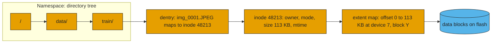
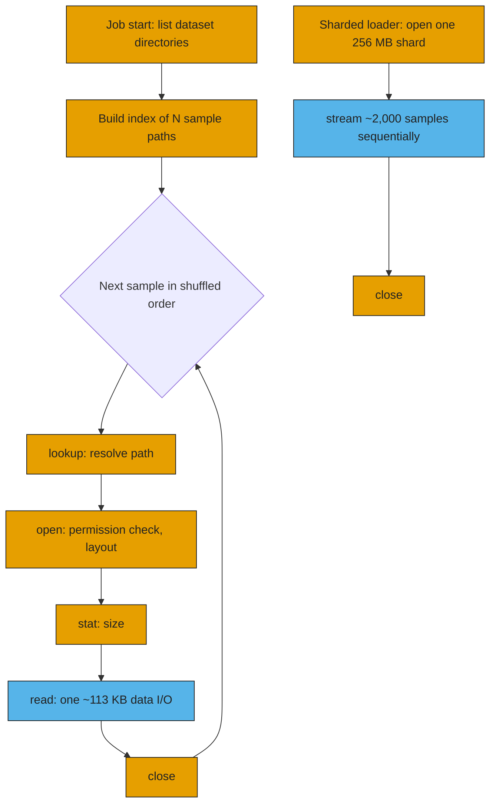
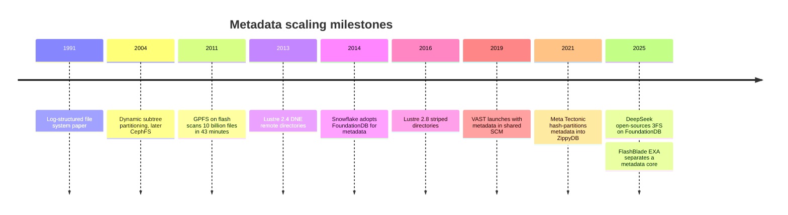

# 21. Metadata: the hidden bottleneck

> **Depth:** L2 · **Reading time:** ~6 min · **Last verified:** 2026-11-01
> **Prerequisites:** [File protocols](../02-protocols-and-networking/08-file-protocols.md) · [Object storage and S3](../02-protocols-and-networking/09-object-storage-and-s3.md) · [Disaggregated shared-everything](16-disaggregated-shared-everything.md) · [Parallel file systems](17-parallel-file-systems.md)

## TL;DR

- **Metadata is the data about data:** names, directories, permissions, sizes and block maps. Open, stat, list, create and rename are metadata operations; only read and write move payload.
- **Metadata operations are small, latency-bound and serialized** on shared structures such as a directory lock. Systems sized in GB/s routinely stall on operations per second.
- **AI is metadata-heavy.** Millions of ~100 KB samples and checkpoints that create a file per GPU turn a bandwidth problem into a metadata problem.
- **Metadata has moved from one server to a distributed database:** hashed directories, shared SCM (VAST), key-value stores on flash (Everpure FlashBlade), FoundationDB (DeepSeek's 3FS).
- **Metadata performance is now a buying criterion.** Ask for creates/s and stats/s, not just TB/s.

## Why this matters for Everpure strategy

Everpure's top-end AI system, FlashBlade//EXA, is a metadata argument. The namespace lives in a FlashBlade "metadata core" built on a distributed key-value store, while commodity data nodes stream the bytes ([Chapter 8](../02-protocols-and-networking/08-file-protocols.md), [Chapter 16](16-disaggregated-shared-everything.md)). Pure Storage pitches the core as serving thousands of clients and billions of items[^1]. If AI pipelines stay metadata-bound, that is a durable differentiator. If data teams pack samples into large shards, the advantage narrows to checkpoints, curation, inference caches and enterprise file estates. Which workloads stay metadata-bound sizes the prize.

## Core concepts

### Names, inodes and maps

A POSIX file system keeps three layers of metadata. The **namespace** is the directory tree, whose **dentries** (directory entries) map names to inode numbers. The **inode** holds owner, permissions, size and timestamps. The **extent map** translates file offsets to physical locations; one extent replaces thousands of per-4 KB pointers.

*Figure 21.1 — Reaching one file's bytes takes a chain of dependent metadata lookups, then a single data access.*

Distributed systems add layouts, leases, locks, dedup tables and reference counts. On a modern flash system, metadata is a large, hot, constantly mutating database.

**Semiconductor bridge.** The metadata service is the file system's tag array and page-table walker. Data reads resemble DRAM burst streaming: wide and bandwidth-bound. Metadata lookups are pointer chasing: each step needs the previous result, so latencies add serially and extra bandwidth buys nothing. Client metadata caches are TLBs; a random shuffle over a billion files blows through them, and every miss becomes a page walk across the network. A rename needs invalidations, the analogue of a TLB shootdown.

### Why AI training is metadata-heavy

*Figure 21.2 — A per-file data loader pays about four metadata operations (orange) for every data read (blue); a sharded loader pays them once per thousands of samples.*

ImageNet-1k is the canonical case: 1,281,167 training JPEGs, 144.8 GB, averaging ~113 KB[^2]. One epoch is ~5.1 million metadata operations, in an order that random shuffling makes unprefetchable.

*Figure 21.3 — Illustrative: below the crossover size S\* = k × B / M, effective throughput is metadata IOPS times file size, and bandwidth sits idle.*
Data: `data/ch21_small_file_throughput.csv`

**Worked example.** Effective throughput = min(B, M × S / k): B is data bandwidth, M metadata ops/s, S file size, k metadata ops per file. With B = 500 GB/s, M = 1 million and k = 4, the cluster opens 250,000 files/s; 250,000 × 113 KB ≈ **28 GB/s, 6% of the bandwidth paid for**. Saturating 500 GB/s with 113 KB files needs ≈17.7 million metadata ops/s.

**Mitigations.** Pack samples into large sequential containers. WebDataset uses plain tar shards, grouping a sample's files by basename[^3]; TFRecord and Parquet do the same, and LLM corpora are tokenized into large binary shards. A 256 MB shard holds ~2,265 such images, cutting metadata operations ~2,000-fold, at the price of coarser shuffling and a repacking step. Curation and deduplication still run on raw files, and RAG corpora and enterprise data often cannot be repacked.

### Checkpoint metadata storms

PyTorch Distributed Checkpoint writes at least one file per rank plus a `.metadata` file[^4]. A 16,384-GPU job creates 16,384 files in one directory within about a second; on one metadata server they serialize on the directory lock, and one-file-per-tensor mode multiplies the count. Closing costs too: 3FS notes that a striped file's exact length must be queried from storage at close[^5]. Bandwidth for a 405B model's ~6.5 TB checkpoint is the headline ([Chapter 31](../05-ai-storage/31-training-storage.md)); the create burst decides whether the first second is wasted.

### Why `ls` on a billion files is hard

`ls -l` reads directory entries in batches, stats each, then sorts in client memory. Serially, at ~100 µs per round trip, 10⁹ stats take 10⁵ s, about 28 hours. At 1 million stats/s in parallel it is ~17 minutes, and sorting 10⁹ names of ~50 bytes needs ~50 GB of client RAM. The fix is to scan the metadata store in parallel, not walk the tree. In 2011 IBM's GPFS, with metadata on flash, scanned 10 billion files in 43 minutes, versus 1 billion in about three hours on disk in 2007[^6]. Single servers hit memory walls first: an HDFS NameNode spends ~150 bytes of heap per file, directory or block[^7], so a billion files needs ~300 GB.

### Log-structured designs

Metadata updates are small random writes, the worst pattern for flash ([Chapter 3](../01-storage-fundamentals/03-inside-an-ssd.md)). Log-structured designs append every change, index the latest version and garbage-collect the rest, an idea dating from 1991[^8]. Pure Storage described Purity's metadata as a key-value store that minimizes overwrites and writes in erase-block multiples[^9]. The gains are sequential writes, cheap snapshots and simple crash recovery; the costs are read amplification, compaction and background work competing with foreground I/O. An SSD's FTL is itself log-structured metadata; doing it once at the array level, not twice, is part of the DirectFlash case ([Chapter 26](../04-everpure/26-purity-and-directflash.md)).

### Metadata scaling strategies

| Strategy | How it works | Wall / trade-off | Examples |
|---|---|---|---|
| Single metadata server | One server holds the whole namespace, often in RAM | RAM and one CPU's lock throughput; ~150 B/object for HDFS[^7] | HDFS NameNode, classic NAS head |
| Active/standby | Same, plus a failover partner | Adds availability, not performance | Lustre single MDT with failover |
| Static subtree partitioning | Admin pins directories to different servers | Hot directories still hit one server | Lustre DNE1 remote directories (2.4)[^10] |
| Dynamic subtree partitioning | Servers migrate busy subtrees among themselves | Balancer complexity; locality kept | CephFS MDS cluster[^11] |
| Hash-distributed directories | Entries hashed across servers or virtual shards | Rename and readdir span shards | Lustre DNE2 striped directories (2.8)[^12]; WEKA virtual metadata servers[^13]; Meta Tectonic[^14] |
| Metadata in shared SCM | Stateless nodes read/write one persistent tree over RDMA | Fabric round trip per lookup; SCM capacity | VAST V-tree[^15] |
| Distributed KV store on flash | Namespace as key-value records spread over blades | Compaction; a dedicated metadata tier to buy | Everpure Purity//FB, FlashBlade//EXA core[^16][^17] |
| Transactional KV database, stateless servers | Inodes and dentries stored as keys in a serializable database | Transaction conflicts and retries; database operations | DeepSeek 3FS on FoundationDB[^5]; Snowflake[^18]; Google Colossus on Bigtable[^19] |

*Table 21.1 — Metadata scaling has moved from bigger servers to partitioned servers to a database underneath stateless servers.*

The core trade-off is locality versus spread. Subtree partitioning keeps listings and renames local but bottlenecks on hot directories; hashing spreads load but makes them multi-server operations. Weil's 2004 simulations favored dynamic subtrees[^11]. Newer systems push consistency into a transactional database: in 3FS a directory is one contiguous key range, so listing is a range scan, and conflicting writes retry[^5].

## How Everpure approaches it vs. competitors

| System | Where metadata lives | How it scales | AI-relevant notes |
|---|---|---|---|
| Everpure FlashBlade//S, //E | Distributed key-value database across blades | Add blades | Company-stated "billions of files"[^16][^17] |
| Everpure FlashBlade//EXA | FlashBlade metadata core; separate data nodes | Metadata core and data nodes scale independently | MLPerf Storage v3.0 config: 30 EXA blades with 120 DFMs for metadata, 30 data nodes[^20]; up to 20× metadata vs scale-out claim [VERIFY: search-summary only][^21] |
| VAST | V-tree in SCM shared by stateless CNodes | Any CNode serves any operation | No lock manager; locks are SCM writes[^15] |
| WEKA | Thousands of virtual metadata servers on all cores | Hash-sharded buckets | Journals to its own storage[^13] |
| DDN EXAScaler (Lustre) | MDS/MDT servers | DNE remote and striped directories | Data-on-MDT keeps small files on metadata targets[^22] |
| DDN Infinia | Key-value object platform | Software-defined | Claims sub-1 ms lookups vs >10 ms (vendor)[^23] |

*Table 21.2 — Every AI-native contender now treats metadata as a distributed database; they differ in where it sits and how far it is from the data.*

**Steelmen.** VAST avoids partitioning decisions, since any node serves any operation, at a fabric round trip per lookup. WEKA's hashing across every core scales creates with the cluster. Lustre was the weakest small-file default, but DNE plus Data-on-MDT closed much of the gap; a 2025 user-group talk called the small-file problem a myth (*site-reported*)[^24]. EXA's case is a hardened metadata engine scaled separately from data; its open questions are pNFS layout recalls under churn and whether a dedicated FlashBlade core beats software-only rivals on cost. Options a strategy team might evaluate, based on public information: publishing per-chassis create/stat curves (IO500 weights metadata equally with bandwidth[^25]), and exposing the metadata database for search and governance ([Chapter 39](../05-ai-storage/39-agentic-ai-and-data-intelligence.md)).

## History and trajectory

*Figure 21.4 — Metadata went from one server, to partitions, to a transactional database behind stateless servers.*

DeepSeek open-sourced 3FS in February 2025[^26]. Meta reportedly flattened Tectonic's layered metadata into one ZippyDB schema to cut lookups[^27] [VERIFY: search-summary only]. Next: inference KV caches create millions of small objects ([Chapter 32](../05-ai-storage/32-inference-and-kv-cache.md)), and agentic AI treats metadata as queryable data.

## Numbers that matter

| Metric | Value | Context | Source / date |
|---|---|---|---|
| ImageNet-1k training set | 1,281,167 files, 144.8 GB, ~113 KB avg | Canonical small-file dataset | Dell InfoHub[^2] |
| Effective throughput at 113 KB | ~28 GB/s of 500 GB/s | 1M metadata ops/s, 4 ops/file | Worked example |
| Crossover file size | 2 MB at 1M ops/s | S\* = k × B / M | Worked example |
| HDFS NameNode heap | ~150 B per file, directory or block | Single-server ceiling | Cloudera docs[^7] |
| GPFS metadata scan | 10 B files in 43 min on flash | vs 1 B in ~3 h on disk (2007) | HPCwire, 2011-07-22[^6] |
| DCP checkpoint files | ≥1 per rank + `.metadata` | 16,384 ranks → 16,384 creates | PyTorch docs[^4] |
| VAST V-tree | 7 levels, 512× fan-out per level | Company-stated [VERIFY: search-summary only] | Blocks & Files[^15] |
| IO500 weighting | Metadata = bandwidth in final score | Geometric mean of both | LLNL IO500 page[^25] |

## Conversation playbook

**Questions for a PM**

1. *"Which workloads stay metadata-bound after customers shard their datasets?"* Strong: checkpoint bursts, curation on raw files, RAG corpora, KV caches, with ops/s from real deals.
2. *"What are creates/s and stats/s per metadata chassis, in one directory and in many?"* Strong: a scaling curve for both cases, not one hero number.
3. *"Can the metadata engine become a search and governance product?"* Strong: what is queryable today and the foreground-latency cost.

**Questions for an engineer**

1. *"What happens when 16,384 ranks create files in one directory in the same second?"* Strong: whether the directory is hashed, lock granularity, creates/s and p99 latency.
2. *"Walk me through a rename across metadata shards."* Strong: the transaction protocol and crash recovery mid-rename.
3. *"How does metadata compaction behave under sustained create/delete churn?"* Strong: a write-amplification figure and worst-case latency.

**Don't say this:**

- "We do X TB/s, so small files are fine." Below the crossover size, bandwidth is irrelevant.
- "Object storage has no metadata problem." It has LIST and per-request overhead ([Chapter 9](../02-protocols-and-networking/09-object-storage-and-s3.md)).
- "Faster flash fixes metadata." The hard parts are serialization and distribution, not media latency.
- "Sharding solves it." Not for checkpoints, curation or inference.

## Going deeper (optional, L3 pointers)

- 3FS design notes (FoundationDB key schema)[^5]; Tectonic, FAST '21[^14]; Weil, SC '04[^11].
- OpenSFS DNE documents[^10][^12]; Lustre Data-on-MDT[^22]; Purity, SIGMOD 2015[^9].

## Key terms

- **Inode**, **dentry**, **extent**: file record, name-to-inode entry, contiguous block run.
- **Metadata storm**: a burst of creates or opens that saturates the metadata tier.
- See the [glossary](../glossary.md) for the rest.

## Sources

[^1]: Pure Storage, "The Metadata Advantage: Scaling I/O Performance for AI and HPC with FlashBlade//EXA" (white paper), n.d. (2025). https://www.purestorage.com/content/dam/pdf/en/white-papers/wp-meta-advantage-scaling-io-performance-flashblade-exa.pdf (retrieved 2026-11-01).
[^2]: Dell Technologies InfoHub, "Deep Learning with Dell EMC Isilon: Introduction," n.d. https://infohub.delltechnologies.com/en-au/l/deep-learning-with-dell-emc-isilon-1/introduction-2011 (retrieved 2026-11-01).
[^3]: WebDataset project, "webdataset" (GitHub repository README), n.d. https://github.com/webdataset/webdataset (retrieved 2026-11-01).
[^4]: PyTorch, "Distributed Checkpoint — torch.distributed.checkpoint," n.d. https://docs.pytorch.org/docs/stable/distributed.checkpoint.html (retrieved 2026-11-01).
[^5]: DeepSeek, "3FS Design Notes" (GitHub), n.d. (2025). https://github.com/deepseek-ai/3FS/blob/main/docs/design_notes.md (retrieved 2026-11-01).
[^6]: HPCwire, "IBM Demos Record-Breaking Parallel File System Performance," 2011-07-22. https://www.hpcwire.com/2011/07/22/ibm_demos_record-breaking_parallel_file_system_performance/ (retrieved 2026-11-01).
[^7]: Cloudera, "Disk space versus namespace" (CDP Private Cloud Base 7.1.8 documentation), n.d. https://docs.cloudera.com/cdp-private-cloud-base/7.1.8/hdfs-overview/topics/hdfs-disk-space-versus-namespace.html (retrieved 2026-11-01).
[^8]: M. Rosenblum and J. K. Ousterhout, "The Design and Implementation of a Log-Structured File System," SOSP 1991 / ACM TOCS 1992. https://people.eecs.berkeley.edu/~brewer/cs262/LFS.pdf (retrieved 2026-11-01).
[^9]: J. Colgrove et al., "Purity: Building Fast, Highly-Available Enterprise Flash Storage from Commodity Components," ACM SIGMOD 2015. https://doi.org/10.1145/2723372.2742798 (retrieved 2026-11-01).
[^10]: OpenSFS, "DNE Remote Directories Solution Architecture," n.d. https://wiki.opensfs.org/DNE_RemoteDirectories_SolutionArchitecture_wiki_version (retrieved 2026-11-01).
[^11]: S. Weil, K. Pollack, S. Brandt and E. Miller, "Dynamic Metadata Management for Petabyte-Scale File Systems," SC '04, 2004-11. https://www.crss.ucsc.edu/pub/weil-sc04.html (retrieved 2026-11-01).
[^12]: OpenSFS, "DNE Striped Directories Final Report," n.d. https://wiki.opensfs.org/images/1/10/DNE_StripedDirectories_FinalReport.pdf (retrieved 2026-11-01).
[^13]: WEKA, "WEKA Architecture Key Concepts," n.d. https://www.weka.io/wp-content/uploads/files/resources/WEKA-Architecture-Key-Concepts.pdf (retrieved 2026-11-01).
[^14]: S. Pan et al., "Facebook's Tectonic Filesystem: Efficiency from Exascale," USENIX FAST '21, 2021-02. https://www.usenix.org/system/files/fast21-pan.pdf (retrieved 2026-11-01).
[^15]: Blocks & Files, "V-tree" (glossary), 2022-04-23. https://blocksandfiles.com/2022/04/23/v-tree/ (retrieved 2026-11-01).
[^16]: Pure Storage, "FlashBlade data sheet," n.d. https://purestorage.com/products/file-and-object/flashblade/data-sheet.html (retrieved 2026-11-01).
[^17]: TechTarget SearchStorage, "Pure FlashBlade," n.d. https://searchstorage.techtarget.com/feature/Pure-FlashBlade (retrieved 2026-11-01).
[^18]: Snowflake, "How FoundationDB Powers Snowflake Metadata Forward," 2018. https://www.snowflake.com/en/blog/how-foundationdb-powers-snowflake-metadata-forward (retrieved 2026-11-01).
[^19]: Google Cloud Blog, "How Colossus optimizes data placement for performance," 2025-03. https://cloud.google.com/blog/products/storage-data-transfer/how-colossus-optimizes-data-placement-for-performance (retrieved 2026-11-01).
[^20]: StorageReview, "MLPerf Storage v3.0: 877 GiB/s checkpoints, a cloud first and a leaderboard turned over," 2026-09. https://storagereview.com/news/mlperf-storage-v3-0-877-gib-s-checkpoints-a-cloud-first-and-a-leaderboard-turned-over (retrieved 2026-11-01).
[^21]: CDOTrends, "FlashBlade//EXA: data storage for AI" (Pure Storage white paper listing), n.d. https://cdotrends.com/white-paper/4890/flashbladeexa-data-storage-ai (retrieved 2026-11-01).
[^22]: Lustre Wiki, "Data on MDT," n.d. https://wiki.lustre.org/Data_on_MDT (retrieved 2026-11-01).
[^23]: DDN via Business Wire, "DDN Unveils Infinia 2.0, The AI Data Intelligence Platform…," 2025-02-20. https://www.businesswire.com/news/home/20250220891434/en/DDN-Unveils-Infinia-2.0-The-AI-Data-Intelligence-Platform-to-Maximize-Value-for-Enterprises-AI-Factories-and-Sovereign-AI (retrieved 2026-11-01).
[^24]: S. Crusan and B. Johnson (Hudson River Trading), "Lustre DNE3: Busting the Small Files Myth," Lustre User Group 2025. https://wiki.lustre.org/images/f/f9/LUG2025-Lustre_DNE3-Busting_the_Small_Files_Myth-Crusan.pdf (retrieved 2026-11-01).
[^25]: Lawrence Livermore National Laboratory, "IO500" (benchmark documentation), n.d. https://software.llnl.gov/benchmarks/80_io500/io500.html (retrieved 2026-11-01).
[^26]: Analytics Vidhya, "DeepSeek Releases 3FS & Smallpond Framework," 2025-02. https://www.analyticsvidhya.com/blog/2025/02/deepseek-3fs-and-smallpond-framework/ (retrieved 2026-11-01).
[^27]: Blocks & Files, "Meta reinvents AI metadata flow and KV caching," 2026-07-27. https://www.blocksandfiles.com/object/2026/07/27/meta-reinvents-ai-metadata-flow-and-kv-caching/5278805 (retrieved 2026-11-01).
