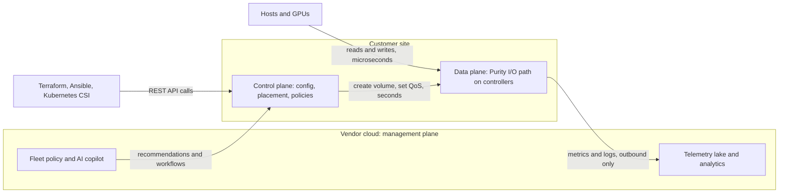
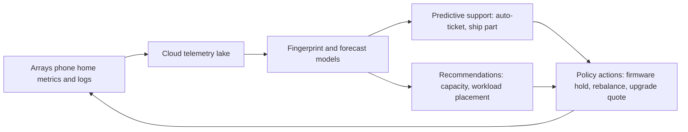
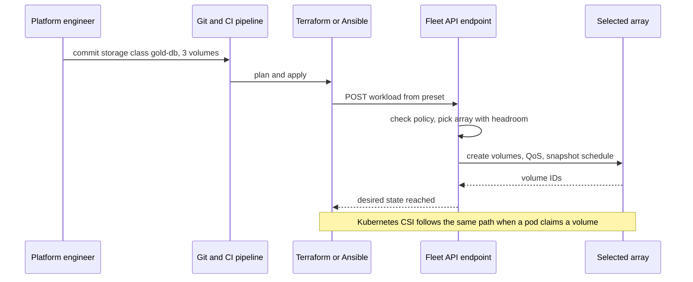

# 22. Control planes and fleet management

> **Depth:** L2 · **Reading time:** ~5 min · **Last verified:** 2026-11-01
> **Prerequisites:** [The storage stack](13-storage-stack.md) · [Scale-up dual-controller arrays](14-scale-up-dual-controller.md) · [Consumption models](23-consumption-models.md)

## TL;DR

- **The data plane moves bytes in microseconds. The control plane decides what should exist (volumes, policies, placement) and runs in seconds.** Good designs keep the control plane out of the I/O path, so a cloud outage never stops storage.
- **Fleet management moved to the cloud in the mid-2010s.** Arrays phone home telemetry; the vendor's analytics predict failures, open tickets and size upgrades before the customer notices.
- **Telemetry compounds with fleet size.** Rare faults are only learnable when you watch many systems, so the biggest installed bases learn fastest. That is a support-cost moat and a sales-signal moat.
- **"Storage as code" changes the buyer.** Platform engineers declare storage in Terraform, Ansible or Kubernetes manifests; API quality now wins deals that GUIs used to.
- **Everpure's bet is Pure1 (cloud analytics) plus Fusion (policy control plane built into Purity).** Dell, NetApp and HPE all ship equivalents, and all four now add AI copilots.

## Why this matters for Everpure strategy

The control plane is where hardware becomes a service. Evergreen//One's SLAs ([Chapter 23](23-consumption-models.md)) are only insurable because Everpure sees every array's capacity, performance and health in near real time. The control plane is also the integration surface for Everpure's platform pitch, the Enterprise Data Cloud, launched in June 2025 with Fusion at its core[^1] ([Chapter 28](../04-everpure/28-platform-and-software.md)). If customers automate against Everpure's APIs, switching costs migrate from the box to the policy layer, which survives every hardware refresh.

## Core concepts

### Three planes, three clocks

*Figure 22.1 — The data plane must keep serving if every arrow to the cloud is cut; the control plane decides, the data plane executes.*

The **data plane** is the I/O path: protocol handling, deduplication, RAID and flash management ([Chapter 14](14-scale-up-dual-controller.md)). The **control plane** holds desired state, such as "this database gets three volumes, a 50,000-IOPS limit and hourly snapshots replicated to site B", and pushes it to the data plane. The **management plane** aggregates many control planes. **Semiconductor bridge:** the data plane is the chip's datapath; the control plane is the on-die power-management microcontroller setting voltages and clocks; the management plane is the out-of-band BMC that a fleet operator scripts. Nobody puts the BMC on the critical path of a load instruction.

Unreachable cloud services must degrade gracefully. Pure1's terms allow "dark sites" with phone-home disabled, at the cost of manual log collection[^2].

### The telemetry loop

*Figure 22.2 — Each incident becomes a fingerprint that protects the rest of the fleet, so the loop improves with every array connected.*

Pure Storage launched Pure1 META in 2017, claiming more than a trillion telemetry data points a day in a ~7 PB lake[^3] and over 500 prevented Severity-1 incidents by then[^4] (company-stated). Today a detected hardware fault opens a support case automatically and can trigger a replacement shipment[^5]. HPE bought Nimble Storage in 2017 largely for InfoSight[^6] and claims it predicts and auto-resolves 86% of issues (company-stated, Nimble base)[^7].

**Why scale is a moat (worked example).** Take a firmware-and-drive interaction that strikes 1 in 10,000 arrays a year. A vendor with 1,000 connected arrays sees it once a decade, which is too rare to model. A vendor with 50,000 sees it five times a year, fingerprints it after the first, and blocks that firmware fleet-wide. This mirrors fab **yield learning**: more wafer starts surface defect signatures sooner. The same data cuts support cost (fewer engineers per installed array), feeds capacity planning (forecast fill dates per array) and gives sales a list of customers about to run out of space.

### Storage as code

*Figure 22.3 — Declarative automation means the engineer names an outcome and the control plane chooses the array, so placement logic becomes the vendor's product.*

Pure Fusion's presets bundle QoS, protection and tags into a fleet-wide template[^8]. In September 2025 Everpure announced cross-array provisioning through storage classes[^9]. Automation hooks include a Terraform provider for Fusion[^10], certified Ansible collections[^11] and Portworx CSI for Kubernetes[^12]. The buyer changes: platform engineering teams judge API coverage, idempotency and provider maturity; a slick GUI matters less. CSI is double-edged. It makes arrays substitutable behind one Kubernetes interface, so differentiation must live above it, in fleet policy.

## How Everpure approaches it vs. competitors

| Vendor | Telemetry / AIOps | Fleet control plane | Automation surface | AI layer (2024–26) |
|---|---|---|---|---|
| Everpure | Pure1; META analytics since 2017[^3] | Fusion, embedded in Purity since 2024[^13]; covers FlashArray, FlashBlade, Cloud Dedicated[^14] | REST, Terraform, Ansible, Portworx CSI[^10][^11][^12] | Pure1 AI Copilot (2024)[^15]; MCP integration slated Q4 FY26[^9] |
| Dell | APEX AIOps Infrastructure Observability (ex-CloudIQ, 2024)[^16] | Per-platform managers plus APEX AIOps | Terraform providers, open-source CSI and CSM modules[^17] | APEX AIOps Incident Management (ex-Moogsoft)[^18] |
| NetApp | Data Infrastructure Insights (ex-Cloud Insights, Sept 2024)[^19] | NetApp Console (ex-BlueXP, Oct 2025)[^20] spans on-prem and hyperscaler ONTAP | ONTAP REST, Ansible, Trident CSI | Console-integrated services |
| HPE | InfoSight (via Nimble, 2017)[^6] | GreenLake cloud console (Data Services Cloud Console, 2021)[^21] | Unified API, CSI driver | GreenLake Intelligence, agentic with MCP (June 2025)[^22] |

*Table 22.1 — Every major vendor now has cloud telemetry, a fleet console, IaC hooks and a copilot; the difference is how unified the policy layer is.*

Everpure's distinctive choice is putting Fusion inside the array OS, so there is no separate control plane to license or deploy[^13]. The steelman for NetApp: its console manages ONTAP inside all three hyperscalers, a broader hybrid reach than Everpure's cloud offerings. HPE's InfoSight claims cross-stack (server and storage) correlation that a storage-only vendor cannot match. Dell spans the widest hardware portfolio, so one AIOps console covers servers, storage and networking.

## History and trajectory

Per-array element managers gave way to cloud analytics (Nimble InfoSight, Pure1) and ML prediction (Pure1 META, 2017), then cloud consoles (HPE 2021), then policy control planes (Fusion embedded 2024; Enterprise Data Cloud 2025). The 2025–26 signal is agentic: Pure1's copilot and HPE's GreenLake Intelligence both expose MCP so AI agents can query and act on fleets[^9][^22]. The open question is how much write access customers will grant an agent.

## Numbers that matter

| Metric | Value | Context | Source / date |
|---|---|---|---|
| Pure1 META telemetry at launch | >1 trillion data points/day; ~7 PB lake | Company-stated | Pure Storage, 2017[^3] |
| Sev-1 incidents prevented | >500 | Company-stated, cumulative to 2017 | BigDATAwire, 2017[^4] |
| HPE InfoSight auto-resolution | 86% of issues | Company-stated; Nimble installed base | HPE[^7] |
| HPE price for Nimble | ~$1.0B net cash | InfoSight a core rationale | HPE, 2017-04-17[^6] |
| Phone-home interval | ~30 seconds | Third-party review [VERIFY: not in Everpure docs] | iThome[^23] |
| Rare-fault observations | 0.1 vs 5 per year | 1,000- vs 50,000-array fleet, 1-in-10,000 fault | Worked example |

## Conversation playbook

**Questions for a PM**

1. *"What share of Sev-1 cases are opened by Pure1 before the customer calls?"* Strong: a measured percentage, trend and cost-per-case impact.
2. *"Which Evergreen//One SLAs depend on telemetry, and what happens at dark sites?"* Strong: names the SLAs that need phone-home and the contractual fallback.
3. *"How do Fusion presets show up in Terraform, and who owns the provider?"* Strong: a supported, versioned provider with release cadence and coverage gaps listed.

**Questions for an engineer**

1. *"If Pure1 and Fusion are both unreachable, what still works?"* Strong: all I/O and local admin; only fleet placement and analytics pause.
2. *"How does Fusion pick an array for a new workload?"* Strong: concrete inputs (headroom, forecast fill, latency class, failure domains) and conflict handling.
3. *"What stops a copilot or agent from deleting production volumes?"* Strong: scoped tokens, approval gates, SafeMode-style immutability underneath.

**Don't say this:**

- "AIOps is just monitoring." It acts: tickets, part shipments, firmware holds.
- "The cloud manages the array." It advises; the array runs alone.
- "CSI support is a differentiator." Every major vendor has it.

## Going deeper (optional, L3 pointers)

- Kubernetes CSI specification (StorageClass, PVC, CreateVolume RPC).
- Everpure Fusion white paper; Pure1 security technical brief.
- HPE InfoSight and NetApp DII documentation for competitor telemetry scope.

## Key terms

- **Control plane / data plane / management plane** — deciding, doing, and fleet-wide oversight.
- **Phone-home telemetry** — outbound metrics and logs sent to the vendor's cloud.
- **Issue fingerprint** — a telemetry signature of a known fault, matched across the fleet.
- **Storage class / preset** — a named policy bundle that automation requests by name.
- See the [glossary](../glossary.md).

## Sources

[^1]: Blocks & Files, "Pure debuts Enterprise Data Cloud with Fusion updates and new FlashArray systems," 2025-06-18. https://www.blocksandfiles.com/ai-ml/2025/06/18/pure-debuts-enterprise-data-cloud-with-fusion-updates-and-new-flasharray-systems/100996 (retrieved 2026-11-01).
[^2]: Pure Storage, "Pure1 Terms of Use," n.d. https://www.purestorage.com/la/legal/pure1-terms-of-use.html (retrieved 2026-11-01).
[^3]: Pure Storage, "Pure Storage Delivers Industry-First Performance and Capacity Prediction Capabilities Powered by Machine Learning" (Pure1 META press release), 2017-06. https://www.everpuredata.com/company/news-and-events/press/ps_release_accelerate2017_meta.html (retrieved 2026-11-01); corroborated by TechTarget, "Pure1 META analytics bolsters Pure Storage software," 2017-06. https://www.techtarget.com/searchstorage/news/450421016/Pure1-META-analytics-bolsters-Pure-Storage-software (retrieved 2026-11-01).
[^4]: BigDATAwire, "Pure Storage Announces Pure1 META AI Platform," 2017-06. https://www.bigdatawire.com/this-just-in/pure-storage-announces-pure1-meta-ai-platform (retrieved 2026-11-01).
[^5]: Everpure blog, post on Pure1 proactive support and automated RMA, n.d. https://blog.everpuredata.com/?p=174167 (retrieved 2026-11-01).
[^6]: HPE, "HPE Completes Acquisition of Nimble Storage," 2017-04-17. https://www.hpe.com/us/en/newsroom/press-release/2017/04/hpe-completes-acquisition-of-nimble-storage.html (retrieved 2026-11-01); eWEEK, "HPE Completes Acquisition of Nimble Storage Earlier Than Planned," 2017-04. https://www.eweek.com/storage/hpe-completes-acquisition-of-nimble-storage-earlier-than-planned (retrieved 2026-11-01).
[^7]: HPE, "HPE InfoSight," n.d. https://www.hpe.com/infosight (retrieved 2026-11-01).
[^8]: Everpure, "Presets and Workloads in Pure Fusion" (demo), n.d. https://www.everpuredata.com/demos/platform/managing-at-scale/presets-and-workloads-in-pure-fusion/6368000113112.html (retrieved 2026-11-01).
[^9]: Blocks & Files, "Pure's control plane gets more intelligent, more secure," 2025-09-26. https://blocksandfiles.com/2025/09/26/pures-control-plane-gets-more-intelligent-more-secure/ (retrieved 2026-11-01).
[^10]: Go package index, "terraform-provider-fusion v1.0.16 (PureStorage-OpenConnect)," 2023-08-02. https://pkg.go.dev/github.com/PureStorage-OpenConnect/terraform-provider-fusion@v1.0.16 (retrieved 2026-11-01).
[^11]: Pure Storage Ansible team, "FlashArray Collection" (GitHub repository), n.d. https://github.com/Pure-Storage-Ansible/FlashArray-Collection (retrieved 2026-11-01).
[^12]: Portworx documentation, "Pure FlashArray Direct Access volumes," n.d. https://docs.portworx.com/portworx-enterprise/operations/operate-kubernetes/storage-operations/create-pvcs/pure-flasharray (retrieved 2026-11-01).
[^13]: TechTarget, "Pure Storage adds AI and automation, extends SLAs," 2024-06. https://www.techtarget.com/searchStorage/news/366589453/Pure-Storage-adds-AI-and-automation-extends-SLAs (retrieved 2026-11-01).
[^14]: Pure Storage, "Pure Fusion: Powering the Enterprise Data Cloud" (white paper), 2025. https://www.purestorage.com/content/dam/pdf/en/white-papers/wp-pure-fusion-powering-the-enterprise-data-cloud.pdf (retrieved 2026-11-01).
[^15]: ITPro, "Pure Storage looks to 'fundamentally change' cloud storage management with new AI copilot tool," 2024-06. https://itpro.com/cloud/cloud-storage/pure-storage-looks-to-fundamentally-change-cloud-storage-management-with-new-ai-copilot-tool (retrieved 2026-11-01).
[^16]: Dell Technologies Info Hub, "Talking CloudIQ: Now we're talking APEX AIOps Infrastructure Observability," 2024-07. https://infohub.delltechnologies.com/en-au/p/talking-cloudiq-now-we-re-talking-apex-aiops-infrastructure-observability (retrieved 2026-11-01).
[^17]: Dell Technologies, "Terraform Providers" (solution brief), n.d. https://www.delltechnologies.com/asset/en-ie/solutions/infrastructure-solutions/briefs-summaries/terraform-providers-solution-brief.pdf (retrieved 2026-11-01); Dell, "terraform-provider-powerscale" (GitHub), n.d. https://github.com/dell/terraform-provider-powerscale (retrieved 2026-11-01).
[^18]: Dell Technologies, "Moogsoft APEX AIOps rebranding notice," 2024-05-21. https://www.delltechnologies.com/asset/en-us/solutions/apex/templates-forms/moogsoft-apex-aiops-rebranding-notice.pdf (retrieved 2026-11-01).
[^19]: NetApp, "Cloud Insights is now Data Infrastructure Insights," 2024-09. https://www.netapp.com/blog/cloud-insights-now-data-infrastructure-insights/ (retrieved 2026-11-01).
[^20]: NetApp, "BlueXP is now NetApp Console," 2025-10-14. https://www.netapp.com/product-updates/new-console-centralized-data-management (retrieved 2026-11-01).
[^21]: HPE, "Hewlett Packard Enterprise expands HPE GreenLake with breakthrough storage as-a-service business transformation," 2021-05-04. https://www.hpe.com/us/en/newsroom/press-release/2021/05/hewlett-packard-enterprise-expands-hpe-greenlake-with-breakthrough-storage-as-a-service-business-transformation.html (retrieved 2026-11-01).
[^22]: HPE, "HPE reimagines hybrid IT operations with GreenLake Intelligence," 2025-06. https://www.hpe.com/us/en/newsroom/press-release/2025/06/hpe-reimagines-hybrid-it-operations-with-greenlake-intelligence.html (retrieved 2026-11-01).
[^23]: iThome, review of Pure Storage FlashArray and Pure1 (Traditional Chinese), n.d. https://www.ithome.com.tw/review/129885 (retrieved 2026-11-01).
