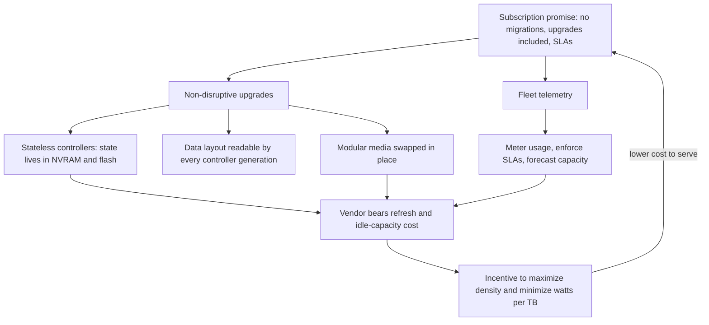
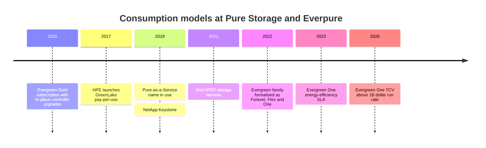

# 23. Consumption models

> **Depth:** L2 · **Reading time:** ~5 min · **Last verified:** 2026-11-01
> **Prerequisites:** [Performance and economics metrics](../01-storage-fundamentals/04-performance-and-economics-metrics.md) · [Scale-up dual-controller arrays](14-scale-up-dual-controller.md) · [Control planes and fleet management](22-control-planes.md)

## TL;DR

- **Storage is bought four ways:** outright capex, a lease, capex plus an upgrade subscription (Evergreen//Forever-style), or storage-as-a-service (STaaS), where the vendor owns the hardware and bills for consumption against SLAs.
- **Total cost over five years can be similar; the cash-flow shape, balance-sheet treatment and risk allocation differ.** STaaS turns a lumpy purchase into a usage-tracking fee and moves overprovisioning and refresh risk to the vendor.
- **For the vendor, STaaS trades upfront product revenue for ratable revenue.** A mix shift toward it depresses reported growth while lifting ARR, RPO and TCV, which is why Everpure leads with those metrics.
- **The business model is an architecture requirement.** A credible subscription needs non-disruptive upgrades, stateless controllers and fleet telemetry; bolting a subscription onto a forklift-upgrade array just finances the forklift.
- **Everpure was early (Evergreen, 2015).** Dell, NetApp and HPE now match the contract terms; matching the architecture is harder.

## Why this matters for Everpure strategy

Subscription services were 46% of Everpure's FY2026 revenue, and subscription ARR reached $1,924.3M with 113% net dollar retention[^1]. By Q2 FY2027 ARR was $2.13B (+20%) and RPO $4.1B (+44%)[^2]. Storage-as-a-service TCV, led by Evergreen//One, grew 121% to $277M in that quarter, a run rate above $1B a year[^3]. Management says this acceleration "dilutes reported near-term revenue growth"[^3]. Reading Everpure's financials or pricing a deal against Dell APEX requires knowing what each model does to cash, revenue and architecture.

## Core concepts

### Four ways to pay for the same petabyte

| Model | Who owns the asset | How upgrades work | Vendor revenue (ASC 606) | Customer accounting (US GAAP) | Examples |
|---|---|---|---|---|---|
| Capex purchase + maintenance | Customer | Forklift refresh every 4–6 years, with data migration | Product upfront at transfer of control; support ratable | PP&E, depreciated; support is opex | Any array |
| Operating lease | Lessor (bank or captive finance arm) | As capex; asset returned or refinanced at term end | Upfront if sold to a third-party lessor | Right-of-use asset and lease liability on balance sheet (ASC 842); straight-line cost | Any array via leasing partner |
| Capex + upgrade subscription | Customer | Controllers refreshed in place at renewal; media expanded with credits | Product upfront; subscription ratable[^4] | PP&E plus opex subscription | Evergreen//Forever[^5]; NetApp Storage Lifecycle Program / Advance[^6]; Dell Future-Proof[^7] |
| Storage-as-a-service | Vendor | Vendor's problem; SLA-backed | Over time, on consumption above a minimum commitment[^8] | Usually a service contract, so opex and off balance sheet, if the vendor's substitution rights are substantive[^9] | Evergreen//One; Dell APEX; NetApp Keystone; HPE GreenLake |

*Table 23.1 — Moving down the table shifts asset ownership, refresh risk and revenue timing from the customer's books to the vendor's.*

The lease-versus-service line is an audit judgment. Under ASC 842, a contract contains a lease if there is an identified asset the customer directs. A vendor's right to swap hardware is only "substantive" if it is practical and economic for the vendor[^9]. STaaS contracts sell capacity and performance, not specific boxes. One EBITDA nuance: STaaS fees and US GAAP operating-lease cost both sit above EBITDA, whereas purchased hardware depreciation sits below it.

### Cash-flow shapes

*Figure 23.1 — Illustrative: the three models land within ~15% of each other in nominal five-year cost; what differs is timing, who carries idle capacity, and who pays for the refresh.*
Data: `data/ch23_cashflow.csv`

**Assumptions.** Demand starts at 1.0 PB effective and grows 20% a year. The capex buyer sizes for year 3 (1.5 PB at an assumed $400K per PB), expands 0.6 PB in year 4 at prices 15% a year lower, and pays 12% a year for support. The lease finances the same hardware at 7%. STaaS charges an assumed $144K per PB-year on actual usage. Discounting at 8% with payments at the start of each year, present costs are capex ~$969K, lease ~$1,007K and STaaS ~$899K. Three things the nominal totals hide: the capex buyer runs one-third idle in year 1 (1.0 of 1.5 PB used); its controllers are five years old at the end and due for a forklift refresh that STaaS already includes; and the STaaS rate is the negotiated variable that decides the winner. **Semiconductor bridge:** STaaS is a foundry capacity reservation. The customer commits to a minimum take, and the vendor owns the fab, the utilization risk and the node upgrades.

### What the vendor's P&L sees

Take a three-year, $1.2M deal. Sold as capex, perhaps $0.9M is product revenue in the quarter it ships and $0.3M of support is recognized at $25K a quarter, so year-one revenue is about $1.0M. Sold as STaaS, it is roughly $100K a quarter, $0.4M in year one. Same economics, 60% less year-one revenue, while the vendor pays for hardware up front. Hence Everpure's emphasis on ARR, RPO and TCV, and its CEO's claim that growth adjusted for the Evergreen//One shift exceeded 40%[^3]. Its subscription gross margin (74.9% in Q2 FY2027) exceeds product (66.2%)[^10], but STaaS hardware costs sit inside the subscription line.

### Why the business model shapes the architecture

*Figure 23.2 — A subscription is only profitable if upgrades are cheap and risks are measurable, so the contract pushes engineering toward stateless controllers, modular media and telemetry.*

A subscription that promises "never migrate again" is a liability unless swapping controllers is routine. That works only if controllers hold no unique state ([Chapter 14](14-scale-up-dual-controller.md)) and new controllers read old layouts. Think of a CPU socket kept compatible across generations: chassis as motherboard, controller as chip. Pure Storage had delivered more than 10,000 non-disruptive controller upgrades to more than 3,000 customers by 2022[^11]. SLAs require measurement, so Evergreen//One's guarantees run on Pure1 telemetry ([Chapter 22](22-control-planes.md)), including a watts-per-TiB energy guarantee introduced in January 2023[^12]. Once the vendor pays for power and hardware, density is margin, which ties DirectFlash to the subscription model ([Chapter 26](../04-everpure/26-purity-and-directflash.md)).

## How Everpure approaches it vs. competitors

Everpure's Evergreen family has three tiers. Evergreen//Forever is owned hardware with a subscription and a controller refresh at each three-year renewal ("Ever Modern"; six years for the //E lines)[^13]. Evergreen//Flex bills capacity per use across a fleet. Evergreen//One is full STaaS, formerly Pure-as-a-Service[^5]. Its SLAs cover performance, availability, capacity, energy and cyber recovery[^14]. Gartner named Pure Storage a Leader in its 2025 consumption-services Magic Quadrant[^15].

Steelman the competitors. HPE launched GreenLake pay-per-use in 2017[^16], earlier than most, and covers compute and networking as well as storage. NetApp Keystone (2019)[^17] runs across on-premises and hyperscaler ONTAP. Dell APEX (2021)[^18] can wrap the broadest hardware portfolio. On contracts, NetApp's and Dell's controller-refresh programs now mirror Evergreen//Forever[^6][^7]. Everpure's edge lies in architecture and track record, not contract terms: one OS lineage designed for in-place upgrades, and a decade of refreshes delivered. A vendor that must migrate data to refresh carries that cost inside every STaaS contract.

## History and trajectory

*Figure 23.3 — Subscriptions moved from a Pure Storage differentiator (2015) to an industry norm (2021); the competition shifted to SLAs and architecture.*

Next: Evergreen//One Overdrive, letting customers burst above their subscribed level, was announced in 2026[^19] [VERIFY: terms and GA]. Contract lengths are reported at three to four years[^3].

## Numbers that matter

| Metric | Value | Context | Source / date |
|---|---|---|---|
| Subscription ARR | $2.13B (+20%) | Q2 FY2027 | Everpure, 2026-08-26[^2] |
| RPO | $4.1B (+44%) | Q2 FY2027 | Everpure, 2026-08-26[^2] |
| STaaS TCV (mainly Evergreen//One) | $277M (+121%) | Q2 FY2027; >$1B run rate | Earnings call, 2026-08[^3] |
| STaaS TCV, FY2026 | $520M (+32%) | [VERIFY: transcript summary only] | Earnings call, 2026-02[^20] |
| Subscription net dollar retention | 113% | FY2026 (FY2025: 117%) | 10-K[^1] |
| Non-disruptive controller upgrades | >10,000 for >3,000 customers | Cumulative to 2022 | Blocks & Files[^11] |
| Year-one revenue, STaaS vs capex | ~40% | Same $1.2M deal | Worked example |

## Conversation playbook

**Questions for a PM**

1. *"What is Evergreen//One's gross margin by contract year?"* Strong: a curve showing early-year hardware drag and later payback, plus the utilization assumption.
2. *"How much headroom above commitment do we deploy, and who pays when it sits idle?"* Strong: a percentage, the forecasting model, and redeployment practice.
3. *"Why do customers choose Forever over One?"* Strong: accounting, data-sovereignty and procurement reasons by segment.

**Questions for an engineer**

1. *"What breaks a non-disruptive upgrade?"* Strong: specific generation-boundary constraints and how they are tested.
2. *"Which SLA is hardest to meet?"* Strong: names the metric and the telemetry used to police it.
3. *"How is consumption metered: provisioned, written or effective capacity?"* Strong: the exact counter and how data reduction enters it.

**Don't say this:**

- "STaaS is always cheaper." It moves risk; the price decides.
- "Subscription means off balance sheet." Only if no embedded lease exists.
- "Lower revenue growth means weaker demand." Check TCV and RPO first.

## Going deeper (optional, L3 pointers)

- Everpure 10-K revenue-recognition note; ASC 606 and ASC 842 guidance on identified assets and substitution rights.
- Evergreen program description and Evergreen//One product guide (SLA definitions, metering).

## Key terms

- **STaaS** — vendor-owned storage billed on consumption against SLAs.
- **TCV / RPO / ARR** — contract value signed, contracted revenue not yet recognized, annualized subscription run rate.
- **Ratable recognition** — revenue spread evenly over the service period.
- See the [glossary](../glossary.md).

## Sources

[^1]: Everpure, "Form 10-K for fiscal year ended February 1, 2026," 2026-03-24. https://www.sec.gov/Archives/edgar/data/1474432/000147443226000027/pstg-20260201.htm (retrieved 2026-11-01).
[^2]: Everpure, "Everpure Announces Second Quarter Fiscal 2027 Financial Results," 2026-08-26. https://investor.everpuredata.com/news-and-events/press-releases/press-release-details/2026/Everpure-Announces-Second-Quarter-Fiscal-2027-Financial-Results/default.aspx (retrieved 2026-11-01).
[^3]: Quartr, "Everpure (P) Q2 2027 earnings summary," 2026-08. https://quartr.com/events/everpure-inc-p-q2-2027_3girLLYP (retrieved 2026-11-01); corroborated by Statementdog, "Everpure Inc (P) 2027 Q2 earnings call transcript," 2026-08. https://statementdog.com/analysis/P/earnings_calls/318913 (retrieved 2026-11-01).
[^4]: Pure Storage, "Form 10-K for fiscal year ended February 6, 2022," 2022-04. https://www.sec.gov/Archives/edgar/data/1474432/000162828022008643/pstg-20220206.htm (retrieved 2026-11-01).
[^5]: Blocks & Files, "Pure Storage Evergreen rework," 2022-06-08. https://blocksandfiles.com/2022/06/08/pure-storage-evergreen-rework/ (retrieved 2026-11-01).
[^6]: NetApp, "Storage Lifecycle Program" (additional terms), n.d. https://www.netapp.com/how-to-buy/sales-terms-and-conditions/additional-terms/storage-lifecycle-program/ (retrieved 2026-11-01); StorageNewsletter, "NetApp Advance," 2023. https://www.storagenewsletter.com/?p=258667 (retrieved 2026-11-01).
[^7]: Dell Technologies, "Future-Proof Program," n.d. https://www.dell.com/en-uk/dt/products/future-proof-program.htm (retrieved 2026-11-01).
[^8]: Pure Storage, "Form 10-K for fiscal year ended February 2, 2025," 2025-04. https://www.sec.gov/Archives/edgar/data/1474432/000162828025015044/pstg-20250202.htm (retrieved 2026-11-01).
[^9]: PwC Viewpoint, "Leases guide, 2.3 Definition of a lease," n.d. https://viewpoint.pwc.com/dt/us/en/pwc/accounting_guides/leases/leases__4_US/chapter_2_scope__1_US/23_definition_of_a_l_US.html (retrieved 2026-11-01).
[^10]: Investing.com, "Everpure Q2 FY27 slides: 38% revenue growth, guidance raised sharply," 2026-08. https://www.investing.com/news/company-news/everpure-q2-fy27-slides-38-revenue-growth-guidance-raised-sharply-93CH-4878054 (retrieved 2026-11-01).
[^11]: Blocks & Files, "Pure Storage reworks Evergreen subscription service," 2022-06-08. https://www.blocksandfiles.com/block/2022/06/08/pure-storage-reworks-evergreen-subscription-service/1591308 (retrieved 2026-11-01).
[^12]: Pure Storage, "With industry-first energy efficiency guarantee, Pure Storage further expands SLA offerings for Evergreen//One," 2023-01-18. https://www.purestorage.com/company/newsroom/press-releases/pure-expands-sla-offerings-evergreen-one.html (retrieved 2026-11-01).
[^13]: Everpure, "Evergreen Program Description," n.d. https://www.everpuredata.com/legal/evergreen-program-description.html (retrieved 2026-11-01).
[^14]: Everpure, "Evergreen//One Storage as a Service" (solution brief), n.d. https://www.everpuredata.com/content/dam/pdf/en/solution-briefs/sb-evergreen-one-storage-as-a-service.pdf (retrieved 2026-11-01).
[^15]: Nasdaq / PR Newswire, "Pure Storage Named a Leader in the 2025 Gartner Magic Quadrant for Infrastructure Platform Consumption Services," 2025. https://www.nasdaq.com/press-release/pure-storage-named-leader-2025-gartnerr-magic-quadranttm-infrastructure-platform (retrieved 2026-11-01).
[^16]: StorageNewsletter, "HPE GreenLake, suite of pay-per-use solutions," 2017-12-06. https://www.storagenewsletter.com/2017/12/06/hpe-greenlake-suite-of-pay-per-use-solutions/ (retrieved 2026-11-01).
[^17]: Blocks & Files, "NetApp adds Keystone subscription billing," 2019-10-29. https://blocksandfiles.com/2019/10/29/netapp-adds-keystone-subscription-billing/ (retrieved 2026-11-01).
[^18]: TechTarget, "Dell Apex launches data storage, cloud as-a-service options," 2021-05. https://www.techtarget.com/searchstorage/news/252500268/Dell-Apex-launches-data-storage-cloud-as-a-service-options (retrieved 2026-11-01).
[^19]: Coolspirit, "Pure Accelerate 2026: What the latest announcements mean for enterprise storage," 2026-06. https://www.coolspirit.co.uk/blogs/pure-accelerate-2026-what-the-latest-announcements-mean-for-enterprise-storage (retrieved 2026-11-01).
[^20]: ROIC.ai, "Everpure Q4 FY2026 earnings call transcript," 2026-02-25. https://www.roic.ai/quote/P/transcripts/2026-year/4-quarter (retrieved 2026-11-01).
