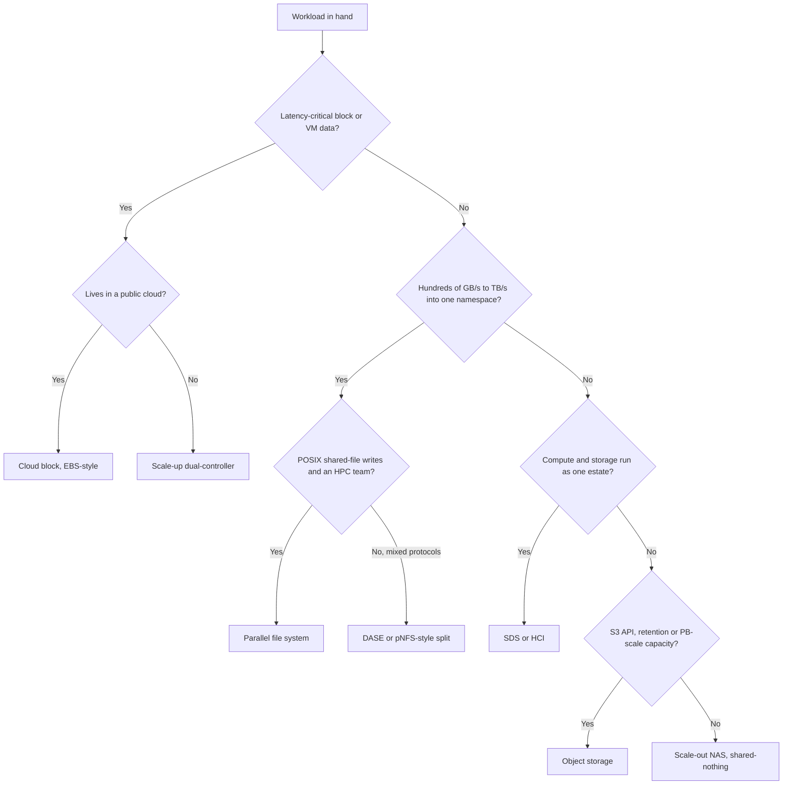
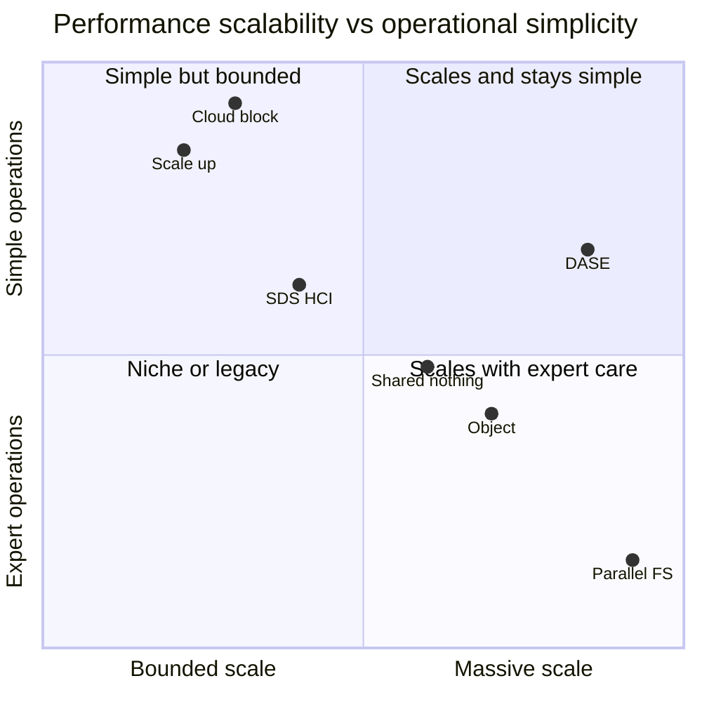

# 24. Architecture decision matrix

> **Depth:** L2 · **Reading time:** ~6 min · **Last verified:** 2026-11-01
> **Prerequisites:** [The storage stack](13-storage-stack.md) · [Scale-up dual-controller](14-scale-up-dual-controller.md) · [Scale-out shared-nothing](15-scale-out-shared-nothing.md) · [DASE](16-disaggregated-shared-everything.md) · [Parallel file systems](17-parallel-file-systems.md) · [Object storage](18-object-storage-architecture.md) · [SDS and HCI](19-software-defined-and-hci.md)

## TL;DR

- **Seven architectures cover almost every deal.** Each has a home workload and a wall (Chapters 14–19).
- **Five questions decide most deals:** how big, which protocol, latency or throughput, how large a failure domain the customer accepts, and who operates it at what cost. Vendor features come after.
- **The deepest split is latency-bound versus throughput-bound.** Databases and VMs want sub-millisecond block; AI training and HPC want TB/s into one namespace.
- **AI is not one workload.** Data loading, checkpointing, KV-cache serving and RAG land in different cells, so "AI storage" is a portfolio question.
- **The boundaries are blurring.** Everyone now sells "unified" block, file and object, and Gartner's 2025 Magic Quadrant merged them into one category[^1]. Underneath, the architectures, and their walls, have not converged.

## Why this matters for Everpure strategy

Everpure sells three architectures: scale-up (FlashArray), a blade scale-out it calls shared-everything (FlashBlade//S and //E), and a pNFS-style parallel design (FlashBlade//EXA), plus container-native SDS (Portworx) and Purity in public clouds. It sells no DASE system and no general-purpose HCI. A strategy team needs to know which cells Everpure covers natively, where it partners, and where rivals fit better by design, because discounting won't win those cells.

The matrix also guards against category errors: an enterprise "AI storage" request is often mostly a capacity and governance problem.

## Core concepts

### The heatmap

| Architecture | OLTP databases | VMs / VDI | Containers | Backup / restore | HPC simulation | AI training (data load) | AI checkpointing | AI inference / KV cache | RAG / vector | Archive |
|---|---|---|---|---|---|---|---|---|---|---|
| **Scale-up dual-controller** | ● sub-ms, sync replication, mature | ● clones dedupe, deep hypervisor integration | ◐ CSI works, one array's ceiling | ◐ fast restores, pricey per TB | ○ one pair caps bandwidth | ○ one pair caps GB/s | ◐ fine for small clusters | ◐ low latency, little shared scale | ● vector DB is a database | ○ $/TB too high |
| **Scale-out shared-nothing** | ◐ east-west hop adds latency | ◐ works; rebuilds hit tail latency | ◐ Ceph/Rook common, ops-heavy | ● capacity grows node by node | ◐ strong in WEKA, weaker NAS | ● bandwidth grows per node | ● every node absorbs writes | ◐ NVMe near GPUs, vendor-dependent | ◐ corpus fine, index elsewhere | ◐ HDD nodes, bundled scaling |
| **DASE** | ◐ block new, fabric hop | ◐ NFS datastores; young block | ◐ CSI fine, large minimum | ● QLC plus reduction, fast restore | ● one namespace, multi-TB/s | ● built for GPU-cluster reads | ● SCM buffer absorbs bursts | ● any node reaches shared flash | ◐ corpus fits; engines vendor-specific | ◐ cheap only at scale |
| **Parallel file system** | ○ wrong semantics and latency | ○ not a datastore | ◐ shared mounts, client friction | ○ costly, complex target | ● its home ground | ● striping feeds thousands of GPUs | ● clients write servers directly | ◐ bandwidth fits, integrations maturing | ○ small files strain metadata | ○ flash tier too costly |
| **Object** | ○ no in-place updates | ○ not block | ◐ cloud-native apps use S3 | ● immutability, cheap, geo-EC | ○ no POSIX, needs staging | ◐ fine with streaming loaders | ◐ async upload, slow sync | ◐ latency-tolerant KV tiers | ● data-lake corpus, native vectors | ● lowest $/TB, geo-EC |
| **SDS / HCI** | ◐ local reads, coupled scaling | ● HCI's original use case | ● container-native data services | ◐ small sites only | ○ coupled nodes, no striping | ○ GPU servers aren't HCI | ○ not built for bursts | ○ not on GPU fabric | ◐ vector DB pods fine | ○ flash HCI costly per TB |
| **Cloud block (EBS-style)** | ● sub-ms io2, pay per IOPS | ● native boot volumes | ◐ CSI works, AZ-pinned volumes | ◐ snapshots to S3, egress | ○ per-volume throughput caps | ○ single-attach, volume caps | ○ ~4 GB/s per volume | ○ no shared namespace | ◐ vector DB on volumes | ○ use object tiers instead |

**Legend:** ● natural fit, what the architecture was built for · ◐ workable with caveats or vendor-dependent · ○ poor fit, usually the wrong tool. Ratings are the atlas's judgment for typical 2026 deployments, not benchmarks; a strong product can beat its row.

*Figure 24.1 — Read the heatmap by row for an architecture's home turf and by column for which architectures compete for a workload. Most columns have two or three credible answers, not one.*

### The five questions that decide a real deal

| Question | What to ask | Pushes toward |
|---|---|---|
| **Scale** | Capacity today and in three years; how many clients | <~2 PB, tens of hosts → scale-up; multi-PB, thousands of clients → scale-out, DASE, parallel FS, object |
| **Protocol** | Block, NFS/SMB, POSIX shared-file, S3 | Block → scale-up or cloud block; S3 → object; shared-file writes from many nodes → parallel FS |
| **Latency vs throughput** | p99 latency target, or aggregate GB/s | Latency → fewest hops (scale-up); throughput → most parallel paths (parallel FS, DASE) |
| **Failure domain** | What may one fault take down, and how long is a rebuild? | Small blast radius → many small arrays; wide EC → big shared pools |
| **Operating model and economics** | Who runs it, kernel clients allowed, capex vs service | Thin team → appliance or cloud; HPC team → parallel FS; cost per TB → object/QLC |

*Figure 24.2 — The first three questions narrow the matrix to one or two rows; the last two usually choose between them.*

**Latency versus throughput** is the deepest split, and it is physics. A 4 KB database write on a networked all-flash array completes in roughly 100–250 µs ([Chapter 13](13-storage-stack.md)). Each extra fabric hop or forwarded request adds tens of microseconds, so the latency winner is the design with the fewest hops between host and NVRAM. Throughput is the reverse problem. A 405B-parameter checkpoint is about 405e9 × 16 bytes ≈ 6.5 TB. At 20 GB/s (an illustrative single-array figure) the write takes 6.5e12 ÷ 20e9 ≈ 325 s. At the 877.5 GiB/s that 30 FlashBlade//EXA data nodes posted in MLPerf Storage v3.0[^2] (≈ 942 GB/s), it takes ≈ 7 s. That gap is the whole case for parallel paths. The semiconductor bridge is the HBM-versus-DRAM trade: HBM wins on bandwidth by going wide, DDR wins on cost and capacity, and no single interface wins both.

**Failure domain** costs money a spec sheet hides. A dual-controller array loses at most itself; a failed DASE enclosure or shared-nothing node puts a slice of a giant namespace into rebuild ([Chapter 20](20-distributed-systems-fundamentals.md)).

### The decision tree

*Figure 24.3 — The tree picks a starting row; failure-domain and economics questions then test it, and real estates usually end with two or three rows.*

### Justifying the contentious cells

- **Scale-up gets ● for RAG/vector.** A vector database is a database. Its hot index lives in DRAM or on low-latency block, which arrays serve well. The source corpus belongs in object or file, which is why object also gets ●, helped by AWS making S3 Vectors generally available in December 2025 with up to two billion vectors per index[^3].
- **DASE gets ◐, not ○, for OLTP.** VAST added NVMe/TCP block in 2025[^4], but every I/O still crosses a back-end fabric, and few banks yet run tier-1 databases on it.
- **Object gets ◐ for training.** Many labs stream shards from S3 through caching loaders; small-file random access drops it to ○.
- **Parallel FS gets ◐ for KV cache.** The bandwidth is there, and EXA led the v3.0 KV-cache read test[^2], but serving millions of small, latency-sensitive KV blocks is newer ground than streaming checkpoints ([Chapter 32](../05-ai-storage/32-inference-and-kv-cache.md)).
- **Cloud block gets ● for OLTP despite cost.** io2 Block Express promises under 500 µs average at 16 KiB and 256K IOPS per volume[^5]. The objection is price per IOPS, not fit.

### The quadrant view

*Figure 24.4 — Placement is the atlas's judgment: the commercial prize is the top-right quadrant, which is why DASE and pNFS-style designs are where the AI-era competition concentrates.*

Object sits low because self-run PB-scale object needs expertise; managed S3 would sit near cloud block. DASE scores well because stateless compute nodes make upgrades routine.

### Where the boundaries are blurring

Three forces are blurring the rows. First, **protocol unification**: FlashArray gained S3 in 2025[^6], VAST added block[^4], WEKA's NeuralMesh 6 unified file and object[^7], and HPE markets the X10000 as unifying all three[^8]. Second, **control-plane unification**: Everpure's Enterprise Data Cloud[^9] and DDN's CORE layer over EXAScaler and Infinia[^10] present several architectures as one pool. Third, **hybrids**: FlashBlade//EXA is a parallel file system on a scale-out metadata engine ([Chapter 17](17-parallel-file-systems.md)). NetApp's AFX is shared-media but documented for NAS and object, not block[^11].

Test any "unified" claim against the matrix: which column was the protocol *added* for, and do its latency and failure domain match a native design?

## How Everpure approaches it vs. competitors

| Architecture | Everpure | Incumbent competitors | AI-native, software and cloud competitors |
|---|---|---|---|
| Scale-up dual-controller | FlashArray //X, //C, //XL, //E, //ST[^6] | Dell PowerStore, PowerMax; NetApp AFF/ASA; HPE Alletra MP B10000; IBM FlashSystem | — |
| Scale-out shared-nothing | FlashBlade//S (blades in a chassis; Everpure calls it shared-everything) | Dell PowerScale; NetApp ONTAP clusters | WEKA NeuralMesh, Qumulo, Ceph |
| DASE | None; EXA is the counter-design | NetApp AFX[^11]; HPE Alletra MP X10000[^8] | VAST Data |
| Parallel file system | FlashBlade//EXA (pNFS)[^12] | Dell PowerScale pNFS / Lightning; HPE Cray E2000 (Lustre)[^13]; IBM Storage Scale | DDN EXAScaler, BeeGFS, Hammerspace |
| Object | FlashBlade S3; FlashArray S3[^6] | Dell ObjectScale; NetApp StorageGRID; HPE X10000 | AWS S3, MinIO AIStor, Cloudian, Scality, DDN Infinia |
| SDS / HCI | Portworx; FlashArray behind Nutanix[^14] | Nutanix; VMware vSAN (Broadcom) | Ceph, Red Hat and IBM distributions |
| Cloud block | Pure Storage Cloud Dedicated (ex-Cloud Block Store) and Azure Native[^15] | NetApp ONTAP in hyperscaler clouds | AWS EBS, Azure Managed Disks, Google Hyperdisk |

*Table 24.5 — Everpure covers five of the seven rows natively and the HCI row by partnership; DASE is the row it competes against rather than in.*

The steelman for VAST: one DASE system covers most of the heatmap's right half with one namespace and reduction domain, which suits neoclouds. For Dell and NetApp: a native product in nearly every row under one contract. Everpure's counter is one OS family (Purity) and one control plane across its rows, with media economics from DirectFlash ([Chapter 26](../04-everpure/26-purity-and-directflash.md)). Options a strategy team might evaluate, based on public information: closing the KV-cache cell faster (PureKVA shipped on FlashBlade in October 2026[^16]); using Portworx's Kubernetes VM-migration cell to pull through arrays; and keeping "unified" messaging behind per-workload proof points.

## History and trajectory

Until about 2010 the matrix had three rows: SAN arrays, NAS filers and tape. Shared-nothing and object came with web-scale data, HCI with 2010s virtualization, DASE and pNFS revivals with GPUs. In 2025 the market started folding rows together: Gartner's new Enterprise Storage Platforms category[^1], NetApp AFX in October 2025[^11], and DDN CORE in November 2025[^10]. The signal to watch in 2027 is whether buyers run one platform across columns, as CoreWeave's reported US$1.17B VAST agreement suggests for neoclouds[^17], or keep best-of-breed per column, as most enterprises still do.

## Numbers that matter

| Metric | Value | Context | Source / date |
|---|---|---|---|
| 4 KB write, networked all-flash array | ~100–250 µs | Why scale-up owns OLTP | Worked example, [Chapter 13](13-storage-stack.md) |
| io2 Block Express per volume | 256K IOPS, 4,000 MB/s, <500 µs avg (16 KiB) | Cloud block fits OLTP but not bulk throughput | AWS docs[^5] |
| FlashBlade//EXA checkpoint write | 877.5 GiB/s, 30 data nodes | Parallel-path ceiling in a standard benchmark | MLPerf Storage v3.0, 2026-09[^2] |
| 405B-model checkpoint at 20 GB/s vs ~942 GB/s | ~325 s vs ~7 s | Why throughput-bound work needs scale-out paths | Worked example |
| Lustre share of Top500 | >60% | Parallel FS still owns HPC | ACM TOS, 2025-06[^18] |
| S3 Vectors per index | Up to 2 billion vectors | Object moving into the RAG column | AWS, 2025-12[^3] |
| NetApp AFX scale | Up to 128 controllers | DASE-style pools reaching incumbents | NetApp docs[^19] |

## Conversation playbook

**Questions for a PM**
1. *"Which cells do we lose on architecture rather than price?"* Strong answer: names them (shared-file-write HPC, multi-site geo-EC object) and a plan for each: partner, roadmap or walk away.
2. *"Where does 'unified' help a buyer?"* Strong answer: one control plane and support contract, with honesty about which protocol is native.
3. *"What is our AI-inference story by cell?"* Strong answer: separates KV cache (PureKVA) from RAG corpora (FlashBlade S3/NFS) from vector-DB block (FlashArray).

**Questions for an engineer**
1. *"What is the p99 penalty of block through a scale-out design?"* Strong answer: the extra hop in microseconds, plus rebuild effects on tail latency.
2. *"How big is the failure domain in EXA's data tier today?"* Strong answer: states the current data-node protection scheme [VERIFY: current FlashBlade//EXA data-node protection] and rebuild time per node.
3. *"Where does the decision tree break?"* Strong answer: small-file AI datasets look throughput-bound but are metadata-bound ([Chapter 21](21-metadata.md)).

**Don't say this:**
- "One platform for every workload." No architecture rates ● in every column, including Everpure's.
- "Object is just for archive." It is the default RAG and data-lake substrate.
- "Parallel file systems are legacy HPC." They lead AI checkpointing benchmarks.
- "DASE can't do block." It can; the question is latency and maturity.

## Going deeper (optional, L3 pointers)

- Test cells with workload-specific benchmarks: MLPerf Storage, SPECstorage and IO500 ([Chapter 37](../05-ai-storage/37-reading-benchmarks.md)).
- For vendor-by-vendor matrices see [Chapter 45](../06-industry-and-competition/45-head-to-head.md) and [Chapter 49](../06-industry-and-competition/49-competitive-matrices.md); for the AI pipeline stages behind the AI columns, [Chapter 30](../05-ai-storage/30-ai-data-pipeline.md).

## Key terms

Architecture decision matrix · workload fit · latency-bound · throughput-bound · failure domain · blast radius · unified storage platform · enterprise storage platform · cloud block storage · S3 Vectors · PureKVA. See the [glossary](../glossary.md).

## Sources

[^1]: Gartner, "Magic Quadrant for Enterprise Storage Platforms" (abstract), 2025-09-02. https://www.gartner.com/en/documents/6908066 (retrieved 2026-11-01).
[^2]: StorageReview, "MLPerf Storage v3.0: 877 GiB/s Checkpoints, a Cloud First, and a Leaderboard Turned Over," 2026-09. https://www.storagereview.com/news/mlperf-storage-v3-0-877-gib-s-checkpoints-a-cloud-first-and-a-leaderboard-turned-over (retrieved 2026-11-01); HPCwire, "Everpure Leads MLPerf Storage Tests for Large Model Checkpointing and KV Cache," 2026-09-02. https://hpcwire.com/off-the-wire/everpure-leads-mlperf-storage-tests-for-large-model-checkpointing-and-kv-cache (retrieved 2026-11-01).
[^3]: AWS, "Amazon S3 Vectors is now generally available with 40 times the scale of preview," 2025-12-02. https://aws.amazon.com/about-aws/whats-new/2025/12/amazon-s3-vectors-generally-available/ (retrieved 2026-11-01).
[^4]: VAST Data, "The latest VAST release is all about the protocols," 2025-02. https://vastdata.com/blog/the-latest-vast-release-is-all-about-the-protocols (retrieved 2026-11-01); Blocks & Files, "VAST Data expands into block storage and event broking," 2025-02-19. https://www.blocksandfiles.com/ai-ml/2025/02/19/vast-data-expands-into-block-storage-and-event-broking/1600470 (retrieved 2026-11-01).
[^5]: AWS, "Amazon EBS Provisioned IOPS SSD volumes," Amazon EBS User Guide, n.d. https://docs.aws.amazon.com/ebs/latest/userguide/provisioned-iops.html (retrieved 2026-11-01).
[^6]: Techzine, "Pure surprises: FlashArray gets S3 support, FlashArray//ST without DFMs," 2025-06. https://www.techzine.eu/blogs/infrastructure/132388/pure-surprises-flasharray-gets-s3-support-flasharray-st-without-dfms/ (retrieved 2026-11-01).
[^7]: HPCwire, "WEKA Launches NeuralMesh 6 and WEKApod as AI Inference Pushes Infrastructure Limits," 2026-07-22. https://www.hpcwire.com/2026/07/22/weka-launches-neuralmesh-6-and-wekapod-as-ai-inference-pushes-infrastructure-limits/ (retrieved 2026-11-01).
[^8]: HPE via Business Wire, "HPE Named a Leader in 2025 Gartner Magic Quadrant for Enterprise Storage Platforms," 2025-09-05. https://www.businesswire.com/news/home/20250905961275/en/HPE-Named-a-Leader-in-2025-Gartner-Magic-Quadrant-for-Enterprise-Storage-Platforms (retrieved 2026-11-01).
[^9]: Blocks & Files, "Pure debuts Enterprise Data Cloud with Fusion updates and new FlashArray systems," 2025-06-18. https://www.blocksandfiles.com/ai-ml/2025/06/18/pure-debuts-enterprise-data-cloud-with-fusion-updates-and-new-flasharray-systems/100996 (retrieved 2026-11-01).
[^10]: Blocks & Files, "DDN goes hard CORE," 2025-11-18. https://www.blocksandfiles.com/ai-ml/2025/11/18/ddn-goes-hard-core/1718766 (retrieved 2026-11-01).
[^11]: NetApp, "AFX overview: capabilities," ONTAP technical reports, n.d. https://docs.netapp.com/us-en/ontap-technical-reports/afx-overview/afx-overview-capabilities.html (retrieved 2026-11-01); Blocks & Files, "NetApp disaggregates ONTAP storage and provides an AI Data Engine," 2025-10-14. https://blocksandfiles.com/2025/10/14/netapp-disaggregates-ontap-storage-and-provides-an-ai-data-engine/ (retrieved 2026-11-01).
[^12]: Everpure, "Technical Brief: FlashBlade//EXA," n.d. (2025). https://www.everpuredata.com/content/dam/pdf/en/technical-briefs/tb-flashblade-exa.pdf (retrieved 2026-11-01).
[^13]: Cray User Group, CUG 2025 proceedings paper on HPE Cray Supercomputing Storage Systems E2000, 2025. https://cug.org/proceedings/cug2025_proceedings/includes/files/pap108s2-file1.pdf (retrieved 2026-11-01).
[^14]: StorageNewsletter, "Availability of Nutanix with Pure Storage FlashArray," 2026-01-02. https://www.storagenewsletter.com/2026/01/02/availability-of-nutanix-with-pure-storage-flasharray/ (retrieved 2026-11-01).
[^15]: Pure Community, "Pure Cloud Block Store is now Pure Storage Cloud Dedicated," n.d. https://purecommunity.purestorage.com/tag/cloud (retrieved 2026-11-01); Microsoft Learn, "Pure Storage Cloud overview," n.d. https://learn.microsoft.com/en-us/azure/partner-solutions/pure-storage/overview (retrieved 2026-11-01).
[^16]: Blocks & Files, "Everpure bulks up AI offer," 2026-09-30. https://blocksandfiles.com/flash/2026/09/30/everpure-bulks-up-ai-offer/5300162 (retrieved 2026-11-01).
[^17]: StorageNewsletter, "Vast Data Secures Commercial Partnership Deal with CoreWeave for $1.17 Billion to Power the Next Generation of AI," 2025-11-07. https://www.storagenewsletter.com/2025/11/07/vast-data-secures-commercial-partnership-deal-with-coreweave-for-1-17-billion-to-power-the-next-generation-of-ai/ (retrieved 2026-11-01).
[^18]: R. S. George, A. Dilger et al. (ORNL and others), "Lustre Unveiled: Evolution, Design, Advancements, and Current Trends," *ACM Transactions on Storage* 21(3), 2025-06. DOI 10.1145/3736583. https://www.ornl.gov/publication/lustre-unveiled-evolution-design-advancements-and-current-trends (retrieved 2026-11-01).
[^19]: NetApp, "FAQ for AFX storage systems," n.d. https://docs.netapp.com/us-en/ontap-afx/faq-ontap-afx.html (retrieved 2026-11-01).
