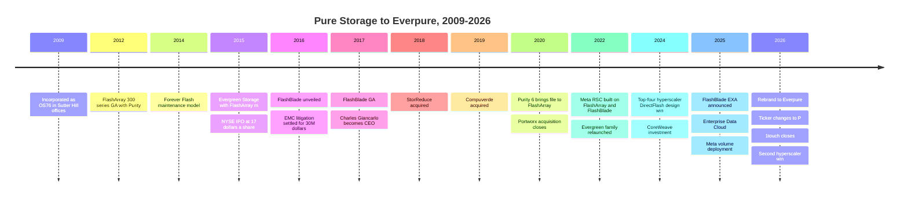
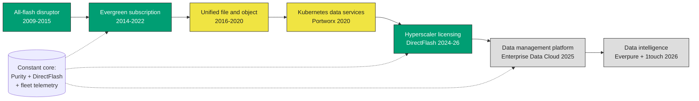

# 25. Company history and strategy, 2009–2026

> **Depth:** L2 · **Reading time:** ~9 min · **Last verified:** 2026-11-01
> **Prerequisites:** [Data reduction](../01-storage-fundamentals/05-data-reduction.md) · [Consumption models](../03-system-architecture/23-consumption-models.md) · [Purity and DirectFlash](26-purity-and-directflash.md)

## TL;DR

- **Pure Storage was founded in 2009 on one insight:** consumer-grade flash plus aggressive data reduction could match disk's cost per usable terabyte. FlashArray reached GA in May 2012; the IPO followed in October 2015.
- **Its durable moat was a business model, not a box.** Forever Flash (2014) and Evergreen (2015) turned controller upgrades into a subscription; subscription ARR was $1.92B at FY2026.
- **Acquisitions were small and capability-driven.** StorReduce, Compuverde, Portworx and 1touch together cost about $0.6B in disclosed consideration, less than one year of free cash flow. One (StorReduce) produced a product that was quietly withdrawn.
- **The newest growth leg is selling IP rather than arrays.** DirectFlash licensing wins with Meta (December 2024) and a second top-five hyperscaler (August 2026) are real, but hyperscale is still a small slice of FY2027 revenue guidance of $5.03–5.07B (about +38%).
- **The February 2026 rebrand to Everpure (NYSE: P, formerly PSTG) is a claim, not yet a result.** It bids for a data-platform valuation while revenue is still mostly arrays and attached subscriptions.

## Why this matters for Everpure strategy

Strategic conversations inside Everpure carry this history. PMs defend Evergreen because it built the installed base; engineers trust Purity because it has survived 14 years of NAND generations; corporate development inherits a pattern of small tuck-ins that bought capabilities, not revenue. Which bets paid off, ran late or died tells you how the organisation weighs a new one.

The rebrand, the 1touch acquisition and hyperscaler licensing all move away from "we sell the best flash array". Is that the fifth pivot in a consistent line, or a break? The record suggests the first, with one caveat: past pivots were underwritten by array cash flows, and the newest ones still are.

## Core concepts

### Seventeen years in one picture

*Figure 25.1 — Each era added a layer on top of the same Purity and DirectFlash core: array (2012), business model (2014–15), file and object (2016–20), cloud-native software (2020), IP licensing (2024) and data intelligence (2026).*

### Era 1, 2009–2015: the all-flash disruptor

The company was incorporated in Delaware in October 2009 as OS76, Inc. and renamed Pure Storage in January 2010[^1]. Its founders, John Colgrove (from Veritas) and John Hayes (from Yahoo), were incubated by Sutter Hill Ventures[^2]. In 2009 enterprise flash meant expensive SLC drives for a few hot databases. Pure bet that consumer MLC flash, managed by software that deduplicated, compressed and spared the cells, could replace disk for primary storage. Illustratively, if a 5:1 data-reduction ratio turns raw flash at five times disk's $/TB into parity per *effective* terabyte, the speed comes almost free ([Chapter 5](../01-storage-fundamentals/05-data-reduction.md)).

Think of a fabless start-up winning with design on a cheap, mature node. After a two-year beta, the FlashArray 300 series reached general availability in May 2012, running the Purity operating environment[^3]. It shipped with "All Software Included" licensing[^1].

The second insight was commercial. Incumbents earned much of their margin from forklift upgrades every three to five years. In February 2014 Pure launched *Forever Flash*, which included a controller refresh with maintenance renewal[^4]. In June 2015 it widened this into the *Evergreen Storage* programme, launched alongside FlashArray//m[^5]. Four months later the IPO priced at $17, raising $425M (25M shares)[^6]. The stock closed its first day at $16.01[^7]. Incumbents fought back in court: Pure settled EMC's patent and trade-secret litigation in October 2016 with a $30M payment to Dell, EMC's new owner[^8].

### Era 2, 2016–2020: second product, new CEO, first deals

FlashBlade, a scale-out file and object system for unstructured data, was unveiled in March 2016 and reached GA on 25 January 2017[^9]. In August 2017 the board appointed Charles Giancarlo, previously CTO of Cisco, as CEO, succeeding Scott Dietzen[^10]. DirectFlash modules, which put raw NAND under Purity's direct control instead of behind an SSD controller, followed with FlashArray//X in April 2017[^11] ([Chapter 26](26-purity-and-directflash.md)).

Three acquisitions followed in 26 months (Table 25.1).

| Target | Announced → closed | Price (disclosed) | Rationale | What became of it |
|---|---|---|---|---|
| StorReduce | Aug 2018 | $20.5M cash, net of cash acquired[^12] | Cloud-native dedupe for object and backup data | Became the ObjectEngine backup appliance (2019). It disappeared from Pure's product pages by mid-2020, with no formal EOL announcement found[^13] |
| Compuverde (Sweden) | Apr 2019 | $47.9M net, plus $15.9M paid to former holders over two years[^14] | File-system software and a team for FlashArray | Basis of native file services in Purity//FA 6.0 (June 2020)[^15] |
| Portworx | Sep 2020 → Oct 2020 | $352.9M consideration plus $32.2M retention (about $370M as announced)[^14][^16] | Kubernetes persistent storage and data services | Sold as Portworx by Everpure. Release 3.6 (Mar 2026) targets VMs on Kubernetes (KubeVirt)[^17] |
| CoreWeave (minority stake) | Nov 2024 | Undisclosed | Channel into GPU clouds | A preferred storage option at CoreWeave[^18]. CoreWeave later signed a $1.17B platform deal with VAST[^19] |
| 1touch | 23 Feb 2026 → 7 May 2026 | $125.0M cash; $101.2M of it booked to goodwill[^20] | Data discovery, classification and semantic context | Relaunched as Everpure Data Intelligence, GA June 2026[^21] |

*Table 25.1 — Everpure buys capabilities, not revenue; the one clear miss (StorReduce) was also the cheapest.*

Disclosed consideration for the four acquisitions is 20.5 + 47.9 + 15.9 + 352.9 + 32.2 + 125.0 ≈ $594M over eight years, less than FY2026 free cash flow of $616M[^22]. No deal bought a large installed base; each had to fit Purity or sit beside it.

### Era 3, 2020–2023: subscription and the first Meta relationship

FY2021 revenue grew only 2%, which the company attributed to COVID-19. FY2022 then rose 29% to $2.18B[^23]. Meta became the showcase AI customer: its AI Research SuperCluster, unveiled in January 2022, used 175 PB of FlashArray and 10 PB of FlashBlade[^24]. In June 2022 Pure reorganised Evergreen into //Forever, //Flex and //One (storage-as-a-service)[^25] ([Chapter 23](../03-system-architecture/23-consumption-models.md)).

In May 2023 a Pure executive predicted that no new hard drives would be sold after 2028. Analysts such as Coughlin Associates disputed it[^26][^27]. It was a marketing line that pointed to the real strategy: QLC DirectFlash at hyperscale.

### Era 4, 2024–2025: from array vendor to IP licensor

On 3 December 2024 Pure announced a DirectFlash design win with a "top-four hyperscaler"[^28]. The FY2025 10-K later named the customer as Meta[^29]. The hyperscaler sources its own hardware and NAND; Pure licenses Purity and DirectFlash technology and provides support[^28]. It is an Arm-style IP licence: Pure trades hardware revenue for margin and reach. Volume deployment began in Q2 FY2026, and the CFO targeted 1–2 EB shipped by the end of that year[^30].

2025 added FlashBlade//EXA for AI-scale throughput (March)[^31] and the *Enterprise Data Cloud*, which uses Fusion to run a fleet as one policy-driven pool (June)[^32] ([Chapter 28](28-platform-and-software.md)).

*Figure 25.2 — Strategy evolution. Green bets have clearly paid off, yellow ones paid off later or more narrowly than first framed, and grey ones are not yet proven. All of them reuse the same core.*

### Era 5, 2026: Everpure

On 23 February 2026 Pure Storage renamed itself Everpure and announced the 1touch acquisition the same day[^33]. On 7 April it said the NYSE ticker would change from PSTG to **P**, effective 17 April 2026[^34]. At Pure//Accelerate in June it made Data Intelligence (formerly 1touch) and Data Stream, a GPU ingest-to-inference pipeline, generally available[^21]. On 10 August a second, unnamed top-five hyperscaler signed a DirectFlash design-win and supply agreement. Meaningful revenue is expected from FY2028[^35].

### The numbers behind the eras

*Figure 25.3 — Revenue compounded about 24% a year over a decade, but unevenly. Two near-flat years show the cost of transitions, and FY2027 guidance would add more revenue in one year than FY2021–FY2024 added in three.*
Data: `data/ch25_revenue.csv`

Worked numbers: FY2016 revenue was $440.3M and FY2026 was $3,662.8M[^36][^37]. That is (3,662.8 ÷ 440.3)^(1/10) ≈ 8.32^0.1 ≈ 1.236, or **about 23.6% CAGR**. FY2027 guidance of $5.03–5.07B[^38] implies about $1.39B of new revenue at the midpoint. FY2021 to FY2024 added only $1.15B (2,830.6 − 1,684.2). FY2017–FY2018 are shown as originally reported, before the ASC 606 accounting change, so they are not strictly comparable.

### What worked, what took longer, what the rebrand signals

**Worked:** Evergreen, which made subscription services $1,691M, or 46% of FY2026 revenue, with ARR of $1,924M[^37]; Purity's single code base across FlashArray and FlashBlade; and the hyperscaler licence, which reached volume shipments within a fiscal year, though its revenue is still small.

**Took longer or landed narrower:** native file on FlashArray took a year from the Compuverde deal to Purity 6.0, and one report says two more years to mature [VERIFY: Purity//FA 6.4 as the release in which file services matured]. Portworx has no disclosed revenue line, and its pitch moved from containers to VM migration off VMware. Hyperscaler revenue was described as small in Q1 FY2027 and back-half-weighted[^39]. The 2028 "end of disk" call is still unproven.

**What the rebrand signals:** the old name tied the company to flash media just as its pitch moved to software, data services and licensing. Options a strategy team might evaluate, based on public information: whether data-intelligence revenue can be disclosed separately enough to support a platform multiple; whether further 1touch-sized deals (governance, vector, lakehouse connectors) are needed to make "data primacy" credible against VAST's AI OS; and how to keep the array franchise funding all of this while NAND costs rise. Everpure raised prices in February 2026[^40], and Q2 FY2027 free cash flow was −$238M after strategic NAND and component purchases[^41].

## How Everpure approaches it vs. competitors

| Company | Starting point | Platform move | AI move | Capital model |
|---|---|---|---|---|
| Everpure | All-flash arrays, one OS (Purity) | Evergreen subscriptions; Fusion/EDC; data intelligence via 1touch | FlashBlade//EXA; DFM licensing to hyperscalers | Public; small tuck-ins funded from FCF |
| NetApp | Unified file/block (ONTAP), hybrid then flash | Cloud-native ONTAP services | AFX disaggregated ONTAP plus AI Data Engine (Oct 2025)[^42] | Public; history of software acquisitions |
| Dell | Broadest portfolio after acquiring EMC | Multiple OSes by product line | PowerScale parallel NFS ("Lightning")[^43] | Public conglomerate; channel scale |
| VAST Data | Disaggregated software platform (2016) | Rebranded as "AI Operating System" (May 2025)[^44] | GPU clouds and neoclouds | Private; $30B valuation (Apr 2026, *reported by CNBC*)[^45] |
| DDN | HPC parallel file systems | "AI and data intelligence" positioning | NVIDIA SuperPOD incumbency | Blackstone $300M at $5B (Jan 2025)[^46] |

*Table 25.2 — Everyone is converging on "data platform for AI". Everpure is unusual in reaching it through one OS and a subscription base rather than through a portfolio (Dell) or a clean-sheet AI design (VAST).*

The steelman for the alternatives: VAST's single-namespace, database-in-storage design was built for AI pipelines, while Everpure is adding equivalent functions after the fact through EXA and Data Stream. Dell and NetApp own larger installed bases and channel reach, and NetApp's ONTAP served file and block from one OS long before Purity 6.0. Everpure's counter-argument is consistency: one OS, one upgrade model and fleet telemetry across 14 years of installed systems ([Chapter 46](../06-industry-and-competition/46-incumbents.md), [Chapter 42](../06-industry-and-competition/42-vast-data.md)).

## History and trajectory

Dated, public signals to watch through 2027:

- **Q3 FY2027** results, due late November 2026, are the first quarter in which management expects hyperscale revenue to rise significantly[^39].
- **Second hyperscaler** revenue is expected from FY2028[^35]. A third win would prove a repeatable model.
- **NAND pricing**: the 2026 component spike tests whether Evergreen contracts protect or squeeze product margins ([Chapter 48](../06-industry-and-competition/48-media-suppliers-and-nand-cycle.md)).
- **Data Intelligence adoption**: no metrics are disclosed yet; the first customer count or ARR figure will be the real test of the rebrand ([Chapter 39](../05-ai-storage/39-agentic-ai-and-data-intelligence.md)).

## Numbers that matter

| Metric | Value | Context | Source / date |
|---|---|---|---|
| IPO | $17/share; $425M raised | Oct 2015, NYSE: PSTG | Press release, 2015-10-06[^6] |
| FY2016 → FY2026 revenue | $440.3M → $3,662.8M | ≈23.6% CAGR (worked above) | 10-Ks[^36][^37] |
| FY2026 subscription ARR | $1,924.3M (+16%) | ≈52% of revenue | FY2026 10-K[^37] |
| FY2026 free cash flow | $616M | Larger than total disclosed M&A spend | Q4 FY26 release[^22] |
| Disclosed M&A consideration | ≈$594M across 4 deals | 2018–2026 | Worked example from Table 25.1 |
| Portworx price | $352.9M + $32.2M retention | Largest deal to date | FY2021 10-K[^14] |
| 1touch price | $125.0M cash | Closed 2026-05-07 | Q1 FY27 10-Q[^20] |
| FY2027 revenue guidance | $5.03–5.07B (≈+38%) | Initial guide (Feb 2026) $4.3–4.4B | Q2 FY27 release, 2026-08-26[^38] |
| Meta DirectFlash target | 1–2 EB by end of FY2026 | First volume deployment Q2 FY26 | Blocks & Files, 2025-08-29[^30] |

## Conversation playbook

**Questions for a PM**

1. *"Which Evergreen promise costs us the most in a NAND upcycle, and how is it priced?"* Strong: names the entitlement (controller refresh, capacity guarantees, //One effective-capacity metering), quantifies exposure and cites contract protections.
2. *"What would make Data Intelligence a separately disclosed line, and when?"* Strong: gives attach rates, standalone versus bundled pricing and a reportable metric, not just "platform".
3. *"Where did Portworx win in FY2026: containers, VM migration or both?"* Strong: separates KubeVirt and VMware-exit deals from cloud-native ones and cites customer counts.

**Questions for an engineer**

1. *"What changed in Purity to serve a hyperscaler that owns the hardware?"* Strong: describes the split between licensed firmware/software and customer-built systems, and who owns failure analysis.
2. *"How much of the Compuverde code still runs in FlashArray file services?"* Strong: candid about the rewrite share and what was kept.
3. *"What did the StorReduce/ObjectEngine exit teach about integrating acquired data paths?"* Strong: names the integration cost and the backup-ISV overlap that made it redundant.

**Don't say this:**

- "Pure invented all-flash storage." Other flash-system vendors were selling before FlashArray reached GA ([Chapter 52](../07-history-and-future/52-history-of-flash.md)). Pure's edge was flash-for-disk economics plus the business model.
- "Everpure is a new company." It is a rename. The legal entity, CUSIP and products carried over.
- "The Meta deal is a hardware sale." It is technology licensing plus support. Meta sources its own hardware and NAND.
- "Pure is an acquisitive company." It has done four small deals in 17 years.

## Going deeper (optional, L3 pointers)

- The 2015 Form S-1 (risk factors and the early Evergreen description) and the FY2021 and FY2026 10-Ks (purchase accounting for Portworx and 1touch).
- [Chapter 29](29-hyperscaler-ecosystem-financials.md) for revenue mix and margin drivers, and [Chapter 54](../07-history-and-future/54-strategic-option-map.md) for the option map.

## Key terms

- **Evergreen** — Everpure's subscription family (//Forever, //Flex, //One) that replaces forklift upgrades.
- **Forever Flash** — the 2014 predecessor programme bundling controller refreshes with maintenance.
- **Design win (hyperscaler)** — a customer's commitment to build on a supplier's technology, here licensed DirectFlash and Purity.
- **Enterprise Data Cloud (EDC)** — Everpure's 2025 architecture for managing a fleet as one policy-driven pool.
- **Data Intelligence** — the ex-1touch discovery and classification product.
- **ASC 606** — the revenue-recognition standard that restated pre-FY2019 figures.
- See the [glossary](../glossary.md) for the rest.

## Sources

[^1]: SEC, "Pure Storage, Inc. Form S-1," 2015-08-27. https://www.sec.gov/Archives/edgar/data/0001474432/000119312515287576/d895532ds1.htm (retrieved 2026-11-01).
[^2]: CNBC, "Disruptors in 2014: Pure Storage," 2014-06-17. https://www.cnbc.com/2014/06/17/disruptors-in-2014-pure-storage.html (retrieved 2026-11-01).
[^3]: The Register, article on the FlashArray 300-series general availability (title not retrieved), 2012-05-16. https://www.theregister.com/2012/05/16/pue_storage_flash_array/ (retrieved 2026-11-01).
[^4]: Pure Storage, "Pure Storage Reinvents the Enterprise Storage Business Model with Forever Flash," 2014-02. https://purestorage.com/company/news-and-events/press/pure-storage-reinvents-the-enterprise-storage-business-model-with-forever-flash.html (retrieved 2026-11-01) [VERIFY: search-summary only].
[^5]: GeekFluent, "Pure Storage Announces New Program, New Hardware, New Software Services," 2015-06-01. https://geekfluent.com/2015/06/01/pure-storage-announces-new-program-new-hardware-new-software-services/ (retrieved 2026-11-01) [VERIFY: search-summary only].
[^6]: Pure Storage / Business Wire, "Pure Storage Prices Initial Public Offering," 2015-10-06. https://investor.purestorage.com/news-and-events/press-releases/press-release-details/2015/Pure-Storage-Prices-Initial-Public-Offering/default.aspx (retrieved 2026-11-01).
[^7]: eWeek, "Pure Storage Goes Public, Stock Whiffs on First Day," 2015-10-07. https://www.eweek.com/storage/pure-storage-goes-public-stock-whiffs-on-first-day/ (retrieved 2026-11-01).
[^8]: SEC, "Pure Storage, Inc. Form 8-K (settlement with Dell/EMC)," 2016-10. https://www.sec.gov/Archives/edgar/data/1474432/000119312516741316/d275548d8k.htm (retrieved 2026-11-01).
[^9]: ChannelBuzz, "Pure Storage announces GA for FlashBlade unstructured workload solution," 2017-01. https://channelbuzz.ca/2017/01/pure-storage-announces-ga-for-flashblade-unstructured-workload-solution-20061/ (retrieved 2026-11-01).
[^10]: SEC, "Pure Storage Form 8-K (CEO appointment)," 2017-08. https://www.sec.gov/Archives/edgar/data/0001474432/000162828017008861/pstg-8kq22017.htm (retrieved 2026-11-01).
[^11]: The Register, "Pure becomes a direct flasher," 2017-04-11. https://www.theregister.com/2017/04/11/pure_becomes_a_direct_flasher/ (retrieved 2026-11-01); Pure Storage, "Pure Storage Announces First Enterprise-Class All-NVMe Flash Array, FlashArray//X," 2017-04-11. https://investor.everpuredata.com/news-and-events/press-releases/press-release-details/2017/Pure-Storage-Announces-First-Enterprise-Class-All-NVMe-Flash-Array-FlashArrayX/default.aspx (retrieved 2026-11-01).
[^12]: SEC, "Pure Storage, Inc. Form 10-K for fiscal 2020," 2020-03. https://www.sec.gov/Archives/edgar/data/1474432/000162828020004133/pstg-20200202.htm (retrieved 2026-11-01).
[^13]: Blocks & Files, "Pure Storage ObjectEngine backup is toast," 2020-07-02. https://www.blocksandfiles.com/flash/2020/07/02/pure-storage-objectengine-backup-is-toast/1615009 (retrieved 2026-11-01).
[^14]: SEC, "Pure Storage, Inc. Form 10-K for fiscal 2021," 2021-03. https://www.sec.gov/Archives/edgar/data/1474432/000162828021005538/pstg-20210131.htm (retrieved 2026-11-01).
[^15]: SiliconANGLE, "Pure Storage converges block and file storage on flagship FlashArray systems," 2020-06-10. https://siliconangle.com/2020/06/10/pure-storage-converges-block-file-storage-flagship-flasharray-systems/ (retrieved 2026-11-01).
[^16]: TechTarget, "Pure Storage acquires Portworx for container management," 2020-09. https://www.techtarget.com/searchstorage/news/252489099/Pure-Storage-acquires-Portworx-for-container-management (retrieved 2026-11-01).
[^17]: IT Brief NZ, "Everpure adds VM storage tools for Kubernetes estates," 2026-03. https://itbrief.co.nz/story/everpure-adds-vm-storage-tools-for-kubernetes-estates (retrieved 2026-11-01).
[^18]: Pure Storage, "Pure Storage Announces Strategic Investment and Technology Partnership with CoreWeave," 2024-11. https://www.purestorage.com/company/newsroom/press-releases/pure-announces-strategic-investment-and-tech-partnership-with-coreweave.html (retrieved 2026-11-01).
[^19]: Reuters (via AOL), "Exclusive: Nvidia-backed Vast Data inks $1.17 billion AI deal with CoreWeave," 2025-11-06. https://www.aol.com/articles/exclusive-nvidia-backed-vast-data-120456403.html (retrieved 2026-11-01).
[^20]: SEC, "Everpure, Inc. Form 10-Q for the quarter ended May 3, 2026," 2026-06. https://www.sec.gov/Archives/edgar/data/0001474432/000147443226000061/pstg-20260503.htm (retrieved 2026-11-01).
[^21]: HPCwire/BigDATAwire, "Everpure Announces Data Stream to Expand AI-Ready Data Offerings," 2026-06-17. https://www.hpcwire.com/bigdatawire/this-just-in/everpure-announces-data-stream-to-expand-ai-ready-data-offerings/ (retrieved 2026-11-01).
[^22]: SEC, "Everpure Q4 FY2026 press release (Exhibit 99.1)," 2026-02-25. https://www.sec.gov/Archives/edgar/data/1474432/000147443226000015/pstg-ex991q4fy2026.htm (retrieved 2026-11-01).
[^23]: SEC, "Pure Storage, Inc. Form 10-K for fiscal 2022," 2022-04. https://www.sec.gov/Archives/edgar/data/1474432/000162828022008643/pstg-20220206.htm (retrieved 2026-11-01).
[^24]: Meta AI, "Introducing the AI Research SuperCluster," 2022-01-24. https://ai.facebook.com/blog/ai-rsc (retrieved 2026-11-01).
[^25]: Blocks & Files, "Pure Storage Evergreen rework," 2022-06-08. https://blocksandfiles.com/2022/06/08/pure-storage-evergreen-rework/ (retrieved 2026-11-01).
[^26]: Blocks & Files, "Pure: no more hard drives will be sold after 2028," 2023-05-09. https://blocksandfiles.com/2023/05/09/pure-no-more-hard-drives-2028/ (retrieved 2026-11-01).
[^27]: Blocks & Files, "Analyst forecasts continued HDD sales beyond 2028," 2024-05-13. https://blocksandfiles.com/2024/05/13/coughlin-associates-hdd/ (retrieved 2026-11-01).
[^28]: SiliconANGLE, "Shares of Pure Storage jump on impressive earnings beat and strong guidance," 2024-12-03. https://siliconangle.com/2024/12/03/shares-pure-storage-jump-impressive-earnings-beat-strong-guidance/ (retrieved 2026-11-01).
[^29]: SEC, "Pure Storage, Inc. Form 10-K for fiscal year ended February 2, 2025," 2025-04. https://www.sec.gov/Archives/edgar/data/1474432/000162828025015044/pstg-20250202.htm (retrieved 2026-11-01; Meta named as the December 2024 design win, seen via search summary); also in the FY2025 Form ARS, https://www.sec.gov/Archives/edgar/data/1474432/000162828025021855/a10kfy2025.htm.
[^30]: Blocks & Files, "Pure knocking it out of the park," 2025-08-29. https://blocksandfiles.com/2025/08/29/pure-knocking-it-out-of-the-park/ (retrieved 2026-11-01).
[^31]: SiliconANGLE, "FlashBlade//EXA: Pure Storage helps enterprises avoid starving data-hungry GPUs," 2025-03-11. https://siliconangle.com/2025/03/11/flashblade-exa-pure-storage-helps-enterprises-avoid-starving-data-hungry-gpus-accelerate-ai-workloads/ (retrieved 2026-11-01).
[^32]: Blocks & Files, "Pure debuts Enterprise Data Cloud with Fusion updates and new FlashArray systems," 2025-06-18. https://www.blocksandfiles.com/ai-ml/2025/06/18/pure-debuts-enterprise-data-cloud-with-fusion-updates-and-new-flasharray-systems/100996 (retrieved 2026-11-01).
[^33]: World Wide Technology, "Pure Storage Rebrands To Everpure And Announces Intent To Acquire 1touch," 2026-02-23. https://www.wwt.com/news/pure-storage-rebrands-to-everpure-and-announces-intent-to-acquire-1touch (retrieved 2026-11-01).
[^34]: Nasdaq / PR Newswire, "Everpure to Change Ticker Symbol to 'P'," 2026-04-07. https://www.nasdaq.com/press-release/everpure-change-ticker-symbol-p-2026-04-07 (retrieved 2026-11-01).
[^35]: Everpure, "Everpure Lands New Design Win with Second Top-Five Hyperscaler," 2026-08-10. https://www.everpuredata.com/company/newsroom/press-releases/everpure-lands-new-design-win-with-second-top-five-hyperscaler.html (retrieved 2026-11-01).
[^36]: SEC, "Pure Storage, Inc. Form 10-K for fiscal 2016," 2016-03. https://www.sec.gov/Archives/edgar/data/0001474432/000156459016015322/pstg-10k_20160131.htm (retrieved 2026-11-01) [VERIFY: search-summary only].
[^37]: SEC, "Everpure, Inc. Form 10-K for fiscal 2026," 2026-03-24. https://www.sec.gov/Archives/edgar/data/1474432/000147443226000027/pstg-20260201.htm (retrieved 2026-11-01).
[^38]: Everpure, "Everpure Announces Second Quarter Fiscal 2027 Financial Results," 2026-08-26. https://investor.everpuredata.com/news-and-events/press-releases/press-release-details/2026/Everpure-Announces-Second-Quarter-Fiscal-2027-Financial-Results/default.aspx (retrieved 2026-11-01).
[^39]: Everpure, "Q1 FY27 Prepared Remarks," 2026-05-27. https://s21.q4cdn.com/687136699/files/doc_financials/2027/q1/Everpure-Q1FY27-Prepared-Remarks.pdf (retrieved 2026-11-01).
[^40]: Alpha Spread, "Everpure (P) Q4-2026 Earnings Call," 2026-02-25. https://www.alphaspread.com/security/nyse/p/investor-relations/earnings-call/q4-2026 (retrieved 2026-11-01).
[^41]: Yahoo Finance, "Everpure (P) Grew Revenue 38% but Free Cash Flow Was Negative," 2026-08. https://finance.yahoo.com/markets/stocks/articles/everpure-p-grew-revenue-38-023544268.html (retrieved 2026-11-01).
[^42]: Blocks & Files, "NetApp disaggregates ONTAP storage and provides an AI Data Engine," 2025-10-14. https://blocksandfiles.com/2025/10/14/netapp-disaggregates-ontap-storage-and-provides-an-ai-data-engine/ (retrieved 2026-11-01).
[^43]: Blocks & Files, "Dell PowerScale gets struck by Lightning and goes parallel," 2025-11-17. https://www.blocksandfiles.com/ai-ml/2025/11/17/dell-powerscale-gets-struck-by-lightning-and-goes-parallel/1711291 (retrieved 2026-11-01).
[^44]: Blocks & Files, "VAST Data launches AI operating system," 2025-05-21. https://www.blocksandfiles.com/ai-ml/2025/05/21/vast-data-launches-ai-operating-system/1613219 (retrieved 2026-11-01).
[^45]: CNBC, "Nvidia backs AI company Vast Data at $30 billion valuation," 2026-04-22. https://www.cnbc.com/2026/04/22/nvidia-backs-ai-company-vast-data.html (retrieved 2026-11-01).
[^46]: Blackstone, "Blackstone Invests $300 Million at a $5 Billion Valuation in DDN," 2025-01-08. https://www.blackstone.com/news/press/blackstone-invests-300-million-at-a-5-billion-valuation-in-ddn-ai-and-data-intelligence-solutions-leader-to-fuel-further-rapid-growth/ (retrieved 2026-11-01).
