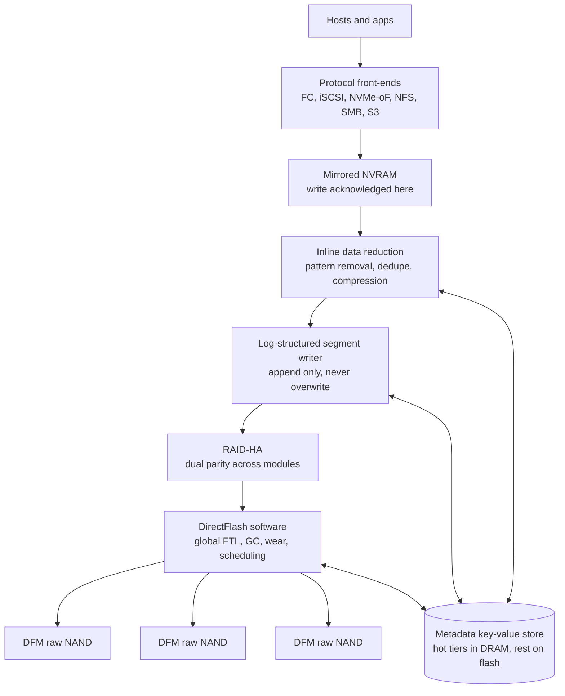
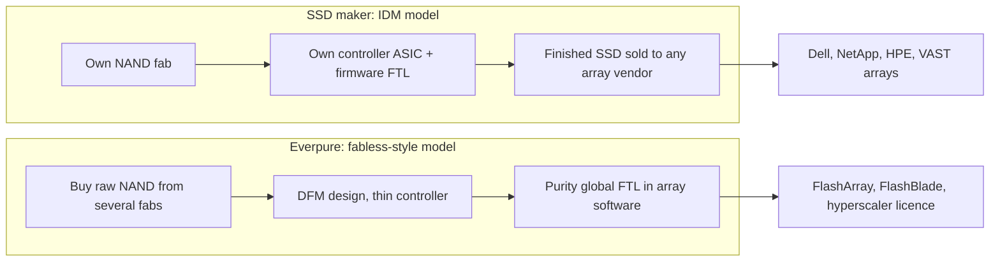
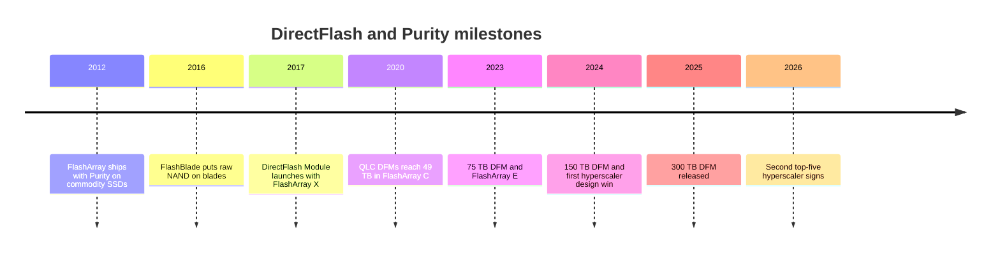

# 26. Core technology: Purity and DirectFlash

> **Depth:** L2 · **Reading time:** ~11 min · **Last verified:** 2026-11-01
> **Prerequisites:** [Media physics for a semis person](../01-storage-fundamentals/02-media-physics.md) · [Inside an SSD](../01-storage-fundamentals/03-inside-an-ssd.md) · [Data reduction](../01-storage-fundamentals/05-data-reduction.md) · [Interfaces and emerging tech](../02-protocols-and-networking/12-interfaces-and-emerging-tech.md) · [Glossary](../glossary.md)

## TL;DR

- **Purity is a log-structured, database-like storage OS.** It appends instead of overwriting, reduces data inline, and keeps all mappings in a key-value metadata store.
- **DirectFlash removes the SSD's own brain.** Purity runs one flash translation layer (FTL) across raw-NAND modules. That gives one log, one garbage collector and one pool of spare flash, where an SSD-based array has one per drive.
- **That is why DFMs ship bigger than SSDs:** 300 TB per module by 2026[^1], against 245.76 TB for the largest standard SSD confirmed shipping[^2] (Sandisk has announced 256 TB[^24]). Everpure's power advantages are vendor claims, best checked at system level.
- **Semis frame:** it is the integrated-memory-controller move, made by a fabless-style player. Global scheduling is the gain; qualifying every NAND generation itself, with NAND bought from IDMs that also sell finished SSDs, is the cost.
- **Exposure cuts both ways.** Everpure buys NAND for its enterprise arrays, and strategic NAND purchases turned Q2 FY27 operating cash flow negative[^3]. It does not buy NAND for hyperscaler licences[^4]. Flexible Data Placement (FDP) SSDs and hyperscaler do-it-yourself designs are the main threats to the moat.

## Why this matters for Everpure strategy

DirectFlash is the technical root of three things investors pay Everpure (NYSE: P, formerly PSTG) for. The first is product gross margin, which a lower bill of materials supports but does not protect: non-GAAP product GM fell to 66.2% in Q2 FY27 from a royalty-flattered 72.9% in Q3 FY26 as NAND costs rose[^5][^45]. The second is the hyperscaler licensing business: Meta, then a second unnamed top-five hyperscaler in August 2026[^6]. The third is the power-and-density pitch to replace disk in power-constrained AI datacenters ([Chapter 38](../05-ai-storage/38-power-and-density.md)). If FDP gives commodity SSDs most of the benefit, or a hyperscaler builds its own equivalent, all three weaken together.

The strategy question is which layer of the moat is durable: software (the global FTL), module design, NAND qualification know-how or supply relationships. Owning the module also makes Everpure a direct raw-NAND buyer in the 2026 shortage, competing for allocation with the IDMs' own SSD businesses.

## Core concepts

### Purity in one picture

Purity was built in 2009–2012 to make commodity SSDs behave like enterprise storage, borrowing from databases and key-value stores. Every write is monotonic (append-only), and deletes are recorded as predicates that hide old records rather than overwriting them[^7]. That one choice explains most of the product.

*Figure 26.1 — Purity is a pipeline from protocol to raw NAND. The metadata store, not the data layout, is the centre of gravity, and DirectFlash is its lowest layer.*

A write lands in NVRAM mirrored across both controllers and is acknowledged there[^8] ([Chapter 14](../03-system-architecture/14-scale-up-dual-controller.md)). Purity then removes patterns such as zeros, deduplicates, and compresses into variable-size blocks of roughly 4–32 KB, matching duplicates at 512-byte alignment[^9] ([Chapter 5](../01-storage-fundamentals/05-data-reduction.md)). Reduced data is packed into large segments written sequentially across modules with dual parity (RAID-HA)[^10]. Overwrites never happen in place: a newer version simply wins in the metadata map, which is why snapshots are nearly free ([Chapter 6](../01-storage-fundamentals/06-data-protection-and-resilience.md)).

The metadata store is the hard part. Everpure describes a tiered "pyramid": hot metadata in controller DRAM, in-flight changes journalled in NVRAM, the bulk on flash[^11]. Purity//FB spreads the same ideas across FlashBlade's blades ([Chapter 27](27-flasharray-and-flashblade.md)).

### The problem DirectFlash solves: a log on top of a log

An SSD is itself a log-structured system. NAND programs pages but erases only whole blocks, so the drive's FTL appends writes, remaps addresses in DRAM, and garbage-collects (GC) stale pages ([Chapter 3](../01-storage-fundamentals/03-inside-an-ssd.md)). Put Purity on top and you have two logs. Each has its own map, its own GC and its own reserved spare space, and neither can see the other's state. Academic work calls this "log-on-log" and shows the layers' write amplification compounding[^12].

*Figure 26.2 — A commodity-SSD array pays for controllers, DRAM maps, garbage collection and spare flash once per drive and again at array level; DirectFlash pays once.*

Three worked numbers show the cost of the stack:

- **Spare flash, paid twice.** A drive built from 8 TiB of NAND (8.80 TB) sold as 7.68 TB hides 1.12 TB, or 14.5% of user capacity. Sold as a 6.4 TB mixed-use drive, it hides 2.40 TB, or 37%. The array then keeps its own free space for segment cleaning on top.
- **Write amplification multiplies.** *Illustrative:* if array GC rewrites 1.5 bytes per host byte, and the drive's GC independently doubles that, NAND absorbs 3 bytes per host byte. QLC, with roughly a third of TLC's endurance, cannot afford that.
- **DRAM scales with capacity.** A page-level FTL stores ~4 bytes per 4 KiB page, i.e. 1 GB of DRAM per TB. A 245 TB SSD mapped that finely would need ~245 GB of on-drive DRAM. Big QLC drives therefore map coarser units and pay read-modify-write penalties on small writes. A 10 PB array mapped at 4 KiB would carry ~10 TB of drive DRAM, Everpure's own argument[^13].

DirectFlash deletes the inner layer. The DirectFlash Module (DFM) is a PCIe/NVMe card of raw NAND behind a thin controller. It has no logical address abstraction of its own[^8], so Purity addresses NAND blocks directly. Purity then does wear levelling, GC and over-provisioning once, at array level[^13]. The precise split of functions such as error correction between module and Purity is not public [VERIFY: which NAND functions run on the DFM controller versus in Purity].

### The semiconductor lens: on-die memory controllers and IDM versus fabless

**Moving the memory controller on-die.** Until the mid-2000s, x86 CPUs reached DRAM through a northbridge chip. AMD (2003) and Intel (2008) pulled the memory controller onto the CPU die. Latency fell and the CPU could schedule DRAM banks knowing its own request stream. DirectFlash is the same move: the "flash northbridge" inside every SSD is absorbed into the array CPU. So is the price: as an on-die controller ties CPUs to DRAM generations, DirectFlash ties Purity releases to NAND generations, each of which must be characterised in software.

**IDM versus fabless.** The SSD makers (Samsung, SK hynix/Solidigm, Micron, Kioxia, Sandisk) are IDMs. They own the NAND fab, design the controller and tune firmware with privileged process data. Everpure behaves like a fabless system house: it buys the "wafer" (raw NAND), designs the module, differentiates in software and skips the SSD maker's controller, DRAM and firmware margin. The classic fabless trade-offs apply:

- **Upside:** freedom to qualify several suppliers on one design, faster architectural iteration, and capital-light scale.
- **Downside:** no process insight, dependence on suppliers that also sell competing finished products, and weaker allocation leverage in shortages.

*Figure 26.3 — SSD makers integrate vertically from fab to firmware; Everpure integrates from module to software and buys NAND from those same IDMs.*

### What owning the FTL buys

**Density.** Without a per-drive DRAM map, module capacity is limited by NAND packages and power, not controller memory, which is why DFMs have led the largest standard SSD at each step (Figure 26.4).

**Power.** Everpure's CTO put the 75 TB DFM under 10 W, against a 25 W maximum for a 61.44 TB Solidigm SSD[^14]: about 0.13 W/TB against 0.41 W/TB, though comparing a typical draw with a maximum flatters the DFM. At system level, Everpure claims HDD-based and 15.36 TB-SSD systems need 2.4× the power of its 75 TB-DFM system and 4.8× that of its 150 TB-DFM system[^15], and up to 75% less power than disk in hyperscale use[^16]. NetApp's rebuttal is fair: compare whole systems, not modules[^17].

**Endurance and QLC viability.** With one GC that knows which data is cold, Purity can group data by lifetime so whole blocks die together. That makes low-endurance QLC usable for enterprise primary storage.

**Failure behaviour.** Purity sees per-block health, so it can retire blocks and evacuate a degrading module before it fails rather than rebuild afterwards[^18]. A commodity SSD fails as a black box. Its firmware is a fleet-wide correlated risk: in 2019 HPE warned that certain SAS SSDs would fail at exactly 32,768 power-on hours without a firmware update[^19]. DirectFlash concentrates that risk in Everpure's own code instead of eliminating it.

**Consistency.** Drive GC fires on its own schedule, causing latency spikes; one scheduler can defer GC around host I/O.

### DFM capacity roadmap

*Figure 26.4 — DFMs went from 75 TB to 300 TB in about two years and stayed above the largest standard SSD; the next steps, 600 TB and 1 PB, are undated ambitions.*
Data: `data/ch26_dfm_capacity.csv`

The 75 TB QLC DFM launched with FlashArray//E in 2023[^20]. In March 2023 Pure Storage set targets of 150 TB in 2024 and 300 TB in 2026[^14]. The 150 TB module was announced in September 2024 for availability by year-end[^21]. Everpure's FY2026 10-K says the 300 TB DFM was released in 2025, ahead of target[^22] [VERIFY: search-summary only], and trade press confirmed 300 TB modules in August 2026[^1]. A co-founder has spoken of 600 TB and then 1 PB-plus modules without dates[^23]. The commodity side is closing in: Sandisk shows 512 TB on its 2027 roadmap[^24], and Meta plans QLC drives up to 512 TB[^25].

### NAND supplier exposure and the 2026 shortage

Everpure qualified Micron's G8 QLC for the 150 TB DFM and is taking Micron G9 QLC into future DFMs, including hyperscaler ones[^26]. Kioxia, whose BiCS8 generation includes a 2 Tb QLC die, is a long-standing partner[^27]. Two suppliers give leverage and resilience at the cost of qualifying each new die.

Everpure raised prices on 9 February 2026, citing component costs[^28]. Strategic NAND and component purchases in Q2 FY27 took operating cash flow to −$136M and free cash flow to −$238M; a ~$577M build in prepaid expenses has been read as advance NAND buying[^29] [VERIFY: prepaid figure from third-party reading of the 10-Q]. Management said cash flow should normalise over two quarters[^3]. TrendForce forecasts NAND contract prices up another 15–20% quarter on quarter in Q4 2026, with enterprise SSDs reportedly up 23–28%[^42][^30].

The hyperscaler model sidesteps this: the customer licenses the design and buys its own NAND and hardware, so Everpure procures no NAND for it[^1][^4]. That is closer to Arm than to a fabless chip vendor ([Chapter 29](29-hyperscaler-ecosystem-financials.md)).

## How Everpure approaches it vs. competitors

| Dimension | Everpure DirectFlash | Commodity-SSD array (Dell, NetApp, HPE, VAST) | Hyperscaler DIY with FDP SSDs |
|---|---|---|---|
| DRAM for flash mapping | None on module; array-level metadata in controller DRAM (size not published) | ~1 GB per TB per drive at 4 KiB mapping, less with coarse mapping | Same as commodity SSDs |
| Over-provisioning | Pooled once at array level | Hidden per drive (~15–37%) plus array reserve | Per drive, though FDP reduces need |
| Write amplification | One GC layer; data placed by lifetime | Array GC × drive GC (log-on-log) | FDP lets host separate lifetimes; near-1 when used well[^32] |
| Power and density | 300 TB modules; vendor claims 2.4–4.8× system power advantage[^15] | 61–245 TB standard drives; standard power envelopes | Same drives; host software tuned |
| Failure behaviour | Per-block visibility; evacuation before failure | Drive fails as unit; firmware bugs correlated across fleet | Same, mitigated by scale and diversity |
| Supply flexibility | Qualify any NAND die, but each needs Purity support | Four-plus drive suppliers, plug-compatible | Four-plus suppliers; maximum leverage |
| Who carries NAND qualification | Everpure | Drive maker | Drive maker |

*Table 26.1 — DirectFlash wins on DRAM, spare flash and write amplification; commodity SSDs win on supply flexibility and on who carries the qualification burden.*

Middle paths exist. IBM builds its own FlashCore Modules for FlashSystem, putting compression, encryption and threat detection inside the module, so it keeps an in-module FTL and adds compute instead of removing it[^33]. Everpure itself uses commercial SSDs in FlashArray//ST[^34] and in FlashBlade//EXA's launch data nodes[^35]. DirectFlash is a choice made per product, not a dogma.

**Steelman the counter-case:**

1. **FDP closes much of the gap without lock-in.** NVMe FDP, ratified in 2022 and backed by Meta and Google with Samsung, lets hosts tag writes so drives keep lifetimes apart, cutting write amplification while drives stay standard[^32][^36]. Meta is deploying standard QLC SSDs alongside DFMs[^37].
2. **R&D scale.** Each NAND IDM funds controller and firmware teams from a far larger SSD revenue base, with process data first.
3. **Single-design risk.** One module design and one FTL serve FlashArray, FlashBlade and two hyperscalers. A latent bug or a NAND-generation defect is correlated across the whole installed base.
4. **Qualification burden.** A fabless buyer must characterise each new die (read thresholds, retention, program timing) without fab data, and NAND makers move to a new generation every year or two.
5. **Hyperscalers can build it.** Open-channel SSDs (LightNVM) were the industry's attempt at host-managed flash, and they were set aside in favour of zoned and placement-hint designs[^38]. Yet when Meta wanted raw-flash control at scale, it licensed rather than built[^37].

## History and trajectory

*Figure 26.5 — Purity began by taming commodity SSDs, then spent a decade replacing them, and is now licensing the replacement to hyperscalers.*

Sources for the timeline: FlashBlade's 2016 blades already carried raw NAND chips, not SSDs[^43]; DirectFlash arrived in FlashArray//X in April 2017[^39]; QLC DFMs reached 24.7 TB and then 49 TB in FlashArray//C[^40][^41]. In December 2024 a "top-four hyperscaler" licensed DirectFlash[^31], and the FY2025 10-K later named it as Meta[^44]. The second top-five win (August 2026) is expected to matter from FY2028[^6].

Signals to watch: a date for 600 TB DFMs, standard SSDs reaching 512 TB, FDP adoption, and NAND costs in product margin.

## Numbers that matter

| Metric | Value | Context | Source / date |
|---|---|---|---|
| Largest DFM | 300 TB | Released 2025 per 10-K; "now up to 300 TB" | Everpure 10-K FY26[^22]; B&F 2026-08-11[^1] |
| Largest standard SSD shipping | 245.76 TB | Micron 6600 ION, G9 QLC | Micron, 2026-05-05[^2] |
| 75 TB DFM power | < 10 W (vs 25 W max for 61.44 TB SSD) | ~0.13 vs ~0.41 W/TB; typical vs max | B&F, 2023-03-01[^14] |
| System power vs HDD / small-SSD systems | 2.4× (75 TB DFM), 4.8× (150 TB DFM) | Vendor claim | B&F, 2025-08-11[^15] |
| SSD DRAM at 4 KiB mapping | ~1 GB per TB | 4 B per 4 KiB page | Worked example |
| Hidden spare in standard SSD | ~15–37% of user capacity | 8 TiB raw sold as 7.68 or 6.4 TB | Worked example |
| Q2 FY27 operating cash flow | −$136M | Strategic NAND and component buys | Yahoo Finance, 2026-08[^29] |
| Q2 FY27 product gross margin | 66.2% (non-GAAP) | Down from 72.9% in Q3 FY26 | Investing.com, 2026-08[^5] |

## Conversation playbook

**Questions for a PM**

1. *"When a 512 TB standard SSD ships, what keeps DFMs ahead?"* Strong answer: a dated next module step and the system-level gap in W/TB, TB/RU and DRAM avoided.
2. *"How does NAND inflation flow through Evergreen//One pricing versus capex sales?"* Strong answer: separates pass-through on new sales from absorption on fixed-price subscriptions, and how the Q2 FY27 NAND buys hedge the gap.
3. *"Why does FlashArray//ST use commercial SSDs?"* Strong answer: small latency-optimised configurations where DFM capacity is overkill, with a clear rule for when DirectFlash wins.

**Questions for an engineer**

1. *"How long does it take to qualify a new NAND die for DirectFlash, and what fails most often?"* Strong answer: months, with specifics on read-retry tuning, retention and error-correction margins.
2. *"Under FDP, what write amplification can a commodity-SSD array reach, and what is Purity's?"* Strong answer: measured fleet numbers, plus the part FDP cannot fix (per-drive DRAM, hidden spare, opaque failure handling).
3. *"What is the blast radius of a DFM firmware or FTL bug?"* Strong answer: staged rollouts, version diversity across the fleet, and a fallback when a NAND lot misbehaves.

**Don't say this:**

- "DFMs are just big SSDs." They have no drive FTL; that is the entire point.
- "DirectFlash makes Everpure immune to NAND prices." Enterprise arrays still consume purchased NAND; only the hyperscaler licence model avoids it.
- "Everpure makes its own flash." It designs modules and software; Micron and Kioxia make the NAND.
- "Up to 75% less power" as a fact. It is a vendor claim against disk, sensitive to the baseline.

## Going deeper (optional, L3 pointers)

- Colgrove et al., SIGMOD 2015[^7]: Purity's monotonic writes, predicate deletion and metadata design.
- Yang et al., INFLOW 2014[^12]: the log-on-log argument.
- Bjørling et al., FAST 2017[^38]: open-channel SSDs, the precursor of ZNS and FDP.

## Key terms

- **DirectFlash Module (DFM)** — Everpure's raw-NAND module, with no drive-level FTL.
- **Global FTL** — one flash translation layer for every module in an array.
- **Log-on-log** — stacked log-structured layers whose GC and write amplification compound.
- **RAID-HA** — Purity's dual-parity protection across modules.
- **NVRAM** — persistent, mirrored memory where writes are acknowledged.
- **FDP** — NVMe Flexible Data Placement: host hints that let drives separate data lifetimes.
- **Indirection unit** — the granularity an SSD's map tracks; larger units cut DRAM but penalise small writes.
- **NAND qualification** — characterising a new NAND die so firmware or software can drive it reliably.

## Sources

[^1]: Blocks & Files, "Second hyperscaler plumps for Everpure's flash technology," 2026-08-11. https://www.blocksandfiles.com/flash/2026/08/11/second-hyperscaler-plumps-for-everpures-flash-technology/5285903 (retrieved 2026-11-01).
[^2]: Micron Technology, "Industry-Leading 245TB Micron 6600 ION Data Center SSD Now Shipping," 2026-05-05. https://investors.micron.com/news/press-release/2026/Industry-Leading-245TB-Micron-6600-ION-Data-Center-SSD-Now-Shipping/default.aspx (retrieved 2026-11-01).
[^3]: Nasdaq, "Everpure Q2 Earnings Call Highlights," 2026-08. https://www.nasdaq.com/articles/everpure-q2-earnings-call-highlights (retrieved 2026-11-01).
[^4]: Motley Fool, "Everpure (P) Q2 2027 Earnings Call Transcript," 2026-08-31. https://www.fool.com/earnings/call-transcripts/2026/08/31/everpure-p-q2-2027-earnings-call-transcript/ (retrieved 2026-11-01).
[^5]: Investing.com, "Everpure Q2 FY27 slides: 38% revenue growth, guidance raised sharply," 2026-08. https://www.investing.com/news/company-news/everpure-q2-fy27-slides-38-revenue-growth-guidance-raised-sharply-93CH-4878054 (retrieved 2026-11-01).
[^6]: Everpure, "Everpure Lands New Design Win with Second Top-Five Hyperscaler," 2026-08-10. https://www.everpuredata.com/company/newsroom/press-releases/everpure-lands-new-design-win-with-second-top-five-hyperscaler.html (retrieved 2026-11-01).
[^7]: J. Colgrove, J. Davis, J. Hayes, E. L. Miller, C. Sandvig, R. Sears, A. Tamches, N. Vachharajani, F. Wang, "Purity: Building Fast, Highly-Available Enterprise Flash Storage from Commodity Components," ACM SIGMOD 2015 (Industrial Track), doi:10.1145/2723372.2742798. https://www.crss.ucsc.edu/pub/colgrove-sigmod15.html (retrieved 2026-11-01).
[^8]: Pure Storage blog, "A Pure Storage Engineer Explains FlashArray//X," n.d. https://blog.purestorage.com/?p=13930 (retrieved via search 2026-11-01).
[^9]: Pure Storage, "Purity Data Sheet" (via Insight), n.d. https://ie.insight.com/content/dam/insight-web/emea/partner/pure-storage/Pure_Purity_Data_Sheet.pdf (retrieved 2026-11-01).
[^10]: Everpure blog, "The Three Rs of Data Storage: Resiliency, Redundancy, and Rebuilds," n.d. https://blog.everpuredata.com/perspectives/the-three-rs-of-data-storage-resiliency-redundancy-and-rebuilds/ (retrieved 2026-11-01).
[^11]: Pure Storage blog, "NetApp Is Livin' La Vida Loca" (vendor comparison describing Purity's metadata tiers), n.d. https://blog.purestorage.com/?p=163330 (retrieved via search 2026-11-01).
[^12]: J. Yang, N. Plasson, G. Gillis, N. Talagala, S. Sundararaman, "Don't Stack Your Log On My Log," USENIX INFLOW 2014. https://www.usenix.org/conference/inflow14/workshop-program/presentation/yang (retrieved 2026-11-01).
[^13]: Everpure, "What Is DirectFlash and How Does It Work?," n.d. https://www.everpuredata.com/knowledge/what-is-directflash-and-how-does-it-work.html (retrieved via search 2026-11-01).
[^14]: Blocks & Files, "300TB flash drives coming from Pure Storage," 2023-03-01. https://blocksandfiles.com/2023/03/01/300tb-flash-drives-coming-from-pure-storage/ (retrieved via search 2026-11-01); roadmap corroborated by Gigazine, "Pure Storage sets goal of realizing 300 TB SSD by 2026," 2023-03-08. https://gigazine.net/gsc_news/en/20230308-pure-storage-300-tb-ssd (retrieved 2026-11-01).
[^15]: Blocks & Files, "Pure Storage claims its flash beats SSDs and disks on power and carbon metrics," 2025-08-11. https://blocksandfiles.com/2025/08/11/pure-storage-flash-beats-ssds-and-disks-on-power-and-carbon-metrics/ (retrieved via search 2026-11-01).
[^16]: Pure Storage, "Hyperscaler," n.d. https://purestorage.com/pure-advantage/platform/hyperscaler.html (retrieved 2026-11-01).
[^17]: NetApp blog, "Direct flash vs SSDs," n.d. https://www.netapp.com/blog/direct-flash-vs-ssds/ (retrieved via search 2026-11-01).
[^18]: Pure Storage / Everpure blog post on DFM evacuation versus rebuild, n.d. https://blog.purestorage.com/?p=143164 (seen via search summary, 2026-11-01).
[^19]: Hewlett Packard Enterprise, "Customer Bulletin: HPE SAS Solid State Drives - Critical Firmware Upgrade Required for Certain HPE SAS Solid State Drive Models to Prevent Drive Failure at 32,768 Hours of Operation," 2019-11. https://support.hpe.com/hpesc/public/docDisplay?docId=emr_na-a00092491en_us (retrieved 2026-11-01).
[^20]: StorageReview, "Pure Storage adds 75TB flash module, FlashArray//E and new FlashArray//X, //C R4 nodes," 2023. https://www.storagereview.com/news/pure-storage-adds-75tb-flash-module-flasharray-e-and-new-flasharray-x-c-r4-nodes (retrieved 2026-11-01).
[^21]: Blocks & Files, "Pure extends FlashBlade file services and adds 150TB flash drive," 2024-09-24. https://blocksandfiles.com/2024/09/24/pure-extends-flashblade-file-services-and-adds-150tb-flash-drive/ (retrieved via search 2026-11-01).
[^22]: Everpure, "Form 10-K for fiscal year ended February 1, 2026," 2026-03-24. https://www.sec.gov/Archives/edgar/data/1474432/000147443226000027/pstg-20260201.htm (seen via search summary of the annual report, 2026-11-01).
[^23]: Pure Storage, "Eliminating Disk for Good" (webinar with co-founder John Colgrove), 2025. https://www.everpuredata.com/video/webinars/eliinating-disk-for-good/6374611414112.html (seen via search summary, 2026-11-01).
[^24]: Blocks & Files, "Sandisk unveils 256 TB SSD for AI workloads, shipping in 2026," 2025-08-05. https://www.blocksandfiles.com/ai-ml/2025/08/05/sandisk-unveils-256-tb-ssd-for-ai-workloads-shipping-in-2026/1589534 (retrieved 2026-11-01).
[^25]: TechRadar Pro, "Facebook engineers say bigger hard disk drives is making one critical metric far, far worse," 2025. https://www.techradar.com/pro/facebook-engineers-say-that-bigger-hard-disk-drives-is-making-one-critical-metric-far-far-worse (retrieved via search 2026-11-01).
[^26]: Blocks & Files, "Pure qualifies Micron's 276-layer flash," 2025-01-08. https://blocksandfiles.com/2025/01/08/pure-qualifies-microns-276-layer-flash/ (retrieved 2026-11-01); TechTarget, "Pure Storage, Micron expand QLC NAND partnership," 2025. https://techtarget.com/searchstorage/news/366617703/Pure-Storage-Micron-expand-QLC-NAND-partnership (retrieved 2026-11-01).
[^27]: Blocks & Files, "Kioxia 2 terabit NAND," 2024-07-03. https://blocksandfiles.com/2024/07/03/kioxia-2-terabit-nand/ (retrieved 2026-11-01).
[^28]: Alpha Spread, "P Q4-2026 Earnings Call," 2026-02-25. https://www.alphaspread.com/security/nyse/p/investor-relations/earnings-call/q4-2026 (retrieved 2026-11-01).
[^29]: Yahoo Finance, "Everpure (P) Grew Revenue 38% but Free Cash Flow Was Negative," 2026-08. https://finance.yahoo.com/markets/stocks/articles/everpure-p-grew-revenue-38-023544268.html (retrieved 2026-11-01); prepaid-expense reading from Finsee, "Everpure (P) Q2 2027 earnings review," 2026-08. https://finsee.ai/earnings/p/2027/q2/en/ (seen via search summary, 2026-11-01).
[^30]: Tech Insider, "Enterprise SSD prices Q4 2026: the NAND supplier race," 2026-09/10, reporting a TrendForce forecast. https://tech-insider.org/enterprise-ssd-prices-q4-2026-nand-supplier-race/ (seen via search summary, 2026-11-01).
[^31]: SiliconANGLE, "Shares of Pure Storage jump on impressive earnings beat and strong guidance," 2024-12-03. https://siliconangle.com/2024/12/03/shares-pure-storage-jump-impressive-earnings-beat-strong-guidance/ (retrieved 2026-11-01).
[^32]: NVM Express, "Overcoming the Write Amplification Problem with NVM Express Flexible Data Placement," n.d. https://nvmexpress.org/nvmeflexible-data-placement-fdp-blog/ (retrieved 2026-11-01).
[^33]: IBM, "IBM FlashSystem," n.d. https://www.ibm.com/flashsystem (retrieved via search 2026-11-01); Blocks & Files, "IBM FlashSystem 5300," 2024-04-25. https://blocksandfiles.com/2024/04/25/ibm-flashsystem-5300/ (retrieved via search 2026-11-01).
[^34]: Techzine, "Pure surprises: FlashArray gets S3 support, FlashArray//ST without DFMs," 2025-06. https://www.techzine.eu/blogs/infrastructure/132388/pure-surprises-flasharray-gets-s3-support-flasharray-st-without-dfms/ (retrieved 2026-11-01).
[^35]: Architecting IT, FlashBlade//EXA analysis, 2025-03. https://www.architecting.it/?p=7294 (retrieved 2026-11-01).
[^36]: Samsung Semiconductor, "Hyperscalers Embrace Flexible Data Placement (FDP) to Increase Performance and Lower TCO," n.d. https://semiconductor.samsung.com/news-events/tech-blog/hyperscalers-embrace-flexible-data-placement-fdp-to-increase-performance-and-lower-tco/ (retrieved 2026-11-01).
[^37]: Blocks & Files, "Meta's positive assessment of Pure Storage's flash mettle," 2025-04-07. https://blocksandfiles.com/2025/04/07/metas-positive-assessment-of-pure-storages-flash-mettle/ (retrieved via search 2026-11-01).
[^38]: M. Bjørling, J. González, P. Bonnet, "LightNVM: The Linux Open-Channel SSD Subsystem," USENIX FAST 2017. https://www.usenix.org/conference/fast17/technical-sessions/presentation/bjorling (retrieved 2026-11-01).
[^39]: The Register, "Pure becomes a direct flasher," 2017-04-11. https://www.theregister.com/2017/04/11/pure_becomes_a_direct_flasher/ (retrieved via search 2026-11-01).
[^40]: TechTarget, "Pure Storage FlashArray//C set sights on hybrid flash market," 2020. https://www.techtarget.com/searchstorage/news/252488188/Pure-Storage-FlashArray-C-set-sights-on-hybrid-flash-market (retrieved via search 2026-11-01).
[^41]: Everpure blog, "FlashArray//C Capacity: The 49TB Milestone Revisited," n.d. https://blog.everpuredata.com/products/capacity-workloads-49tb-qlc/ (retrieved via search 2026-11-01).
[^42]: TrendForce, "AI Server Demand Sustains Memory Contract Price Increases in 4Q26, While Consumer-Side Pressure Persists," 2026-09-30. https://www.trendforce.com/presscenter/news/20260930-13258.html (retrieved 2026-11-01; enterprise SSD range from secondary coverage).
[^43]: The Register, "FlashBlade back story notes," 2016-03-15. https://www.theregister.com/2016/03/15/flashblade_back_story_notes/ (retrieved via search 2026-11-01); Computer Weekly, "Pure Storage drips out more of its all-flash analytics FlashBlade," 2016. https://computerweekly.com/news/450299856/Pure-Storage-drips-out-more-of-its-all-flash-analytics-FlashBlade (retrieved via search 2026-11-01).
[^44]: SEC, "Pure Storage, Inc. Form 10-K for fiscal year ended February 2, 2025," 2025-04. https://www.sec.gov/Archives/edgar/data/1474432/000162828025015044/pstg-20250202.htm (seen via search summary, 2026-11-01).
[^45]: Futurum Group, "Pure Storage Q3 FY 2026 Results: Revenue Up 16% YoY, Guidance Raised," 2025-12. https://futurumgroup.com/insights/pure-storage-q3-fy-2026-results-revenue-up-16-yoy-guidance-raised/ (retrieved via search summary 2026-11-01).
