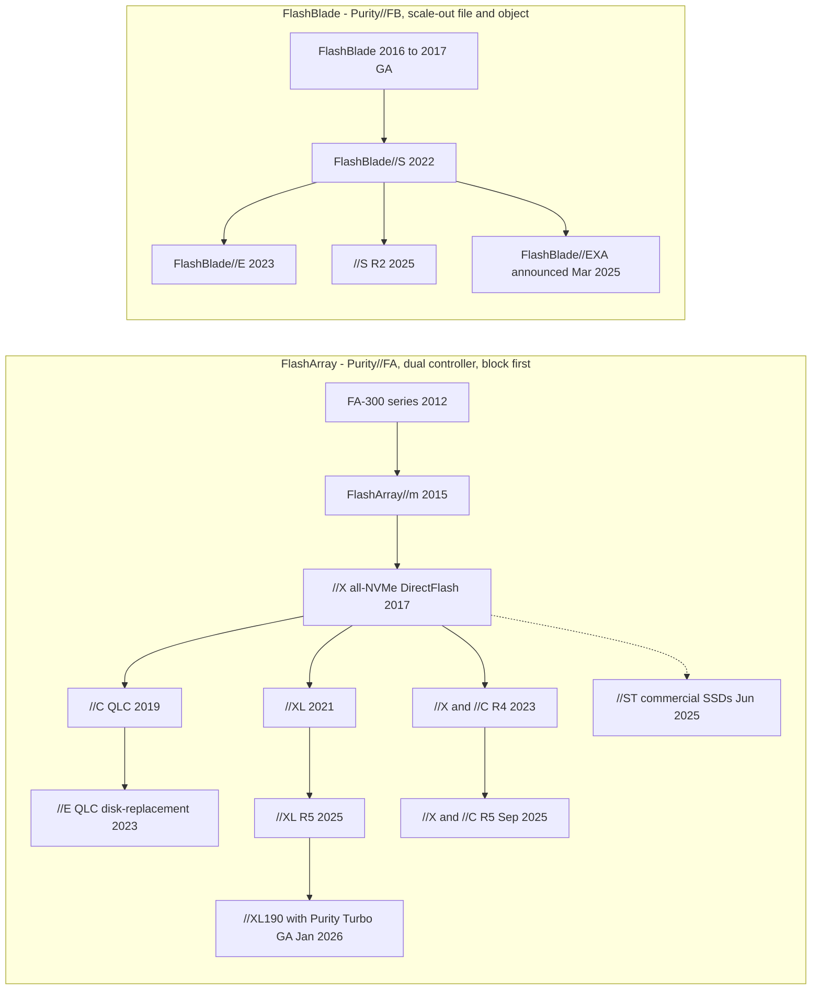
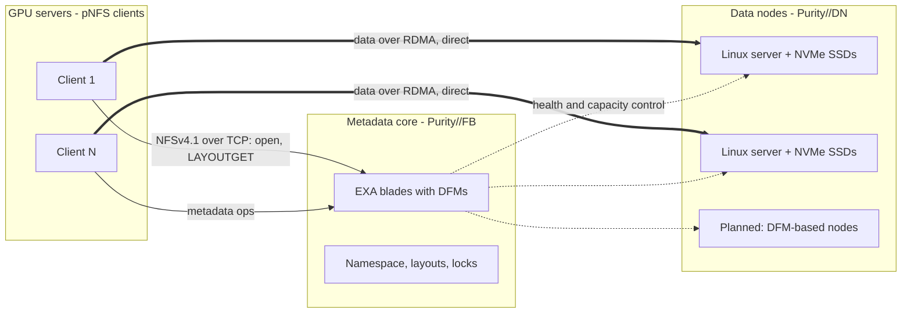
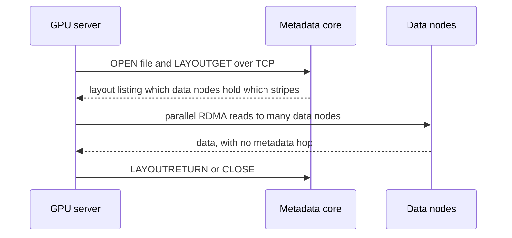

# 27. Product portfolio: FlashArray and FlashBlade

> **Depth:** L2 · **Reading time:** ~11 min · **Last verified:** 2026-11-01
> **Prerequisites:** [Core technology: Purity and DirectFlash](26-purity-and-directflash.md) · [Scale-up dual-controller arrays](../03-system-architecture/14-scale-up-dual-controller.md) · [Scale-out shared-nothing clusters](../03-system-architecture/15-scale-out-shared-nothing.md) · [Disaggregated shared-everything](../03-system-architecture/16-disaggregated-shared-everything.md)

## TL;DR

- **Two product families, two operating systems, one media strategy.** FlashArray runs Purity//FA on a dual-controller, scale-up design and serves block storage first (file and S3 were added later). FlashBlade runs Purity//FB on scale-out blades for file and object. Almost every model uses Everpure's own DirectFlash Modules (DFMs). The exceptions are FlashArray//ST and the FlashBlade//EXA data nodes.
- **Models differ mainly in media and controller size.** //XL, //X and //ST are TLC performance tiers. //C and //E are QLC capacity tiers. FlashBlade//S is the performance tier and FlashBlade//E the capacity tier. "R-numbers" (R4, R5) are controller refreshes that customers can apply in place.
- **FlashBlade//EXA is the AI-scale outlier.** A Purity//FB metadata core sits on DFM blades, and separate third-party Linux/NVMe data nodes hold the data. Clients use pNFS to fetch a file's layout from the metadata core, then move data directly to and from the data nodes. [Chapter 16](../03-system-architecture/16-disaggregated-shared-everything.md) explains why this is a metadata/data split rather than DASE.
- **EXA posted the top numbers in MLPerf Storage v3.0 (September 2026),** with 877.5 GiB/s of checkpoint write and 1,623.4 GiB/s of KV-cache read. VAST, WEKA and DDN did not submit to that round, so "#1" means first among the systems that entered.
- **The AI certification gap has narrowed but not closed.** FlashBlade//S holds DGX SuperPOD certification. EXA has NVIDIA-Certified Storage status, and NCP certification was still pending as of March 2026.

## Why this matters for Everpure strategy

The portfolio is the revenue engine. Everpure's product revenue grew 54% year on year in Q2 FY27, to US$687 million[^1]. The *mix* within that growth tells a strategy team where the business is heading. Each FlashArray tier competes against a different incumbent product. Each FlashBlade tier meets a different challenger. EXA, the newest member, is the company's entry ticket to the GPU-cluster deals that VAST, WEKA and DDN have been winning ([Chapter 41](../06-industry-and-competition/41-why-ai-native-vendors-won.md)).

Knowing the lineup well enough to place a model against a workload is the minimum for credible conversations with PMs. Knowing *what the benchmarks actually measured* is the minimum for credible conversations with the Office of the CTO. This chapter covers both. The technology underneath, Purity and DirectFlash, is in [Chapter 26](26-purity-and-directflash.md). The software and subscription layer on top is in [Chapter 28](28-platform-and-software.md).

## Core concepts

### The lineage in one picture

Pure Storage launched FlashArray in May 2012[^2]. For its first five years it had one product line built on SAS SSDs. Two changes reshaped it. The first was **DirectFlash**: FlashArray//X (April 2017) talked NVMe directly to raw NAND on Pure's own modules[^3]. The second was **media tiering**: QLC-based //C arrived in September 2019[^4] so that one controller design could serve both performance and capacity. FlashBlade began as a separate scale-out file and object system. It was unveiled in 2016 and generally available in January 2017[^5]. It later forked the same way: //S for performance (June 2022)[^6] and //E for capacity (March 2023)[^7].

*Figure 27.1 — Two families have forked into performance (TLC) and capacity (QLC) tiers on shared software. //ST (dotted) is the only FlashArray that leaves DirectFlash, and EXA is the only FlashBlade that adds third-party hardware.*

Sources for the nodes: FA-300 and //m[^8]; //XL[^9]; //E, //X R4 and //C R4[^10]; //XL R5, //ST and //S R2[^11]; //X R5 and //C R5[^12]; //XL190[^13]; EXA[^14].

**Semiconductor bridge.** Read the R-numbers as die shrinks on a stable instruction set. Purity is the ISA. A new controller generation (newer Intel Xeon, more PCIe lanes) is a new stepping. Because Evergreen subscriptions swap controllers in place without moving data ([Chapter 23](../03-system-architecture/23-consumption-models.md)), a 2019 //X customer can be running R5 controllers today. That is why Everpure talks about "generations" more than about product SKUs.

### FlashArray: one controller design, five media personalities

Every FlashArray is a two-controller, scale-up system ([Chapter 14](../03-system-architecture/14-scale-up-dual-controller.md)). The models differ in three things: controller horsepower, media and which data services stay switched on.

- **//X and //C share controllers.** In the R5 refresh (September 2025) both moved to Intel Emerald Rapids. Pure reported //X about 30% faster and //C about 40% faster than R4. The default 3RU chassis grew to 28 drive slots[^12]. //X uses TLC DFMs for sub-millisecond tier-1 work. //C uses QLC for capacity at millisecond-class latency.
- **//XL is the big-controller variant.** It launched in December 2021 at up to 5.78 PB effective, with NVRAM moved onto the flash modules[^9]. The R5 datasheet cites up to 7.4 PB effective and 45 GB/s, a large-block (512 KB) read figure[^15]. The XL190, GA in January 2026, adds **Purity Turbo**, which lets the *secondary* controller serve reads[^13]. That is a notable change for an active/passive-style design ([Chapter 14](../03-system-architecture/14-scale-up-dual-controller.md)).
- **//E is the disk-replacement tier.** It launched in June 2023 with 75 TB QLC DFMs and an entry size of about 1 PB[^10].
- **//ST is the deliberate exception.** It uses commercial PCIe SSDs, not DFMs. It is block-only. It turns off deduplication, compression and synchronous replication to shorten the I/O path. Everpure claims more than 10 million IOPS per 5RU[^16].

**Worked example: what //ST's design choice costs.** Take 400 TB of logical database data that reduces 4:1 on a normal FlashArray. A //X stores it on about 100 TB of physical flash. //ST does not reduce data, so it needs the full 400 TB, roughly four times the NAND. With NAND prices up sharply in 2026 ([Chapter 48](../06-industry-and-competition/48-media-suppliers-and-nand-cycle.md)), //ST makes sense in two cases. One is data that barely reduces anyway: encrypted or already-compressed tablespaces, where the ratio may be near 1:1 and the penalty disappears. The other is a workload where each microsecond has a dollar value, such as trading, large OLTP or log writes.

| Model | Target workloads | Media | Performance / capacity tier | Competitor it most often meets |
|---|---|---|---|---|
| FlashArray//XL (R5, XL190) | Consolidated tier-0/1 databases, large virtualisation estates | TLC DFMs, NVRAM on modules | Top of scale-up block; up to 7.4 PB effective (R5) | Dell PowerMax, Hitachi VSP, NetApp high-end AFF/ASA |
| FlashArray//X (R5) | Mainstream tier-1 block and file: VMs, databases, VDI | TLC DFMs | Sub-ms performance, midrange to upper midrange | Dell PowerStore, NetApp AFF/ASA, HPE Alletra MP |
| FlashArray//ST | In-memory DBs, large OLTP, logging | Commercial PCIe SSDs, no data reduction | Latency and IOPS-density specialist | Server-local NVMe; high-end PowerMax/VSP |
| FlashArray//C (R5) | Tier-2 consolidation, dev/test, VM capacity, backup | QLC DFMs | Capacity block/file, ms-class latency | NetApp AFF C-Series, Dell PowerStore, hybrid arrays |
| FlashArray//E | Disk replacement, backup and secondary copies | QLC DFMs (75 TB and up) | Lowest $/TB FlashArray, about 1 PB entry | Hybrid and HDD arrays |
| FlashBlade//S (S100/S200/S500 R2) | Analytics, EDA, rapid restore, AI training and inference on SuperPOD | QLC DFMs | Scale-out file and object performance tier | Dell PowerScale, NetApp ONTAP NAS, VAST |
| FlashBlade//E | Data lakes, archives, backup repositories | QLC DFMs; storage-only chassis behind a control chassis | Capacity file and object | Dell PowerScale archive tiers, HDD object (Cloudian, Scality), Qumulo |
| FlashBlade//EXA | GPU clusters, neoclouds, HPC: checkpoints, training reads, KV cache | DFM metadata blades plus third-party NVMe data nodes | Multi-TB/s single namespace | VAST, WEKA, DDN EXAScaler, IBM Storage Scale |

*Table 27.1 — Positioning by workload. Competitor pairings are the atlas's judgement from public positioning, not Everpure win/loss data. Specs: [^15][^16][^10][^13][^7][^17].*

### FlashBlade//S and //E: scale-out with a capacity fork

FlashBlade//S separates per-blade compute from DirectFlash capacity inside a 5U chassis. This lets customers add blades for performance or larger DFMs for capacity[^6]. Partner listings for the R2 generation cite up to 1,200 TB per blade with 300 TB DFMs and 400GbE networking[^13] [VERIFY: per-blade figure is a partner claim]. FlashBlade//E keeps CPUs only in a control chassis and adds storage-only chassis behind it. That design lowers $/TB for cold unstructured data[^7]. Purity DeepReduce reached //E in early 2026[^13]. In September 2026 Everpure made it always-on, with a median 2:1 global reduction expected on //E and //S200 R2[^18].

In AI, FlashBlade//S is the workhorse. FlashBlade//S500 earned DGX SuperPOD certification over Ethernet in November 2024[^19]. FlashBlade earned NVIDIA-Certified Storage at the Foundation and Enterprise levels in March 2025[^20]. Everpure says the //S R2 platform is certified for GB200 and GB300 SuperPODs[^21] [VERIFY: search-summary only].

### FlashBlade//EXA: metadata core plus data nodes

EXA was announced on March 11, 2025, for AI and HPC at a scale beyond what a FlashBlade//S cluster reaches[^14]. The design starts from a diagnosis: at thousands of GPUs, the bottleneck is metadata and coordination, not raw media bandwidth ([Chapter 21](../03-system-architecture/21-metadata.md)). EXA therefore splits the system into two independently scaled tiers[^17][^22]:

*Figure 27.2 — Clients go to the metadata core only for the map. Bulk data travels straight between GPU servers and data nodes, so throughput scales with data-node count while metadata scales with blades.*

1. **The metadata core** is FlashBlade hardware running Purity//FB. It holds the namespace, file layouts and locks on DFM blades. Pure Storage's launch materials described one to ten chassis of ten blades each[^17].
2. **Data nodes** at launch were off-the-shelf Linux servers with NVMe SSDs, running Everpure's Purity//DN stack[^17][^23]. Under the EXA terms of use, a data node is a third-party server paired with the metadata core. Each node comes with a 160 TiB usable-capacity entitlement, and larger capacity is licensed per TB[^24]. The SPECstorage submission used Supermicro 1U servers[^23] [VERIFY: data-node model read from a garbled search extract].
3. **DFM-based data nodes**, with 75 TB and 150 TB modules and up to 24 per server, were planned for 2H 2025[^25]. No public source found confirms they are GA as of November 2026, and the September 2026 MLPerf submission still used Linux/NVMe data nodes[^26] [VERIFY: DFM data-node GA status].

*Figure 27.3 — The pNFS read path: one metadata round trip, then many parallel direct transfers. This is the parallel-file-system pattern of [Chapter 17](../03-system-architecture/17-parallel-file-systems.md) with Purity as the metadata server.*

Clients speak standard pNFS. Metadata travels as NFSv4.1 over TCP, and data moves over RDMA[^22]. The design therefore needs no proprietary client driver, which is an advantage against WEKA and Lustre-based systems in locked-down GPU images. [Chapter 16](../03-system-architecture/16-disaggregated-shared-everything.md) argues why this counts as a metadata/data split rather than shared-everything; this chapter does not repeat the case. Two consequences matter for the portfolio. First, EXA's data-node hardware is customer-sourceable, which helps neoclouds with server supply deals. Second, EXA's data services, including protection, reduction and multi-tenancy, mature on a separate release train (Purity//DN) from Purity//FB[^23]. Multi-tenancy and QoS for neoclouds arrived at Accelerate 2026 in June[^27].

### What the benchmarks actually measured

MLPerf Storage emulates accelerators in software. A run passes if the storage keeps every simulated GPU above a utilisation threshold. No real GPUs are involved ([Chapter 37](../05-ai-storage/37-reading-benchmarks.md))[^28]. Round v3.0, published September 1, 2026, moved the simulated accelerator from H100 to B200. It also added KV-cache and vector-database workloads[^29]. Everpure was one of 11 first-time submitters[^29]. Earlier "v2.0 results" from Pure Storage were a white paper, not an MLCommons-listed entry[^30] [VERIFY: whether any v2.0 result was officially submitted].

*Figure 27.4 — Checkpoint write scales nearly linearly with data nodes, but at 30 nodes per-node throughput is about 11% below the 10-node rate.*
Data: `data/ch27_mlperf_checkpoint_scaling.csv`

**Worked check on the headline.** Everpure reported 877.52 GiB/s for 17.74 seconds on the largest checkpoint model[^31]. That is 877.52 × 17.74 ≈ 15,570 GiB, or about 16.7 TB. The result is consistent with a roughly trillion-parameter model at about 16 bytes per parameter, covering weights plus Adam state ([Chapter 31](../05-ai-storage/31-training-storage.md)). Scaling efficiency is (877.52 ÷ 30) ÷ (327.65 ÷ 10) = 29.25 ÷ 32.77 ≈ **89%**. In converted units, 877.52 GiB/s × 1.074 ≈ 942 GB/s. A cluster checkpointing every 30 minutes would stall for about 17.74 ÷ 1,800 ≈ 1% of wall-clock time, before any asynchronous checkpointing.

| Claim | Benchmark | Date | Configuration | Caveat |
|---|---|---|---|---|
| 877.5 GiB/s checkpoint write, top of round | MLPerf Storage v3.0, checkpointing | 2026-09-01 | 30 EXA blades (120 DFMs, metadata) + 30 Linux/NVMe data nodes, ~866 TB usable[^26] | VAST, WEKA, DDN absent. Data nodes are not DFMs. Reported read figure conflicts (588.3 vs 833.0 GiB/s)[^26][^31] |
| Near-linear scaling, 327.6 → 877.5 GiB/s | Same | 2026-09-01 | 10 → 30 data nodes | Per-node rate down ~11%. 15- and 20-node points from one secondary source |
| 1,623.4 GiB/s KV-cache read | MLPerf Storage v3.0, KV cache | 2026-09-01 | 51-host EXA configuration[^26] | First round of a new workload. Next results ~443 GiB/s (UBIX, FarmGPU). Host vs node counts unclear |
| 85,736 tokens/s (Llama 3.1 8B), 33,403 (70B), storage-only | MLPerf Storage v3.0, KV cache | 2026-09-01 | Not stated in coverage[^32] | Tokens a storage system can feed, not a GPU serving rate. "#1 on every test entered" is Everpure's framing |
| 6,300 AI_Jobs at 0.97 ms, #1 | SPECstorage Solution 2020 AI_IMAGE | Tested Jan 2026, published 2026-02-17 | 30 S500R1-EXA blades, 60 data nodes, 80 hosts[^23] | Displaced HPE/WEKA (5,000)[^33]. Image-training proxy with few submitters |
| >10 TB/s read, single namespace | Everpure preliminary testing | 2025-03-11 | Not disclosed[^34] | Vendor test, unaudited |
| >5 TB/s read with 60 data nodes | Everpure technical brief | 2025 | 60 data nodes[^35] | Vendor test. ≥83 GB/s per node |
| Up to 20× faster time to first token (PureKVA) | Everpure internal | 2026-09-30 | Not published[^18] | "Up to"; baseline presumably recompute |

*Table 27.2 — Benchmark claims for FlashBlade//EXA. The audited results are strong, but they come from rounds the main AI-native rivals skipped, on third-party data nodes.*

## How Everpure approaches it vs. competitors

Everpure's portfolio argument is *one software lineage per family, own media everywhere, upgrade in place*. Rivals beat it in specific places:

| Line | Everpure's best argument | Where a rival genuinely wins | Rival |
|---|---|---|---|
| FlashArray//XL | In-place controller upgrades, high reduction, operational simplicity | Mainframe (FICON) attachment and decades of multi-site replication practice; FlashArray has no mainframe answer | Dell PowerMax, Hitachi VSP, IBM DS8000 |
| FlashArray//X, //C | DFM density, shared controllers, block + file + S3 on one OS | NAS depth and installed base (ONTAP replication, caching, multiprotocol); FlashArray file services are younger | NetApp |
| FlashArray//ST | Microsecond-class latency with array-grade availability | Server-local NVMe with database-native replication beats any networked array on latency and cost for one application | DIY / HCI |
| //E and FlashBlade//E | Power, footprint and flash reliability for "cold" data | Raw $/TB. QLC was roughly 15× HDD per GB in 2026 per TrendForce[^36] [VERIFY: single-vendor-derived index] | HDD object and hybrid arrays |
| FlashBlade//S | SuperPOD-certified scale-out file/object with Evergreen | PowerScale's installed base and mixed flash/HDD tiers in one cluster; VAST's global similarity reduction and database features | Dell, VAST |
| FlashBlade//EXA | Purity metadata engine, standard pNFS client, customer-sourced data nodes, top v3.0 results | NVIDIA flagship references (DDN's ~4 TB/s on Eos)[^37]; WEKA's software-anywhere and cloud reach; VAST's neocloud scale (US$1.17B CoreWeave deal, *reported by press*)[^38]; SuperPOD certification held by all three | VAST, WEKA, DDN |

*Table 27.3 — Steelman by product line. FlashArray's exposures are breadth (mainframe, NAS heritage). FlashBlade//EXA's are references and certification maturity.*

The strategic pattern is that Everpure is strongest where one OS can be stretched across tiers, as with FlashArray from //ST to //E. It is most exposed where a workload needs an ecosystem badge or a reference customer before it needs a better architecture. At EXA scale, buyers often ask "who runs this on a 10,000-GPU cluster?" before they ask about speed. Options a strategy team might evaluate, based on public information: whether DFM data nodes (closing the media-cost gap) or NCP/SuperPOD certification for EXA (closing the badge gap) matters more to neocloud win rates, and whether //ST and //E justify their SKU complexity or should fold into //X and //C over time.

## History and trajectory

The portfolio grew by forking, not by acquiring. FlashArray went from one SAS-based line (2012) to DirectFlash (2017), then to tiers by media (//C in 2019, //E in 2023), then to a specialist (//ST in 2025). FlashBlade followed with a two-year lag. The forks match the NAND roadmap. QLC density made //C and //E viable. The 75 TB, then 150 TB, then 300 TB DFM progression ([Chapter 26](26-purity-and-directflash.md)) is what lets the capacity tiers compete with disk.

Signals for 2026–2027: EXA gained NVIDIA-Certified Storage status in March 2026, with NCP certification described as "later this year"[^39]. Everpure aligned EXA with NVIDIA's BlueField-4 STX reference architecture[^40]. Multi-tenancy and QoS for neoclouds came at Accelerate 2026[^27]. PureKVA and always-on DeepReduce arrived in October 2026[^18]. The first enterprise EXA customer was reported in Q4 FY26[^41]. Watch for three things: DFM data-node GA, NCP and SuperPOD badges for EXA, and an MLPerf v4.0 round that VAST, WEKA or DDN actually enter.

## Numbers that matter

| Metric | Value | Context | Source / date |
|---|---|---|---|
| FlashArray launch | May 2012 | First product, with "All Software Included" licensing | S-1, 2015[^2] |
| FlashArray//XL R5 | Up to 7.4 PB effective; 45 GB/s (512 KB read) | Top scale-up block | Datasheet[^15] |
| FlashArray//ST | >10 M IOPS per 5RU | No dedupe or compression | Everpure, 2025[^16] |
| EXA checkpoint write | 877.52 GiB/s (≈942 GB/s) | 30 data nodes, MLPerf v3.0 | 2026-09[^31] |
| EXA scaling efficiency, 10 → 30 nodes | ≈89% | 29.25 vs 32.77 GiB/s per node | Worked example |
| EXA KV-cache read | 1,623.4 GiB/s | 51-host configuration | 2026-09[^26] |
| SPECstorage AI_IMAGE | 6,300 AI_Jobs, 0.97 ms | 60 data nodes | SPEC, 2026-02[^23] |
| EXA data-node capacity entitlement | 160 TiB usable per node | Beyond that, licensed per TB | Terms of use[^24] |
| Product revenue, Q2 FY27 | US$687M (+54%) | Total revenue US$1.19B | Everpure, 2026-08-26[^1] |

## Conversation playbook

**Questions for a PM**

1. *"Where does //ST win deals that //XL190 with Purity Turbo would lose, and how big is that pool?"* A strong answer separates latency-bound from IOPS-bound buyers. It gives data-reduction ratios at which //ST's lack of reduction stops mattering, and it admits any overlap with //XL.
2. *"What share of EXA pipeline needs DFM data nodes or NCP certification before signing?"* A strong answer splits enterprise from neocloud buyers, names the gating requirement for each, and gives a date for each gate.
3. *"Which competitor shows up most against FlashBlade//E, and on what metric do we lose?"* A strong answer says HDD-based object on $/TB, and then gives the power, rack and refresh numbers that flip total cost of ownership at a stated capacity and term.

**Questions for an engineer**

1. *"In the 30-node MLPerf run, what limited per-node throughput: data-node NICs, SSDs or metadata?"* Strong: names the bottleneck, says what changes with DFM nodes, and explains the read-figure discrepancy.
2. *"How are data nodes protected today, and what does a data-node loss during a checkpoint look like to the client?"* Strong: names the protection scheme, the degraded-mode throughput and the rebuild time.
3. *"What does Purity Turbo change in controller cache coherence when the secondary serves reads?"* Strong: explains how the two caches stay consistent, how failover behaves, and why this is XL190-only.

**Don't say this:**

- "EXA beat VAST and WEKA in MLPerf." They did not submit to v3.0.
- "Every Everpure product runs on DirectFlash." //ST and EXA data nodes use commercial SSDs.
- "FlashBlade//EXA is SuperPOD-certified." The public record shows //S, not EXA, as of this writing.
- "R5 is a new product." It is a controller refresh that Evergreen customers can apply in place.
- "877 GiB/s means 877 GB/s." GiB is about 7% larger, so the figure is ≈942 GB/s.

## Going deeper (optional, L3 pointers)

- The MLCommons v3.0 results tables and Everpure's submission system description (closed division, per-workload configurations).
- The SPECstorage Solution 2020 full disclosure for the EXA result (Purity//FB 4.6.4, Purity//DN 1.0, network topology).
- RFC 8881 (NFSv4.1) on pNFS layouts, and RFC 8435 (Flex Files), for the client path in Figure 27.3.
- Everpure FlashBlade//EXA technical brief and terms of use (data-node licensing).

## Key terms

- **R-generation** — a FlashArray controller refresh (for example R5) applied in place.
- **Purity Turbo** — XL190 feature letting the secondary controller serve reads.
- **Metadata core / data node** — EXA's Purity//FB blade tier and its Purity//DN Linux data servers.
- **pNFS layout** — the map a metadata server returns so clients can read data servers directly.
- **MLPerf Storage checkpointing / KV-cache workloads** — emulated tests of checkpoint bandwidth and inference-context reads.
- See the [glossary](../glossary.md) for the rest.

## Sources

[^1]: Everpure, "Everpure Announces Second Quarter Fiscal 2027 Financial Results," 2026-08-26. https://investor.everpuredata.com/news-and-events/press-releases/press-release-details/2026/Everpure-Announces-Second-Quarter-Fiscal-2027-Financial-Results/default.aspx (retrieved 2026-11-01).
[^2]: SEC, "Pure Storage, Inc. Form S-1," 2015-08-27. https://www.sec.gov/Archives/edgar/data/0001474432/000119312515287576/d895532ds1.htm (retrieved 2026-11-01).
[^3]: Pure Storage, "Pure Storage Announces First Enterprise-Class All-NVMe Flash Array, FlashArray//X," 2017-04-11. https://investor.everpuredata.com/news-and-events/press-releases/press-release-details/2017/Pure-Storage-Announces-First-Enterprise-Class-All-NVMe-Flash-Array-FlashArrayX/default.aspx (retrieved 2026-11-01).
[^4]: Blocks & Files, "Pure Storage speeds, enlarges and extends systems, embraces subscriptions and heads for the clouds," 2019-09-17. https://blocksandfiles.com/2019/09/17/pure-storage-accelerate-launches/ (retrieved 2026-11-01).
[^5]: GeekFluent, "Pure Storage's FlashBlade is now GA," 2017-01-25. https://geekfluent.com/2017/01/25/pure-storages-flashblade-is-now-ga/ (retrieved 2026-11-01).
[^6]: Blocks & Files, "Pure extends FlashBlade with more capacity and faster compute," 2022-06-08. https://blocksandfiles.com/2022/06/08/pure-extends-flashblade-with-more-capacity-and-faster-compute/ (retrieved 2026-11-01).
[^7]: StorageNewsletter, "Pure Storage Ushers in New Era of Unstructured Storage with FlashBlade//E," 2023-03-02. https://www.storagenewsletter.com/2023/03/02/pure-storage-ushers-in-new-era-of-unstructured-storage-with-flashblade-e/ (retrieved 2026-11-01).
[^8]: ChannelBuzz, "Pure Storage moves into hardware with its next-gen FlashArray," 2015-06. https://channelbuzz.ca/2015/06/pure-storage-moves-into-hardware-with-its-next-gen-flasharray-13569/ (retrieved 2026-11-01).
[^9]: Pure Storage via Nasdaq, "Pure Storage Introduces New Top-End FlashArray Model Bringing Power and Scale with Unparalleled Simplicity to the Enterprise," 2021-12-08. https://www.nasdaq.com/press-release/pure-storage-introduces-new-top-end-flasharray-model-bringing-power-and-scale-with (retrieved 2026-11-01).
[^10]: Pure Storage, "Pure Storage Expands Pure//E Family, Enabling Customers to Choose Flash For Any Workload," 2023-06. https://investor.everpuredata.com/news-and-events/press-releases/press-release-details/2023/Pure-Storage-Expands-PureE-Family-Enabling-Customers-to-Choose-Flash-For-Any-Workload/default.aspx (retrieved 2026-11-01); StorageReview, "Pure Storage adds 75TB flash module, FlashArray//E and new FlashArray//X, //C R4 nodes," 2023. https://www.storagereview.com/news/pure-storage-adds-75tb-flash-module-flasharray-e-and-new-flasharray-x-c-r4-nodes (retrieved 2026-11-01).
[^11]: Techzine, "Pure surprises: FlashArray gets S3 support, FlashArray//ST without DFMs," 2025-06. https://www.techzine.eu/blogs/infrastructure/132388/pure-surprises-flasharray-gets-s3-support-flasharray-st-without-dfms/ (retrieved 2026-11-01).
[^12]: Blocks & Files, "Pure Enterprise Data Cloud updates," 2025-09-26. https://blocksandfiles.com/2025/09/26/pure-enterprise-data-cloud-updates/ (retrieved 2026-11-01).
[^13]: Everpure, "Pure Launch Blog: January 2026 Edition," 2026-01. https://blog.everpuredata.com/products/pure-launch-blog-january-2026-edition/ (retrieved 2026-11-01).
[^14]: SiliconANGLE, "FlashBlade//EXA: Pure Storage helps enterprises avoid starving data-hungry GPUs," 2025-03-11. https://siliconangle.com/2025/03/11/flashblade-exa-pure-storage-helps-enterprises-avoid-starving-data-hungry-gpus-accelerate-ai-workloads/ (retrieved 2026-11-01).
[^15]: Pure Storage, "FlashArray//XL datasheet," n.d. (R5 edition). https://www.purestorage.com/content/dam/pdf/en/datasheets/ds-flasharray-xl.pdf (retrieved 2026-11-01).
[^16]: Pure Storage, "FlashArray//ST" product page and datasheet, 2025. https://www.purestorage.com/products/unified-block-file-storage/flasharray-st.html (retrieved 2026-11-01); Pure Storage via Nasdaq, "Pure Storage Unveils Next-Generation Storage Products to Deliver Performance at Any Scale," 2025-06. https://www.nasdaq.com/press-release/pure-storage-unveils-next-generation-storage-products-deliver-performance-any-scale (retrieved 2026-11-01).
[^17]: Architecting IT, "FlashBlade//EXA analysis," 2025-03. https://www.architecting.it/?p=7294 (retrieved 2026-11-01); Pure Storage, "FlashBlade//EXA for AI" (solution brief), 2025. https://www.purestorage.com/content/dam/pdf/en/solution-briefs/sb-flashblade-exa-ai.pdf (retrieved 2026-11-01).
[^18]: Blocks & Files, "Everpure bulks up AI offer," 2026-09-30. https://blocksandfiles.com/flash/2026/09/30/everpure-bulks-up-ai-offer/5300162 (retrieved 2026-11-01).
[^19]: Blocks & Files, "Pure Storage's FlashBlade//S500 gains Nvidia SuperPOD certification," 2024-11-18. https://www.blocksandfiles.com/ai-ml/2024/11/18/pure-storages-flashblade/s500-gains-nvidia-superpod-certification/1598641 (retrieved 2026-11-01).
[^20]: Blocks & Files, "Pure Storage expands AI capabilities with Nvidia certification," 2025-03-19. https://www.blocksandfiles.com/ai-ml/2025/03/19/pure-storage-expands-ai-capabilities-with-nvidia-certification/1595136 (retrieved 2026-11-01).
[^21]: Everpure blog, "Pure Storage NVIDIA certification for DGX GB200 and GB300 SuperPODs," n.d. https://blog.everpuredata.com/purely-technical/pure-storage-nvidia-certification-dgx-gb200-gb300-superpods/ (retrieved 2026-11-01).
[^22]: Blocks & Files, "How Pure Storage developed its disaggregated FlashBlade//EXA system," 2025-04-17. https://blocksandfiles.com/2025/04/17/how-pure-storage-developed-its-disaggregated-flashblade-exa-system/ (retrieved 2026-11-01).
[^23]: SPEC, "SPECstorage Solution 2020_ai_image Result: Pure Storage FlashBlade//EXA (storage2020-20260130-00145)," published 2026-02-17. https://www.spec.org/storage2020/results/res2026q1/storage2020-20260130-00145.html (retrieved 2026-11-01).
[^24]: Everpure, "FlashBlade//EXA Terms of Use," n.d. https://www.everpuredata.com/legal/flashblade-exa-terms-of-use.html (retrieved 2026-11-01).
[^25]: NAND Research, "Research Note: Pure Storage FlashBlade//EXA," 2025-03. https://nand-research.com/research-note-pure-storage-flashblade-exa/ (retrieved 2026-11-01).
[^26]: StorageReview, "MLPerf Storage v3.0: 877 GiB/s checkpoints, a cloud first and a leaderboard turned over," 2026-09. https://storagereview.com/news/mlperf-storage-v3-0-877-gib-s-checkpoints-a-cloud-first-and-a-leaderboard-turned-over (retrieved 2026-11-01).
[^27]: TechTarget, "7 highlights from Pure Accelerate 2026," 2026-06. https://www.techtarget.com/it-infrastructure/opinion/7-highlights-from-Pure-Accelerate-2026 (retrieved 2026-11-01); Everpure blog, "Meet FlashBlade//EXA: the AI Data Platform for Scale," 2026-06. https://blog.everpuredata.com/products/meet-flashblade-exa-the-ai-data-platform-for-scale/ (retrieved 2026-11-01).
[^28]: HPCwire, "The New MLPerf Storage Benchmark Runs Without ML Accelerators," 2024-10-03. https://www.hpcwire.com/2024/10/03/the-new-mlperf-storage-benchmark-runs-without-ml-accelerators/ (retrieved 2026-11-01).
[^29]: MLCommons via GlobeNewswire, "MLCommons Releases New MLPerf Storage v3.0 Benchmark Results," 2026-09-01. https://www.globenewswire.com/news-release/2026/09/01/3354412/0/en/mlcommons-releases-new-mlperf-storage-v3-0-benchmark-results.html (retrieved 2026-11-01).
[^30]: Everpure, "FlashBlade//EXA MLPerf Storage v2.0 Test Results" (white paper), n.d. https://www.everpuredata.com/content/dam/pdf/en/white-papers/twp-flashblade-exa-mlperf-storage-v2-0-test-results.pdf (retrieved 2026-11-01).
[^31]: HPCwire (Everpure release), "Everpure Leads MLPerf Storage Tests for Large Model Checkpointing and KV Cache," 2026-09-02. https://hpcwire.com/off-the-wire/everpure-leads-mlperf-storage-tests-for-large-model-checkpointing-and-kv-cache (retrieved 2026-11-01).
[^32]: Everpure blog, "Everpure FlashBlade//EXA Tops MLPerf Storage v3.0 Checkpointing and KV cache Benchmarks," 2026-09. https://blog.everpuredata.com/purely-technical/everpure-flashblade-exa-tops-mlperf-storage-v3-benchmarks/ (retrieved 2026-11-01).
[^33]: Blocks & Files, "Everpure tops SPECstorage Solution 2020 AI IMAGE benchmark charts," 2026-03-13. https://www.blocksandfiles.com/flash/2026/03/13/everpure-tops-specstorage-solution-2020-ai-image-benchmark-charts/5209245 (retrieved 2026-11-01).
[^34]: StorageReview, "FlashBlade//EXA: Pure Storage's new AI/HPC powerhouse with 10 TB/s performance," 2025-03-11. https://www.storagereview.com/news/flashblade-exa-pure-storages-new-ai-hpc-powerhouse-with-10-tb-s-performance (retrieved 2026-11-01).
[^35]: Everpure, "Technical Brief: FlashBlade//EXA," n.d. (2025). https://www.everpuredata.com/content/dam/pdf/en/technical-briefs/tb-flashblade-exa.pdf (retrieved 2026-11-01).
[^36]: DatacenterDisk, "The SSD/HDD Price Divergence Report 2026," 2026 (citing TrendForce). https://datacenterdisk.com/reports/ssd-hdd-price-divergence-2026 (retrieved 2026-11-01).
[^37]: DDN, "DDN Delivers 4 Terabytes/Second of Accelerated Storage Performance in Groundbreaking NVIDIA Eos AI Supercomputer," 2024-03. https://www.ddn.com/press-releases/ddn-delivers-4-terabytes-second-of-accelerated-storage-performance-in-groundbreaking-nvidia-eos-ai-supercomputer/ (retrieved 2026-11-01).
[^38]: Reuters (via AOL), "Exclusive: Nvidia-backed Vast Data inks $1.17 billion AI deal with CoreWeave," 2025-11-06. https://www.aol.com/articles/exclusive-nvidia-backed-vast-data-120456403.html (retrieved 2026-11-01).
[^39]: Blocks & Files, "Everpure dives deeper into AI," 2026-03-16. https://www.blocksandfiles.com/ai-ml/2026/03/16/everpure-dives-deeper-into-ai/5209351 (retrieved 2026-11-01).
[^40]: StorageReview, "Everpure aligns FlashBlade//EXA with NVIDIA AI Factory architectures, previews Data Stream," 2026-03-16. https://www.storagereview.com/news/everpure-aligns-flashblade-exa-with-nvidia-ai-factory-architectures-previews-data-stream (retrieved 2026-11-01).
[^41]: Futurum, "Everpure Q4 FY 2026 Revenue Passes $1 Billion as Platform Strategy Scales," 2026-02. https://futurumgroup.com/insights/everpure-q4-fy-2026-revenue-passes-1-billion-as-platform-strategy-scales (retrieved 2026-11-01).
