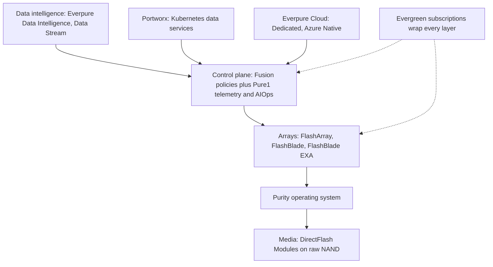
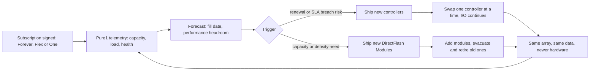
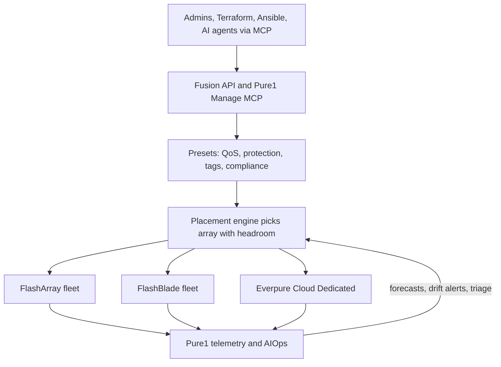
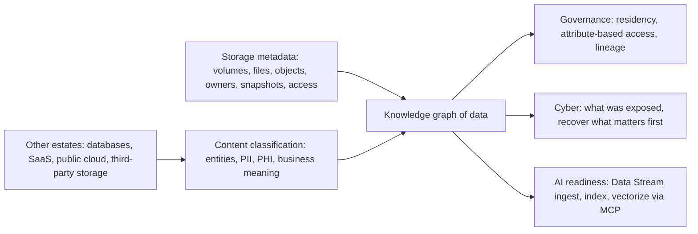
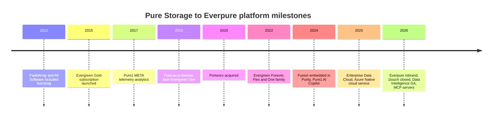

# 28. Platform and software

> **Depth:** L2 · **Reading time:** ~10 min · **Last verified:** 2026-11-01
> **Prerequisites:** [Control planes and fleet management](../03-system-architecture/22-control-planes.md) · [Consumption models](../03-system-architecture/23-consumption-models.md) · [Purity and DirectFlash](26-purity-and-directflash.md) · [FlashArray and FlashBlade](27-flasharray-and-flashblade.md)

## TL;DR

- **One software stack, many kinds of hardware.** Purity runs on every array, Fusion and Pure1 manage the fleet, Portworx and Everpure Cloud extend it to Kubernetes and public cloud, and Data Intelligence (ex-1touch) reads what the data *is*. Umbrella names: Enterprise Data Cloud (2025), "Data Primacy" (2026).
- **Evergreen is the business model that makes the platform work.** Customers subscribe to an architecture; controllers and media are refreshed in place with no data migration. Subscription ARR reached $2.13B (+20%) in Q2 FY27[^1].
- **Switching costs now live in the control plane.** Fusion presets and automation outlast any hardware refresh. Over 1,200 customers used Fusion by Q1 FY27, double the prior quarter[^2], still under a tenth of the base.
- **1touch ($125.0M, closed 2026-05-07)[^3] bets that storage metadata plus content classification becomes a governance and AI-readiness product.** It is small next to Portworx (~$353M, 2020)[^4] but enters categories owned by data catalogs and data-security vendors.
- **Every incumbent is making the same pitch.** Dell, NetApp, HPE and VAST all sell a "data platform"; the differences are what sits beneath (one OS or a portfolio), reach beyond own hardware, and whether customers buy the top layers.

## Why this matters for Everpure strategy

Hardware margins ride the NAND cycle; Everpure raised prices in February 2026 as component costs surged ([Chapter 29](29-hyperscaler-ecosystem-financials.md)). Subscription gross margin was 74.9% in Q2 FY27 against 66.2% for product (both non-GAAP)[^5]. The platform aims to make revenue compound through attach and expansion. Subscription net dollar retention was 113% in FY26[^6], so a cohort paying $100 one year paid $113 the next.

The risk: if Fusion, Portworx and Data Intelligence mostly ship inside array deals rather than winning standalone budgets, "data management company" is a rebrand on a storage P&L. The options a strategy team might evaluate, based on public information, turn on that distinction.

## Core concepts

### The stack, layer by layer

*Figure 28.1 — One OS on every array, one control plane over every array, and the newest layers (Portworx, cloud, data intelligence) plugged into that control plane rather than into individual boxes.*

The bottom three layers are covered in [Chapter 26](26-purity-and-directflash.md), [Chapter 27](27-flasharray-and-flashblade.md) and [Chapter 22](../03-system-architecture/22-control-planes.md). The layers above need no Everpure hardware: **Portworx** serves Kubernetes anywhere, **Everpure Cloud** runs Purity in AWS and Azure, and **Data Intelligence** classifies data wherever it lives.

**Semiconductor bridge:** this is Synopsys and Cadence moving from point tools to flows. A simulator is easy to swap; a sign-off flow with years of scripts and qualified recipes is not. Fusion presets and automation are Everpure's "flow"; the arrays are the tools.

Naming has shifted, so be precise. The **Enterprise Data Cloud** (June 2025) was a unified on-premises-plus-cloud control plane with Fusion at its core[^7]; the CEO tied the February 2026 Everpure name to it and to Evergreen[^8]. Counsel and filings now say "Everpure Platform"[^9]. At Accelerate 2026 the framing became **Data Primacy**, trusted data rather than applications at the centre[^10], with pillars of data management, a unified data plane and an intelligent control plane[^11]. "Pure Storage Cloud" is now **Everpure Cloud**[^12].

### Evergreen: subscribing to an architecture

Evergreen began in 2015; Evergreen Gold became Evergreen//Forever in the 2022 restructuring[^13] that produced today's three tiers[^14].

| Tier | Who owns the hardware | What you pay for | Refresh mechanics | Key guarantees (company-stated) |
|---|---|---|---|---|
| Evergreen//Forever | Customer | Array purchase plus a recurring subscription | Controller refresh tied to three-year renewals, subject to program terms[^15][^16] | Non-disruptive upgrades; no re-buying capacity already owned |
| Evergreen//Flex | Customer | Capacity actually used, with fleet-level pooling | Same as //Forever; capacity can be moved across the fleet | Pay-per-use on owned arrays[^15] |
| Evergreen//One | Everpure | A performance tier, priced per unit of used capacity, with a minimum commit | Everpure's responsibility, invisible to the customer | Up to ten SLAs, including 99.9999% availability, a 25% capacity buffer, energy efficiency, zero planned downtime and zero data loss[^17][^18] |

*Table 28.1 — The three Evergreen tiers move risk progressively from the customer (owns and plans) to Everpure (owns, plans and guarantees).*

The enabler is architectural. In a Purity dual-controller array, persistent state (data, metadata, write log) lives on flash modules and NVRAM in the chassis, not in the controllers ([Chapter 14](../03-system-architecture/14-scale-up-dual-controller.md)), so controllers swap one at a time while the partner serves I/O, and media is replaced by adding modules and evacuating old ones.

*Figure 28.2 — The Evergreen loop: telemetry tells Everpure when to ship hardware, and the architecture lets that hardware go in with no data migration, which is what makes the subscription renewable.*

By July 2021 Pure Storage cited more than 7,000 non-disruptive controller upgrades for over 2,700 customers since 2015 (company-stated)[^19]. Evergreen//One's SLAs are underwritable only because Pure1 watches every array; the buffer is sized from historical growth via Pure1's workload planner[^17]. **Overdrive**, announced for Q3 2026, allows bursts up to 25% above the subscribed level[^20] [VERIFY: Overdrive terms from secondary summaries only].

**Worked example (illustrative).** A customer uses 800 TiB under Evergreen//One. With a 25% buffer, Everpure keeps at least 1,000 TiB effective on site, on hardware it owns; if data reduces worse than planned, it adds flash at its own cost. The vendor carries utilisation and data-reduction risk a capex buyer would carry, priced into the per-TiB rate and profitable only if telemetry keeps forecasts accurate. [Chapter 23](../03-system-architecture/23-consumption-models.md) covers the cash-flow side.

Evergreen//One bookings growth is tracked in [Chapter 29](29-hyperscaler-ecosystem-financials.md).

### Fusion and Pure1: the control plane as the product

*Figure 28.3 — Users and agents ask for an outcome through one API; presets encode policy, Pure1 telemetry informs placement, and the arrays become interchangeable capacity behind it.*

Fusion has been embedded in Purity since 2024, with nothing separate to deploy[^21]. Its central object is the **preset**, a fleet-wide template of performance limits, snapshot and replication policy, and tags[^22], much like a Kubernetes storage class. Pure1 supplies forecasts, workload planning and predictive support. In 2026 both became agent-addressable: Everpure offers a **Pure1 Manage MCP server** and a **Fusion MCP server**, so AI tools can query fleet state and carry out supervised actions[^23]. Fusion Compliance and Agentic Triage (configuration-drift detection with AI root-cause suggestions) and Workload Rebalance and Mobility were slated for Q4 2026[^24] [VERIFY: GA status].

Watch adoption: over 1,200 Fusion customers against roughly 14,500–15,000 in total [VERIFY: two different base figures] is about 8%, and control-plane lock-in is real only for them.

### Portworx: storage for Kubernetes, then for VMs

Portworx (acquired October 2020[^4]) pools whatever disks or cloud volumes sit under a Kubernetes cluster and gives containers persistent volumes, replication, snapshots, backup and DR, on any hardware or cloud, or directly on FlashArray. Everpure books Portworx term licences as product revenue and its other offerings as subscription services revenue[^3], so no standalone Portworx revenue figure is public.

Portworx's second act came from Broadcom, whose post-2023 VMware licensing changes raised many renewal bills[^25] and pushed enterprises to evaluate **KubeVirt**, which runs VMs as Kubernetes objects (often via OpenShift Virtualization). Portworx Enterprise 3.6 (March 2026) added validated KubeVirt frameworks and a VM-readiness tool; customers run over 100,000 VM volumes on it (company-stated)[^26]. Everpure's own IT moved more than 5,000 VMs to KubeVirt on Portworx (company-stated)[^27]. An OpenShift plugin and an Edge SKU followed at Red Hat Summit 2026[^28].

Everpure hedges the VMware exit both ways: Portworx for Kubernetes, and the May 2025 Nutanix partnership (FlashArray as external AHV storage) for another hypervisor[^29]. Either way the array can stay Everpure.

### Everpure Cloud

**Everpure Cloud Dedicated** (ex-Cloud Block Store) is customer-managed Purity in the customer's AWS or Azure account, with replication and snapshot parity with on-premises arrays[^12]. **Everpure Cloud Azure Native**, co-developed with Microsoft and launched September 2025[^30], is a fully managed Azure Native ISV service, first for Azure VMware Solution[^31], with Azure VM support GA from June 2026[^20] [VERIFY: Azure VM GA date]. The role is mainly defensive: a workload moving to cloud can stay under Fusion and Evergreen-style billing rather than native EBS or Azure Disk. Against NetApp's first-party ONTAP services in all three hyperscalers, Everpure's reach is narrower ([Chapter 46](../06-industry-and-competition/46-incumbents.md)).

### 1touch and the data-intelligence thesis

*Figure 28.4 — The thesis: the storage layer already knows where every byte is and who touched it; add knowledge of what the bytes mean, and you can sell governance, cyber recovery and AI-ready data from the same graph.*

1touch closed on 2026-05-07, the $125.0M subject to adjustments and escrow[^3]. As **Everpure Data Intelligence** (GA June 2026)[^10] it discovers structured and unstructured data, classifies it at entity level (flagging PII and PHI) into a semantic knowledge graph, tracks lineage, and enforces attribute-based access and residency policy[^32]. Analysts also describe it as reaching databases, SaaS and third-party storage, not only Everpure arrays[^11]. Native MCP support (September 2026) lets agents query it[^33]. **Data Stream**, on FlashBlade with NVIDIA GPUs and NVIDIA's AI Data Platform reference design, ingests, indexes and vectorises that data for RAG and inference[^34] ([Chapter 39](../05-ai-storage/39-agentic-ai-and-data-intelligence.md), [Chapter 33](../05-ai-storage/33-rag-vector-lakehouse.md)).

Why a storage company? The array already holds the **inventory** (every volume, file, object, snapshot and access) and sits on the **write path**, so classification can trigger as data lands rather than by weekly crawls, as a catalog above storage must. **Semiconductor bridge:** on-die telemetry sees every transaction; external test equipment only samples.

### How "storage vendor → data platform" is meant to work commercially

The model has three levers:

1. **Attach.** Each layer sells into ~15,000 customers who already trust the vendor and run Pure1. *Illustrative:* if 5% of 15,000 customers attach Data Intelligence at an assumed $150k ARR, that is 750 × $150k ≈ $113M of ARR, about 5% on top of the $2.13B base. That is roughly one year's revenue to recover the $125M price.
2. **ARR quality.** Software raises subscription mix, margin and net retention beyond capacity growth alone.
3. **Switching costs.** They shift from the box (which Evergreen makes easy to refresh) to policy, automation and the knowledge graph, which are costly to rebuild elsewhere.

**Where it may not work.** First, crowding: catalogs and lakehouse governance (Databricks Unity Catalog, Snowflake's governance features, Microsoft Purview) own "what is this data" for analytics, and data-security vendors (BigID, Varonis, Cyera) sell discovery to the CISO, a different buyer. Second, neutrality is unproven. One analyst said the case beyond Everpure hardware becomes "a bigger question mark", noting Everpure is outside the Open Semantic Interchange metadata effort[^11] [VERIFY: search-summary only]. Third, storage sellers are paid on arrays; software covering rival storage needs separate incentives. Futurum's open question: how quickly customers follow[^32].

## How Everpure approaches it vs. competitors

| Vendor | Platform pitch (2025–26) | What's underneath | Data-intelligence / AI layer | Consumption | Steelman | Weak spot |
|---|---|---|---|---|---|---|
| Everpure | Enterprise Data Cloud → Data Primacy[^7][^10] | One OS (Purity) across all arrays and cloud | Data Intelligence (ex-1touch), Data Stream[^34] | Evergreen //Forever, //Flex, //One | Simplest single-OS stack; mature non-disruptive refresh | Narrow cloud reach; DI unproven off Everpure gear; software mostly sold with arrays |
| Dell | AI Data Platform with NVIDIA[^35] | Several OSes: PowerScale, Lightning FS, ObjectScale, PowerStore, PowerMax | Data orchestration within the AI Data Platform | APEX[^36] | Sells servers, networking and storage on one PO | Portfolio sprawl; control plane less unified |
| NetApp | Intelligent data infrastructure; AFX + AI Data Engine[^37] | ONTAP on-premises and as first-party service in all three hyperscalers | AI Data Engine (ONTAP extension on NVIDIA AI Data Platform) | Keystone[^36] | Deepest hybrid-cloud reach; long data-management heritage | AFX/AIDE new; ONTAP complexity |
| HPE | GreenLake cloud with GreenLake Intelligence[^38] | Alletra MP (block, file, object), Zerto, Data Fabric[^39] | Inline metadata enrichment on X10000; agentic ops | GreenLake[^36] | Full-stack (compute, networking via Juniper) under one cloud console | Storage is a small slice of HPE; many products |
| VAST | AI Operating System[^40] | One software stack (DASE) on partner hardware | DataBase, DataEngine, InsightEngine, AgentEngine, PolicyEngine in-platform | Software subscription | Most integrated: database and compute live in the storage layer | Asks customers to replace analytics tools too; private-company disclosure |

*Table 28.2 — All five vendors call themselves data platforms; Everpure's distinctive claim is one OS plus a non-disruptive subscription, while VAST goes furthest up the stack and NetApp furthest across clouds.*

Dell and HPE stitch several OSes under one console; NetApp has one OS but a less clean refresh subscription; VAST puts database and functions inside storage ([Chapter 42](../06-industry-and-competition/42-vast-data.md)), where Everpure stops short. The strongest steelman is NetApp: first-party ONTAP services in all three hyperscalers against Everpure's one native service plus a customer-managed virtual array.

## History and trajectory

*Figure 28.5 — Every step moved value from hardware toward subscription and software, but the data-layer step in 2026 is the first that reaches beyond Everpure's own boxes.*

Timeline sources: All Software Included[^41], Pure1 META[^42], Evergreen//One[^14], AI copilot[^43]. Portworx was the first product needing no Pure hardware. Signals for the next 12–18 months: whether Fusion adoption keeps doubling, whether Data Intelligence is priced and reported separately and wins non-Everpure estates, and whether Everpure joins metadata-interoperability efforts.

## Numbers that matter

| Metric | Value | Context | Source / date |
|---|---|---|---|
| Subscription ARR | $2.13B (+20% YoY) | Evergreen, Portworx, Pure1, cloud subscriptions | Q2 FY27 release[^1] |
| Subscription net dollar retention | 113% (FY25: 117%) | Expansion within existing subscribers | FY26 10-K[^6] |
| Fusion customers | >1,200, doubled QoQ | ≈8% of ~15k customers (worked) | Q1 FY27 remarks, 2026-05-27[^2] |
| Evergreen//One availability SLA | 99.9999% | Plus 25% capacity buffer, up to 1 PiB | Everpure SLA brief[^17] |
| Non-disruptive controller upgrades | >7,000 for >2,700 customers | Cumulative 2015 to July 2021, company-stated | Pure press release, 2021[^19] |
| 1touch purchase price | $125.0M cash | Closed 2026-05-07 | 10-Q Q1 FY27[^3] |
| Portworx purchase consideration | $352.9M (+$32.2M retention) | Closed Oct 2020 | FY21 10-K[^4] |
| VM volumes on Portworx | >100,000 | Company-stated, March 2026 | IT Brief[^26] |
| Attach illustration | ~$113M ARR | 5% × 15,000 × $150k, illustrative | Worked example |

## Conversation playbook

**Questions for a PM**

1. *"What share of Data Intelligence deals cover data that is not on Everpure storage?"* Strong: a number, named estate types (Oracle, SaaS, rival NAS), and how it integrates with an existing catalog or DSPM tool.
2. *"Is Fusion adoption counted as customers who enabled it or customers running presets in production?"* Strong: separates "turned on" from "automating against it" and ties the latter to renewal and NDR.
3. *"What does Evergreen//One's 25% buffer cost us in deployed capacity, and how has NAND inflation changed that?"* Strong: quantifies buffer and data-reduction risk and how pricing or Overdrive recovers it.

**Questions for an engineer**

1. *"How does Data Intelligence classify on the write path without adding latency to Purity?"* Strong: asynchronous, off the I/O path, triggered by snapshot or metadata events, with bounded controller resources.
2. *"What can an agent do through the Fusion MCP server without human approval?"* Strong: scoped credentials, read-only default, approval gates on destructive actions, immutable snapshots as backstop.
3. *"When Portworx runs on non-Everpure disks, what do customers lose versus Portworx on FlashArray?"* Strong: candid about data reduction, snapshot offload and replication efficiency.

**Don't say this:**

- "Evergreen means free hardware." The subscription funds upgrades, with eligibility terms.
- "Everpure is now a data-management company like Databricks." It manages data infrastructure and metadata, not analytics engines.
- "Portworx only works with Everpure arrays." It is hardware-agnostic by design.
- "1touch is Everpure's biggest software deal." Portworx cost almost three times as much.

## Going deeper (optional, L3 pointers)

- Evergreen//One Product Guide and Evergreen Program Description (SLA definitions, remedies, eligibility).
- Fusion white paper and open-source Fusion MCP server (preset schema, API objects).
- Portworx docs on KubeVirt live migration; KubeVirt and CSI specifications.

## Key terms

- **Everpure Platform / Enterprise Data Cloud / Data Primacy** — names for the stack and strategy.
- **Evergreen//Forever, //Flex, //One** — owned, owned pay-per-use, and as-a-service subscription tiers.
- **Fusion preset** — a fleet-wide policy template for provisioning.
- **Portworx** — Kubernetes data services that run on any infrastructure.
- **KubeVirt** — runs VMs as Kubernetes objects.
- **Everpure Cloud Dedicated / Azure Native** — customer-managed and fully managed cloud Purity.
- **Everpure Data Intelligence** — discovery and classification product from 1touch.
- See the [glossary](../glossary.md).

## Sources

[^1]: Everpure, "Everpure Announces Second Quarter Fiscal 2027 Financial Results," 2026-08-26. https://investor.everpuredata.com/news-and-events/press-releases/press-release-details/2026/Everpure-Announces-Second-Quarter-Fiscal-2027-Financial-Results/default.aspx (retrieved 2026-11-01).
[^2]: Everpure, "Q1 FY27 Prepared Remarks," 2026-05-27. https://s21.q4cdn.com/687136699/files/doc_financials/2027/q1/Everpure-Q1FY27-Prepared-Remarks.pdf (retrieved 2026-11-01); prior figure (>600 customers) from Everpure, "Q4FY26 Prepared Remarks," 2026-02-25. https://s21.q4cdn.com/687136699/files/doc_financials/2026/q4/Q4FY26-Everpure-Prepared-Remarks.pdf (retrieved 2026-11-01).
[^3]: SEC, "Everpure, Inc. Form 10-Q for the quarter ended May 3, 2026," 2026-06. https://www.sec.gov/Archives/edgar/data/0001474432/000147443226000061/pstg-20260503.htm (retrieved 2026-11-01).
[^4]: SEC, "Pure Storage, Inc. Form 10-K for fiscal year 2021," 2021-03. https://www.sec.gov/Archives/edgar/data/1474432/000162828021005538/pstg-20210131.htm (retrieved 2026-11-01).
[^5]: Investing.com, "Everpure Q2 FY27 slides: 38% revenue growth, guidance raised sharply," 2026-08. https://www.investing.com/news/company-news/everpure-q2-fy27-slides-38-revenue-growth-guidance-raised-sharply-93CH-4878054 (retrieved 2026-11-01).
[^6]: SEC, "Everpure, Inc. Form 10-K for fiscal year ended February 1, 2026," 2026-03-24. https://www.sec.gov/Archives/edgar/data/1474432/000147443226000027/pstg-20260201.htm (retrieved 2026-11-01).
[^7]: Blocks & Files, "Pure debuts Enterprise Data Cloud with Fusion updates and new FlashArray systems," 2025-06-18. https://www.blocksandfiles.com/ai-ml/2025/06/18/pure-debuts-enterprise-data-cloud-with-fusion-updates-and-new-flasharray-systems/100996 (retrieved 2026-11-01).
[^8]: WWT, "Pure Storage Rebrands To Everpure And Announces Intent To Acquire 1touch," 2026-02-23. https://www.wwt.com/news/pure-storage-rebrands-to-everpure-and-announces-intent-to-acquire-1touch (retrieved 2026-11-01).
[^9]: Cleary Gottlieb, "Everpure Completes Acquisition of 1touch," 2026-05-11. https://www.clearygottlieb.com/news-and-insights/news-listing/everpure-completes-acquisition-of-1touch (retrieved 2026-11-01).
[^10]: HPCwire, "Everpure Wants to Improve Data Management for the Coming AI Wave," 2026-06-20. https://www.hpcwire.com/aiwire/2026/06/20/everpure-wants-to-improve-data-management-for-the-coming-ai-wave/ (retrieved 2026-11-01).
[^11]: TechTarget, "Everpure grows into data management with Data Intelligence update," 2026-06. https://www.techtarget.com/searchstorage/news/366644759/Everpure-grows-into-data-management-with-Data-Intelligence-update (retrieved 2026-11-01; read via search summary, page not fetchable); corroborated in part by IT Brief Australia, "Storage to strategy: Everpure pivots to data intelligence," 2026. https://itbrief.com.au/story/storage-to-strategy-everpure-pivots-to-data-intelligence (retrieved 2026-11-01).
[^12]: Everpure Support, "White Paper: Everpure Cloud Dedicated for AWS," n.d. https://support.everpuredata.com/r/bHp_RInmbnRr219God~wDA/vvUbjhwU28Xj07IMH9rE6w (retrieved 2026-11-01); Pure Community, "Pure Cloud Block Store is now Pure Storage Cloud Dedicated," n.d. https://purecommunity.purestorage.com/tag/cloud (retrieved 2026-11-01).
[^13]: IDC / Pure Storage, "Evergreen//Forever Subscription Ushers in New FlashBlade//S" (white paper), 2022. https://www.purestorage.com/content/dam/pdf/de-de/white-papers/wp-idc-evergreen-forever-subscription-ushers-in-new-flashblade-s-de-de.pdf (retrieved 2026-11-01).
[^14]: Blocks & Files, "Pure Storage Evergreen rework," 2022-06-08. https://blocksandfiles.com/2022/06/08/pure-storage-evergreen-rework/ (retrieved 2026-11-01).
[^15]: Everpure, "Evergreen subscriptions" (product page), n.d. https://www.everpuredata.com/products/staas/evergreen.html (retrieved 2026-11-01).
[^16]: Everpure, "Evergreen Program Description" (legal), n.d. https://www.purestorage.com/legal/evergreen-program-description.html (retrieved 2026-11-01).
[^17]: Everpure, "Evergreen//One Advanced SLAs" (solution brief), n.d. https://www.everpuredata.com/content/dam/pdf/en/solution-briefs/sb-evergreen-one-advanced-slas.pdf (retrieved 2026-11-01).
[^18]: Everpure, "Evergreen//One Product Guide" (subscriptions commencing on or after 2025-08-18), n.d. https://www.everpuredata.com/legal/evergreen-one-product-guide.html (retrieved 2026-11-01).
[^19]: Pure Storage, "Pure's Evergreen Subscription to Innovation Reaches New Milestone," 2021-07. https://www.purestorage.com/company/newsroom/press-releases/pure-evergreen-subscription-reaches-new-milestone.html (retrieved 2026-11-01); corroborated by ITWeb, 2021-07. https://www.itweb.co.za/article/pures-evergreen-subscription-to-innovation-reaches-new-milestone-delivers-over-7-000-non-disruptive-controller-upgrades-since-2015/raYAyModA85qJ38N (retrieved 2026-11-01).
[^20]: Coolspirit, "Pure Accelerate 2026: What the Latest Announcements Mean for Enterprise Storage," 2026-06. https://www.coolspirit.co.uk/blogs/pure-accelerate-2026-what-the-latest-announcements-mean-for-enterprise-storage (retrieved 2026-11-01).
[^21]: TechTarget, "Pure Storage adds AI and automation, extends SLAs," 2024-06. https://www.techtarget.com/searchStorage/news/366589453/Pure-Storage-adds-AI-and-automation-extends-SLAs (retrieved 2026-11-01).
[^22]: Everpure, "Presets and Workloads in Pure Fusion" (demo), n.d. https://www.everpuredata.com/demos/platform/managing-at-scale/presets-and-workloads-in-pure-fusion/6368000113112.html (retrieved 2026-11-01).
[^23]: Everpure blog, "Pure1, now agentic," 2026. https://blog.everpuredata.com/products/pure1-now-agentic/ (retrieved 2026-11-01).
[^24]: Blocks & Files, "Everpure extends data and control planes for agentic AI," 2026-06-17. https://www.blocksandfiles.com/data-management/2026/06/17/everpure-extends-data-and-control-planes-for-agentic-ai/5257407 (retrieved 2026-11-01; read via search summary).
[^25]: CIO Dive, "Broadcom's VMware acquisition and VCF private cloud strategy," 2024. https://ciodive.com/news/broadcom-vmware-acquistion-vcf-private-cloud/733800/ (retrieved 2026-11-01); Data Center Knowledge, "Broadcom Explains VMware Strategy Amid Product 'Confusion'," 2024. https://www.datacenterknowledge.com/management/broadcom-explains-vmware-strategy-amid-product-confusion- (retrieved 2026-11-01).
[^26]: IT Brief New Zealand, "Everpure adds VM storage tools for Kubernetes estates," 2026-03. https://itbrief.co.nz/story/everpure-adds-vm-storage-tools-for-kubernetes-estates (retrieved 2026-11-01).
[^27]: Intelligent CIO, "Portworx by Everpure is redefining modern virtualisation for customers with proven, enterprise-ready solutions," 2026-04-02. https://www.intelligentcio.com/me/2026/04/02/portworx-by-everpure-is-redefining-modern-virtualisation-for-customers-with-proven-enterprise-ready-solutions/ (retrieved 2026-11-01).
[^28]: Efficiently Connected, "Portworx at Red Hat Summit 2026," 2026-05. https://www.efficientlyconnected.com/portworx-edge-kubernetes-storage-red-hat-summit-2026/ (retrieved 2026-11-01).
[^29]: SDxCentral, "Nutanix partners with Pure Storage in latest VMware assault," 2025-05. https://www.sdxcentral.com/news/nutanix-partners-with-pure-storage-in-latest-vmware-assault/ (retrieved 2026-11-01).
[^30]: Blocks & Files, "Pure Enterprise Data Cloud updates," 2025-09-26. https://blocksandfiles.com/2025/09/26/pure-enterprise-data-cloud-updates/ (retrieved 2026-11-01).
[^31]: Microsoft Learn, "Pure Storage Cloud overview" (Azure Native ISV Services), n.d. https://learn.microsoft.com/en-us/azure/partner-solutions/pure-storage/overview (retrieved 2026-11-01).
[^32]: Futurum Group, "Everpure's Data Primacy Bet: From Storage to System of Record," 2026. https://futurumgroup.com/insights/everpures-data-primacy-bet-from-storage-to-system-of-record/ (retrieved 2026-11-01; read via search summary).
[^33]: Blocks & Files, "Everpure bulks up AI offer," 2026-09-30. https://blocksandfiles.com/flash/2026/09/30/everpure-bulks-up-ai-offer/5300162 (retrieved 2026-11-01).
[^34]: BigDATAwire / HPCwire, "Everpure Announces Data Stream to Expand AI-Ready Data Offerings," 2026-06-17. https://www.hpcwire.com/bigdatawire/this-just-in/everpure-announces-data-stream-to-expand-ai-ready-data-offerings/ (retrieved 2026-11-01).
[^35]: Dell Technologies, "Dell AI Data Platform with NVIDIA Supercharges Enterprise AI with Breakthrough Data Orchestration and Storage Innovations," 2026-03-16. https://www.dell.com/en-us/dt/corporate/newsroom/announcements/detailpage.press-releases~usa~2026~03~dell-ai-data-platform-with-nvidia-supercharges-enterprise-ai-with-breakthrough-data-orchestration-and-storage-innovations.htm (retrieved 2026-11-01).
[^36]: Gartner Peer Insights, "Platform-Native Consumption Services" market comparisons (Evergreen//One, NetApp Keystone, Dell APEX, HPE GreenLake Flex Capacity), n.d. https://www.gartner.com/reviews/market/platform-native-consumption-services/compare/product/evergreenone-vs-hpe-greenlake-flex-capacity (retrieved 2026-11-01).
[^37]: Blocks & Files, "NetApp disaggregates ONTAP storage and provides an AI Data Engine," 2025-10-14. https://blocksandfiles.com/2025/10/14/netapp-disaggregates-ontap-storage-and-provides-an-ai-data-engine/ (retrieved 2026-11-01).
[^38]: HPE, "HPE reimagines hybrid IT operations with GreenLake Intelligence," 2025-06. https://www.hpe.com/us/en/newsroom/press-release/2025/06/hpe-reimagines-hybrid-it-operations-with-greenlake-intelligence.html (retrieved 2026-11-01).
[^39]: Blocks & Files, "HPE updates Alletras X and B10000, Zerto and Data Fabric in GreenLake private cloud update blast," 2026-05-12. https://www.blocksandfiles.com/file/2026/05/12/hpe-updates-alletras-x-and-b10000-zerto-and-data-fabric-in-greenlake-private-cloud-update-blast/5239011 (retrieved 2026-11-01).
[^40]: HPCwire, "VAST Data Expands AI Data Stack, Keeps Eye on North Star," 2026-02-25. https://www.hpcwire.com/2026/02/25/vast-data-expands-ai-data-stack-keeps-eye-on-north-star/ (retrieved 2026-11-01).
[^41]: SEC, "Pure Storage, Inc. Form S-1," 2015-08-27. https://www.sec.gov/Archives/edgar/data/0001474432/000119312515287576/d895532ds1.htm (retrieved 2026-11-01).
[^42]: Pure Storage, "Pure Storage Delivers Industry-First Performance and Capacity Prediction Capabilities Powered by Machine Learning" (Pure1 META), 2017-06. https://www.everpuredata.com/company/news-and-events/press/ps_release_accelerate2017_meta.html (retrieved 2026-11-01).
[^43]: ITPro, "Pure Storage looks to 'fundamentally change' cloud storage management with new AI copilot tool," 2024-06. https://itpro.com/cloud/cloud-storage/pure-storage-looks-to-fundamentally-change-cloud-storage-management-with-new-ai-copilot-tool (retrieved 2026-11-01).
