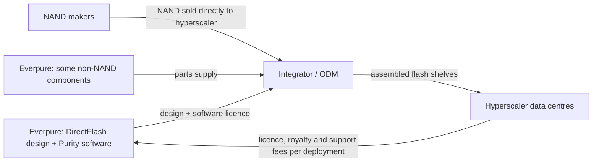
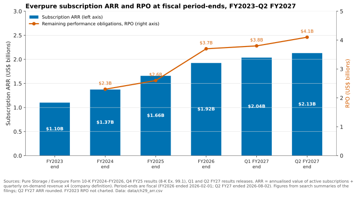
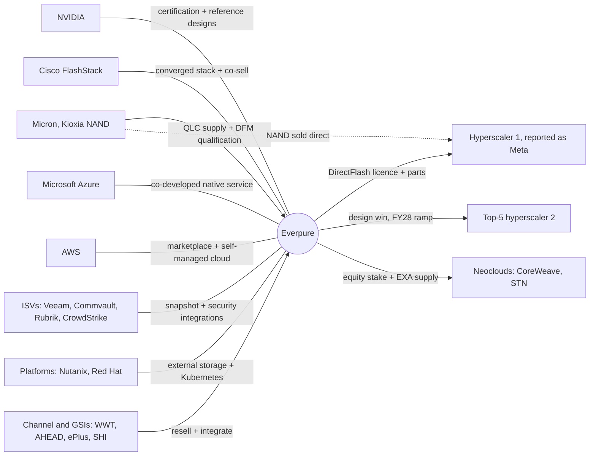

# 29. Hyperscaler business, ecosystem and financials through a tech lens

> **Depth:** L2 · **Reading time:** ~9 min · **Last verified:** 2026-11-01
> **Prerequisites:** [Purity and DirectFlash](26-purity-and-directflash.md) · [Consumption models](../03-system-architecture/23-consumption-models.md) · [Company history and strategy](25-company-history-and-strategy.md)

## TL;DR

- **Two revenue lines, three businesses.** Everpure (NYSE: P, formerly PSTG) sells arrays with NAND on its own books, Evergreen subscriptions recognised ratably, and hyperscale DirectFlash licences where the customer buys the NAND. Each has a different margin profile.
- **The hyperscaler model licenses flash-management IP; it does not sell boxes.** The first customer, Meta (named in the FY25 10-K), passed 2 EB in FY26. A second top-five hyperscaler signed on 2026-08-10, with revenue from FY28.
- **Recurring revenue keeps compounding.** At Q2 FY27 (ended 2026-08-02), subscription ARR was $2.13B (+20%) and RPO $4.1B (+44%).
- **Technology choices set margins.** DirectFlash removes SSD controllers and DRAM from the bill of materials. The 2026 NAND spike has pushed non-GAAP product gross margin (GM) down to 65–66%, subscription GM runs about 75%, and hyperscale licensing is accretive but lumpy.
- **The ecosystem is mostly distribution.** NVIDIA certifications gate AI deals, Cisco and GSIs carry enterprise volume, and NAND makers sell directly to Everpure's hyperscale customers.

## Why this matters for Everpure strategy

Everpure raised its FY27 revenue guidance from $4.3–4.4B in February 2026 to $5.03–5.07B in August. The new midpoint is about 38% above FY26's $3.66B[^1][^2]. A dollar of hyperscale licence, FlashArray//C or Evergreen//One revenue differs in cost, cash timing and durability, so the source of growth matters. This chapter links the architecture in [Chapter 26](26-purity-and-directflash.md) to the numbers analysts model.

Whether the licensing model reaches more than two hyperscalers, and whether it complements or cannibalises arrays, sits near the centre of the equity story.

## Core concepts

### Three revenue engines on one technology stack

The 10-K has two revenue lines, **product** and **subscription services**. Three engines feed them:

1. **Arrays sold outright** (FlashArray, FlashBlade, FlashBlade//EXA). Everpure buys NAND, builds DirectFlash Modules (DFMs) and books product revenue at shipment; the attached Evergreen//Forever support-and-upgrade subscription is ratable.
2. **Consumption services**, mainly Evergreen//One, an SLA-backed storage-as-a-service priced on capacity used. Everpure keeps the hardware and revenue is ratable, which is why FY24 product revenue fell 9% while subscription rose 26%; the 10-K partly blamed Evergreen//One's consumption model[^3].
3. **Hyperscale.** DirectFlash and Purity technology is licensed to hyperscalers that buy their own NAND, and the revenue lands in *product*. Q3 FY26 product revenue was $534.8M (+17.6%) and included royalties from hyperscaler shipments[^4].

*Figure 29.1 — Evergreen//One pulled the mix toward subscription through FY25. In FY27 product revenue is growing faster again, driven by price, large deals and hyperscale.*
Data: `data/ch29_revenue_mix.csv`

Subscription's share of revenue rose from 35% in FY23 to 46% in FY25 and FY26. It then slipped to 44% in H1 FY27, and to 42% in Q2 alone[^5], because product revenue grew 55% in Q1 and 54% in Q2[^6][^1]. The causes: price increases after NAND costs surged (list prices rose on 2026-02-09[^7]), larger deals and, from H2 FY27, hyperscale. The recurring base is not weakening; subscription services still grew 17% in Q1 and 20% in Q2.

### The hyperscaler model: licensing a controller, not selling a box

**Semiconductor bridge.** DirectFlash takes the SSD's controller ASIC and FTL DRAM out of the drive and moves flash management into Purity ([Chapter 26](26-purity-and-directflash.md)). The hyperscale deals sell that capability the way an IP vendor sells a design: the customer buys the "wafers" (NAND); Everpure supplies design, software and some non-NAND parts, and is paid as capacity deploys.

*Figure 29.2 — In hyperscale, the NAND never appears on Everpure's books. Everpure is paid for IP, software, support and some components, so revenue per exabyte is low but gross margin is high.*

What is public, in date order:

- **Design win (December 2024).** With its Q3 FY25 results, Pure Storage announced a DirectFlash design win with an unnamed top-four hyperscaler. Hardware was excluded: the customer buys from its integrator, and Pure earns licence, software and support fees[^8][^9]. Analysts identified the customer as Meta; the CEO cited Meta's choice of DFMs at the March 2025 FlashBlade//EXA launch[^10], and the FY2025 10-K names Meta[^46].
- **Volume (FY26).** Pure recognised its first revenue in Q2 FY26. The FY26 plan assumed 1–2 EB of DirectFlash deployed[^11], and by Q3 FY26 Pure said it had beaten its 2 EB forecast[^4]. For scale, 2 EB is about 26,700 modules at 75 TB or 13,300 at 150 TB (deployed sizes undisclosed).
- **Standardised model (February 2026).** Management said hyperscale terms were now standard: Everpure procures some components, and hyperscalers keep buying NAND through their own supply chains. Revenue follows data-centre build-outs, with most of FY27's expected in Q3–Q4[^13]. [VERIFY: search-summary only]
- **Second hyperscaler (2026-08-10).** Everpure announced a design win and supply agreement with a second unnamed top-five hyperscaler, built on DirectFlash. It contributes little to FY27 and is expected to matter from FY28[^14][^15]. Management said it mirrors the first, and that DirectFlash is mostly replacing SSDs, not disks, for now[^16]. The release itself warns that the customer may not order or deploy the volumes contemplated[^14].

**Worked example (illustrative): why hyperscale lifts margin only at scale.** Everpure does not disclose hyperscale gross margin. Analyst commentary puts it around 75–85% (some notes say above 90% for pure royalties)[^17] [VERIFY: analyst estimates, search-summary only]. Suppose hyperscale is 5% of quarterly revenue at 85% GM and everything else runs at Q2 FY27's 69.9% non-GAAP GM[^18]. Blended GM = 0.95 × 69.9% + 0.05 × 85% = 66.4% + 4.25% ≈ **70.7%**, a lift of about 0.8 points. At a 10% share it is 0.90 × 69.9% + 0.10 × 85% ≈ **71.4%**. Hyperscale moves the blend only at double-digit revenue share. Q3 FY26 is the real-world version: royalties helped lift non-GAAP product GM to 72.9% (from 67.4%) and GAAP GM to 72.3%[^4][^47]. But management said the newer models, with Everpure supplying components, bring hyperscale margins closer to the company average[^47], so 85% is an upper case.

### Subscription ARR and RPO: what the backlog says

Everpure defines **subscription ARR** as the annualised contract value of active subscriptions at quarter-end plus that quarter's on-demand revenue × 4[^3]. **RPO** (remaining performance obligations) is contracted revenue not yet recognised: undelivered product plus the unexpired years of multi-year subscriptions.

*Figure 29.3 — ARR has compounded at about 21% a year, while RPO stepped up sharply in FY26 as large deals and longer Evergreen terms added to the backlog.*
Data: `data/ch29_arr.csv`

How to read it:

- **Growth rate.** (2.13 ÷ 1.10)^(1/3.5 years) ≈ 1.21, about 21% a year[^3][^1].
- **The RPO step.** RPO grew 40% in FY26 (14% in FY25) on large deals and longer Evergreen contracts[^19]. Some growth was borrowed: longer renewals slowed ARR growth to 16% and net dollar retention fell from 117% to 113%[^20].
- **Sanity check.** Q2 subscription revenue of $499M × 4 ≈ $2.0B sits just below $2.13B ARR, which includes on-demand run-rate and late-quarter starts. RPO is about 1.9× ARR.

**Tech lens.** In Evergreen//One, Everpure owns the hardware and charges per TB used, so DFM density, data reduction and watts per TB set its margin, and non-disruptive upgrades make multi-year SLAs workable. Evergreen//One sales grew 73% in Q1 FY27[^6], and storage-as-a-service total contract value (TCV) was $277M in Q2 (+121%)[^16] [VERIFY: TCV from call summaries].

### Gross-margin drivers tied to technology

| Driver | Technology mechanism | Margin effect | Public evidence |
|---|---|---|---|
| DirectFlash vs SSD bill of materials | No per-drive controller ASIC or FTL DRAM. An SSD needs about 1 GB of DRAM per TB, because it keeps a 4-byte map entry for each 4 KiB page. Purity manages NAND globally, with less hidden over-provisioning | Lower $/TB than buying finished SSDs, which supports product GM while Everpure prices aggressively | Q4 FY26 product GM 67.3%, up more than 400 bp on mix[^21] |
| NAND pricing pass-through | Everpure buys NAND for enterprise arrays. NAND contract prices rose steeply through 2026, with TrendForce forecasting another +15–20% QoQ for 4Q26 (enterprise SSDs reportedly +23–28%)[^22] | Costs rise before price lists do. Margin lags and then recovers. Securing supply uses cash | Price rise on 2026-02-09[^7]; non-GAAP product GM 65.5% in Q1 and 66.2% in Q2 FY27[^6][^18]; Q2 free cash flow (FCF) –$238M on strategic NAND buys[^23] |
| Evergreen//Forever and //One | Software-heavy support plus non-disruptive upgrades. With //One, Everpure also carries the hardware | Subscription GM about 75%. Hardware-heavy //One mix can dilute it relative to pure support [VERIFY: //One cost composition] | Non-GAAP subscription GM 75.6% in Q1 and 74.9% in Q2 FY27[^6][^18] |
| Hyperscale licensing | The customer buys the NAND. Everpure supplies IP, software, support and some non-NAND parts | Royalty-like and margin-accretive, but lumpy and tied to customers' build-outs | Q3 FY26 GAAP GM 72.3%, helped by royalties[^4]; model standardised in Feb 2026[^13] |
| Deal and product mix | Large AI and enterprise deals; QLC capacity tiers (//C, //E) priced against disk | Management says it is deliberately running near the bottom of the 65–70% product GM range to win share | Long-term product GM range 65–70%[^24] |
| Software attach | Portworx, Fusion, Data Intelligence (ex-1touch) | Close to pure software, but too small today to move the blend | Not separately disclosed |

*Table 29.1 — Every margin line traces back to a technology choice: who owns the NAND, how much of the drive Everpure designs, and who owns the hardware after the sale.*

### The ecosystem map

*Figure 29.4 — Most of the ecosystem is distribution and validation, not revenue. The hyperscaler edges are the exception: there the NAND makers sell around Everpure, straight to its customer.*

Relationship types, in brief:

- **Validation (NVIDIA).** SuperPOD (November 2024)[^25], NVIDIA-Certified Storage and NCP high-performance storage (March 2025)[^26] for FlashBlade//S; Data Stream on the AI Data Platform design[^27]; BlueField-4 STX partner[^28]. No fees, but no shortlist without them ([Chapter 27](27-flasharray-and-flashblade.md), [Chapter 34](../05-ai-storage/34-nvidia-ecosystem.md)).
- **Converged distribution.** FlashStack joined Cisco's Secure AI Factory with NVIDIA in late 2025, sold via AHEAD, ePlus, SHI and WWT[^29].
- **Hyperscalers, two roles.** DirectFlash customers, and cloud channels: Everpure Cloud Azure Native, co-developed with Microsoft[^30], and Cloud Dedicated on AWS and Azure[^31] ([Chapter 28](28-platform-and-software.md)).
- **Neoclouds.** A November 2024 CoreWeave stake made Pure a preferred storage option there[^32], though Evercore noted investors rated it below a tier-1 hyperscaler win[^33]; CoreWeave later signed a far larger deal with VAST[^41]. STN's GPU cloud runs on FlashBlade//EXA[^34], and Evergreen//One reached EXA in March 2026[^35] ([Chapter 35](../05-ai-storage/35-ai-factories-and-neoclouds.md)).
- **NAND.** Micron and Kioxia supply and co-qualify DFM NAND ([Chapter 26](26-purity-and-directflash.md))[^36].
- **ISVs and platforms.** Veeam (Fusion plug-in)[^37], Commvault (IntelliSnap)[^38], Rubrik and CrowdStrike (Enterprise Data Cloud)[^39], and Nutanix AHV external storage (May 2025)[^40].

## How Everpure approaches it vs. competitors

| Dimension | Everpure | VAST Data (private) | NAND/SSD makers (Samsung, SK hynix/Solidigm, Micron, Kioxia) | Incumbent arrays (Dell, NetApp, HPE) |
|---|---|---|---|---|
| What hyperscalers buy | DirectFlash design + Purity licence + some parts; two top-5 wins | Software on partner hardware; strongest with neoclouds | Standard or custom SSDs, often running hyperscaler firmware | Little at hyperscale; strength is enterprise |
| Who owns NAND cost | Everpure (enterprise); customer (hyperscale) | Hardware partner or customer | Supplier, and it captures the 2026 price spike | Vendor, which buys SSDs |
| Neocloud motion | CoreWeave stake, STN, EXA with multi-tenancy | $1.17B CoreWeave agreement (*company-stated*)[^41] | Indirect, via servers | Dell AI Data Platform; NetApp AFX[^42] |
| NVIDIA alignment | SuperPOD, Certified Storage, NCP, STX partner | STX partner, deep NVIDIA ties | Component suppliers to NVIDIA systems | STX partners[^28] |
| Revenue durability | 42–46% subscription; $4.1B RPO | *Company-stated* ARR only | Cyclical | Own subscription programs ([Ch 23](../03-system-architecture/23-consumption-models.md)) |

*Table 29.2 — Everpure is the only array vendor publicly known to monetise its flash design inside hyperscalers. VAST owns the neocloud software position, and the NAND makers capture the commodity price cycle.*

**Steelman the alternatives.** Hyperscalers have deep firmware teams and buy SSDs at huge volume, so the default is commodity drives ([Chapter 36](../05-ai-storage/36-hyperscaler-ai-storage.md)); DirectFlash must win on power and density TCO. NAND makers bank the 2026 price spike that Everpure's enterprise business absorbs. VAST's software-only model lets neoclouds own and finance hardware; Everpure's hyperscale licence model is a partial answer in the same spirit.

## History and trajectory

Hyperscale went from announcement (December 2024) to first revenue (Q2 FY26) to more than 2 EB (Q3 FY26), then a second customer (August 2026)[^8][^11][^4][^14]. Signals to watch:

- **Q3 FY27** (quarter ending around 2026-11-01) is guided at $1.325–1.335B and is the first quarter with significant hyperscale revenue expected[^1][^5]. It had not been reported by 2026-11-01.
- At the 2026-09-23 Financial Analyst Meeting, Everpure reaffirmed FY27 guidance and gave a preliminary FY28 outlook of $7.0–7.3B revenue (+39–45%) and $1.7–1.9B non-GAAP operating income. It expects three new vectors (Modern Data Software, Scale AI, Hyperscale Solutions) to reach only about 20% of revenue by FY2030[^43][^48].
- One transcript summary says Everpure will report hyperscale as a single total, not customer by customer[^44]. [VERIFY: Chinese-language summary only]
- NAND contract prices are still rising into 4Q26[^22], so product GM likely stays near the range floor.

## Numbers that matter

| Metric | Value | Context | Source / date |
|---|---|---|---|
| FY26 revenue (product / subscription) | $3,662.8M ($1,971.7M / $1,691.2M) | FY ended 2026-02-01; +16% | 10-K FY26[^20] |
| Q2 FY27 revenue | $1.19B (+38%); product $687M (+54%) | Quarter ended 2026-08-02 | Release, 2026-08-26[^1] |
| Subscription ARR | $2.13B (+20%) | Q2 FY27 end | Release, 2026-08-26[^1] |
| RPO | $4.1B (+44%) | Q2 FY27 end; $3.7B at FY26 end | Release[^1]; ARS FY26[^19] |
| Gross margin, Q2 FY27 | 68.4% GAAP / 69.9% non-GAAP; product 66.2%, subscription 74.9% (non-GAAP) | Product at low end of 65–70% range | Slides, 2026-08[^18] |
| Hyperscale volume | More than 2 EB in FY26 | Original plan 1–2 EB | B&F, 2025-12-03[^4] |
| FY27 revenue guidance | $5.03–5.07B | Up from $4.3–4.4B (Feb 2026) | Release, 2026-08-26[^1] |
| Q2 FY27 free cash flow | –$238M | Strategic NAND and component buys | Yahoo Finance, 2026-08[^23] |
| Illustrative blended GM lift | +0.8 pt at 5% hyperscale mix | Assumes 85% hyperscale GM | Worked example, this chapter |

## Conversation playbook

**Questions for a PM**

1. *"Which hyperscale components do we procure, and which does the customer source?"* Strong answer: NAND stays with the customer; Everpure supplies parts where its design adds value, trading margin percentage for revenue per exabyte.
2. *"What drives Evergreen//One cost per TB, and how does the DFM roadmap change it?"* Strong answer: density, data reduction, power and refresh cadence under the SLA.
3. *"Which certification has moved the most AI pipeline?"* Strong answer: specific (NCP for neoclouds, Cisco Secure AI Factory for enterprise), tied to win rates, not logos.

**Questions for an engineer**

1. *"What changes when Purity runs on a hyperscaler's hardware and fleet tooling?"* Strong answer: telemetry, firmware updates, and the boundary with the hyperscaler's own storage software.
2. *"Why is DirectFlash replacing SSDs before HDDs at hyperscale?"* Strong answer: performance tiers adopt first; the $/TB gap with disk delays displacement.
3. *"How exposed is DFM qualification to one NAND supplier?"* Strong answer: Micron and Kioxia dual-sourcing, and qualification lead times per NAND generation.

**Don't say this:**

- "Everpure sells Meta storage arrays." It licenses technology and supplies some parts. Meta buys the NAND.
- "Subscription share fell, so recurring is weakening." It grew about 20%; product grew faster.
- "Hyperscale will lift margins immediately." Not until it reaches double-digit revenue share.
- "RPO is all subscription." It includes undelivered product.
- "Everpure has named the second hyperscaler." It has not; only Meta is named.

## Going deeper (optional, L3 pointers)

- The ASC 606 treatment of hyperscale licence revenue (point-in-time or over time) in the FY26 10-K and the FY27 10-Qs.
- The Q4 FY26 and Q2 FY27 prepared remarks on Everpure's investor site, for hyperscale model wording[^13][^45].
- FTL DRAM and over-provisioning mechanics: [Inside an SSD](../01-storage-fundamentals/03-inside-an-ssd.md); NAND pricing: [Chapter 48](../06-industry-and-competition/48-media-suppliers-and-nand-cycle.md).

## Key terms

- **Subscription ARR** — annualised value of active subscriptions plus on-demand run-rate.
- **RPO** — contracted revenue not yet recognised.
- **Design win** — a customer's commitment to build its platform around a supplier's technology.
- **Royalty / licence revenue** — fees paid per unit deployed for the use of IP.
- **TCV** — total contract value over a contract's life.
- **NAND pass-through** — how quickly NAND cost changes reach customer prices.
- See the [glossary](../glossary.md) for the rest.

## Sources

[^1]: Everpure, "Everpure Announces Second Quarter Fiscal 2027 Financial Results," 2026-08-26. https://investor.everpuredata.com/news-and-events/press-releases/press-release-details/2026/Everpure-Announces-Second-Quarter-Fiscal-2027-Financial-Results/default.aspx (retrieved 2026-11-01).
[^2]: Futurum Group, "Everpure Q4 FY 2026 Revenue Passes $1 Billion as Platform Strategy Scales," 2026-02. https://futurumgroup.com/insights/everpure-q4-fy-2026-revenue-passes-1-billion-as-platform-strategy-scales (retrieved 2026-11-01).
[^3]: Pure Storage, "Form 10-K for fiscal year ended February 4, 2024," 2024-04. https://www.sec.gov/Archives/edgar/data/1474432/000162828024013860/pstg-20240204.htm (retrieved 2026-11-01).
[^4]: Blocks & Files, "Pure Storage hikes full-year forecast after solid Q3," 2025-12-03. https://www.blocksandfiles.com/2025/12/03/pure-storage-hikes-full-year-forecast-after-solid-q3/1720082 (retrieved 2026-11-01).
[^5]: Nasdaq, "Everpure Q2 Earnings Call Highlights," 2026-08. https://www.nasdaq.com/articles/everpure-q2-earnings-call-highlights (retrieved 2026-11-01).
[^6]: Nasdaq, "Everpure Q1 Earnings Call Highlights," 2026-05. https://www.nasdaq.com/articles/everpure-q1-earnings-call-highlights (retrieved 2026-11-01).
[^7]: Alpha Spread, "P Q4-2026 Earnings Call," 2026-02-25. https://www.alphaspread.com/security/nyse/p/investor-relations/earnings-call/q4-2026 (retrieved 2026-11-01).
[^8]: SiliconANGLE, "Shares of Pure Storage jump on impressive earnings beat and strong guidance," 2024-12-03. https://siliconangle.com/2024/12/03/shares-pure-storage-jump-impressive-earnings-beat-strong-guidance/ (retrieved 2026-11-01).
[^9]: Blocks & Files, "Pure Storage notches up hyperscaler deal, revenue uptick," 2024-12-04. https://www.blocksandfiles.com/block/2024/12/04/pure-storage-notches-up-hyperscaler-deal-revenue-uptick/1596200 (retrieved 2026-11-01).
[^10]: Futurum Group, "Pure Storage Announces FlashBlade//EXA for the AI Factory," 2025-03. https://futurumgroup.com/insights/pure-storage-announces-flashblade-exa-for-the-ai-factory (retrieved 2026-11-01).
[^11]: Blocks & Files, "Pure knocking it out of the park," 2025-08-29. https://blocksandfiles.com/2025/08/29/pure-knocking-it-out-of-the-park/ (retrieved 2026-11-01).
[^12]: Barron's via iTiger, "Pure Storage Stock Rallies 24%. A Meta Deal Has Something to Do With It, Say Analysts," 2025-08-28. https://www.itiger.com/news/2562879055 (retrieved 2026-11-01).
[^13]: Everpure, "Q4 FY26 Prepared Remarks," 2026-02-25. https://s21.q4cdn.com/687136699/files/doc_financials/2026/q4/Q4FY26-Everpure-Prepared-Remarks.pdf (retrieved 2026-11-01; content seen via search summary only).
[^14]: Everpure, "Everpure Lands New Design Win with Second Top-Five Hyperscaler," 2026-08-10. https://www.everpuredata.com/company/newsroom/press-releases/everpure-lands-new-design-win-with-second-top-five-hyperscaler.html (retrieved 2026-11-01).
[^15]: Blocks & Files, "Second hyperscaler plumps for Everpure's flash technology," 2026-08-11. https://www.blocksandfiles.com/flash/2026/08/11/second-hyperscaler-plumps-for-everpures-flash-technology/5285903 (retrieved 2026-11-01).
[^16]: Motley Fool, "Everpure (P) Q2 2027 Earnings Call Transcript," 2026-08-31. https://www.fool.com/earnings/call-transcripts/2026/08/31/everpure-p-q2-2027-earnings-call-transcript/ (retrieved 2026-11-01).
[^17]: Blocks & Files, "Pure Storage hammers revenue guidance as Meta deal boosts bottom-line outlook," 2025-08-29. https://www.blocksandfiles.com/ai-ml/2025/08/29/pure-storage-hammers-revenue-guidance-as-meta-deal-boosts-bottom-line-outlook/1610155 (retrieved 2026-11-01; analyst margin estimates seen via search summary only).
[^18]: Investing.com, "Everpure Q2 FY27 slides: 38% revenue growth, guidance raised sharply," 2026-08. https://www.investing.com/news/company-news/everpure-q2-fy27-slides-38-revenue-growth-guidance-raised-sharply-93CH-4878054 (retrieved 2026-11-01).
[^19]: Everpure, "Form ARS for fiscal year 2026," 2026. https://www.sec.gov/Archives/edgar/data/0001474432/000147443226000043/a10kfy2026.htm (retrieved 2026-11-01).
[^20]: Everpure, "Form 10-K for fiscal year ended February 1, 2026," 2026-03-24. https://www.sec.gov/Archives/edgar/data/1474432/000147443226000027/pstg-20260201.htm (retrieved 2026-11-01).
[^21]: Morningstar / PR Newswire, "Everpure Announces Fiscal Fourth Quarter and Full Year 2026 Financial Results," 2026-02-25. https://www.morningstar.com/news/pr-newswire/20260225sf95343/everpure-announces-fiscal-fourth-quarter-and-full-year-2026-financial-results (retrieved 2026-11-01).
[^22]: TrendForce, "AI Server Demand Sustains Memory Contract Price Increases in 4Q26, While Consumer-Side Pressure Persists," 2026-09-30. https://www.trendforce.com/presscenter/news/20260930-13258.html (retrieved 2026-11-01).
[^23]: Yahoo Finance, "Everpure (P) Grew Revenue 38% but Free Cash Flow Was Negative," 2026-08. https://finance.yahoo.com/markets/stocks/articles/everpure-p-grew-revenue-38-023544268.html (retrieved 2026-11-01).
[^24]: CNHI News, "Everpure" (analyst-meeting coverage), 2026-09. https://www.cnhinews.com/news/article_df7adf0b-e673-56b4-99bf-f49ea5156bf0.html (retrieved 2026-11-01).
[^25]: Blocks & Files, "Pure FlashBlade SuperPOD certification," 2024-11-18. https://blocksandfiles.com/2024/11/18/pure-flashblade-superpod-certification/ (retrieved 2026-11-01).
[^26]: Blocks & Files, "Pure Storage expands AI capabilities with Nvidia certification," 2025-03-19. https://www.blocksandfiles.com/ai-ml/2025/03/19/pure-storage-expands-ai-capabilities-with-nvidia-certification/1595136 (retrieved 2026-11-01).
[^27]: HPCwire / BigDATAwire, "Everpure Announces Data Stream to Expand AI-Ready Data Offerings," 2026-06-17. https://www.hpcwire.com/bigdatawire/this-just-in/everpure-announces-data-stream-to-expand-ai-ready-data-offerings/ (retrieved 2026-11-01).
[^28]: StorageNewsletter, "Nvidia GTC 2026: Nvidia Launches BlueField-4 STX Storage Architecture With Broad Industry Adoption," 2026-03-17. https://www.storagenewsletter.com/2026/03/17/nvidia-gtc-2026-nvidia-launches-bluefield-4-stx-storage-architecture-with-broad-industry-adoption/ (retrieved 2026-11-01).
[^29]: StorageNewsletter, "Pure Storage and Cisco Deliver AI Factories for the Enterprise with Nvidia," 2025-11-07. https://www.storagenewsletter.com/2025/11/07/pure-storage-and-cisco-deliver-ai-factories-for-the-enterprise-with-nvidia/ (retrieved 2026-11-01).
[^30]: Blocks & Files, "Pure Enterprise Data Cloud updates," 2025-09-26. https://blocksandfiles.com/2025/09/26/pure-enterprise-data-cloud-updates/ (retrieved 2026-11-01).
[^31]: Microsoft Learn, "Pure Storage Cloud overview," n.d. https://learn.microsoft.com/en-us/azure/partner-solutions/pure-storage/overview (retrieved 2026-11-01).
[^32]: Pure Storage, "Pure Storage Announces Strategic Investment and Technology Partnership with CoreWeave," 2024-11. https://www.purestorage.com/company/newsroom/press-releases/pure-announces-strategic-investment-and-tech-partnership-with-coreweave.html (retrieved 2026-11-01).
[^33]: TipRanks / The Fly, "Evercore says CoreWeave deal could yield sizable contributions for Pure Storage," 2024-11. https://www.tipranks.com/news/the-fly/evercore-says-coreweave-deal-could-yield-sizable-contributions-for-pure-storage (retrieved 2026-11-01).
[^34]: Everpure, "STN customer story," n.d. https://www.everpuredata.com/au/customers/stn.html (retrieved 2026-11-01).
[^35]: IT Brief, "Everpure expands AI storage, adds Data Stream beta," 2026-03. https://itbrief.news/story/everpure-expands-ai-storage-adds-data-stream-beta (retrieved 2026-11-01).
[^36]: Blocks & Files, "Pure qualifies Micron's 276-layer flash," 2025-01-08. https://blocksandfiles.com/2025/01/08/pure-qualifies-microns-276-layer-flash/ (retrieved 2026-11-01).
[^37]: Veeam, "Everpure + Veeam Partnership," n.d. https://www.veeam.com/solutions/alliance-partner/everpure.html (retrieved 2026-11-01).
[^38]: Commvault, "Everpure supported technologies," 2026-02. https://www.commvault.com/supported-technologies/everpure (retrieved 2026-11-01).
[^39]: Blocks & Files, "Pure debuts Enterprise Data Cloud with Fusion updates and new FlashArray systems," 2025-06-18. https://www.blocksandfiles.com/ai-ml/2025/06/18/pure-debuts-enterprise-data-cloud-with-fusion-updates-and-new-flasharray-systems/100996 (retrieved 2026-11-01).
[^40]: SDxCentral, "Nutanix partners with Pure Storage in latest VMware assault," 2025-05. https://www.sdxcentral.com/news/nutanix-partners-with-pure-storage-in-latest-vmware-assault/ (retrieved 2026-11-01).
[^41]: StorageNewsletter, "Vast Data Secures Commercial Partnership Deal with CoreWeave for $1.17 Billion to Power the Next Generation of AI," 2025-11-07. https://www.storagenewsletter.com/2025/11/07/vast-data-secures-commercial-partnership-deal-with-coreweave-for-1-17-billion-to-power-the-next-generation-of-ai/ (retrieved 2026-11-01).
[^42]: Blocks & Files, "NetApp disaggregates ONTAP storage and provides an AI Data Engine," 2025-10-14. https://blocksandfiles.com/2025/10/14/netapp-disaggregates-ontap-storage-and-provides-an-ai-data-engine/ (retrieved 2026-11-01).
[^43]: Quiver Quantitative, "Why Everpure (P) Stock Is Up Today," 2026-09. https://www.quiverquant.com/news/Why+Everpure+%28P%29+Stock+Is+Up+Today (retrieved 2026-11-01).
[^44]: StatementDog, "Everpure Inc (P) 2027 Q2 earnings call transcript (Chinese)," 2026-08. https://statementdog.com/analysis/P/earnings_calls/318913 (retrieved 2026-11-01).
[^45]: Everpure, "Q2 FY27 Prepared Remarks," 2026-08-26. https://s21.q4cdn.com/687136699/files/doc_financials/2027/q2/Q2FY27-Prepared-Remarks.pdf (retrieved 2026-11-01).
[^46]: SEC, "Pure Storage, Inc. Form 10-K for fiscal year ended February 2, 2025," 2025-04. https://www.sec.gov/Archives/edgar/data/1474432/000162828025015044/pstg-20250202.htm (seen via search summary, 2026-11-01).
[^47]: Futurum Group, "Pure Storage Q3 FY 2026 Results: Revenue Up 16% YoY, Guidance Raised," 2025-12. https://futurumgroup.com/insights/pure-storage-q3-fy-2026-results-revenue-up-16-yoy-guidance-raised/ (retrieved via search summary 2026-11-01); Pure Storage, "Form 10-Q for the quarter ended November 2, 2025." https://www.sec.gov/Archives/edgar/data/1474432/000147443225000065/pstg-20251102.htm (retrieved via search summary 2026-11-01).
[^48]: StorageNewsletter (Everpure release), "Everpure's Expanding Business Model Fuels New Long-Term Outlook," 2026-10-01. https://www.storagenewsletter.com/2026/10/01/everpures-expanding-business-model-fuels-new-long-term-outlook/ (retrieved via search summary 2026-11-01).
