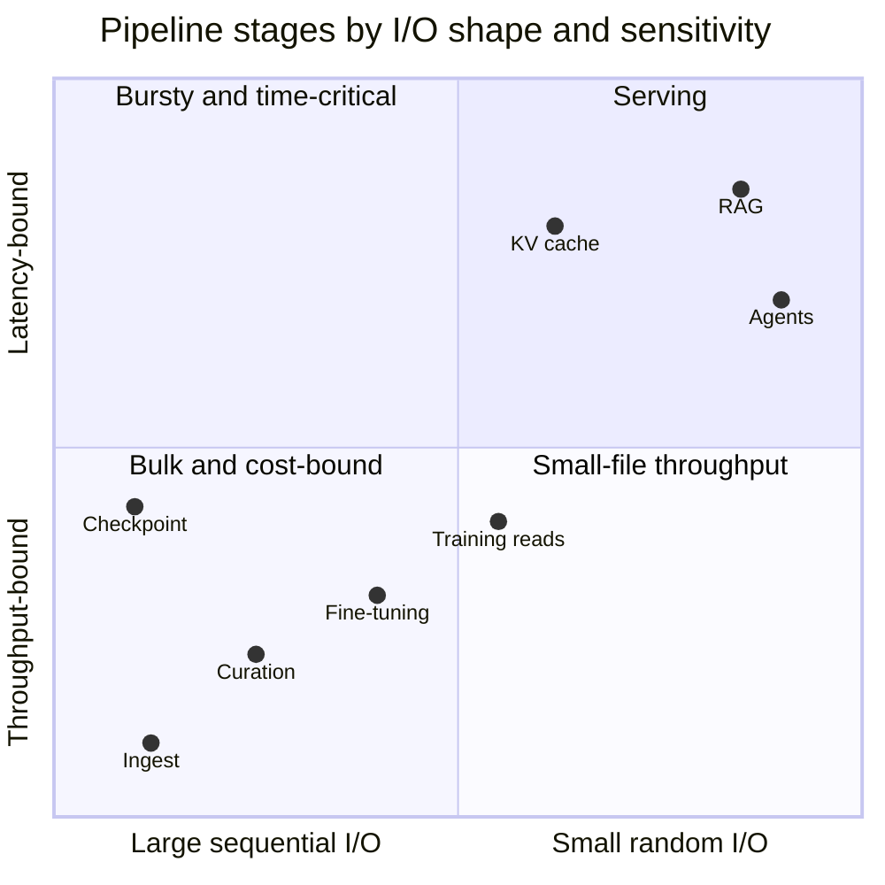
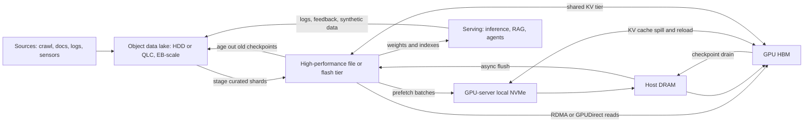
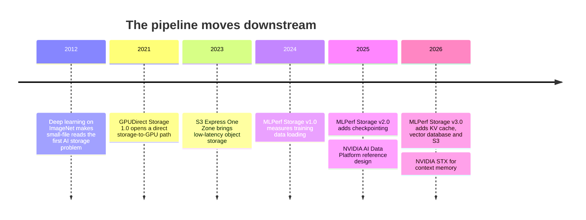

# 30. The AI data pipeline end to end

> **Depth:** L2 · **Reading time:** ~10 min · **Last verified:** 2026-11-01
> **Prerequisites:** [What storage does](../01-storage-fundamentals/01-what-storage-does.md) · [Object storage and S3](../02-protocols-and-networking/09-object-storage-and-s3.md) · [The GPU data path](../02-protocols-and-networking/11-gpu-data-path.md) · [Parallel file systems](../03-system-architecture/17-parallel-file-systems.md)

## TL;DR

- **"AI storage" is at least eight workloads, not one.** Ingest is write-heavy and cost-bound, training reads are throughput-bound, checkpointing is a write burst, and inference, RAG and agents are latency-bound small I/O.
- **Data shrinks, then grows again.** More than 10 PB of web crawl[^1] filters down to tens of TB of training text and under 1 TB of weights. Then the pipeline makes new data: multi-TB checkpoints, KV caches, embeddings and logs.
- **Capacity lives in object storage; performance lives in file and flash next to the GPU.** Object is the cheapest durable TB and every tool speaks S3. Training and checkpoint code expects POSIX paths and RDMA-fed bandwidth. The two are converging.
- **In LLM training, checkpoints stress storage more than the training data does.** Newer spending sits further down the pipeline, in KV cache and in data intelligence for RAG and agents.
- **Treat the pipeline as a memory hierarchy with a prefetcher.** Training access order is known in advance; inference and agent access depends on users. Every hop costs energy.

## Why this matters for Everpure strategy

Every storage vendor now says "AI", but the money sits in different places at each stage: the lake pays for cheap capacity, the training tier pays a premium for bandwidth, and inference and agents pay for new software. Everpure has products at most stages: FlashBlade//E and S3 for capacity, FlashBlade//S and FlashBlade//EXA for training and checkpoints, PureKVA for inference, and Data Stream plus Data Intelligence (formerly 1touch) for RAG and agents[^2][^3][^4]. DDN and WEKA start from the high-performance tier, hyperscalers own the cloud lake, VAST spans the stack, and database vendors contest RAG and agents.

The real questions: which stages to compete in, where a multi-stage platform beats point products, and where data gravity lets the lake owner capture downstream stages. This chapter maps Part 5; later chapters cover [training](31-training-storage.md), [inference and KV cache](32-inference-and-kv-cache.md), [RAG and lakehouses](33-rag-vector-lakehouse.md), [NVIDIA's ecosystem](34-nvidia-ecosystem.md), [neoclouds](35-ai-factories-and-neoclouds.md), [hyperscalers](36-hyperscaler-ai-storage.md), [benchmarks](37-reading-benchmarks.md), [power](38-power-and-density.md) and [agents](39-agentic-ai-and-data-intelligence.md).

## Core concepts

### Eight stages, eight I/O signatures

*Figure 30.1 — The pipeline moves from write-heavy, cost-bound bulk I/O on the left to read-heavy, latency-bound small I/O on the right, then feeds its own outputs back into the lake.*

**Ingest.** Crawls, documents, images, video and logs arrive as large write-once objects. Common Crawl's January 2025 crawl alone held 3.0 billion pages and 460 TiB uncompressed[^5]. Ingest needs cheap durable capacity and aggregate write bandwidth; latency barely matters.

**Curation and preprocessing.** Extraction, language identification, quality filtering, deduplication, PII scrubbing and tokenization are repeated full scans that rewrite shards into formats such as Parquet. This is AI's closest cousin to analytics, bound by scan throughput and CPU or GPU. It is also power-hungry: Meta found that for some production recommendation models, storage plus preprocessing drew more power than training itself[^6].

**Training: data loading.** Thousands of GPUs read shuffled samples and almost never write. Image and video datasets mean floods of small reads; LLM text is packed into large shards and is light. The danger is tail latency, because a synchronous step waits for its slowest loader.

**Checkpointing.** Every GPU dumps its state at once: a write burst, read back only after a failure ([Chapter 31](31-training-storage.md)).

**Fine-tuning and post-training.** Supervised fine-tuning, reinforcement learning and distillation run many smaller jobs that re-read base weights repeatedly; RL even runs inference inside training. To storage it looks like a busy multi-tenant file share.

**Inference.** Two kinds of I/O. *Weight loading* is large sequential reads and a cold-start problem when services autoscale: 810 GB at 10 GB/s takes 81 seconds. The *KV cache* is per-token attention state that spills from HBM into DRAM, local NVMe and shared flash ([Chapter 32](32-inference-and-kv-cache.md)).

**RAG and agents.** Retrieval searches a vector index and fetches chunks: small random reads on a millisecond budget, plus re-embedding writes as documents change. Agents chain many such steps across files, databases and APIs, adding governance and a trail of state and logs. Here storage becomes data management ([Chapter 39](39-agentic-ai-and-data-intelligence.md)).

| Stage | Dominant pattern | Read / write | Interface | Typical I/O or file size | Most sensitive to | Typical tier |
|---|---|---|---|---|---|---|
| Ingest | Sequential, append-only | Write-heavy | Object (S3 PUT, multipart) | MB–GB objects | $/TB, aggregate write GB/s | Object lake on HDD or QLC |
| Curation / preprocessing | Repeated full scans + rewrites | Read-heavy, large writes | Object + Parquet / table formats | 100 MB–1 GB shards | Scan throughput, CPU/GPU | Lake + flash scratch |
| Training data loading | Random reads of shuffled samples/shards | ~100% read | POSIX / NFS / parallel FS, or S3 with cache | KB samples to GB shards | Throughput and tail latency | Hot flash + GPU-local NVMe |
| Checkpointing | Bursty large sequential writes | ~95% write | Parallel FS or object | GBs per GPU, TBs per checkpoint | Burst write bandwidth | Local NVMe → flash → object |
| Fine-tuning / post-training | Many concurrent medium jobs | Mixed | File, object, model hub | GB–TB base weights | Multi-tenancy, QoS | Shared flash + object |
| Inference | Weight loads + KV block reads/writes | Read-heavy | File/S3; KV over RDMA | GB–TB weights; KB–MB KV blocks | Latency (time to first token) | HBM → DRAM → NVMe → shared flash |
| RAG retrieval | Small random reads, background re-indexing | ~95% read | Vector DB, lakehouse, object | 1–6 KB vectors; KB–MB chunks | Query latency (ms), freshness | DRAM/flash index; object corpus |
| Agents | Small, metadata-heavy, many sources | Mixed (state, logs) | APIs, MCP, file, object, DB | KB records | Latency, permissions, lineage | All tiers + metadata catalog |

*Table 30.1 — No single row resembles another closely enough for one tuning to serve all eight; read/write mixes are indicative.*

### Why it is not one workload

*Figure 30.2 — The stages scatter across all four quadrants, which is why "AI storage" deals are really multi-tier deals.*

The stages pull a design in opposite directions:

- **Cost versus speed.** The lake wants the cheapest durable TB (HDD or QLC, wide erasure codes); the hot tier wants flash, RDMA and a metadata engine that pays only if GPUs stay busy.
- **Large versus small I/O.** Wide stripes suit multi-MB writes and punish 4 KB random updates ([Chapter 6](../01-storage-fundamentals/06-data-protection-and-resilience.md)).
- **Metadata.** A checkpoint is a few huge files; an image dataset is billions of tiny ones; agents generate lookups ([Chapter 21](../03-system-architecture/21-metadata.md)).
- **Semantics.** POSIX offers rename, append and locks; S3 offers immutable objects over HTTP.

Buyers run several tiers or buy a platform that credibly spans several; that choice is the vendor battleground.

### Why the lake is object and the hot tier is file

**Object storage wins the lake** on cost, scale and reach. AWS says S3 holds more than 500 trillion objects and serves over 200 million requests per second[^7]. Erasure coding makes durability cheap, write-once data fits immutable objects, and every tool from Spark to PyTorch loaders speaks S3. The weaknesses: millisecond latency, no append or rename, and a tax on small objects ([Chapter 9](../02-protocols-and-networking/09-object-storage-and-s3.md)).

**File and parallel file systems win the hot tier** because training and checkpoint code writes to paths. Parallel file systems stripe each file across many servers that a client reads at once ([Chapter 17](../03-system-architecture/17-parallel-file-systems.md)); RDMA and GPUDirect Storage skip the CPU bounce buffer ([Chapter 11](../02-protocols-and-networking/11-gpu-data-path.md)).

**The boundary is blurring.** S3 Express One Zone (2023) claims 10x faster access than S3 Standard[^8]; CoreWeave caches object data on every GPU node with LOTA[^9]; MLPerf Storage v3.0 added an S3 path that about one-sixth of submissions used[^10]. File systems are adding S3 front ends, and multiprotocol platforms (VAST, FlashBlade) serve both. The useful distinction is becoming *tier*, not *protocol*.

*Figure 30.3 — Bulk data flows inward from the lake toward HBM; checkpoints and KV state flow back outward; the lake both starts and ends the loop.*

### Worked numbers: where the bytes and the stress are

*Figure 30.4 — Illustrative: filtering shrinks petabytes to terabytes, then training produces artefacts larger than the model itself.*
Data: `data/ch30_data_funnel.csv`

**From crawl to weights.** DataComp-LM's pool holds 240T tokens of Common Crawl text[^11]. FineWeb filtered and deduplicated 96 snapshots into 15T tokens, about 44 TB on disk[^12][^13], with a 1.3T-token educational subset[^12]. Llama 3 trained on about 15.6T tokens[^14]; as 4-byte token IDs that is 15.6e12 × 4 ≈ 62 TB. Filtering, not tokenization, does the shrinking, so curation is where the lake's capacity and scan bandwidth earn their keep.

**Tokens are cheap to stream.** Llama 3's batch grew to 16M tokens per step[^14]: 64 MB at 4 bytes per token, so even one step per second is about 64 MB/s for the whole cluster. Multimodal is different; video can need GB/s per node.

**Checkpoints are not cheap.** A 405B model at 14–16 bytes per parameter (weights plus Adam state) needs 5.7–6.5 TB. Meta built Llama 3's storage on its Tectonic file system at 240 PB across 7,500 SSD servers, sustaining 2 TB/s with 7 TB/s peaks, and named bursty checkpoint writes a major challenge[^14]. At 2 TB/s, 6.5 TB takes about 3.3 s; at 100 GB/s, 65 s, with a 16K-GPU job like Llama 3's[^14] idle throughout.

**Inference creates new state.** Llama 3 70B's KV cache costs 80 layers × 8 KV heads × 128 dimensions × 2 (K and V) × 2 bytes = 327,680 bytes, or about 320 KiB per token. A 128K-token context is about 40 GiB, half an 80 GB GPU's HBM. **RAG adds more**: 1 billion chunks × 1,024-dimension float32 embeddings is 4 TB of vectors before any index overhead.

### Semiconductor bridge: a memory hierarchy with a prefetcher

Read the tiers as a cache hierarchy:

| AI pipeline tier | CPU analogue |
|---|---|
| HBM | Register file / L1 |
| Host DRAM | L2 |
| GPU-local NVMe | Last-level cache |
| Shared flash | Main memory |
| Object lake | Disk |

Each step outward adds capacity and loses bandwidth per GPU; as in CPU design, the craft is hiding the next level's latency with prefetching and buffering.

**Training is the friendly case.** The shuffle order comes from a seed, so the loader knows exactly which samples come next: a perfect prefetcher, like a DMA engine walking a known descriptor list rather than a speculative stream prefetcher. **Checkpoints use a write-back buffer**: state drains from HBM to host DRAM or local NVMe in seconds, then flushes asynchronously, as a store buffer does.

**Inference is a cache whose reuse distance depends on users**: hit rate depends on how often prompts share prefixes. NVIDIA's KV Block Manager names its tiers G1 (HBM) through G4 (remote storage)[^15]. Agents are least predictable of all. Downstream, value shifts from raw bandwidth to caching policy, placement and metadata.

**Moving data costs energy.** At 45 nm, Horowitz put a 64-bit DRAM access at roughly 1.3–2.6 nJ against 0.4–3.7 pJ for a floating-point operation, a gap of hundreds to thousands of times[^16]. Every NIC, switch and SSD hop adds more. With data-centre electricity forecast at 565 TWh in 2026[^17], there are three responses:

1. Keep hot data close, in local NVMe caches and KV tiers.
2. Move compute to the data. NVIDIA's BlueField-4 STX[^18] and VAST running its storage controllers on BlueField-4 DPUs[^19] both do this.
3. Move fewer bytes, by filtering early and reducing data ([Chapter 38](38-power-and-density.md)).

## How Everpure approaches it vs. competitors

| Stage | What the buyer pays for | Everpure offering | Strongest alternatives (steelman) | Who tends to win today |
|---|---|---|---|---|
| Ingest / lake | $/TB, durability, S3 compatibility | FlashBlade//E, FlashBlade S3, DirectFlash density[^3] | AWS S3 / Azure Blob (gravity, zero ops); HDD object stores (cheapest TB) | Hyperscalers in cloud; HDD object on-prem |
| Curation | Scan throughput, table formats, GPU pipelines | Data Stream, built on NVIDIA's AI Data Platform design[^4][^20] | Lakehouse platforms on object storage; VAST's database and compute layer | Lakehouse software vendors |
| Training + checkpoint | GB/s to TB/s, NVIDIA certification | FlashBlade//S500, FlashBlade//EXA; 877.5 GiB/s checkpoint write in MLPerf Storage v3.0 (vendor-submitted; see [Ch 31](31-training-storage.md) for who did not enter)[^21] | DDN EXAScaler, WEKA, VAST, IBM Storage Scale, Dell Lightning FS[^22] | NVIDIA-aligned specialists ([Ch 41](../06-industry-and-competition/41-why-ai-native-vendors-won.md)) |
| Fine-tuning | Multi-tenancy, QoS, many jobs | FlashBlade//S; FlashBlade//EXA multi-tenancy and QoS (2026)[^23] | NetApp AFX, Dell PowerScale, VAST | Enterprise incumbents |
| Inference / KV cache | Time to first token, tokens per dollar | PureKVA, claimed up to 20x faster TTFT, test details unpublished[^2] | WEKA Augmented Memory Grid[^24], VAST on BlueField-4[^19], NVIDIA STX/CMX[^18] | Too early to call |
| RAG | Vectors, freshness, permissions | Data Stream vector DB integration[^4] | Vector databases; AWS S3 Vectors[^25]; NetApp AI Data Engine[^26] | Database vendors + hyperscalers |
| Agents | Discovery, classification, governance, MCP | Data Intelligence (ex-1touch, US$125M); native MCP support[^3][^2] | NetApp AIDE, Dell AI Data Platform, governance software | Open |

*Table 30.2 — Everpure has a product at every stage, but its strongest positions are the flash tiers in the middle; the lake and the agent layer are contested by players who do not sell arrays.*

**Steelman the specialists.** DDN and WEKA win the hot tier through focus, HPC heritage and early NVIDIA alignment. Hyperscalers win the lake through gravity: egress fees and tooling keep petabytes in S3. VAST argues one shared-everything platform should span lake, hot tier and database, the most direct challenge to a product-family approach ([Chapter 42](../06-industry-and-competition/42-vast-data.md)). **Everpure's counter-thesis** is one operating environment and control plane across stages, with DirectFlash pulling lake capacity from HDD onto flash. The risk is being second-best at every stage.

Options a strategy team might evaluate, based on public information:

- Lead with checkpoint and KV-cache performance, where MLPerf v3.0 gives comparable evidence.
- Use Data Intelligence to own the metadata layer that RAG and agents depend on.
- Partner rather than compete for the cloud lake.

## History and trajectory

*Figure 30.5 — The industry's attention has moved stage by stage down the pipeline, from feeding training to serving inference.*

Small image files were the first AI storage problem; LLMs made checkpoints the bandwidth problem; deployment made inference context the latency problem. MLPerf Storage followed: v1.0 (September 2024) measured training reads[^27], v2.0 (August 2025) added checkpointing[^28], v3.0 (September 2026) added KV cache, vector database and S3[^10]. So did hardware: GPUDirect Storage 1.0 in 2021[^29], NVIDIA's AI Data Platform in March 2025[^20], BlueField-4 STX in March 2026[^18]. TrendForce attributes part of 4Q26 enterprise SSD demand to hyperscalers buying QLC for KV cache[^30]. A likely next step is agent memory and state as a named workload.

## Numbers that matter

| Metric | Value | Context | Source / date |
|---|---|---|---|
| One Common Crawl monthly crawl | 3.0B pages, 460 TiB uncompressed | January 2025 crawl | Common Crawl[^5], 2025 |
| FineWeb | 15T tokens from 96 snapshots; ~44 TB | Filtered, deduplicated web text | NeurIPS 2024[^12]; Hugging Face[^13] |
| DCLM-Pool | 240T tokens | Largest public pre-filter text pool | DataComp-LM[^11], 2024 |
| Llama 3 pre-training | ~15.6T tokens; 240 PB Tectonic, 2 TB/s sustained, 7 TB/s peak | Meta's own training storage | Meta, 2024-07[^14] |
| Checkpoint, 405B model | 5.7–6.5 TB | 14–16 bytes per parameter | Worked example |
| KV cache, Llama 3 70B | ~320 KiB per token; ~40 GiB at 128K tokens | BF16, grouped-query attention | Worked example |
| S3 scale | >500T objects, >200M requests/s | Why lakes default to object | AWS via LMI, 2026-03[^7] |
| DRAM access vs FP op energy | ~1.3–2.6 nJ vs 0.4–3.7 pJ | 45 nm; data movement dominates | Horowitz, ISSCC 2014[^16] |
| MLPerf Storage v3.0 S3 share | ~1/6 of submissions | Object entering the hot tier | MLCommons, 2026-09-01[^10] |

## Conversation playbook

**Questions for a PM**

1. *"Which stages does our AI revenue come from today, and which are we betting on?"* Strong: revenue split by stage, where attach happens (does KVA ride on existing FlashBlade deals?), and candour about which wins are still pilots.
2. *"If the lake is already in S3, how do we win the hot tier, and ever win the lake back?"* Strong: data gravity, egress economics, the caching or tiering mechanism, and the NVIDIA certifications that get Everpure onto the bill of materials.
3. *"What must PureKVA prove to become a standard tier, not a feature?"* Strong: independent results (MLPerf v3.0 KV cache), integrations (Dynamo, vLLM, llm-d), hit-rate assumptions and tokens per dollar versus no offload.

**Questions for an engineer**

1. *"Walk me through a 6 TB checkpoint on FlashBlade//EXA. Where does the burst land, what is the persistence point, and how many seconds are GPUs blocked?"* Strong: async staging via host DRAM or local NVMe, write GB/s per data node, blocked time versus time to durability.
2. *"What happens when a dataset of billions of small files is reshuffled every epoch?"* Strong: metadata operations per second, client caching, and advice to pack data into shards.
3. *"For a KV block fetch, what is the latency budget and where does it break: network, metadata or media?"* Strong: microsecond figures, the RDMA path, block sizes, and the concurrency where tail latency climbs.

**Don't say this:**

- "AI storage is all about throughput." Inference, RAG and agents are latency- and metadata-bound.
- "LLM training needs huge read bandwidth for the dataset." Text tokens are tiny. Checkpoints and multimodal data drive bandwidth.
- "Object storage is too slow for AI." Nearly every lake is object storage, and S3 is now inside MLPerf Storage.
- "Data shrinks through the pipeline, so storage demand falls." Checkpoints, KV caches, embeddings, logs and retained versions grow it again.
- "GPUDirect makes storage latency irrelevant." It removes a CPU copy; it does not remove the network or the media.

## Going deeper (optional, L3 pointers)

- Meta, "The Llama 3 Herd of Models," infrastructure section[^14]; Zhao et al., ISCA 2022, on Meta's ingestion pipeline[^6].
- FineWeb and DataComp-LM papers on curation filters[^12][^11]; NVIDIA Dynamo KVBM docs[^15]; MLPerf Storage rules ([Chapter 37](37-reading-benchmarks.md)).

## Key terms

- **Data lake** — low-cost, usually object-based store for raw and curated data.
- **Hot tier** — high-performance file or flash tier feeding GPUs.
- **KV cache** — per-token attention state reused during inference.
- **Data gravity** — the pull of applications and spend toward where large data already sits.
- More in the [glossary](../glossary.md).

## Sources

[^1]: Common Crawl, "Overview," n.d. https://commoncrawl.org/overview (retrieved 2026-11-01). Reports a repository of more than 10 PB collected since 2008. [VERIFY: search-summary only; page not fetchable from this environment]
[^2]: Blocks & Files, "Everpure bulks up AI offer," 2026-09-30. https://blocksandfiles.com/flash/2026/09/30/everpure-bulks-up-ai-offer/5300162 (retrieved 2026-11-01).
[^3]: Everpure, "Pure Launch Blog: January 2026 Edition," 2026-01; and Everpure, "Form 10-Q for the quarter ended May 3, 2026," 2026-06. https://blog.everpuredata.com/products/pure-launch-blog-january-2026-edition/ ; https://www.sec.gov/Archives/edgar/data/0001474432/000147443226000061/pstg-20260503.htm (retrieved 2026-11-01).
[^4]: HPCwire/BigDATAwire, "Everpure Announces Data Stream to Expand AI-Ready Data Offerings," 2026-06-17. https://www.hpcwire.com/bigdatawire/this-just-in/everpure-announces-data-stream-to-expand-ai-ready-data-offerings/ (retrieved 2026-11-01).
[^5]: Common Crawl, "January 2025 Crawl Archive Now Available," 2025-01. https://commoncrawl.org/blog/january-2025-crawl-archive-now-available (retrieved 2026-11-01).
[^6]: M. Zhao et al., "Understanding Data Storage and Ingestion for Large-Scale Deep Recommendation Model Training," ISCA 2022. https://arxiv.org/abs/2108.09373 (retrieved 2026-11-01).
[^7]: Le Monde Informatique, "AWS S3 fête ses 20 ans," 2026-03 (reporting AWS's anniversary figures). https://www.lemondeinformatique.fr/actualites/lire-aws-s3-fete-ses-20-ans-99637.html (retrieved 2026-11-01). [VERIFY: search-summary only; corroborated by Wikipedia, confirm against AWS's own S3 20th-anniversary post]
[^8]: AWS, "Announcing the Amazon S3 Express One Zone storage class," 2023-11-28. https://aws.amazon.com/about-aws/whats-new/2023/11/amazon-s3-express-one-zone-storage-class (retrieved 2026-11-01).
[^9]: CoreWeave, "Storage," product page, n.d. https://coreweave.com/products/storage (retrieved 2026-11-01).
[^10]: MLCommons via GlobeNewswire, "MLCommons Releases New MLPerf Storage v3.0 Benchmark Results," 2026-09-01. https://www.globenewswire.com/news-release/2026/09/01/3354412/0/en/mlcommons-releases-new-mlperf-storage-v3-0-benchmark-results.html (retrieved 2026-11-01).
[^11]: J. Li et al., "DataComp-LM: In search of the next generation of training sets for language models," NeurIPS 2024 Datasets and Benchmarks, 2024-06. https://arxiv.org/abs/2406.11794 (retrieved 2026-11-01).
[^12]: G. Penedo et al., "The FineWeb Datasets: Decanting the Web for the Finest Text Data at Scale," NeurIPS 2024 Datasets and Benchmarks, 2024. https://proceedings.neurips.cc/paper_files/paper/2024/hash/370df50ccfdf8bde18f8f9c2d9151bda-Abstract-Datasets_and_Benchmarks_Track.html (retrieved 2026-11-01).
[^13]: Hugging Face, "FineWeb: decanting the web for the finest text data at scale" (blog), 2024-05-31. https://huggingfacefw-blogpost-fineweb-v1.static.hf.space/ (retrieved 2026-11-01; "15-trillion tokens, 44TB disk space", seen via search result; dataset card HuggingFaceFW/fineweb gives the same figure). Secondary summaries quoting ~50 TB are not the official figure.
[^14]: Meta (Llama Team), "The Llama 3 Herd of Models," arXiv:2407.21783, 2024-07-31. https://arxiv.org/abs/2407.21783 (retrieved 2026-11-01).
[^15]: NVIDIA, "KVBM design," Dynamo documentation v1.3.0, n.d. https://docs.nvidia.com/dynamo/v1.3.0/design-docs/component-design/kvbm-design.md (retrieved 2026-11-01).
[^16]: M. Horowitz, "1.1 Computing's energy problem (and what we can do about it)," ISSCC 2014, 2014-02. https://doi.org/10.1109/ISSCC.2014.6757323 (retrieved 2026-11-01); figures as reproduced in arXiv:1602.04183, https://arxiv.org/pdf/1602.04183 (retrieved 2026-11-01).
[^17]: Gartner, "Gartner Says Data Center Electricity Consumption to Grow 26% in 2026," 2026-06-10. https://www.gartner.com/en/newsroom/press-releases/2026-06-10-gartner-says-data-center-electricity-demand-to-grow-26-percent-in-2026 (retrieved 2026-11-01).
[^18]: NVIDIA, "NVIDIA Launches BlueField-4 STX Storage Architecture With Broad Industry Adoption," 2026-03-16. https://investor.nvidia.com/news/press-release-details/2026/NVIDIA-Launches-BlueField-4-STX-Storage-Architecture-With-Broad-Industry-Adoption/default.aspx (retrieved 2026-11-01).
[^19]: StorageNewsletter, "CES 2026: Vast Data Redesigns AI Inference Architecture for the Agentic Era with Nvidia," 2026-01-07. https://www.storagenewsletter.com/2026/01/07/ces-2026-vast-data-redesigns-ai-inference-architecture-for-the-agentic-era-with-nvidia/ (retrieved 2026-11-01).
[^20]: NVIDIA Newsroom, "NVIDIA and Storage Industry Leaders Unveil New Class of Enterprise Infrastructure for the Age of AI," 2025-03-18. https://nvidianews.nvidia.com/news/nvidia-and-storage-industry-leaders-unveil-new-class-of-enterprise-infrastructure-for-the-age-of-ai (retrieved 2026-11-01).
[^21]: HPCwire, "Everpure Leads MLPerf Storage Tests for Large Model Checkpointing and KV Cache," 2026-09-02. https://hpcwire.com/off-the-wire/everpure-leads-mlperf-storage-tests-for-large-model-checkpointing-and-kv-cache (retrieved 2026-11-01).
[^22]: Dell Technologies, "Dell AI Data Platform with NVIDIA Supercharges Enterprise AI with Breakthrough Data Orchestration and Storage Innovations," 2026-03-16. https://www.dell.com/en-us/dt/corporate/newsroom/announcements/detailpage.press-releases~usa~2026~03~dell-ai-data-platform-with-nvidia-supercharges-enterprise-ai-with-breakthrough-data-orchestration-and-storage-innovations.htm (retrieved 2026-11-01).
[^23]: Everpure Blog, "Meet FlashBlade//EXA: the AI Data Platform for Scale," 2026-06. https://blog.everpuredata.com/products/meet-flashblade-exa-the-ai-data-platform-for-scale/ (retrieved 2026-11-01).
[^24]: WEKA, "WEKA Breaks The AI Memory Barrier With Augmented Memory Grid on NeuralMesh," 2025-11-18. https://www.weka.io/news/weka-breaks-the-ai-memory-barrier-with-augmented-memory-grid (retrieved 2026-11-01).
[^25]: StorageNewsletter, "AWS re:Invent 2025: Amazon S3 Vectors is Now Generally Available with 40 Times the Scale of Preview," 2025-12-05. https://www.storagenewsletter.com/2025/12/05/aws-reinvent-2025-amazon-s3-vectors-is-now-generally-available-with-40-times-the-scale-of-preview/ (retrieved 2026-11-01).
[^26]: Blocks & Files, "NetApp disaggregates ONTAP storage and provides an AI Data Engine," 2025-10-14. https://blocksandfiles.com/2025/10/14/netapp-disaggregates-ontap-storage-and-provides-an-ai-data-engine/ (retrieved 2026-11-01).
[^27]: MLCommons, "New MLPerf Storage v1.0 Benchmark Results Show Storage Systems Play a Critical Role in AI Model Training Performance," 2024-09-25. https://mlcommons.org/2024/09/mlperf-storage-v1-0-benchmark-results/ (retrieved 2026-11-01).
[^28]: StorageNewsletter, "New MLPerf Storage v2.0 Benchmark Results Demonstrate the Critical Role of Storage Performance in AI Training Systems," 2025-08-08. https://www.storagenewsletter.com/2025/08/08/new-mlperf-storage-v2-0-benchmark-results-demonstrate-the-critical-role-of-storage-performance-in-ai-training-systems/ (retrieved 2026-11-01).
[^29]: Blocks & Files, "GPUDirect Storage hitting the streets to VAST acclaim," 2021-06-28. https://www.blocksandfiles.com/file/2021/06/28/gpudirect-storage-hitting-the-streets-to-vast-acclaim/1611092 (retrieved 2026-11-01).
[^30]: TrendForce, "AI Server Demand Sustains Memory Contract Price Increases in 4Q26, While Consumer-Side Pressure Persists," 2026-09-30. https://www.trendforce.com/presscenter/news/20260930-13258.html (retrieved 2026-11-01).
