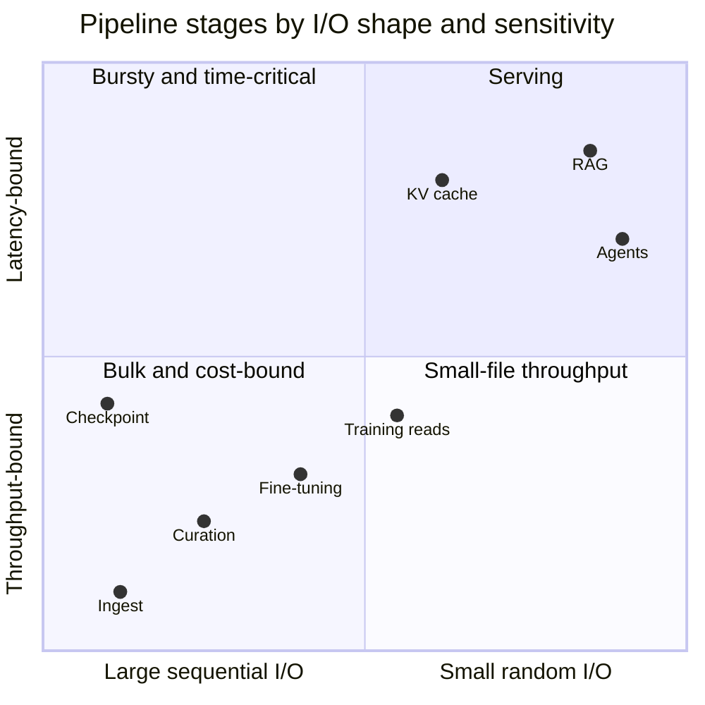
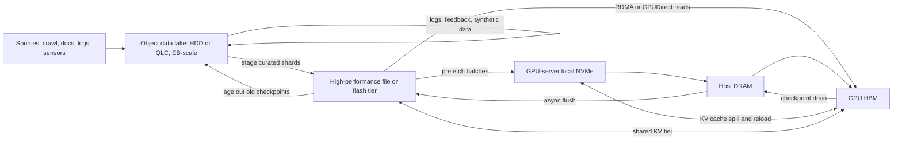
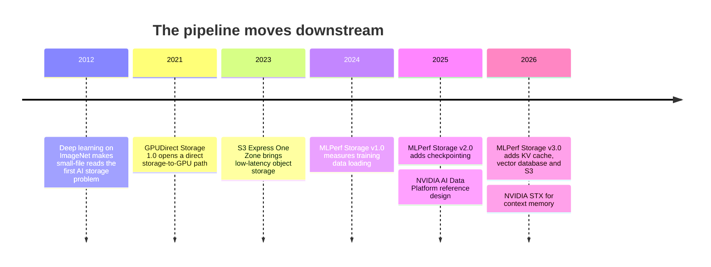

# 30. The AI data pipeline end to end

> **Depth:** L2 · **Reading time:** ~10 min · **Last verified:** 2026-11-01
> **Prerequisites:** [What storage does](../01-storage-fundamentals/01-what-storage-does.md) · [Object storage and S3](../02-protocols-and-networking/09-object-storage-and-s3.md) · [The GPU data path](../02-protocols-and-networking/11-gpu-data-path.md) · [Parallel file systems](../03-system-architecture/17-parallel-file-systems.md)

## TL;DR

- **"AI storage" is at least eight workloads, not one.** Ingest is write-heavy and bound by cost per TB. Training data loading is read-only and bound by throughput. Checkpointing is a write burst. Inference, RAG and agents are bound by latency and increasingly made of small I/O. A system tuned for one stage is mediocre at the others.
- **Data shrinks, then grows again.** More than 10 PB of web crawl filters down to tens of TB of training text and under 1 TB of model weights. Then the pipeline starts producing data of its own: multi-TB checkpoints, KV caches, embeddings and logs.
- **Capacity lives in object storage; performance lives in file and flash next to the GPU.** The lake is object storage because it is the cheapest durable TB and every tool speaks S3. The hot tier is file or parallel file because training and checkpoint code expects POSIX paths and needs RDMA-fed bandwidth. The two are converging.
- **In LLM training, checkpoints stress storage far more than the training data does.** Text arrives at MB/s across a whole cluster, while checkpoints burst at TB/s. The newer spending is further down the pipeline, in inference KV cache and in data intelligence for RAG and agents.
- **Treat the pipeline as a memory hierarchy with a prefetcher.** Training is the easy case because access order is known in advance. Inference and agents are hard because access depends on users. Every hop costs energy, which is why vendors keep pushing compute toward the data.

## Why this matters for Everpure strategy

Every storage vendor now says "AI", but the money sits in different places at each stage. The lake pays for cheap capacity, the training tier pays a premium for bandwidth, and the inference and agent stages are paying for new software. Everpure has products at most stages: FlashBlade//E and S3 for capacity, FlashBlade//S and FlashBlade//EXA for training and checkpoints, PureKVA for inference, and Data Stream plus Data Intelligence (formerly 1touch) for RAG and agents[^1][^2][^3]. Competitors come at this from other directions. DDN and WEKA start from the high-performance tier, hyperscalers own the cloud lake, VAST has built across the whole stack, and database vendors contest RAG and agents.

So the strategic question is not "do we do AI storage" but three narrower ones. Which stages should Everpure compete in? Where does a multi-stage platform beat point products? And where does data gravity let whoever owns the lake capture the stages downstream? This chapter maps Part 5. Later chapters go deep on [training](31-training-storage.md), [inference and KV cache](32-inference-and-kv-cache.md), [RAG and lakehouses](33-rag-vector-lakehouse.md), [NVIDIA's ecosystem](34-nvidia-ecosystem.md), [neoclouds](35-ai-factories-and-neoclouds.md), [hyperscalers](36-hyperscaler-ai-storage.md), [benchmarks](37-reading-benchmarks.md), [power](38-power-and-density.md) and [agents](39-agentic-ai-and-data-intelligence.md).

## Core concepts

### Eight stages, eight I/O signatures

*Figure 30.1 — The pipeline moves from write-heavy, cost-bound bulk I/O on the left to read-heavy, latency-bound small I/O on the right, then feeds its own outputs back into the lake.*

**Ingest.** Web crawls, documents, images, video, logs and enterprise records arrive as large objects that are written once and only ever appended to. Common Crawl's January 2025 crawl alone held 3.0 billion pages and 460 TiB of uncompressed content[^4]. Ingest needs cheap, durable capacity and aggregate write bandwidth. Latency barely matters.

**Curation and preprocessing.** This stage covers text extraction, language identification, quality filtering, deduplication, PII scrubbing and tokenization. Each step is a full scan of the lake that rewrites shards into columnar formats such as Parquet. It is the AI pipeline's closest cousin to analytics and is bound by scan throughput and CPU, or increasingly GPU. It also uses more power than people expect. Meta measured that for some production recommendation models, storage plus preprocessing drew more power than training itself[^5].

**Training: data loading.** Thousands of GPUs read shuffled samples and almost never write. Image and video datasets generate floods of small reads. LLM text is packed into large token shards and is light, as the worked numbers below show. The danger is tail latency: a synchronous training step waits for its slowest data loader.

**Checkpointing.** At intervals, every GPU dumps its state at once. That makes checkpointing a write-only burst, with reads only after a failure or for evaluation. [Chapter 31](31-training-storage.md) covers sizing and frequency.

**Fine-tuning and post-training.** Supervised fine-tuning, reinforcement learning and distillation use smaller datasets but run many jobs at once, and they re-read base weights over and over. RL even runs inference inside training. In storage terms this looks like a busy multi-tenant enterprise file share.

**Inference.** Inference does two different kinds of I/O. The first is *weight loading*, large sequential reads that create a cold-start problem whenever a service autoscales: 810 GB of weights at 10 GB/s takes 81 seconds. The second is the *KV cache*, per-token attention state that spills out of HBM into DRAM, local NVMe and shared flash ([Chapter 32](32-inference-and-kv-cache.md)).

**RAG and agents.** Retrieval embeds the query, searches a vector index and fetches text chunks. That means small random reads against a millisecond budget, plus background re-embedding writes as documents change. Agents chain many such steps across files, databases and APIs. They add governance (who may see what) and leave a trail of state and logs. At this end of the pipeline, storage turns into a data-management problem ([Chapter 39](39-agentic-ai-and-data-intelligence.md)).

| Stage | Dominant pattern | Read / write | Interface | Typical I/O or file size | Most sensitive to | Typical tier |
|---|---|---|---|---|---|---|
| Ingest | Sequential, append-only | Write-heavy | Object (S3 PUT, multipart) | MB–GB objects | $/TB, aggregate write GB/s | Object lake on HDD or QLC |
| Curation / preprocessing | Repeated full scans + rewrites | Read-heavy, large writes | Object + Parquet / table formats | 100 MB–1 GB shards | Scan throughput, CPU/GPU | Lake + flash scratch |
| Training data loading | Random reads of shuffled samples/shards | ~100% read | POSIX / NFS / parallel FS, or S3 with cache | KB samples to GB shards | Throughput and tail latency | Hot flash + GPU-local NVMe |
| Checkpointing | Bursty large sequential writes | ~95% write | Parallel FS or object | GBs per GPU, TBs per checkpoint | Burst write bandwidth | Local NVMe → flash → object |
| Fine-tuning / post-training | Many concurrent medium jobs | Mixed | File, object, model hub | GB–TB base weights | Multi-tenancy, QoS | Shared flash + object |
| Inference | Weight loads + KV block reads/writes | Read-heavy | File/S3; KV over RDMA | GB–TB weights; KB–MB KV blocks | Latency (time to first token) | HBM → DRAM → NVMe → shared flash |
| RAG retrieval | Small random reads, background re-indexing | ~95% read | Vector DB, lakehouse, object | 1–6 KB vectors; KB–MB chunks | Query latency (ms), freshness | DRAM/flash index; object corpus |
| Agents | Small, metadata-heavy, many sources | Mixed (state, logs) | APIs, MCP, file, object, DB | KB records | Latency, permissions, lineage | All tiers + metadata catalog |

*Table 30.1 — No single row resembles another closely enough for one tuning to serve all eight; read/write mixes are indicative.*

### Why it is not one workload

*Figure 30.2 — The stages scatter across all four quadrants, which is why "AI storage" deals are really multi-tier deals.*

The stages pull a storage design in opposite directions on several axes:

- **Cost versus speed.** The lake wants the cheapest durable TB, which means HDD or QLC with wide erasure codes. The hot tier wants flash, RDMA networking and a metadata engine that pays for itself only if GPUs stay busy.
- **Large versus small I/O.** Wide erasure-coded stripes are efficient for multi-MB sequential writes and painful for 4 KB random updates ([Chapter 6](../01-storage-fundamentals/06-data-protection-and-resilience.md)).
- **Metadata load.** A checkpoint creates a few huge files. An image dataset is billions of tiny ones, and agents generate lookups rather than bulk reads ([Chapter 21](../03-system-architecture/21-metadata.md)).
- **Semantics.** POSIX gives rename, append and locks. S3 gives immutable objects over HTTP.

So buyers either run several tiers, which is what most large shops do, or buy a platform that credibly spans several. That choice is the vendor battleground.

### Why the lake is object and the hot tier is file

**Object storage wins the lake** on cost, scale and reach. AWS says S3 holds more than 500 trillion objects and serves over 200 million requests per second[^6]. Erasure coding across failure domains makes durability cheap. Crawl and curation data is written once, which fits immutable objects, and every data tool from Spark to PyTorch loaders speaks S3. The weaknesses are millisecond request latency, no in-place append or rename, and a per-request tax on small objects ([Chapter 9](../02-protocols-and-networking/09-object-storage-and-s3.md)).

**File and parallel file systems win the hot tier** because training and checkpoint code writes to paths. A parallel file system stripes each file across many servers so that one client reads from all of them at once ([Chapter 17](../03-system-architecture/17-parallel-file-systems.md)). RDMA and GPUDirect Storage move data into GPU memory without a CPU bounce buffer ([Chapter 11](../02-protocols-and-networking/11-gpu-data-path.md)).

**The boundary is blurring.** On the object side, AWS launched S3 Express One Zone in 2023, claiming 10x faster access than S3 Standard[^7]. CoreWeave caches object data on every GPU node with LOTA[^8]. MLPerf Storage v3.0 added an S3 access path, and about one-sixth of submissions used it[^9]. On the file side, file systems are adding S3 front ends, and multiprotocol platforms (VAST, FlashBlade) serve both. The useful distinction is becoming *tier*, not *protocol*.

*Figure 30.3 — Bulk data flows inward from the lake toward HBM; checkpoints and KV state flow back outward; the lake both starts and ends the loop.*

### Worked numbers: where the bytes and the stress are

*Figure 30.4 — Illustrative: filtering does most of the shrinking, from petabytes to terabytes, and then training produces artefacts larger than the model itself.*
Data: `data/ch30_data_funnel.csv`

**From crawl to weights.** DataComp-LM's pool holds 240T tokens of Common Crawl text[^10]. FineWeb filtered and deduplicated 96 crawl snapshots into 15T tokens, about 44 TB on disk[^11][^12], and its educational subset is 1.3T tokens[^11]. Llama 3 trained on about 15.6T tokens[^13]. Stored as 4-byte token IDs, that is 15.6e12 × 4 ≈ 62 TB. Tokenization barely shrinks the data; filtering is what shrinks it. So curation is where the lake's capacity and scan bandwidth earn their keep.

**Tokens are cheap to stream.** Llama 3's batch grew to 16M tokens per step[^13]. At 4 bytes per token that is 64 MB per step, so even at one step per second the whole cluster reads about 64 MB/s, which is trivial. Multimodal training is different, because video frames can need GB/s per node.

**Checkpoints are not cheap.** A 405B-parameter model at 14–16 bytes per parameter (weights plus Adam optimizer state) needs 5.7–6.5 TB per checkpoint. Meta built Llama 3's storage on its Tectonic file system at 240 PB across 7,500 SSD servers, sustaining 2 TB/s with 7 TB/s peaks, and named bursty checkpoint writes a major challenge[^13]. At 2 TB/s, 6.5 TB takes about 3.3 s. At 100 GB/s it takes 65 s, with up to 16,000 GPUs idle for every one of those seconds.

**Inference creates new state.** Llama 3 70B's KV cache costs 80 layers × 8 KV heads × 128 dimensions × 2 (K and V) × 2 bytes = 327,680 bytes, or about 320 KiB per token. A 128K-token context is then about 40 GiB, half of an 80 GB GPU's HBM for one conversation. **RAG adds more**: 1 billion chunks × 1,024-dimension float32 embeddings is 4 TB of vectors before any index overhead.

### Semiconductor bridge: a memory hierarchy with a prefetcher

Read the tiers as a cache hierarchy:

| AI pipeline tier | CPU analogue |
|---|---|
| HBM | Register file / L1 |
| Host DRAM | L2 |
| GPU-local NVMe | Last-level cache |
| Shared flash | Main memory |
| Object lake | Disk |

Each step outward gives about 10x more capacity and less bandwidth per GPU. As in CPU design, the craft is hiding the next level's latency with prefetching and buffering.

**Training is the friendly case.** The shuffle order comes from a seed, so the data loader knows exactly which samples come next. That makes it a perfect prefetcher, closer to a DMA engine walking a known descriptor list than to a speculative stream prefetcher.

**Checkpoints use a write-back buffer.** State drains from HBM to host DRAM or local NVMe in seconds, then flushes asynchronously to shared storage. A store buffer does the same job in a CPU.

**Inference is a cache whose reuse distance depends on users.** The hit rate depends on how often prompts share prefixes. NVIDIA's KV Block Manager makes the hierarchy explicit, naming its tiers G1 (HBM) through G4 (remote storage)[^14]. Agents are the least predictable of all. The implication is that toward the end of the pipeline, value shifts from raw bandwidth to caching policy, placement and metadata.

**Moving data costs energy.** At 45 nm, Horowitz put a 64-bit DRAM access at roughly 1.3–2.6 nJ, against 0.4–3.7 pJ for a floating-point operation, a gap of several hundred to several thousand times[^15]. Every hop through a NIC, a switch or an SSD adds more. With data-centre electricity forecast at 565 TWh in 2026[^16], there are three responses:

1. Keep hot data close, in local NVMe caches and KV tiers.
2. Move compute to the data. NVIDIA's BlueField-4 STX[^17] and VAST running its storage controllers on BlueField-4 DPUs[^18] both do this.
3. Move fewer bytes, by filtering early and reducing data ([Chapter 38](38-power-and-density.md)).

## How Everpure approaches it vs. competitors

| Stage | What the buyer pays for | Everpure offering | Strongest alternatives (steelman) | Who tends to win today |
|---|---|---|---|---|
| Ingest / lake | $/TB, durability, S3 compatibility | FlashBlade//E, FlashBlade S3, DirectFlash density[^2] | AWS S3 / Azure Blob (gravity, zero ops); HDD object stores (cheapest TB) | Hyperscalers in cloud; HDD object on-prem |
| Curation | Scan throughput, table formats, GPU pipelines | Data Stream, built on NVIDIA's AI Data Platform design[^3][^19] | Lakehouse platforms on object storage; VAST's database and compute layer | Lakehouse software vendors |
| Training + checkpoint | GB/s to TB/s, NVIDIA certification | FlashBlade//S500, FlashBlade//EXA; 877.5 GiB/s checkpoint write in MLPerf Storage v3.0 (company-reported)[^20] | DDN EXAScaler, WEKA, VAST, IBM Storage Scale, Dell Lightning FS[^21] | NVIDIA-aligned specialists ([Ch 41](../06-industry-and-competition/41-why-ai-native-vendors-won.md)) |
| Fine-tuning | Multi-tenancy, QoS, many jobs | FlashBlade//S; FlashBlade//EXA multi-tenancy (2026)[^2] | NetApp AFX, Dell PowerScale, VAST | Enterprise incumbents |
| Inference / KV cache | Time to first token, tokens per dollar | PureKVA, claimed up to 20x faster TTFT, test details unpublished[^1] | WEKA Augmented Memory Grid[^22], VAST on BlueField-4[^18], NVIDIA STX/CMX[^17] | Too early to call |
| RAG | Vectors, freshness, permissions | Data Stream vector DB integration[^3] | Vector databases; AWS S3 Vectors[^23]; NetApp AI Data Engine[^24] | Database vendors + hyperscalers |
| Agents | Discovery, classification, governance, MCP | Data Intelligence (ex-1touch, US$125M); native MCP support[^2][^1] | NetApp AIDE, Dell AI Data Platform, governance software | Open |

*Table 30.2 — Everpure has a product at every stage, but its strongest positions are the flash tiers in the middle; the lake and the agent layer are contested by players who do not sell arrays.*

**Steelman the specialists.** DDN and WEKA win the hot tier through focus, HPC heritage and early NVIDIA alignment. Hyperscalers win the lake through gravity: once petabytes sit in S3, egress fees and tooling keep them there. VAST argues that one shared-everything platform should span the lake, the hot tier and the database, which is the most direct challenge to a product-family approach ([Chapter 42](../06-industry-and-competition/42-vast-data.md)).

**Everpure's counter-thesis.** One operating environment and control plane can span the stages, while DirectFlash efficiency pulls lake capacity from HDD onto flash. The risk is ending up second-best at every stage.

Options a strategy team might evaluate, based on public information:

- Lead with checkpoint and KV-cache performance, where MLPerf v3.0 gives independent-format evidence.
- Use Data Intelligence to own the metadata layer that RAG and agents depend on.
- Partner rather than compete for the cloud lake.

## History and trajectory

*Figure 30.5 — The industry's attention has moved stage by stage down the pipeline, from feeding training to serving inference.*

The first AI storage problem was millions of small image files. The LLM era made checkpoints the bandwidth problem, and production deployment made inference context the latency problem. The MLCommons benchmark moved down the pipeline the same way. MLPerf Storage v1.0 (September 2024) measured training reads[^25], v2.0 (August 2025) added checkpointing[^26], and v3.0 (September 2026) added KV cache, vector database and S3 tests[^9]. Hardware followed: GPUDirect Storage reached 1.0 in 2021[^27], NVIDIA's AI Data Platform design arrived in March 2025[^19], and BlueField-4 STX for context memory in March 2026[^17]. Demand signals point the same way. TrendForce attributes part of 4Q26 enterprise SSD demand to hyperscalers buying QLC for KV cache[^28]. A likely next step is agent memory and state as a named workload, which would pull storage further into data management.

## Numbers that matter

| Metric | Value | Context | Source / date |
|---|---|---|---|
| One Common Crawl monthly crawl | 3.0B pages, 460 TiB uncompressed | January 2025 crawl | Common Crawl[^4], 2025 |
| FineWeb | 15T tokens from 96 snapshots; ~44 TB | Filtered, deduplicated web text | NeurIPS 2024[^11]; dataset card[^12] |
| DCLM-Pool | 240T tokens | Largest public pre-filter text pool | DataComp-LM[^10], 2024 |
| Llama 3 pre-training | ~15.6T tokens; 240 PB Tectonic, 2 TB/s sustained, 7 TB/s peak | Meta's own training storage | Meta, 2024-07[^13] |
| Checkpoint, 405B model | 5.7–6.5 TB | 14–16 bytes per parameter | Worked example |
| KV cache, Llama 3 70B | ~320 KiB per token; ~40 GiB at 128K tokens | BF16, grouped-query attention | Worked example |
| S3 scale | >500T objects, >200M requests/s | Why lakes default to object | AWS via LMI, 2026-03[^6] |
| DRAM access vs FP op energy | ~1.3–2.6 nJ vs 0.4–3.7 pJ | 45 nm; data movement dominates | Horowitz, ISSCC 2014[^15] |
| MLPerf Storage v3.0 S3 share | ~1/6 of submissions | Object entering the hot tier | MLCommons, 2026-09-01[^9] |

## Conversation playbook

**Questions for a PM**

1. *"Which stages does our AI revenue come from today, and which are we betting on?"* A strong answer splits the business by stage (training and checkpoint, inference, lake, data intelligence). It says where attach happens, for example whether KVA rides on an existing FlashBlade deal, and admits where wins are still pilots.
2. *"If a customer's lake is already in S3, how do we win the hot tier, and do we ever win the lake back?"* A strong answer covers data gravity, egress economics and the caching or tiering mechanism. It names the certifications that get Everpure onto the NVIDIA bill of materials.
3. *"What does PureKVA need to prove to become a standard tier rather than a feature?"* A strong answer names independent results (MLPerf v3.0 KV cache), framework integrations (Dynamo, vLLM, llm-d), hit-rate assumptions and tokens per dollar against a no-offload baseline.

**Questions for an engineer**

1. *"Walk me through a 6 TB checkpoint on FlashBlade//EXA. Where does the burst land, what is the persistence point, and how many seconds are GPUs blocked?"* A strong answer covers async staging through host DRAM or local NVMe, write GB/s per data node, and blocked time against total time to durability.
2. *"What happens when a dataset of billions of small files is reshuffled every epoch?"* A strong answer gives metadata operations per second, client caching behaviour, and a recommendation to pack the data into shards.
3. *"For a KV block fetch, what is the latency budget and where does it break: network, metadata or media?"* A strong answer gives microsecond figures, the RDMA path, block sizes and the concurrency at which tail latency climbs.

**Don't say this:**

- "AI storage is all about throughput." Only half the stages are throughput-bound; inference, RAG and agents are latency- and metadata-bound.
- "LLM training needs huge read bandwidth for the dataset." Text tokens are tiny. Checkpoints and multimodal data drive bandwidth.
- "Object storage is too slow for AI." Nearly every lake is object storage, and S3 is now inside MLPerf Storage.
- "Data shrinks through the pipeline, so storage demand falls." Checkpoints, KV caches, embeddings, logs and retained versions grow it again.
- "GPUDirect makes storage latency irrelevant." It removes a CPU copy; it does not remove the network or the media.

## Going deeper (optional, L3 pointers)

- Meta, "The Llama 3 Herd of Models," infrastructure section: storage, checkpointing and failure statistics at 16K-GPU scale[^13].
- Zhao et al., ISCA 2022, on Meta's data storage and ingestion pipeline and its power share[^5].
- The FineWeb and DataComp-LM papers for the curation steps and how much each filter removes[^11][^10].
- NVIDIA Dynamo KVBM design docs for the G1–G4 tier model[^14].
- MLPerf Storage rules for how each stage is emulated (see [Chapter 37](37-reading-benchmarks.md)).

## Key terms

- **Data lake** — low-cost, usually object-based store for raw and curated data.
- **Hot tier** — high-performance file or flash tier feeding GPUs.
- **Data curation** — filtering, deduplicating and tokenizing raw data into training sets.
- **Checkpoint** — periodic snapshot of model and optimizer state for restart.
- **KV cache** — per-token attention state reused during inference.
- **Data gravity** — the tendency of applications and spending to follow where large data already sits.
- See the [glossary](../glossary.md) for the rest.

## Sources

[^1]: Blocks & Files, "Everpure bulks up AI offer," 2026-09-30. https://blocksandfiles.com/flash/2026/09/30/everpure-bulks-up-ai-offer/5300162 (retrieved 2026-11-01).
[^2]: Everpure, "Pure Launch Blog: January 2026 Edition," 2026-01; and Everpure, "Form 10-Q for the quarter ended May 3, 2026," 2026-06. https://blog.everpuredata.com/products/pure-launch-blog-january-2026-edition/ ; https://www.sec.gov/Archives/edgar/data/0001474432/000147443226000061/pstg-20260503.htm (retrieved 2026-11-01).
[^3]: HPCwire/BigDATAwire, "Everpure Announces Data Stream to Expand AI-Ready Data Offerings," 2026-06-17. https://www.hpcwire.com/bigdatawire/this-just-in/everpure-announces-data-stream-to-expand-ai-ready-data-offerings/ (retrieved 2026-11-01).
[^4]: Common Crawl, "January 2025 Crawl Archive Now Available," 2025-01. https://commoncrawl.org/blog/january-2025-crawl-archive-now-available (retrieved 2026-11-01).
[^5]: M. Zhao et al., "Understanding Data Storage and Ingestion for Large-Scale Deep Recommendation Model Training," ISCA 2022. https://arxiv.org/abs/2108.09373 (retrieved 2026-11-01).
[^6]: Le Monde Informatique, "AWS S3 fête ses 20 ans," 2026-03 (reporting AWS's anniversary figures). https://www.lemondeinformatique.fr/actualites/lire-aws-s3-fete-ses-20-ans-99637.html (retrieved 2026-11-01). [VERIFY: search-summary only; corroborated by Wikipedia, confirm against AWS's own S3 20th-anniversary post]
[^7]: AWS, "Announcing the Amazon S3 Express One Zone storage class," 2023-11-28. https://aws.amazon.com/about-aws/whats-new/2023/11/amazon-s3-express-one-zone-storage-class (retrieved 2026-11-01).
[^8]: CoreWeave, "Storage," product page, n.d. https://coreweave.com/products/storage (retrieved 2026-11-01).
[^9]: MLCommons via GlobeNewswire, "MLCommons Releases New MLPerf Storage v3.0 Benchmark Results," 2026-09-01. https://www.globenewswire.com/news-release/2026/09/01/3354412/0/en/mlcommons-releases-new-mlperf-storage-v3-0-benchmark-results.html (retrieved 2026-11-01).
[^10]: J. Li et al., "DataComp-LM: In search of the next generation of training sets for language models," NeurIPS 2024 Datasets and Benchmarks, 2024-06. https://arxiv.org/abs/2406.11794 (retrieved 2026-11-01).
[^11]: G. Penedo et al., "The FineWeb Datasets: Decanting the Web for the Finest Text Data at Scale," NeurIPS 2024 Datasets and Benchmarks, 2024. https://proceedings.neurips.cc/paper_files/paper/2024/hash/370df50ccfdf8bde18f8f9c2d9151bda-Abstract-Datasets_and_Benchmarks_Track.html (retrieved 2026-11-01).
[^12]: Hugging Face, "HuggingFaceFW/fineweb" dataset card, n.d. https://huggingface.co/datasets/HuggingFaceFW/fineweb (retrieved 2026-11-01). [VERIFY: ~44 TB disk size seen in search summaries only; secondary summaries range 44–50 TB]
[^13]: Meta (Llama Team), "The Llama 3 Herd of Models," arXiv:2407.21783, 2024-07-31. https://arxiv.org/abs/2407.21783 (retrieved 2026-11-01).
[^14]: NVIDIA, "KVBM design," Dynamo documentation v1.3.0, n.d. https://docs.nvidia.com/dynamo/v1.3.0/design-docs/component-design/kvbm-design.md (retrieved 2026-11-01).
[^15]: M. Horowitz, "1.1 Computing's energy problem (and what we can do about it)," ISSCC 2014, 2014-02. https://doi.org/10.1109/ISSCC.2014.6757323 (retrieved 2026-11-01); figures as reproduced in arXiv:1602.04183, https://arxiv.org/pdf/1602.04183 (retrieved 2026-11-01).
[^16]: Gartner, "Gartner Says Data Center Electricity Consumption to Grow 26% in 2026," 2026-06-10. https://www.gartner.com/en/newsroom/press-releases/2026-06-10-gartner-says-data-center-electricity-demand-to-grow-26-percent-in-2026 (retrieved 2026-11-01).
[^17]: NVIDIA, "NVIDIA Launches BlueField-4 STX Storage Architecture With Broad Industry Adoption," 2026-03-16. https://investor.nvidia.com/news/press-release-details/2026/NVIDIA-Launches-BlueField-4-STX-Storage-Architecture-With-Broad-Industry-Adoption/default.aspx (retrieved 2026-11-01).
[^18]: StorageNewsletter, "CES 2026: Vast Data Redesigns AI Inference Architecture for the Agentic Era with Nvidia," 2026-01-07. https://www.storagenewsletter.com/2026/01/07/ces-2026-vast-data-redesigns-ai-inference-architecture-for-the-agentic-era-with-nvidia/ (retrieved 2026-11-01).
[^19]: NVIDIA Newsroom, "NVIDIA and Storage Industry Leaders Unveil New Class of Enterprise Infrastructure for the Age of AI," 2025-03-18. https://nvidianews.nvidia.com/news/nvidia-and-storage-industry-leaders-unveil-new-class-of-enterprise-infrastructure-for-the-age-of-ai (retrieved 2026-11-01).
[^20]: HPCwire, "Everpure Leads MLPerf Storage Tests for Large Model Checkpointing and KV Cache," 2026-09-02. https://hpcwire.com/off-the-wire/everpure-leads-mlperf-storage-tests-for-large-model-checkpointing-and-kv-cache (retrieved 2026-11-01).
[^21]: Dell Technologies, "Dell AI Data Platform with NVIDIA Supercharges Enterprise AI with Breakthrough Data Orchestration and Storage Innovations," 2026-03-16. https://www.dell.com/en-us/dt/corporate/newsroom/announcements/detailpage.press-releases~usa~2026~03~dell-ai-data-platform-with-nvidia-supercharges-enterprise-ai-with-breakthrough-data-orchestration-and-storage-innovations.htm (retrieved 2026-11-01).
[^22]: WEKA, "WEKA Breaks The AI Memory Barrier With Augmented Memory Grid on NeuralMesh," 2025-11-18. https://www.weka.io/news/weka-breaks-the-ai-memory-barrier-with-augmented-memory-grid (retrieved 2026-11-01).
[^23]: StorageNewsletter, "AWS re:Invent 2025: Amazon S3 Vectors is Now Generally Available with 40 Times the Scale of Preview," 2025-12-05. https://www.storagenewsletter.com/2025/12/05/aws-reinvent-2025-amazon-s3-vectors-is-now-generally-available-with-40-times-the-scale-of-preview/ (retrieved 2026-11-01).
[^24]: Blocks & Files, "NetApp disaggregates ONTAP storage and provides an AI Data Engine," 2025-10-14. https://blocksandfiles.com/2025/10/14/netapp-disaggregates-ontap-storage-and-provides-an-ai-data-engine/ (retrieved 2026-11-01).
[^25]: MLCommons, "New MLPerf Storage v1.0 Benchmark Results Show Storage Systems Play a Critical Role in AI Model Training Performance," 2024-09-25. https://mlcommons.org/2024/09/mlperf-storage-v1-0-benchmark-results/ (retrieved 2026-11-01).
[^26]: StorageNewsletter, "New MLPerf Storage v2.0 Benchmark Results Demonstrate the Critical Role of Storage Performance in AI Training Systems," 2025-08-08. https://www.storagenewsletter.com/2025/08/08/new-mlperf-storage-v2-0-benchmark-results-demonstrate-the-critical-role-of-storage-performance-in-ai-training-systems/ (retrieved 2026-11-01).
[^27]: Blocks & Files, "GPUDirect Storage hitting the streets to VAST acclaim," 2021-06-28. https://www.blocksandfiles.com/file/2021/06/28/gpudirect-storage-hitting-the-streets-to-vast-acclaim/1611092 (retrieved 2026-11-01).
[^28]: TrendForce, "AI Server Demand Sustains Memory Contract Price Increases in 4Q26, While Consumer-Side Pressure Persists," 2026-09-30. https://www.trendforce.com/presscenter/news/20260930-13258.html (retrieved 2026-11-01).
