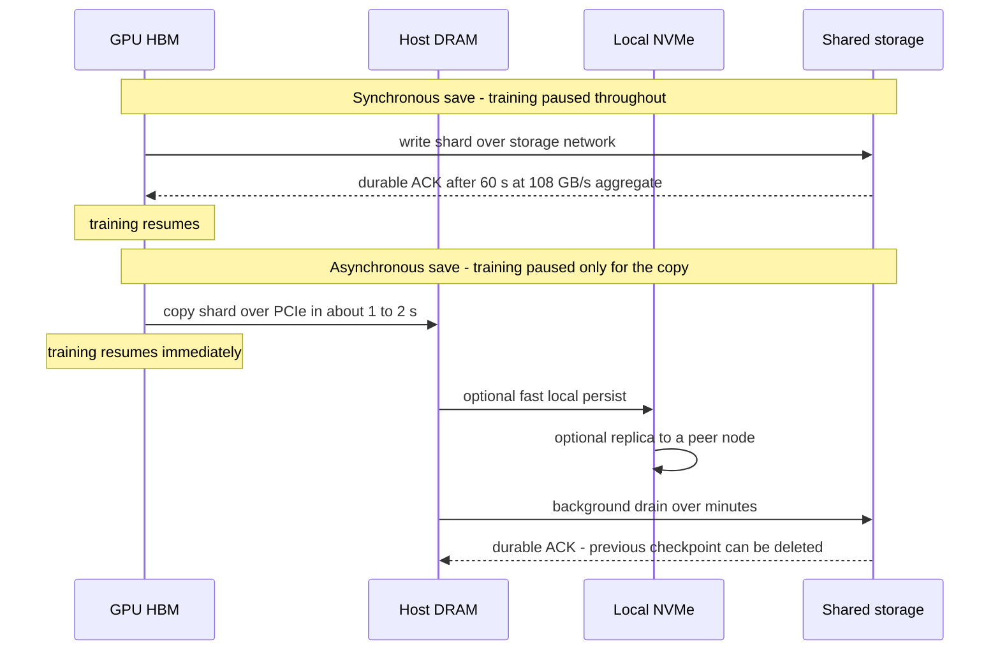
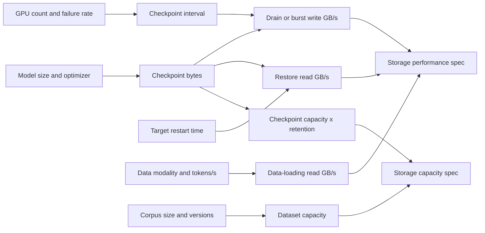
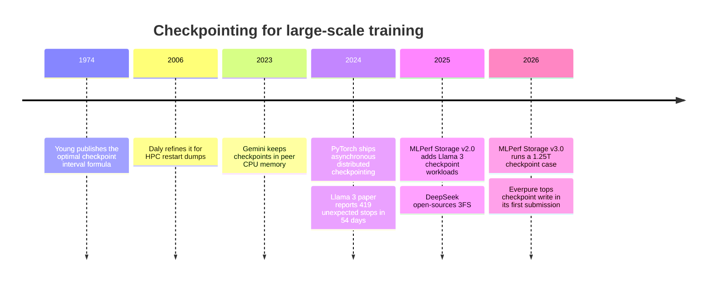

# 31. Training storage

> **Depth:** L2 · **Reading time:** ~11 min · **Last verified:** 2026-11-01
> **Prerequisites:** [The GPU data path](../02-protocols-and-networking/11-gpu-data-path.md) · [The AI data pipeline end to end](30-ai-data-pipeline.md) · [Performance and economics metrics](../01-storage-fundamentals/04-performance-and-economics-metrics.md) · [Parallel file systems](../03-system-architecture/17-parallel-file-systems.md)

## TL;DR

- **Checkpoints, not training data, set the performance spec for LLM training storage.** A 405B-parameter model reads roughly 11 MB/s of text tokens across 16,384 GPUs, yet its full training state is about 6.5 TB. Writing that in 60 seconds takes about 108 GB/s.
- **Size the checkpoint at roughly 14–16 bytes per parameter, not 2.** Mixed-precision Adam keeps fp32 master weights and two fp32 optimizer moments next to the bf16 weights. Weights alone are one-seventh of what gets saved.
- **Failures set the checkpoint frequency.** Meta's Llama 3 run saw 419 unexpected interruptions in 54 days, about one every 3.1 hours. With synchronous saves, the best interval wastes about 10% of the cluster. At 100,000 GPUs it would waste about a quarter.
- **Asynchronous and tiered checkpointing turn a peak-bandwidth problem into a sustained-bandwidth one.** GPUs dump state to host DRAM or local NVMe in seconds and drain to shared storage in the background; software removes most of the stall.
- **The hardest moment is the restore.** Every GPU reads at once after a failure, and at large scale restart time costs more than save time. Ask about cold read bandwidth and metadata storms, not only write GB/s.

## Why this matters for Everpure strategy

In training-cluster deals, the checkpoint is the requirement that turns "a few MB/s of tokens" into "hundreds of GB/s of writes", and it decides which architectures get shortlisted. In its first MLPerf Storage entry (v3.0, September 2026), Everpure's FlashBlade//EXA posted the top checkpoint-write result among submitters[^1][^2], a credible public data point in exactly this argument ([Chapter 27](../04-everpure/27-flasharray-and-flashblade.md)).

The tension: asynchronous saves, node-local tiers and in-memory replicas keep shrinking the peak storage must absorb, so a pitch built on burst write bandwidth sells into an eroding requirement. Durable value moves to sustained drain bandwidth, restore speed and efficient checkpoint retention. These are options a strategy team might evaluate, based on public information.

## Core concepts

### Two very different I/O jobs

**Data loading** is a steady, read-mostly stream of often small, random samples. **Checkpointing** is a periodic burst of large, mostly sequential writes; its mirror image, the **restore**, is a read burst from every GPU at once. [Chapter 30](30-ai-data-pipeline.md) places both in the pipeline and [Chapter 11](../02-protocols-and-networking/11-gpu-data-path.md) explains how bytes reach GPU memory; this chapter sizes them.

### How big is a checkpoint?

A checkpoint is everything needed to resume training exactly. With the Adam optimizer in mixed precision, each parameter carries:

| Component | Bytes per parameter | In GPU memory? | Usually saved? |
|---|---|---|---|
| bf16 working weights | 2 | Yes | Yes (or re-derived from fp32 master) |
| fp32 master weights | 4 | Yes | Yes |
| Adam first moment (m), fp32 | 4 | Yes | Yes |
| Adam second moment (v), fp32 | 4 | Yes | Yes |
| bf16 gradients | 2 | Yes, transient | Rarely |
| **Total** | **16** | 16 | **~12–14** |

*Table 31.1 — Weights are only about one-eighth of training state; the optimizer is most of what a checkpoint writes.*

So **full training state = parameters × 16 bytes**, and a typical **saved checkpoint = parameters × ~14 bytes**. Variations: gradients are transient and rarely saved; dropping the bf16 copy (rebuilt from fp32 on load) gives 12 bytes; fp32 gradients push in-memory state to 18; 8-bit or bf16 optimizer moments can halve the optimizer share. Data-loader and RNG state add only megabytes.

MLPerf Storage's checkpoint workload lands in the same range. IBM reports 105 GB for the 8B case and 15 TB for the 1T case, of which 13.2 TB is optimizer state[^3]. That is roughly 13–15 bytes per parameter.

*Figure 31.1 — Worked example: a checkpoint is roughly 7–8× the model's inference weights, so a 1T-parameter model saves 14–16 TB every time.*
Data: `data/ch31_checkpoint_size.csv`

One subtlety: for **mixture-of-experts** models, checkpoint size follows *total* parameters, while compute follows *active* parameters. A 1T-total MoE activating a few tens of billions of parameters per token computes like a mid-size model but checkpoints like a 1T one, raising storage bandwidth per unit of GPU compute.

### Throughput math: bytes ÷ window

The core formula is **required bandwidth = checkpoint bytes ÷ the time you allow the write to take**. The window is a business choice: allowed GPU idle time (synchronous) or time until the checkpoint is safe (asynchronous).

| Model (full state) | Assumed GPUs | Per-GPU shard | Sync, 60 s window | Sync, 300 s window | Async, drain within 30 min | Per 8-GPU node, 60 s |
|---|---|---|---|---|---|---|
| 70B (1.12 TB) | 1,024 | 1.09 GB | 18.7 GB/s | 3.7 GB/s | 0.6 GB/s | 0.15 GB/s |
| 405B (6.48 TB) | 16,384 | 395 MB | **108 GB/s** | 21.6 GB/s | 3.6 GB/s | 0.05 GB/s |
| 1T (16 TB) | 32,768 | 488 MB | 267 GB/s | 53 GB/s | 8.9 GB/s | 0.07 GB/s |
| 2T (32 TB) | 65,536 | 488 MB | 533 GB/s | 107 GB/s | 17.8 GB/s | 0.07 GB/s |

*Table 31.2 — Worked example: sharding makes each client's job trivial; the hard part is the aggregate burst landing on shared storage, which asynchronous drain cuts by 30×.*

Two lessons follow. First, **sharding spreads the bytes but does not shrink them**. Every GPU writes its own slice, so no single NIC is the bottleneck; Meta reports per-GPU checkpoint state of 1 MB to 4 GB for Llama 3[^4], which brackets the 395 MB average above. If only one model replica wrote (16 nodes in Llama 3 405B's tensor-by-pipeline layout[^4]), each node would push 405 GB, 6.75 GB/s for a minute. Either way, storage sees the full aggregate plus thousands of simultaneous file creates, a metadata event ([Chapter 21](../03-system-architecture/21-metadata.md)).

Second, **the asynchronous column matters most for sizing**, because modern frameworks lean toward it.

### Synchronous vs asynchronous checkpointing

*Figure 31.2 — Asynchronous checkpointing cuts the GPU stall to a PCIe copy and moves the storage write off the critical path, at the cost of a window in which the newest checkpoint is not yet durable.*

In an asynchronous save, each GPU copies its shard into pinned host memory (about a second for a few hundred MB over PCIe) and resumes while CPU threads write it out. With PyTorch's 2024 asynchronous mode, IBM measured a 7B model's checkpoint downtime falling from 148.8 to 6.3 seconds[^5]. Tiered variants add an intermediate stop. NVIDIA's NeMo local checkpointing writes each node's part to local SSD or RAM disk and replicates it to peer nodes[^6]. AWS's Gemini research system keeps checkpoints in peer CPU memory and reported over 13× faster recovery[^7].

The costs: a node lost mid-drain falls back to the previous checkpoint; host DRAM must hold the shard; the drain must finish before the next save; and background writes compete with training traffic unless they use a separate storage fabric.

**Semiconductor bridge.** A checkpoint is a power-gating state save. Context goes to retention flops before a domain is gated, and designers trade save/restore cost against leakage saved, a break-even calculation. Synchronous checkpointing is an all-bank DRAM refresh, blocking every bank for tRFC; asynchronous checkpointing is per-bank refresh, hiding the burst behind useful work.

### Frequency vs failure rate

Checkpoint frequency trades time spent saving against work redone after a failure. Young's approximation gives the optimal interval as **τ ≈ √(2 × C × M)**, where *C* is the GPU stall per checkpoint and *M* is the mean time between job-killing failures[^8]. Overhead is then roughly C/τ + τ/(2M), plus restart time per failure.

During a 54-day snapshot of Llama 3 405B pre-training on 16,384 H100s, Meta logged 466 interruptions: 47 planned and **419 unexpected**. About 78% of these were attributed to confirmed or suspected hardware, led by faulty GPUs and HBM3[^4][^9]. That is one unexpected stop every 54 × 24 ÷ 419 ≈ **3.1 hours**. In Meta's research clusters a 1,024-GPU job's mean time to failure was 7.9 hours, against 47.7 days for an 8-GPU job[^10]. Scaling that linearly predicts about 30 minutes at 16K GPUs; mature fleets like Llama 3's do far better.

| Scenario (405B, 6.48 TB state) | MTBF *M* | Stall per save *C* | Optimal interval τ | Save + rework overhead | Drain bandwidth needed |
|---|---|---|---|---|---|
| 16K GPUs, sync at 108 GB/s | 3.1 h | 60 s | 19 min | **10.4%** | 108 GB/s burst |
| 16K GPUs, sync at ~1 TB/s | 3.1 h | 6.5 s | 6.3 min | 3.4% | ~1 TB/s burst |
| 16K GPUs, async | 3.1 h | 2 s | 3.5 min | 1.9% | 31 GB/s sustained |
| 100K GPUs, sync at 108 GB/s | 30 min* | 60 s | 7.8 min | **25.6%** | 108 GB/s burst |
| 100K GPUs, async | 30 min* | 2 s | 1.4 min | 4.7% | 76 GB/s sustained |

*Table 31.3 — Worked example using Young's formula: at 100K GPUs synchronous checkpointing wastes a quarter of the cluster, while asynchronous saves keep overhead under 5% but demand steady drain bandwidth. \*Assumes failures scale linearly with GPU count from the Llama 3 rate.*

At 16K GPUs, 10.4% overhead idles ~1,700 GPUs, tens of millions of dollars a year at the rental rates in [Chapter 11](../02-protocols-and-networking/11-gpu-data-path.md). The trap: restart time is paid per failure however checkpoints are written. A 5-minute restart costs 2.7% at 16K GPUs and 16% at 100K.

### Restore storms

After a failure, bad nodes are swapped and every rank reads the latest checkpoint at once. Three things make this harder than the save:

1. **Read amplification.** The optimizer state is sharded, but the bf16 weights are replicated across data-parallel groups. In the naive approach every replica reads its own copy. For Llama 3 405B with 128 data-parallel replicas, that is 0.81 TB × 128 + 5.67 TB ≈ **109 TB of reads to recover 6.5 TB of unique data**. Good frameworks read each byte once and broadcast it over the faster GPU fabric.
2. **Cold reads and metadata.** Caches may no longer hold the checkpoint, and thousands of ranks open and stat files simultaneously. In Everpure's own MLPerf Storage v3.0 result, checkpoint *read* was 588 GiB/s against 877 GiB/s *write*[^1]. Restore was the slower direction even for the leader.
3. **Everything else restarts too.** Container images and Python environments hit shared storage at the same moment; Meta cut job-startup time to keep effective training time above 90%[^4].

A useful sizing target is a restore time, not a bandwidth. Reading 6.5 TB of unique data in two minutes needs 54 GB/s. The same restore with naive replica reads needs about 900 GB/s.

### Data loading: tokens are cheap, pixels are not

The data-loading requirement is **tokens/s per GPU × bytes per token × GPUs**. Llama 3 405B ran at about 41% of the H100's ~989 dense BF16 TFLOPS on 16,384 GPUs[^4]. At 6 FLOPs per parameter per token, each GPU consumes 989×10¹² × 0.41 ÷ (6 × 405×10⁹) ≈ **167 tokens/s**. At 4 bytes per token ID, that is 0.7 KB/s per GPU and about **11 MB/s for the cluster**. (Over 15.6T tokens that is ~66 days, consistent with the run[^4].) Yet Meta's Tectonic storage for Llama 3 offered 240 PB on 7,500 SSD servers, 2 TB/s sustained and 7 TB/s peak, and Meta still called bursty checkpoint writes "a major challenge"[^4]. It was sized for checkpoints, not tokens.

| Workload | Per-GPU input rate | Bytes per GPU per second | 1,024 GPUs | Basis |
|---|---|---|---|---|
| 405B dense text LLM | 167 tokens/s | ~0.7 KB/s | ~0.7 MB/s | Worked example from Llama 3 MFU |
| 8B dense text LLM | 8,450 tokens/s | ~34 KB/s | ~35 MB/s | Same formula, smaller model |
| Image model, ~100 KB JPEGs | 1,000 images/s (illustrative) | ~100 MB/s | ~100 GB/s | Illustrative assumption |
| Video model, 20 MB clips | 2 clips/s (illustrative) | ~40 MB/s | ~40 GB/s | Illustrative assumption |
| MLPerf Storage 3D U-Net | ~2.7 GiB/s per simulated H100 | ~2.7 GiB/s | ~2.8 TiB/s | DDN v1.0 result[^11] |

*Table 31.4 — Text training barely touches storage; image, video and scientific volumes can need five to six orders of magnitude more bytes per GPU.*

Teams often pre-encode video into compact latents, trading storage bandwidth for an offline compute pass. The MLPerf 3D U-Net row is deliberately storage-bound (tiny model, large volumes), a stress test rather than a typical workload ([Chapter 37](37-reading-benchmarks.md)).

### What this means for sizing an AI factory

*Figure 31.3 — For text LLMs, the performance spec comes from checkpoint save and restore; for multimodal training, data loading can dominate.*

Capacity example: the last 10 checkpoints of a 405B run plus 20 evaluation milestones is 30 × 5.67 TB ≈ 170 TB, modest next to a multimodal corpus but hot data readable at restore speed. NVIDIA's DGX SuperPOD (H100) reference architecture's "best" storage tier asks for 40 GB/s read and 20 GB/s write per node, and 125/62 GB/s read/write per 32-node scalable unit[^12] [VERIFY: search-summary only]. Scaled linearly to 64 units (16,384 GPUs), that is about 4 TB/s of write, the same order as Meta's 7 TB/s peak.

## How Everpure approaches it vs. competitors

| Approach | Where the checkpoint burst lands | Strength | Weakness | Examples (public) |
|---|---|---|---|---|
| Shared all-flash, metadata/data split | Shared namespace, clients write data nodes directly | High aggregate write; one copy visible to every node for restore | Must be sized for the burst or the drain | Everpure FlashBlade//EXA: 877.5 GiB/s checkpoint write in MLPerf Storage v3.0[^1][^2] |
| Parallel file system | Object storage targets via striping | Mature at HPC scale; strong streaming | Metadata server limits on file-per-rank storms | DDN EXAScaler (>2× checkpoint speedup, company-stated)[^13]; Azure Managed Lustre 642.2 GiB/s in v3.0[^2] |
| Disaggregated shared-everything | SCM/flash write buffer, migrated to QLC later | Absorbs bursts into a fast tier; global reduction | Write path amplifies back-end traffic | VAST (no MLPerf Storage submission)[^2][^14] |
| Software-defined parallel FS | Commodity NVMe servers or cloud instances | Scales per node; cloud and neocloud fit | Customer owns hardware integration | WEKA (company-stated checkpoint focus)[^15] |
| Node-local tier | GPU servers' own NVMe, then drained | Removes network from the critical path | Durability depends on replication; capacity stranded in servers | Hammerspace Tier 0[^16]; NVIDIA NeMo local checkpointing[^6] |
| Self-built | Hyperscaler or lab file system | Tuned to one workload; no vendor margin | Engineering headcount; not for sale | Meta Tectonic[^4]; DeepSeek 3FS (~6.6 TiB/s reads across 180 storage nodes)[^17] |

*Table 31.5 — Every architecture can absorb checkpoints; they differ in whether the burst lands on shared flash, a fast buffer tier, or the GPU servers themselves.*

**Everpure's position.** FlashBlade//EXA pitches aggregate write through a direct client-to-data-node path plus a metadata core for mass file creates. The v3.0 submission wrote a 1.25T-parameter checkpoint emulation from 1,024 simulated accelerators in 17.74 seconds[^1]. That implies roughly 16–17 TB per checkpoint (atlas arithmetic), consistent with Figure 31.1. Everpure also markets FlashBlade with PyTorch asynchronous checkpointing and claims at least 10× lower checkpoint overhead (company-stated)[^18]. Most of that gain is the software pattern, which works on any storage.

**Steelman the alternatives.** DDN's Lustre lineage has absorbed file-per-process checkpoint storms in national labs for two decades. VAST's write buffer absorbs bursts without sizing QLC for them. Node-local tiers attack the root: if checkpoints rarely leave GPU servers, shared storage holds only slower, durable copies. And VAST, WEKA and DDN did not submit to v3.0[^2], so Everpure's lead covers the submitters, not the market.

## History and trajectory

*Figure 31.4 — Checkpoint theory is 50 years old; what changed is scale, which pushed checkpointing into the storage benchmark and the storage RFP.*

HPC solved this first: supercomputer restart dumps drove the parallel file systems of the 2000s ([Chapter 17](../03-system-architecture/17-parallel-file-systems.md)). MLPerf Storage made checkpointing a scored workload in v2.0 (August 2025), using Llama 3 8B, 70B, 405B and 1T models[^19]. Its metrics are deliberately pessimistic: duration is the slowest process and throughput is the minimum across processes, over 10 checkpoints written and read[^20].

Three trends point forward: **checkpoints move closer to the GPU** (host DRAM, local NVMe, peer replicas), with shared storage as durable backstop; **lower-precision optimizer states** shrink bytes per parameter while total parameter counts keep growing; and as failures scale with GPU count, **time-to-resume becomes the metric** vendors are judged on.

## Numbers that matter

| Metric | Value | Context | Source / date |
|---|---|---|---|
| Training state, mixed-precision Adam | ~16 B/param in memory; ~12–14 B/param saved | 405B → 6.48 TB full state | Worked example |
| 405B full state in 60 s | ~108 GB/s | 6.48 TB ÷ 60 s; async drain over 30 min needs 3.6 GB/s | Worked example |
| Llama 3 interruptions | 466 in 54 days (419 unexpected, ~78% hardware) | 16,384 H100s; ~one every 3.1 h | Meta[^4], 2024-07 |
| Llama 3 storage | 240 PB, 7,500 servers, 2 TB/s sustained, 7 TB/s peak | Checkpoint bursts called a major challenge | Meta[^4], 2024-07 |
| Per-GPU checkpoint state, Llama 3 | 1 MB to 4 GB | Sharded across 16K GPUs | Meta[^4], 2024-07 |
| MTTF, 1,024-GPU job | 7.9 h (vs 47.7 days for 8 GPUs) | Meta research clusters | Kokolis et al.[^10], 2025-02 |
| Async checkpoint downtime, 7B | 148.8 s → 6.3 s | PyTorch DCP with IBM | PyTorch[^5], 2024 |
| MLPerf Storage v3.0 checkpoint write, top | 877.5 GiB/s (read 588.3 GiB/s) | Everpure FlashBlade//EXA, 30 data nodes, 1.25T case; vendor-submitted | HPCwire[^1], 2026-09-02 |
| Text token input, 405B on 16K GPUs | ~11 MB/s cluster-wide | 167 tokens/s/GPU × 4 B | Worked example |

## Conversation playbook

**Questions for a PM**

1. *"In the last five training deals we lost, was the checkpoint requirement written as burst GB/s, drain rate or time-to-resume?"* Strong: knows the customer's framework (sync or async), checkpoint size and interval, and whether the RFP number was real or copied from a reference architecture.
2. *"How do we size a cluster for a customer running asynchronous checkpointing to local NVMe?"* Strong: sustained drain, restore bandwidth and retained-checkpoint capacity, not peak write, and how pricing compensates when that shrinks the deal.
3. *"What's our answer when VAST or WEKA says MLPerf Storage doesn't reflect real customers?"* Strong: concede it is synthetic, then cite the 1.25T case, the pessimistic min-throughput metric and references at similar scale.

**Questions for an engineer**

1. *"Walk me through a 16K-rank restore after the cache has been dropped: files opened per second, read GB/s and time to first step."* Strong: separate metadata and data numbers, broadcast versus per-replica reads, and the slowest-client tail.
2. *"What happens to a running checkpoint drain when a data node fails?"* Strong: degraded write bandwidth as a percentage, stall-or-retry behaviour, and time to full speed.
3. *"Where does the checkpoint's write amplification come from on our platform: erasure coding, metadata, reduction?"* Strong: a back-end-bytes-per-client-byte figure, and candour that optimizer state barely compresses.

**Don't say this:**

- "LLM training needs huge read bandwidth." Text needs MB/s. Checkpoints, restores and multimodal data drive bandwidth.
- "A 405B checkpoint is 810 GB." That is the bf16 weights. With optimizer state it is about 5.7–6.5 TB.
- "Faster storage is the only way to cut checkpoint overhead." Asynchronous and tiered checkpointing remove most of the stall in software.
- "Checkpoint data dedupes well." Successive checkpoints differ in almost every fp32 value; expect little reduction.
- "The MLPerf leader is the fastest system on the market." Major competitors didn't submit to v3.0.

## Going deeper (optional, L3 pointers)

- Meta, "The Llama 3 Herd of Models," §3.3 (storage and reliability).
- Young (1974) and Daly (2006) on optimal checkpoint intervals.
- PyTorch Distributed Checkpoint (DCP) docs: async save and resharding on load.
- NVIDIA NeMo / Megatron "local checkpointing" and the Gemini (SOSP 2023) paper on in-memory checkpoint placement.
- MLPerf Storage checkpointing rules (subset vs default mode).

## Key terms

- **Checkpoint** — a saved copy of all training state needed to resume a run.
- **Optimizer state** — Adam's per-parameter moments and fp32 master weights, most of a checkpoint's size.
- **Asynchronous checkpointing** — copying state to host memory, then writing to storage in the background while training continues.
- **Restore storm** — every GPU reading the latest checkpoint at once after a failure.
- **Young's formula** — the optimal checkpoint interval, √(2 × save cost × MTBF).
- See the [glossary](../glossary.md) for the rest.

## Sources

[^1]: HPCwire (Everpure release), "Everpure Leads MLPerf Storage Tests for Large Model Checkpointing and KV Cache," 2026-09-02. https://hpcwire.com/off-the-wire/everpure-leads-mlperf-storage-tests-for-large-model-checkpointing-and-kv-cache (retrieved 2026-11-01).
[^2]: StorageReview, "MLPerf Storage v3.0: 877 GiB/s Checkpoints, a Cloud First, and a Leaderboard Turned Over," 2026-09. https://www.storagereview.com/news/mlperf-storage-v3-0-877-gib-s-checkpoints-a-cloud-first-and-a-leaderboard-turned-over (retrieved 2026-11-01).
[^3]: IBM Research Blog, "IBM Storage Scale delivers real-world performance: an in-depth analysis," n.d. (2025). https://research.ibm.com/blog/ibm-storage-scale-mlperf (retrieved 2026-11-01).
[^4]: Llama Team, AI @ Meta, "The Llama 3 Herd of Models," arXiv:2407.21783, 2024-07-31. https://arxiv.org/abs/2407.21783 (retrieved 2026-11-01).
[^5]: PyTorch Blog, "Reducing Model Checkpointing Times by Over 10x with PyTorch Distributed Asynchronous Checkpointing," 2024-06. https://pytorch.org/blog/reducing-checkpointing-times/ (retrieved 2026-11-01).
[^6]: NVIDIA, "Resiliency Features," NeMo Framework User Guide 25.04, n.d. https://docs.nvidia.com/nemo-framework/user-guide/25.04/resiliency.html (retrieved 2026-11-01).
[^7]: Z. Wang et al., "Gemini: Fast Failure Recovery in Distributed Training with In-Memory Checkpoints," SOSP '23, 2023-10. https://www.amazon.science/publications/gemini-fast-failure-recovery-in-distributed-training-with-in-memory-checkpoints (retrieved 2026-11-01).
[^8]: J. W. Young, "A first order approximation to the optimum checkpoint interval," Communications of the ACM 17(9), 1974-09. https://doi.org/10.1145/361147.361115 (retrieved 2026-11-01).
[^9]: DatacenterDynamics, "Meta report details hundreds of GPU and HBM3 related interruptions to Llama 3 training run," 2024-07. https://datacenterdynamics.com/en/news/meta-report-details-hundreds-of-gpu-and-hbm3-related-interruptions-to-llama-3-training-run (retrieved 2026-11-01).
[^10]: A. Kokolis et al. (Meta), "Revisiting Reliability in Large-Scale Machine Learning Research Clusters," arXiv:2410.21680v2, 2025-02-06. https://arxiv.org/abs/2410.21680v2 (retrieved 2026-11-01).
[^11]: Blocks & Files, "MLPerf AI benchmark tests how storage systems keep GPUs busy," 2024-09-26. https://www.blocksandfiles.com/ai-ml/2024/09/26/mlperf-ai-benchmark-tests-how-storage-systems-keep-gpus-busy/1605043 (retrieved 2026-11-01).
[^12]: NVIDIA, "Storage Architecture," DGX SuperPOD Reference Architecture (DGX H100), n.d. https://docs.nvidia.com/dgx-superpod/reference-architecture-scalable-infrastructure-h100/latest/storage-architecture.html (retrieved 2026-11-01).
[^13]: DDN, "Understanding the impact of checkpoints on AI efficiency," n.d. https://www.ddn.com/blog/understanding-the-impact-of-checkpoints-on-ai-efficiency/ (retrieved 2026-11-01).
[^14]: VAST Data, "We've got the write stuff, baby," n.d. https://vastdata.com/blog/weve-got-the-write-stuff-baby (retrieved 2026-11-01).
[^15]: WEKA, "WEKA eliminates costly checkpoint bottlenecks" (solution brief), n.d. https://www.weka.io/resources/solution-brief/weka-eliminates-costly-checkpoint-bottlenecks/ (retrieved 2026-11-01).
[^16]: Hammerspace, "Hammerspace Tier 0 Affinitization," 2026. https://hammerspace.com/hammerspace-tier-0-affinitization/ (retrieved 2026-11-01).
[^17]: DeepSeek, "3FS: Fire-Flyer File System" (README), 2025. https://github.com/deepseek-ai/3FS (retrieved 2026-11-01).
[^18]: Everpure Blog, "How to Accelerate Training for Large AI Models with Pure Storage FlashBlade and PyTorch Checkpointing," n.d. https://blog.everpuredata.com/purely-technical/pure-storage-flashblade-and-pytorch-asynchronous-checkpointing/ (retrieved 2026-11-01).
[^19]: MLCommons via GlobeNewswire, "New MLPerf Storage v2.0 Benchmark Results Demonstrate the Critical Role of Storage Performance in AI Training Systems," 2025-08-04. https://www.globenewswire.com/news-release/2025/08/04/3126718/0/en/new-mlperf-storage-v2-0-benchmark-results-demonstrate-the-critical-role-of-storage-performance-in-ai-training-systems.html (retrieved 2026-11-01).
[^20]: Lawrence Livermore National Laboratory, "MLPerf Storage," LLNL Benchmarks documentation, n.d. https://software.llnl.gov/benchmarks/81_mlpstor/mlpstor.html (retrieved 2026-11-01).
