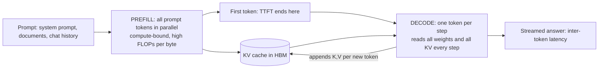
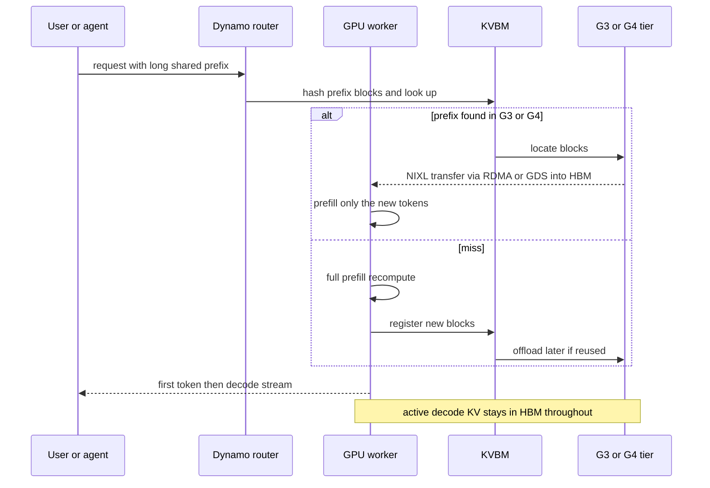
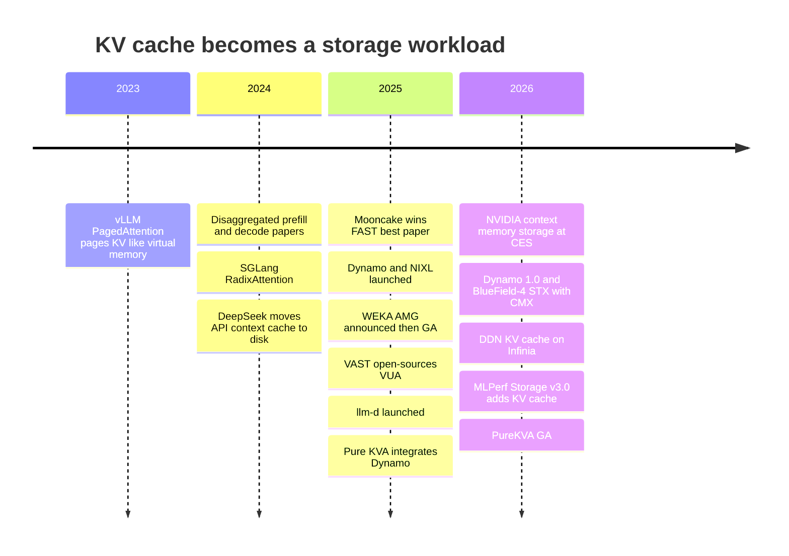

# 32. Inference and KV cache

> **Depth:** L2 · **Reading time:** ~11 min · **Last verified:** 2026-11-01
> **Prerequisites:** [Media physics](../01-storage-fundamentals/02-media-physics.md) · [The GPU data path](../02-protocols-and-networking/11-gpu-data-path.md) · [Interfaces and emerging tech (CXL)](../02-protocols-and-networking/12-interfaces-and-emerging-tech.md) · [Training storage](31-training-storage.md)

## TL;DR

- **The KV cache is the model's working memory for a conversation.** It holds the attention keys and values of every token seen so far. For a Llama 3.1 70B-class model it costs **320 KiB per token**, so one 128K-token session holds about **43 GB**, and a fleet of retained sessions reaches petabytes.
- **Inference has two phases with opposite bottlenecks.** Prefill is compute-bound and produces the KV cache. Decode is memory-bandwidth-bound and rereads the whole cache for every new token. Active KV therefore has to sit in HBM. Storage can only hold KV that is *not being decoded right now*.
- **KV caching is a recompute-or-fetch trade.** Rebuilding a 128K context costs an 8-GPU node about 2.6 seconds of full compute. Fetching it over 8 × 400 Gb/s NICs takes about 0.13 seconds. Fetching wins once a GPU gets more than roughly 2–5 GB/s from the tier, so hit rate and bandwidth decide the economics, not latency alone.
- **NVIDIA has standardized the hierarchy.** Dynamo's KV Block Manager (KVBM) defines tiers G1 (HBM) to G4 (networked storage). NIXL moves the bytes. BlueField-4 STX/CMX adds a pod-level "G3.5" flash tier. Every storage vendor, Everpure included, now competes to be the G3.5/G4 backend.
- **Treat vendor claims with care.** Everpure (PureKVA), WEKA (Augmented Memory Grid), DDN, VAST and HPE all claim 20× or more faster time to first token, mostly against a no-cache baseline. MLPerf Storage v3.0 (September 2026) added the first neutral KV-cache test[^1].

## Why this matters for Everpure strategy

Training storage is a one-time sale per cluster. Inference is where AI spending is shifting, and it recurs. KV caching is the first inference workload that needs *capacity and bandwidth from shared storage on every user request*. If a cache tier lets a GPU fleet serve more conversations per GPU, the storage is paid for out of the GPU budget, which is the most persuasive argument a storage vendor has (see [Chapter 11](../02-protocols-and-networking/11-gpu-data-path.md)). Everpure has entered with PureKVA on FlashBlade. It also led the MLPerf Storage v3.0 KV-cache runs it entered[^2] (company-stated) and is a named partner in NVIDIA's BlueField-4 STX storage architecture[^3].

The risk is equally direct. NVIDIA is defining the tier: its names, its software (Dynamo, NIXL) and now a reference rack (CMX). In that design, storage can become a commodity flash shelf behind NVIDIA's software and DPUs. Strategy teams should therefore ask two questions. Is KV cache a new socket for Everpure? Or is it a feature that NVIDIA, local NVMe and cheaper model architectures will absorb?

## Core concepts

### What the KV cache is, and how big it gets

A transformer generates one token at a time. At each step, every layer's attention compares the new token's *query* with the *keys* of all earlier tokens and blends their *values*. Without a cache, those keys and values would be recomputed for the whole history at every step. With a cache, each token's K and V are computed once and stored. The cost is memory:

**KV bytes per token = 2 (K and V) × layers × KV heads × head dimension × bytes per value.**

Llama 3.1 70B has 80 layers and uses grouped-query attention (GQA): 64 query heads share 8 KV heads, each of dimension 128 (8,192 ÷ 64)[^4]. At fp16 that gives 2 × 80 × 8 × 128 × 2 = **327,680 bytes (320 KiB) per token**. Llama 3.1 405B (126 layers, 8 KV heads) needs 504 KiB per token. DeepSeek-V3 uses multi-head latent attention (MLA). It caches one compressed 512-wide latent plus a 64-wide positional key per layer, so 61 layers come to about 69 KiB per token despite 671B parameters[^5]. Without GQA, Llama 3.1 70B would need 8× more, about 2.5 MiB per token. Model architects have already cut KV size by an order of magnitude, and that is the first thing a storage pitch has to survive.

![Two-panel chart. Panel A plots KV cache per session against context length from 8K to 1M tokens on log axes for DeepSeek-V3 (68.6 KiB per token), Llama 3.1 8B (128 KiB), Llama 3.1 70B (320 KiB) and Llama 3.1 405B (504 KiB), with reference lines for one B200 GPU's 180 GB of HBM and an 8-GPU node's 1,440 GB. A 70B session reaches 43 GB at 128K and 344 GB at 1M. Panel B shows the total KV for 1 to 100,000 retained 128K-token Llama 3.1 70B sessions, rising from 43 GB to 4.3 PB, against one node's HBM, DRAM and local NVMe capacity.](../assets/charts/ch32-kv-size.svg)

*Figure 32.1 — Worked example: KV size is linear in context and in sessions, so a few hundred retained long conversations already exceed everything one 8-GPU node holds.*
Data: `data/ch32_kv_size.csv`

Put that next to the hardware. An H200 has 141 GB of HBM[^6], and a Rubin GPU has 288 GB of HBM4[^7]. A DGX B200 node has 1,440 GB of HBM across eight GPUs, 2 TB of host DRAM and 8 × 3.84 TB of local NVMe[^8]. Take 71 GB of fp8 weights for a 70B model out of that HBM, and about 1.37 TB is left for KV: **about 31 sessions at 128K**, fewer once activations are counted. Storing KV in fp8 doubles the count. It does not change the shape of the curve.

### Prefill versus decode: two different machines

*Figure 32.2 — Prefill creates the KV cache in one compute-heavy burst; decode then rereads it once per generated token, which is why active KV must live in the fastest memory.*

**Prefill** processes the whole prompt at once. It is matrix-multiply heavy and runs near the GPU's compute roofline. Its latency is **time to first token (TTFT)**. **Decode** produces one token per step. Each step reads the weights and *the entire KV cache of every sequence in the batch*. That is very low arithmetic intensity, the memory-bound regime a semiconductor reader knows from roofline plots. A worked example: 16 sessions at 128K on a 70B model hold 687 GB of KV. Spread across eight B200s, each GPU reads ~86 GB of KV per step, about 11 ms at B200's 8 TB/s of HBM bandwidth[^8]. Reading the weights takes only ~1 ms. At long context, decode speed is set by KV bytes, and batch size is capped by HBM capacity. Streaming that 86 GB from a 50 GB/s network link would take 1.7 seconds *per token*. That is the hard limit on storage's role: **storage holds inactive KV**, meaning between turns, while an agent waits on a tool, or a shared prefix not yet in use. It does not hold the working set.

Because the phases want different hardware, serving systems now separate them. **Disaggregated serving** runs prefill and decode on different GPU pools and ships the KV cache between them. The idea was published in 2024 as DistServe (OSDI)[^9] and Splitwise (ISCA)[^10]. Moonshot AI's Mooncake, which serves the Kimi chatbot, built a production system around a pooled KV store on spare CPU DRAM and SSDs. It won Best Paper at USENIX FAST 2025 with the subtitle "trading more storage for less computation"[^11]. Disaggregation turns KV from a private GPU buffer into data that moves over the network, and the network is where storage vendors operate.

### Prefix caching: the hit-rate game

Many requests share a beginning: the same system prompt, the same uploaded contract, the same code repository, or the earlier turns of the same chat. **Prefix caching** stores KV in fixed-size blocks keyed by a hash of the tokens up to that block. A new request then reuses the longest matching prefix and prefills only the new tokens. vLLM's PagedAttention (SOSP 2023) made this possible by managing KV in pages, like virtual memory. Its authors reported that earlier systems wasted 60–80% of KV memory to fragmentation, and that paging improved throughput 2–4×[^12]. SGLang's RadixAttention extended the idea to a prefix tree[^13].

The semiconductor bridge is direct. The block hash is a cache tag. Eviction is LRU with a frequency filter. Average access time is hit rate × fetch time + miss rate × recompute time. The quirk is that misses are *recomputable*, so losing a KV block costs time and money but never correctness. That changes what a storage tier must guarantee: durability matters far less than throughput and tail latency. Hit rates are also fragile. LMCache's authors found that context truncation, a common serving practice, can halve the prefix hit ratio[^14]. A model update invalidates the entire cache, because KV is specific to the model weights that produced it.

### Recompute or fetch: the break-even

**Worked example (128K-token context, Llama 3.1 70B, 8-GPU B200-class node).** Recompute costs about 2 × 70.6×10⁹ × 131,072 ≈ 1.85×10¹⁶ FLOPs for the linear layers, plus about 2.25×10¹⁶ for causal attention (2 × n² × 8,192 × 80 layers), so ≈ 4.1×10¹⁶ FLOPs. Assume the node *delivers* 16 PFLOPS (2 PFLOPS per GPU, an assumption well below peak). Recompute then takes **≈ 2.6 s and ≈ 21 GPU-seconds**. Fetching 43 GB over eight 400 Gb/s NICs at ~80% efficiency (320 GB/s) takes **≈ 0.13 s** and leaves the GPUs free for other work. The general rule: a 70B model spends roughly 0.5–1 million FLOPs to recreate each byte of KV. At 2 PFLOPS per GPU, fetching wins whenever the tier delivers more than **~2–5 GB/s per GPU**. That is a low bar for RDMA flash, and the reason KV offload works at all.

*Figure 32.3 — The KV hierarchy is a cache hierarchy with a ~1,000× latency cliff between memory and flash; storage vendors compete below the cliff, where capacity and sharing matter more than nanoseconds.*

| Path for a 128K-context hit (70B, 43 GB) | Time to restore | GPU time burned | Capacity at that tier (one node) | Cost to hold 43 GB for 1 hour |
|---|---|---|---|---|
| Miss: recompute prefill | ≈ 2.6 s | ≈ 21 GPU-s (≈ US$0.02 at US$4/GPU-h, assumed) | n/a | n/a |
| G2 host DRAM over PCIe 5 (~440 GB/s per node) | ≈ 0.1 s | ~0 | 2–4 TB → ~45–90 sessions | ≈ US$0.01 (DRAM at ~US$10/GB, 4-yr life, assumed) |
| G3 local NVMe (8 drives, ~56 GB/s) | ≈ 0.8 s | ~0 | ~31 TB → ~700 sessions, this node only | ≈ US$0.0006 (flash system at ~US$0.50/GB, assumed) |
| G3.5 / G4 networked flash (~320 GB/s to the node) | ≈ 0.13 s + lookup | ~0 | PB per pod or cluster, any node | ≈ US$0.0006 plus network and software |
| Miss on a 1M-token context (343 GB) | ≈ 100 s recompute (attention dominates) | ≈ 800 GPU-s | does not fit one node's HBM | n/a |

*Table 32.1 — Worked example, not vendor data: one recompute costs about as much as holding the same KV in DRAM for two hours or on flash for ~40 hours, so the economics come down to hit rate and fetch bandwidth.*

Three conclusions follow. First, local NVMe is slower to restore than a well-provisioned network. Eight 400G NICs out-run eight U.2 drives, which is why NVIDIA put its context tier on Ethernet. Second, DRAM and [CXL memory](../02-protocols-and-networking/12-interfaces-and-emerging-tech.md) win on speed for the hottest evicted blocks but cost ~20× more per GB-hour. Synopsys claims CXL offloads KV 3.6× faster than SSDs[^15] (vendor claim). The real comparison is tokens per dollar. Third, the per-node figures understate the shared tier's main advantage: **any GPU can hit any session's prefix**. The router can then send a returning user to whichever node is free instead of whichever node holds the cache.

### Why long context and agents turn KV into a storage problem

Chat sessions are short and bursty. Agents are long and stop-start. Consider a coding agent that runs 50 turns and grows its context to 100K tokens. Each turn waits seconds to minutes on tools, tests or other agents. With no cache, every turn re-prefills the whole history: about 50 × 50K ≈ **2.5 million prefill tokens** to produce a 100K-token context, 25× the work done with perfect reuse. The KV must also survive those pauses without occupying HBM that other users need. Multiply by thousands of concurrent agents and the retained state is the right-hand side of Figure 32.1: tens of TB to PB, reused within minutes, and recomputable but expensive to lose. That workload has the profile of a shared flash cache, not of memory or of archival storage. Hyperscalers already behave this way: TrendForce attributes part of 4Q26 enterprise SSD demand to QLC purchases for KV cache[^16]. DeepSeek moved its API cache to disk in 2024, billing cache hits at one-tenth the price of a miss. It reported that first-token latency on a heavily reused 128K prompt fell from 13 s to about 0.5 s[^17] (company-stated). Anthropic bills cache reads at 0.1× the base input price[^18]. **Prompt-cache pricing is the market's own valuation of a KV hit.**

### The software stack: Dynamo, KVBM, NIXL, LMCache, llm-d

NVIDIA unveiled **Dynamo**, its open-source distributed inference framework, at GTC on 2025-03-18[^19] and declared it production-ready (1.0) on 2026-03-16[^20]. It does KV-aware routing and disaggregated prefill/decode across TensorRT-LLM, vLLM and SGLang. Its **KVBM** tiers KV blocks across G1 (HBM), G2 (host DRAM), G3 (local SSD) and G4 (remote storage, treated as an opaque blob store), with disk I/O through NIXL and GPUDirect Storage where available[^21]. To spare SSD endurance, recent versions write a block from DRAM to disk only after it has been reused at least twice (a version-dependent default)[^22]. **NIXL** is the transfer library underneath, with plug-in backends (UCX/RDMA, POSIX, GDS, object and vendor plug-ins). That plug-in socket is where a storage vendor integrates[^23].

*Figure 32.4 — On a hit, the expensive step becomes a bulk DMA from flash into HBM; on a miss, the GPU recomputes and the new blocks become tomorrow's hits.*

The open-source alternatives matter because they keep the tier vendor-neutral. **LMCache** pulls KV out of vLLM and SGLang into shared tiers. Its authors report up to 15× throughput on multi-round and document workloads[^14]. vLLM itself now offloads KV across host memory, storage and remote peers[^24]. **llm-d**, launched in May 2025 by Red Hat, Google Cloud, IBM Research, CoreWeave and NVIDIA, became a CNCF Sandbox project in March 2026[^25]. It brings KV-aware scheduling to Kubernetes. A storage vendor that supports NIXL, LMCache and llm-d reaches nearly every serving stack. One that supports only its own client reaches very few.

### Where storage vendors can, and can't, add value

**Can:** capacity at flash cost per GB. A namespace shared across nodes, which raises hit rates and frees routing. Persistence across restarts and scale-out events. Multi-tenant isolation and encryption of user context, which is sensitive data. The bandwidth to feed hundreds of GPUs at once: FlashBlade//EXA's MLPerf v3.0 entry read KV at 1,623.4 GiB/s on 51 hosts[^26] (company-reported). **Can't:** anything inside the decode loop. Anything DRAM or CXL does better for blocks reused within seconds. Durability features customers will not pay for, since KV is recomputable. And protection from model-side shrinkage. MLA, fp8/fp4 KV and hybrid attention designs cut bytes per token, and each cut moves the break-even toward local memory. The defensible position is the **shared, pod-to-cluster tier**: too big for DRAM, too shared for local NVMe.

## How Everpure approaches it vs. competitors

| Vendor | Offering | Integration path | Headline claim (vendor claim) | Caveat |
|---|---|---|---|---|
| **Everpure** | PureKVA on FlashBlade (S3 and NFS); EXA for scale | vLLM and Dynamo; RDMA pre-staging into GPU memory[^27] | Up to 20× faster TTFT; DeepReduce always-on; GA October 2026[^28] | Test details unpublished; MLPerf v3.0 KV results are the only neutral data[^2] |
| WEKA | Augmented Memory Grid on NeuralMesh | RDMA + GDS; open-sourced NIXL plugin; GA 2025-11-18, OCI launch partner[^29] | "1000×" GPU memory extension; up to 20× lower TTFT[^29] | Longest commercial track record; NeuralMesh 6 claims lack a reproducible method[^30] |
| VAST Data | VUA (open source, Apr 2025); CNode software on BlueField-4 (CES 2026) | vLLM, LMCache, Dynamo[^31] | 75% lower power for KV operations; hardware 2H 2026[^32] | Strongest fit with NVIDIA's DPU-centric CMX design |
| DDN | KV cache on Infinia and EXAScaler via Dynamo/NIXL | Dynamo-integrated since June 2026[^33] | Up to 55× faster KV loading (2026); 27× faster, 75% lower input-token cost (2025)[^33][^34] | Multipliers vary widely by baseline |
| HPE | Alletra MP X10000 KV offload | Kamiwaza-validated test on H200[^35] | Up to 20× faster TTFT, 17× effective throughput[^35] | Sponsored content |
| NVIDIA | BlueField-4 STX / CMX "G3.5" tier | Native to Dynamo, Spectrum-X, BlueField-4[^3][^36] | 5× tokens/s and 5× power efficiency vs traditional storage[^37] | Defines the socket; partners supply software and flash |

*Table 32.2 — Every claim here is vendor-reported, most against a no-cache baseline; comparable numbers exist only in MLPerf Storage v3.0.*

**Steelmanning the alternatives.** WEKA moved first. It announced AMG at GTC 2025 and has a hyperscale cloud partner, so it can point to production references Everpure is only beginning to build. VAST's decision to run its storage software *on* the BlueField-4 DPU inside GPU servers fits NVIDIA's CMX blueprint most closely, and that alignment can decide NVIDIA-led deals ([Chapter 34](34-nvidia-ecosystem.md)). The simplest rival is the "free" one: a DGX already ships with ~31 TB of local NVMe, and LMCache can use it at no extra licence cost.

**Everpure's case.** FlashBlade already holds the shared-namespace, multi-tenant and high-bandwidth position in many accounts, and PureKVA reuses it rather than adding a silo. The MLPerf v3.0 KV results are the only neutral evidence any vendor has published so far. Options a strategy team might evaluate, based on public information: an upstream NIXL backend and LMCache/llm-d connectors so PureKVA reaches every serving stack; positioning EXA as the software layer for STX/CMX racks rather than a rival to them; and pricing KV capacity by GB-hour or tokens served, matching how inference buyers already think about cache hits.

## History and trajectory

*Figure 32.5 — In three years KV cache went from a GPU memory-management trick to a named storage tier with a reference rack and a benchmark.*

The direction is clear and has three parts. First, **standardization**: NVIDIA named the tiers, shipped the transfer library and then a rack design, and MLCommons defined a test. Second, **commoditization pressure**: once NIXL is the interface, backends are interchangeable unless they differ on throughput, sharing or price. Third, **model-side shrinkage**: MLA-style compression and low-precision KV cut bytes per token by 4–10×, while context lengths and agent counts keep rising. Whether total KV demand grows faster than bytes per token fall is the open question, and its answer will decide whether this tier becomes a meaningful revenue line or stays a feature ([Chapter 53](../07-history-and-future/53-future-trends.md)).

## Numbers that matter

| Metric | Value | Context | Source / date |
|---|---|---|---|
| KV per token, Llama 3.1 70B (fp16) | 320 KiB | 80 layers × 8 KV heads × 128 × 2 × 2 B | Worked example from config[^4] |
| KV per token, DeepSeek-V3 (MLA) | ~69 KiB | 61 layers × 576 values × 2 B | Worked example from config[^5] |
| One 128K-token 70B session | ≈ 43 GB | ≈ 31 sessions fill a DGX B200's HBM after weights | Worked example |
| DGX B200 memory tiers | 1,440 GB HBM; 2 TB DRAM; 30.7 TB NVMe | Reference node for G1–G3 | NVIDIA spec[^8] |
| Recompute vs fetch, 128K context | ≈ 2.6 s vs ≈ 0.13 s | 16 PFLOPS delivered vs 320 GB/s fetch | Worked example |
| Fetch break-even bandwidth | ~2–5 GB/s per GPU | Below this, recompute is faster | Worked example |
| DeepSeek disk cache | Hit priced at 1/10 of miss; 13 s → 0.5 s TTFT on a 128K prompt | Company-stated, 2024 | DeepSeek, 2024-08-02[^17] |
| FlashBlade//EXA MLPerf v3.0 KV | 85,736 tok/s (8B); 33,403 tok/s (70B); 1,623.4 GiB/s read | Company-reported; v3.0 simulates B200s | Everpure / StorageReview, 2026-09[^2][^26] |
| NVIDIA CMX claim | 5× tokens/s, 5× power efficiency | vs "traditional storage"; vendor claim | NVIDIA, 2026-01[^37] |

## Conversation playbook

**Questions for a PM**

1. *"What hit rate and context length does PureKVA's 20× TTFT figure assume, and what is the baseline: recompute, local NVMe or LMCache on DRAM?"* A strong answer gives the model, context, concurrency and the baseline. It also says where the benefit disappears, typically below ~8K tokens or at low reuse.
2. *"Are we a supplier to NVIDIA's CMX racks, a competitor to them, or the G4 tier behind them?"* A strong answer gives a clear position for each NVIDIA deal type and says what Everpure contributes that a BlueField-4 flash shelf does not, such as sharing, tenancy or reduction.
3. *"How would we price a KV tier: per TB, per GB-hour or per token served?"* A strong answer ties the price to the customer's recompute cost, which can be read off API prompt-cache pricing.

**Questions for an engineer**

1. *"What restore bandwidth per GPU, and what p99 latency per KV block, does PureKVA deliver at 1,000 concurrent sessions?"* A strong answer gives GB/s per GPU above the ~2–5 GB/s break-even, the block size, and tail latency under mixed offload and onload.
2. *"What happens to the cache when the model is updated or a node restarts?"* A strong answer covers cache keys that include the model version, invalidation, warm-up behaviour, and the fact that loss means recompute, not data loss.
3. *"Do we have an upstream NIXL backend, and does PureKVA work with LMCache and llm-d without our own client?"* A strong answer names the plugin, its upstream status and the supported engine versions.

**Don't say this:**

- "Storage extends GPU memory." It holds inactive KV. Decode cannot run from flash: every active token is reread on every step.
- "KV cache needs enterprise-grade durability." It is recomputable. Value comes from throughput, sharing and cost per GB-hour, not eleven nines.
- "Local NVMe is enough." Sometimes it is, but it is visible only to its own node. It caps hit rates and, in the worked example, restores slower than eight 400G NICs.
- "20× faster TTFT" without stating the baseline, context length and hit rate.
- "CXL solves this." CXL memory is DRAM at DRAM prices: faster, but roughly 20× the GB-hour cost of flash.

## Going deeper (optional, L3 pointers)

- NVIDIA Dynamo KVBM design document (tier policies, block layout, NIXL backends)[^21] and the NIXL repository[^23].
- Qin et al., "Mooncake," USENIX FAST 2025: the reference production design for a disaggregated KV pool[^11].
- Kwon et al., PagedAttention (SOSP 2023)[^12], and the LMCache paper on cross-engine KV sharing and hit-rate pitfalls[^14].
- MLCommons Storage `kv_cache_benchmark` README: three closed workloads (Llama 3.1 8B with 200 users, 8B with 100 users plus 4 GB of CPU memory, 70B with 70 users), each run three times; scored on tokens/s, read/write GiB/s and p95 read latency[^38].

## Key terms

- **KV cache** — per-token attention keys and values kept so they are not recomputed.
- **Prefill / decode** — the compute-bound prompt phase and the memory-bound generation phase.
- **TTFT** — time to first token, set mainly by prefill or KV restore.
- **Prefix caching** — reusing KV blocks for identical leading tokens across requests.
- **GQA / MLA** — attention designs that shrink KV per token.
- **KVBM, NIXL, CMX** — Dynamo's tier manager, NVIDIA's transfer library, NVIDIA's pod context-memory tier.
- See the [glossary](../glossary.md) for the rest.

## Sources

[^1]: MLCommons via GlobeNewswire, "MLCommons Releases New MLPerf Storage v3.0 Benchmark Results," 2026-09-01. https://www.globenewswire.com/news-release/2026/09/01/3354412/0/en/mlcommons-releases-new-mlperf-storage-v3-0-benchmark-results.html (retrieved 2026-11-01).
[^2]: Everpure Blog, "Everpure FlashBlade//EXA Tops MLPerf Storage v3.0 Checkpointing and KV cache Benchmarks," 2026-09. https://blog.everpuredata.com/purely-technical/everpure-flashblade-exa-tops-mlperf-storage-v3-benchmarks/ (retrieved 2026-11-01).
[^3]: NVIDIA Investor Relations, "NVIDIA Launches BlueField-4 STX Storage Architecture With Broad Industry Adoption," 2026-03-16. https://investor.nvidia.com/news/press-release-details/2026/NVIDIA-Launches-BlueField-4-STX-Storage-Architecture-With-Broad-Industry-Adoption/default.aspx (retrieved 2026-11-01).
[^4]: Meta, `llama-models` repository, "models/sku_list.py" (Llama 3.1 8B/70B/405B architecture arguments: dim, n_layers, n_heads, n_kv_heads), n.d. https://github.com/meta-llama/llama-models/blob/main/models/sku_list.py (retrieved 2026-11-01).
[^5]: DeepSeek-AI, `DeepSeek-V3` repository, "inference/configs/config_671B.json" (n_layers 61, kv_lora_rank 512, qk_rope_head_dim 64), n.d. https://github.com/deepseek-ai/DeepSeek-V3/blob/main/inference/configs/config_671B.json (retrieved 2026-11-01).
[^6]: NVIDIA, "NVIDIA H200 Tensor Core GPU," product page, n.d. (141 GB HBM3e, 4.8 TB/s). https://www.nvidia.com/en-us/data-center/h200/ (retrieved 2026-11-01).
[^7]: Tom's Hardware, "Nvidia launches Vera Rubin NVL72 AI supercomputer at CES, promises up to 5x greater inference performance and 10x lower cost per token than Blackwell, coming 2H 2026," 2026-01. https://www.tomshardware.com/pc-components/gpus/nvidia-launches-vera-rubin-nvl72-ai-supercomputer-at-ces-promises-up-to-5x-greater-inference-performance-and-10x-lower-cost-per-token-than-blackwell-coming-2h-2026 (retrieved 2026-11-01).
[^8]: NVIDIA, "NVIDIA DGX B200," product page, n.d. (1,440 GB GPU memory, 64 TB/s aggregate HBM bandwidth; 2 TB system memory configurable to 4 TB; 8 × 3.84 TB NVMe U.2; 8 × ConnectX-7 up to 400 Gb/s). https://www.nvidia.com/en-us/data-center/dgx-b200/ (retrieved 2026-11-01).
[^9]: Y. Zhong et al., "DistServe: Disaggregating Prefill and Decoding for Goodput-optimized Large Language Model Serving," USENIX OSDI 2024. https://www.usenix.org/conference/osdi24/presentation/zhong-yinmin (retrieved 2026-11-01).
[^10]: P. Patel et al., "Splitwise: Efficient Generative LLM Inference Using Phase Splitting," ISCA 2024 (arXiv:2311.18677). https://arxiv.org/abs/2311.18677 (retrieved 2026-11-01).
[^11]: R. Qin et al., "Mooncake: Trading More Storage for Less Computation — A KVCache-centric Architecture for Serving LLM Chatbot," USENIX FAST 2025 (Best Paper). https://www.usenix.org/conference/fast25/presentation/qin (retrieved 2026-11-01).
[^12]: W. Kwon et al., "Efficient Memory Management for Large Language Model Serving with PagedAttention," ACM SOSP 2023 (arXiv:2309.06180). https://arxiv.org/abs/2309.06180 (retrieved 2026-11-01).
[^13]: L. Zheng et al., "SGLang: Efficient Execution of Structured Language Model Programs," NeurIPS 2024 (arXiv:2312.07104). https://arxiv.org/abs/2312.07104 (retrieved 2026-11-01).
[^14]: Y. Cheng et al., "LMCache: An Efficient KV Cache Layer for Enterprise-Scale LLM Inference," arXiv:2510.09665, 2025-10 (rev. 2025-12; MLSys 2026). https://arxiv.org/abs/2510.09665 (retrieved 2026-11-01).
[^15]: StorageReview, "Synopsys CXL 4.0 IP hits 128 GT/s, claims 3.6x KV cache offload over SSDs," 2025-12. https://www.storagereview.com/news/synopsys-cxl-4-0-ip-hits-128-gt-s-claims-3-6x-kv-cache-offload-over-ssds (retrieved 2026-11-01).
[^16]: TrendForce, "AI Server Demand Sustains Memory Contract Price Increases in 4Q26, While Consumer-Side Pressure Persists," 2026-09-30. https://www.trendforce.com/presscenter/news/20260930-13258.html (retrieved 2026-11-01).
[^17]: DeepSeek, "DeepSeek API introduces Context Caching on Disk," 2024-08-02. https://api-docs.deepseek.com/news/news0802 (retrieved 2026-11-01); corroborated by S. Willison, "DeepSeek API context caching," 2024-08-14. https://simonwillison.net/2024/Aug/14/deepseek-context-caching/ (retrieved 2026-11-01).
[^18]: Anthropic, "Prompt caching," Claude developer documentation, n.d. https://docs.claude.com/en/docs/build-with-claude/prompt-caching (retrieved 2026-11-01).
[^19]: NVIDIA Newsroom, "NVIDIA Dynamo Open-Source Library Accelerates and Scales AI Reasoning Models," 2025-03-18. https://nvidianews.nvidia.com/news/nvidia-dynamo-open-source-library-accelerates-and-scales-ai-reasoning-models (retrieved 2026-11-01).
[^20]: NVIDIA Newsroom, "NVIDIA Enters Production With Dynamo, the Broadly Adopted Inference Operating System for AI Factories," 2026-03-16. https://nvidianews.nvidia.com/news/dynamo-1-0 (retrieved 2026-11-01).
[^21]: NVIDIA, "KVBM design," Dynamo documentation v1.3.0, n.d. https://docs.nvidia.com/dynamo/v1.3.0/design-docs/component-design/kvbm-design.md (retrieved 2026-11-01).
[^22]: NVIDIA, "KV cache offloading" (KVBM guide), Dynamo documentation, n.d. https://docs.dynamo.nvidia.com/dynamo/user-guides/kv-cache-offloading (retrieved 2026-11-01).
[^23]: NVIDIA / ai-dynamo, "NIXL: NVIDIA Inference Xfer Library" (GitHub repository), n.d. https://github.com/ai-dynamo/nixl (retrieved 2026-11-01).
[^24]: vLLM Blog, "Tiered KV Cache Offloading in vLLM," 2026-09-10. https://vllm.ai/blog/2026-09-10-tiered-kv-offloading (retrieved 2026-11-01).
[^25]: CNCF Blog, "Welcome llm-d to the CNCF: evolving Kubernetes into SOTA AI infrastructure," 2026-03-24. https://www.cncf.io/blog/2026/03/24/welcome-llm-d-to-the-cncf-evolving-kubernetes-into-sota-ai-infrastructure/ (retrieved 2026-11-01).
[^26]: StorageReview, "MLPerf Storage v3.0: 877 GiB/s Checkpoints, a Cloud First, and a Leaderboard Turned Over," 2026-09. https://www.storagereview.com/news/mlperf-storage-v3-0-877-gib-s-checkpoints-a-cloud-first-and-a-leaderboard-turned-over (retrieved 2026-11-01).
[^27]: Pure Storage Blog, "Pure KVA Now Integrates with NVIDIA Dynamo for Scalable, Low-Latency LLM Inference," 2025. https://blog.purestorage.com/news-events/pure-kva-integrates-nvidia-dynamo-for-scalable-low-latency-llm-inference/ (retrieved 2026-11-01).
[^28]: Blocks & Files, "Everpure bulks up AI offer," 2026-09-30. https://blocksandfiles.com/flash/2026/09/30/everpure-bulks-up-ai-offer/5300162 (retrieved 2026-11-01); StorageReview, "Everpure Adds PureKVA to FlashBlade, Claims Up to 20x Faster Time to First Token, and Makes DeepReduce Always-On," 2026. https://www.storagereview.com/news/everpure-purekva-flashblade-20x-time-to-first-token-always-on-deepreduce (retrieved 2026-11-01).
[^29]: WEKA, "WEKA Breaks The AI Memory Barrier With Augmented Memory Grid on NeuralMesh," 2025-11-18. https://www.weka.io/news/weka-breaks-the-ai-memory-barrier-with-augmented-memory-grid (retrieved 2026-11-01).
[^30]: NAND Research, "WEKA NeuralMesh 6 and WEKApod 3: density, KV cache and AI economics," 2026-07. https://nand-research.com/weka-neuralmesh-6-and-wekapod-3-density-kv-cache-and-ai-economics/ (retrieved 2026-11-01).
[^31]: VAST Data, "Open and Undivided Attention," 2025-04. https://www.vastdata.com/blog/open-and-undivided-attention (retrieved 2026-11-01); Blocks & Files, "VAST's VUA flash caching virtually expands GPU server memory for AI token generation," 2025-04-25. https://blocksandfiles.com/2025/04/25/vasts-vua-flash-caching-virtually-expands-gpu-server-memory-for-ai-token-generation/ (retrieved 2026-11-01).
[^32]: StorageNewsletter, "CES 2026: Vast Data Redesigns AI Inference Architecture for the Agentic Era with Nvidia," 2026-01-07. https://www.storagenewsletter.com/2026/01/07/ces-2026-vast-data-redesigns-ai-inference-architecture-for-the-agentic-era-with-nvidia/ (retrieved 2026-11-01).
[^33]: Blocks & Files, "DDN launches faster array HW and KV cache SW for AI," 2026-06-24. https://www.blocksandfiles.com/ai-ml/2026/06/24/ddn-launches-faster-array-hw-and-kv-cache-sw-for-ai/5261447 (retrieved 2026-11-01).
[^34]: Blocks & Files, "DDN touts Infinia storage as key to faster, cheaper AI inference," 2025-07-19. https://www.blocksandfiles.com/data-management/2025/07/19/ddn-touts-infinia-storage-as-key-to-faster-cheaper-ai-inference/1603774 (retrieved 2026-11-01).
[^35]: Blocks & Files (Partner Content), "HPE puts storage to work on AI's expensive memory problem," 2026-10-29. https://www.blocksandfiles.com/ai-ml/2026/10/29/partner-content-hpe-puts-storage-to-work-on-ais-expensive-memory-problem/5305788 (retrieved 2026-11-01).
[^36]: NAND Research, "NVIDIA STX & CMX: Infrastructure for AI Context Storage (GTC 2026)," 2026-03. https://nand-research.com/nvidia-stx-cmx-infrastructure-for-agentic-ai-context-storage/ (retrieved 2026-11-01).
[^37]: NVIDIA Newsroom, "NVIDIA BlueField-4 Powers New Class of AI-Native Storage Infrastructure for the Next Frontier of AI," 2026-01-05. https://nvidianews.nvidia.com/news/nvidia-bluefield-4-powers-new-class-of-ai-native-storage-infrastructure-for-the-next-frontier-of-ai (retrieved 2026-11-01); NVIDIA Developer Blog, "Introducing NVIDIA BlueField-4-Powered Inference Context Memory Storage Platform for the Next Frontier of AI," 2026-01. https://developer.nvidia.com/blog/introducing-nvidia-bluefield-4-powered-inference-context-memory-storage-platform-for-the-next-frontier-of-ai/ (retrieved 2026-11-01).
[^38]: MLCommons, `storage` repository, "kv_cache_benchmark/README.md," n.d. https://github.com/mlcommons/storage/blob/main/kv_cache_benchmark/README.md (retrieved 2026-11-01).
