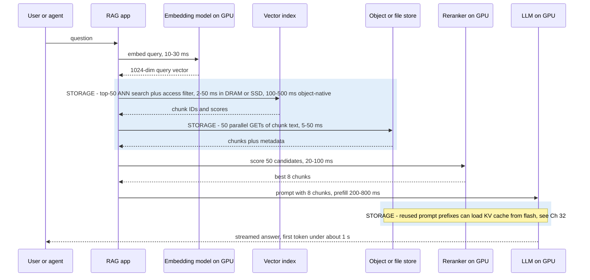
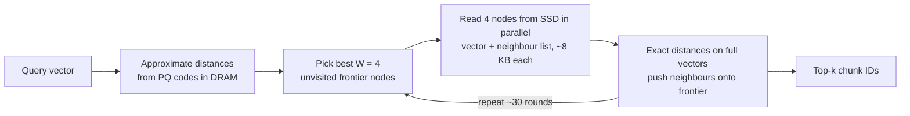
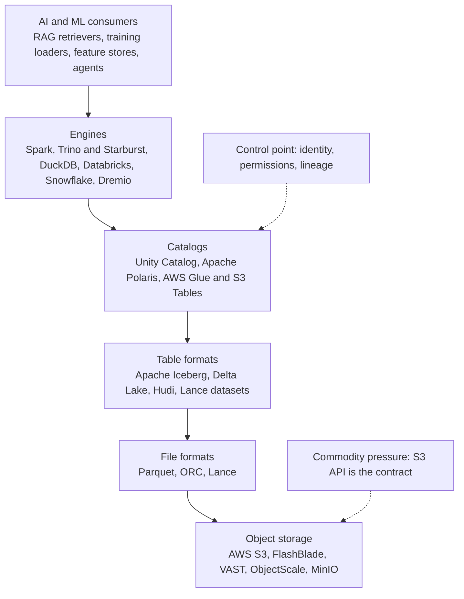
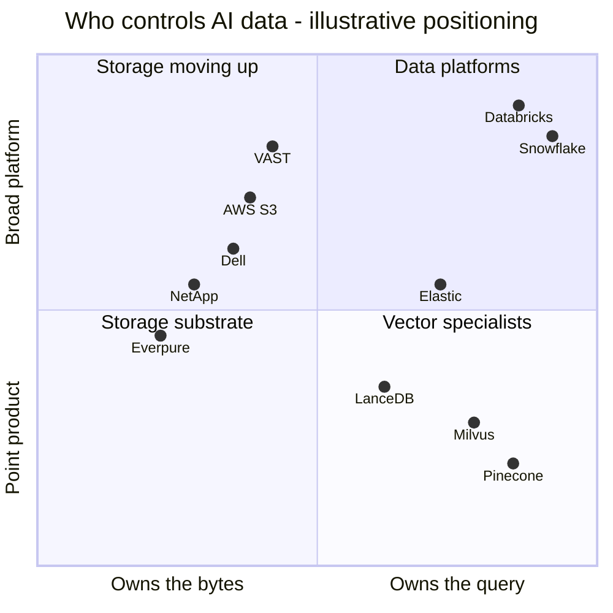
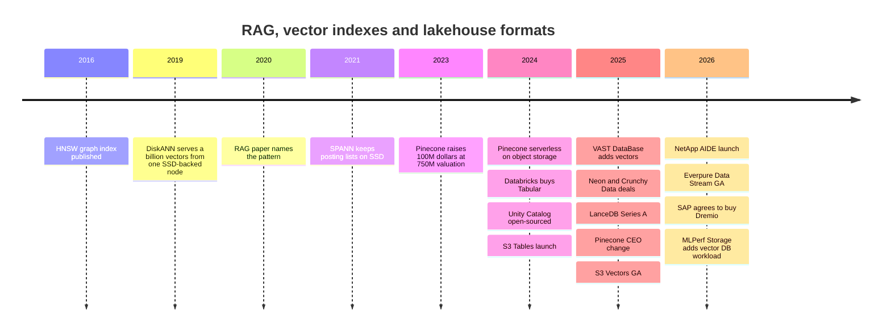

# 33. RAG, vector databases and AI-native data formats

> **Depth:** L2 · **Reading time:** ~10 min · **Last verified:** 2026-11-01
> **Prerequisites:** [Object storage and S3](../02-protocols-and-networking/09-object-storage-and-s3.md) · [Metadata](../03-system-architecture/21-metadata.md) · [The AI data pipeline end to end](30-ai-data-pipeline.md) · [Inference and KV cache](32-inference-and-kv-cache.md)

## TL;DR

- **RAG turns a company's documents into an LLM's working memory.** Chunks are embedded as vectors; at question time the closest chunks are pasted into the prompt. Storage sits on three steps: vector search, chunk fetch and, increasingly, KV-cache reuse.
- **Vector indexes are a memory-capacity problem.** One billion 1,024-dimension vectors are ~4.1 TB raw. Held in DRAM, that costs ~16× more media than an SSD-resident design such as DiskANN, so billion-scale indexes are moving to flash and object storage.
- **AI-native formats change the I/O pattern.** Parquet is built for scans; Lance for scans *and* random row reads (shuffled training, embeddings, multimodal blobs). Iceberg adds transactions and a catalog over plain files in object storage.
- **Every storage vendor now ships a "data engine".** VAST, NetApp, Dell, Everpure and AWS have all moved embedding, vector search or table management into or next to storage. Meanwhile vector search has become a *feature* of Postgres, Elastic, Databricks, Snowflake and S3 itself.
- **The strategic question is who owns the control point.** Bytes are replaceable; catalogs, metadata and governance are sticky. Value accrues to whoever owns the metadata and the query, unless the data cannot leave the building.

## Why this matters for Everpure strategy

Enterprise AI is mostly *inference over private data*, and RAG is the default way to connect the two. That creates a storage workload of small random reads against huge indexes, plus a lakehouse of Parquet, Lance and Iceberg files in S3 buckets. It also creates a land grab. AWS put vector search and Iceberg tables inside S3[^1][^2]. VAST added a vector-capable database[^3]. NetApp's AI Data Engine generates embeddings "at the storage layer"[^4], and Dell bundled Elastic and Starburst engines into its AI Data Platform[^5]. Everpure's answer is FlashBlade as substrate, Data Stream (ingest-to-vector pipeline, GA June 2026)[^6] and Data Intelligence (ex-1touch). Whether these moves capture value or merely defend share depends on a market where data platforms dwarf any storage vendor's data-services business: Databricks reported a >US$7 billion run-rate at a US$190 billion valuation (company-stated, August 2026)[^7], and Snowflake booked US$4.47 billion of FY2026 product revenue[^8].

## Core concepts

### Embeddings in one paragraph

An **embedding model** maps a chunk of text, an image or a video frame to a fixed-length vector, say 1,024 floats, trained so that similar meanings land close together. Similarity is then geometry: a cosine or dot product. For a semis reader, an embedding is a learned fingerprint, and search is a giant matrix-vector multiply (GEMV) against every stored vector, unless an index lets you skip most of them.

Embeddings can outweigh the source. A 512-token text chunk is about 2 KB (~4 bytes per token), but its 1,024-dim fp32 embedding is 4 KB. A 10 TB text corpus becomes ~5 billion chunks and ~20 TB of vectors, **twice the source**, before any index. For images and video the ratio flips.

### The RAG request path

RAG was named in a 2020 Facebook AI paper[^9]. Documents are chunked, embedded and indexed offline; at query time the system embeds the question, retrieves the nearest chunks and conditions the LLM on them.

*Figure 33.1 — Illustrative latency budget: in a well-built RAG stack, storage-bound steps take 10–30% of time-to-first-token, but a cold object-store index can make retrieval the single largest step.*

The budget is a worked illustration, not a benchmark. Object-native search ranges come from vendor documentation: Databricks quotes ~250 ms for storage-optimized endpoints[^10], AWS ~100 ms for frequently queried S3 Vectors indexes and sub-second otherwise[^11], and turbopuffer hundreds of milliseconds cold versus under 10 ms from its NVMe cache[^12]. The lesson: **retrieval is latency-bound, not bandwidth-bound**. Fifty 2 KB chunks is 100 KB, but each GET pays a full round trip: about a millisecond on all-flash object storage, tens of milliseconds on a disk-based cloud tier.

### Vector indexes: trading memory for recall

A *flat* scan of every vector is exact but O(N). **Approximate nearest neighbour (ANN)** indexes give up a few percent of *recall* (the share of true neighbours returned) for orders-of-magnitude speed-ups.

| Index | How it works | Memory footprint (1B × 1,024-dim) | Recall / latency | SSD-friendly? |
|---|---|---|---|---|
| Flat (brute force) | Scan every vector, often on GPU | 4.1 TB fp32, wherever it sits | 100% / seconds per query at 1B | Only as a sequential scan |
| IVF (inverted file) | Cluster vectors; probe the nearest few clusters | Centroids small; lists = full data | 90–98% tunable / ms if lists in RAM | Yes: clusters are contiguous reads (SPANN keeps lists on SSD[^13]) |
| HNSW (graph) | Multi-layer proximity graph; greedy walk | Vectors + ~264 B/vector of links ≈ 4.4 TB | 95–99% / ~1 ms in DRAM | Poor: one dependent random read per hop |
| DiskANN / Vamana | Flat graph on SSD; PQ codes in DRAM steer the walk | ~64 GB DRAM + ~4.4 TB SSD | >95% 1-recall@1, <3 ms on SIFT1B[^14] | Designed for it: beam search issues parallel 4 KB reads |
| PQ / binary quantization | Compress each vector to 8–128 B codes; ADC look-up tables | 64–128 GB for 1B | Lower alone; re-rank fixes it | Codes in RAM, originals on SSD |

*Table 33.1 — Index choice is a placement decision: which bytes must sit in DRAM and which can live on flash.*

**Worked example (the 4 TB problem).** 1 billion vectors × 1,024 dimensions × 4 bytes = 4.1 × 10¹² bytes ≈ **4.1 TB** raw. An HNSW graph (M = 32) adds up to 64 four-byte neighbour IDs per vector, ~264 GB. At ~US$14.5/GB for 2026 server DRAM[^15], an in-memory replica carries ~US$63,000 of DRAM. DiskANN keeps only 64-byte PQ codes in DRAM (64 GB, ~US$900) and the 4.4 TB graph on SSD at ~US$0.75/GB[^16] (~US$3,300). That is **~US$66k versus ~US$4k of media per replica**, before replicas for query throughput.

*Figure 33.2 — Worked example: moving the bulk of a billion-vector index from DRAM to flash cuts media cost per replica by roughly 16× at 2026 prices.*
Data: `data/ch33_vector_memory.csv`

### Why graph search on SSD works, and why it is pointer chasing

*Figure 33.3 — DiskANN hides SSD latency by issuing a small batch of reads per hop, the same trick an out-of-order core uses to keep several cache misses in flight.*

**Semiconductor bridge.** An HNSW walk is a linked-list traversal: the next address depends on data not yet loaded, so prefetchers cannot help and the walk is bound by *latency*. It is the irregular-access profile of graph analytics that caches handle badly. DiskANN's beam width W is memory-level parallelism. With ~30 dependent rounds at ~100 µs per NVMe read, a query takes ~3 ms, consistent with the paper. At 5,000 queries/s, 30 × 4 nodes × two 4 KB sectors is ~1.2 million random reads per second, within reach of a few data-centre NVMe SSDs. Behind a networked array adding ~0.5 ms per round trip, a query takes ~15 ms; behind a 20 ms object GET, ~600 ms. That is why object-storage-native engines (turbopuffer, Pinecone serverless) prefer **clustered** IVF/SPANN-style layouts, which need a few large reads instead of dozens of dependent small ones[^12][^17].

**PQ is weight quantization for vectors.** Product quantization splits a 1,024-dim vector into 64 sub-vectors and replaces each with a 1-byte codebook index: 4,096 bytes → 64 bytes. Distances come from table look-ups, as palettized or INT4 weights trade accuracy for memory in inference. The fix for lost accuracy is re-ranking top candidates with full-precision vectors from SSD. Elastic's "BBQ" pushes this to 1 bit per dimension and claims ~95% memory reduction[^18].

Production systems combine these. Milvus offers a DiskANN index[^19]; Pinecone serverless keeps immutable "slabs" in object storage, cached on executor SSDs[^17]; S3 Vectors scales to 2 billion vectors per index and 20 trillion per bucket[^1]. The direction is clear: **DRAM for steering, flash for the index, object storage for durability**.

### File formats: Parquet versus Lance

Parquet groups rows into large *row groups* and stores each column in compressed *pages* of roughly a megabyte. That suits scans, but fetching one row means decompressing a whole page per column. Reading 1 million random 4 KB embeddings that way could drag ~1 TB off storage to deliver 4 GB: 250× read amplification. It is the DRAM problem of activating a whole row to read one cache line.

**Lance**, an open columnar format from LanceDB's founders, adapts its encoding to the data's width. Wide values such as embeddings and image bytes are laid out so one row costs about one I/O; narrow values are packed into small blocks for fast scans. The authors' 2025 paper reports that tuned Parquet can get >60× better random access than its defaults, at a cost in scan speed and memory, and that Lance targets that random-read performance without those costs[^20]. Lance also versions datasets and adds columns (say, a new embedding model's output) without rewriting the table, suiting shuffled training loaders and RAG stores whose small random reads NVMe flash serves well. LanceDB raised a US$30 million Series A in June 2025 led by Theory Ventures, with Databricks Ventures participating, and positions itself as a "multimodal lakehouse"[^21] (*company-stated*).

### Table formats, catalogs and the lakehouse

A folder of Parquet files has no transactions, schema enforcement or safe concurrent writers. **Apache Iceberg** (like rivals Delta Lake and Hudi) adds a metadata tree: a table points to a snapshot, which lists manifests, which list data files with column statistics. A commit writes new files, then atomically swaps one pointer in a **catalog**. That compare-and-swap on a root pointer gives snapshot isolation, time travel and engine independence, and avoids slow LIST calls ([Chapter 9](../02-protocols-and-networking/09-object-storage-and-s3.md)). Iceberg v3 added deletion vectors and a variant type for semi-structured data[^22].

*Figure 33.4 — In a lakehouse, storage is the bottom layer behind a standard S3 contract; the catalog above it is where lock-in and governance concentrate.*

The catalog is the prize. In June 2024 Snowflake announced Polaris as an open Iceberg catalog, and a day later Databricks bought Tabular, founded by Iceberg's creators, for a reported US$1–2 billion[^23], then open-sourced Unity Catalog[^24]. In 2026 SAP agreed to buy Dremio to make its Business Data Cloud Iceberg-native[^25]. Storage's part is real but narrow: fast small-object GETs and PUTs, high LIST rates and, as S3 Tables showed (claimed up to 3× faster queries and 10× more transactions per second than self-managed Iceberg), automatic compaction of the small files streaming writers leave behind[^2].

## How Everpure approaches it vs. competitors

| Vendor | Storage layer | Vector / table layer it ships | Posture |
|---|---|---|---|
| Everpure | FlashBlade S3/NFS; Portworx for Kubernetes data services | Data Stream: ingest, curate, embed and index on the NVIDIA AI Data Platform design, GA June 2026[^6]; built-in vector DB with NeMo Retriever per a sponsored article[^26] [VERIFY: which vector engine Data Stream ships]; Data Intelligence with MCP[^27] | Storage plus pipeline and metadata; partners for engines |
| VAST Data | DASE all-flash ([Ch 16](../03-system-architecture/16-disaggregated-shared-everything.md)) | VAST DataBase with native vectors and InsightEngine (2025); claims trillion-vector scale (*company-stated*)[^3]; CNode-X GPUs run cuVS[^28] | Storage becoming a database |
| NetApp | ONTAP, AFX | AI Data Engine: Metadata Engine, Data Curator (embeddings and vector search APIs), Data Guardrails; lighthouse launch March 2026[^4][^29] | Metadata-first, inside ONTAP licensing |
| Dell | PowerScale, ObjectScale, Lightning FS | AI Data Platform: Data Search Engine (Elastic) and Data Analytics Engine (Starburst/Trino); cuVS hybrid search planned for H1 2026[^5] | Storage plus partner engines |
| AWS | S3 | S3 Vectors (GA Dec 2025, 2B vectors/index)[^1]; S3 Tables (managed Iceberg, Dec 2024)[^2] | Absorbs the database into the bucket |
| Pinecone | Object storage underneath (serverless)[^17] | Managed vector DB | Specialist under feature pressure |
| Milvus / Zilliz, Weaviate | Bring-your-own or cloud | Open-source vector DBs; DiskANN-type indexes[^19] | Specialist, open-source led |
| LanceDB | Any object store | Lance format plus vector/multimodal DB[^21] | Format-led |
| Elastic, pgvector | Local SSD / any | Vector search as a feature of search and Postgres[^18] | Incumbent databases absorbing vectors |
| Databricks, Snowflake | Customer's cloud object storage | Vector search, Iceberg/Delta, catalogs, Postgres (Neon, Crunchy Data)[^30] | Data platforms; own the catalog and the query |

*Table 33.2 — Storage vendors are moving up into pipelines and metadata while databases absorb vector search; the overlap is the contested ground.*

*Figure 33.5 — Illustrative judgment, not measured data: storage vendors cluster on the left and climb, data platforms own the upper right, and pure vector databases are squeezed from both sides.*

**Does value accrue to storage or to data vendors?** The steelman for data vendors is strong. Vector search became a feature within about two years, in Postgres, Elastic, Databricks, Snowflake and S3. The best-funded specialist, Pinecone (US$100 million Series B at a US$750 million valuation in 2023[^31]), replaced its founder-CEO in September 2025[^32] and was reported to be weighing options including a sale[^33] [VERIFY: date and status of the reported Pinecone sale exploration]. Revenue pools differ by an order of magnitude, and catalogs, not bytes, carry permissions and lineage ([Chapter 39](39-agentic-ai-and-data-intelligence.md)).

The steelman for storage vendors: most enterprise unstructured data sits on on-premises file and object systems, kept there by sovereignty or cost. Embedding it in place avoids the expensive copy, and SSD-resident indexes expand flash demand. Everpure read AWS's 2025 S3 moves as evidence that enterprise AI is converging on object storage[^34].

Options a strategy team might evaluate, based on public information: (1) make FlashBlade the best on-prem target for Iceberg and Lance, with managed compaction, published small-object and LIST performance, and results on MLPerf Storage v3.0's new vector-database workload[^35]; (2) partner with engines and catalogs rather than build a database, as Snowflake external tables on FlashBlade (2022) and Dremio briefs already did[^36]; (3) treat Data Intelligence's metadata as the control point that makes FlashBlade the system of record for *what the data is*; (4) watch format companies, where LanceDB's size makes it a partner- or investment-scale asset, not a platform bet.

## History and trajectory

*Figure 33.6 — Research ideas from 2016–2021 became products in 2024–2026, and the products then migrated from standalone databases into storage platforms and data platforms.*

The arc runs from DRAM-resident specialist databases (2019–2023), through storage-compute separation onto object stores (2024), to absorption (2025–2026), where vectors became a column type, a bucket type or a storage feature. Watch GPU-accelerated indexing (NVIDIA cuVS in VAST, Dell and the AI Data Platform, [Chapter 34](34-nvidia-ecosystem.md)) and IBM's 100-billion-vector demonstration on content-aware storage[^37], a scale only flash holds economically.

## Numbers that matter

| Metric | Value | Context | Source / date |
|---|---|---|---|
| Raw size, 1B × 1,024-dim fp32 vectors | ~4.1 TB | Plus ~264 GB for an HNSW graph (M = 32) | Worked example |
| Media cost per replica, HNSW-in-DRAM vs DiskANN | ~US$66k vs ~US$4k | DRAM ~$14.5/GB, SSD ~$0.75/GB | Worked example[^15][^16] |
| DiskANN on SIFT1B | >95% 1-recall@1, <3 ms mean, >5,000 QPS | 64 GB RAM workstation plus SSD | NeurIPS 2019[^14] |
| S3 Vectors scale | 2B vectors/index, 20T/bucket | GA Dec 2025; ~100 ms for hot queries | AWS via StorageNewsletter[^1][^11] |
| Storage-optimized vector search latency | ~250 ms | Databricks, >1B vectors at 768-dim | Databricks docs[^10] |
| BBQ memory reduction | ~95% | 1-bit vectors, int4 queries | Elastic, 2024-11[^18] |
| Tabular acquisition | US$1–2B (reported) | Iceberg creators' company | Blocks & Files, 2024-06[^23] |
| Databricks run-rate / valuation | >US$7B / US$190B | Company-stated, Aug 2026 | TheNextWeb[^7] |

## Conversation playbook

**Questions for a PM**

1. *"When a customer runs RAG on FlashBlade, where does the vector index live, and whose software is it?"* Strong: validated engines named, DRAM- or SSD-resident, who owns support, and where Data Stream ends and a partner begins.
2. *"Which engines read Iceberg on FlashBlade S3 in production, and how do our small-object GET latency and LIST rate compare with S3 Tables?"* Strong: named engines, measured numbers, a compaction view.
3. *"How does Data Intelligence's metadata make us harder to replace than an S3 endpoint?"* Strong: a concrete workflow (classification feeding RAG access filters) and Unity or Polaris integration.

**Questions for an engineer**

1. *"For a 1B-vector DiskANN index on FlashBlade, what is per-hop read latency and sustainable queries per second per chassis?"* Strong: µs, IOPS per TB, and the network round trip's effect on 30 dependent hops.
2. *"How do we serve Lance-style random reads and Parquet scans from one bucket without one starving the other?"* Strong: QoS, per-request overhead, small-I/O efficiency.
3. *"Where does embedding run in Data Stream, and what happens when the customer changes embedding model?"* Strong: GPU placement, re-embedding throughput, and versioned columns rather than full rewrites.

**Don't say this:**

- "Vector databases are a new storage tier." They are software indexes; storage holds their files.
- "RAG is bandwidth-hungry." Retrieval is latency-bound; ingest and re-embedding need the bandwidth.
- "HNSW runs fine on network storage." Each hop is a dependent read.
- "Iceberg is a storage product." It is a table format; the catalog, not the bucket, holds the power.
- "Quantization ruins recall." With full-precision re-ranking, 64× compression typically loses little.

## Going deeper (optional, L3 pointers)

- DiskANN (NeurIPS 2019) and SPANN (NeurIPS 2021): the canonical SSD-resident designs.
- Malkov and Yashunin, HNSW (arXiv 1603.09320); Jégou et al., product quantization (IEEE TPAMI, 2011).
- Pace et al., the Lance paper (arXiv 2504.15247); the Apache Iceberg v3 spec and REST catalog API.

## Key terms

- **Embedding** — fixed-length vector representing the meaning of a chunk of data.
- **ANN index** — approximate nearest-neighbour structure (IVF, HNSW, DiskANN).
- **Product quantization (PQ)** — compression into codebook indices.
- **Lance**, **Apache Iceberg**, **catalog** — see the [glossary](../glossary.md).

## Sources

[^1]: StorageNewsletter, "AWS re:Invent 2025: Amazon S3 Vectors is Now Generally Available with 40 Times the Scale of Preview," 2025-12-05. https://www.storagenewsletter.com/2025/12/05/aws-reinvent-2025-amazon-s3-vectors-is-now-generally-available-with-40-times-the-scale-of-preview/ (retrieved 2026-11-01).
[^2]: Amazon, "Amazon S3 Expands Capabilities with Managed Apache Iceberg Tables for Faster Data Lake Analytics…," press release, 2024-12-03. https://press.aboutamazon.com/2024/12/amazon-s3-expands-capabilities-with-managed-apache-iceberg-tables-for-faster-data-lake-analytics-and-automatic-metadata-generation-to-simplify-data-discovery-and-understanding (retrieved 2026-11-01).
[^3]: SiliconANGLE, "VAST Data adds vector search and serverless functions to its scalable data platform," 2025-03-12. https://siliconangle.com/2025/03/12/vast-data-adds-vector-search-serverless-functions-scalable-data-platform/ ; HPCwire, "VAST Data Expands AI Data Stack, Keeps Eye on North Star," 2026-02-25. https://www.hpcwire.com/2026/02/25/vast-data-expands-ai-data-stack-keeps-eye-on-north-star/ (both retrieved 2026-11-01).
[^4]: NetApp, "AI Data Engine architecture," NetApp documentation, n.d. https://docs.netapp.com/us-en/ai-data-engine/get-started/aide-architecture.html ; NetApp, "AIDE FAQ," n.d. https://docs.netapp.com/us-en/ai-data-engine/faq-aide.html (both retrieved 2026-11-01).
[^5]: Blocks & Files, "Dell expands AI Data Platform with search and analytics," 2025-10-22. https://www.blocksandfiles.com/ai-ml/2025/10/22/dell-expands-ai-data-platform-with-search-analytics/1607930 ; IT Brief UK, "Dell unveils major AI Data Platform upgrades with NVIDIA, Elastic," 2025-10. https://itbrief.co.uk/story/dell-unveils-major-ai-data-platform-upgrades-with-nvidia-elastic (both retrieved 2026-11-01).
[^6]: Everpure, "Everpure Announces Data Stream," press release, 2026-06-17. https://www.everpuredata.com/company/newsroom/press-releases/everpure-announces-data-stream.html ; HPCwire/BigDATAwire, "Everpure Announces Data Stream to Expand AI-Ready Data Offerings," 2026-06-17. https://www.hpcwire.com/bigdatawire/this-just-in/everpure-announces-data-stream-to-expand-ai-ready-data-offerings/ (both retrieved 2026-11-01).
[^7]: TheNextWeb, "Databricks closes $5 billion round at $190 billion valuation," 2026-08. https://thenextweb.com/news/databricks-closes-5-billion-round-at-190-billion-valuation (retrieved 2026-11-01).
[^8]: Snowflake Inc., "Form 10-K for fiscal year ended January 31, 2026," 2026-03. https://www.sec.gov/Archives/edgar/data/1640147/000164014726000008/snow-20260131.htm (retrieved 2026-11-01; figures seen via search summary of the filing).
[^9]: P. Lewis et al., "Retrieval-Augmented Generation for Knowledge-Intensive NLP Tasks," NeurIPS 2020 (arXiv 2005.11401), 2020-05. https://arxiv.org/abs/2005.11401 (retrieved 2026-11-01).
[^10]: Databricks, "Mosaic AI Vector Search" and "Vector Search performance guide," Databricks documentation, n.d. https://docs.databricks.com/aws/en/generative-ai/vector-search ; https://docs.databricks.com/aws/en/vector-search/vector-search-best-practices (both retrieved 2026-11-01).
[^11]: InfoQ, "AWS S3 Vectors reaches general availability," 2026-01. https://www.infoq.com/news/2026/01/aws-s3-vectors-ga (retrieved 2026-11-01; latency figure seen via search summary, consistent with AWS What's New 2025-12-02).
[^12]: turbopuffer, "turbopuffer: fast search on object storage," 2024-07-08. https://turbopuffer.com/blog/turbopuffer ; turbopuffer, "Introduction," documentation, n.d. https://turbopuffer.com/docs (both retrieved 2026-11-01).
[^13]: Q. Chen et al., "SPANN: Highly-efficient Billion-scale Approximate Nearest Neighbor Search," NeurIPS 2021 (arXiv 2111.08566). https://arxiv.org/abs/2111.08566 (retrieved 2026-11-01).
[^14]: S. Jayaram Subramanya et al., "DiskANN: Fast Accurate Billion-point Nearest Neighbor Search on a Single Node," NeurIPS 2019. https://papers.nips.cc/paper/2019/hash/09853c7fb1d3f8ee67a61b6bf4a7f8e6-Abstract.html (retrieved 2026-11-01).
[^15]: Counterpoint Research, "Memory Price Tracker, April 2026," 2026-04. https://counterpointresearch.com/de/reports/memory-price-tracker-april-2026 (retrieved 2026-11-01; ~$927 per 64 GB DDR5 RDIMM, seen via search summary).
[^16]: Hardware Busters, "Enterprise SSD Prices Now Run 18.6x Hard Drives, and the Cheap Alternative Is Sold Out Until 2027," 2026. https://hwbusters.com/news/enterprise-ssd-prices-now-run-18-6x-hard-drives-and-the-cheap-alternative-is-sold-out-until-2027/ (retrieved 2026-11-01; 30 TB TLC SSD at ~$22,600).
[^17]: Pinecone, "Pinecone Pods vs. Serverless: Migration Guide," n.d. https://www.pinecone.io/lp/pods-vs-serverless/ ; SiliconANGLE, "Pinecone's vector database goes serverless," 2024-01-16. https://siliconangle.com/2024/01/16/pinecones-vector-database-goes-serverless/ (both retrieved 2026-11-01).
[^18]: Elastic via Business Wire, "Elastic Introduces Better Binary Quantization Technique in Elasticsearch," 2024-11-11. https://www.businesswire.com/news/home/20241111128613/en/Elastic-Introduces-Better-Binary-Quantization-Technique-in-Elasticsearch (retrieved 2026-11-01).
[^19]: Alibaba Cloud, "Storage-Optimized Disk Index (DiskANN)," Milvus user guide, n.d. https://help.aliyun.com/en/milvus/user-guide/capacity-disk-index-diskann (retrieved 2026-11-01).
[^20]: W. Pace, C. She, L. Xu et al., "Lance: Efficient Random Access in Columnar Storage through Adaptive Structural Encodings," arXiv 2504.15247, 2025-04-21. https://arxiv.org/abs/2504.15247 (retrieved 2026-11-01; abstract seen via search summary).
[^21]: LanceDB, "LanceDB Raises $30M Series A to Build the Multimodal Lakehouse," 2025-06-24. https://www.lancedb.com/blog/series-a-funding ; AOL/Yahoo News, "LanceDB raises $30 million for multimodal AI data infrastructure," 2025-06. https://www.aol.com/news/lancedb-raises-30-million-multimodal-100430609.html (both retrieved 2026-11-01).
[^22]: Google Open Source Blog, "What's new in Apache Iceberg v3?," 2025-08. https://opensource.googleblog.com/2025/08/whats-new-in-iceberg-v3.html (retrieved 2026-11-01).
[^23]: Blocks & Files, "Databricks buys Tabular to win the Iceberg war," 2024-06-05. https://blocksandfiles.com/2024/06/05/databricks-buys-tabular-to-win-the-iceberg-war/ ; Starburst, "Snowflake, Databricks, Tabular and Iceberg," 2024-06. https://www.starburst.io/blog/snowflake-databricks-tabular-iceberg/ (both retrieved 2026-11-01).
[^24]: BigDATAwire, "Databricks to Open Source Unity Catalog," 2024-06-12. https://www.bigdatawire.com/2024/06/12/databricks-to-open-source-unity-catalog (retrieved 2026-11-01).
[^25]: Dremio, "SAP to Acquire Dremio to Unify SAP and Non-SAP Data to Power Agentic AI," 2026-05-04. https://www.dremio.com/newsroom/sap-to-acquire-dremio-to-unify-sap-and-non-sap-data-to-power-agentic-ai/ (retrieved 2026-11-01).
[^26]: Blocks & Files (sponsored), "How Everpure plans to stop AI from starving without data," 2026-09-15. https://www.blocksandfiles.com/ai-ml/2026/09/15/sponsored-how-everpure-plans-to-stop-ai-from-starving-without-data/5295582 (retrieved 2026-11-01).
[^27]: Blocks & Files, "Everpure bulks up AI offer," 2026-09-30. https://blocksandfiles.com/flash/2026/09/30/everpure-bulks-up-ai-offer/5300162 (retrieved 2026-11-01).
[^28]: Datacenter Dynamics, "VAST Data integrates AI OS into Nvidia GPU-powered servers," 2026-02-25. https://www.datacenterdynamics.com/en/news/vast-data-integrates-ai-os-into-nvidia-gpu-powered-servers/ (retrieved 2026-11-01).
[^29]: NetApp, "NetApp Accelerates Momentum in AI Leadership with NVIDIA," press release, 2026-03-16. https://www.netapp.com/en/newsroom/press-releases/news-rel-20260316-181478/ (retrieved 2026-11-01).
[^30]: The Register, "Snowflake and Databricks bank on PostgreSQL," 2025-06-10. https://www.theregister.com/2025/06/10/snowflake_and_databricks_bank_postgresql ; SiliconANGLE, "Snowflake buys Crunchy Data to add bite to AI agents," 2025-06-02. https://siliconangle.com/2025/06/02/snowflake-buys-crunchy-data-add-bite-ai-agents/ (both retrieved 2026-11-01).
[^31]: Pinecone via Business Wire, "Pinecone raises $100M Series B," 2023-04-27. https://www.businesswire.com/news/home/20230427005380/en (retrieved 2026-11-01).
[^32]: Pinecone, "Moving Pinecone forward with Ash Ashutosh as CEO and Edo spearheading our growing AI ambitions as Chief Scientist," 2025-09-08. https://www.pinecone.io/blog/growing-ai-ambitions/ ; VentureBeat, "Pinecone founder Edo Liberty steps aside as CEO," 2025-09. https://venturebeat.com/data-management/pinecone-founder-edo-liberty-steps-aside-as-ceo-and-appoints-googler-ash (both retrieved 2026-11-01).
[^33]: Calcalist (Ctech), report citing The Information on Pinecone weighing options, n.d. (2025). https://www.calcalistech.com/ctechnews/article/bjsgtha9gx (retrieved 2026-11-01; seen via search summary only).
[^34]: Everpure, "AWS re:Invent 2025: Five S3 Updates That Signal the Future of Enterprise AI Storage," 2025-12. https://blog.everpuredata.com/news-events/aws-reinvent-2025-future-of-enterprise-ai-storage/ (retrieved 2026-11-01).
[^35]: MLCommons via GlobeNewswire, "MLCommons Releases New MLPerf Storage v3.0 Benchmark Results," 2026-09-01. https://www.globenewswire.com/news-release/2026/09/01/3354412/0/en/mlcommons-releases-new-mlperf-storage-v3-0-benchmark-results.html (retrieved 2026-11-01).
[^36]: Blocks & Files, "Pure gets FlashBlade up close and cloud-adjacent co-lo personal with Snowflake," 2022-05-11. https://blocksandfiles.com/2022/05/11/pure-gets-flashblade-up-close-and-cloud-adjacent-co-lo-personal-with-snowflake/ ; Pure Storage, "Pure Storage and Dremio solution brief," n.d. https://www.purestorage.com/content/dam/pdf/en/solution-briefs/sb-pure-storage-dremio.pdf (both retrieved 2026-11-01).
[^37]: HPCwire, "IBM Demonstrates Extreme Scale for Content-Aware Storage with 100B Vector Database," 2026. https://www.hpcwire.com/off-the-wire/ibm-demonstrates-extreme-scale-for-content-aware-storage-with-100b-vector-database/ (retrieved 2026-11-01).
