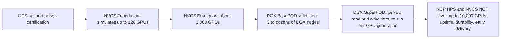
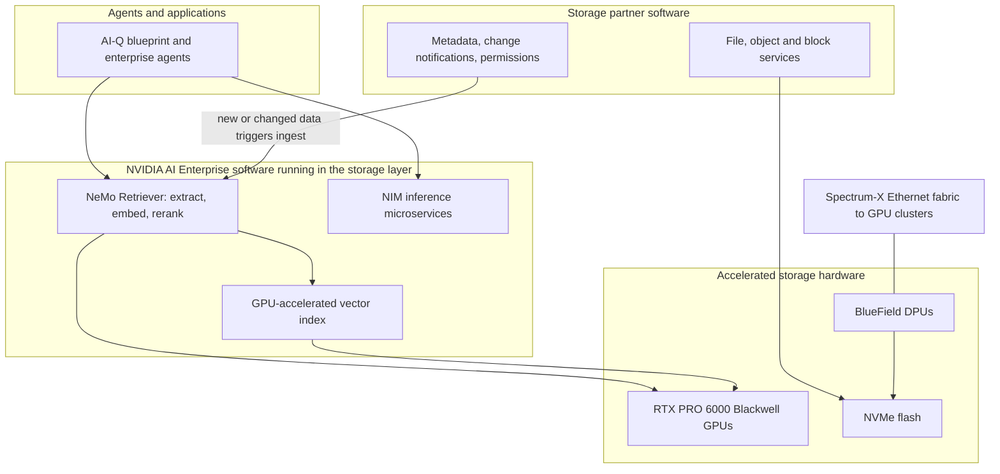
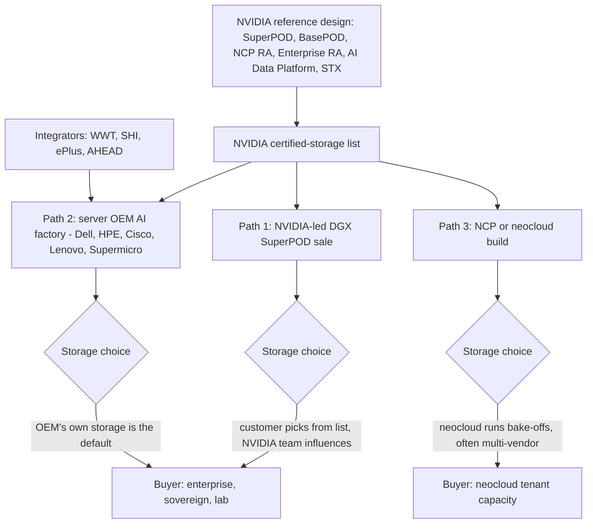
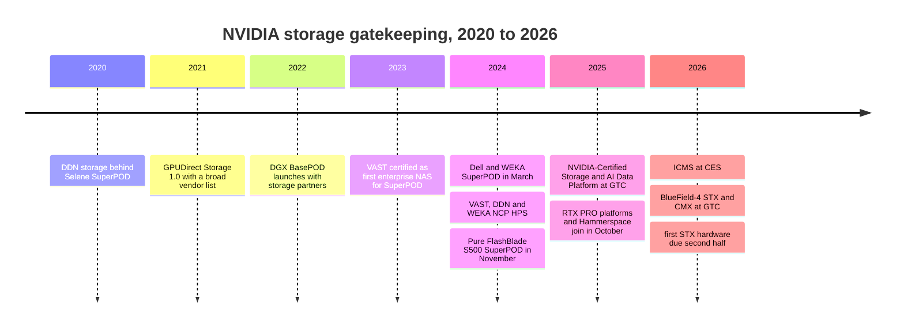

# 34. NVIDIA's ecosystem and certifications

> **Depth:** L2 · **Reading time:** ~10 min · **Last verified:** 2026-11-01
> **Prerequisites:** [Datacenter networking for storage](../02-protocols-and-networking/10-datacenter-networking.md) · [The GPU data path](../02-protocols-and-networking/11-gpu-data-path.md) · [Inference and KV cache](32-inference-and-kv-cache.md)

## TL;DR

- **NVIDIA runs the approved-vendor list for AI storage.** Each of its reference designs (BasePOD, SuperPOD, NVIDIA Cloud Partner, Enterprise) names storage that passed NVIDIA's tests. A vendor missing from the list is usually not in the deal.
- **The program is a set of tiers ordered by scale.** NVIDIA-Certified Storage has Foundation (up to 128 simulated GPUs), Enterprise (about 1,000) and NCP (up to 10,000) levels. SuperPOD certification adds per-GPU-generation throughput tiers. NCP certification adds cloud-grade uptime, durability and delivery-time rules.
- **Certification sets a floor. It does not rank vendors.** The SuperPOD B200 "enhanced" tier works out to under 0.5 GB/s of read per GPU. Around a dozen vendors pass it. Certification proves interoperability and minimum throughput. It says nothing about price, data reduction, operations or failure behaviour.
- **NVIDIA keeps moving into the storage box.** The AI Data Platform (2025) put GPUs and NVIDIA retrieval software inside storage. BlueField-4 STX and CMX (2026) standardize the KV-cache tier on NVIDIA silicon, with 12 storage vendors as co-design partners.
- **NVIDIA invests in some of the vendors it certifies.** It holds equity in VAST and WEKA, and DDN runs NVIDIA's own clusters. Everpure has every major certification for FlashBlade//S. It has none NVIDIA-granted yet for FlashBlade//EXA, and it has no NVIDIA equity tie.

## Why this matters for Everpure strategy

Storage is a small slice of an AI cluster's bill of materials, but the GPU vendor sets the architecture, picks the reference partners and often owns the customer conversation. For Everpure (NYSE: P, formerly PSTG), certification is the gate to compete; the competition happens after it. The strategic questions: how fast each new product clears NVIDIA's gates, how much deal flow runs through server OEMs that sell their own storage, and what happens to array economics if NVIDIA's reference storage (STX) absorbs functions storage software performs today.

The semiconductor parallel is close. Being on a foundry's IP ecosystem list (TSMC's Open Innovation Platform) or a reference board's approved vendor list does not win a socket, but being off it loses one. The platform owner also decides when the list is re-qualified: usually every product generation.

## Core concepts

### Five programs, one gatekeeper

NVIDIA publishes five overlapping structures that matter for storage:

1. **DGX BasePOD.** Enterprise clusters from two DGX nodes to dozens[^1]; storage partners pass a validation-and-approval process. Launched with storage partners in September 2022[^2].
2. **DGX SuperPOD.** NVIDIA's turnkey large cluster, built from 32-node scalable units (SUs). Each GPU generation's reference architecture publishes a storage performance table to certify against[^3].
3. **NVIDIA Cloud Partner (NCP) reference architectures.** GPU-cloud blueprints; storage earns "high-performance storage" (HPS) certification, and NCPs must meet NVIDIA's *Requirements for AI Clouds*[^4].
4. **NVIDIA-Certified Storage (NVCS).** Launched at GTC in March 2025 for enterprise AI factories on NVIDIA-Certified servers[^5], with Foundation, Enterprise and NCP levels[^6].
5. **AI Data Platform and STX.** Reference *designs* for what storage itself should contain, not test suites. NVCS is the prerequisite for building on the AI Data Platform[^5].

*Figure 34.1 — Each rung simulates or deploys more GPUs and adds tests; the programs are parallel, not formal prerequisites, but buyers read them as a ladder.*

### What the tests actually require

Most test details sit on partner portals. Three public anchors show the bar:

- **NVCS scale.** Foundation tests simulate workloads of up to 128 GPUs, Enterprise about 1,000 and NCP up to 10,000[^6] [VERIFY: search-summary only, Enterprise and NCP counts]. NVIDIA's framework covers training, fine-tuning, inference, KV cache and retrieval I/O profiles, including synchronous and asynchronous checkpoints[^6].
- **SuperPOD throughput.** The DGX B200 reference architecture asks, per 256-GPU SU, 40/20 GB/s read/write at "standard" and 125/62 GB/s at "enhanced", scaling linearly to four SUs[^3]. The B300 version asks 640 and 2,000 GB/s read for eight SUs[^7].
- **NCP operations.** High-speed file storage at roughly 99.5% uptime and 99.999% annual durability per PB, NFSv4 home directories, and storage live with API integration eight weeks *before* the GPUs arrive[^4] [VERIFY: thresholds quoted from v2.2; current is v2.4]. The detailed GB300 NVL72 storage design is on NVIDIA's non-public partner portal[^8].

**Worked example: how high is the floor?** Enhanced B200 read is 125 GB/s ÷ 256 GPUs ≈ **0.49 GB/s per GPU**; standard is 40 ÷ 256 ≈ 0.16 GB/s. NVIDIA's own guidance says read-dominant work (image or video training) wants about 4 GB/s per GPU[^3], eight times the enhanced tier, or ~1 TB/s per SU. WEKA claimed 720 GB/s of read from one eight-node WEKApod at its 2024 SuperPOD certification[^9], beating the four-SU enhanced target with a single small appliance. Certification tells a buyer the system won't starve a text-LLM training job; it does not separate the top vendors, who compete on everything else.

**What certification does and doesn't prove**

| Certification shows | Certification does not show |
|---|---|
| Interoperates with NVIDIA's stack (GDS, RDMA, Spectrum-X or InfiniBand, Base Command) | Price-performance, $/TB or power per TB |
| Meets a published throughput floor at a stated scale | Behaviour at 80% full, during rebuilds, or under mixed tenants |
| NVIDIA support and sales teams know the configuration | Effective capacity after data reduction |
| The vendor will re-qualify on the next GPU generation | Long-run reliability, upgrade disruption, operations staffing |
| Inclusion in reference bills of materials | Any ranking: the list is unordered and non-exclusive |

*Table 34.1 — Certification is a gate, not a grade. Everything in the right column is where deals are actually won (see [Chapter 37](37-reading-benchmarks.md) on reading benchmarks).*

### The AI Data Platform: NVIDIA's blueprint for the storage box itself

In March 2025 NVIDIA presented the AI Data Platform, a reference design that puts accelerated compute and AI agents into the storage layer so data is extracted, embedded and indexed where it lives rather than copied to a separate RAG pipeline. NVIDIA named ten launch partners, Pure Storage among them[^10]. The hardware recipe pairs RTX PRO 6000 Blackwell Server Edition GPUs with BlueField DPUs and Spectrum-X Ethernet. The software recipe is the AI-Q blueprint, which calls NeMo Retriever microservices for extraction and retrieval[^11]. Later implementations go further: Hammerspace's platform (GA March 2026) bundles NIM and NeMo Retriever[^12], and Everpure's Data Stream (June 2026) is an ingest-to-inference pipeline on the same design[^13].

*Figure 34.2 — NVIDIA supplies GPUs, DPUs, network and retrieval software; the partner's differentiated layer, data services and metadata, is the middle of the sandwich.*

The bargain cuts both ways: partners get a ready-made RAG answer ([Chapter 33](33-rag-vector-lakehouse.md)), NVIDIA gets GPUs and software subscriptions in every storage rack, and every partner's AI story converges on the same NVIDIA parts.

### STX and CMX: the reference storage server

NVIDIA went a step further at CES in January 2026 with the Inference Context Memory Storage platform, a BlueField-4-powered KV-cache tier inside each pod[^14]. At GTC in March 2026 it widened this into **BlueField-4 STX**, a modular storage reference architecture built on Vera Rubin, BlueField-4 and Spectrum-X. The first rack-scale implementation is the **CMX** context memory storage platform[^15]. Twelve storage vendors, including Everpure, VAST, WEKA, DDN, Dell and NetApp, are co-design partners; AIC, Supermicro and QCT build hardware; CoreWeave, Lambda, Nebius, OCI and four others are early adopters[^16]. STX is a blueprint NVIDIA distributes, not a box it sells[^17]. KV-cache mechanics are in [Chapter 32](32-inference-and-kv-cache.md), and the DPU's place in the network is in [Chapter 10](../02-protocols-and-networking/10-datacenter-networking.md).

The strategic point is where value moves. If the controller is a BlueField-4 running NVIDIA's DOCA software on ODM-built servers, storage software becomes a tenant on NVIDIA's controller silicon, as fabless designs build on a foundry's process and IP. One analyst firm argues vendors not optimized for inference and context memory face margin pressure as NVIDIA standardizes the data path, while noting those vendors are STX partners[^18]. Opinion, but the right risk.

### How deals flow through NVIDIA

*Figure 34.3 — Storage is chosen at three points: the certified list sets the field in NVIDIA-led deals, the OEM's own storage starts ahead in OEM deals, and neoclouds run their own tests.*

The paths have different economics. **Dell** bundles PowerScale, ObjectScale and its Lightning parallel file system into its AI Data Platform with NVIDIA[^19], so an independent vendor in a Dell-led deal starts behind. **HPE** sells its own X10000 alongside GreenLake for File, which runs VAST software[^20]. **Cisco** has no storage, so its Secure AI Factory with NVIDIA lists partners (Pure Storage, Hitachi Vantara, NetApp, VAST, later Nutanix)[^21], which is why Everpure's FlashStack CVD in the Cisco AI PODs matters[^22]. **Neoclouds** qualify several vendors: CoreWeave lists VAST, WEKA, DDN, IBM and Pure Storage[^23], and its US$1.17 billion VAST agreement shows how large one decision can be[^24]. See [Chapter 35](35-ai-factories-and-neoclouds.md).

### Kingmaker or toll booth? NVIDIA's investments

NVIDIA also invests in some listed vendors. It participated in VAST's 2021 Series D[^25] and its 2026 Series F at a US$30 billion valuation (*company-stated*)[^26]. Secondary sources also list NVIDIA in VAST's December 2023 Series E, but VAST's own release names other investors [VERIFY: NVIDIA in VAST Series E]. NVIDIA was in WEKA's US$140 million Series E in 2024 (*company-stated*)[^27]. DDN has no reported NVIDIA equity; its tie is operational, running NVIDIA's Selene and Eos clusters (Eos: 48 AI400X2 units, ~4 TB/s, *company-stated*)[^28]. No public evidence shows certifications favour NVIDIA's portfolio companies; the pass lists include almost everyone. The investments buy something less formal: early roadmap access, joint launches (VAST's CNode-X, February 2026) and the "NVIDIA-backed" label in every press article.

Read honestly, NVIDIA is less a kingmaker than a toll booth with favoured lanes. It rarely picks one winner; it sets the entry fee (re-certify every GPU generation, adopt each new NVIDIA interface) and profits from a crowded field of compliant suppliers. That is a platform owner commoditizing its complements.

## How Everpure approaches it vs. competitors

| Vendor | DGX SuperPOD | DGX BasePOD | NCP / HPS | NVIDIA-Certified Storage | AI Data Platform / STX |
|---|---|---|---|---|---|
| **Everpure** | FlashBlade//S500, Nov 2024[^29]; none found for EXA | Via Cisco FlashStack, Nov 2023[^22] | FlashBlade//S, HGX H200/B200, Mar 2025[^30] | FB//S500 Foundation + Enterprise, Mar 2025[^30]; EXA validation in progress, Mar 2026[^31] | ADP in FlashBlade (Mar 2025); Data Stream (Jun 2026)[^13]; STX partner |
| **VAST** | Yes, May 2023 (first enterprise NAS)[^32] | Earlier DGX POD RA [VERIFY] | HPS, Jul 2024[^33] | Listed (CNode, BlueField-3 DBox, EBox); level unverified[^34] | InsightEngine (ADP launch); STX partner |
| **WEKA** | WEKApod, Mar 2024; Nitro/Prime 2025[^9] | Yes (H100)[^35] | HPS, Sep 2024[^35] | Listed (WEKApod Nitro); level unverified[^34] | ADP launch; STX partner |
| **DDN** | Since DGX A100 era; runs Selene and Eos[^28] | Yes, 2022 RAs | HPS, Aug 2024[^36] | AI400X3 listed[^34] | Infinia (ADP launch); STX partner |
| **NetApp** | AFF A90, Mar 2025; EF600/BeeGFS earlier[^37] | AIPod | AFF A90, Mar 2025[^37] | AFF A90 and AFX listed[^34] | AIPod / AI Data Engine; STX partner |
| **Dell** | PowerScale F710, Mar 2024 (first Ethernet)[^38] | [VERIFY] | [VERIFY] | PowerScale F710 listed[^34] | Dell AI Data Platform[^19]; STX partner |
| **HPE** | None found [VERIFY] | GreenLake for File (VAST-based)[^20] | None found | X10000 Foundation, first object platform, Mar 2026[^39] | ADP launch; STX partner |
| **IBM** | Storage Scale System 6000, Aug 2024[^40] | Yes (IBM-stated)[^41] | Yes (IBM-stated)[^41] | Storage Scale System 3500/6000 listed[^34] | Storage Scale AI Data Platform; STX partner |
| **Hitachi Vantara** | Pursuing as of 2024; unconfirmed[^42] | Hitachi iQ, Jul 2024[^42] | None found | Listed; product unverified[^34] | ADP launch; STX partner |
| **Nutanix** | None found | None found | None found | Enterprise level, Jun 2026[^43] [VERIFY: date] | ADP launch; STX partner |
| **Hammerspace** | None | None | None | None as of Sep 2026[^44] | AIDP on NVIDIA reference design, GA Mar 2026[^12]; GDS self-certified Feb 2024 |

*Table 34.2 — Nearly every vendor holds nearly every badge; the differences are timing and product-line coverage. "None found" means no public source located, not confirmed absence.*

**Everpure's position.** FlashBlade//S holds the full set. The gap is FlashBlade//EXA, aimed at the largest AI and neocloud deals. In March 2026 Everpure said it was extending NVCS validation to EXA toward the NCP level and aligning EXA with STX[^31]. Until then, competitors can call EXA uncertified in exactly the deals it targets. Everpure's distinctive move is independent benchmarking: it submitted to MLPerf Storage v3.0 in September 2026, while VAST, WEKA and DDN did not[^45].

**Steelmanning the others.** DDN's claim is strongest: NVIDIA runs its own clusters on DDN, which no certificate matches. VAST and WEKA have equity ties and usually ship NVIDIA's new interfaces first. Dell and HPE own the server sale. Everpure's counter is what certification doesn't measure: Evergreen economics, power and density ([Chapter 38](38-power-and-density.md)) and enterprise data services.

**Options a strategy team might evaluate, based on public information:**

1. **Certification velocity as a KPI.** Treat "days from NVIDIA GPU launch to certified on each tier" as a product metric, with EXA at the NCP level as the near-term gap.
2. **Be an early STX/CMX implementer** so Purity's data services run on whatever controller NVIDIA standardizes, rather than defending x86 controllers.
3. **Diversify routes to market** beyond NVIDIA-led deals: Cisco, integrators, hyperscaler marketplaces, and non-NVIDIA accelerator and Ultra Ethernet ecosystems as hedges.
4. **Compete on what certificates don't measure**: independent benchmarks, effective $/TB, TB per watt and non-disruptive upgrades.
5. **Weigh a deeper NVIDIA commercial or equity tie** against the cost: dependence on one supplier's roadmap and less neutrality with AMD and hyperscaler buyers.

## History and trajectory

*Figure 34.4 — The gate has moved from "does your file system feed GPUs" (2020–2023), to "can you run inside a GPU cloud" (2024), to "will you build on NVIDIA's storage silicon" (2026).*

Supermicro has shown a prototype CMX server and is validating STX SSD requirements with Micron, Samsung and Phison, for 2H 2026 shipments[^46]. The 2027 signal: whether NCP designs make CMX-class context storage a required line item, and whether CMX nodes come from storage vendors or straight from ODMs.

## Numbers that matter

| Metric | Value | Context | Source / date |
|---|---|---|---|
| NVCS simulated scale | 128 / ~1,000 / 10,000 GPUs | Foundation / Enterprise / NCP levels | NVIDIA docs[^6], retrieved 2026-11 |
| SuperPOD B200 read, 1 SU | 40 GB/s standard; 125 GB/s enhanced | 256 GPUs per SU | NVIDIA B200 RA[^3] |
| Enhanced read per GPU | ≈0.49 GB/s | 125 ÷ 256; NVIDIA advises ~4 GB/s for read-heavy work | Worked example |
| SuperPOD B300 read, 8 SU | 640 / 2,000 GB/s | Standard / enhanced | NVIDIA B300 RA[^7] |
| NCP storage lead time | 8 weeks before GPUs | With API integration | NVIDIA AI Cloud requirements[^4] |
| STX co-design storage partners | 12 | Includes Everpure, VAST, WEKA, DDN | StorageNewsletter, 2026-03-17[^16] |
| VAST Series F valuation | US$30B | NVIDIA participated; company-stated | CNBC, 2026-04-22[^26] |
| WEKA Series E | US$140M at US$1.6B | NVIDIA participated; company-stated | WEKA, 2024-05-15[^27] |

## Conversation playbook

**Questions for a PM**

1. *"When will FlashBlade//EXA appear on NVIDIA's certified list, at which level, and which deals are we losing until then?"* Strong: a level, a GPU generation, a target quarter, and the deal types where the gap is used against EXA.
2. *"In a Dell- or HPE-led AI factory, how do we get in?"* Strong: separates customer-mandated storage from OEM default, cites Cisco and integrator routes, and sizes each path.
3. *"What does STX/CMX do to our bill of materials and gross margin?"* Strong: whether Purity runs on BlueField-4, who builds the hardware, and whether CMX is new revenue or cannibalizes array capacity.

**Questions for an engineer**

1. *"How much headroom do we have over the SuperPOD enhanced tier per SU, and what limits us first?"* Strong: a multiple (say 3× or 5×) and the first bottleneck (front-end ports, metadata, back-end fabric).
2. *"What did certification testing *not* exercise that customers hit in production?"* Strong: rebuild under load, full-system behaviour, multi-tenant QoS, upgrade under load.
3. *"What would it take to run our data path on a BlueField-4 controller?"* Strong: core-count and memory constraints, which Purity services fit on the DPU, and what stays on x86.

**Don't say this:**

- "We're NVIDIA-certified, so we're as good as VAST." Everyone is; it is the entry ticket.
- "SuperPOD certification proves top performance." It proves a floor of about 0.5 GB/s per GPU on B200 enhanced.
- "NVIDIA picks the storage winner." NVIDIA usually lists a dozen. OEMs, integrators and neocloud bake-offs decide most deals.
- "STX means NVIDIA is entering storage." It is a partner-built reference architecture; the risk is a commoditized controller, not an NVIDIA storage brand (yet).

## Going deeper (optional, L3 pointers)

- DGX SuperPOD reference architectures (B200, B300, GB200, Rubin), "Storage Architecture" sections.
- NVIDIA-Certified Storage docs: workload descriptions and the certified-systems list.
- NVIDIA *Requirements for AI Clouds*, storage chapter.
- Vendor RAs (Everpure's NCP design, IBM's SuperPOD guides) to compare node counts with NVIDIA's tiers.

## Key terms

- **DGX BasePOD / SuperPOD** — enterprise and large-cluster reference architectures.
- **Scalable unit (SU)** — the 32-node building block of a SuperPOD.
- **NCP / HPS** — NVIDIA Cloud Partner program, and its high-performance storage certification.
- **NVIDIA-Certified Storage** — tiered storage certification (Foundation, Enterprise, NCP).
- **AI Data Platform** — NVIDIA's reference design for GPU-accelerated retrieval inside storage.
- **BlueField-4 STX / CMX** — NVIDIA's storage reference architecture, and its context-memory rack implementation.
- **AI-Q, NeMo Retriever, NIM** — agent blueprint, retrieval and inference microservices.
- See the [glossary](../glossary.md) for the rest.

## Sources

[^1]: NVIDIA Docs, "DGX BasePOD Overview," n.d. https://docs.nvidia.com/dgx-basepod/reference-architecture-infrastructure-foundation-enterprise-ai/latest/dgx-basepod-overview.html (retrieved 2026-11-01; search-summary only).
[^2]: Blocks & Files, "Nvidia unveils DGX BasePOD and partners," 2022-09-21. https://blocksandfiles.com/2022/09/21/nvidia-basepod-storage-partners/ (retrieved 2026-11-01).
[^3]: NVIDIA Docs, "Storage Architecture — NVIDIA DGX SuperPOD Reference Architecture featuring DGX B200," Table 6, n.d.; PDF RA-11334-001. https://docs.nvidia.com/dgx-superpod/reference-architecture-scalable-infrastructure-b200/latest/storage-architecture.html (retrieved 2026-11-01; figures via search summary of the PDF, consistent with IBM's SuperPOD guide citing the same table: https://www-api.ibm.com/adobe/assets/urn:aaid:aem:9f7ef845-68b6-4092-8a4a-a0659d44267d/original/as/nvidia-dgx-superpod-with-ibm-storage-scale-and-ibm-storage-scale-system-6000-dgx-h100-h200-b200-b300.pdf).
[^4]: NVIDIA Docs, "NVIDIA Requirements for AI Clouds – Storage requirements," n.d. (v2.2 archive; current v2.4). https://docs.nvidia.com/dsx/ncp/nvidia-requirements-for-ai-clouds/storage-requirements (retrieved 2026-11-01).
[^5]: NVIDIA Blog, "Full Steam Ahead: NVIDIA-Certified Program Expands to Enterprise Storage for Faster AI Factory Deployment," 2025-03 (GTC 2025). https://blogs.nvidia.com/blog/nvidia-certified-enterprise-storage/ (retrieved 2026-11-01; search-summary only).
[^6]: NVIDIA Docs, "NVIDIA-Certified Storage," n.d. https://docs.nvidia.com/certification-programs/certified-storage/latest/nvidia-certified-storage.html (retrieved 2026-11-01; search-summary only; Foundation 128-GPU figure corroborated by Data Centre Magazine, June 2026, https://publication.datacentremagazine.com/data-centre-magazine-june-2026-issue-47/0520680001781516622/p96).
[^7]: NVIDIA Docs, "High Performance Storage Architecture — NVIDIA DGX SuperPOD with DGX B300 Systems (Quantum-X800)," Table 5, n.d. https://docs.nvidia.com/dgx-superpod/reference-architecture/scalable-infrastructure-b300-xdr/latest/storage-architecture.html (retrieved 2026-11-01; search-summary only).
[^8]: NVIDIA Docs, "Inference Provider Platform Requirements on GB300 NVL72 for NCPs," n.d. https://docs.nvidia.com/dsx/ncp/inference-provider-requirements/home (retrieved 2026-11-01).
[^9]: WEKA (PR Newswire), "WEKA Unveils Powerful AI-Native Data Platform Appliance for NVIDIA DGX SuperPOD with NVIDIA DGX H100 Systems," 2024-03-18. https://www.prnewswire.com/il/news-releases/weka-unveils-powerful-ai-native-data-platform-appliance-for-nvidia-dgx-superpod-with-nvidia-dgx-h100-systems-302091876.html ; AIwire/HPCwire, "WEKA Expands NVIDIA Integrations and Certifications," 2025-03-19. https://www.hpcwire.com/aiwire/2025/03/19/weka-expands-nvidia-integrations-and-certifications-unveils-augmented-memory-grid/ (retrieved 2026-11-01).
[^10]: NVIDIA Newsroom, "NVIDIA and Storage Industry Leaders Unveil New Class of Enterprise Infrastructure for the Age of AI," 2025-03-18. https://nvidianews.nvidia.com/news/nvidia-and-storage-industry-leaders-unveil-new-class-of-enterprise-infrastructure-for-the-age-of-ai (retrieved 2026-11-01).
[^11]: NVIDIA Blog, "Ready to Reason: Storage Leaders Build Infrastructure to Fuel AI Agents With NVIDIA AI Data Platform," 2025. https://blogs.nvidia.com/blog/storage-leaders-ai-data-platform-agents/ ; IT Brief UK, "NVIDIA unveils AI data platform with leading storage firms," 2025-03. https://itbrief.co.uk/story/nvidia-unveils-ai-data-platform-with-leading-storage-firms (retrieved 2026-11-01; search-summary only).
[^12]: Hammerspace (Business Wire), "Hammerspace Launches AI Data Platform Based on NVIDIA Reference Design – Available Now," 2026-03-16. https://secure.businesswire.com/news/home/20260316701813/en/Hammerspace-Launches-AI-Data-Platform-Based-on-NVIDIA-Reference-Design-Available-Now ; StorageNewsletter, "Hammerspace Hyperscale NAS Achieves GPUDirect Storage Self-Certification from Nvidia," 2024-02-26. https://www.storagenewsletter.com/2024/02/26/hammerspace-hyperscale-nas-achieves-gpudirect-storage-self-certification-from-nvidia/ (retrieved 2026-11-01).
[^13]: HPCwire/BigDATAwire, "Everpure Announces Data Stream to Expand AI-Ready Data Offerings," 2026-06-17. https://www.hpcwire.com/bigdatawire/this-just-in/everpure-announces-data-stream-to-expand-ai-ready-data-offerings/ (retrieved 2026-11-01).
[^14]: NVIDIA Newsroom, "NVIDIA BlueField-4 Powers New Class of AI-Native Storage Infrastructure for the Next Frontier of AI," 2026-01-05. https://nvidianews.nvidia.com/news/nvidia-bluefield-4-powers-new-class-of-ai-native-storage-infrastructure-for-the-next-frontier-of-ai (retrieved 2026-11-01).
[^15]: NVIDIA Investor Relations, "NVIDIA Launches BlueField-4 STX Storage Architecture With Broad Industry Adoption," 2026-03-16. https://investor.nvidia.com/news/press-release-details/2026/NVIDIA-Launches-BlueField-4-STX-Storage-Architecture-With-Broad-Industry-Adoption/default.aspx (retrieved 2026-11-01).
[^16]: StorageNewsletter, "Nvidia GTC 2026: Nvidia Launches BlueField-4 STX Storage Architecture With Broad Industry Adoption," 2026-03-17. https://www.storagenewsletter.com/2026/03/17/nvidia-gtc-2026-nvidia-launches-bluefield-4-stx-storage-architecture-with-broad-industry-adoption/ (retrieved 2026-11-01).
[^17]: VentureBeat, "Nvidia BlueField-4 STX adds a context memory layer to storage," 2026-03. https://venturebeat.com/data/nvidia-bluefield-4-stx-adds-a-context-memory-layer-to-storage-to-close-the (retrieved 2026-11-01; search-summary only).
[^18]: theCUBE Research, "Special Breaking Analysis: Nvidia moves even further down the stack — why STX signals a new battleground in storage for AI factories," 2026-03. https://thecuberesearch.com/special-breaking-analysis-nvidia-moves-even-further-down-the-stack-why-stx-signals-a-new-battleground-in-storage-for-ai-factories/ (retrieved 2026-11-01; search-summary only).
[^19]: Dell Newsroom, "Dell AI Data Platform with NVIDIA Supercharges Enterprise AI with Breakthrough Data Orchestration and Storage Innovations," 2026-03-16. https://www.dell.com/en-us/dt/corporate/newsroom/announcements/detailpage.press-releases~usa~2026~03~dell-ai-data-platform-with-nvidia-supercharges-enterprise-ai-with-breakthrough-data-orchestration-and-storage-innovations.htm (retrieved 2026-11-01).
[^20]: HPE Community, "HPE GreenLake for File Storage certified for NVIDIA DGX BasePOD," n.d. https://community.hpe.com/t5/around-the-storage-block/hpe-greenlake-for-file-storage-certified-for-nvidia-basepod-with/ba-p/7217368 ; HPE, "HPE GreenLake for File Storage," n.d. https://www.hpe.com/data/hpe-greenlake-file-storage (retrieved 2026-11-01).
[^21]: StorageNewsletter, "Cisco to Deliver Secure AI Infrastructure with NVIDIA," 2025-03-20. https://www.storagenewsletter.com/2025/03/20/cisco-to-deliver-secure-ai-infrastructure-with-nvidia/ ; Cisco, "Cisco Secure AI Factory with NVIDIA," n.d. https://www.cisco.com/site/us/en/solutions/artificial-intelligence/secure-ai-factory/ (retrieved 2026-11-01).
[^22]: StorageNewsletter, "Pure Storage and Cisco Deliver AI Factories for the Enterprise with Nvidia," 2025-11-07. https://www.storagenewsletter.com/2025/11/07/pure-storage-and-cisco-deliver-ai-factories-for-the-enterprise-with-nvidia/ ; Blocks & Files, "Pure Storage gets new Cisco FlashStack for AI certification added to Nvidia BasePOD validation," 2023-11-13. https://blocksandfiles.com/2023/11/13/pure-storage-gets-new-cisco-flashstack-for-ai-certification-added-to-nvidia-basepod-validation/ (retrieved 2026-11-01).
[^23]: CoreWeave, "Storage," n.d. https://coreweave.com/products/storage (retrieved 2026-11-01).
[^24]: Blocks & Files, "VAST Data lands $1.17 billion CoreWeave deal," 2025-11-06. https://www.blocksandfiles.com/ai-ml/2025/11/06/vast-data-lands-117-billion-coreweave-deal/1608868 (retrieved 2026-11-01).
[^25]: StorageNewsletter, "Vast Data Raised $83 Million, Total Reaching $263 Million," 2021-05-05. https://www.storagenewsletter.com/2021/05/05/vast-data-raised-83-million-total-reaching-263-million/ (retrieved 2026-11-01).
[^26]: CNBC, "Nvidia backs AI company Vast Data at $30 billion valuation," 2026-04-22. https://www.cnbc.com/2026/04/22/nvidia-backs-ai-company-vast-data.html ; Blocks & Files, "VAST Data raises $1B at $30B valuation as AI storage demand surges," 2026-03-11. https://www.blocksandfiles.com/flash/2026/03/11/vast-data-raises-1b-at-30b-valuation-as-ai-storage-demand-surges/5208106 (retrieved 2026-11-01).
[^27]: WEKA, "WEKA Nets $140M in Series E Funding at $1.6B Valuation," 2024-05-15. https://www.weka.io/news/weka-nets-140m-in-series-e-funding-at-1-6b-valuation (retrieved 2026-11-01).
[^28]: DDN, "DDN Delivers 4 Terabytes/Second of Accelerated Storage Performance in Groundbreaking NVIDIA Eos AI Supercomputer," 2024-03. https://www.ddn.com/press-releases/ddn-delivers-4-terabytes-second-of-accelerated-storage-performance-in-groundbreaking-nvidia-eos-ai-supercomputer/ ; insideHPC, "HPC at Scale Enabled by DDN A3i and NVIDIA SuperPOD," 2020-04. https://insidehpc.com/2020/04/hpc-at-scale-enabled-by-ddn-a3i-and-nvidia-superpod/ (retrieved 2026-11-01).
[^29]: Blocks & Files, "Pure Storage's FlashBlade//S500 gains Nvidia SuperPOD certification," 2024-11-18. https://www.blocksandfiles.com/ai-ml/2024/11/18/pure-storages-flashblade/s500-gains-nvidia-superpod-certification/1598641 (retrieved 2026-11-01).
[^30]: Blocks & Files, "Pure Storage expands AI capabilities with Nvidia certification," 2025-03-19. https://www.blocksandfiles.com/ai-ml/2025/03/19/pure-storage-expands-ai-capabilities-with-nvidia-certification/1595136 ; Pure Storage, "Pure Storage Integrates NVIDIA AI Data Platform into FlashBlade to Fuel Enterprise AI Innovation," 2025-03. https://investor.everpuredata.com/news-and-events/press-releases/press-release-details/2025/Pure-Storage-Integrates-NVIDIA-AI-Data-Platform-into-FlashBlade-to-Fuel-Enterprise-AI-Innovation/default.aspx (retrieved 2026-11-01).
[^31]: StorageReview, "Everpure aligns FlashBlade//EXA with NVIDIA AI factory architectures, previews Data Stream," 2026-03. https://www.storagereview.com/news/everpure-aligns-flashblade-exa-with-nvidia-ai-factory-architectures-previews-data-stream (retrieved 2026-11-01; search-summary only).
[^32]: VAST Data (Business Wire), "VAST Data Achieves NVIDIA DGX SuperPOD Certification," 2023-05-17. https://www.businesswire.com/news/home/20230517005089/en ; Blocks & Files, "VAST Data goes certifiably SuperPODding," 2023-05-17. https://blocksandfiles.com/2023/05/17/vast-data-goes-certifiably-superpodding/ (retrieved 2026-11-01).
[^33]: Intelligent CIO, "VAST Data achieves high-performance storage solution certification," 2024-07-10. https://www.intelligentcio.com/north-america/2024/07/10/vast-data-achieves-high-performance-storage-solution-certification/ (retrieved 2026-11-01).
[^34]: NVIDIA Docs, "List of NVIDIA-Certified Storage Systems," n.d. https://docs.nvidia.com/certification-programs/certified-storage/latest/systems-list.html (retrieved 2026-11-01; search-summary only; per-level detail not visible).
[^35]: WEKA, "WEKA Achieves NVIDIA Cloud Network Partner Certification," 2024-09-25. https://www.weka.io/news/weka-achieves-nvidia-cloud-network-partner-certification ; WEKA, "WEKA and NVIDIA DGX BasePOD reference architecture," n.d. https://weka.io/resources/reference-architecture/weka-and-nvidia-dgx-basepod (retrieved 2026-11-01).
[^36]: Blocks & Files, "DDN gets Nvidia nod to supply storage to GPU-serving cloud partners," 2024-08-21. https://www.blocksandfiles.com/ai-ml/2024/08/21/ddn-gets-nvidia-nod-to-supply-storage-to-gpu-serving-cloud-partners/1590712 (retrieved 2026-11-01).
[^37]: HPCwire/BigDATAwire, "NetApp Validated for NVIDIA DGX SuperPOD, Cloud Partners and Certified Systems," 2025-03-18. https://www.hpcwire.com/bigdatawire/this-just-in/netapp-validated-for-nvidia-dgx-superpod-cloud-partners-and-certified-systems/ (retrieved 2026-11-01).
[^38]: Dell Technologies, "PowerScale: World's First Ethernet Storage Certified on NVIDIA SuperPOD," 2024-03. https://www.dell.com/fr-ca/blog/powerscale-worlds-first-ethernet-storage-certified-on-nvidia-superpod/ (retrieved 2026-11-01).
[^39]: HPE Newsroom, "HPE accelerates secure, scalable production-ready AI through new innovations with NVIDIA," 2026-03-16. https://www.hpe.com/us/en/newsroom/press-release/2026/03/hpe-accelerates-secure-scalable-production-ready-ai-through-new-innovations-with-nvidia.html (retrieved 2026-11-01).
[^40]: IBM Community, "IBM Storage Scale System 6000 receives NVIDIA DGX SuperPOD certification," 2024-08-29. https://community.ibm.com/community/user/blogs/mike-kieran/2024/08/29/ibm-storage-scale-system-6000-receives-nvidia-dgx (retrieved 2026-11-01).
[^41]: IBM Community, "Introducing IBM Storage Scale 6.0.1 and Storage Scale System 7.0.1: An AI-Ready Data Platform," 2026-06-08. https://community.ibm.com/community/user/blogs/mike-kieran/2026/06/08/introducing-ibm-storage-scale-601-and-storage-scal (retrieved 2026-11-01).
[^42]: Hitachi, "Hitachi Vantara achieves NVIDIA DGX BasePOD certification" (press release), 2024-07-29. https://www.hitachi.com/en/press/articles/2024/07/0729/ ; Blocks & Files, "How Nvidia assesses SuperPOD AI storage performance," 2024-09-03. https://www.blocksandfiles.com/ai-ml/2024/09/03/how-nvidia-assesses-superpod-ai-storage-performance/1612775 (retrieved 2026-11-01).
[^43]: HPCwire/BigDATAwire, "Nutanix Unified Storage Achieves NVIDIA Certification as Enterprises Race to Build AI Factories," 2026-06. https://www.hpcwire.com/bigdatawire/this-just-in/nutanix-unified-storage-achieves-nvidia-certification-as-enterprises-race-to-build-ai-factories/ (retrieved 2026-11-01).
[^44]: StorageReview, "Best Storage Arrays 2026: AI Storage Leaders and Audited Results," updated 2026-09-01. https://www.storagereview.com/best/storage-arrays (retrieved 2026-11-01).
[^45]: MLCommons, "MLCommons Releases New MLPerf Storage v3.0 Benchmark Results," 2026-09-01. https://mlcommons.org/2026/09/mlperf-storage-v3-0-results/ (retrieved 2026-11-01).
[^46]: MLQ.ai, "NVIDIA Launches BlueField-4 STX Storage Architecture at GTC 2026, Supermicro Among First to Build CMX Server," 2026-03. https://mlq.ai/news/nvidia-launches-bluefield-4-stx-storage-architecture-at-gtc-2026-supermicro-among-first-to-build-cmx-server/ (retrieved 2026-11-01).
