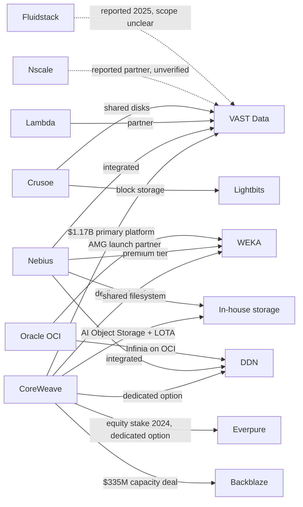
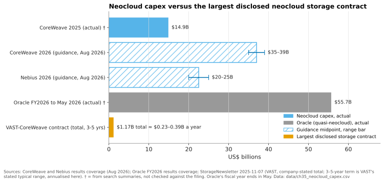

# 35. AI factories and neoclouds

> **Depth:** L2 · **Reading time:** ~10 min · **Last verified:** 2026-11-01
> **Prerequisites:** [The GPU data path](../02-protocols-and-networking/11-gpu-data-path.md) · [Consumption models](../03-system-architecture/23-consumption-models.md) · [Training storage](31-training-storage.md) · [NVIDIA's ecosystem and certifications](34-nvidia-ecosystem.md)

## TL;DR

- **Neoclouds are GPU-specialist clouds that rent accelerator capacity to AI labs, enterprises and even hyperscalers.** The leaders now operate at utility scale: CoreWeave ended 2025 with more than 850 MW of active power in 43 data centres[^1] and guides 2026 capex to US$35–39 billion[^2].
- **They buy storage as a product to resell, not as infrastructure to consume.** It must be multi-tenant, API-provisioned and metered in $/GB-month, and it must clear a margin over its own cost.
- **The largest disclosed storage contract is about 1% a year of its customer's capex, and storage is about 4% of a GPU row's power, but it can idle 100% of the GPUs.** Neoclouds therefore weight reliability, time-to-deploy and NVIDIA alignment above price.
- **VAST is the incumbent of record.** Its US$1.17 billion CoreWeave agreement is the largest disclosed deal[^3]. WEKA and DDN hold multi-vendor positions, and the biggest neoclouds increasingly build their own object tier.
- **Everpure is a challenger here.** It has a CoreWeave equity stake, small FlashBlade//EXA neocloud wins and a fitting consumption model, but no large anchor account.

## Why this matters for Everpure strategy

Neoclouds are the fastest-growing new class of storage buyer, and they buy differently from the enterprises that built Everpure's franchise. CoreWeave alone had a backlog of roughly US$104 billion in August 2026[^2]. The storage chosen there shapes reference designs, benchmarks and buyer expectations far beyond their own data centres. VAST's rise ([Chapter 42](../06-industry-and-competition/42-vast-data.md)) is in large part a neocloud story.

The strategic question is which neocloud business is worth winning. Mega-neocloud deals are huge, concentrated and increasingly contested by in-house builds. Tier-2, sovereign and inference neoclouds are smaller, more numerous and less locked up. Each needs a different product, pricing and financing posture.

## Core concepts

### Neoclouds, AI factories and the foundry analogy

An **AI factory** is NVIDIA's term for a data centre whose output is tokens: GPUs, networks, storage and software designed as one production line. A **neocloud** rents out such factories. It sells bare-metal or Kubernetes/Slurm GPU clusters by the hour or under multi-year take-or-pay contracts, to labs, start-ups, enterprises and capacity-short hyperscalers. Microsoft's contract with Nebius is worth about US$17.4 billion[^4].

The semiconductor bridge is the foundry model. Hyperscalers resemble IDMs: they design their own storage stacks ([Chapter 36](36-hyperscaler-ai-storage.md)), much as an IDM runs its own process. Neoclouds resemble a young pure-play foundry: they buy tools and compete on capacity, time-to-volume and yield (here, utilisation). They adopt whatever tool the reference flow qualifies, and NVIDIA Cloud Partner (NCP) reference designs play the role of the PDK. A storage vendor outside the qualified flow rarely gets evaluated.

Scale has moved fast. CoreWeave reported a fleet of about 250,000 GPUs and 360 MW of active power at its 2025 IPO[^5]. It ended 2025 with more than 850 MW active and about 3.1 GW contracted[^1]. By June 2026 it had about 1.5 GW active and 3.7 GW contracted, and it targets more than 1.85 GW active by end-2026[^6][^2]. Nebius raised its end-2026 contracted-power target to 5 GW in August 2026; contracted power means land and power commitments, not running capacity, and Nebius expects 0.8–1 GW connected by then[^7]. Oracle acts as a quasi-neocloud: its remaining performance obligations passed US$455 billion in fiscal Q1 2026[^8]. Fluidstack is building data centres for Anthropic's US$50 billion programme[^9].

### Anatomy of an AI-factory row

*Figure 35.1 — In an AI-factory row, storage is a small slice of racks and power on its own network, yet every GPU depends on it for data, checkpoints and context.*

A liquid-cooled GB200 NVL72 rack joins 72 GPUs by NVLink into one scale-up domain and draws roughly 120 kW (vendor ratings up to 130 kW)[^10][^11]. Eight of them make a 576-GPU unit drawing about 1 MW. Three networks leave the row:

- **Back-end compute fabric** (InfiniBand or Spectrum-X Ethernet) carries GPU-to-GPU collectives between racks. Storage normally stays off it.
- **Storage network** (Ethernet with RoCE) carries training reads, checkpoints and KV-cache spill. It is often converged with the front-end on the same NICs or DPUs.
- **Front-end network** carries tenant access, APIs, dataset ingest and management.

How much storage does the row need? Reference designs disagree. Cisco's NCP high-performance storage design sizes 180 GB/s of read for 1,152 GPUs, about 0.16 GB/s per GPU [VERIFY: search-summary only][^12]. WEKA's NCP-certified designs cite roughly 1 GB/s per GPU[^13]. For our 576 GPUs that is 90–576 GB/s, a sixfold spread. The gap is mostly checkpoint bursts and tolerated write stall ([Chapter 31](31-training-storage.md)). NVIDIA's NCP requirements add an operational bar: end-to-end uptime above 99.5% per PB for the high-speed file system, an NFSv4 shared home-directory tier held to a higher (99.99%) availability target, and a readiness timeline in which data-movement systems must be in place about eight weeks before GPU handover[^14].

### How a neocloud buys differently from an enterprise

**1. Storage is resold, so it is priced per GB-month.** CoreWeave lists Distributed File Storage at US$0.07/GB-month. Its AI Object Storage is US$0.06 hot, US$0.03 warm and US$0.015 cold, with no egress or request fees[^15]. US$0.07/GB-month is US$840 per TB-year. Assume, for illustration only, an all-in cost of US$1,000 per usable TB over four years. At list price and 100% sold, revenue is US$3,360 against US$1,000 of cost, a 70% gross margin. At 50% sold the margin falls to about 40%, and at 30% sold it is roughly breakeven. **The neocloud's storage P&L is a utilisation business.** Hence the premium on thin provisioning, data reduction and capacity-on-demand pricing. An enterprise sees only the US$1,000.

**2. Multi-tenancy is the product.** An enterprise array serves one company with trusted administrators. A neocloud serves hundreds of tenants who must not see each other's data or noisy I/O. That means hard isolation (namespaces, VRF separation, per-tenant keys), QoS, quotas, metering and self-service APIs. Crusoe, for example, exposes VAST-backed shared disks through its API, CLI and Terraform[^16].

**3. Reliability and time-to-deploy beat price.** Storage is a rounding error in neocloud capex. The VAST–CoreWeave agreement is US$1.17 billion over what VAST describes as typical 3–5-year terms[^17], or about US$0.23–0.39 billion a year. Against CoreWeave's US$35–39 billion of 2026 capex that is roughly 0.6–1.1% (Figure 35.3). Yet a storage outage idles every GPU attached to it ([Chapter 11](../02-protocols-and-networking/11-gpu-data-path.md) prices GPU idle time). Blocks & Files summarised the neocloud view: reliability beats storage price because GPU downtime costs far more[^18].

**4. Power per rack is the binding constraint.** Using the Figure 35.1 assumptions, three storage racks at about 15 kW draw 45 kW. That equals 45 ÷ 125 ≈ 0.36 of an NVL72 rack, about 26 GPUs' worth of power. Where contracted megawatts cap revenue, TB/W and TB per rack matter even when storage $/TB does not ([Chapter 38](38-power-and-density.md)).

**5. NVIDIA alignment is the entry ticket.** Neoclouds want storage certified at NVIDIA's NCP tier and present in NCP reference designs ([Chapter 34](34-nvidia-ecosystem.md)). They also want it on NVIDIA's roadmap: CoreWeave, Crusoe, Lambda, Nebius, OCI and others are named early adopters of the BlueField-4 STX context-memory architecture[^19]. And buyers rank neoclouds with SemiAnalysis's ClusterMAX ratings, whose ten criteria include storage[^20].

**6. Software-defined is preferred.** Large neoclouds want storage on the same qualified servers, spares and automation as their compute. WEKA, for example, runs natively on Nebius's servers[^21]. Appliances win when they are the fastest route to a certified configuration.

**7. Financing shapes the deal.** Neoclouds fund GPUs with debt secured on customer contracts, plus customer prepayments and convertible bonds. Nebius expects more than US$9 billion of customer prepayments in 2026, covering roughly 50–60% of the capex on the related deals[^7]. It also priced US$2.75 billion of convertible notes in September 2025, up to about US$3.16 billion if the purchasers' option was exercised in full[^22]. Vendors are asked to match with consumption pricing or deferred payments, and they take counterparty risk.

| Criterion | Why it matters to a neocloud | Architectures that score well |
|---|---|---|
| Hard multi-tenancy and QoS | Hundreds of tenants share a cluster; a noisy or leaky neighbour is a lost customer | VAST (built-in tenancy); WEKA; FlashBlade//EXA since 2026 multi-tenancy/QoS release[^23] |
| API/Terraform provisioning and metering | Storage is sold self-service and billed per GB-month | In-house object stores; VAST; WEKA |
| Throughput per rack and per watt | Power caps revenue; checkpoint bursts set sizing | Disaggregated flash (VAST, FlashBlade//EXA); DDN appliances for raw GB/s |
| NVIDIA NCP certification and STX roadmap | Entry ticket to reference designs and NVIDIA-led deals | VAST, WEKA, DDN, Everpure, IBM, NetApp all pursue it[^19] |
| Runs on the neocloud's own hardware | One supply chain, spares pool and automation stack | Software-defined (WEKA, VAST software, Lightbits, in-house) |
| Time-to-deploy at scale | Storage readiness milestones run weeks ahead of GPU handover; revenue starts at handover | Vendors with pre-validated racks and field teams at scale |
| Consumption pricing and financing | Matches debt- and prepayment-funded capex | Subscription models (Evergreen//One, VAST/WEKA licences) |
| Hybrid tiering to cheap capacity | Margin on cold data, free-egress positioning | Object-native designs; cloud capacity partners (Backblaze) |

*Table 35.1 — Neocloud buying criteria: price per TB matters less than tenancy, power, NVIDIA alignment and speed, which favours software-defined, disaggregated designs.*

### Who supplies whom

*Figure 35.2 — VAST touches every large neocloud, but the biggest buyers run several vendors in parallel plus their own object tier; dashed edges are reported but not confirmed by both parties.*

Edge sources: CoreWeave (its storage page also lists IBM Storage Scale)[^24][^25][^3][^26][^27]; Nebius[^21][^28][^29][^30]; Lambda and Crusoe[^31][^16][^32]; OCI[^33][^34]. Nscale appears only in a Next Platform list of VAST partners[^35]; Fluidstack's 2025 VAST deal may not cover the Anthropic sites[^36]. Together AI has disclosed no storage vendor [VERIFY: Together AI storage vendor].

### The build-it-yourself threat

The largest neoclouds are copying the hyperscaler playbook. CoreWeave's AI Object Storage runs **LOTA** (Local Object Transport Accelerator), a cache on every GPU node's local NVMe, and claims up to 7 GB/s per GPU[^25]. Nebius's own shared filesystem now has validated cluster sizes of 100 PB [VERIFY: search-summary only][^30]. The emerging pattern is in-house object for bulk data, third-party file for the hottest tier and a cheap partner for capacity, such as CoreWeave's five-year, multi-exabyte deal with Backblaze, which supplies HDD-based tiers behind CoreWeave AI Object Storage (about US$335 million over the initial orders)[^27]. Vendors keep the performance tier only while measurably better than a commodity-flash build, the dynamic that led Everpure to license DirectFlash to Meta rather than sell arrays[^37] ([Chapter 29](../04-everpure/29-hyperscaler-ecosystem-financials.md)).

*Figure 35.3 — The largest disclosed neocloud storage deal is about 1% a year of its customer's capex, which is why neoclouds buy storage on risk and speed, not price.*

Data: `data/ch35_neocloud_capex.csv`

## How Everpure approaches it vs. competitors

| Vendor | Neocloud position (public) | Fit to neocloud criteria | Weak spot |
|---|---|---|---|
| VAST Data | Primary platform at CoreWeave (US$1.17B); Lambda, Crusoe, Nebius, many tier-2s[^3][^31] | Native multi-tenancy, software on partner hardware, NVIDIA closeness | Concentration in one customer; neoclouds building their own object tier |
| WEKA | Nebius premium tier; CoreWeave option; OCI launch partner[^21][^33] | Software-defined, runs on neocloud servers, strong KV-cache story | Smaller scale and balance sheet; client software on GPU nodes |
| DDN | CoreWeave option, Nebius, OCI; xAI heritage[^28][^34] | Raw throughput, HPC credibility, NVIDIA reference designs | Appliance-centric; Lustre operations burden for multi-tenant service |
| Everpure (FlashBlade//EXA) | CoreWeave equity stake and dedicated option; STN, beyond.pl wins[^26][^38] | Standard pNFS client, DirectFlash density in the metadata tier, Evergreen//One for EXA[^38], NCP reference architecture[^39] | Multi-tenancy only arrived in 2026[^23]; EXA data nodes are still third-party NVMe servers, so DFM power density does not yet reach the data tier ([Chapter 37](37-reading-benchmarks.md)); no mega-neocloud anchor |
| In-house / open | CoreWeave AI Object Storage, Nebius filesystem, Lightbits at Crusoe[^25][^32] | Lowest cost, full control, same hardware | Engineering burden; harder for hottest file tier |

*Table 35.2 — VAST holds the neocloud anchor accounts, WEKA and DDN hold multi-vendor seats, and Everpure enters as a challenger whose levers are financing and, once DFM data nodes ship, power density.*

**Steelman VAST.** VAST got there first with a design that matches neocloud economics. Its stateless compute and shared QLC let a neocloud scale performance and capacity separately. It had multi-tenancy early, sells software on commodity servers, and its CoreWeave reference makes it the safe choice for smaller neoclouds, none of whom wants to experiment during a GPU ramp.

**Options a strategy team might evaluate, based on public information:**

1. **Software-first EXA.** License EXA software on neocloud-qualified servers, as with hyperscalers, trading gross dollars for presence.
2. **Finance the ramp.** Evergreen//One already covers EXA[^38]. Terms tied to tenant sell-through would address criteria 1 and 7, at the cost of credit exposure.
3. **Lead on power.** Publish TB/W and TB/rack against NCP sizings.
4. **Target tier-2, sovereign and inference neoclouds.** Demand is shifting towards enterprise inference[^18], where KV-cache tiers (PureKVA, STX) are new and contested ([Chapter 32](32-inference-and-kv-cache.md)).
5. **Use the CoreWeave relationship.** Aim for a tier or region, not head-on displacement.

## History and trajectory

- **2023–2024:** H100 scarcity creates the boom. VAST becomes CoreWeave's and then Lambda's storage platform (2023)[^40]. Crusoe launches VAST-backed shared disks in September 2024[^16]. Pure Storage invests in CoreWeave in November 2024[^26].
- **2025:** CoreWeave IPOs (March) and launches AI Object Storage with LOTA[^25]. Nebius adds DDN (May) and WEKA (June)[^28][^21]. In September Nebius signs the Microsoft contract[^4]. In October Microsoft contracts Nscale for about 200,000 GB300 GPUs (*company-stated*; no value disclosed)[^41]. In November VAST expands its CoreWeave relationship into the US$1.17 billion agreement[^3] and Anthropic picks Fluidstack[^9].
- **2026:** NVIDIA's STX names neocloud early adopters (March)[^19]. Everpure reports EXA neocloud wins and extends Evergreen//One to EXA (March)[^38], then adds EXA multi-tenancy (June)[^23]. CoreWeave signs a US$335M capacity deal with Backblaze (June)[^27] and raises capex guidance to US$35–39B (August)[^2].
- **Where it goes:** inference over training, KV-cache tiers, more in-house object storage at the top, and credit stress among weaker neoclouds if GPU rental prices fall faster than debt amortises.

## Numbers that matter

| Metric | Value | Context | Source / date |
|---|---|---|---|
| CoreWeave active / contracted power | >850 MW / ~3.1 GW; ~1.5 GW / ~3.7 GW | 43 data centres at end-2025; June 2026 | 10-K FY2025[^1]; Q2 2026 call[^6] |
| CoreWeave 2026 capex guidance | US$35–39B | Raised from US$31–35B in August 2026 | Q2 2026 coverage[^2] |
| CoreWeave revenue backlog | ~US$104B | Before US$25B+ of new commitments in early Q3 | Q2 2026 coverage[^2] |
| VAST–CoreWeave agreement | US$1.17B (*company-stated*) | Typically 3–5 years, ≈ 0.6–1.1% of 2026 capex a year | Reuters, 2025-11-06[^3] |
| CoreWeave file / hot object list price | US$0.07 / US$0.06 per GB-month | No egress or request fees | CoreWeave docs[^15] |
| NVL72 rack power | ~120–130 kW | Liquid-cooled; drives row power math | SemiAnalysis; Gigabyte[^10][^11] |
| Storage share of row power | ~4% | Worked example, Figure 35.1 assumptions | Worked example |
| NCP readiness milestone | ~8 weeks before GPU handover | Data-movement systems; high-speed FS uptime >99.5% per PB | NVIDIA NCP requirements[^14] |
| Nebius–Microsoft contract | ~US$17.4B (up to ~US$19.4B) | Hyperscaler buying neocloud capacity | Nebius 6-K, 2025-11[^4] |

## Conversation playbook

**Questions for a PM**

1. *"What does a neocloud's storage P&L look like on EXA versus VAST at 50% sell-through?"* Strong: $/TB-month cost against tenant list price, including data reduction.
2. *"Which tenancy features block us in neocloud bake-offs today?"* Strong: specific gaps (keys, VRF, QoS floors, metering, Terraform) with ship dates.
3. *"How do we get into NCP reference designs for GB300 and Vera Rubin, not just certification?"* Strong: separates certification from being the named design.

**Questions for an engineer**

1. *"Size storage for 1,152 GB300 GPUs at 0.16 versus 1 GB/s per GPU. What changes in racks, kW and switch ports?"* Strong: node counts, kW and ports for both, and which tenants need.
2. *"How do we stop one tenant's checkpoint burst from starving another's training reads?"* Strong: QoS at metadata and data layers, with measured tail latency.
3. *"Could EXA data nodes run on a neocloud's own server SKU?"* Strong: qualification steps, firmware dependencies, support model.

**Don't say this:**

- "Neoclouds are price-driven buyers." Not for storage: the largest disclosed deal is about 1% a year of capex, so risk, speed and power dominate.
- "VAST owns all neoclouds." CoreWeave and Nebius run several vendors plus in-house storage.
- "NCP certification wins the deal." It qualifies you. Reference-design placement and the anchor account win it.
- "Multi-tenancy is a feature." For a neocloud it is the product.
- "CoreWeave is a hyperscaler." It buys and finances third-party storage like a foundry buys tools.

## Going deeper (optional, L3 pointers)

- NVIDIA's "Requirements for AI Clouds" storage section; the detailed NCP storage design is partner-portal only[^14].
- Vendor NCP reference architectures from Cisco, IBM, DDN, WEKA and Pure Storage (FlashBlade//S500)[^12][^39].
- CoreWeave's FY2025 10-K risk factors on customer concentration and debt[^1].
- SemiAnalysis ClusterMAX 2.0 methodology for how buyers score neocloud storage[^20].

## Key terms

- **Neocloud** — GPU-specialist cloud provider renting AI clusters.
- **AI factory** — data centre designed end to end to produce AI tokens.
- **NCP (NVIDIA Cloud Partner)** — NVIDIA's programme and reference designs for GPU clouds.
- **LOTA** — CoreWeave's node-local cache for its AI Object Storage.
- **Sell-through** — share of installed storage capacity actually billed to tenants.
- **ClusterMAX** — SemiAnalysis's rating system for GPU clouds.
- See the [glossary](../glossary.md) for the rest.

## Sources

[^1]: SEC, "CoreWeave, Inc. Form 10-K for fiscal year ended December 31, 2025," 2026. https://www.sec.gov/Archives/edgar/data/1769628/000176962826000104/crwv-20251231.htm (retrieved 2026-11-01).
[^2]: Channelchek, "CoreWeave Q2 2026 Earnings: CRWV Stock Jumps 14% on Record Revenue and Raised AI Capex Guidance," 2026-08. https://dashboard.channelchek.com/?p=104902 ; corroborated by TrendSpider, "CoreWeave Stock Jumps After Q2 Earnings Beat," 2026-08. https://trendspider.com/blog/coreweave-stock-q2-earnings-guidance-2026/ (both retrieved 2026-11-01).
[^3]: Reuters (via AOL), "Exclusive: Nvidia-backed Vast Data inks $1.17 billion AI deal with CoreWeave," 2025-11-06. https://www.aol.com/articles/exclusive-nvidia-backed-vast-data-120456403.html (retrieved 2026-11-01).
[^4]: SEC, "Nebius Group N.V. Form 6-K, Exhibit 99.2 (Q3 2025 results)," 2025-11. https://www.sec.gov/Archives/edgar/data/1513845/000110465925109806/tm2530882d1_ex99-2.htm (retrieved 2026-11-01).
[^5]: The Next Platform, "CoreWeave's 250,000-Strong GPU Fleet Undercuts The Big Clouds," 2025-03-06. https://www.nextplatform.com/ai/2025/03/06/coreweaves-250000-strong-gpu-fleet-undercuts-the-big-clouds/1656232 (retrieved 2026-11-01).
[^6]: MarketBeat, "CoreWeave Q2 Earnings Call Highlights," 2026-08-11. https://www.marketbeat.com/instant-alerts/coreweave-q2-earnings-call-highlights-2026-08-11/ (retrieved 2026-11-01).
[^7]: MarketBeat, "Nebius Group Q2 Earnings Call Highlights," 2026-08-12. https://www.marketbeat.com/instant-alerts/nebius-group-q2-earnings-call-highlights-2026-08-12/ ; Rivkin, "Nebius Group (NASDAQ:NBIS)" Q2 2026 results summary, 2026-08. https://rivkin.com.au/?p=37370 ; The Energy Mag, "Nebius Group reports 454% revenue growth in Q2 2026, raises power guidance to 5 GW," 2026-08. https://theenergymag.com/news/market-news/nebius-group-reports-454-revenue-growth-in-q2-2026-raises-power-guidance-to-5-gw (both retrieved 2026-11-01).
[^8]: DatacenterDynamics, "Oracle has $455bn in remaining performance obligations at end of Q1 2026," 2025-09. https://www.datacenterdynamics.com/en/news/oracle-has-455bn-in-remaining-performance-obligations-at-end-of-q1-2026/ (retrieved 2026-11-01).
[^9]: TechCrunch, "Anthropic announces $50 billion data center plan," 2025-11-12. https://www.techcrunch.com/2025/11/12/anthropic-announces-50-billion-data-center-plan/ (retrieved 2026-11-01).
[^10]: SemiAnalysis, "GB200 Hardware Architecture and Component Supply Chain & BOM," 2024-07. https://newsletter.semianalysis.com/p/gb200-hardware-architecture-and-component (retrieved 2026-11-01).
[^11]: Gigabyte, "NVIDIA GB200 NVL72 (GIGAPOD)," n.d. https://www.gigabyte.com/Enterprise/GIGAPOD-Pod-Scale/AI-DLC-POD_NVIDIA-GB200-NVL72 (retrieved 2026-11-01).
[^12]: Cisco, "High-Performance Storage Reference Architecture for NVIDIA Cloud Partners, GB200/GB300 NVL72" (EBox, per file name), n.d. https://www.cisco.com/c/dam/en/us/solutions/collateral/artificial-intelligence/cisco-ebox-hcp-nvl72-hps-ra.pdf (retrieved 2026-11-01).
[^13]: WEKA, "How Certified Storage is Reshaping the AI Factory Floor," n.d. https://weka.io/article/how-certified-storage-is-reshaping-the-ai-factory-floor (retrieved 2026-11-01).
[^14]: NVIDIA Docs, "NVIDIA Requirements for AI Clouds – Storage requirements," n.d. https://docs.nvidia.com/dsx/ncp/nvidia-requirements-for-ai-clouds/storage-requirements ; NVIDIA, "NVIDIA Requirements for AI Clouds" v2.4, 2026-09-01. https://docs.nvidia.com/dsx/ncp/nvidia-requirements-for-ai-clouds/v2.4 (both retrieved 2026-11-01; read via search summary).
[^15]: CoreWeave Docs, "Storage Pricing," n.d. https://docs.coreweave.com/docs/pricing/pricing-storage (retrieved 2026-11-01).
[^16]: Crusoe, "Crusoe announces collaboration with VAST Data to deliver high-performance, scalable data platform on Crusoe Cloud," 2024-09-26. https://www.crusoe.ai/resources/newsroom/crusoe-vast-data-to-deliver-high-performance-data (retrieved 2026-11-01).
[^17]: StorageNewsletter, "Vast Data Secures Commercial Partnership Deal with CoreWeave for $1.17 Billion to Power the Next Generation of AI," 2025-11-07. https://www.storagenewsletter.com/2025/11/07/vast-data-secures-commercial-partnership-deal-with-coreweave-for-1-17-billion-to-power-the-next-generation-of-ai/ (retrieved 2026-11-01).
[^18]: Blocks & Files, "VAST Data and the evolving neoclouds," 2026-06-16. https://www.blocksandfiles.com/ai-ml/2026/06/16/vast-data-and-the-evolving-neoclouds/5256380 (retrieved 2026-11-01).
[^19]: StorageNewsletter, "Nvidia GTC 2026: Nvidia Launches BlueField-4 STX Storage Architecture With Broad Industry Adoption," 2026-03-17. https://www.storagenewsletter.com/2026/03/17/nvidia-gtc-2026-nvidia-launches-bluefield-4-stx-storage-architecture-with-broad-industry-adoption/ (retrieved 2026-11-01).
[^20]: SemiAnalysis, "ClusterMAX 2.0," 2025 (evaluation conducted August–September 2025). https://clustermax.semianalysis.com/v2 (retrieved 2026-11-01).
[^21]: Blocks & Files, "Nebius taps WEKA for top layer of storage in GPU farms," 2025-06-10. https://www.blocksandfiles.com/ai-ml/2025/06/10/nebius-taps-weka-for-top-layer-of-storage-in-gpu-farms/1594977 (retrieved 2026-11-01).
[^22]: Nebius, "Nebius Group announces pricing of upsized private offering of $2.75 billion of convertible senior notes," 2025-09-10. https://nebius.com/newsroom/nebius-group-announces-pricing-of-upsized-private-offering-of-2-75-billion-of-convertible-senior-notes (retrieved 2026-11-01); SEC, "Nebius Group N.V. Form 424B5 (convertible senior notes due 2030 and 2032)," 2025-09. https://www.sec.gov/Archives/edgar/data/1513845/000110465925088885/tm2525503-3_424b5.htm (retrieved 2026-11-01).
[^23]: Coolspirit, "Pure Accelerate 2026: What the Latest Announcements Mean for Enterprise Storage," 2026-06. https://www.coolspirit.co.uk/blogs/pure-accelerate-2026-what-the-latest-announcements-mean-for-enterprise-storage (retrieved 2026-11-01).
[^24]: CoreWeave, "Storage" product page, n.d. https://coreweave.com/products/storage (retrieved 2026-11-01).
[^25]: CoreWeave, "CoreWeave Unveils AI Object Storage, Redefining How AI Workloads Access and Scale Data," 2025. https://coreweave.com/news/coreweave-unveils-ai-object-storage-redefining-how-ai-workloads-access-and-scale-data (retrieved 2026-11-01).
[^26]: Pure Storage, "Pure Storage Announces Strategic Investment and Technology Partnership with CoreWeave," 2024-11. https://www.purestorage.com/company/newsroom/press-releases/pure-announces-strategic-investment-and-tech-partnership-with-coreweave.html (retrieved 2026-11-01).
[^27]: Blocks & Files, "Backblaze gets $335 million CoreWeave bonanza," 2026-06-23. https://blocksandfiles.com/public-cloud/2026/06/23/backblaze-gets-335-million-coreweave-bonanza/5260288 (retrieved 2026-11-01).
[^28]: Blocks & Files, "DDN storing data for Nebius AI's GPU server farm," 2025-05-02. https://www.blocksandfiles.com/ai-ml/2025/05/02/ddn-storing-data-for-nebius-ais-gpu-server-farm/1600313 (retrieved 2026-11-01).
[^29]: Nebius, "VAST Data" partner catalogue entry, n.d. https://nebius.com/partner-catalog/vast (retrieved 2026-11-01).
[^30]: Nebius, "Storage for AI workloads," n.d. https://nebius.com/storage (retrieved 2026-11-01).
[^31]: Blocks & Files, "The nature of the VAST Data beast," 2025-12-11. https://blocksandfiles.com/2025/12/11/the-nature-of-the-vast-data-beast (retrieved 2026-11-01).
[^32]: Crusoe, "How We Built It: Block Storage for AI/ML Workloads, Powered by Lightbits," 2024. https://crusoe.ai/blog/how-we-built-it-block-storage-for-ai-ml-workloads-powered-by-lightbits/ (retrieved 2026-11-01).
[^33]: Oracle Blogs, "Scaling long-context inference on OCI with WEKA's Augmented Memory Grid," 2025-11. https://blogs.oracle.com/ai-and-datascience/scaling-long-context-inference-on-oci-with-wekas-augmented-memory-grid (retrieved 2026-11-01).
[^34]: Blocks & Files, "DDN goes hard CORE," 2025-11-18. https://www.blocksandfiles.com/ai-ml/2025/11/18/ddn-goes-hard-core/1718766 (retrieved 2026-11-01).
[^35]: The Next Platform, "VAST Data's $1.17 Billion Deal With CoreWeave Is A Leading Indicator," 2025-11-08. https://www.nextplatform.com/ai/2025/11/08/vast-datas-117-billion-deal-with-coreweave-is-a-leading-indicator/1696240 (retrieved 2026-11-01).
[^36]: Baxtel, "Fluidstack chooses VAST Data platform for AI workloads," 2025-04. https://baxtel.com/news/fluidstack-chooses-vast-data-platform-for-ai-workloads (retrieved 2026-11-01).
[^37]: SiliconANGLE, "Shares of Pure Storage jump on impressive earnings beat and strong guidance," 2024-12-03. https://siliconangle.com/2024/12/03/shares-pure-storage-jump-impressive-earnings-beat-strong-guidance/ (retrieved 2026-11-01).
[^38]: Blocks & Files, "Everpure dives deeper into AI," 2026-03-16. https://www.blocksandfiles.com/ai-ml/2026/03/16/everpure-dives-deeper-into-ai/5209351 (retrieved 2026-11-01).
[^39]: Pure Storage, "High-Performance Storage for NVIDIA Cloud Partners (Reference Architecture)," n.d. https://www.purestorage.com/content/dam/pdf/en/reference-architectures/ra-high-performance-storage-for-nvidia-cloud-partners.pdf (retrieved 2026-11-01).
[^40]: Blocks & Files, "VAST Data bags second GPU cloud customer, Lambda Labs," 2023-10-23. https://www.blocksandfiles.com/ai-ml/2023/10/23/vast-data-bags-second-gpu-cloud-customer-lambda-labs/1595654 (retrieved 2026-11-01).
[^41]: Nscale, "Nscale Contracts Approximately 200,000 NVIDIA GB300 GPUs with Microsoft to Deliver NVIDIA AI Infrastructure Across Europe and the U.S.," 2025-10-15. https://nscale.com/press-releases/nscale-microsoft-2025 ; TechCrunch, "Nscale inks massive AI infrastructure deal with Microsoft," 2025-10-15. https://techcrunch.com/2025/10/15/nscale-inks-massive-ai-infrastructure-deal-with-microsoft/ (both retrieved 2026-11-01).
