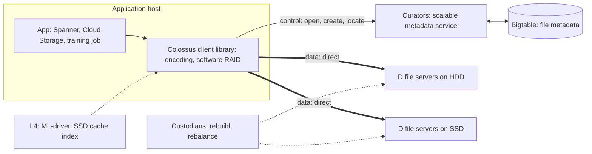
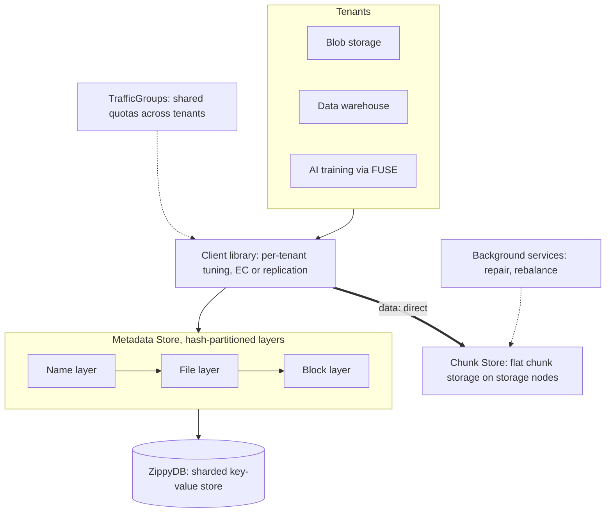
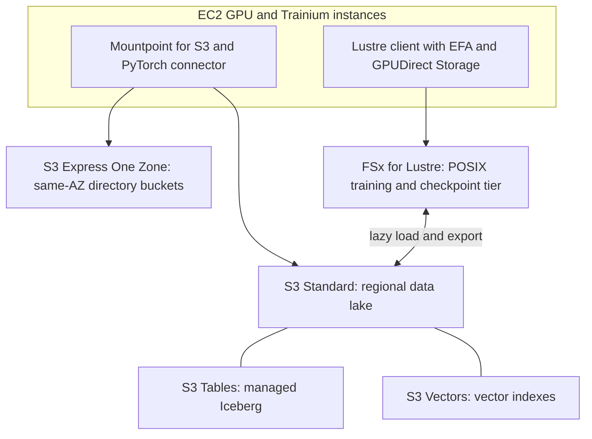
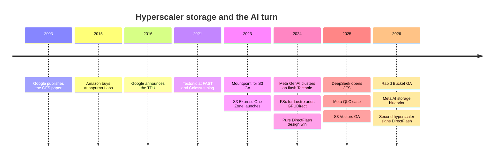

# 36. How hyperscalers build AI storage

> **Depth:** L2 · **Reading time:** ~10 min · **Last verified:** 2026-11-01
> **Prerequisites:** [Parallel file systems](../03-system-architecture/17-parallel-file-systems.md) · [Object storage architecture](../03-system-architecture/18-object-storage-architecture.md) · [Metadata](../03-system-architecture/21-metadata.md) · [Training storage](31-training-storage.md) · [Purity and DirectFlash](../04-everpure/26-purity-and-directflash.md)

## TL;DR

- **Hyperscalers build the file system and buy the parts.** Google (Colossus), Meta (Tectonic) and AWS (S3) run home-grown software that turns a datacenter of commodity drives into one pool. They buy no arrays for their own workloads.
- **The designs are close cousins.** A smart client library, metadata on a scalable database (Bigtable for Colossus, ZippyDB for Tectonic) and simple data servers, with no controller in the data path.
- **AI pushed them from disk toward flash.** Built on HDDs with a little flash, these systems met GPU clusters that need far more bandwidth per terabyte. Meta's GenAI clusters run on flash-optimized Tectonic; Google, AWS and Azure sell zonal, GPU-adjacent tiers.
- **Where hyperscalers do buy, they buy components and IP, not systems.** Meta and a second top-five hyperscaler licensed Everpure's DirectFlash design while buying their own NAND. Cloud *services* do resell partners (DDN Lustre at Google, VAST listings) for tenants.
- **It is the same logic as TPU, Trainium and Nitro.** Build where volume amortizes engineering and the part differentiates. Buy where a merchant supplier has more scale. Vendors win at the seams.

## Why this matters for Everpure strategy

The top hyperscalers are the largest buyers of storage media on earth, yet almost closed to storage-system vendors. For Everpure (NYSE: P, formerly PSTG) that matters three ways. Its hyperscaler revenue exists only because Pure Storage found a seam: a licence for flash-management software and module design, with the customer buying its own NAND[^1][^2]. Hyperscaler designs set the reference architecture that neoclouds and enterprises copy. And whether hyperscalers keep cold data on HDD or move it to QLC is the largest swing factor in flash-versus-disk demand ([Chapter 48](../06-industry-and-competition/48-media-and-nand-cycle.md)).

Which layers hyperscalers build, which they buy, and why the boundary moves defines the addressable surface for licensing deals. [Chapter 29](../04-everpure/29-hyperscaler-ecosystem-financials.md) covers the deal financials; this chapter covers the engineering behind the boundary.

## Core concepts

### The common pattern: one disaggregated file system per datacenter

An enterprise array puts intelligence in a controller between host and drives ([Chapter 14](../03-system-architecture/14-scale-up-dual-controller.md)). Hyperscale file systems remove that box:

- **A client library** in every application encodes data, finds where it lives and streams it directly to or from storage servers.
- **A metadata service** runs as a sharded application on a scalable database; file names and block maps are just rows.
- **Thin data servers** expose local disks over the network, while background workers repair and rebalance.

**Semiconductor bridge.** Moving the RAID logic into the client is like moving the memory controller onto the CPU die. It removes a hop and a box, but only works if you control every application and its libraries. Hyperscalers do; enterprise vendors don't, so they sell controllers and standard protocols.

### Google Colossus

Colossus succeeded GFS as Google's cluster-level file system and sits under Cloud Storage, Firestore, YouTube, Drive and Gmail[^3]. Its control plane is a pool of **Curators**, which store file-system metadata in Bigtable. That change let Colossus scale metadata more than 100× beyond the largest GFS clusters. Data flows directly between the client library and **D file servers**, which are network-attached disks. **Custodians** handle rebuilds and disk balancing[^3].

*Figure 36.1 — Colossus keeps metadata in a database and data on simple disk servers; the client library, not a controller, owns the data path.*

Two Colossus file systems each hold more than 10 exabytes; the largest regularly exceed 50 TB/s of reads and 25 TB/s of writes, and the busiest cluster serves over 600 million IOPS[^4]. At ~250 MB/s per HDD, 50 TB/s is the streaming bandwidth of 200,000 drives.

The economics come from mixing media: Google buys just enough flash to lift I/O density to what applications need, and just enough disk for capacity[^3]. A tier called **L4** decides which data earns SSD, running a read cache and a writeback policy that simulates options such as "SSD for one hour" per file category. The same simulations drive SSD purchasing[^4]. **Semiconductor bridge:** L4 is a last-level cache with a learned replacement policy, sized by simulating hit rates before buying silicon.

For AI, **Rapid Bucket** (GA April 2026) is a zonal Cloud Storage bucket on Colossus; Google claims more than 15 TB/s, 20 million requests per second and sub-millisecond latency in one bucket. **Rapid Cache** (formerly Anywhere Cache) adds up to 2.5 TB/s of read cache in front of existing buckets[^5]. For POSIX users Google sells Managed Lustre, built on DDN's EXAScaler, at up to 10 TB/s[^5][^6].

### Meta Tectonic

Tectonic is Meta's exabyte-scale, multitenant file system, described at USENIX FAST '21[^7]. One cluster serves an entire datacenter. It replaced separate systems for photo and video blobs (Haystack and f4) and many HDFS clusters for the data warehouse[^7][^8]. Consolidation cut the number of warehouse clusters by 10×[^8].

*Figure 36.2 — Tectonic splits metadata into layers on a shared key-value store and gives each tenant its own client-side tuning over a common chunk pool.*

Two ideas matter. **Disaggregated metadata**: names, files and blocks are separate layers, each hash-partitioned into a key-value store, so a hot directory does not overload the servers holding block maps[^7][^8]. **Multitenancy without per-tenant clusters**: tenants share a few dozen traffic groups, so the blob store's peak no longer strands disks the warehouse could use[^8], while tenant-specific tuning such as erasure-code width lives in the client library. It is the hyperscale version of the consolidation argument ([Chapter 19](../03-system-architecture/19-software-defined-and-hci.md)).

**AI changed the media.** Meta's two 24,576-GPU GenAI clusters (2024) use a home-grown FUSE client on a flash-optimized Tectonic, plus a parallel NFS deployment co-developed with Hammerspace, both on YV3 Sierra Point servers with high-capacity E1.S SSDs[^9]. A worked number shows why. A 405B-parameter checkpoint with optimizer state is ~405e9 × 16 bytes ≈ 6.5 TB. Writing it in 60 seconds needs ~108 GB/s. That is ~430 HDDs at ~250 MB/s streaming flat out, before erasure-coding overhead, or ~22 NVMe SSDs at ~5 GB/s.

Meta's July 2026 "AI storage blueprint" adds regional, flash-backed BLOB storage colocated with GPUs, a client SDK embedding Tectonic's block client to skip proxies, hedged reads against tail latency, and GPU-host memory and local flash as L1/L2 caches[^10]: a cache hierarchy around one source of truth ([Chapter 31](31-training-storage.md)).

In March 2025 Meta argued for QLC flash as a middle tier, because HDD bandwidth per terabyte falls as drives grow. Meta targets workloads around 10 MB/s per TB, which 16–20 TB HDDs used to meet[^11]. The arithmetic: a ~250 MB/s drive gives 12.5 MB/s/TB at 20 TB, but only 8.3 MB/s/TB at 30 TB. Meta named Pure Storage's DirectFlash Module and standard QLC SSDs from other vendors[^11][^12].

### AWS: object store at the centre, file and cache at the edge

AWS builds a layered stack around S3, which by industry reports held over 500 trillion objects and peaked near 1 PB/s in 2025[^13] [VERIFY: search-summary only; confirm against AWS re:Invent 2025 keynote].

*Figure 36.3 — AWS keeps S3 as the system of record and adds zonal object, parallel file and client-side layers to bring bandwidth next to the GPUs.*

- **S3 Express One Zone** (November 2023) puts directory buckets in the compute's Availability Zone for single-digit-millisecond access. AWS claimed 10× faster access than S3 Standard at launch[^14], then cut storage prices 31% and GET prices 85% in April 2025[^15].
- **FSx for Lustre**, a managed parallel file system linked to S3, has since November 2024 supported EFA and GPUDirect Storage at up to 1,200 Gbps (150 GB/s) per client, 12× the earlier 100 Gbps TCP limit[^16].
- **Mountpoint for S3** (GA August 2023), an open-source client, maps file reads to S3 GETs at up to 100 Gb/s per instance[^17].
- **S3 Tables** (Iceberg, December 2024) and **S3 Vectors** (GA December 2025, up to 2 billion vectors per index) pull analytics and RAG data into the object layer[^18][^19] ([Chapter 33](33-rag-vector-lakehouse.md)).

AWS did not invent a new file system for AI. It runs open-source Lustre as a service and keeps proprietary effort where scale pays: the object store, the EFA network and Nitro offload cards.

### Azure: Blob at exabyte scale plus managed Lustre

Microsoft centres on Blob, whose "scaled accounts" let OpenAI run exabyte-scale datasets across regions[^20]. For POSIX, Azure Managed Lustre's AMLFS 20 SKU (preview, November 2025) reaches 25 PiB and 512 GB/s in one namespace[^21]. Azure was the first hyperscale service submitted to MLPerf Storage, at 642 GiB/s checkpoint write in v3.0[^22] ([Chapter 37](37-reading-benchmarks.md)). Azure also offers VAST through its Native ISV Service[^23].

### DeepSeek 3FS: the open hyperscale design

DeepSeek open-sourced its **Fire-Flyer File System (3FS)** in February 2025[^24]. Its design follows the same pattern: stateless metadata services on a transactional key-value store (FoundationDB), chain replication (CRAQ) for strong consistency, and storage nodes shared by all clients. A 180-node cluster, each node with 2×200 Gb/s InfiniBand and sixteen NVMe SSDs, reached ~6.6 TiB/s aggregate reads[^25]. Per node: 6.6 TiB/s ÷ 180 ≈ 37.5 GiB/s, against a line rate of 400 Gb/s ≈ 46.6 GiB/s, or ~80% of the NIC. Built for AI rather than photo archives, it is all-flash. It shows an AI lab can build hyperscaler-class storage and give it away, which pressures proprietary software pricing.

### Build versus buy, and the custom-silicon parallel

| Buyer | Builds | Buys | Why |
|---|---|---|---|
| Top hyperscalers (Google, Meta, AWS, Microsoft) | File system, metadata, erasure coding, caching, client libraries; servers to OCP-style specs | HDDs, NAND/SSDs, NICs; selective IP licences (DirectFlash); partner software inside some cloud services | Exabyte scale amortizes large teams; control of the whole stack; media is a commodity where suppliers have scale |
| AI labs with own clusters (DeepSeek, Meta FAIR-type) | Lean parallel FS (3FS) or a tuned hyperscaler FS | Servers, SSDs, InfiniBand | Workload is narrow and known; talent concentrated |
| Neoclouds (CoreWeave, Nebius, Lambda) | Object layer and GPU-side caches (e.g., CoreWeave LOTA) | Dedicated file systems from VAST, WEKA, DDN, Everpure | Time to market; customer demand for certified, known systems; small storage teams ([Chapter 35](35-ai-factories-and-neoclouds.md)) |
| Large enterprises | Almost nothing below the data platform | Arrays and SDS (Everpure, NetApp, Dell, VAST) or cloud services | No scale to amortize a storage team; need support, SLAs, features |

*Table 36.1 — The build boundary falls as scale rises: hyperscalers build everything except media, neoclouds build only the GPU-side glue, and enterprises buy systems.*

The logic mirrors silicon. Google ran the TPU for about a year before announcing it in May 2016[^26]. AWS bought Annapurna Labs in 2015 to build Nitro, then Graviton and Trainium (announced December 2020)[^27]. The design is proprietary; the wafers come from a foundry. In storage, the file system is the chip design and NAND and HDDs are foundry capacity bought on the merchant market. A DirectFlash licence is like licensing a SerDes or CPU core: IP that speeds up an in-house design without ceding control to a system vendor.

## How Everpure approaches it vs. competitors

| Vendor | How it reaches hyperscalers | What the hyperscaler gets | Strength | Weakness |
|---|---|---|---|---|
| Everpure | DirectFlash software and module design licence plus non-NAND parts; the customer buys NAND[^1][^2] | Raw-NAND management at high density under its own file system | Only array vendor inside a top-five hyperscaler's own storage; no NAND inventory risk | Two customers; a hyperscaler could rebuild the function with FDP SSDs |
| DDN | Engine of a first-party cloud service (Google Cloud Managed Lustre)[^6] | Proven Lustre for cloud tenants | Lustre depth; Google brand | Sells to the cloud *service*, not Google's internal storage |
| VAST | Managed marketplace services on Google Cloud and Azure[^23][^28] | A turnkey AI data platform for tenants | Fast GTM; same software as on-prem | Marketplace revenue, not internal infrastructure |
| Hammerspace | Co-developed parallel NFS for Meta's GenAI clusters[^9] | Standards-based NFS over existing storage | Inside Meta's AI stack | Software layer over others' storage |
| Commodity SSD makers (Samsung, Solidigm, Micron) | Direct supply; standards such as FDP | Standard QLC/TLC SSDs | Scale, multiple sources | Little differentiation |

*Table 36.2 — Vendors enter hyperscalers either through internal infrastructure as IP or components, or through cloud services as managed partners; only the first touches the exabytes.*

The steelman against Everpure is that hyperscalers can build it. NVMe Flexible Data Placement, driven by Meta and Google, lets standard SSDs take placement hints and removes much of the write amplification DirectFlash targets ([Chapter 26](../04-everpure/26-purity-and-directflash.md)). Meta runs standard QLC SSDs alongside DFMs[^11]. The counter-argument is revealed preference: when Meta wanted raw-flash control at scale, it licensed it, and a second top-five hyperscaler followed in August 2026, with revenue expected from FY2028[^2]. Options a strategy team might evaluate, based on public information: which other hyperscaler file systems face the same HDD-to-flash pressure, and whether the licence can extend to software above the FTL.

## History and trajectory

*Figure 36.4 — The disk-era file systems of 2003–2021 were rebuilt around flash and GPU locality in 2023–2026.*

Two signals point forward. **Storage is moving next to the GPUs**: zonal buckets, regional BLOB stacks and host-memory caches trade durability domain for latency and bandwidth. **Flash is advancing into capacity tiers**: in August 2025 Pure Storage expected to ship 1–2 exabytes of DirectFlash to Meta by the end of FY26[^29]. HDDs still dominate hyperscale exabytes, and bears argue disk keeps a large TCO edge ([Chapter 48](../06-industry-and-competition/48-media-and-nand-cycle.md)); the debate is how fast flash takes share.

## Numbers that matter

| Metric | Value | Context | Source / date |
|---|---|---|---|
| Largest Colossus file systems | >10 EB each (two); >50 TB/s read, 25 TB/s write | Company-stated | Google, 2025-03-26[^4] |
| Google Rapid Bucket | >15 TB/s, 20M req/s, sub-ms | Single zonal bucket on Colossus | Google, 2026-04-22[^5] |
| Meta GenAI cluster size | 2 × 24,576 GPUs | Flash Tectonic + Hammerspace NFS | Meta, 2024-03-12[^9] |
| Tectonic warehouse consolidation | 10× fewer clusters | After moving from HDFS | Meta, 2021-06-21[^8] |
| FSx for Lustre per-client throughput | 1,200 Gbps | With EFA + GDS; was 100 Gbps | AWS, 2024-11-27[^16] |
| S3 Express One Zone price cut | Storage −31%, GET −85% | April 2025 | AWS, 2025-04-10[^15] |
| Azure Managed Lustre AMLFS 20 | 25 PiB, 512 GB/s | Preview | Microsoft, 2025-11[^21] |
| DeepSeek 3FS read throughput | ~6.6 TiB/s on 180 nodes | ~80% of NIC line rate (worked) | DeepSeek GitHub[^25] |
| HDD bandwidth per TB | 12.5 → 8.3 MB/s/TB | 250 MB/s drive at 20 TB vs 30 TB | Worked example |

## Conversation playbook

**Questions for a PM**

1. *"Which hyperscaler file systems besides Tectonic hit the same HDD bandwidth-per-TB wall?"* Strong: names workloads (warm blob, AI data lakes) and how the licence fits each file system, not just the Meta story.
2. *"What do we deliver to a hyperscaler that FDP plus a standard QLC SSD doesn't?"* Strong: numbers on density per rack, power, write amplification and the software the customer would otherwise maintain.
3. *"Could the licence model sell to tier-2 clouds or neoclouds that lack a Tectonic?"* Strong: the licence assumes the buyer has its own file system; others need a full system such as FlashBlade//EXA.

**Questions for an engineer**

1. *"Where does DirectFlash sit relative to the hyperscaler's file system?"* Strong: at the media and flash-management layer under the storage servers, with the file system still owning placement, erasure coding and metadata (public sources don't detail the integration).
2. *"How do hyperscalers stop GPU stalls from tail latency?"* Strong: hedged reads, client-side concurrency control, host-memory and local-NVMe caches, and zonal placement, as in Meta's 2026 blueprint.
3. *"What would it take for Colossus's L4 tier to move bulk data from HDD to QLC?"* Strong: cost per unit of bandwidth versus cost per TB; once HDD must be over-provisioned for bandwidth, flash wins.

**Don't say this:**

- "Hyperscalers buy storage arrays." For their own workloads they buy media and occasional IP; arrays appear only inside partner cloud services.
- "Meta replaced its disks with Pure." Meta adds QLC as a middle tier alongside HDDs and also uses standard QLC SSDs.
- "We compete with Colossus or Tectonic." They are internal; we compete with services built on them, such as Rapid Bucket.
- "3FS proves storage software is worthless." A lab with a narrow workload can build its own; enterprises still pay for support and features.

## Going deeper (optional, L3 pointers)

- Tectonic FAST '21 paper: layered metadata and consistency semantics[^7].
- CacheSack, cited in the 2025 Colossus post: the admission policy behind L4[^4].
- 3FS design notes: CRAQ and the USRBIO zero-copy client API[^25].

## Key terms

- **Colossus / Curator / D file server** — Google's cluster file system, its metadata servers (on Bigtable) and its simple disk servers.
- **L4 cache** — Colossus's ML-driven SSD caching and placement tier.
- **Tectonic / ZippyDB / Chunk Store** — Meta's multitenant file system, the key-value store holding its metadata, and its flat data layer.
- **S3 Express One Zone / Rapid Bucket** — AWS and Google zonal, low-latency object tiers built for AI.
- **Smart client** — a client library that does placement and encoding itself, so no controller sits in the data path.
- **Hedged read** — a duplicate request sent to a second replica to cut tail latency.
- See the [glossary](../glossary.md) for the rest.

## Sources

[^1]: SiliconANGLE, "Shares of Pure Storage jump on impressive earnings beat and strong guidance," 2024-12-03. https://siliconangle.com/2024/12/03/shares-pure-storage-jump-impressive-earnings-beat-strong-guidance/ (retrieved 2026-11-01).
[^2]: Everpure, "Everpure Lands New Design Win with Second Top-Five Hyperscaler," 2026-08-10. https://www.everpuredata.com/company/newsroom/press-releases/everpure-lands-new-design-win-with-second-top-five-hyperscaler.html (retrieved 2026-11-01); Motley Fool, "Everpure (P) Q2 2027 Earnings Call Transcript," 2026-08-31. https://www.fool.com/earnings/call-transcripts/2026/08/31/everpure-p-q2-2027-earnings-call-transcript/ (retrieved 2026-11-01).
[^3]: Google Cloud Blog (D. Hildebrand, D. Serenyi), "Colossus under the hood: a peek into Google's scalable storage system," 2021-04-19. https://cloud.google.com/blog/products/storage-data-transfer/a-peek-behind-colossus-googles-file-system (retrieved 2026-11-01).
[^4]: Google Cloud Blog (L. Greenfield, S. Pollen), "Colossus under the hood: How we deliver SSD performance at HDD prices," 2025-03-26. https://cloud.google.com/blog/products/storage-data-transfer/how-colossus-optimizes-data-placement-for-performance (retrieved 2026-11-01).
[^5]: Google Cloud Blog, Cloud Next '26 storage announcements, 2026-04-22. https://cloud.google.com/blog/products/storage-data-transfer/next26-storage-announcements (retrieved 2026-11-01).
[^6]: Business Wire, "DDN Announces Collaboration with Google Cloud to Advance AI Initiatives with Google Cloud Managed Lustre and Infinia at Google Cloud Next 2025," 2025-04-09. https://www.businesswire.com/news/home/20250409046523/en/ (retrieved 2026-11-01).
[^7]: USENIX, Pan et al., "Facebook's Tectonic Filesystem: Efficiency from Exascale," FAST '21, 2021-02. https://www.usenix.org/conference/fast21/presentation/pan (retrieved via search 2026-11-01).
[^8]: Meta Engineering, "Tectonic file system: Consolidating Facebook storage infrastructure," 2021-06-21. https://engineering.fb.com/2021/06/21/data-infrastructure/tectonic-file-system/ (retrieved via search 2026-11-01).
[^9]: Meta Engineering, "Building Meta's GenAI Infrastructure," 2024-03-12. https://engineering.fb.com/2024/03/12/data-center-engineering/building-metas-genai-infrastructure/ (retrieved via search 2026-11-01).
[^10]: Meta Engineering, "Meta's AI storage blueprint at scale," 2026-07-01. https://engineering.fb.com/2026/07/01/data-infrastructure/metas-ai-storage-blueprint-at-scale/ (retrieved via search 2026-11-01).
[^11]: Meta Engineering, "A case for QLC SSDs in the data center," 2025-03-04. https://engineering.fb.com/2025/03/04/data-center-engineering/a-case-for-qlc-ssds-in-the-data-center/ (retrieved via search 2026-11-01).
[^12]: Blocks & Files, "Meta's positive assessment of Pure Storage's flash mettle," 2025-04-07. https://blocksandfiles.com/2025/04/07/metas-positive-assessment-of-pure-storages-flash-mettle/ (retrieved via search 2026-11-01).
[^13]: Wikipedia, "Amazon S3" (citing AWS re:Invent 2025 keynote), n.d. https://en.wikipedia.org/wiki/Amazon_S3 (retrieved via search 2026-11-01).
[^14]: AWS What's New, "Announcing the Amazon S3 Express One Zone storage class," 2023-11-28. https://aws.amazon.com/about-aws/whats-new/2023/11/amazon-s3-express-one-zone-storage-class (retrieved 2026-11-01).
[^15]: AWS What's New, "Amazon S3 Express One Zone reduces storage and request prices," 2025-04-10. https://aws.amazon.com/about-aws/whats-new/2025/04/amazon-s3-express-one-zone-reduces-storage-request-prices/ (retrieved via search 2026-11-01).
[^16]: AWS What's New, "Amazon FSx for Lustre now supports Elastic Fabric Adapter and NVIDIA GPUDirect Storage," 2024-11-27. https://aws.amazon.com/about-aws/whats-new/2024/11/amazon-fsx-lustre-elastic-fabric-adapter-nvidia-gpudirect-storage/ (retrieved via search 2026-11-01).
[^17]: AWS News Blog, "Mountpoint for Amazon S3 – Generally Available and Ready for Production Workloads," 2023-08-09. https://aws.amazon.com/blogs/aws/mountpoint-for-amazon-s3-generally-available-and-ready-for-production-workloads/ (retrieved via search 2026-11-01).
[^18]: AWS, "Amazon S3 User Guide: Document history / What's New," n.d. https://docs.aws.amazon.com/AmazonS3/latest/userguide/WhatsNew.md (retrieved 2026-11-01).
[^19]: StorageNewsletter, "AWS re:Invent 2025: Amazon S3 Vectors is Now Generally Available with 40 Times the Scale of Preview," 2025-12-05. https://www.storagenewsletter.com/2025/12/05/aws-reinvent-2025-amazon-s3-vectors-is-now-generally-available-with-40-times-the-scale-of-preview/ (retrieved 2026-11-01).
[^20]: Microsoft, "OpenAI accelerates AI innovation with Azure Blob Storage scaled accounts" (customer story), n.d. https://www.microsoft.com/en/customers/story/23427-openai-lp-azure-blob-storage (retrieved via search 2026-11-01).
[^21]: Microsoft Tech Community, Azure HPC Blog, Azure Managed Lustre AMLFS 20 public preview, 2025-11. https://techcommunity.microsoft.com/blog/azurehighperformancecomputingblog/-/4470665 (retrieved via search 2026-11-01).
[^22]: StorageReview, "MLPerf Storage v3.0: 877 GiB/s Checkpoints, a Cloud First, and a Leaderboard Turned Over," 2026-09. https://www.storagereview.com/news/mlperf-storage-v3-0-877-gib-s-checkpoints-a-cloud-first-and-a-leaderboard-turned-over (retrieved 2026-11-01).
[^23]: VAST Data, "VAST and Microsoft Azure Unite to Advance Agentic AI," 2025-11-18. https://www.vastdata.com/press-releases/vast-and-microsoft-azure-unite-to-advance-agentic-ai (retrieved 2026-11-01).
[^24]: Tom's Hardware, "DeepSeek releases powerful new parallel file system, Fire-Flyer File System, made open source," 2025-03. https://tomshardware.com/pc-components/storage/deepseek-releases-powerful-new-parallel-file-system-fire-flyer-fire-system-made-open-source (retrieved via search 2026-11-01).
[^25]: DeepSeek, "3FS" repository README, n.d. https://github.com/deepseek-ai/3FS (retrieved 2026-11-01).
[^26]: Google Cloud Blog (N. Jouppi), "Google supercharges machine learning tasks with TPU custom chip," 2016-05-18. https://cloud.google.com/blog/products/ai-machine-learning/google-supercharges-machine-learning-tasks-with-custom-chip (retrieved via search 2026-11-01).
[^27]: Amazon Science, "How silicon innovation became the 'secret sauce' behind AWS's success," n.d. https://amazon.science/how-silicon-innovation-became-the-secret-sauce-behind-awss-success (retrieved via search 2026-11-01).
[^28]: Blocks & Files, "VAST supports Google Cloud TPUs in managed service with Red Stapler's SW," 2025-11-11. https://blocksandfiles.com/2025/11/11/vast-supports-google-cloud-tpus-in-managed-service-with-red-staplers-sw/ (retrieved 2026-11-01).
[^29]: Blocks & Files, "Pure knocking it out of the park," 2025-08-29. https://blocksandfiles.com/2025/08/29/pure-knocking-it-out-of-the-park/ (retrieved 2026-11-01).
