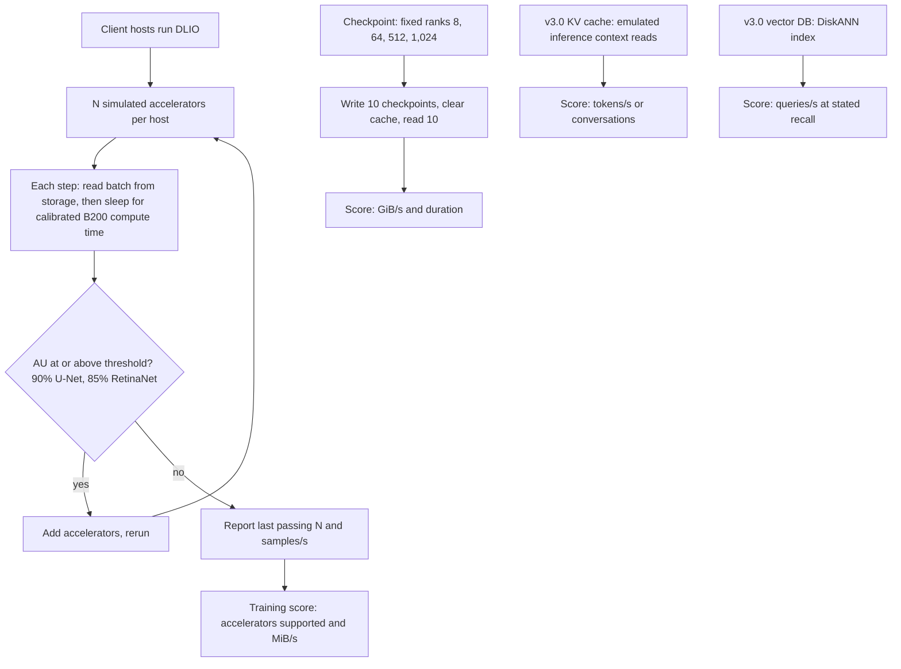
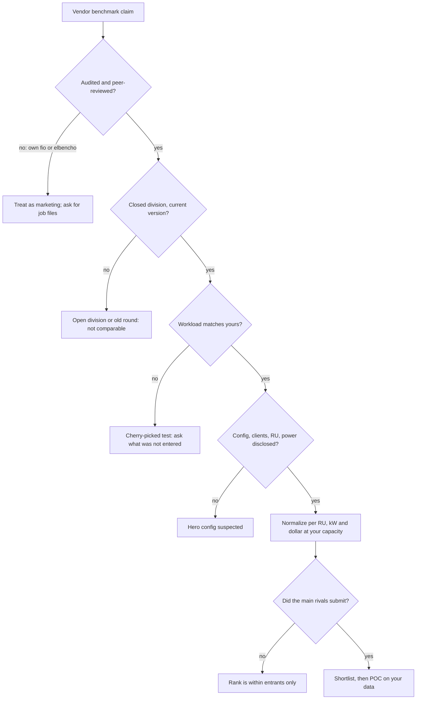
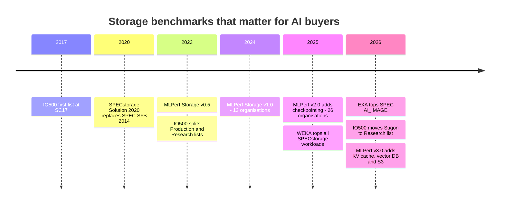

# 37. Reading benchmarks critically

> **Depth:** L2 · **Reading time:** ~10 min · **Last verified:** 2026-11-01
> **Prerequisites:** [Performance and economics metrics](../01-storage-fundamentals/04-performance-and-economics-metrics.md) · [Training storage](31-training-storage.md) · [Inference and KV cache](32-inference-and-kv-cache.md) · [FlashArray and FlashBlade](../04-everpure/27-flasharray-and-flashblade.md)

## TL;DR

- **Storage benchmarks mostly measure how much hardware was submitted.** Scale-out systems scale, so the biggest configuration wins. A number means little until divided by rack units, kilowatts or dollars at the buyer's capacity point.
- **MLPerf Storage uses no real GPUs.** Simulated accelerators "compute" by sleeping; the score is how many the storage keeps above a utilisation threshold. That is bandwidth divided by per-accelerator demand, so results do not compare across versions.
- **Each benchmark has a blind spot.** SPECstorage AI_IMAGE has few contenders; IO500 mixes units and splits production from research systems; STAC-M3 reports "X of Y" wins; vendor fio runs are only as honest as their job files.
- **Absence is data.** VAST, WEKA and DDN skipped MLPerf Storage v3.0 (September 2026). Everpure's first-place checkpoint and KV-cache results are peer-reviewed and real, and they came in a field without its strongest rivals.
- **Benchmarks shortlist; proofs of concept decide.** Ten questions (below) separate engineering results from marketing.

## Why this matters for Everpure strategy

Benchmarks are how AI-storage vendors, Everpure included, turn engineering into sales claims. FlashBlade//EXA's MLPerf Storage v3.0 and SPECstorage AI_IMAGE results anchor Everpure's case for neocloud and AI-factory deals ([Chapter 27](../04-everpure/27-flasharray-and-flashblade.md)), and competitors will attack them as Everpure attacks theirs. Pricing a benchmark claim separates a durable technical lead from a configuration choice, which also matters when a diligence target ([Chapter 50](../06-industry-and-competition/50-diligence-framework.md)) leads with a "world record".

Participation is itself a strategic choice: costs (engineering weeks, hardware, a possible public loss) against credibility with buyers who cannot test for themselves. Which tests to enter, and how to frame results, are options a strategy team might evaluate from public information.

## Core concepts

### Why storage benchmarks are harder than chip benchmarks

A CPU benchmark runs on one part. A storage benchmark runs on a *system* (servers, drives, network, clients, software), all chosen by the submitter. It is like a memory-bandwidth claim for a self-chosen number of HBM stacks, with no die area or power attached. Scale-out storage is near-linear by design ([Chapter 15](../03-system-architecture/15-scale-out-shared-nothing.md)), so "fastest" usually means "largest configuration". The useful content is the result's *shape*: per-node rate, scaling efficiency, latency under load.

### How MLPerf Storage works

MLPerf Storage, from MLCommons, uses no accelerators. A tool called DLIO runs on ordinary client hosts, reads data with real data-loader behaviour, then *sleeps* for the time a real GPU would take to compute each batch[^1]. Sleep times are calibrated per accelerator model. The v2.0 rules list A100, H100, B200 and AMD MI355[^2], and v3.0 submissions simulate B200 or MI355[^3].

The key metric is **accelerator utilisation (AU)**: the share of time a simulated accelerator spends "computing" rather than waiting for data. The submitter adds accelerators until AU falls below threshold and reports the largest passing count and its throughput. Under the v2.0 rules the thresholds were 90% for 3D U-Net and ResNet-50 and 70% for CosmoFlow[^2]. In v3.0 the closed training workloads are 3D U-Net (90%) and RetinaNet (85%)[^4][^3]. CosmoFlow, ResNet-50, DLRM and Flux moved to an unranked "whatif" category[^5].

*Figure 37.1 — MLPerf Storage turns storage bandwidth into "accelerators kept busy" by sleeping in place of compute. Checkpoint, KV-cache and vector tests score bandwidth, tokens and queries directly.*

**"Accelerators supported" is bandwidth in disguise.** In v1.0 Huawei's OceanStor A800 fed 255 simulated H100s on 3D U-Net at 679 GB/s[^1]. That is 679 ÷ 255 ≈ 2.7 GB/s per accelerator. DDN's EXAScaler AI400X2T reached 99,018 MiB/s with 36 H100s from 18 clients[^6], or ≈2.9 GB/s each. So the count is roughly throughput ÷ 2.7 GB/s. A faster simulated GPU needs more bandwidth each, so the same storage "supports" fewer, and a v3.0 B200 count cannot be set against a v2.0 H100 count[^7].

**Anti-gaming rules.** The dataset must be at least five times total client memory, so it cannot sit in page cache. Results are the mean of consecutive runs after a warm-up, with no cherry-picking, reproducible within 5%[^2]. Checkpointing uses fixed process counts for Llama 3 8B, 70B, 405B and 1T (8 to 1,024 ranks; about 105 GB to 18 TB per checkpoint), and hosts must clear file cache between write and read when the checkpoint is under three times client memory[^2]. Submissions disclose topology and, on-premises, power and rack units. Peer review is closed: submitters object to each other's results, which can be fixed, moved to the open division or withdrawn[^2].

**Closed versus open.** The *closed* division fixes the code and allows a few tunables such as reader threads; storage-side optimisation is unrestricted. The *open* division allows disclosed custom loaders, formats and framework changes[^2]. Quoting an open result beside closed ones mixes categories.

**What v3.0 added.** The September 2026 round drew 143 results from 19 organisations, 11 of them first-time submitters (including Everpure, Azure, NVIDIA and Nebius)[^8][^7]. It added a **KV-cache** test (a working-group emulation scoring how fast storage feeds inference context), a **vector-database** test (DiskANN in every submission) and an **S3 object path** beside POSIX[^8][^4]. Reports differ on the vector dataset size: 10 million vectors in the closed configuration versus 1 million at 1,536 dimensions [VERIFY: vector DB dataset size in v3.0 rules][^4]. Power and rack-space efficiency began to be tracked as reported metrics[^7] [VERIFY: search-summary only].

### The other benchmarks

| Benchmark | What it measures | Who runs / audits it | Main metric | How gameable | Best used for |
|---|---|---|---|---|---|
| **MLPerf Storage** (MLCommons) | Training reads, checkpoint write/read, KV-cache reads, vector search, all with simulated accelerators | Vendor runs; closed peer review among submitters[^2] | Accelerators supported, GiB/s, tokens/s, QPS | Medium: config size, client count, choosing which workloads to enter | AI training and checkpoint shortlisting |
| **SPECstorage Solution 2020** (SPEC) | Five file workloads: AI_IMAGE, EDA_BLENDED, GENOMICS, SWBUILD, VDA | Vendor runs; SPEC review before publication | Business metric (e.g., AI_Jobs) at an overall response time (ORT)[^9] | Medium: thin fields per workload, cross-workload comparisons barred by SPEC[^9] | File-system latency under rising load |
| **IO500** | IOR easy (large sequential) and hard (small, shared-file) bandwidth, mdtest easy/hard metadata, parallel find | Sites or vendors submit; committee scores reproducibility[^10] | Geometric mean of a bandwidth score and a metadata score[^11] | High: metadata-heavy tricks, research-grade software, client count (hence the 10-node list) | HPC parallel file systems, metadata stress |
| **STAC-M3** (STAC) | kdb+ tick-data analytics (Antuco, Kanaga suites) | STAC audits vendor-sponsored runs | Mean response times across dozens of tests[^12] | Medium: "best in X of Y" reporting, full reports often subscriber-only | Financial time-series buyers |
| **Vendor fio / elbencho / GDSIO** | Whatever the job file says | Vendor, unaudited | GB/s, IOPS, latency | Very high: block size, queue depth, compressible buffers, cache-resident working sets | Engineering tuning and POC scripts, never as a claim |

*Table 37.1 — The five benchmark families an AI-storage buyer meets. Gameability rises as audit and fixed rules fall away.*

**SPECstorage Solution 2020** replaced SPEC SFS 2014 in late 2020[^13]. Each workload scales "business units" until response time collapses, yielding a load-latency curve, which says more than a single peak. The AI_IMAGE field is thin. WEKA on HPE hardware topped all five workloads in February 2025, including 5,000 AI_Jobs[^14]. FlashBlade//EXA posted 6,300 AI_Jobs at 0.97 ms ORT in February 2026, using 30 blades, 60 data nodes and 80 client hosts[^15][^16].

**IO500** scores bandwidth tests in GiB/s and metadata tests in kIOPS, then takes a geometric mean. The mixed units have no physical meaning, and strong metadata can carry weak bandwidth[^11]. Write phases must run at least 300 seconds[^17]. Since ISC23 a reproducibility questionnaire splits a **Production** list from a **Research** list[^10]. That rule bit at ISC26. Sugon's ParaStor F9000 entry, scoring 79,110 against Aurora's 32,166, was moved to the Research list for lack of public architecture documentation and limited availability[^18] [VERIFY: scores from search summary]. Sugon's press release still claimed No. 1; always ask which list, and when. DDN's ISC25 "#1" claim concerned the 10-node production list, where Argonne's DAOS systems actually held the top two places and a DDN EXAScaler system was third; WEKA disputed the claim[^19].

**STAC-M3** is audited, but results are framed as wins on subsets, for example "19 of 24 Kanaga benchmarks" and "1.77× faster than a Pure Storage based SUT" on one metric[^12], or "12 of 17 Antuco" for Dell PowerScale[^20]. Ask which tests were lost.

### Where a v3.0 headline comes from

*Figure 37.2 — The same EXA design gives 327.6 or 877.5 GiB/s depending on how many data nodes were submitted. The ranking is mostly a ranking of configuration size.*
Data: `data/ch37_mlperf_v3_checkpoint.csv`

Change the denominator and the story changes. EXA delivers 877.52 ÷ 30 ≈ 29.3 GiB/s per data node, or ≈14.6 if its 30 metadata blades count too[^21]. NVIDIA's AIStore delivers 133.27 ÷ 12 ≈ 11.1 GiB/s per node, at about 95% of nominal NIC bandwidth: a network-bound, well-tuned cloud result[^22]. Alluxio's 147 GiB/s used the smaller 405B model through a cache over Amazon S3[^23]. Azure publishes no node count and warns against normalising by clients[^24]; for a cloud service the honest denominator is provisioned capacity and price. The choice of denominator *is* the argument.

### How vendors game benchmarks

*Figure 37.3 — A claim has to survive five gates before it says anything about your deployment. Most fail at "workload matches yours" or "rivals submitted".*

The recurring tactics:

1. **Hero configurations.** Submit the largest system you can borrow; none of these benchmarks reports price.
2. **Client inflation.** More clients bring more DRAM and NICs. DDN's 36-accelerator v1.0 result used 18 clients[^6].
3. **Caching and compressible data.** Vendor working sets that fit in DRAM, or fio buffers that are zero-filled or highly compressible on arrays with inline reduction, Everpure's included ([Chapter 5](../01-storage-fundamentals/05-data-reduction.md)).
4. **Division and version mixing.** Open next to closed, H100 next to B200, GiB next to GB (1 GiB/s ≈ 1.074 GB/s).
5. **Workload cherry-picking.** Enter checkpointing and skip training, or report "#1 on every test entered". Everpure uses that framing for v3.0[^25].
6. **Flattering denominators.** Per data node excluding metadata servers, per client, per undefined "rack".
7. **Unverified previews.** Hammerspace's v1.0 records were first reported before verification[^26]. Pure Storage published a v2.0 white paper that was not an official listed submission[^27].
8. **Not submitting.** Absence avoids a public loss. StorageReview lists no audited MLPerf result for VAST in any round[^28], and VAST, WEKA and DDN all skipped v3.0[^7].

### Worked normalisation example (illustrative assumptions)

Two hypothetical submissions; every figure is an assumption, realistic in shape but not any product's data.

| Metric | Submission A (60 servers) | Submission B (10 servers) | Arithmetic |
|---|---|---|---|
| Checkpoint write | 900 GB/s | 300 GB/s | Assumed |
| Rack units incl. switches | 130 U | 24 U | Assumed: 2U servers + network |
| Power | 70 kW | 15.5 kW | Assumed |
| Price (3-year, installed) | $9.0M | $2.4M | Assumed |
| Usable capacity | 4.0 PB | 0.5 PB | Assumed |
| GB/s per RU | 6.9 | 12.5 | 900/130; 300/24 |
| GB/s per kW | 12.9 | 19.4 | 900/70; 300/15.5 |
| GB/s per $M | 100 | 125 | 900/9.0; 300/2.4 |
| Cost to meet 900 GB/s + 4 PB | $9.0M (1 unit) | $19.2M (8 units, capacity-bound) | 4.0/0.5 = 8 |
| Cost to meet 900 GB/s + 1 PB | $9.0M (1 unit) | $7.2M (3 units, bandwidth-bound) | 900/300 = 3 |

*Table 37.2 — B wins every ratio, but A is cheaper once the buyer needs 4 PB. Normalise at the customer's requirement point, not at the vendor's.*

The semiconductor parallel is perf-per-watt at a fixed workload versus peak TOPS. What predicts the buyer's bill is cost at *their* bandwidth-to-capacity ratio, exactly the axis on which architectures differ ([Chapter 16](../03-system-architecture/16-disaggregated-shared-everything.md); [Chapter 38](38-power-and-density.md)).

### Ten questions to ask any vendor benchmark claim

1. Which benchmark, version and division, and is the result listed by the benchmark body?
2. What exact hardware ran it: storage nodes, metadata nodes, drives, NICs, switches?
3. How many client hosts, with how much DRAM, and was the dataset larger than their combined memory?
4. What is the per-node, per-RU and per-kW figure, and what does that configuration cost?
5. Was the tested media the media you would buy (for example DFMs versus commodity NVMe)?
6. Which workloads did you skip, and why?
7. Which competitors were in the same round?
8. Is this read or write, peak or sustained, GB or GiB?
9. How did throughput scale from the smallest configuration tested to the largest?
10. Will you run the same harness on our data, at our scale, in a POC?

## How Everpure approaches it vs. competitors

| Vendor | MLPerf Storage | SPECstorage 2020 | IO500 | STAC-M3 | Reading |
|---|---|---|---|---|---|
| **Everpure** | v3.0 first submission: top checkpoint write and KV-cache results[^21][^7]; v2.0 white paper only[^27] | AI_IMAGE #1, 6,300 AI_Jobs (Feb 2026)[^15] | None found | Pure Storage-based SUT cited as a comparison point[^12] | Strong, audited numbers in rounds rivals skipped |
| **VAST** | Never submitted[^28] | None found | None found | None found | Sells on references, POCs and NVIDIA alignment |
| **WEKA** | v1.0 reportedly; not v2.0 or v3.0 [VERIFY: v1.0 participation] | All five workloads #1 (Feb 2025); AI_IMAGE since passed by EXA[^14][^16] | Customer submissions, e.g., 665.49 at a cancer research centre (company-stated)[^29] | kdb+ on AWS (2021)[^30] | Prefers benchmarks it can win broadly |
| **DDN** | v1.0 and v2.0; skipped v3.0[^6][^31][^7] | None found | Frequent; "#1" claims on the 10-node list[^19] | EXAScaler AI400X (2020)[^32] | HPC-native benchmark culture |
| **Azure, NVIDIA, Nebius** | First-time v3.0 entrants[^8] | n/a | n/a | n/a | Clouds now benchmark managed storage too |

*Table 37.3 — Who enters which benchmark is itself a positioning signal.*

Apply the same scrutiny to Everpure. The case *for* its v3.0 result is strong: peer-reviewed, the round's largest checkpoint write, about 89% per-node efficiency from 10 to 30 data nodes ([Chapter 27](../04-everpure/27-flasharray-and-flashblade.md)), and 1,623.4 GiB/s of KV-cache read on 51 hosts, far ahead of the next entrants[^7]. The caveats:

- The data nodes were third-party Linux/NVMe servers, so the result says little about DirectFlash economics.
- No price was disclosed.
- Reported checkpoint read figures conflict: 588.3 GiB/s versus 833.0 GiB/s [VERIFY: EXA checkpoint read][^21][^7].
- KV cache is a first-round workload with few entrants.
- Coverage shows no EXA training-workload result [VERIFY: whether EXA entered training workloads].

The abstainers' steelman is real: neocloud-scale buyers run their own acceptance tests, a run costs engineering weeks, and a loss is public forever. So is the counter: enterprise buyers without test labs lean on audited results.

## History and trajectory

*Figure 37.4 — Benchmarks have moved from HPC file I/O toward the AI pipeline. Each round adds a stage, from training reads to checkpointing to inference context.*

IO500 dates from 2017 and MLPerf Storage v0.5 from 2023 [VERIFY: both launch dates]. MLPerf Storage grew from 13 organisations in v1.0 (September 2024)[^33] to 26 in v2.0 (August 2025), when checkpointing arrived[^34], then shrank to 19 in v3.0 even as it added inference workloads[^8]. Benchmarks follow the I/O hot spot, which in 2026 is KV-cache offload ([Chapter 32](32-inference-and-kv-cache.md)) and S3 access[^35]. Watch whether VAST, WEKA or DDN enter v4.0, whether power and rack-unit efficiency become ranked metrics, and whether IO500's reproducibility gate spreads.

## Numbers that matter

| Metric | Value | Context | Source / date |
|---|---|---|---|
| MLPerf v3.0 participation | 19 orgs, 143 results, 11 first-time | Down from 26 orgs in v2.0 | MLCommons / StorageReview, 2026-09[^8][^7] |
| Top v3.0 checkpoint write | 877.5 GiB/s (EXA, 30 data nodes) | 327.6 GiB/s at 10 nodes | Everpure release, 2026-09-02[^21] |
| Second v3.0 checkpoint write | 642.2 GiB/s (Azure Managed Lustre) | 4,096 TiB, 128 clients; first hyperscale cloud entrant | Microsoft; StorageReview, 2026-09[^24][^7] |
| Per-accelerator bandwidth, 3D U-Net on H100 | ≈2.7–2.9 GB/s | Worked from Huawei and DDN v1.0 results | HPCwire 2024-10; B&F 2024-09[^1][^6] |
| MLPerf dataset-size rule | ≥5× total client memory | Limits page-cache inflation | MLCommons rules[^2] |
| AU thresholds (v3.0 closed) | 90% U-Net, 85% RetinaNet | Was 70% for CosmoFlow in v2.0 | MLCommons; Nebius[^4][^3][^2] |
| SPEC AI_IMAGE top result | 6,300 AI_Jobs at 0.97 ms ORT (EXA) | Prior leader WEKA/HPE at 5,000 | SPEC, 2026-02-17[^15][^14] |
| Normalisation swing | Up to 2× cost reversal | Worked example: A vs B at 4 PB vs 1 PB | Worked example (Table 37.2) |

## Conversation playbook

**Questions for a PM**

1. *"Why did we enter checkpointing and KV cache in v3.0 but not training?"* Strong answer: names the target buyer and says what a training entry would have shown.
2. *"How do sellers answer 'VAST and WEKA didn't need MLPerf'?"* Strong answer: concedes POCs dominate at neocloud scale; positions audited results as risk reduction for enterprises without test labs.
3. *"What is EXA's cost per GB/s at a customer's capacity point?"* Strong answer: a range at two or three bandwidth-to-capacity ratios, not a headline.

**Questions for an engineer**

1. *"In the 30-node checkpoint run, what was the bottleneck?"* Strong answer: names NICs, SSDs or metadata with per-node numbers, and explains the 11% per-node falloff.
2. *"How did you make sure page cache didn't flatter the checkpoint read?"* Strong answer: cites the 3×-memory cache-clear rule, client DRAM sizes and the source of the read discrepancy.
3. *"What would change with DFM-based data nodes?"* Strong answer: separates media from network and software effects, and admits the current result does not test DirectFlash.

**Don't say this:**

- "EXA beat VAST and WEKA in MLPerf." They did not enter v3.0.
- "MLPerf Storage tested real B200s." The accelerators are simulated.
- Comparing v3.0 with v2.0 results. The simulated accelerator changed, and Pure's v2.0 numbers were not an official submission.
- "IO500 #1" without naming the list (production or research, full or 10-node) and the date.
- Quoting GiB/s and GB/s in the same comparison.

## Going deeper (optional, L3 pointers)

- `mlcommons/storage` on GitHub: rules, submission guidelines, `mlpstorage` CLI.
- DLIO source (Argonne): sleep-based accelerator emulation.
- SPECstorage full disclosure reports: bills of materials and load-latency curves.
- IO500 reproducibility questionnaire; `ior`/`mdtest` hard-workload parameters.
- fio buffer options (`buffer_compress_percentage`, `zero_buffers`, `refill_buffers`).

## Key terms

- **Accelerator utilisation (AU)** — share of time a simulated accelerator computes rather than waits.
- **Closed / open division** — fixed-code results versus disclosed modifications.
- **Hero configuration** — a system sized to win a headline, not to match a purchase.
- See the [glossary](../glossary.md) for MLPerf Storage, DLIO, SPECstorage, IO500, STAC-M3 and the rest.

## Sources

[^1]: HPCwire, "The New MLPerf Storage Benchmark Runs Without ML Accelerators," 2024-10-03. https://www.hpcwire.com/2024/10/03/the-new-mlperf-storage-benchmark-runs-without-ml-accelerators/ (retrieved 2026-11-01).
[^2]: MLCommons, "MLPerf Storage Submission Guidelines" (v2.0), GitHub `mlcommons/storage`, n.d. https://github.com/mlcommons/storage/blob/main/Submission_guidelines.md (retrieved 2026-11-01).
[^3]: Nebius, "MLPerf Storage v3.0 results: Leading RetinaNet training on Nebius Object Storage," 2026-09. https://nebius.com/blog/posts/mlperf-storage-v3-0-results (retrieved 2026-11-01; via search summary).
[^4]: MLCommons, "Benchmark MLPerf Storage," n.d. https://mlcommons.org/benchmarks/storage/ (retrieved 2026-11-01; via search summary).
[^5]: MLCommons, "Release MLPerf Storage v3.0," GitHub `mlcommons/storage`, 2026. https://github.com/mlcommons/storage/releases/tag/v3.0 (retrieved 2026-11-01).
[^6]: Blocks & Files, "MLPerf AI benchmark tests how storage systems keep GPUs busy," 2024-09-26. https://www.blocksandfiles.com/ai-ml/2024/09/26/mlperf-ai-benchmark-tests-how-storage-systems-keep-gpus-busy/1605043 (retrieved 2026-11-01).
[^7]: StorageReview, "MLPerf Storage v3.0: 877 GiB/s Checkpoints, a Cloud First, and a Leaderboard Turned Over," 2026-09. https://www.storagereview.com/news/mlperf-storage-v3-0-877-gib-s-checkpoints-a-cloud-first-and-a-leaderboard-turned-over (retrieved 2026-11-01).
[^8]: MLCommons via GlobeNewswire, "MLCommons Releases New MLPerf Storage v3.0 Benchmark Results," 2026-09-01. https://www.globenewswire.com/news-release/2026/09/01/3354412/0/en/mlcommons-releases-new-mlperf-storage-v3-0-benchmark-results.html (retrieved 2026-11-01).
[^9]: SPEC, "SPECstorage fair use rules," n.d. https://open.spec.org/products/fairuse/spec_storage (retrieved 2026-11-01; via search summary).
[^10]: IO500 Committee via hpc-announce, "Call for Submissions IO500 ISC23," 2023-03. https://lists.mcs.anl.gov/pipermail/hpc-announce/2023-March/009424.html (retrieved 2026-11-01; via search summary).
[^11]: Lawrence Livermore National Laboratory, "IO500" (benchmark documentation), n.d. https://software.llnl.gov/benchmarks/80_io500/io500.html (retrieved 2026-11-01; via search summary).
[^12]: STAC, "STAC-M3 Benchmark Results: KX kdb+ 4.1 on Supermicro, Micron, Intel," 2025-10-27. https://stacresearch.com/news/stac-m3-benchmark-results-kx-kdb-4-1-on-supermicro-micron-intel/ (retrieved 2026-11-01; via search summary).
[^13]: Blocks & Files, "SPEC Solution 2020 benchmark," 2020-12-23. https://blocksandfiles.com/2020/12/23/spec-solutions-2020-benchmark/ (retrieved 2026-11-01; via search summary).
[^14]: Blocks & Files, "WEKA tops SPECstorage Solution 2020 benchmark," 2025-02-11. https://www.blocksandfiles.com/ai-ml/2025/02/11/weka-tops-specstorage-solution-2020-benchmark/1595764 (retrieved 2026-11-01).
[^15]: SPEC, "SPECstorage Solution 2020_ai_image Result: Pure Storage FlashBlade//EXA (storage2020-20260130-00145)," published 2026-02-17. https://www.spec.org/storage2020/results/res2026q1/storage2020-20260130-00145.html (retrieved 2026-11-01).
[^16]: Blocks & Files, "Everpure tops SPECstorage Solution 2020 AI IMAGE benchmark charts," 2026-03-13. https://www.blocksandfiles.com/flash/2026/03/13/everpure-tops-specstorage-solution-2020-ai-image-benchmark-charts/5209245 (retrieved 2026-11-01).
[^17]: A. Dilger, "IO500 Storage Benchmark for HPC," Lustre User Group 2019. https://wiki.lustre.org/images/9/92/LUG2019-IO500_Storage_Benchmark_for_HPC-Dilger.pdf (retrieved 2026-11-01; via search summary).
[^18]: Tom's Hardware, "Sanctioned Chinese supercomputer maker stripped of IO500 benchmark crown, Intel-powered Aurora retakes the lead," 2026. https://www.tomshardware.com/tech-industry/supercomputers/sanctioned-chinese-supercomputer-maker-stripped-of-io500-benchmark-crown-intel-powered-aurora-retakes-the-lead-record-breaking-parastor-f9000-storage-system-doesnt-meet-reproducibility-requirements (retrieved 2026-11-01; via search summary).
[^19]: Blocks & Files, "DDN tops IO500 10-node list for HPC storage," 2025-06-20. https://www.blocksandfiles.com/ai-ml/2025/06/20/ddn-tops-io500-10-node-list-for-hpc-storage/1609176 (retrieved 2026-11-01).
[^20]: STAC, "STAC-M3 Benchmark Report: kdb+ 4.1 with Dell Technologies all-flash array," 2026-03-13. https://stacresearch.com/news/stac-m3-benchmark-report-kdb-4-1-with-dell-technologies-all-flash-array/ (retrieved 2026-11-01; via search summary).
[^21]: HPCwire (Everpure release), "Everpure Leads MLPerf Storage Tests for Large Model Checkpointing and KV Cache," 2026-09-02. https://hpcwire.com/off-the-wire/everpure-leads-mlperf-storage-tests-for-large-model-checkpointing-and-kv-cache (retrieved 2026-11-01).
[^22]: NVIDIA, "NVIDIA AIStore at MLPerf Storage v3.0: Linear Scale-Out and Multi-Cloud Portability," 2026-09-01. https://aistore.nvidia.com/blog/2026/09/01/mlperf-storage-v3 (retrieved 2026-11-01; via search summary, corroborated by StorageReview).
[^23]: Alluxio, "MLPerf Storage v3.0: Alluxio's distributed cache delivers 147 GiB/s Llama 3 checkpoint writes," 2026-09. https://www.alluxio.io/blog/mlperf-storage-v3-0-alluxios-distributed-cache-delivers-147-gib-s-llama-3-checkpoint-writes (retrieved 2026-11-01; via search summary).
[^24]: Microsoft Learn, "Azure Managed Lustre MLPerf Storage v3.0 results," 2026-09. https://learn.microsoft.com/en-us/azure/azure-managed-lustre/mlperf-storage-v3-results (retrieved 2026-11-01; via search summary).
[^25]: Everpure blog, "Everpure FlashBlade//EXA Tops MLPerf Storage v3.0 Checkpointing and KV cache Benchmarks," 2026-09. https://blog.everpuredata.com/purely-technical/everpure-flashblade-exa-tops-mlperf-storage-v3-benchmarks/ (retrieved 2026-11-01).
[^26]: Blocks & Files, "Hammerspace hammers MLPerf Storage benchmark results," 2024. https://blocksandfiles.com/?p=68906 (retrieved 2026-11-01).
[^27]: Everpure, "FlashBlade//EXA MLPerf Storage v2.0 Test Results" (white paper), n.d. https://www.everpuredata.com/content/dam/pdf/en/white-papers/twp-flashblade-exa-mlperf-storage-v2-0-test-results.pdf (retrieved 2026-11-01).
[^28]: StorageReview, "Best Storage Arrays 2026: AI Storage Leaders and Audited Results," 2026. https://www.storagereview.com/best/storage-arrays (retrieved 2026-11-01; via search summary).
[^29]: WEKA, "Revolutionizing Research: WEKA's IO500 Benchmark Success," n.d. https://www.weka.io/?p=39859 (retrieved 2026-11-01).
[^30]: STAC, "STAC Report: kdb+ 4.0 on WekaFS and AWS under STAC-M3 (tick analytics)," 2021. https://docs.stacresearch.com/node/46449 (retrieved 2026-11-01; via search summary).
[^31]: HPCwire/AIwire, "DDN Showcases AI400X3 Performance in Latest MLPerf Storage Benchmarks," 2025-08-05. https://www.hpcwire.com/aiwire/2025/08/05/ddn-showcases-ai400x3-performance-in-latest-mlperf-storage-benchmarks/ (retrieved 2026-11-01).
[^32]: StorageNewsletter, "STAC Report: kdb+ 3.6 with DDN EXAScaler and AI400X flash appliances under STAC-M3," 2020-10-20. https://storagenewsletter.com/2020/10/20/securities-technology-analysis-center-report-kdb-3-6-with-ddn-exascaler-and-ai400x-flash-appliances-under-stack-m3 (retrieved 2026-11-01; via search summary).
[^33]: MLCommons, "New MLPerf Storage v1.0 Benchmark Results Show Storage Systems Play a Critical Role in AI Model Training Performance," 2024-09-25. https://mlcommons.org/2024/09/mlperf-storage-v1-0-benchmark-results/ (retrieved 2026-11-01).
[^34]: MLCommons via GlobeNewswire, "New MLPerf Storage v2.0 Benchmark Results Demonstrate the Critical Role of Storage Performance in AI Training Systems," 2025-08-04. https://www.globenewswire.com/news-release/2025/08/04/3126718/0/en/new-mlperf-storage-v2-0-benchmark-results-demonstrate-the-critical-role-of-storage-performance-in-ai-training-systems.html (retrieved 2026-11-01).
[^35]: Blocks & Files, "MLPerf Storage benchmark updated for modern AI," 2026-09-01. https://www.blocksandfiles.com/ai-ml/2026/09/01/mlperf-storage-benchmark-updated-for-modern-ai/5293617 (retrieved 2026-11-01).
