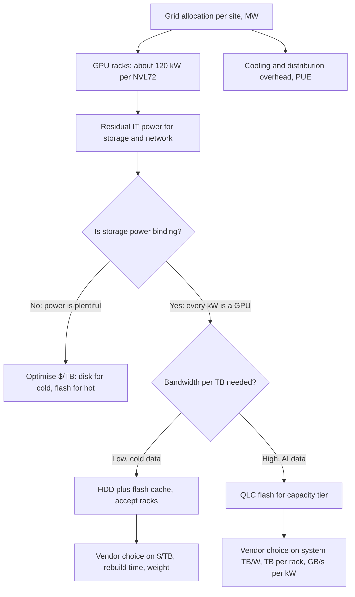

# 38. Power, density and the AI datacenter

> **Depth:** L2 · **Reading time:** ~9 min · **Last verified:** 2026-11-01
> **Prerequisites:** [Media physics](../01-storage-fundamentals/02-media-physics.md) · [Performance and economics metrics](../01-storage-fundamentals/04-performance-and-economics-metrics.md) · [Purity and DirectFlash](../04-everpure/26-purity-and-directflash.md) · [AI factories and neoclouds](35-ai-factories-and-neoclouds.md)

## TL;DR

- **AI datacenters are power-limited, not chip-limited.** NVIDIA, Microsoft, AWS, Meta and CoreWeave have all said so publicly. A site's grid connection caps its GPUs, so every storage watt is a watt that cannot run a GPU.
- **QLC flash beats disk about 2× per watt at the drive** (~8.2 against ~4.4 TB/W for the best of each). At system level the gap depends on drive size and on what sits in the box. A 2022-era flash enclosure can lose to a modern disk JBOD.
- **Density is where flash pulls away.** A rack of 245 TB QLC drives holds roughly 5× the raw petabytes of a rack of 44 TB disks. It also needs 2–3× the power per rack, which many halls cannot feed.
- **At grid prices, power savings never pay for the flash premium.** Storing 100 PB for five years on QLC rather than disk saves about 1.2 GWh, or roughly $170K, against a media premium of $8–37M. Flash wins only when freed watts become GPUs, when bandwidth per TB is required, or when NAND is bought at hyperscaler cost.
- **Disk still wins cold data at rest,** on $/TB and on embodied carbon. HAMR roadmaps (100 TB by 2029) improve disk's TB/W every generation. Vendor power claims from both camps need system-level, same-basis checks.

## Why this matters for Everpure strategy

"Flash replaces disk" used to be a cost-curve argument. With enterprise QLC at 15–23× disk per TB in 2026 ([Chapter 2](../01-storage-fundamentals/02-media-physics.md)), it is now a power argument. Everpure (NYSE: P, formerly PSTG) has made that argument central. Its DirectFlash hyperscaler wins were explained in terms of footprint and power ([Chapter 29](../04-everpure/29-hyperscaler-ecosystem-financials.md)), and it sells a contractual watts-per-TiB guarantee. If power stays the binding constraint for AI build-outs, a vendor with the best system-level TB/W has a demand driver that is independent of the NAND price cycle. If grid supply loosens, or HAMR closes the gap, the pitch falls back to $/TB, where disk wins.

This chapter gives the arithmetic to tell which world a deal is in. It builds on the metrics in [Chapter 4](../01-storage-fundamentals/04-performance-and-economics-metrics.md) and the module design in [Chapter 26](../04-everpure/26-purity-and-directflash.md), and does not repeat them.

## Core concepts

### The site power cap is the budget everything else comes out of

An AI campus starts from a fixed grid allocation, measured in megawatts and set years ahead by utilities and permits. GPUs are the revenue engine, so operators hand them as much of that allocation as possible. Networking, cooling overhead and storage share what is left. The leaders say this openly.

| Company | Who / where | What was said | Date |
|---|---|---|---|
| NVIDIA | Jensen Huang, GTC keynote | "We are now a power-limited industry"; revenue tracks available power[^1] | 2025-03 |
| AWS | Andy Jassy, Q2 2025 earnings call | "The single biggest constraint is power"[^2] | 2025-07-31 |
| Microsoft | Satya Nadella, Bg2 podcast | GPUs sit in inventory for lack of powered shells to install them in[^3] | late 2025 |
| Meta | Mark Zuckerberg, Dwarkesh podcast | Energy, not chips, would bound cluster build-out[^4] | 2024-04 |
| CoreWeave | Q2 2026 results | 1.5 GW active, 3.7 GW contracted; >1.85 GW active targeted by end-2026[^5] | 2026-08-11 |
| Meta storage team | FMS 2025 talk on QLC | QLC racks exceed 10 PB, but power is still higher than Meta would like[^6] | 2025-08-06 |

*Table 38.1 — Hyperscaler and neocloud leaders frame power, not silicon, as the binding constraint, and even flash's champions at Meta still want lower watts.*

Gartner expects datacenter electricity use to grow 26% in 2026[^7]. That gives a decision chain:

*Figure 38.1 — The site power cap flows down to storage; the flash-versus-disk choice turns on whether storage watts displace GPUs and how much bandwidth each terabyte must serve.*

At about 120 kW per GB200 NVL72 rack[^8], one GPU and its share of the rack draws roughly 1.7 kW. [Chapter 35](35-ai-factories-and-neoclouds.md) works out storage at about 4% of a GPU row's power. Small, but not free.

### Semiconductor bridge: storage after the end of frequency scaling

This is the move chip design made around 2005, when Dennard scaling ended. Once power density stopped falling with each node, clock frequency stopped being the goal. Designs became power-limited, and perf/W became the metric that sold chips. In a fixed-TDP SoC, watts saved in the uncore (I/O, fabric, memory controllers) become turbo headroom for the cores. Storage is the AI campus's uncore. Every watt it saves goes to the "cores", the GPUs, and Huang's framing makes tokens per watt the revenue metric. Storage vendors are being pulled into perf/W thinking the way CPU vendors were twenty years ago.

### TB per watt: what the datasheets actually say

![Horizontal bar chart in two panels. Top panel, single devices: Micron 6600 ION 245.76 TB QLC SSD 8.19 TB/W at 30 W max; Everpure 75 TB DirectFlash Module 7.5 TB/W at under 10 W typical; Solidigm D5-P5336 122.88 TB 4.92 TB/W at 25 W max; 44 TB HDD 4.4 TB/W at 10 W; Seagate Exos M 30 TB HDD 3.16 TB/W at 9.5 W. Bottom panel, systems: VAST Ceres DF-3060V2 DBox 1.86 TB/W; WD Data102 JBOD with 22 TB disks 1.73 TB/W; Everpure FlashBlade//E expansion 1.2 TB/W; FlashBlade//S500 0.77 TB/W; DDN AI400X3 0.21 usable TB/W.](../assets/charts/ch38-tb-per-watt.svg)

*Figure 38.2 — At the drive, QLC is about 2× disk per watt; at system level, older flash enclosures and performance appliances can trail a modern disk JBOD.*
Data: `data/ch38_tb_per_watt.csv`

Three readings matter. First, drive-level TB/W tracks capacity per device, because power per device barely changes. A nearline disk draws about 9.5–10 W whether it holds 30 or 44 TB[^9][^10]. A large QLC drive draws 25–30 W whether it holds 122 or 245 TB[^11][^10]. Everpure's 75 TB module was stated at under 10 W[^12]. Second, system overhead swamps drive differences. Controllers, fans, NICs and DRAM cut TB/W 2–10×. VAST's 1U DBox reaches about 1.9 TB/W before its CNodes[^13]. A WD 102-bay JBOD of 22 TB disks reaches about 1.7 TB/W before its head server[^14]; filled with 44 TB disks at similar watts it would reach about 3.5 TB/W (illustrative), ahead of the DBox. Everpure's FlashBlade//E (0.83 W/TB per expansion) and FlashBlade//S500 (1.3 W/TB) include their compute[^15][^16]. Third, performance boxes sit in a different class. DDN's 2U AI400X3 is rated at 2,400 W[^17], about 0.2 usable TB/W on an implied ~500 TB [VERIFY: usable capacity per appliance]. It is built for GB/s per kW, not TB/W.

The lesson: compare systems at the same scope, watts basis and drive generation.

### Rack density: petabytes per rack

| Configuration (42U rack, ~36U for storage) | Devices | Raw PB per rack | IT kW per rack | Basis |
|---|---|---|---|---|
| 7 × 4U 106-bay JBOD + 4 head servers, 44 TB HDD | 742 | 32.6 | ~11 | Worked example: 15 W per bay all-in |
| Same, 100 TB HAMR (WD 2029 roadmap[^18]) | 742 | 74.2 | ~11 | Illustrative |
| 30 × 1U servers, 24 × 122.88 TB QLC | 720 | 88.5 | ~32 | Worked example: 25 W/drive + 450 W/server |
| 30 × 1U servers, 24 × 245.76 TB QLC | 720 | 176.9 | ~32 | Matches Micron's 720-drive rack[^10] |
| Deployed hyperscale QLC rack (Meta) | n/d | >10 | n/d | FMS 2025[^6] |

*Table 38.2 — Illustrative: QLC holds about 5× the petabytes per rack of 44 TB disk, but at about 3× the kW, so real racks are often power-capped far below the theoretical maximum.*

Two caveats keep this honest. A full flash rack at ~32 kW exceeds the 10–15 kW many air-cooled halls feed, so operators spread it across racks. And deployed racks, such as Meta's ">10 PB", run well below the theoretical ceiling because of power, cooling, network ports and drive generation. Disk racks hit a different wall: floor loading. A rack of 742 nearline drives weighs well over a tonne.

### Worked example: 100 PB for five years

**Requirement:** 100 PB usable, held flat for five years, read-mostly. **Illustrative:** per-bay and per-server watts, PUE and usable ratios are this atlas's assumptions; prices are sourced.

| Line | HDD (44 TB) | QLC (245.76 TB) | Basis |
|---|---|---|---|
| Raw capacity at 75% usable | 133.3 PB | 133.3 PB | 8+2 erasure coding plus spares, assumption |
| Devices | 3,030 drives | 543 drives in 23 servers | Raw ÷ drive size |
| IT power | 45.5 kW | 23.9 kW | HDD 15 W/bay all-in (WD JBOD ≈12.7 W/bay[^14] + head share); QLC 25 W/drive + 450 W/server |
| Racks | 5 | 1 (2 if capped at ~15 kW) | Table 38.2 |
| Facility power at PUE 1.3 | 59.1 kW | 31.1 kW | Assumption for a new AI-class hall |
| Energy, 5 years | 2.59 GWh | 1.36 GWh | × 43,800 h |
| Energy cost at $0.1385/kWh | $359K | $189K | US commercial average[^19] |
| Media cost, 2026 prices | $2.9M ($22/TB) | $40.3M ($302/TB) | HDD[^20]; QLC[^21] |
| Media cost, mid-2025 prices | $2.2M ($16.50/TB) | $10.7M ($80/TB) | [^20] |
| Embodied carbon, media | ~2.7 kt CO2e | ~21.3 kt CO2e | 0.16 kg/GB flash, about 1/8 for disk[^22] |

*Table 38.3 — Illustrative: QLC halves the power and cuts racks 5×, but the ~$170K energy saving is two orders of magnitude smaller than the media premium.*

The flash case has three escape routes from that table.

**1. Freed watts become GPUs.** The 21.6 kW of IT power saved is about 13 GPU slots at 1.7 kW each. At CoreWeave's US$6.16 H100 list price per GPU-hour[^23], 13 GPUs earn about $3.5M of gross rental over five years. That beats the electricity bill, but at 2026 NAND prices it still does not cover a $37M premium. At mid-2025 prices, with exabyte scale and higher-value GPUs, it starts to.

**2. Bandwidth per TB is required.** Meta's argument for QLC is that disk bandwidth per TB keeps falling as drives grow[^24]. Meta places QLC at workloads needing about 10 MB/s per TB. For 100 PB usable that means 1 TB/s. A nearline disk streams perhaps 250 MB/s at best and far less under mixed access. At an assumed 125 MB/s effective, you need about 8,000 drives instead of 3,030, roughly 120 kW. That is 5× the flash option's power, the regime where vendor claims of "75% less power" become plausible.

**3. NAND at hyperscaler cost.** In Everpure's second hyperscaler deal the customer buys its own NAND[^25]. The NAND then reaches the buyer near contract price, not array street price, which shrinks the media premium. That is why hyperscalers move first.

### Where disk still wins

Disk wins cold data at rest: archives, backup copies and data lakes read rarely. There the bandwidth requirement is low and $/TB dominates. It also wins on embodied carbon. Tannu and Nair estimated about 0.16 kg CO2e per GB to manufacture flash, about 8× disk per unit of capacity[^22]. In the example above, the embodied gap (~18.6 kt) dwarfs the operational savings (1.23 GWh, or 120–620 t at any grid intensity from 0.1 to 0.5 kg/kWh). That 2022 figure predates today's denser NAND, so treat it as an order of magnitude. Flash's carbon case leans on longer service life and on avoided racks and buildings.

## How Everpure approaches it vs. competitors

| Camp | Headline power/density claim | Basis | Steelman or caveat |
|---|---|---|---|
| Everpure | DFMs use up to 75% less power than disk in hyperscale (*company-stated*)[^26]; disk and 15 TB-SSD systems draw 2.4× its 75 TB-DFM system and 4.8× its 150 TB-DFM system (*company-stated*)[^27]; watts/TiB guarantee on Evergreen//One[^28] | Own system models; guarantee is contractual | Strongest when DFM size leads commodity SSDs; guarantee assumes data reduction on most tiers ([Chapter 4](../01-storage-fundamentals/04-performance-and-economics-metrics.md)) |
| Commodity QLC (Micron, Solidigm) | ~8.2 vs ~4.4 TB/W drive-level (*vendor*)[^10]; 1 EB study: 77% less power, 90% less space than HDD on Ceph (*vendor*)[^29] | Drive max watts; 10-year model | Credible at drive level; system results depend on the software vendor |
| VAST | ~500 W per PB with 30 TB QLC (*company-stated*, 2021)[^30] | DBox plus CNodes | Pioneered QLC at scale; today's 61 TB-class DBoxes trail 245 TB-class designs |
| HDD vendors (Seagate, WD) | Disk more cost- and energy-efficient per TB for mass data (Seagate CEO)[^31]; Mozaic 3+ cuts power per TB 40% and embodied carbon per TB 55%, the latter against a 16 TB PMR drive (*vendor*)[^32] | Per-drive, own baseline | Right on $/TB and embodied carbon; weak on bandwidth per TB |
| VDURA (hybrid) | HDD systems lower total carbon (*vendor*)[^33]; QLC at 22.6× HDD $/TB in Q1 2026[^34] | Hybrid flash plus HDD | Price data is real; argues mixed fleets |

*Table 38.4 — Every camp's power claim is true at its chosen scope; the counter-question is always "whole system, same watts basis, same drive generation, your bandwidth per TB".*

Everpure's structural edge is that it owns the flash translation layer, so its module capacity can run ahead of commodity SSDs. That edge narrows whenever a 245 TB drive ships ([Chapter 26](../04-everpure/26-purity-and-directflash.md)). The steelman for VAST and WEKA is that commodity 245 TB QLC brings much of the TB/W benefit with a broader supply base. The steelman for disk is the table above: at 2026 prices, cold exabytes stay on HDD. Options a strategy team might evaluate, based on public information: publishing audited system-level TB/W and GB/s per kW against NVIDIA reference sizings, and pricing guarantees per *usable* TiB for AI data that does not reduce.

## History and trajectory

In 2021, flash vendors like VAST argued density per rack unit[^30]. In 2023, Pure Storage added a watts-per-TiB SLA[^28] and showed roughly 1 W/TB with FlashBlade//E[^15]. In 2024–25 power entered the CEO vocabulary: Zuckerberg[^4], Huang[^1], Jassy[^2]. Meta published its QLC case[^24], widely read as pointing to DirectFlash, and Pure's hyperscaler revenue began. In 2026, 245 TB QLC drives shipped[^10] while NAND prices rose every quarter[^35]. That widened the $/TB gap just as the power argument peaked.

Disk is not standing still. Western Digital targets HAMR at 100 TB by 2029[^18]. At constant ~10 W per drive that is ~10 TB/W, about today's best QLC at the drive. Expect flash to answer with 512 TB-class drives and larger modules ([Chapter 53](../07-history-and-future/53-future-trends.md)), and the contest to shift from TB/W to GB/s per kW, where disk cannot follow.

## Numbers that matter

| Metric | Value | Context | Source / date |
|---|---|---|---|
| Drive TB/W, 245 TB QLC vs 44 TB HDD | ~8.2 vs ~4.4 | Max-rated watts, vendor comparison | StorageReview, 2026[^10] |
| System TB/W, VAST DBox vs WD 102-bay JBOD | ~1.9 vs ~1.7 | Excludes CNodes and head server | VAST; WD[^13][^14] |
| GB200 NVL72 rack power | ~120 kW | One GPU slot ≈ 1.7 kW | SemiAnalysis[^8] |
| CoreWeave active / contracted power | 1.5 GW / 3.7 GW | Q2 2026 | Results, 2026-08-11[^5] |
| 100 PB × 5 years, energy saved by QLC | ~1.23 GWh (~$170K) | vs $8–37M media premium | Worked example |
| PB per rack, 245 TB QLC vs 44 TB HDD | ~177 vs ~33 | ~32 vs ~11 kW per rack | Worked example; Micron[^10] |
| Flash embodied carbon | ~0.16 kg CO2e/GB, ~8× HDD | 2022 estimate | Tannu & Nair[^22] |
| HAMR roadmap | 100 TB by 2029 | ~10 TB/W at ~10 W | Western Digital, 2026-02-03[^18] |

## Conversation playbook

**Questions for a PM**

1. *"In a power-capped AI deal, what is our system TB/W and GB/s per kW at the customer's real configuration, including compute?"* Strong: a number with scope and watts basis stated, and a named competitor configuration.
2. *"Where do we lose to disk, and do we walk away?"* Strong: cold archive and backup at 2026 NAND prices; a break-even $/TB premium per segment.
3. *"How does the watts-per-TiB guarantee behave on AI data that does not reduce?"* Strong: the usable-capacity figure and who bears the risk.

**Questions for an engineer**

1. *"What fraction of system power is NAND, and what is controller, DRAM, fans and NICs?"* Strong: a breakdown showing where DFM design saves watts, not just "bigger modules".
2. *"What do our boxes draw idle, at read-mostly load and during rebuild?"* Strong: measured curves, not nameplate.
3. *"How does QLC write power scale with sustained ingest?"* Strong: watts per GB/s written, and how the write path limits it.

**Don't say this:**

- "Flash saves so much power it pays for itself." Not at grid prices: about $170K against tens of millions for 100 PB.
- "Our TB/W beats disk," comparing a drive with an enclosure. Compare whole systems.
- "HDD is dead." Disks are shipping at 40–44 TB, with HAMR targeting 100 TB.
- "Storage power is a big share of an AI datacenter." It is a few percent; it matters only because the cap is hard.

## Going deeper (optional, L3 pointers)

- Meta's QLC case and E2 form-factor work[^24][^6]: bandwidth per TB as the tiering criterion.
- Tannu and Nair, "The Dirty Secret of SSDs"[^22]: embodied-carbon method and its sensitivity to refresh cycles.
- [Chapter 48](../06-industry-and-competition/48-media-suppliers-and-nand-cycle.md) for how NAND pricing moves the break-even.

## Key terms

- **Power cap (site)** — the fixed grid allocation that bounds all IT load.
- **TB/W** — capacity per watt; drive-level and system-level figures differ widely.
- **PB per rack** — rack density, limited by power, cooling and floor loading.
- **GB/s per kW** — bandwidth per kilowatt, the AI-era storage efficiency metric.
- **Bandwidth per TB** — throughput a device delivers per unit of capacity; falls as disks grow.
- **HAMR** — heat-assisted magnetic recording, disk's capacity roadmap.
- **Embodied carbon** — emissions from manufacturing hardware.
- **Dennard scaling** — the historical rule that kept power density constant as transistors shrank.
- **Powered shell** — a datacenter building with grid power and cooling ready for IT.

## Sources

[^1]: Analytics India Magazine, "We Are Now a Power-Limited Industry, Says Jensen Huang," 2025-03. https://analyticsindiamag.com/deep-tech/we-are-now-a-power-limited-industry-says-jensen-huang/ (retrieved 2026-11-01); corroborated by G. Lockwood, "GTC 2025 recap," 2025-03. https://blog.glennklockwood.com/2025/03/gtc-2025-recap.html (retrieved 2026-11-01).
[^2]: SDxCentral, "AWS achieves $123B annualized revenue run rate," 2025-07-31. https://www.sdxcentral.com/news/aws-achieves-123b-annualized-revenue-run-rate/ (retrieved 2026-11-01); corroborated by Data Center Knowledge, "Amazon, Echoing Microsoft, Says It Can't Keep Up With AI Demand," https://www.datacenterknowledge.com/cloud/amazon-echoing-microsoft-says-it-can-t-keep-up-with-ai-demand (retrieved 2026-11-01).
[^3]: TechRadar Pro, "'You may actually have a bunch of chips sitting in inventory that I can't plug in': Satya Nadella admits…," 2025-11. https://www.techradar.com/pro/you-may-actually-have-a-bunch-of-chips-sitting-in-inventory-that-i-cant-plug-in-satya-nadella-admits-an-embarrassing-shortcoming-so-lets-hope-it-doesnt-set-the-company-back-in-the-ai-arms-race (retrieved 2026-11-01); corroborated by DatacenterDynamics, "Microsoft has AI GPUs sitting in inventory because it lacks the power necessary to install them," https://www.datacenterdynamics.com/en/news/microsoft-has-ai-gpus-sitting-in-inventory-because-it-lacks-the-power-necessary-to-install-them (retrieved 2026-11-01). [VERIFY: exact podcast date, reported as late October/early November 2025]
[^4]: SDxCentral, "Meta's Mark Zuckerberg says energy constraints are holding back AI data center buildout," 2024-04. https://www.sdxcentral.com/news/metas-mark-zuckerberg-says-energy-constraints-are-holding-back-ai-data-center-buildout/ (retrieved 2026-11-01).
[^5]: MarketBeat, "CoreWeave Q2 Earnings Call Highlights," 2026-08-11. https://www.marketbeat.com/instant-alerts/coreweave-q2-earnings-call-highlights-2026-08-11/ (retrieved 2026-11-01); corroborated by The Energy Mag, "CoreWeave reports $2.58 billion Q2 2026 revenue amid infrastructure expansion," 2026-08. https://theenergymag.com/news/market-news/coreweave-reports-2-58-billion-q2-2026-revenue-amid-infrastructure-expansion (retrieved 2026-11-01).
[^6]: Future of Memory and Storage 2025 proceedings, "QLCP-201-1 (Gupta)," 2025-08-06. https://files.futurememorystorage.com/proceedings/2025/20250806_QLCP-201-1_Gupta.pdf (seen via search summary, 2026-11-01). [VERIFY: speaker's Meta affiliation and slide wording]
[^7]: Gartner, "Gartner Says Data Center Electricity Consumption to Grow 26% in 2026," 2026-06-10. https://www.gartner.com/en/newsroom/press-releases/2026-06-10-gartner-says-data-center-electricity-demand-to-grow-26-percent-in-2026 (retrieved 2026-11-01).
[^8]: SemiAnalysis, "GB200 Hardware Architecture and Component Supply Chain & BOM," 2024-07. https://newsletter.semianalysis.com/p/gb200-hardware-architecture-and-component (retrieved 2026-11-01); Gigabyte, "NVIDIA GB200 NVL72 (GIGAPOD)," n.d. https://www.gigabyte.com/Enterprise/GIGAPOD-Pod-Scale/AI-DLC-POD_NVIDIA-GB200-NVL72 (retrieved 2026-11-01).
[^9]: StorageReview, "Seagate Exos M 30TB Review: HAMR-ing Storage Density," 2025-07-15. https://www.storagereview.com/review/seagate-exos-m-30tb-review-hamr-ing-storage-density (retrieved 2026-11-01). 9.5 W max operating, 6.9 W idle.
[^10]: StorageReview, "Micron 6600 ION 245TB SSD Review: A Quarter Petabyte Per Drive Bay," 2026. https://www.storagereview.com/review/micron-6600-ion-245tb-ssd-review-a-quarter-petabyte-per-drive-bay (retrieved 2026-11-01); Micron, "Industry-Leading 245TB Micron 6600 ION Data Center SSD Now Shipping," 2026-05-05. https://investors.micron.com/news/press-release/2026/Industry-Leading-245TB-Micron-6600-ION-Data-Center-SSD-Now-Shipping/default.aspx (retrieved 2026-11-01).
[^11]: StorageReview, "Solidigm 122.88TB D5-P5336 Review," 2025. https://www.storagereview.com/review/solidigm-122-88tb-d5-p5336-review-high-capacity-storage-meets-operational-efficiency (retrieved 2026-11-01). 24 W active, 5 W idle; 25 W maximum per secondary reviews.
[^12]: Blocks & Files, "300TB flash drives coming from Pure Storage," 2023-03-01. https://blocksandfiles.com/2023/03/01/300tb-flash-drives-coming-from-pure-storage/ (retrieved via search 2026-11-01).
[^13]: VAST Data, "DBox DF-3015V2/DF-3060V2 Ceres Datasheet," n.d. https://kb.vastdata.com/docs/dbox-df-3015v2df-3060v2-ceres-datasheet (seen via search summary, 2026-11-01): 1,352 TB raw, 368 W idle, 400–728 W active, 850 W max; CDW lists 650 W operational, https://www.cdw.com/product/vast-df-3060-v2-storage-enclosure/8370305 (retrieved 2026-11-01).
[^14]: Western Digital, "Ultrastar Data102 3000 Series User Guide," 2024-08 (via ManualsLib). https://www.manualslib.com/manual/4255469/Western-Digital-Ultrastar-Data102-3000-Series.html (seen via search summary, 2026-11-01). Under 1,300 W in WD internal testing; 2,244 TB configuration per reseller listing, https://store.digital-origin.co.uk/western-digital-ultrastar-data102-disk-array-2244-tb-rack-4u-black-grey-1es2494.html. [VERIFY: search-summary only]
[^15]: Blocks & Files, "Pure swings FlashBlade//E at unstructured data," 2023-03-01. https://blocksandfiles.com/2023/03/01/pure-flashblade-e/ (retrieved 2026-11-01). About 1.06 W/TB starting configuration, 0.83 W/TB per expansion.
[^16]: Everpure Support, "FlashBlade//S Simplifies and Accelerates GPU-provider AI Services for NVIDIA Cloud Partners," n.d. https://support.everpuredata.com/r/nvidia/flashblades-simplifies-and-accelerates-gpu-provider-ai-services-for-nvidia-cloud-partners (seen via search summary, 2026-11-01). [VERIFY: search-summary only]
[^17]: DDN, "DDN Powers the AI Factory of the Future with Record-Breaking Performance Density," 2025-08-04. https://www.ddn.com/press-releases/ddn-powers-the-ai-factory-of-the-future-with-record-breaking-performance-density/ (retrieved via search 2026-11-01); corroborated by HPCwire, 2025-08-05. https://www.hpcwire.com/aiwire/2025/08/05/ddn-showcases-ai400x3-performance-in-latest-mlperf-storage-benchmarks/
[^18]: Western Digital, "Western Digital Accelerates Storage Innovation for AI Era," 2026-02-03. https://www.westerndigital.com/company/newsroom/press-releases/2026/2026-02-03-western-digital-accelerates-storage-innovation-for-ai-era (retrieved 2026-11-01).
[^19]: U.S. Energy Information Administration, "Electric Power Monthly, Table 5.3" (commercial sector, 12 months to July 2026), 2026-09. https://www.eia.gov/electricity/monthly/epm_table_grapher.php?t=epmt_5_3 (retrieved 2026-11-01). [VERIFY: search-summary only]
[^20]: ServNet UK, "All-flash vs nearline HDD TCO 2026" (30 TB HDD $668 in Q1 2026, $495 in Q2 2025; 30 TB QLC $2,450 in Q2 2025), 2026. https://www.servnetuk.com/insights/all-flash-vs-nearline-hdd-tco-2026 (retrieved 2026-11-01). [VERIFY: search-summary only]
[^21]: TechRadar Pro, "World's largest SSD has tripled in price in just nine months and now costs more than a new car," 2026. https://www.techradar.com/pro/worlds-largest-ssd-has-tripled-in-price-in-just-nine-months-and-now-costs-more-than-a-new-car (retrieved 2026-11-01). $37,128 for 122.88 TB (~$302/TB).
[^22]: S. Tannu and P. J. Nair, "The Dirty Secret of SSDs: Embodied Carbon," HotCarbon 2022. https://arxiv.org/abs/2207.10793 (retrieved via search 2026-11-01); coverage in Network World, "Are HDDs greener than SSDs?" https://www.networkworld.com/article/3706371/are-hdds-greener-than-ssds.html (retrieved 2026-11-01).
[^23]: CoreWeave, "Pricing," n.d. (2026); 8× HGX H100 at US$49.24/hr. https://www.coreweave.com/pricing (retrieved 2026-11-01).
[^24]: Meta Engineering, "A case for QLC SSDs in the data center," 2025-03-04. https://engineering.fb.com/2025/03/04/data-center-engineering/a-case-for-qlc-ssds-in-the-data-center/ (retrieved via search 2026-11-01); The Register, "Quad goals: Meta proposes QLC SSDs as a new storage tier in datacenters," 2025-03-07. https://www.theregister.com/2025/03/07/meta_proposes_qlc_ssds_as/ (retrieved 2026-11-01).
[^25]: Everpure, "Everpure Lands New Design Win with Second Top-Five Hyperscaler," 2026-08-10. https://www.everpuredata.com/company/newsroom/press-releases/everpure-lands-new-design-win-with-second-top-five-hyperscaler.html (retrieved 2026-11-01).
[^26]: Pure Storage, "Hyperscaler," n.d. https://purestorage.com/pure-advantage/platform/hyperscaler.html (retrieved 2026-11-01).
[^27]: Blocks & Files, "Pure Storage claims its flash beats SSDs and disks on power and carbon metrics," 2025-08-11. https://blocksandfiles.com/2025/08/11/pure-storage-flash-beats-ssds-and-disks-on-power-and-carbon-metrics/ (retrieved via search 2026-11-01).
[^28]: Pure Storage, "With Industry-First Energy Efficiency Guarantee, Pure Storage Further Expands SLA Offerings for Evergreen//One," 2023-01-18. https://www.everpuredata.com/company/newsroom/press-releases/pure-expands-sla-offerings-evergreen-one.html (retrieved 2026-11-01).
[^29]: Solidigm, "The Economics of Exabyte Storage," n.d. https://www.solidigm.com/products/technology/economics-of-exabyte-data-storage.html (retrieved via search 2026-11-01).
[^30]: StorageNewsletter, "VAST Data Universal Storage All-Flash Platforms Double Storage Density With Intel QLC 30TB SSDs," 2021-12-23. https://www.storagenewsletter.com/2021/12/23/vast-data-universal-storage-all-flash-platforms-double-storage-density-with-intel-qlc-30tb-ssds/ (retrieved 2026-11-01).
[^31]: Insider Monkey, "Seagate Technology Holdings plc (NASDAQ:STX) Q3 2026 Earnings Call Transcript," 2026-04. https://www.insidermonkey.com/blog/seagate-technology-holdings-plc-nasdaqstx-q3-2026-earnings-call-transcript-1749863/ (retrieved via search 2026-11-01).
[^32]: Seagate, "Seagate's Breakthrough 30TB+ Hard Drives Ramp Volume…," 2024-01-17. https://www.businesswire.com/news/home/20240117730823/en (retrieved via search 2026-11-01).
[^33]: Blocks & Files, "VDURA argues HDD systems are greener than flash arrays," 2024-08-01. https://blocksandfiles.com/2024/08/01/vdura-hdd-storage-is-greener-than-flash/ (retrieved via search 2026-11-01).
[^34]: Blocks & Files, "VDURA says 30 TB QLC SSD capacity now costs 22.6x more than HDD," 2026-04-08. https://www.blocksandfiles.com/flash/2026/04/08/vdura-says-30-tb-qlc-ssd-capacity-now-costs-226x-more-than-hdd/5214761 (retrieved via search 2026-11-01).
[^35]: TrendForce, "AI Server Demand Sustains Memory Contract Price Increases in 4Q26, While Consumer-Side Pressure Persists," 2026-09-30. https://www.trendforce.com/presscenter/news/20260930-13258.html (retrieved 2026-11-01).
