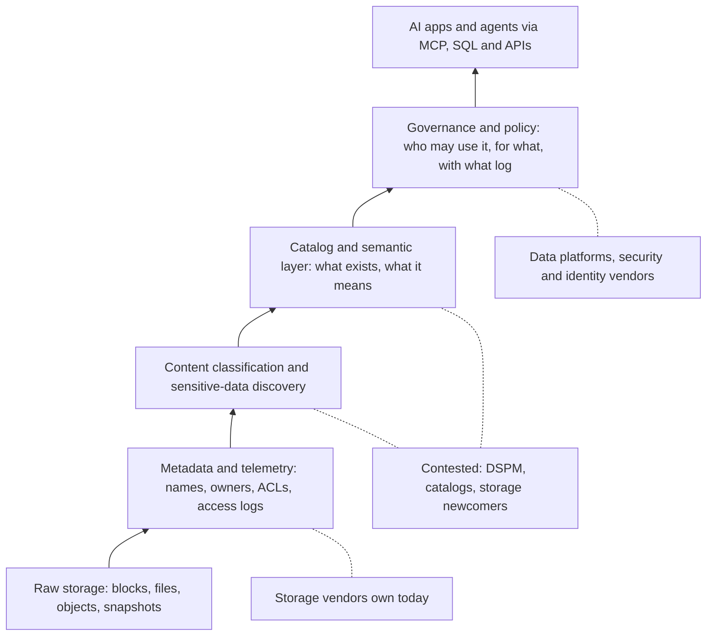
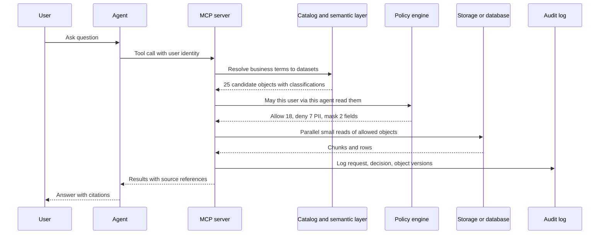
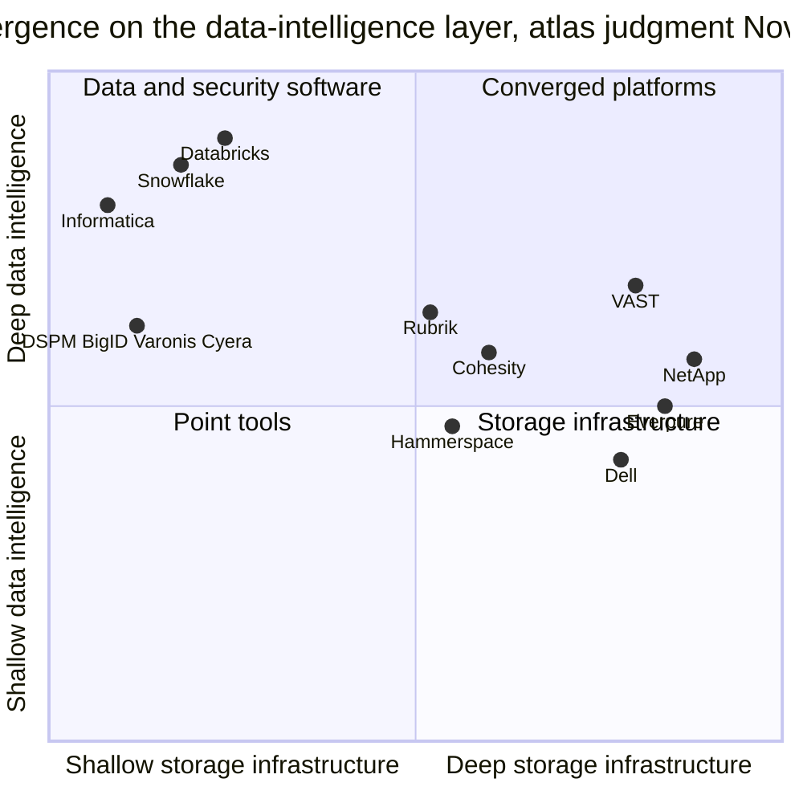
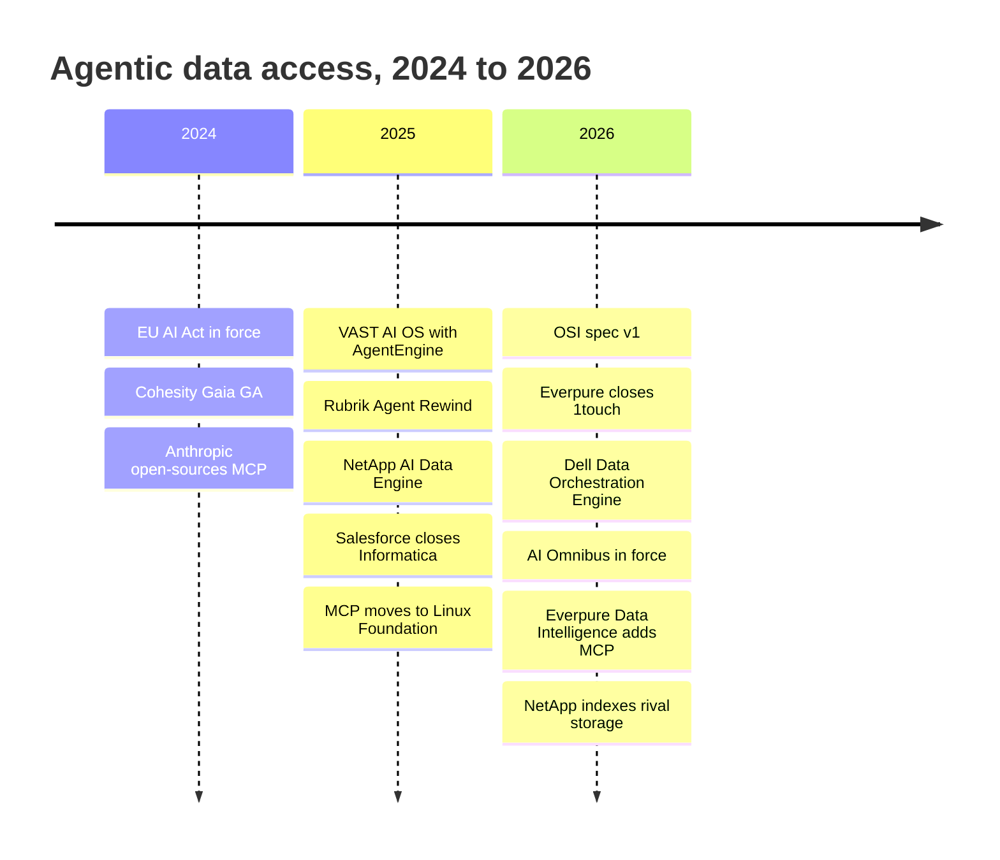

# 39. Agentic AI and data intelligence

> **Depth:** L2 · **Reading time:** ~9 min · **Last verified:** 2026-11-01
> **Prerequisites:** [Metadata](../03-system-architecture/21-metadata.md) · [Control planes](../03-system-architecture/22-control-planes.md) · [Platform and software](../04-everpure/28-platform-and-software.md) · [The AI data pipeline end to end](30-ai-data-pipeline.md) · [RAG, vector databases and AI-native data formats](33-rag-vector-lakehouse.md)

## TL;DR

- **Agents turn metadata into a product.** An agent can only use data it can find, interpret and is allowed to touch, so knowing what exists, what it means and who may use it becomes as valuable as the bytes.
- **MCP is becoming the agent's I/O bus.** The Model Context Protocol (open-sourced November 2024, given to a Linux Foundation fund in December 2025, >10,000 servers) standardises how agents call tools[^1]. Bulk data still moves over S3, NFS and SQL.
- **Agents change the access pattern.** An agent fans one question out into dozens of tool calls and hundreds of small reads, each needing a delegated permission decision and a log line.
- **Every storage vendor now claims this layer.** VAST, NetApp, Dell, Hammerspace, Cohesity and Everpure (Data Intelligence, from the US$125.0M 1touch deal[^2]) all pitch it, against far larger catalog and data-security vendors.
- **The strategic question is neutrality.** Storage vendors see every write; data and security vendors see every vendor's storage and own the buyer. A storage vendor wins only if it covers data not on its own arrays.

## Why this matters for Everpure strategy

Everpure's "Data Primacy" pitch and its 1touch purchase rest on one bet: in an agentic enterprise, the scarce asset is *trusted context about data*, not capacity. If agents become the main consumers of data, control moves to whoever answers three questions per request: what is this, may this agent see it, and what did it do with it. A vendor that answers them stays sticky as hardware commoditises; one that does not becomes the S3 endpoint under someone else's catalog ([Chapter 33](33-rag-vector-lakehouse.md)).

The rivals are not only storage vendors. Salesforce paid US$8 billion for Informatica's catalog and governance business (closed November 2025)[^3]. The data-security posture management (DSPM) specialist Cyera raised US$600 million at a US$12 billion valuation in June 2026 (*reported*)[^4]. Those prices show where the value sits, and how costly it is to buy in.

## Core concepts

### Metadata is the raw material

A storage system holds three kinds of metadata, and owns two of them by default ([Chapter 21](../03-system-architecture/21-metadata.md)):

1. **System metadata:** names, paths, sizes, owners, access-control lists (ACLs), timestamps, snapshots, replicas.
2. **Telemetry:** who read or wrote what, when, from where. Control planes such as Pure1 log it ([Chapter 22](../03-system-architecture/22-control-planes.md)).
3. **Content-derived metadata:** what the bytes *are*. This file holds a passport number; this table is EU customer data. Producing it means opening and classifying content, the job of discovery and DSPM tools and now Everpure Data Intelligence.

**Semiconductor bridge:** system metadata is the tag RAM of a cache: it tells you a line exists and where. Content metadata means reading the data array itself, which costs bandwidth. Telemetry is the on-die bus monitor: only something on the write path sees every transaction without sampling, the core of the storage-vendor argument ([Chapter 28](../04-everpure/28-platform-and-software.md)).

*Figure 39.1 — Each layer is built from the one below; storage vendors own the bottom two, and the fight is over layers three and four, where meaning and sensitivity are attached to the bytes.*

### Catalogs and semantic layers

A **catalog** records what datasets exist, their schemas, owners, classifications and lineage. A **semantic layer** records what business terms *mean*: one governed definition of "active customer" or "net revenue", with the joins and filters that compute it. Humans carry these definitions in their heads; agents do not. Ask an LLM for "Q3 churn" over 4,000 raw tables and it guesses a join, returning a confident wrong number.

The industry is standardising this layer. Snowflake's Open Semantic Interchange (OSI) published a first, Apache-2-licensed specification in January 2026 covering datasets, metrics, dimensions and relationships. Databricks, Informatica, Salesforce, dbt Labs and dozens of others were in the working group[^5]. An analyst noted Everpure is not a member[^6] [VERIFY: search-summary only]. **Semiconductor bridge:** the semantic layer is the instruction-set architecture between "software" (agents) and "hardware" (tables and files), and whoever writes the ISA shapes everything above it.

### MCP: the agent's I/O bus

**MCP** defines how an AI application (the *host*, with an MCP *client*) discovers and calls an MCP *server* that exposes **tools** (actions), **resources** (readable data) and **prompts**. Messages are JSON-RPC[^7]. MCP replaces an M × N mesh of custom connectors[^8]: a storage vendor writes one server and every compliant agent can use it.

MCP is a **control and query plane, not a data plane**: an agent asking for "contracts with change-of-control clauses" gets references and snippets; training-scale bytes still move over S3, NFS or GPUDirect ([Chapter 11](../02-protocols-and-networking/11-gpu-data-path.md)). It also pushes security onto the server. The 2025-11-25 specification treats MCP servers as OAuth resource servers, forbids passing the client's token through to upstream APIs, and warns of **confused-deputy** attacks, in which a server with broad privileges is tricked into acting for a caller who lacks them[^9]. An MCP server in front of an array is a privileged deputy by design.

### Why agents create new access patterns

*Figure 39.2 — The policy check and audit write sit on the critical path of every agent tool call.*

An agent splits a task into parallel sub-queries, retries and chains tools. Four properties follow.

- **Many small reads.** Metadata lookups and 4–64 KB chunk fetches dominate, favouring low-latency flash and fast metadata services over raw GB/s.
- **Fan-out.** Like a GPU warp's scatter-gather loads, the slowest of hundreds of object touches sets completion time.
- **Fine-grained, delegated permissions.** The agent acts *on behalf of* a user, so the effective right is the user's entitlements intersected with the agent's scope, often at row or field level, finer than array ACLs.
- **Lineage.** Auditing or undoing an action requires knowing which object versions informed it; snapshots make that possible.

**Worked example (illustrative).** 5,000 employees each give an agent 10 tasks a day; each task makes 8 tool calls touching 25 objects. That is 5,000 × 10 × 8 × 25 = **10 million access decisions a day**. Over a 10-hour workday that averages 10M ÷ 36,000 s ≈ **280 per second**, with peaks several times higher. The same humans opening ~50 files each make 250,000, 40× fewer. At ~1 KB per log record, that is ~10 GB of audit log a day, or ~1.8 TB over six months. Databricks says agents created ~80% of databases on Neon (*company-stated*, 2025)[^10].

**Semiconductor bridge:** the policy engine is to agents what an **IOMMU** is to DMA-capable devices. Every access is translated and permission-checked, and the decision cache works like an IOTLB. Too slow and every I/O stalls; cache too long and a revoked permission stays live.

### Governance becomes a runtime requirement

The EU AI Act (Regulation 2024/1689) entered into force on 1 August 2024. Its prohibitions applied from 2 February 2025 and general-purpose AI model obligations from 2 August 2025[^11]. For high-risk systems, defined by use case (hiring, credit, critical infrastructure), not by whether an agent is involved, Article 10 requires governed, representative training data and Article 12 automatic event logging, with logs kept at least six months[^11]. The Digital Omnibus on AI (Regulation 2026/1744, in force 27 July 2026) moved high-risk deadlines to 2 December 2027 (Annex III) and 2 August 2028 (embedded in regulated products), without delaying prohibitions or GPAI rules[^12]. Fines reach €35 million or 7% of worldwide turnover for prohibited practices[^11].

Gartner predicted in June 2025 that over 40% of agentic AI projects would be cancelled by the end of 2027, citing cost, unclear value and weak risk controls[^13]: governance decides whether agents reach production.

### Can storage vendors own this layer?

**The storage-vendor case:** the array holds the inventory and sits on the write path, so it can classify on ingest or from snapshots without weekly crawls. It can enforce policy where the bytes live, and immutable snapshots can undo what an agent did.

**The data and security-vendor case:** data sits on many vendors' storage, in SaaS and in cloud, so one vendor's governance is partial; the buyer (CDO or CISO) is not the storage buyer; and catalog and DSPM vendors are neutral and already wired to identity systems. Coverage of *other people's* data decides it, which is why NetApp's September 2026 move to index any NFS, SMB or S3 store[^14] and Dell's claim that its orchestration engine works beyond Dell storage[^15] matter more than their feature lists.

## How Everpure approaches it vs. competitors

| Vendor | Offering (first date) | What it does | Reaches other vendors' data? | Agent interface | Status (Nov 2026) |
|---|---|---|---|---|---|
| Everpure | Data Intelligence, ex-1touch (GA June 2026)[^16]; Data Stream | Discovery, entity-level classification, knowledge graph, lineage, residency and access policy | Analysts say yes (databases, SaaS, third-party storage)[^6] | Native MCP, Oct 2026[^17] | GA; MCP new |
| VAST | InsightEngine (2024–25), AgentEngine (May 2025), PolicyEngine (Feb 2026)[^18][^19] | Embedding and RAG in-platform; serverless agent runtime; inline policy checks and tamper-resistant traces (*company-stated*) | Mainly data on VAST | MCP-compatible tools in AgentEngine[^18] | PolicyEngine due by end-2026 |
| NetApp | AI Data Engine (Oct 2025)[^20] | Metadata engine, curation and embeddings, guardrails in ONTAP | Expanded to any NFS, SMB, S3 (Sept 2026)[^14] | MCP server in NetApp Console[^14] | Lighthouse 2026 [VERIFY: AIDE GA date]; PEAK:AIO deal pending |
| Dell | AI Data Platform, Data Orchestration Engine (Mar 2026)[^15] | Low-code discovery, prep and governance into AI-ready datasets; from Dataloop (~US$120M, *reported*)[^21] | Yes, per analysts[^15] | Workflows, NIM, marketplace | Available Q1 CY26 per Dell |
| Hammerspace | AI Data Platform (Oct 2025)[^22] | Assimilates metadata from existing storage into a global namespace; Milvus vectors | Yes, by design | MCP services[^22] | Shipping, NVIDIA design-aligned |
| Cohesity | Gaia (GA Mar 2024)[^23]; Maestro (June 2026)[^24] | RAG search over backup copies, on-prem option with NVIDIA | Any data it protects | Gaia MCP now; Maestro MCP later 2026 | Partly GA |
| Rubrik | Agent Rewind (Aug 2025)[^25] | Tracks agent actions and rolls back files, databases, configs | Any data it protects | Agent-platform integrations | GA (*company-stated*) |

*Table 39.1 — Storage and data-protection vendors arrived at the same layer from different floors; the dividing lines are coverage of other vendors' data and whether agents can act or only read.*

*Figure 39.3 — Atlas judgment, not vendor data: storage vendors are climbing while data vendors are not descending, and VAST sits furthest up.*

**Trade-offs.** VAST is the steelman for "storage becomes the AI data platform": database, runtime and policy in one system, but scoped to data on VAST. NetApp has the deepest metadata heritage and now indexes rival storage. Dell (Dataloop) and Everpure (1touch) each bought a ~US$120–125M startup to get here. Cohesity and Rubrik hold a full copy of most enterprise data and can *undo* agent actions. Everpure's asset is entity-level classification plus a Pure1-managed fleet ([Chapter 28](../04-everpure/28-platform-and-software.md)); its gap is proof on non-Everpure data.

**Options a strategy team might evaluate, based on public information:**

1. **Neutral metadata hub.** Price Data Intelligence separately, lead with non-Everpure estates, connect to Unity Catalog, Polaris and Purview, and join OSI.
2. **Best substrate, partner above.** Feed write-path events and snapshot-based scanning to DSPM and catalog vendors.
3. **Agent-safety primitives.** Package SafeMode snapshots, per-agent QoS and audit export as "agent undo".
4. **Tuck-in M&A.** Semantic-layer or lineage assets in the 1touch price range. DSPM leaders at Cyera-type valuations are out of reach.

## History and trajectory

*Figure 39.4 — In two years the industry gained an agent protocol, a semantic-layer spec and a regulatory clock.*

The arc runs from storage-resource reports (2000s) through GDPR-era classification tools (2010s) to AI data platforms. NVIDIA's AI Data Platform design (March 2025) gave vendors a template for GPUs and retrieval next to data ([Chapter 34](34-nvidia-ecosystem.md)). The 2026 shift is from *preparing* data for RAG to *governing* agent access. Signals to watch over the next 12–18 months: separate disclosure of data-intelligence revenue; delegated-identity support in MCP; OSI moving to a foundation; and buying driven by the December 2027 deadline.

## Numbers that matter

| Metric | Value | Context | Source / date |
|---|---|---|---|
| MCP servers in existence | >10,000 | At donation to the Agentic AI Foundation | Anthropic, 2025-12[^1] |
| Everpure 1touch price | US$125.0M cash | Closed 2026-05-07 | 10-Q Q1 FY27[^2] |
| Dell Dataloop price | ~US$120M (*reported*) | Basis of Data Orchestration Engine | Calcalist via StorageNewsletter, 2026-01[^21] |
| Salesforce–Informatica | US$8B equity value | Catalog, governance, MDM; closed 2025-11-18 | Salesforce, 2025-11[^3] |
| Cyera valuation | US$12B (*reported*) | US$600M round, DSPM | SecurityWeek, 2026-06[^4] |
| Agent-created databases on Neon | ~80% (*company-stated*) | Machine demand overtaking human | Databricks, 2025-05[^10] |
| Access decisions, 5,000-user agent rollout | ~10M/day, ~280/s | 10 tasks × 8 calls × 25 objects | Worked example |
| EU AI Act high-risk deadline (Annex III) | 2 Dec 2027 | Delayed from 2 Aug 2026 | Regulation 2026/1744[^12] |
| Minimum log retention, high-risk AI | 6 months | Providers and deployers | AI Act Arts 19, 26[^11] |

## Conversation playbook

**Questions for a PM**

1. *"What share of Data Intelligence bookings cover data not on Everpure?"* Strong: a number and named estates (Oracle, M365, rival NAS).
2. *"Who is the buyer: storage admin, CDO or CISO, and who carries the quota?"* Strong: a named persona, separate SKU and quota credit for non-array deals.
3. *"How does Data Intelligence coexist with a customer's Purview, Collibra or Cyera?"* Strong: it feeds them, no rip-out.

**Questions for an engineer**

1. *"What does the MCP server do with a user's identity: pass it through, exchange it, or use a service account?"* Strong: token exchange, per-agent scopes, no shared superuser.
2. *"How many policy decisions per second can you sustain, and how fast does a revocation take effect?"* Strong: measured rates, cache lifetime in seconds, fan-out behaviour.
3. *"Is classification on the write path or off it?"* Strong: off-path, snapshot- or event-triggered, bounded controller impact.

**Don't say this:**

- "MCP moves the data." It moves requests and results; bulk bytes use S3, NFS or SQL.
- "The EU AI Act regulates all agents as high-risk." Risk class depends on use case.
- "Array ACLs are enough for agents." They work at file or share level; agents need delegated, field-level decisions.
- "Storage vendors will displace Databricks or Snowflake." The realistic prize is the metadata and policy beneath them.
- "Data intelligence is just RAG." RAG retrieves; data intelligence decides what may be retrieved.

## Going deeper (optional, L3 pointers)

- MCP specification 2025-11-25: authorization and security sections (OAuth 2.1, RFC 8707, RFC 9728).
- EU AI Act Articles 10, 12, 19 and 26, and the Digital Omnibus amendments to Article 113.
- The OSI specification; Unity Catalog's access-control model.
- Google's Zanzibar (USENIX ATC 2019) for high-rate permission checks.

## Key terms

- **Model Context Protocol (MCP)**, **MCP server**, **semantic layer**, **data catalog**, **DSPM**, **data lineage**, **on-behalf-of authorisation**, **confused deputy**, **policy decision point**, **content-derived metadata**, **Open Semantic Interchange (OSI)**, **high-risk AI system** — see the [glossary](../glossary.md).

## Sources

[^1]: Anthropic, "Donating the Model Context Protocol and establishing the Agentic AI Foundation," 2025-12-09. https://www.anthropic.com/news/donating-the-model-context-protocol-and-establishing-of-the-agentic-ai-foundation (retrieved 2026-11-01; read via search summary).
[^2]: SEC, "Everpure, Inc. Form 10-Q for the quarter ended May 3, 2026," 2026-06. https://www.sec.gov/Archives/edgar/data/0001474432/000147443226000061/pstg-20260503.htm (retrieved 2026-11-01).
[^3]: Salesforce via Business Wire, "Salesforce Completes Acquisition of Informatica," 2025-11-18. https://markets.financialcontent.com/clarkebroadcasting.mymotherlode/article/bizwire-2025-11-18-salesforce-completes-acquisition-of-informatica ; Seeking Alpha, "Salesforce completes acquisition of Informatica," 2025-11-18. https://seekingalpha.com/news/4523363-salesforce-completes-acquisition-of-informatica (both retrieved 2026-11-01).
[^4]: SecurityWeek, "Cyera Raises $600 Million at $12 Billion Valuation," 2026-06. https://www.securityweek.com/cyera-raises-600-million-at-12-billion-valuation/amp/ ; Globes, "Cyera raises $600m at $12b valuation," 2026-06-10. https://en.globes.co.il/en/article-1001545507 (both retrieved 2026-11-01).
[^5]: Snowflake, "Open Semantic Interchange's specs finalized," 2026-01-27. https://www.snowflake.com/en/blog/open-semantic-interchanges-specs-finalized/ (retrieved 2026-11-01; read via search summary).
[^6]: TechTarget, "Everpure grows into data management with Data Intelligence update," 2026-06. https://www.techtarget.com/searchstorage/news/366644759/Everpure-grows-into-data-management-with-Data-Intelligence-update (retrieved 2026-11-01; read via search summary).
[^7]: Model Context Protocol, "Specification, version 2025-11-25," 2025-11-25. https://modelcontextprotocol.io/specification/2025-11-25 (retrieved 2026-11-01; read via search summary).
[^8]: TechCrunch, "Anthropic proposes a new way to connect data to AI chatbots," 2024-11-25. https://techcrunch.com/2024/11/25/anthropic-proposes-a-way-to-connect-data-to-ai-chatbots/ (retrieved 2026-11-01).
[^9]: Model Context Protocol, "Security Best Practices," specification 2025-11-25. https://modelcontextprotocol.io/specification/2025-11-25/basic/security_best_practices (retrieved 2026-11-01; read via search summary).
[^10]: Databricks, "Databricks + Neon," 2025-05. https://www.databricks.com/blog/databricks-neon (retrieved 2026-11-01; read via search summary).
[^11]: European Union, "Regulation (EU) 2024/1689 (Artificial Intelligence Act)," Official Journal, 2024-07-12; Articles 10, 12, 19, 26, 99 and 113. https://eur-lex.europa.eu/eli/reg/2024/1689/oj (retrieved 2026-11-01).
[^12]: Cooley, "Digital AI Omnibus delays key deadlines, introduces new rules," 2026-07. https://cdp.cooley.com/digital-ai-omnibus-delays-key-deadlines-introduces-new-rules/ ; Northern Ireland Assembly, "EU law scrutiny tracker: Regulation (EU) 2026/1744," 2026. https://www.niassembly.gov.uk/assembly-business/brexit-and-beyond/eu-law-scrutiny-tracker/regulation-2026-1744/ (both retrieved 2026-11-01; read via search summary).
[^13]: W.Media, "Over 40 percent of Agentic AI projects could face the axe by end of 2027: Gartner," 2025-06-27. https://w.media/over-40-percent-of-agentic-ai-projects-could-face-the-axe-by-end-of-2027-gartner/ (retrieved 2026-11-01).
[^14]: Blocks & Files, "NetApp unveils fastest file system on the planet with great raft of other announcements," 2026-09-29. https://www.blocksandfiles.com/file/2026/09/29/netapp-unveils-fastest-file-system-on-the-planet-with-great-raft-of-other-announcements/5299808 ; Futurum Group, "NetApp Novus, PEAK:AIO and NetApp's Two-Market AI Strategy," 2026-09. https://futurumgroup.com/insights/netapp-novus-peakaio-and-netapps-two-market-ai-strategy/ (both retrieved 2026-11-01; read via search summary).
[^15]: Dell Technologies, "Dell AI Data Platform with NVIDIA Supercharges Enterprise AI with Breakthrough Data Orchestration and Storage Innovations," 2026-03-16. https://www.dell.com/en-us/dt/corporate/newsroom/announcements/detailpage.press-releases~usa~2026~03~dell-ai-data-platform-with-nvidia-supercharges-enterprise-ai-with-breakthrough-data-orchestration-and-storage-innovations.htm ; TechTarget, "Dell Data Orchestration Engine joins AI data pipeline fray," 2026-03. https://www.techtarget.com/searchstorage/news/366640330/Dell-Data-Orchestration-Engine-joins-AI-data-pipeline-fray (both retrieved 2026-11-01).
[^16]: HPCwire, "Everpure Wants to Improve Data Management for the Coming AI Wave," 2026-06-20. https://www.hpcwire.com/aiwire/2026/06/20/everpure-wants-to-improve-data-management-for-the-coming-ai-wave/ (retrieved 2026-11-01).
[^17]: Blocks & Files, "Everpure bulks up AI offer," 2026-09-30. https://blocksandfiles.com/flash/2026/09/30/everpure-bulks-up-ai-offer/5300162 ; NAND Research, "Everpure extends data intelligence and inference acceleration for enterprise agentic AI," 2026-09. https://nand-research.com/everpure-extends-data-intelligence-and-inference-acceleration-for-enterprise-agentic-ai/ (both retrieved 2026-11-01).
[^18]: Blocks & Files, "VAST Data launches AI operating system," 2025-05-21. https://www.blocksandfiles.com/ai-ml/2025/05/21/vast-data-launches-ai-operating-system/1613219 (retrieved 2026-11-01).
[^19]: HPCwire, "VAST Data Expands AI Data Stack, Keeps Eye on North Star," 2026-02-25. https://www.hpcwire.com/2026/02/25/vast-data-expands-ai-data-stack-keeps-eye-on-north-star/ ; IT Brief UK, "VAST Data debuts AI tools for safer, smarter agents," 2026-02. https://itbrief.co.uk/story/vast-data-debuts-ai-tools-for-safer-smarter-agents (both retrieved 2026-11-01).
[^20]: Blocks & Files, "NetApp disaggregates ONTAP storage and provides an AI Data Engine," 2025-10-14. https://blocksandfiles.com/2025/10/14/netapp-disaggregates-ontap-storage-and-provides-an-ai-data-engine/ ; NetApp, "NetApp Accelerates Momentum in AI Leadership with NVIDIA," press release, 2026-03-16. https://www.netapp.com/en/newsroom/press-releases/news-rel-20260316-181478/ (both retrieved 2026-11-01).
[^21]: StorageNewsletter, "Dell Acquired Dataloop AI for $120 Million," 2026-01-02. https://www.storagenewsletter.com/2026/01/02/dell-acquired-dataloop-ai-for-120-million/ ; Seeking Alpha, "Dell to acquire AI-data startup Dataloop in $120M deal - report," 2025-12-17. https://seekingalpha.com/news/4532624-dell-to-acquire-ai-data-startup-dataloop-in-120m-deal-report (both retrieved 2026-11-01).
[^22]: HPCwire, "Hammerspace Launches AI Data Platform Based on NVIDIA Reference Design," 2025-10-28. https://www.hpcwire.com/off-the-wire/hammerspace-launches-ai-data-platform-based-on-nvidia-reference-design/ ; Tech Field Day, "Taming Data Estate Chaos for AI with Hammerspace," 2026-01-29. https://techfieldday.com/video/taming-data-estate-chaos-for-ai-with-hammerspace/ (both retrieved 2026-11-01).
[^23]: Cohesity, "Cohesity Gaia is available now," 2024-03-15. https://www.cohesity.com/blogs/cohesity-gaia-is-available-now/ ; Business Wire, "Cohesity Introduces the Industry's First Generative AI-powered Conversational Search Assistant," 2024-02-28. https://www.businesswire.com/news/home/20240228412251/en/ (both retrieved 2026-11-01).
[^24]: Blocks & Files, "Cohesity goes agentic with headless protection," 2026-06-18. https://www.blocksandfiles.com/ai-ml/2026/06/18/cohesity-goes-agentic-with-headless-protection/5258151 ; Cohesity, "AI conversational search" solution page, n.d. https://www.cohesity.com/solutions/ai-conversational-search/ (both retrieved 2026-11-01; read via search summary).
[^25]: Rubrik via Business Wire, "Rubrik Unveils Agent Rewind For When AI Agents Go Awry," 2025-08-12. https://www.businesswire.com/news/home/20250812418116/en/Rubrik-Unveils-Agent-Rewind-For-When-AI-Agents-Go-Awry ; Blocks & Files, "Rubrik buying Predibase," 2025-06-26. https://blocksandfiles.com/2025/06/26/rubrik-buying-predibase/ (both retrieved 2026-11-01).
