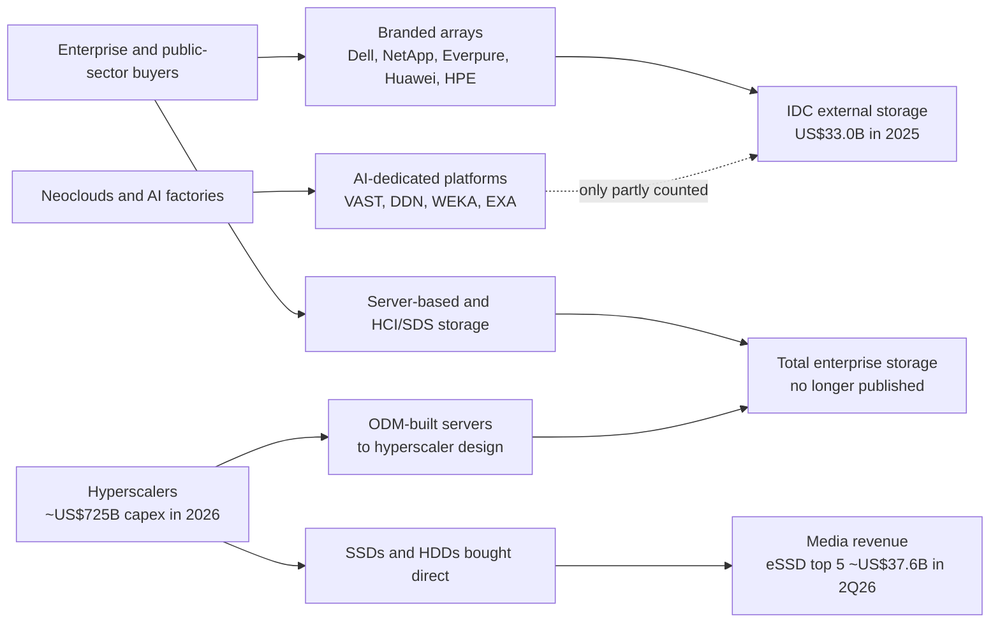
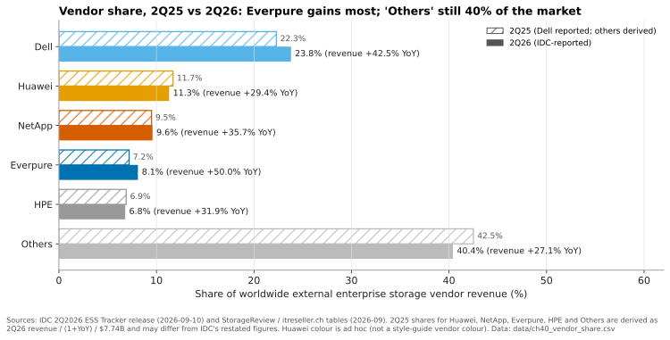
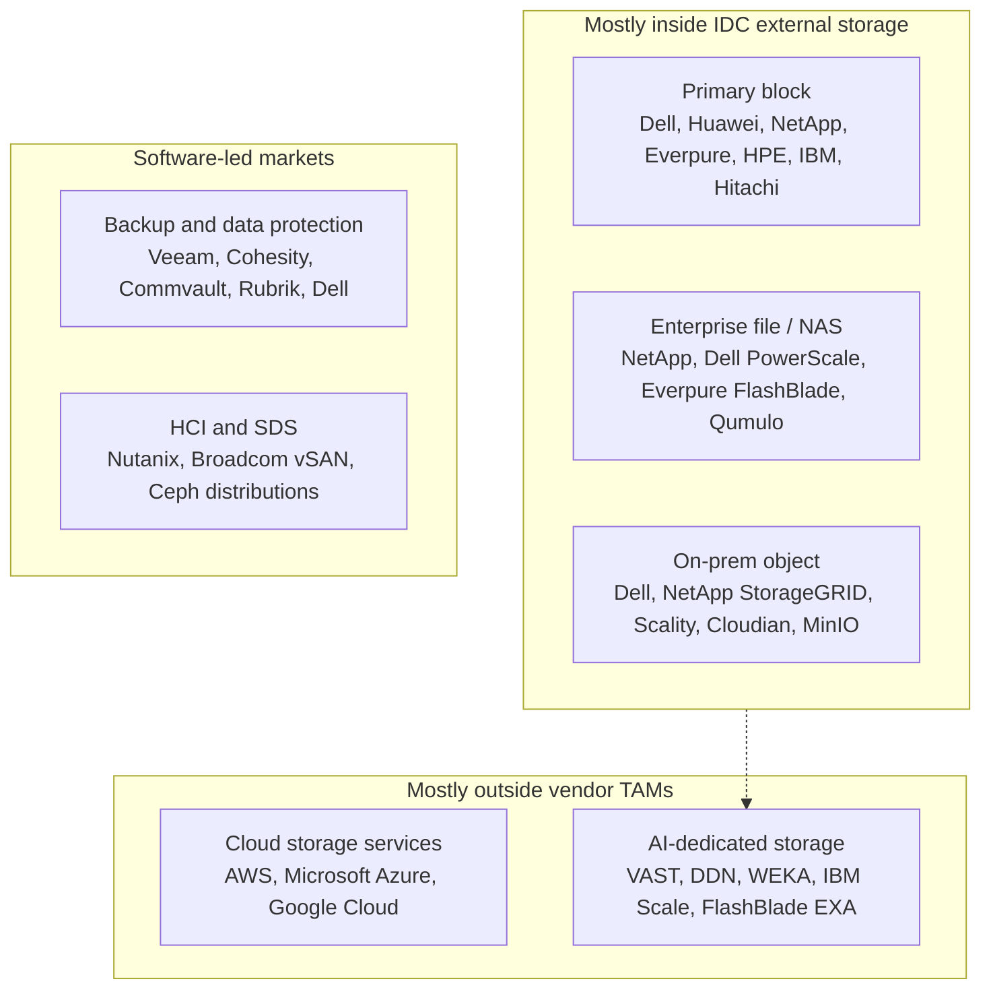
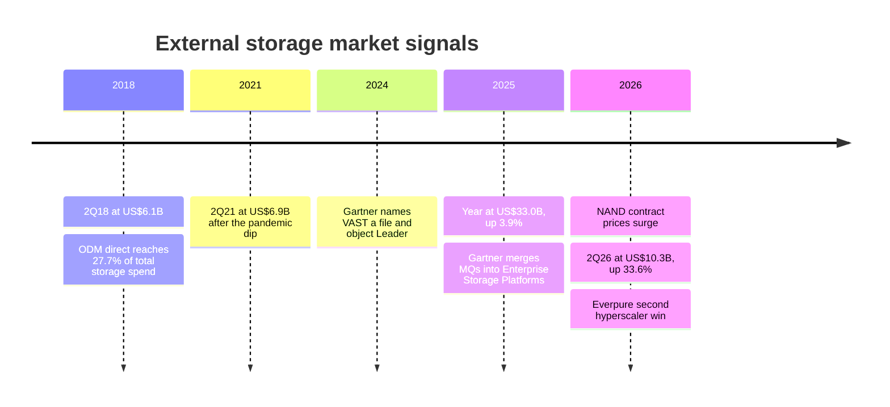

# 40. Market structure and sizing

> **Depth:** L2 · **Reading time:** ~10 min · **Last verified:** 2026-11-01
> **Prerequisites:** [What storage does](../01-storage-fundamentals/01-what-storage-does.md) · [Consumption models](../03-system-architecture/23-consumption-models.md) · [Everpure's hyperscaler business and financials](../04-everpure/29-hyperscaler-ecosystem-financials.md) · [Hyperscaler AI storage](../05-ai-storage/36-hyperscaler-ai-storage.md)

## TL;DR

- **The headline "storage market" is IDC's external enterprise storage systems tracker: US$33.0B in calendar 2025 and US$10.3B in 2Q26, up 33.6% year on year.** It counts branded arrays sold to enterprises. Most hyperscaler storage spend is outside it.
- **The 2026 growth is mostly price.** NAND contract prices more than doubled in the first half of 2026, and IDC says customers paid more for *less* capacity. Treat 30%+ revenue growth as pass-through inflation, not units.
- **Share is fragmented and stable.** Dell holds 23.8%, Huawei 11.3%, NetApp 9.6%, Everpure 8.1% and HPE 6.8%, and about 40% sits with everyone else. Everpure gained the most in 2Q26 (+50% revenue growth), but a year's gain is under one share point.
- **No credible public "AI storage TAM" exists.** The big-number reports come from market-research firms with loose definitions. IDC's AI infrastructure tracker puts storage at only 2.4% of AI infrastructure spend. A defensible triangulation gives roughly US$9–25B for 2026, and the independent-vendor slice of that is much smaller.
- **Growth is concentrated in all-flash, in the high end (systems above US$250K, +91%), and in AI-dedicated file/object platforms.** Of those, only the first two appear cleanly in IDC's tracker.

## Why this matters for Everpure strategy

Every market number in a board deck, sell-side model or acquisition memo starts from a definition. A US$33B market growing 3–4% a year supports a share-gain story. A US$10B quarter growing 34% looks like a boom, but much of it reverses when NAND prices normalise. An "AI storage market" of US$100B+ by 2030 would justify almost any acquisition multiple, yet it comes from firms that count any storage with "AI-powered" features.

Definitions matter for Everpure specifically. Its fastest-growing new lines, hyperscaler DirectFlash design wins and AI-factory storage for neoclouds, sit partly or wholly *outside* the tracker that ranks it fourth. Tracker share and tracker-based TAMs therefore understate its exposure to where storage dollars are growing.

## Core concepts

### Four different "storage markets"

"The storage market" usually means one of four things.

1. **External enterprise storage systems** (IDC's "External OEM ESS"). These are branded arrays sold by OEMs such as Dell, NetApp or Everpure into enterprise and public-sector datacentres, measured as vendor revenue. They were US$33.0B in 2025, +3.9%[^1]. This is the number vendors quote share against.
2. **Total enterprise storage systems.** This adds storage inside servers ("server-based") and **ODM direct**: systems that ODMs such as Quanta or Wiwynn build to a hyperscaler's design and sell to it directly. In the last public split we found, ODM direct was already US$3.9B a quarter and 27.7% of total enterprise storage spend in 3Q18[^2]. IDC no longer publicises the total; that share has almost certainly risen since.
3. **Cloud storage services.** S3, Azure Blob and Google Cloud Storage are rented, not bought. They show up in cloud-provider revenue, and the hardware behind them shows up as ODM purchases and drive purchases.
4. **Media.** These are the SSDs and HDDs themselves. In 2Q26 the top five enterprise SSD vendors alone booked about US$37.6B[^3]. That is 3.6× the entire external array market in the same quarter, because most enterprise SSDs go into servers rather than arrays.

*Figure 40.1 — The tracker vendors quote counts only branded arrays sold to enterprises; hyperscaler storage flows through ODMs and direct drive purchases, which is why it mostly isn't in any array vendor's TAM.*

**Why hyperscaler storage is (mostly) not in vendor TAMs.** The four largest US hyperscalers were guiding to roughly US$725B of combined capex for 2026[^4]. Little of it buys branded arrays. Meta's Tectonic and Google's Colossus are in-house file systems running on commodity servers[^5] (see [Chapter 36](../05-ai-storage/36-hyperscaler-ai-storage.md)). The value chain looks like a captive fabless model: the hyperscaler does the design (software), the ODM is the foundry, and NAND makers sell the wafers. An array vendor captures margin only if it licenses something the hyperscaler can't build cheaply. That is why Everpure's second top-five hyperscaler win is structured as a master supply agreement for software and non-NAND parts, with the hyperscaler buying NAND itself and revenue starting in FY2028[^6]. Whether IDC counts such deals as external storage is unclear [VERIFY: IDC treatment of hyperscaler DirectFlash licence/component revenue].

### Reading the IDC number properly

*Figure 40.2 — For seven years the external array market grew about 3% a year; 2026 broke the pattern, and the break coincides with the NAND price spike.*
Data: `data/ch40_market_size.csv`

Three cautions apply. First, IDC restates. Its 1Q26 growth rate was revised from 22.7% to 28.7% one quarter later[^7]. It published 2024 at US$33.5B[^8], yet reported 2025's US$33.0B as 3.9% growth, which implies a lower 2024 base of about US$31.8B. Second, quarters are seasonal (Q4 budgets, a weak Chinese Q1). In 1Q26 Huawei's share was 6.7% and Dell's 31.2%[^9], against 12.6% and 23.7% the quarter before[^1]. Use four-quarter totals. Third, trackers disagree on level: Omdia sized 2022 external storage at about US$38B [VERIFY: search-summary only][^10]. Never splice two sources.

### Price, not units: the 2026 NAND surge

TrendForce put NAND contract prices up 55–60% quarter on quarter in 1Q26 and a further 70–75% in 2Q26 (the 2Q26 figure comes from secondary aggregation)[^11]. It expects enterprise SSD prices to rise another 23–28% in 4Q26[^12]. Array vendors passed it on; Everpure raised prices on 9 February 2026[^13]. IDC's 2Q26 commentary says the component increase lifted system prices across all-flash, hybrid and HDD-only systems, that customers bought less capacity while paying more, and that some orders were pulled forward to beat further increases[^14].

The arithmetic: revenue growth = (1 + price per TB change) × (1 + capacity change) − 1. If revenue grew 33.6% while capacity shipped was flat to down, the price per TB of a system rose at least 33.6%.

| Capacity shipped, YoY | Implied price per TB, YoY | Reading |
|---|---|---|
| −10% | +48% | Rationing; consistent with IDC's "less capacity" comment |
| 0% | +34% | Pure price pass-through |
| +10% | +21% | Unlikely given supply constraints |
| +25% (a normal pre-2026 year) | +7% | Would need a historic demand surge |

*Table 40.1 — Worked example: with capacity flat or falling, essentially all of 2Q26's 33.6% revenue growth is higher prices per terabyte.*

For a semis reader this is the DRAM cycle seen from downstream: a component shortage inflates the system market's revenue line. Growth rates will compress mechanically once contract prices plateau; IDC expects component costs to stay high well into 2027[^14]. And share gains during a shortage partly reflect *supply* access: the vendor with secured NAND ships. Everpure's 2Q FY27 cash flow was negative partly because of strategic NAND prepayments[^15], which is effectively buying share with working capital. [Chapter 48](48-media-suppliers-and-nand-cycle.md) covers the cycle itself.

### Where the growth is concentrated

In 2Q26, all-flash arrays were US$5.4B (+42.9%), or 52.1% of the market. Systems priced above US$250K grew 90.6% to US$2.7B[^14]. Backing out the year-ago bases from those growth rates gives about US$7.74B total, US$3.78B all-flash and US$1.42B high-end. So hybrid and disk systems grew about 25%, and the high-end band alone contributed about US$1.3B of the market's US$2.6B increase, roughly half. Large configurations are where AI-adjacent buying and pull-forward show up first.

*Figure 40.3 — Everpure (+50%) and Dell (+42.5%) took share in 2Q26; the long tail lost two points, but the market remains fragmented.*
Data: `data/ch40_vendor_share.csv`

The 2Q26 shares and growth rates come from IDC's release and trade-press tables[^14][^16]; year-ago shares other than Dell's are derived from them, so treat half-point moves as approximate. Dell added about US$0.73B, Everpure US$0.28B. "Others" (IBM, Hitachi Vantara, Lenovo, IEIT Systems, Fujitsu and more) grew about 27%.

### The segment map

The tracker cuts revenue by vendor and price band, not by workload. Strategy needs a workload cut, where public share data is thin.

*Figure 40.4 — Incumbents lead the measured segments; the fastest-growing segment, AI-dedicated storage, is led by private specialists and only partly visible in the trackers.*

Evidence differs by box. In block, the IDC top five is a fair proxy. In backup, Veeam says IDC ranked it first with 13.6% of data-replication-and-protection software in 2H25 (vendor-reported)[^17]. Cohesity, Commvault, Rubrik, Veeam, Dell and Druva were 2025 Gartner Leaders[^18]. For file, object, HCI and AI-dedicated storage, no current public share data exists; the names are frequent shortlist entries, not a ranking. Company detail lives in [Chapter 46](46-incumbents.md) (incumbents), [Chapter 47](47-other-challengers.md) (challengers and SDS) and Chapters [42](42-vast-data.md)–[44](44-ddn.md) (VAST, WEKA, DDN).

### Sizing AI storage: what exists, and a triangulation

| Estimate | Source and access | Year | Definition | Caveats |
|---|---|---|---|---|
| US$33.0B (+3.9%) | IDC, public press release[^1] | CY2025 | External OEM enterprise storage systems, vendor revenue | Excludes ODM direct, server-based, cloud; restated periodically |
| US$10.3B (+33.6%) | IDC, public press release[^14] | 2Q26 | Same | Inflated by NAND pass-through and pull-forward |
| US$2.2B, 2.4% of US$89.7B | IDC AI Infrastructure Tracker, public blog[^19] | 1Q26 | Storage systems deployed for AI workloads, as share of AI infrastructure | Methodology and buyer mix in paid tracker; likely includes cloud builders |
| US$497B AI infrastructure | IDC, public blog[^19] | 2026 forecast | Servers plus storage for AI | Storage share not given for the forecast |
| ~US$10.5B storage in 2029 (~1.4%) | Next Platform, derived from IDC's US$758B 2029 forecast[^20] | 2029 | Press derivation, not an IDC number | [VERIFY: search-summary only] |
| US$30.6B → US$118.4B, 25.9% CAGR | Grand View Research, paid report (public summary)[^21] | 2024 → 2030 | "AI-powered storage", which includes storage with AI features | Definition sweeps in general-purpose storage; low confidence |
| US$73.6B / US$162.5B | Lucintel / Allied Market Research, paid reports (public summaries)[^22] | 2030 / 2031 | "AI-powered storage" | Ranges this wide signal definitional noise |
| >US$23B → US$38B | IDC file and object storage, public release[^23] | 2013 → 2017 | File- plus object-based storage incl. hyperscale | Stale; no current public file/object figure found [VERIFY] |

*Table 40.2 — Public market-size estimates: only IDC's tracker figures are measured spend; the "AI storage" reports differ by 2× because they measure different things.*

No analyst firm publicly publishes a measured, vendor-addressable AI storage market, so a strategy team must triangulate. Worked example (assumptions in italics):

- **Top-down.** IDC forecasts US$497B of 2026 AI infrastructure spend[^19]. At IDC's own measured storage share of 2.4%, AI storage is about **US$12B**. *If dedicated shared storage is instead 5% of cluster spend*, a plausible upper bound for data-heavy training clusters (see [Chapter 31](../05-ai-storage/31-training-storage.md)), it is about **US$25B**.
- **Run-rate.** IDC's US$2.2B in 1Q26 × 4 is about **US$9B** annualised.
- **Bottom-up floor.** VAST claims over US$0.5B of committed ARR exiting its January 2026 fiscal year (company-stated)[^24]. DDN told Forbes it expects about US$1B of 2026 revenue (reported by press)[^25]. WEKA's ARR is estimated at US$0.10–0.15B (estimated, Globes)[^26]. Together that is about **US$1.6–1.7B** for the three AI-native specialists.

The result is a 2026 AI storage spend range of roughly US$9–25B. *Assume half of it is hyperscaler self-build that no vendor can address*: the vendor-addressable pool is then about US$5–12B. There, 10 points of share is worth US$0.5–1.2B a year, which helps explain specialist valuations that price in share not yet won.

## How Everpure approaches it vs. competitors

| Vendor | Measured position (IDC 2Q26) | Where it is strong outside the tracker | Market-structure bet |
|---|---|---|---|
| Everpure | #4, 8.1%, fastest-growing (+50%)[^14] | Hyperscaler DirectFlash licensing (Meta plus a second top-five)[^6]; neocloud AI | Grow outside the array TAM via licensing and AI; Gartner Leader, top on both axes in 2026[^27] |
| Dell | #1, 23.8%, +42.5%[^1] | AI servers and storage bundled into AI-factory deals | Breadth: sell storage attached to the server and GPU wallet |
| Huawei | #2, 11.3%[^16] | China and markets closed to US vendors | Geographic moat; limited exposure in the US |
| NetApp | #3, 9.6%[^16] | Unified file, first-party cloud services on all three hyperscalers | Storage OS that runs inside the hyperscalers |
| HPE | #5, 6.8%[^16] | GreenLake consumption, AI servers | Bundling with compute and services |
| VAST / DDN / WEKA | Not reported in top five; partly uncounted | Neoclouds, sovereign AI, hyperscaler AI tenants | AI-dedicated platforms; define the segment the trackers miss |

*Table 40.3 — Incumbents compete on share of a slow, measured market; Everpure and the AI specialists are betting on the unmeasured parts.*

Steelman the incumbents. Dell's +42.5% on a base three times Everpure's added the most absolute dollars, and in AI factories the vendor selling GPU servers often controls the storage line too. NetApp attacks the hyperscaler problem from the other side by monetising storage software inside the clouds. Gartner's Magic Quadrant assesses vision and execution, not share. Its 2025 edition merged the separate primary-storage and file-and-object reports into one "Enterprise Storage Platforms" report[^28]. In 2026 its Leaders were Everpure, Huawei, HPE, NetApp, IBM and Dell[^27]. VAST, a Leader in the last standalone file-and-object MQ in 2024[^29], is not in the reported 2026 placements [VERIFY: whether VAST was evaluated]. Use the MQ as a buyer-perception signal, not a sizing input.

## History and trajectory

*Figure 40.5 — Eight years of low-single-digit growth ended in 2026 because of component pricing, while the structurally important shift, storage moving to hyperscalers and AI specialists, ran underneath the tracker the whole time.*

From 2Q18 (about US$6.1B) to 2Q25 (about US$7.7B) the external market grew roughly 3% a year[^30]: falling flash prices offset capacity growth, and hyperscalers absorbed workloads that once bought arrays. Three signals point ahead. Gartner raised its 2026 data-centre systems forecast to US$822B (+62.5%)[^31], of which arrays are a small fraction. IDC's 2.4% AI storage share is the number to watch: if inference and KV-cache tiers (see [Chapter 32](../05-ai-storage/32-inference-and-kv-cache.md)) push it toward 4–5%, the AI storage pool doubles at the same compute spend. And NAND normalisation, not expected before 2027, will expose how much of 2026's growth was price.

## Numbers that matter

| Metric | Value | Context | Source / date |
|---|---|---|---|
| External enterprise storage, CY2025 | US$33.0B, +3.9% | Market vendors quote share against | IDC, 2026-03-12[^1] |
| External enterprise storage, 2Q26 | US$10.34B, +33.6% | Mostly price pass-through | IDC, 2026-09-10[^14] |
| All-flash share of 2Q26 | US$5.4B, 52.1%, +42.9% | Flash now the majority | IDC, 2026-09-10[^14] |
| Systems above US$250K, 2Q26 | US$2.7B, +90.6% | About half of the YoY dollar increase | IDC, 2026-09-10[^14]; worked example |
| Top-5 share, 2Q26 | Dell 23.8, Huawei 11.3, NetApp 9.6, Everpure 8.1, HPE 6.8% | ~40% "Others" | IDC via StorageReview, 2026-09[^16] |
| Storage share of AI infrastructure | 2.4% (US$2.2B of US$89.7B) | 1Q26 | IDC blog, 2026-07-21[^19] |
| Top-5 enterprise SSD revenue, 2Q26 | ~US$37.6B | 3.6× the external array market | TrendForce, 2026-09-01[^3] |
| Big-4 hyperscaler capex, 2026 | ~US$725B (guided) | Mostly outside array TAMs | FT tally via Yahoo Finance, 2026-04[^4] |
| AI storage spend, 2026 | ~US$9–25B | Triangulation above | Worked example |

## Conversation playbook

**Questions for a PM**

1. *"When we say we gained share, which tracker, which period, and is it four-quarter rolling?"* Strong: names IDC external storage, says whether it is IDC's figure or Everpure's "modified" one, and separates price from units.
2. *"What share of our AI revenue would IDC count as external storage?"* Strong: splits EXA sold to neoclouds, DirectFlash hyperscaler licensing and Evergreen//One, and knows how each is classified.
3. *"How much of this year's growth survives a 30% NAND price decline?"* Strong: models price per TB and capacity separately and knows pull-forward exposure.

**Questions for an engineer**

1. *"In an AI factory bill of materials, what fraction is shared storage, and what moves it?"* Strong: cites GB/s per GPU and PB per thousand GPUs and how checkpointing and KV-cache tiers change them.
2. *"What would a hyperscaler have to build itself to replace our licensed component?"* Strong: names the hard parts (flash management, metadata, density) and the engineering years needed.
3. *"Which workloads are leaving arrays for server-based or cloud storage, and why?"* Strong: specific about latency, data gravity and cost per TB.

**Don't say this:**

- "The storage market grew 34%." Say that external array *revenue* grew 34%, mostly on price, and that capacity was flat to down.
- "Everpure has 8% of the storage market." It has 8.1% of IDC external storage in one quarter; of total storage spend including hyperscalers and cloud, far less.
- "AI storage is a US$100B+ market." Those are low-confidence, broadly defined figures; IDC measures 2.4% of AI infrastructure.
- "Gartner ranks Everpure #1." It is highest on both MQ axes: an assessment, not share.
- Comparing single-quarter shares across vendors. Seasonality (Q1 China, Q4 budgets) moves them several points.

## Going deeper (optional, L3 pointers)

- IDC's Worldwide Quarterly Enterprise Storage Systems Tracker taxonomy (paid): price bands, segment definitions and the ODM-direct and server-based breakouts behind the public releases.
- IDC's Worldwide Quarterly AI Infrastructure Tracker methodology: how it assigns storage systems to AI workloads.
- TrendForce quarterly NAND and enterprise SSD releases, for the price side of the decomposition.
- Everpure's 2026 Financial Analyst Meeting materials (23 September 2026), for the company's own TAM and SAM framing [VERIFY: figures not retrieved][^32].

## Key terms

- **External enterprise storage systems** — branded arrays sold as standalone systems; IDC's headline tracker.
- **ODM direct** — storage hardware built by ODMs to a hyperscaler's design and sold to it directly.
- **Server-based storage** — drives inside servers, managed by software (HCI, SDS, hyperscaler file systems).
- **TAM / SAM** — total / serviceable addressable market.
- **Price/volume decomposition** — splitting revenue growth into price-per-unit change and unit (capacity) change.
- **Pull-forward demand** — orders placed early to beat expected price rises.
- See the [glossary](../glossary.md) for the rest.

## Sources

[^1]: IDC, "Worldwide External Enterprise Storage Systems Market Closed with a Solid 3.9% Year-over-Year Growth in Revenue," 2026-03-12. https://www.idc.com/resource-center/press-releases/worldwide-external-enterprise-storage-systems-market-closed-with-a-solid-3-9-year-over-year-growth-in-revenue-according-to-idc/ (retrieved 2026-11-01).
[^2]: The Register, "IDC's storage trackers follow the suppliers' Q3 2018 spoors," 2018-12-14. https://www.theregister.com/2018/12/14/idcs_storage_trackers_follow_the_suppliers_q3_2018_spoors/ (retrieved 2026-11-01).
[^3]: TrendForce, "Higher Prices and Shipments Drive Top Five Enterprise SSD Vendors' Revenue to Nearly US$37.59 Billion in 2Q26," 2026-09-01. https://www.trendforce.com/presscenter/news/20260901-13210.html (retrieved 2026-11-01).
[^4]: Yahoo Finance (citing a Financial Times tally), "'Magnificent 7' earnings rush reveals AI spending surge, with hyperscaler capex set to reach $725 billion in 2026," 2026-04. https://finance.yahoo.com/markets/article/magnificent-7-earnings-rush-reveals-ai-spending-surge-with-hyperscaler-capex-set-to-reach-725-billion-in-2026-224901707.html (retrieved 2026-11-01).
[^5]: S. Pan et al., "Facebook's Tectonic Filesystem: Efficiency from Exascale," USENIX FAST '21, 2021-02. https://www.usenix.org/conference/fast21/presentation/pan (retrieved 2026-11-01).
[^6]: Everpure, "Everpure Lands New Design Win with Second Top Five Hyperscaler," 2026-08-10. https://www.everpuredata.com/company/newsroom/press-releases/everpure-lands-new-design-win-with-second-top-five-hyperscaler.html (retrieved 2026-11-01).
[^7]: Blocks & Files, "IDC's latest enterprise storage tracker shows booming storage market growth," 2026-09-23. https://www.blocksandfiles.com/flash/2026/09/23/idcs-latest-enterprise-storage-tracker-shows-booming-storage-market-growth/5298577 (retrieved 2026-11-01).
[^8]: IDC, "Enterprise Storage Systems Market Insights," n.d. (2025). https://www.idc.com/?p=4752 (retrieved 2026-11-01).
[^9]: IDC, "Worldwide External Enterprise Storage Systems Market" 1Q26 tracker release, 2026-06-15. https://www.idc.com/?p=115848 (retrieved 2026-11-01).
[^10]: Omdia, "Omdia's DC storage tracking finds worldwide external storage systems revenue increased in 2022," 2023. https://omdia.tech.informa.com/blogs/2023/omdias-dc-storage-tracking-finds-worldwide-external-storage-systems-revenue-increased-127-in-2022 (retrieved 2026-11-01).
[^11]: StorageNewsletter (TrendForce), "Memory Makers Prioritize Server Applications, Driving Across-the-Board Price Increases in 1Q26," 2026-01-27, https://www.storagenewsletter.com/2026/01/27/memory-makers-prioritize-server-applications-driving-across-the-board-price-increases-in-1q26-says-trendforce/ ; TrendForce, "Combined Revenue of Top Five NAND Flash Brands Rises 77% QoQ in 2Q26," 2026-08-18, https://www.trendforce.com/presscenter/news/20260818-13186.html (both retrieved 2026-11-01).
[^12]: TrendForce, "AI Server Demand Sustains Memory Contract Price Increases in 4Q26, While Consumer-Side Pressure Persists," 2026-09-30. https://www.trendforce.com/presscenter/news/20260930-13258.html (retrieved 2026-11-01).
[^13]: Alpha Spread, "Everpure Q4-2026 Earnings Call," 2026-02-25. https://www.alphaspread.com/security/nyse/p/investor-relations/earnings-call/q4-2026 (retrieved 2026-11-01).
[^14]: IDC, "2Q2026 ESS Tracker" press release, 2026-09-10. https://www.idc.com/resource-center/press-releases/2q2026-ess-tracker/ (retrieved 2026-11-01).
[^15]: Yahoo Finance, "Everpure (P) Grew Revenue 38% but Free Cash Flow Was Negative," 2026-08. https://finance.yahoo.com/markets/stocks/articles/everpure-p-grew-revenue-38-023544268.html (retrieved 2026-11-01).
[^16]: StorageReview, "IDC External Storage Tracker: $10.3 Billion in Q2 2026 as Server Market Tops $166 Billion on AI Demand," 2026-09. https://www.storagereview.com/news/idc-external-storage-tracker-q2-2026-10-3-billion-as-server-market-tops-166-billion (retrieved 2026-11-01).
[^17]: StorageNewsletter (Veeam), "Veeam Ranked the #1 Data Protection Software in Market Share Worldwide for 2H 2025," 2026-05-07. https://www.storagenewsletter.com/2026/05/07/veeam-ranked-the-1-data-protection-software-in-market-share-worldwide-for-2h-2025/ (retrieved 2026-11-01).
[^18]: Veeam via Business Wire, "Veeam Positioned as a Leader in the 2025 Gartner Magic Quadrant for Backup and Data Protection Platforms for the Ninth Consecutive Time," 2025-06-26. https://www.businesswire.com/news/home/20250626180903/en (retrieved 2026-11-01). Full Leader list from vendor releases and a secondary summary [VERIFY].
[^19]: IDC, "AI Infrastructure Spending Holds Near $90 Billion in Q1 2026 as Arm Overtakes x86 in Accelerated Servers; 2026 Forecast Raised to $497 Billion," 2026-07-21. https://www.idc.com/resource-center/blog/ai-infrastructure-spending-holds-near-90-billion-in-q1-2026-as-arm-overtakes-x86-in-accelerated-servers-2026-forecast-raised-to-497-billion/ (retrieved 2026-11-01).
[^20]: The Next Platform, "More Upward Revisions On AI Infrastructure Spending," 2025-11-03. https://www.nextplatform.com/ai/2025/11/03/more-upward-revisions-on-ai-infrastructure-spending/1641510 (retrieved 2026-11-01).
[^21]: Grand View Research, "AI-Powered Storage Market Report," n.d. https://www.grandviewresearch.com/industry-analysis/ai-powered-storage-market-report (retrieved 2026-11-01).
[^22]: Lucintel, "AI Powered Storage Market," n.d., https://lucintel.com/ai-powered-storage-market.aspx ; Allied Market Research, "AI Powered Storage Market Insights, 2031," n.d., https://alliedmarketresearch.com/ai-powered-storage-market-A09518 (both retrieved 2026-11-01).
[^23]: StorageNewsletter (IDC), "WW File- and Object-Based Storage Market Growth Outpaces Overall Enterprise Disk Storage Systems Market," 2013. https://www.storagenewsletter.com/?p=124184 (retrieved 2026-11-01).
[^24]: Futuriom, "VAST Data Hits $30 Billion Valuation Amid 'AI Revolution'," 2026-04. https://www.futuriom.com/articles/news/vast-data-hits-30-billion-valuation-amid-ai-revolution/2026/04 (retrieved 2026-11-01).
[^25]: Forbes Italia, "Chi è Alex Bouzari, il miliardario che rende più veloci i supercomputer dell'IA," 2026-08-10. https://forbes.it/2026/08/10/chi-e-alex-bouzari-il-miliardario-che-rende-piu-veloci-i-supercomputer-dellia/ (retrieved 2026-11-01).
[^26]: Globes, "Chip industry headache is this Israeli co's opportunity," 2026. https://en.globes.co.il/en/article-1001542294 (retrieved 2026-11-01).
[^27]: Everpure, "Everpure Named a Leader in the 2026 Gartner Magic Quadrant for Enterprise Storage Platforms," 2026-08-21. https://www.everpuredata.com/company/newsroom/press-releases/everpure-named-leader-2026-gmq-enterprise-storage-platforms.html (retrieved 2026-11-01).
[^28]: NetApp, "NetApp named a Leader by Gartner in the 2025 Magic Quadrant for Enterprise Storage Platforms," 2025-09-05. https://www.netapp.com/newsroom/press-releases/news-rel-20250905-934005.html (retrieved 2026-11-01).
[^29]: Blocks & Files, "Gartner's file and object MQ drops Cloudian, DDN, NetApp and Quantum," 2024-10-11. https://blocksandfiles.com/storage-management/2024/10/11/gartners-file-and-object-mq-drops-cloudian-ddn-netapp-and-quantum/1592981 (retrieved 2026-11-01).
[^30]: IDC via Business Wire, "Worldwide Enterprise External OEM Storage Systems Market Revenue Increased 9.7% During the Second Quarter of 2021," 2021-09-09, https://www.businesswire.com/news/home/20210909005847/en/ ; StorageNewsletter (IDC), 2Q18 external storage release, 2018-09, https://www.storagenewsletter.com/?p=193184 (both retrieved 2026-11-01).
[^31]: Gartner, "Gartner Forecasts Worldwide IT Spending to Grow 14.2% in 2026, Totaling $6.37 Trillion," 2026-07-27. https://www.gartner.com/en/newsroom/press-releases/2026-07-27-gartner-forecasts-worldwide-it-spending-to-grow-14-point-2-percent-in-2026-totaling-6-point-37-trillion (retrieved 2026-11-01).
[^32]: StorageNewsletter, "Everpure's Expanding Business Model Fuels New Long-Term Outlook," 2026-10-01. https://www.storagenewsletter.com/2026/10/01/everpures-expanding-business-model-fuels-new-long-term-outlook/ (retrieved 2026-11-01).
