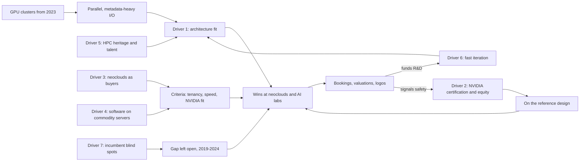
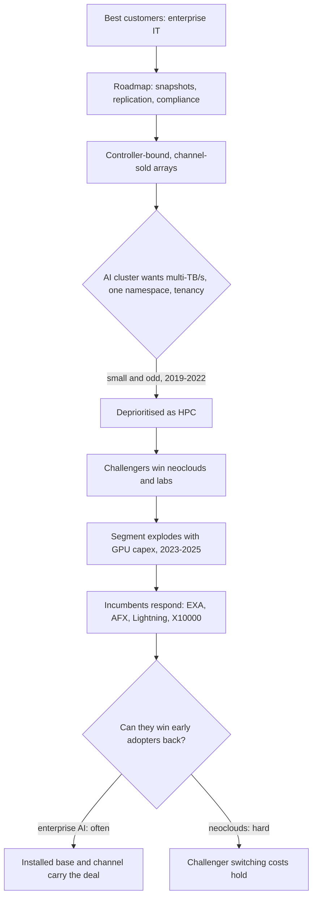
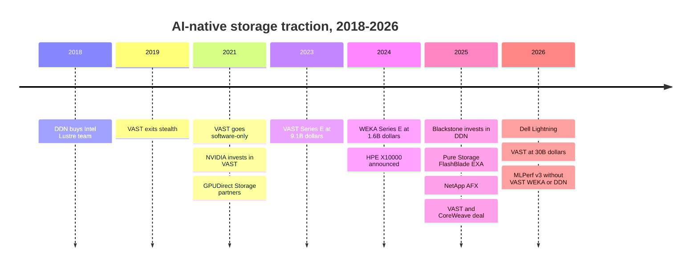

# 41. Why AI-native storage vendors gained so much traction

> **Depth:** L2 · **Reading time:** ~12 min · **Last verified:** 2026-11-01
> **Prerequisites:** [Disaggregated shared-everything](../03-system-architecture/16-disaggregated-shared-everything.md) · [Parallel file systems](../03-system-architecture/17-parallel-file-systems.md) · [Metadata](../03-system-architecture/21-metadata.md) · [NVIDIA's ecosystem](../05-ai-storage/34-nvidia-ecosystem.md) · [AI factories and neoclouds](../05-ai-storage/35-ai-factories-and-neoclouds.md)

## TL;DR

- **The traction is real but concentrated.** VAST, WEKA and DDN won the largest GPU clusters at neoclouds and AI labs. VAST's US$1.17B CoreWeave agreement[^1] and US$30B valuation[^2] are the headline signals. Enterprise AI storage, by revenue, still mostly goes to incumbents.
- **Three drivers did most of the work, and they compound.** The first is architectures built for parallel, metadata-heavy GPU I/O. The second is early NVIDIA alignment: reference designs, certification and equity. The third is a new buyer class, the neoclouds, whose criteria matched those architectures.
- **Four drivers amplified them.** Software on commodity servers, HPC talent, fast product cadence and incumbent blind spots: enterprise-feature roadmaps, controller-bound designs, channel incentives and scale-up habits.
- **The thesis is weakest where it is loudest.** About US$37B of combined private valuation sits on roughly US$1.1B of revenue signals. Customers are concentrated, NVIDIA can make or unmake vendors, all three skipped MLPerf Storage v3.0, and the 2026 NAND shortage hits vendors that do not buy their own flash.
- **The window is closing, not closed.** Everpure's FlashBlade//EXA, NetApp AFX, Dell Lightning and HPE X10000 (2024–2026) remove the architecture gap. They do not remove the challengers' installed base or their NVIDIA relationships.

## Why this matters for Everpure strategy

Most board conversations about AI storage now start with the challengers' numbers. If the reader cannot separate the causes of their success from the noise around it, two errors follow. One is to over-copy: chasing valuation-driven narratives such as an "AI operating system". The other is to under-react: treating VAST, WEKA and DDN as niche HPC suppliers. This chapter breaks the thesis into drivers and asks of each one whether it is copyable, structural or fading.

For a strategy team, that framing sorts the options. Architecture gaps can be closed by engineering, and FlashBlade//EXA is that bet ([Chapter 27](../04-everpure/27-flasharray-and-flashblade.md)). NVIDIA certification can be earned. A neocloud anchor account and NVIDIA equity cannot simply be built. They have to be won, partnered for or bought. The vendor-level detail is in [Chapter 42](42-vast-data.md) (VAST), [Chapter 43](43-weka.md) (WEKA) and [Chapter 44](44-ddn.md) (DDN). This chapter is the cross-cutting explanation, and it is deliberately sceptical.

## Core concepts

### What "traction" means here

The scoreboard has four kinds of evidence, and they should not be blended:

- **Contracts.** VAST's US$1.17B multi-year CoreWeave agreement (reported by Reuters on 2025-11-06, confirmed by VAST)[^1]. DDN says it supports more than 500,000 NVIDIA GPUs, including xAI's Colossus (*company-stated*)[^3]. WEKA lists Nebius, Cohere, Midjourney and Stability AI as customers[^4].
- **Capital.** VAST's valuation rose from US$1.2B in 2020[^5] to US$30B in April 2026 (*company-stated*)[^2]. Blackstone put US$300M into DDN at US$5B in January 2025, DDN's first institutional money[^6]. WEKA reached US$1.6B in May 2024[^7].
- **Revenue signals.** All are self-reported. VAST cites more than US$500M of committed ARR (CARR)[^8]. WEKA said it passed US$100M of ARR in 2024[^9]. DDN is reported to be targeting about US$1B of revenue in 2026 (*reported by Forbes*)[^10].
- **Analyst recognition.** Gartner named VAST a Leader in its 2024 Magic Quadrant for File and Object Storage, the same edition that dropped DDN and NetApp from the report[^11].

The diagram below shows how the drivers connect. The point it makes is that they form a loop, not a list.

*Figure 41.1 — The drivers form a flywheel: architecture fit and NVIDIA alignment won the first neocloud deals, and the capital and logos those deals produced paid for faster iteration and deeper NVIDIA ties.*

### Driver 1: architecture fit for parallel GPU I/O and metadata

**Mechanism.** A training cluster makes thousands of clients read millions of small samples at once. It then has them write checkpoint shards in synchronized bursts. Two designs handle this well. A [parallel file system](../03-system-architecture/17-parallel-file-systems.md) stripes data across many servers (DDN EXAScaler, WEKA). A [disaggregated shared-everything](../03-system-architecture/16-disaggregated-shared-everything.md) system lets every stateless node reach every SSD (VAST). Both spread [metadata](../03-system-architecture/21-metadata.md) across many nodes instead of a controller pair. A dual-controller array tops out at whatever two controllers can serve.

**Evidence.** NVIDIA's own Eos supercomputer uses 48 DDN AI400X2 appliances for about 4 TB/s (*company-stated*)[^12]. WEKA, running on HPE servers, topped all five SPECstorage Solution 2020 workloads in January 2025[^13].

**Rating: strong, but eroding.** The architecture gap explained 2019–2024. By 2026 every major incumbent ships a disaggregated or parallel design (Table 41.3).

### Driver 2: NVIDIA alignment and certification

**Mechanism.** NVIDIA's reference architectures work as procurement shortlists ([Chapter 34](../05-ai-storage/34-nvidia-ecosystem.md)). Being early on the list, and being in NVIDIA's own data centres, de-risks the purchase for a buyer spending hundreds of millions on GPUs. Equity adds a signal of strategic intent.

**Evidence.** NVIDIA joined VAST's Series D in 2021[^14] and WEKA's Series E in 2024[^7]. VAST, WEKA and DDN were early GPUDirect Storage partners[^15]. DDN ran inside Selene and Eos[^12].

**Rating: strong historically, now non-exclusive.** By GTC 2025 at least seven vendors, including Pure Storage, Dell, NetApp and IBM, had SuperPOD certification or validation[^16]. NVIDIA's 2026 STX storage architecture named 12 co-design partners[^17]. Certification sets a floor. It no longer separates vendors.

### Driver 3: neoclouds as a new buyer class

**Mechanism.** A neocloud resells storage per GB-month to hundreds of tenants ([Chapter 35](../05-ai-storage/35-ai-factories-and-neoclouds.md)). It values hard multi-tenancy, API provisioning, deployment speed and NVIDIA's blessing over $/TB, because storage is about 1% of its capex but can idle every GPU. Enterprise array vendors had built for the opposite buyer: one tenant, trusted administrators, procurement through a channel partner.

**Evidence.** CoreWeave's agreement with VAST is the largest disclosed storage deal[^1]. WEKA powers Nebius's premium tier[^18]. CoreWeave lists VAST, WEKA, DDN, IBM and Pure Storage as dedicated-storage partners[^19]. That is a multi-vendor shelf, not a monopoly.

**Rating: strong.** This is the single best explanation of *where* the challengers won. It also explains why their revenue is concentrated.

### Driver 4: software-defined on commodity hardware

**Mechanism.** Selling software on partner servers keeps the vendor capital-light. Inventory and NAND risk sit with Supermicro, Cisco or the customer. It also lets a neocloud run storage on the same qualified servers, spares pool and automation as its compute. VAST left the hardware business in April 2021 for this model[^20].

**Evidence.** VAST reports positive free cash flow despite rapid growth (*company-stated*)[^8]. WEKA runs natively on Nebius servers and in four public clouds ([Chapter 43](43-weka.md)).

**Rating: moderate.** The counter-evidence is that hardware still sells. DDN, self-funded and profitable for about 25 years by its own account[^6], sells appliances. WEKA launched WEKApod 3, its first chassis-up hardware, in July 2026[^21]. In the 2026 NAND shortage, owning supply became an advantage (see below).

### Driver 5: HPC heritage and talent

**Mechanism.** Parallel I/O, RDMA and failure handling at thousands of clients are rare skills. They concentrate in a few teams: national-lab file-system engineers and Israel's enterprise-flash alumni.

**Evidence.** DDN bought Intel's Lustre engineering team in 2018 and revived it as the Whamcloud division[^22]. WEKA's CEO led IBM's XIV platform team[^23]. VAST's CEO came from XtremIO[^24].

**Rating: moderate.** Talent explains execution quality. It does not explain market choice. VAST's founders came from enterprise flash, not HPC, and won anyway.

### Driver 6: speed of product iteration

**Mechanism.** AI workloads changed every 12–18 months: training, then checkpointing, then RAG, then KV cache for inference. Single-product, venture-funded firms can ship a new tier faster than an incumbent juggling five product lines and a large installed base.

**Evidence.** WEKA shipped Augmented Memory Grid, a KV-cache tier, in November 2025, months before NVIDIA standardised that tier[^25]. VAST added GPU-equipped CNodes and two new engines in February 2026[^26]. It also launched VAST Amplify in January 2026, a programme to reuse customers' installed SSDs, competitors' included, during the shortage[^27]. DDN shipped Infinia 2.0, AI400X3 and DDN CORE within one year[^28].

**Rating: moderate.** Launches are not adoption, and most claims are vendor-tested.

### Driver 7: incumbents' blind spots

**Mechanism.** This is the classic innovator's dilemma. Incumbents' best customers asked for snapshots, replication, compliance and five-nines dual-controller uptime, and those features carried the margin. Early GPU clusters were small, odd and HPC-flavoured. Channel partners earned more selling familiar arrays. Scale-up engineering habits made "one controller pair, more shelves" the reflex answer.

*Figure 41.2 — Incumbents did not misjudge the technology so much as the customer: the early AI buyer looked unprofitable until it became the fastest-growing segment, and by then challengers held the reference accounts.*

**Evidence.** Most of it is indirect, so read this as inference from behaviour. The response launches all arrive in 2024–2026 (Table 41.3). The channel motive became visible when HPE stopped reselling WEKA, Qumulo and Scality in favour of its own Alletra MP line[^29].

**Rating: moderate, and fading.** The blind spot was real. It is now being closed.

### Thesis-strength scorecard

| Driver | Best evidence (dated) | Rating | Counter-evidence |
|---|---|---|---|
| 1. Architecture fit | DDN in NVIDIA Eos at ~4 TB/s (2024)[^12]; WEKA SPECstorage sweep (Jan 2025)[^13] | Strong, eroding | Everpure EXA topped MLPerf v3.0 checkpointing (Sep 2026)[^30] and SPECstorage AI_IMAGE (Mar 2026)[^31] |
| 2. NVIDIA alignment | NVIDIA equity in VAST (2021) and WEKA (2024)[^14][^7] | Strong, non-exclusive | Seven-plus SuperPOD vendors by 2025[^16]; 12 STX partners (2026)[^17] |
| 3. Neocloud buyers | VAST–CoreWeave US$1.17B (Nov 2025)[^1]; WEKA–Nebius (Jun 2025)[^18] | Strong | CoreWeave runs a five-vendor shelf plus its own object store[^19] |
| 4. Software on commodity | VAST software-only since 2021, FCF positive (*company-stated*)[^20][^8] | Moderate | DDN appliances; WEKApod 3 (2026)[^21]; NAND shortage favours flash buyers |
| 5. HPC heritage, talent | DDN's Whamcloud team (2018)[^22]; ex-XIV and ex-XtremIO founders | Moderate | VAST won without HPC roots |
| 6. Iteration speed | WEKA AMG GA (Nov 2025)[^25]; VAST CNode-X (Feb 2026)[^26] | Moderate | Few independent audits; launches are not adoption |
| 7. Incumbent blind spots | All incumbent responses dated 2024–2026; HPE drops WEKA (Nov 2025)[^29] | Moderate, fading | Incumbents grew faster than the market in 2Q26[^32] |

*Table 41.1 — The strongest drivers (fit, NVIDIA, neoclouds) explain where challengers won; the weaker ones explain how fast, and every row now has dated counter-evidence.*

### The semiconductor bridge: fabless accelerators versus the CPU incumbent

The closest analogy is GPUs against x86 CPUs. Intel optimised for latency-bound, single-thread code and high-margin server CPUs. Throughput-parallel work, first graphics and then deep learning, looked like a niche until it became the growth market. NVIDIA, a fabless company, won with an architecture fitted to the workload *and* a software ecosystem (CUDA) that made it the default. Intel's response combined in-house projects and acquisitions. It bought Nervana in 2016, then paid about US$2B for Habana in December 2019 and shut down Nervana's training chip weeks later[^33]. NetApp's 2026 purchases of DataPelago and PEAK:AIO follow the same catch-up-by-acquisition pattern[^34].

| Dimension | CPU incumbent vs GPU challengers | Storage incumbents vs AI-native vendors |
|---|---|---|
| Under-served workload | Massively parallel math | Parallel, metadata-heavy GPU I/O |
| Incumbent's optimisation | Single-thread latency, x86 margin | Dual-controller uptime, enterprise data services |
| Challenger's edge | Throughput architecture plus CUDA ecosystem | DASE or parallel FS plus NVIDIA reference status |
| Supply model | Fabless on TSMC | Software on Supermicro, Cisco and partner servers |
| Incumbent response | Larrabee, Xeon Phi, Nervana, Habana | EXA, AFX, Lightning, X10000; DataPelago, PEAK:AIO |
| Where the analogy breaks | CUDA lock-in is deep | NFS/S3 clients are standard; switching is easier |

*Table 41.2 — The pattern rhymes with GPUs versus CPUs, but storage has no CUDA: standard protocols make challenger lock-in shallower than NVIDIA's.*

The last row is the important caveat. VAST serves standard NFS and S3 clients. DDN and WEKA need their own clients but expose POSIX semantics. Nothing in storage is as sticky as a decade of CUDA kernels. The fabless analogy also has a supply-side lesson. In a foundry shortage, fabless firms queue behind those with prepaid capacity. In 2026 the "foundry" is NAND.

### Where the thesis is weak or overhyped

**Valuations versus revenue.** Combined last valuations are US$30B + US$5B + US$1.6B ≈ US$36.6B. Combined revenue signals are about US$0.5B of VAST CARR, at least US$0.1B of WEKA ARR[^9] and about US$0.5B of reported DDN 2025 revenue[^10] [VERIFY: search-summary only], roughly US$1.1B in total. For scale, IDC's external enterprise storage tracker recorded US$10.34B in the second quarter of 2026 alone, about US$41B annualised[^32]. The challengers are about 3% of that by revenue. The definitions differ, and IDC's tracker of branded external systems may under-count software sold on partner servers, but not by an order of magnitude. VAST's 60x multiple on CARR, and about half of its Series F being secondary[^35], price in a winner-take-most outcome.

*Figure 41.3 — The market has priced one winner: VAST's multiple is about four times WEKA's and five times DDN's, so "AI-native vendors" is really a VAST valuation story with two more modestly priced peers.*
Data: `data/ch41_valuations.csv`

**Customer concentration.** The CoreWeave agreement alone is about 29% of VAST's US$4B cumulative bookings ([Chapter 42](42-vast-data.md)). DDN's 2026 growth is reportedly tied to xAI and sovereign supercomputers[^10]. A pause in neocloud capex would hit all three at once.

**NVIDIA is a kingmaker, and kingmakers change their minds.** The equity and reference status that lifted VAST and WEKA now flow to everyone through STX[^17]. NVIDIA's own software decides which tiers matter for KV cache. A vendor whose differentiation is "NVIDIA-aligned" holds a licence that NVIDIA can dilute.

**Enterprise AI is buying from incumbents.** IDC's 2Q26 tracker shows the external-storage market up 33.6%, Dell up 42.5% and Everpure up 50%[^32]. Dell says more than 5,000 customers are deploying its AI Factory[^36]. Enterprises mostly run inference and RAG next to existing data, so installed base and channel decide.

**Incumbents caught up architecturally.** See Table 41.3. Each launch removes a talking point the challengers had in 2023.

**MLPerf absences.** VAST, WEKA and DDN all skipped MLPerf Storage v3.0, the first round with a KV-cache test. Everpure entered for the first time and posted the top checkpoint result[^37][^30]. Absence proves nothing about performance, but it leaves the challengers' inference claims vendor-tested ([Chapter 37](../05-ai-storage/37-reading-benchmarks.md)).

**The NAND shortage cuts against software-only vendors.** TrendForce forecast another 15–20% rise in NAND contract prices for 4Q26[^38]. VAST passes hardware through at cost, so its customers and server partners carry the price spike and the allocation risk. Its response, Amplify, is about reusing flash, not securing it[^27]. Everpure, by contrast, used about US$577M of prepayments for strategic NAND and component purchases in Q2 FY27[^39]. That is the IDM-with-capacity position in a foundry shortage.

## How Everpure approaches it vs. competitors

Everpure's answer to drivers 1, 2 and 7 is FlashBlade//EXA. Pure Storage launched it in March 2025[^40]. It splits a metadata core on FlashBlade from data nodes that clients reach directly over pNFS. The other incumbents took different routes to the same gap.

| Vendor and product | Date | Design | What it closes | What it does not (yet) |
|---|---|---|---|---|
| Everpure FlashBlade//EXA | Mar 2025[^40] | Metadata core plus direct-path data nodes, standard pNFS | Throughput and metadata scale; audited MLPerf v3.0 lead[^30] | No NVIDIA certification for EXA itself yet ([Chapter 34](../05-ai-storage/34-nvidia-ecosystem.md)); no large neocloud anchor |
| NetApp AFX | Oct 2025[^41] | Disaggregated ONTAP, optional GPU data node | ONTAP data services at scale-out | GA timing and neocloud references [VERIFY: AFX GA date] |
| Dell Lightning File System | Mar 2026[^42] | Parallel file system inside Dell AI Data Platform | A "Tier 0" parallel FS sold through Dell's channel | New code with an unproven field record |
| HPE Alletra MP X10000 | Nov 2024; native file 2026[^43] | Object-first, 16 compute plus 16 storage nodes, 23 PB raw | NVIDIA-certified object at Foundation level | Scale ceiling well below multi-exabyte neocloud pools |

*Table 41.3 — By 2026 every major incumbent ships an AI-scale design; the challengers' remaining edge is installed base, NVIDIA intimacy and neocloud references, not architecture.*

Steelmanning the challengers: incumbents' launches are 12–24 months old, and the hardest part of a 100,000-GPU deployment is operational history, not a datasheet. VAST's CoreWeave relationship and DDN's place inside NVIDIA's own clusters are referenceable in a way no 2025 launch is yet. Everpure's strengths are different: a public company's audited financials, NAND supply, Evergreen consumption models and the enterprise installed base where IDC shows it growing fastest. [Chapter 45](45-head-to-head.md) runs the four-way comparison, and [Chapter 46](46-incumbents.md) profiles the incumbents.

## History and trajectory

*Figure 41.4 — Challengers built the category from 2018 to 2023; from 2024 the timeline fills with incumbent responses and the contest shifts from architecture to accounts.*

Signals to watch in 2026–2027: whether VAST files for an IPO, which would be the first audited test of the thesis[^35]; whether DDN closes the strategic round it said it wants by year-end[^44]; whether WEKA raises again or becomes an acquisition target; whether neoclouds keep shifting capacity to in-house object stores; and whether any challenger re-enters MLPerf with a KV-cache result.

## Numbers that matter

| Metric | Value | Context | Source / date |
|---|---|---|---|
| VAST valuation | US$30B | Series F, about US$1B, roughly half secondary | CNBC, 2026-04-22[^2] |
| VAST committed ARR | > US$0.5B | Company-stated; about 60x valuation multiple (worked) | Futuriom, 2026-04[^8] |
| VAST–CoreWeave agreement | US$1.17B | Largest disclosed AI-storage contract; multi-year | Reuters, 2025-11-06[^1] |
| WEKA last valuation / ARR | US$1.6B / > US$0.1B | No priced round since May 2024 | WEKA, 2024-05-15 and 2025-02[^7][^9] |
| DDN valuation / 2026 revenue target | US$5B / ~US$1B | Reported target; base figures conflict | Blackstone 2025-01; Forbes 2026-08[^6][^10] |
| Combined valuation vs revenue signals | ~US$36.6B vs ~US$1.1B | About 3% of the external-storage run-rate (worked) | Worked example |
| External storage market, 2Q26 | US$10.34B, +33.6% YoY | Dell +42.5%, Everpure +50% | IDC, 2026-09-10[^32] |
| MLPerf Storage v3.0 | 19 organisations | VAST, WEKA and DDN absent | MLCommons, 2026-09-01[^37] |
| NAND contract price, 4Q26 | +15–20% QoQ | Shortage favours vendors with secured supply | TrendForce, 2026-09-30[^38] |

## Conversation playbook

**Questions for a PM**

1. *"In the last ten AI deals we lost to VAST or WEKA, which driver decided it?"* A strong answer splits losses by buyer type (neocloud, AI lab, enterprise) and names the deciding factor: NVIDIA certification, tenancy, an existing relationship or price. Lumping them together as "AI deals" is a weak answer.
2. *"Which challenger advantage can we copy in 12 months, and which can't we?"* Strong: certification and multi-tenancy are copyable. NVIDIA equity and a CoreWeave-scale reference are not, and need a partnership or a different segment.
3. *"How does the NAND shortage change our pitch against software-only vendors?"* Strong: it quantifies delivery dates and price locks versus a customer sourcing servers through a partner, and it does not overclaim, since hyperscaler NAND is bought separately.

**Questions for an engineer**

1. *"Where does EXA's metadata core saturate, compared with VAST's shared-SCM approach, at a million small-file creates per second?"* Strong: a number, the limiting resource, and how it scales with added nodes.
2. *"What does a neocloud tenant-isolation audit look like on our system?"* Strong: per-tenant keys, QoS floors, noisy-neighbour test results and API coverage.
3. *"Why would a customer pick our pNFS client over WEKA's or Lustre's agent?"* Strong: it names the operational win (no kernel module to track) and the performance cost, with measurements.

**Don't say this:**

- "AI-native vendors won the AI storage market." They won the largest neocloud and lab clusters. Enterprise AI spend mostly went to incumbents in 2026.
- "VAST's valuation proves its technology is superior." It proves investors expect a dominant share. The audited test is still to come.
- "NVIDIA picked VAST." NVIDIA invests in and certifies several vendors, and its own clusters run on DDN.
- "Software-only is always the better model." In a NAND shortage, owning supply wins deals.
- "They avoid MLPerf because they'd lose." Absence is not evidence either way. Say "their inference claims are not audited."

## Going deeper (optional, L3 pointers)

- Clayton Christensen, *The Innovator's Dilemma* (1997): the low-end and new-market disruption models behind Figure 41.2.
- MLCommons MLPerf Storage v3.0 results tables, to compare submitters by workload and configuration.
- NVIDIA's NCP storage requirements and DGX SuperPOD storage validation documents ([Chapter 34](../05-ai-storage/34-nvidia-ecosystem.md)).
- [Chapter 50](50-diligence-framework.md) applies a diligence scorecard to one of these vendors.

## Key terms

- **AI-native storage vendor** — a storage company whose growth and product roadmap centre on GPU-cluster workloads (VAST, WEKA, DDN), as opposed to general enterprise storage.
- **Neocloud** — a GPU-specialist cloud that rents accelerator capacity and resells storage as a metered service.
- **Committed ARR (CARR)** — annualised value of signed recurring contracts, including those not yet live; larger than ARR.
- **Innovator's dilemma** — the pattern in which incumbents rationally serve their best customers and miss a new segment that later becomes the growth market.
- **Kingmaker risk** — dependence on a platform owner (here NVIDIA) whose endorsements can be extended to rivals.
- **Reference-design status** — being named in a platform vendor's validated architecture, which works as a procurement shortlist.
- **Catch-up launch** — an incumbent product built to close an architectural gap opened by challengers.
- **Software-defined storage** — storage sold as software that runs on partner or customer servers rather than vendor appliances.

## Sources

[^1]: Reuters (via Yahoo Finance), "Exclusive: Nvidia-backed Vast Data inks $1.17 billion AI deal with CoreWeave," 2025-11-06. https://finance.yahoo.com/news/exclusive-nvidia-backed-vast-data-120456403.html (retrieved 2026-11-01).
[^2]: CNBC, "Nvidia backs AI company Vast Data at $30 billion valuation," 2026-04-22. https://www.cnbc.com/2026/04/22/nvidia-backs-ai-company-vast-data.html (retrieved 2026-11-01).
[^3]: Benzinga, "Blackstone invests $300 million in AI data firm that powers Elon Musk's xAI supercomputer," 2025-01. https://www.benzinga.com/news/25/01/42892338/blackstone-invests-300-million-in-ai-data-firm-that-powers-elon-musks-xai-supercomputer (retrieved 2026-11-01).
[^4]: WEKA, "Our Customers," n.d. https://www.weka.io/customers/ (retrieved 2026-11-01).
[^5]: VAST Data, "VAST Data Raises $100 Million in Series C Funding at $1.2 Billion Valuation to Democratize Flash for All Data" (press release), 2020-04. https://vastdata.com/news-post/vast-data-raises-100-million-in-series-c-funding-at-1-2-billion-valuation-to-democratize-flash-for-all-data (retrieved 2026-11-01).
[^6]: Blackstone, "Blackstone Invests $300 Million at a $5 Billion Valuation in DDN, AI and Data Intelligence Solutions Leader, to Fuel Further Rapid Growth," 2025-01-09. https://www.blackstone.com/news/press/blackstone-invests-300-million-at-a-5-billion-valuation-in-ddn-ai-and-data-intelligence-solutions-leader-to-fuel-further-rapid-growth/ (retrieved 2026-11-01).
[^7]: WEKA, "WEKA Nets $140M in Series E Funding at $1.6B Valuation," 2024-05-15. https://www.weka.io/news/weka-nets-140m-in-series-e-funding-at-1-6b-valuation (retrieved 2026-11-01).
[^8]: Futuriom, "VAST Data Hits $30 Billion Valuation Amid 'AI Revolution'," 2026-04. https://www.futuriom.com/articles/news/vast-data-hits-30-billion-valuation-amid-ai-revolution/2026/04 (retrieved 2026-11-01).
[^9]: WEKA, "A Strategic Step Forward for WEKA: An Open Letter From Our CEO," 2025-02. https://www.weka.io/article/a-strategic-step-forward-for-weka-an-open-letter-from-our-ceo (retrieved 2026-11-01).
[^10]: Forbes (Iain Martin), "AI's Latest Rocket Ship Is An Old School, 28-Year-Old Data Company," 2026-08-06. https://www.forbes.com/sites/iainmartin/2026/08/06/ais-latest-rocket-ship-is-an-old-school-28-year-old-data-company/ ; Forbes Italia, "Chi è Alex Bouzari, il miliardario che rende più veloci i supercomputer dell'IA," 2026-08-10. https://forbes.it/2026/08/10/chi-e-alex-bouzari-il-miliardario-che-rende-piu-veloci-i-supercomputer-dellia/ (retrieved 2026-11-01). Revenue base figures seen in search summaries only.
[^11]: VAST Data, "VAST Data Named a Leader in the 2024 Gartner Magic Quadrant for File and Object Storage Platforms" (press release), 2024-10. https://www.vastdata.com/press-releases/leader-in-the-2024-gartner-magic-quadrant ; Blocks & Files, "Gartner's file and object MQ drops Cloudian, DDN, NetApp and Quantum," 2024-10-11. https://blocksandfiles.com/2024/10/11/gartners-file-and-object-mq-drops-cloudian-ddn-netapp-and-quantum/ (retrieved 2026-11-01).
[^12]: DDN, "DDN Delivers 4 Terabytes/Second of Accelerated Storage Performance in Groundbreaking NVIDIA Eos AI Supercomputer" (press release), 2024-03. https://www.ddn.com/press-releases/ddn-delivers-4-terabytes-second-of-accelerated-storage-performance-in-groundbreaking-nvidia-eos-ai-supercomputer/ (retrieved 2026-11-01).
[^13]: Blocks & Files, "WEKA tops SPECstorage Solution 2020 benchmark," 2025-02-11. https://www.blocksandfiles.com/ai-ml/2025/02/11/weka-tops-specstorage-solution-2020-benchmark/1595764 (retrieved 2026-11-01).
[^14]: StorageNewsletter, "Vast Data Raised $83 Million, Total Reaching $263 Million," 2021-05-05. https://www.storagenewsletter.com/2021/05/05/vast-data-raised-83-million-total-reaching-263-million/ (retrieved 2026-11-01).
[^15]: Blocks & Files, "GPUDirect Storage hitting the streets to VAST acclaim," 2021-06-28. https://www.blocksandfiles.com/file/2021/06/28/gpudirect-storage-hitting-the-streets-to-vast-acclaim/1611092 (retrieved 2026-11-01).
[^16]: Blocks & Files, "Storage vendors rally behind Nvidia at GTC 2025," 2025-03-18. https://www.blocksandfiles.com/ai-ml/2025/03/18/storage-vendors-rally-behind-nvidia-at-gtc-2025/1602277 (retrieved 2026-11-01).
[^17]: StorageNewsletter, "Nvidia GTC 2026: Nvidia Launches BlueField-4 STX Storage Architecture With Broad Industry Adoption," 2026-03-17. https://www.storagenewsletter.com/2026/03/17/nvidia-gtc-2026-nvidia-launches-bluefield-4-stx-storage-architecture-with-broad-industry-adoption/ (retrieved 2026-11-01).
[^18]: WEKA, "WEKA and Nebius Partner to Deliver High-Performance AI Data Infrastructure," 2025-06. https://www.weka.io/news/weka-nebius-partner-high-performance-ai-data-infrastructure (retrieved 2026-11-01).
[^19]: CoreWeave, "Storage" (product page), n.d. https://coreweave.com/products/storage (retrieved 2026-11-01).
[^20]: Blocks & Files, "VAST Data exits hardware business, pivots to software subscriptions," 2021-04-06. https://blocksandfiles.com/2021/04/06/vast-data-software-subscriptions-pivot/ (retrieved 2026-11-01).
[^21]: WEKA, "WEKA Debuts NeuralMesh 6 to Power Enterprise and Agentic AI Workloads at Production Scale," 2026-07-21. https://www.weka.io/news/neuralmesh-6-enterprise-agentic-ai (retrieved 2026-11-01).
[^22]: TOP500, "DDN Acquires Lustre Business from Intel," 2018-06. https://www.top500.org/news/ddn-acquires-lustre-business-from-intel/ ; The Next Platform, "DDN Breathes New Life Into Lustre File System," 2018-06-27. https://www.nextplatform.com/2018/06/27/ddn-breathes-new-life-into-lustre-file-system/ (retrieved 2026-11-01).
[^23]: WEKA, "Company / Leadership," n.d. https://weka.io/?p=39624 ; SC18, presenter biography of Liran Zvibel, 2018. https://sc18.supercomputing.org/presenter/index-uid=974735085058700992.html (retrieved 2026-11-01).
[^24]: Blocks & Files, "VAST Data's business sitrep," 2019-02-26. https://blocksandfiles.com/2019/02/26/vast-datas-business-sitrep/ (retrieved 2026-11-01).
[^25]: WEKA, "WEKA Breaks The AI Memory Barrier With Augmented Memory Grid on NeuralMesh," 2025-11-18. https://www.weka.io/news/weka-breaks-the-ai-memory-barrier-with-augmented-memory-grid (retrieved 2026-11-01).
[^26]: HPCwire, "VAST Data Expands AI Data Stack, Keeps Eye on North Star," 2026-02-25. https://www.hpcwire.com/2026/02/25/vast-data-expands-ai-data-stack-keeps-eye-on-north-star/ (retrieved 2026-11-01).
[^27]: Blocks & Files, "VAST Amplify scheme," 2026-01-27. https://blocksandfiles.com/2026/01/27/vast-amplify-scheme/ ; HPCwire/AIwire, "VAST Data Launches VAST Amplify Program to Boost Effective Flash Storage Capacity," 2026-01-28. https://www.hpcwire.com/aiwire/2026/01/28/vast-data-launches-vast-amplify-program-to-boost-effective-flash-storage-capacity/ (retrieved 2026-11-01).
[^28]: Blocks & Files, "DDN goes hard CORE," 2025-11-18. https://www.blocksandfiles.com/ai-ml/2025/11/18/ddn-goes-hard-core/1718766 ; DDN, "DDN launches AI400X3 and Infinia 2.1 at ISC 2025" (blog), 2025-06. https://www.ddn.com/blog/ddn-launches-ai400x3-and-infinia-2.1-at-isc-2025/ (retrieved 2026-11-01).
[^29]: Blocks & Files, "HPE stops selling Qumulo, Scality and WEKA software," 2025-11-07. https://www.blocksandfiles.com/file/2025/11/07/hpe-stops-selling-qumulo-scality-and-weka-software/1721655 (retrieved 2026-11-01).
[^30]: Everpure Blog, "Everpure FlashBlade//EXA Tops MLPerf Storage v3.0 Checkpointing and KV cache Benchmarks," 2026-09. https://blog.everpuredata.com/purely-technical/everpure-flashblade-exa-tops-mlperf-storage-v3-benchmarks/ (retrieved 2026-11-01).
[^31]: Blocks & Files, "Everpure tops SPECstorage Solution 2020 AI IMAGE benchmark charts," 2026-03-13. https://www.blocksandfiles.com/flash/2026/03/13/everpure-tops-specstorage-solution-2020-ai-image-benchmark-charts/5209245 (retrieved 2026-11-01).
[^32]: IDC, "2Q2026 ESS Tracker" (press release), 2026-09-10. https://www.idc.com/resource-center/press-releases/2q2026-ess-tracker/ ; StorageReview, "IDC External Storage Tracker Q2 2026: $10.3 Billion as Server Market Tops $166 Billion," 2026-09. https://www.storagereview.com/news/idc-external-storage-tracker-q2-2026-10-3-billion-as-server-market-tops-166-billion (retrieved 2026-11-01).
[^33]: Datacenter Dynamics, "Intel kills Nervana's NNP-T chip in favor of Habana processors," 2020-02. https://www.datacenterdynamics.com/en/news/intel-kills-nervanas-nnp-t-chip-favor-habana-processors (retrieved 2026-11-01).
[^34]: Yahoo Finance, "NetApp (NTAP) Acquires AI Storage Software Firm To Expand AI Infrastructure," 2026-07. https://finance.yahoo.com/technology/ai/articles/netapp-ntap-acquires-ai-storage-220629407.html ; SDxCentral, Storage & Memory acquisition news (PEAK:AIO), 2026-09. https://www.sdxcentral.com/news/?tag=acquisition_1&term=storage-memory (retrieved 2026-11-01).
[^35]: Bloomberg, "Nvidia-Backed Vast Data Triples Value to $30 Billion, Mulls IPO," 2026-04. https://news.bloomberglaw.com/private-equity/nvidia-backed-vast-data-triples-value-to-30-billion-mulls-ipo (retrieved 2026-11-01).
[^36]: Dell Technologies, "Dell Technologies World 2026: Enterprise AI Announcements This Week" (blog), 2026-05. https://www.dell.com/en-us/blog/dell-technologies-world-2026-enterprise-ai-announcements-this-week/ (retrieved 2026-11-01).
[^37]: MLCommons via GlobeNewswire, "MLCommons Releases New MLPerf Storage v3.0 Benchmark Results," 2026-09-01. https://www.globenewswire.com/news-release/2026/09/01/3354412/0/en/mlcommons-releases-new-mlperf-storage-v3-0-benchmark-results.html ; StorageReview, "MLPerf Storage v3.0: 877 GiB/s Checkpoints, a Cloud First, and a Leaderboard Turned Over," 2026-09. https://www.storagereview.com/news/mlperf-storage-v3-0-877-gib-s-checkpoints-a-cloud-first-and-a-leaderboard-turned-over (retrieved 2026-11-01).
[^38]: TrendForce, "AI Server Demand Sustains Memory Contract Price Increases in 4Q26, While Consumer-Side Pressure Persists," 2026-09-30. https://www.trendforce.com/presscenter/news/20260930-13258.html (retrieved 2026-11-01).
[^39]: Yahoo Finance, "Everpure (P) Grew Revenue 38% but Free Cash Flow Was Negative," 2026-08. https://finance.yahoo.com/markets/stocks/articles/everpure-p-grew-revenue-38-023544268.html (retrieved 2026-11-01).
[^40]: SiliconANGLE, "FlashBlade//EXA: Pure Storage helps enterprises avoid starving data-hungry GPUs," 2025-03-11. https://siliconangle.com/2025/03/11/flashblade-exa-pure-storage-helps-enterprises-avoid-starving-data-hungry-gpus-accelerate-ai-workloads/ (retrieved 2026-11-01).
[^41]: Blocks & Files, "NetApp disaggregates ONTAP storage and provides an AI Data Engine," 2025-10-14. https://blocksandfiles.com/2025/10/14/netapp-disaggregates-ontap-storage-and-provides-an-ai-data-engine/ (retrieved 2026-11-01).
[^42]: Dell Technologies, "Dell AI Data Platform with NVIDIA Supercharges Enterprise AI with Breakthrough Data Orchestration and Storage Innovations" (press release), 2026-03-16. https://www.dell.com/en-us/dt/corporate/newsroom/announcements/detailpage.press-releases~usa~2026~03~dell-ai-data-platform-with-nvidia-supercharges-enterprise-ai-with-breakthrough-data-orchestration-and-storage-innovations.htm (retrieved 2026-11-01).
[^43]: Blocks & Files, "HPE announces object storage software for Alletra MP," 2024-11-20. https://www.blocksandfiles.com/storage-management/2024/11/20/hpe-announces-object-storage-software-for-alletra-mp/1607549 ; Blocks & Files, "HPE updates Alletras X and B10000, Zerto and Data Fabric in GreenLake private cloud update blast," 2026-05-12. https://www.blocksandfiles.com/file/2026/05/12/hpe-updates-alletras-x-and-b10000-zerto-and-data-fabric-in-greenlake-private-cloud-update-blast/5239011 (retrieved 2026-11-01).
[^44]: Bloomberg, "AI Data Firm DDN Eyeing a Fresh Funding Round by End of Year," 2026-06-10. https://www.bloomberg.com/news/articles/2026-06-10/ai-data-firm-ddn-eyeing-a-fresh-funding-round-by-end-of-year (retrieved 2026-11-01).
