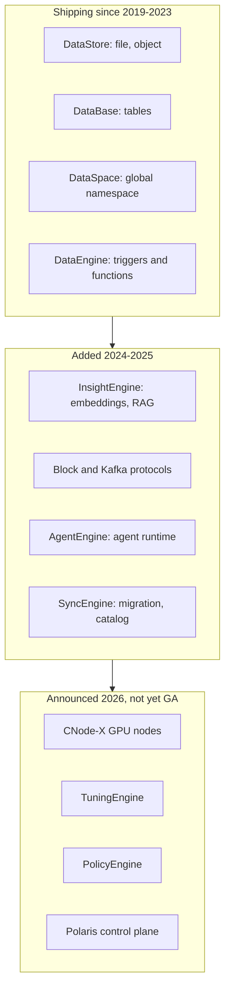
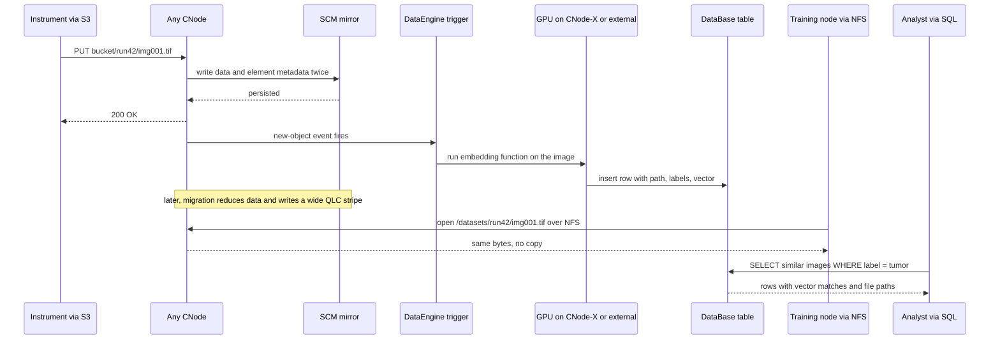
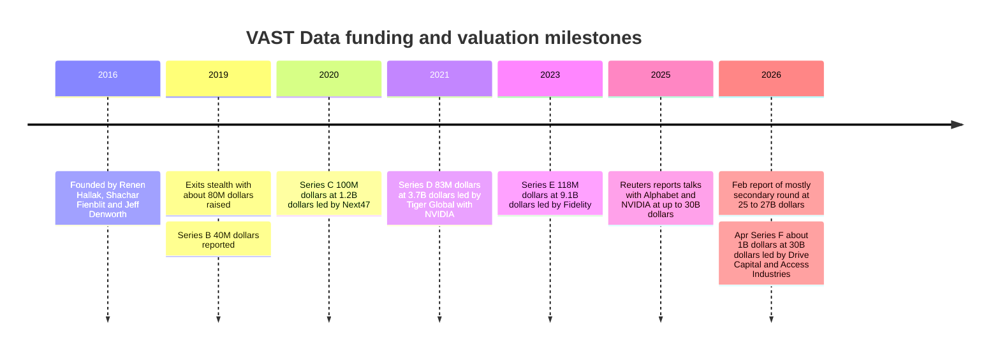
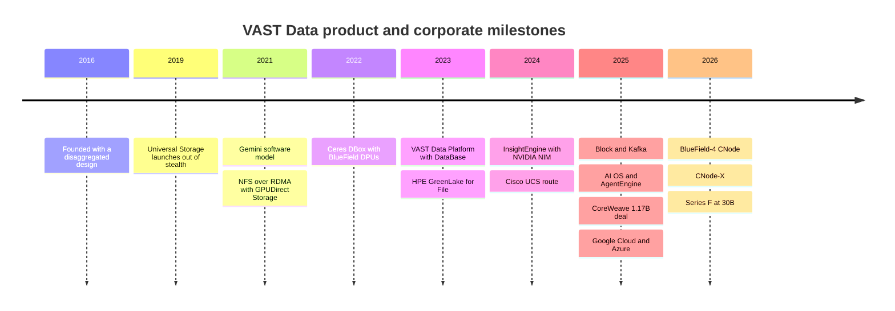

# 42. VAST Data deep dive

> **Depth:** L2 · **Reading time:** ~19 min · **Last verified:** 2026-11-01
> **Prerequisites:** [Disaggregated shared-everything architectures](../03-system-architecture/16-disaggregated-shared-everything.md) · [Data reduction](../01-storage-fundamentals/05-data-reduction.md) · [Data protection and resilience](../01-storage-fundamentals/06-data-protection-and-resilience.md) · [AI factories and neoclouds](../05-ai-storage/35-ai-factories-and-neoclouds.md) · [Why AI-native storage vendors gained traction](41-why-ai-native-vendors-won.md)

## TL;DR

- **VAST is a software company that built a hardware architecture, then climbed up the stack.** Its base is DASE: stateless compute nodes sharing SCM plus QLC flash over NVMe-oF. On top sit the Element Store (one metadata structure for files, objects, tables and blocks), and then a growing set of "engines" sold together as the VAST AI Operating System.
- **The economics come from three mechanisms: very wide erasure codes, similarity-based data reduction, and cheap QLC.** At large scale, protection overhead falls to about 3% and data reduction is cluster-wide. That makes all-flash credible for whole datasets, not just hot tiers.
- **The business numbers are company-stated and large.** VAST cites more than US$500M in committed ARR, more than US$4B in cumulative bookings, positive operating margin and free cash flow, and a US$30B valuation in an April 2026 Series F of about US$1B, roughly half of it secondary (reported by Bloomberg).
- **The customer base leans heavily on neoclouds and frontier labs.** CoreWeave signed a US$1.17B agreement, and VAST says it is the main data platform for xAI's Colossus, a claim DDN contests. Google Cloud and Microsoft Azure added cloud routes in late 2025.
- **The risks mirror the strengths.** VAST's valuation runs ahead of its disclosed revenue, it depends on partners for hardware during a NAND shortage, its customers are concentrated, NVIDIA is spreading the same architecture to every rival, and a database play takes it into Databricks and Snowflake territory.

## Why this matters for Everpure strategy

VAST is the competitor that defined the AI-native storage category in buyers' minds. At large GPU clusters, it is usually the incumbent Everpure's FlashBlade//EXA has to displace or sit beside. In April 2026 it became the most valuable private storage company: its company-stated valuation is about 25 times that of its 2020 round[^1][^2]. Its pitch has moved from "cheaper all-flash" to "the operating system for AI data." That move changes what Everpure is compared against. The comparison is no longer only about GB/s and $/TB. Buyers now also weigh whether the storage layer can host embeddings, event streams, SQL tables and agent runtimes.

For a strategy team, VAST is a benchmark in three ways. Technically, its design is the reference that [Chapter 16](../03-system-architecture/16-disaggregated-shared-everything.md) uses to explain shared-everything disaggregation. Commercially, it shows that software-only economics on partner hardware can produce cash flow at scale, if the company-stated figures hold. Strategically, it is a test of whether storage vendors can capture value above the storage layer. Everpure faces the same question with Fusion, its KV-cache work and its data-management roadmap ([Chapter 28](../04-everpure/28-platform-and-software.md)).

## Core concepts

### DASE in one paragraph, and what VAST adds

[Chapter 16](../03-system-architecture/16-disaggregated-shared-everything.md) covers the architecture in depth, so here is the short version. VAST splits a cluster into **CNodes**, stateless servers that run every protocol and data service, and **DBoxes**, enclosures of SSDs behind redundant fabric endpoints called DNodes. An NVMe-over-RDMA fabric connects the two tiers, so every CNode can reach every SSD. All state, including metadata, lives on shared persistent media: a small storage-class-memory (SCM) tier and a large QLC tier[^3]. A write is acknowledged once it is mirrored into SCM on two enclosures. Data reduction and wide-stripe erasure coding happen later, when the data migrates to QLC. Any CNode can serve any read.

This chapter covers what VAST built on that base: the hardware generations, the Element Store, the reduction and protection maths, the protocol layer, and the AI OS software stack.

![Layered diagram of the VAST AI Operating System. From bottom to top: shared media in DBoxes (DNodes, about 1% SCM or SLC, about 99% QLC); an NVMe-oF fabric; stateless compute (CNode, CNode-X with GPUs, BlueField-4 CNode inside GPU servers, EBox); the Element Store (byte-granular metadata, similarity reduction, wide erasure codes, snapshots and QoS); data services (DataStore, DataBase, DataSpace); compute engines (DataEngine, InsightEngine, AgentEngine, SyncEngine, plus announced TuningEngine and PolicyEngine); and access protocols (NFS, SMB, S3, NVMe/TCP block, Kafka API, SQL). A side column shows the Polaris control plane, the 2019–2026 sequence of additions, and the partner hardware and clouds it runs on.](../assets/diagrams/ch42-vast-architecture.svg)

*Figure 42.1 — VAST's moat is no longer the DASE hardware pattern, which rivals now copy. It is the single Element Store underneath, which lets every new layer reuse the same data without copies.*

### Hardware generations: from appliance to "runs on anything with a fabric"

VAST has changed what it ships roughly every two years. Each change pushed it further from being a box vendor:

| Generation | When | What changed | Strategic point |
|---|---|---|---|
| Universal Storage appliance | 2019 | CNodes in CBoxes, plus enclosures with Intel Optane SCM and QLC, sold by VAST[^4] | Proved DASE in production |
| Gemini model | Apr 2021 | VAST stops selling hardware. Customers buy certified hardware at cost through a partner and pay VAST a software subscription[^5][^6] | Software-like margins and revenue recognition |
| Second-source SCM | Nov 2021 | Kioxia FL6 SLC qualified alongside Optane[^7] | Insurance before Intel exited Optane in 2022 |
| Ceres DBox | Mar 2022 | NVIDIA BlueField DPUs replace x86 DNodes. The current DF-3060V2 holds 12 TB SCM and 1,352 TB QLC[^8][^9] | Density and power per PB |
| EBox | 2024–25 | CNode and DNode software on one standard server[^10] | Fits hyperscaler and cloud fleets that buy one server type |
| CNode-X | Announced Feb 2026, due later in 2026 | CNodes with NVIDIA GPUs, sold first by Supermicro and Cisco. The Supermicro build carries two RTX PRO 6000 Blackwell GPUs[^11][^12] | GPU-accelerated vector search and SQL inside the cluster |
| BlueField-4 CNode | Announced Jan 2026, hardware 2H 2026 | CNode software runs on the BlueField-4 DPU *inside GPU servers*, with access to the whole namespace[^13] | Storage controller moves into the GPU server for KV cache |

*Table 42.1 — Every VAST hardware generation either lowered VAST's own hardware exposure or moved its software closer to the GPU.*

**Semiconductor bridge.** The arc resembles a fabless chip company's path. VAST first sold a reference board (the appliance). It then licensed the design while partners handled manufacturing and inventory (Gemini and the OEMs). Most recently it has put its IP on the customer's own silicon (BlueField-4 inside the GPU server), much as an IP vendor ends up as a block inside someone else's SoC. Each step lowers capital intensity. Each step also gives up some control over the bill of materials and supply.

### The Element Store: one metadata structure for every data type

Most storage systems keep separate metadata for each personality: a file-system inode tree, an object index, a LUN map. VAST's Element Store keeps one. Files, objects, block volumes and database tables are all "elements" in the same persistent metadata structure, which lives in SCM and which every CNode reads and writes directly over the fabric[^3]. Three consequences follow.

1. **Multiprotocol is native, not gatewayed.** An object written over S3 is the same element an NFS client sees as a file, with no translation copy. Snapshots, replication and quality-of-service apply to every protocol, so block volumes added in 2025 inherited them on day one[^14].
2. **Metadata is byte-granular.** Data is stored at its exact byte length, not padded to a 4 KB or 32 KB block[^15]. That matters for small files and for the reduction scheme below.
3. **Capacity and metadata scale together.** Because metadata lives on shared SCM, not in the DRAM of a server that owns it, adding DBoxes adds metadata capacity, and adding CNodes adds metadata processing. The cost is a fabric round trip on every metadata lookup, as described in [Chapter 16](../03-system-architecture/16-disaggregated-shared-everything.md).

The persistent tier is tiny. In a DF-3060V2, SCM is 12 ÷ 1,364 ≈ 0.9% of raw capacity[^9]. It plays the role of a last-level cache plus the page table, while QLC is the bulk DRAM. The difference from a CPU is that this "cache" is persistent, so a power loss leaves nothing to flush.

### Similarity-based data reduction

Classic deduplication finds **identical** chunks by hash, and classic compression squeezes each chunk on its own. Both miss a common pattern in real data: chunks that are almost the same. Two checkpoint shards, two VM images or two versions of a genomics file can differ by a few bytes per block. A shifted timestamp then defeats deduplication, and per-block compression never sees the redundancy between blocks.

VAST's approach, described in its patent and engineering blog, works in three steps[^16][^17][^15]:

1. Compute a **similarity hash** for each chunk. Unlike a cryptographic hash, a similarity hash gives nearby values for chunks that share most of their bytes.
2. Group chunks with matching similarity hashes. Store one as a **reference** block.
3. Compress every other chunk in the group **against the reference** (VAST cites Zstandard-class compression with the reference used as a dictionary), so each one is stored only as a small delta. Exact duplicates collapse to pointers as before.

**Worked example (illustrative).** Take 1,000 daily snapshots of a 1 TB dataset in which 2% of the bytes change each day, scattered across blocks. Deduplication at 32 KB granularity finds few identical blocks, because nearly every block has at least one changed byte. Similarity reduction keeps one reference copy (1 TB) and stores each day's changes as deltas. That is about 0.02 TB a day plus compression overhead, or roughly 1 + 1,000 × 0.02 = 21 TB, against 1,000 TB logical, close to 48:1. On unrelated, already-compressed data such as JPEGs or encrypted video, the same machinery finds little and the ratio approaches 1:1. VAST's own median across customer datasets is about 2:1 (company-stated)[^18] [VERIFY: VAST median reduction ratio; third-party summaries cite ~3:1].

**Semiconductor bridge.** This is base-plus-delta compression, the idea proposed for CPU caches: store a base value and small deltas for neighbouring words. VAST applies it across a whole namespace, which is only practical because the metadata that tracks the references sits in shared SCM.

**The trade-off.** Reads of a delta-compressed chunk must fetch the reference too, and the reduction work costs CNode CPU during migration. VAST says reads use locally decodable compression to limit the extra fetch[^15]. Even so, reduction-heavy datasets cost more CPU per GB/s than raw ones, which is one reason CNode counts scale with workload as well as capacity.

### Locally decodable erasure codes: why wide stripes are safe

Wide stripes cut overhead but traditionally made rebuilds expensive. With Reed-Solomon k+m, rebuilding one lost strip means reading k surviving strips. VAST's locally decodable codes add structure so that a single lost strip can be rebuilt from about a quarter of the stripe[^19].

**Worked numbers.** A 146+4 stripe, which VAST uses on clusters of 75 or more DBoxes, has an overhead of 4 ÷ 150 = 2.7%[^20]. Plain Reed-Solomon would read 146 strips to rebuild one. Reading about a quarter means roughly 37. Compare a classic 8+2 layout, at 20% overhead and 8 reads per rebuild. VAST gets 7× lower overhead for about 4.6× more rebuild reads per strip. The rebuild is spread across every CNode and SSD in the cluster, so wall-clock rebuild time stays short. On a 50 PB usable cluster the overhead gap is worth about 50 ÷ 0.8 − 50 ÷ 0.973 ≈ 11 PB of raw flash.

**Bridge.** This resembles local reconstruction codes in cloud storage, and HBM's split between on-die ECC (cheap, local) and system-level ECC (global, stronger). Most repairs stay local. The rarer multi-failure case falls back to the wide code.

### Protocols: NFS to Kafka on the same bytes

By late 2026 the access layer includes NFSv3/v4 (including NFS over RDMA, which VAST paired with GPUDirect Storage from 2021[^21]), SMB, S3, block over NVMe/TCP and a Kafka-compatible Event Broker. Block and Kafka arrived in early 2025[^14][^22]. VAST built the Kafka producer and consumer APIs as just another protocol module, so event topics land as tables that SQL can query. VAST claims its largest clusters handle 500 million messages per second (company-stated)[^22]. Two choices stand out:

- **Standard NFS clients, no proprietary driver.** Lustre and WEKA each need a client module on every GPU node ([Chapter 17](../03-system-architecture/17-parallel-file-systems.md)). VAST asks for none, which matters to neoclouds that run locked-down images. FlashBlade//EXA makes the same choice with standard pNFS.
- **One namespace across protocols.** A dataset ingested through S3 can be trained on through NFS and catalogued through SQL without an ETL copy.

### The AI OS stack: what each layer does and how mature it is

VAST rebranded in May 2025 as the "AI Operating System"[^23]. The label is marketing. The components underneath are concrete:

*Figure 42.2 — The product stack by maturity. The storage-native layers are proven at scale, while the agent and governance layers are newer and their adoption is mostly undisclosed.*

| Component | What it does, in plain terms | First announced | Status (public sources) |
|---|---|---|---|
| DataStore | The file, object and block personalities of the Element Store | 2019 (as Universal Storage) | Shipping |
| DataBase | Columnar tables stored directly in the Element Store and queried via engines such as Trino and Spark. Now holds vectors and event topics | 2023, with the "VAST Data Platform"[^24] | Shipping |
| DataSpace | Global namespace across sites and clouds, extended to a hybrid namespace with Google Cloud in Nov 2025[^25] | 2023 | Shipping |
| DataEngine | Event triggers plus serverless functions and containers running inside the cluster[^26] | 2023 | Shipping |
| InsightEngine | Embeds new data as it lands, using NVIDIA NIM microservices triggered by DataEngine, then indexes it for retrieval[^27] | Oct 2024 | Shipping [VERIFY: GA date; one source says Mar 2025] |
| AgentEngine | Runtime for deploying agents, with MCP-compatible tool access[^23] | May 2025 | Announced. Adoption undisclosed |
| SyncEngine | Data migration and cataloguing from other systems[^28] | Aug 2025 | Shipping [VERIFY: exact scope and pricing] |
| TuningEngine, PolicyEngine | Fine-tuning loops; guardrails and access policy for agents[^28] | Feb 2026 | Due by end of 2026 |
| Polaris | Control plane across clusters and clouds[^29] | Feb 2026 | [VERIFY: whether a separately sold product] |

*Table 42.2 — "AI OS" is a bundle of storage-native services (proven) and compute or agent services (new). Diligence should treat the two halves separately.*

### I/O walkthrough: one object, three personalities

The clearest way to see the Element Store's value is to follow one piece of data through the stack. Take a pharma company ingesting microscope images for a vision model:

*Figure 42.3 — One write serves object ingest, file-based training and SQL plus vector search. The copies a conventional stack makes between object store, file system and vector database never happen.*

**Worked example (illustrative).** Take a 10 PB image corpus. A conventional pipeline lands it in object storage, copies a working set into a parallel file system for training, and builds embeddings in a separate vector database. If the training copy is half the corpus, that is 5 PB of extra flash plus the pipelines to keep it fresh. The embeddings are small by comparison. For 2 billion images at 1,024 dimensions × 2 bytes (FP16), they come to about 2e9 × 2,048 bytes ≈ 4 TB. The win is not the vector bytes. It is eliminating the 5 PB copy and the staleness window between copies. The counter-argument is that a parallel file system or a specialised vector database may be faster at its single job, and that many enterprises already own a lakehouse ([Chapter 33](../05-ai-storage/33-rag-vector-lakehouse.md)).

### Why put GPUs and DPUs into storage nodes

CNode-X and the BlueField-4 CNode push compute in opposite directions. **CNode-X** brings GPUs into the storage cluster, so vector search (NVIDIA cuVS), data clustering and SQL (VAST cites the open-source Sirius GPU SQL engine and claims 44% faster queries, company-stated) run next to the data instead of hauling it to a GPU farm[^12]. The **BlueField-4 CNode** does the reverse. It puts the storage controller on the DPU inside each GPU server, which serves NVIDIA's inference context-memory tier for KV cache ([Chapter 32](../05-ai-storage/32-inference-and-kv-cache.md)). VAST claims 75% lower power for KV-cache operations than with separate controllers (company-stated)[^13].

The bridge is near-memory compute. Moving the operation to the data is cheaper than moving the data when the operation's output is small relative to its input, as in a similarity search over billions of vectors. The strategic catch is that NVIDIA published BlueField-4 STX as a reference architecture with a dozen storage partners, Everpure among them[^30]. The DPU placement is therefore not unique to VAST, and the differentiation has to come from the software.

## Business model & financials

### How VAST makes money

Since 2021 VAST has sold software, not hardware. Under **Gemini**, customers buy certified servers and enclosures at cost from a manufacturing partner and pay VAST a subscription priced on capacity, with support included. VAST says customers can renew at the same price for up to ten years (company-stated)[^5][^31]. VAST also sells through OEMs that bundle its software with their hardware (HPE, Cisco, Supermicro) and through cloud marketplaces. Per-TB prices are not public.

Two consequences matter. First, VAST's reported gross margin should look like a software company's, while the customer's total cost still carries full hardware cost, including NAND, which VAST does not mark up or control. Second, "bookings" and "CARR" are VAST's chosen metrics. They capture multi-year commitments that GAAP revenue would spread over time, so they are not comparable with Everpure's revenue or subscription ARR.

### Funding and valuation

*Figure 42.4 — Valuation compounded about 25× from 2020 to 2026 on roughly US$1.3B of cumulative capital raised, much of the last round going to selling shareholders.*

*Figure 42.5 — VAST raised little primary capital relative to its valuation. The 2023 and 2026 rounds both returned cash to existing holders, which is what a company that says it is cash-generative would do.*
Data: `data/ch42_funding.csv`

The details, with labels:

- **Founding.** Early 2016, by Renen Hallak (CEO, previously at XtremIO), Shachar Fienblit and Jeff Denworth. Offices are in New York with R&D in Israel[^4]. VAST came out of stealth in February 2019 with about US$80M raised across its Series A and B (company-stated at launch)[^32] [VERIFY: per-round investors for Series A and B].
- **Series C, April 2020:** US$100M at US$1.2B, led by Next47 (company-stated)[^2].
- **Series D, May 2021:** US$83M at US$3.7B post-money, led by Tiger Global with NVIDIA participating, for about US$263M raised in total (company-stated)[^33].
- **Series E, December 2023:** US$118M at US$9.1B, led by Fidelity with NEA, BOND and Drive Capital (company-stated). Part of the proceeds reportedly bought back existing shares (reported by The Information via Crunchbase News)[^34][^35].
- **2025–early 2026 talks.** Reuters, via Globes, reported talks with Alphabet and NVIDIA at up to US$30B. In February 2026, Globes reported a mostly secondary round at US$25–27B (both reported by press)[^36][^37].
- **Series F, closed April 2026:** about US$1B of primary and secondary capital at US$30B. Drive Capital and Access Industries co-led, and NVIDIA, Fidelity and NEA participated (company-stated)[^1][^38]. Bloomberg reported that about half went to the company and half to early investors and employees through a tender (reported by Bloomberg)[^39]. Calcalist called it the largest private round in Israeli tech[^40]. Hallak has said an IPO is possible but not needed for funding[^39].

### Revenue, profitability and the "Rule of X"

VAST is private and publishes no audited financials. All of the following is company-stated unless marked otherwise:

- **Committed ARR (CARR) above US$500M** at the end of its fiscal year ending January 2026, **cumulative bookings above US$4B**, and **positive operating margin and free cash flow**[^38][^41] [VERIFY: fiscal-year label; some coverage says "previous fiscal year" without naming it].
- At the Series E in late 2023, VAST cited US$1B of cumulative software bookings and 12 consecutive quarters of positive cash flow[^34][^35]. Bookings therefore roughly quadrupled in about 2.3 years.
- A **"Rule of X" score of 228%**[^38]. Bessemer defines Rule of X as revenue growth × a multiplier (about 2× for private companies) + free-cash-flow margin[^42]. VAST did not disclose the components. **Worked inference:** if the FCF margin is between 10% and 30%, 228 = 2g + FCF implies growth of about 99–109%. In other words, the score is consistent with revenue roughly doubling. That is an inference, not a disclosure.
- Press and analyst estimates vary widely. Sacra estimated about US$200M ARR in January 2025 (estimated)[^43]. Blocks & Files speculated that run-rate "could even be topping $2 billion" after the CoreWeave deal (speculation, not a disclosure)[^44]. The gap between CARR (>US$0.5B) and that speculation is a definitions problem: multi-year bookings booked up front versus annualised recurring value.
- **Headcount:** about 1,200, roughly a third in Israel, as of March 2026 (reported)[^45] [VERIFY: headcount].

**Worked valuation multiple.** US$30B ÷ US$0.5B CARR = **60× trailing CARR**. If CARR doubles in FY2027, which is consistent with the Rule of X inference, the forward multiple is about 30×. For scale, Everpure reported US$2.13B of subscription ARR in Q2 FY27[^46]. That is about four times VAST's CARR, though the definitions differ and Everpure also books large product revenue.

## Customers & go-to-market

### Who buys

| Segment | Named customers or partners (public) | What they buy VAST for |
|---|---|---|
| Neoclouds | CoreWeave (US$1.17B multi-year deal)[^47], Lambda, Crusoe, Core42, Nebius[^48], Nscale[^49] | Multi-tenant shared storage behind GPU fleets, resold as a service |
| Frontier labs | xAI Colossus. VAST says it is the primary platform. DDN also claims a primary role[^50][^51] | Training data, checkpoints, model stores at 100k+ GPU scale |
| Hyperscaler channels | Google Cloud managed service (Nov 2025)[^52]; Azure Native ISV Service (announced Nov 2025)[^53] | Hybrid namespace and cloud bursting |
| Enterprise and research via OEMs | HPE GreenLake for File (since Apr 2023)[^54]; Cisco UCS (Oct 2024)[^55]; Supermicro[^11] | All-flash file and object consolidation, AI pilots |

*Table 42.3 — VAST's revenue concentration is in the top two rows. The OEM and cloud rows are its route to diversification.*

**CoreWeave.** The deal is US$1.17B (reported by Reuters on 2025-11-06, confirmed by VAST). It makes the VAST AI OS CoreWeave's primary data platform. VAST said contracts like this usually run three to five years, without giving terms[^47][^56]. The Next Platform called CoreWeave VAST's "customer number one"[^57]. **Rough concentration arithmetic:** US$1.17B is about 29% of the US$4B cumulative bookings figure, though the timing of when each was booked is undisclosed.

**xAI: contested.** VAST's co-founder said xAI uses VAST "primarily," while adding that this does not mean exclusively. DDN's president called DDN the "primary and main" provider for Grok 3's first phase. Blocks & Files later reported that VAST was supplying more storage for the wider site[^50][^51]. xAI has not published a split. The defensible statement is "both supply Colossus; the split is unknown."

**Cloud routes.** On Google Cloud, VAST runs as a fully managed service with Marketplace billing and TPU support[^52]. The Azure offering was announced at Ignite in November 2025 as an Azure Native ISV Service on local-NVMe VMs. Its general-availability status was unclear in public sources at the time of writing[^53] [VERIFY: Azure GA].

**OEMs.** HPE GreenLake for File runs VAST software on Alletra MP hardware, but HPE decides which VAST features ship, and object was not offered at launch[^58]. HPE also sells its own X10000, so it is both partner and competitor. Lenovo has run seller training on VAST with ThinkSystem servers (July 2025), but no Lenovo OEM launch was found[^59] [VERIFY: Lenovo OEM status].

### How it sells

VAST's direct field team chases the largest deals (neoclouds, labs, government). OEMs extend reach into enterprise accounts it cannot cover. NVIDIA is a co-seller in all but name: VAST has been an investor-backed partner since 2021, holds DGX SuperPOD certification, and launched with NVIDIA's AI Data Platform and STX designs[^60][^30]. VAST has never submitted to MLPerf Storage. It sells on reference customers rather than audited benchmarks[^61].

## Why it gained traction

[Chapter 41](41-why-ai-native-vendors-won.md) covers the category-level reasons. For VAST specifically, the steelman has six parts:

1. **It bet on the right media curve early.** In 2016 it designed for QLC plus SCM plus NVMe-oF when all three were immature. When they matured, VAST had a three-year head start on a design that incumbents could not retrofit onto dual-controller or shared-nothing code bases.
2. **It made flash cheap enough for "all the data."** Wide codes at about 3% overhead and global reduction let VAST pitch one flash tier instead of flash plus disk. That simplified the architecture for AI buyers, who reread whole datasets each epoch.
3. **It fit neocloud operations.** A neocloud needs standard NFS clients, multi-tenancy, a single namespace, and the ability to add throughput or capacity independently as tenants change. DASE gives all four.
4. **It chose the software model before AI demand arrived.** Gemini (2021) meant that when GPU clusters exploded in 2023–2025, VAST could scale bookings without a manufacturing balance sheet.
5. **It stayed close to NVIDIA.** NVIDIA invested from the Series D, early GPUDirect Storage work over NFS-RDMA followed, and NVIDIA launches have featured VAST since. In AI infrastructure, NVIDIA's reference designs are de facto procurement lists.
6. **It sold a story and then shipped against it.** The "operating system" framing is ambitious, but VAST has shipped a database, event streaming, block and agent tooling on a cadence that rivals have struggled to match. Buyers who assumed storage would be a commodity heard a platform pitch instead.

## Risks & open questions

| Risk | Why it matters | What would reduce it |
|---|---|---|
| Valuation ahead of revenue | 60× trailing CARR. About half the Series F was secondary, and an IPO would test the number publicly | Audited revenue, an S-1, or CARR well above US$1B |
| Hardware dependency in a NAND shortage | NAND contract prices rose sharply through 2026 (TrendForce forecast another 15–20% QoQ for 4Q26)[^62]. VAST passes hardware through at cost, so customers bear the spike and deployments can slip. VAST pitches its reduction as a hedge[^63] | Long-term supply agreements via OEMs, or higher reduction ratios on AI data |
| Customer concentration | One customer equals about 29% of cumulative bookings. Neocloud demand depends on GPU financing cycles | Enterprise and cloud-marketplace growth disclosed separately |
| NVIDIA commoditising the pattern | STX and BlueField-4 give every partner the same DPU-in-GPU-server design[^30]. NetApp, HPE and Everpure ship disaggregated systems ([Chapter 16](../03-system-architecture/16-disaggregated-shared-everything.md)) | Software features rivals cannot match, such as the single Element Store across tables and files |
| Moving up-stack | DataBase, AgentEngine and TuningEngine compete with Databricks, Snowflake, vector databases and NVIDIA's own software. Buyers in those categories are different people | Public reference customers for DataBase and AgentEngine |
| OEM partners as competitors | HPE sells X10000, Cisco and Supermicro sell rivals too, and HPE controls which VAST features ship[^58] | Direct, cloud and neocloud channels outgrowing OEMs |
| No audited benchmarks | Absent from MLPerf Storage v1.0–v3.0[^61] | Entering a public benchmark round |

*Table 42.4 — Most of VAST's risks are the flip side of choices that made it successful: software-only, NVIDIA-aligned, neocloud-first and platform-ambitious.*

Open questions worth tracking: how much of CARR is CoreWeave; whether the BlueField-4 CNode ships in 2H 2026 as announced; whether DataBase wins workloads that do not start as storage; and whether Jeff Denworth still holds an operational role, which one Israeli outlet questioned[^64] [VERIFY: Denworth role].

## Strategic relevance to Everpure

Options a strategy team might evaluate, based on public information:

1. **Compete head-on at large AI scale with FlashBlade//EXA.** EXA's case against VAST is a shorter data path (client to data node, no CNode hop), standard pNFS, Purity's metadata engine, and audited MLPerf v3.0 results in a round VAST skipped ([Chapter 27](../04-everpure/27-flasharray-and-flashblade.md)). The gaps are reference customers at 100k-GPU scale, DFM-based data nodes, and certification badges.
2. **Turn the NAND shortage into a wedge.** Everpure (NYSE: P, formerly PSTG) designs its own DirectFlash Modules and buys NAND as a large volume buyer ([Chapter 26](../04-everpure/26-purity-and-directflash.md)). VAST's customers buy servers at cost in a tight market. If supply stays constrained into 2027, a vendor that guarantees capacity and price may matter more than one with a lower software fee ([Chapter 48](48-media-suppliers-and-nand-cycle.md)).
3. **Match the platform story selectively, not wholesale.** Everpure already has KV-cache work (KVA), Data Stream and Fusion. The open question is which of VAST's up-stack layers buyers actually pay for. The evidence so far points to the storage-native ones (multiprotocol, global namespace, event triggers) rather than agent runtimes.
4. **Coexist inside neoclouds.** CoreWeave also lists Everpure among its dedicated-storage partners[^65]. Neoclouds multi-source, so a second-source position is a realistic entry point.
5. **Watch the IPO.** A VAST S-1 would give the first audited view of AI-native storage economics: gross margin, revenue recognition on bookings, and customer concentration. That would reset the benchmark for Everpure's own valuation conversation. Acquiring VAST at a US$30B private mark is not a realistic option for a storage incumbent of Everpure's size. Smaller up-stack assets are, as NetApp's 2026 acquisitions show ([Chapter 46](46-incumbents.md)).

## How Everpure approaches it vs. competitors

| Dimension | VAST AI OS | Everpure FlashBlade//EXA |
|---|---|---|
| Architecture | DASE: stateless CNodes share all SSDs over NVMe-oF[^3] | Metadata/data split: Purity//FB metadata core plus data nodes running Purity//DN[^66] |
| Data path | Client → CNode → DBox (two fabric hops) | Client → data node directly over RDMA after a pNFS layout fetch |
| Metadata home | Shared SCM, accessed by any CNode | DFM-based FlashBlade blades |
| Media | SCM/SLC plus commodity QLC SSDs | Metadata on DFMs. Data nodes use third-party NVMe today, with DFM data nodes planned [VERIFY: DFM data-node GA] |
| Protection and reduction | Locally decodable codes to 146+4 (2.7%). Global similarity reduction | Purity reduction on the metadata core. Data-node protection on a separate release train ([Chapter 16](../03-system-architecture/16-disaggregated-shared-everything.md)) |
| Protocols | NFS/RDMA, SMB, S3, NVMe/TCP block, Kafka, SQL | pNFS (NFSv4.1 metadata over TCP, data over RDMA) |
| Up-stack services | DataBase, DataEngine, InsightEngine, AgentEngine and more | KVA for KV cache, Fusion control plane, Data Stream preview[^67] |
| Public benchmarks | None in MLPerf Storage | MLPerf v3.0: 877.5 GiB/s checkpoint write, 1,623.4 GiB/s KV-cache read[^61] |
| Business model | Software subscription. Hardware at cost via partners or OEMs | Everpure metadata hardware plus software. Data nodes customer-sourced with a 160 TiB entitlement each[^68] |
| Scale proof points | CoreWeave, xAI (contested), neoclouds | Meta hyperscale DFM deal (adjacent), first enterprise EXA customer in Q4 FY26 |

*Table 42.5 — VAST leads on breadth of services and installed scale. EXA leads on data-path simplicity and audited results, and Everpure owns its media supply.*

The steelman for VAST in this comparison is that breadth compounds. Every new engine runs on the same Element Store, so each one makes the platform harder to remove. The steelman for EXA is that at the 1–10 TB/s frontier the bottleneck is metadata and the data path, not the number of personalities, and EXA removes a hop there. Which matters more depends on the buyer. A neocloud selling storage-as-a-service values breadth. A lab running one giant training job values throughput per dollar and per watt. [Chapter 45](45-head-to-head.md) runs the four-way comparison including WEKA and DDN.

## History and trajectory

*Figure 42.6 — VAST added a major layer roughly every year. Since 2023 the additions have been software services more than hardware.*

The trajectory has three phases. From 2016 to 2020 the company was a storage architecture: all-flash at near-disk economics. From 2021 to 2023 it became a software business with a data platform. Since 2024 it has been an AI infrastructure company that happens to store data. Signals for 2026–2027 are CNode-X and BlueField-4 shipments in 2H 2026, TuningEngine and PolicyEngine general availability by year-end[^28], a possible IPO[^39], and whether CARR growth broadens beyond neoclouds.

## Numbers that matter

| Metric | Value | Context | Source / date |
|---|---|---|---|
| Valuation | US$30B | Series F, company-stated; ~25× the 2020 round | CNBC / VAST, 2026-04[^1] |
| Series F size | ~US$1B, ~half secondary | Co-led by Drive Capital and Access Industries | Bloomberg, 2026-04[^39] |
| Committed ARR | >US$500M | Exiting FY ending Jan 2026, company-stated | VAST via Futurum, 2026-04[^38] |
| Cumulative bookings | >US$4B | Up from ~US$1B at end-2023, company-stated | 2026-04[^38]; 2023-12[^34] |
| Rule of X | 228% | Implies ~100% growth at 10–30% FCF margin (worked inference) | 2026-04[^38]; Bessemer[^42] |
| CoreWeave agreement | US$1.17B | Multi-year; ~29% of cumulative bookings (worked) | Reuters, 2025-11-06[^47] |
| Valuation ÷ CARR | ~60× | Worked example | Worked example |
| Widest stripe overhead | 2.7% (146+4) | Needs ≥75 DBoxes | VAST blog[^20] |
| SCM share of raw | ~0.9% | DF-3060V2 DBox | VAST KB[^9] |
| Headcount | ~1,200 | ~1/3 in Israel, reported | HPCwire, 2026-03[^45] |

## Conversation playbook

**Questions for a PM**

1. *"In the last ten EXA deals against VAST, what decided the outcome?"* A strong answer separates neocloud from lab and enterprise deals. It names the deciding factor in each (reference customers, NFS versus pNFS client support, $/TB under NAND inflation, up-stack features), and admits where VAST's breadth won.
2. *"Which VAST AI OS features show up in RFPs as requirements, not nice-to-haves?"* A strong answer distinguishes multiprotocol on one namespace and event triggers, which appear often, from AgentEngine-style features, which rarely gate deals. It says how Everpure covers the ones that do.
3. *"How does the NAND shortage change our competitive pitch against a software-only vendor?"* A strong answer quantifies the hardware share of total cost of ownership for a 50 PB deal, explains Everpure's supply position versus at-cost white-box hardware, and avoids overclaiming price guarantees.

**Questions for an engineer**

1. *"Walk me through a 1 GB/s write on VAST versus EXA: fabric crossings, persistence point, and where reduction happens."* A strong answer gives roughly 4× back-end traffic for VAST's mirror-then-migrate path ([Chapter 16](../03-system-architecture/16-disaggregated-shared-everything.md)) and the direct data-node write for EXA, and says where each spends CPU.
2. *"Is similarity reduction a real advantage on AI training data?"* A strong answer says it helps on checkpoints, versions, logs and near-duplicate corpora. It helps little on compressed media and tokenised shards. It asks for measured ratios, not marketing medians.
3. *"What does BlueField-4 STX change for us?"* A strong answer explains that the DPU-resident controller becomes a shared NVIDIA pattern. It identifies the software that still differentiates (metadata engine, reduction, multi-tenancy) and the timeline for EXA's STX alignment.

**Don't say this:**

- "VAST is a hardware company." It has sold software on partner hardware since 2021.
- "VAST has US$2B of ARR." That is press speculation. The company-stated figure is more than US$500M of CARR.
- "VAST powers xAI." Both VAST and DDN claim a primary role at Colossus, and the split is unknown.
- "VAST's data reduction is 3:1." VAST's own cited median is about 2:1, and the ratio depends entirely on the data.
- "FlashBlade//EXA beat VAST in MLPerf." VAST did not enter.
- "The AI OS is all shipping." Several engines and CNode-X were announced in 2026 with GA targeted for later in the year.

## Going deeper (optional, L3 pointers)

- VAST's US patent application 2019/0379394 on global similarity-based compression[^16], and its engineering blog series on locally decodable codes[^19].
- Lockwood et al., PDSW'21, for an independent benchmark of a VAST system's read and write behaviour[^69].
- VAST knowledge-base pages on DBox high availability, rack resiliency and data reduction, for stripe and failure-domain rules.
- NVIDIA's BlueField-4 STX and inference context-memory documentation, to see which parts of the KV-cache design are NVIDIA's and which are VAST's.

## Key terms

- **Element Store** — VAST's single metadata and data structure underneath every protocol and service.
- **Similarity-based data reduction** — compressing near-duplicate chunks as deltas against a shared reference block.
- **Locally decodable erasure code** — a wide erasure code that rebuilds a lost strip from a fraction of the stripe.
- **VAST AI Operating System** — VAST's 2025 umbrella brand for DataStore, DataBase, DataSpace and its compute engines.
- **CNode-X / EBox / Ceres** — GPU-equipped compute node, converged server, and BlueField-based storage enclosure.
- **Gemini** — VAST's model of hardware at cost plus a capacity-priced software subscription.
- **Committed ARR (CARR)** — annualised value of signed recurring contracts, including those not yet live.
- **Rule of X** — Bessemer's growth-weighted variant of the Rule of 40.
- See the [glossary](../glossary.md) for the rest.

## Sources

[^1]: CNBC, "Nvidia backs AI company Vast Data at $30 billion valuation," 2026-04-22. https://www.cnbc.com/2026/04/22/nvidia-backs-ai-company-vast-data.html (retrieved 2026-11-01).
