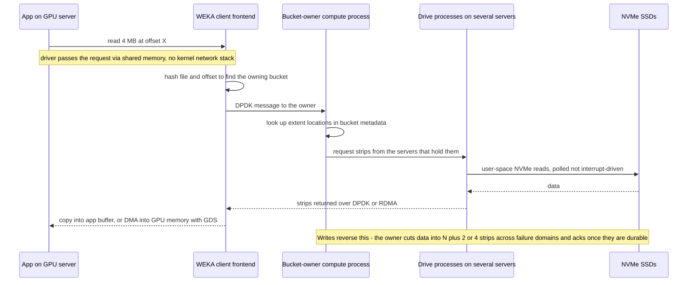
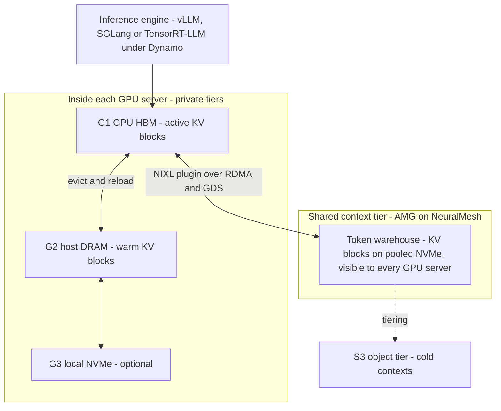
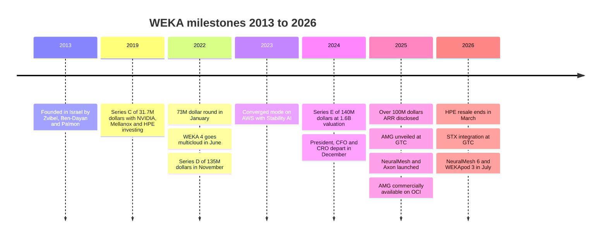

# 43. WEKA deep dive

> **Depth:** L2 · **Reading time:** ~17 min · **Last verified:** 2026-11-01
> **Prerequisites:** [Scale-out shared-nothing clusters](../03-system-architecture/15-scale-out-shared-nothing.md) · [Parallel and distributed file systems](../03-system-architecture/17-parallel-file-systems.md) · [The GPU data path](../02-protocols-and-networking/11-gpu-data-path.md) · [Inference and KV cache](../05-ai-storage/32-inference-and-kv-cache.md)

## TL;DR

- **WEKA sells software, not boxes.** Its product is a parallel, shared-nothing file system for NVMe flash. It was called WekaFS, became NeuralMesh in June 2025, and NeuralMesh 6 was announced in July 2026. It runs on commodity servers, inside GPU servers, or in AWS, Azure, Google Cloud and OCI. Its technical signature is a kernel-bypass data path with metadata sharded across every node.
- **It was among the first vendors to make KV-cache offload a commercial product.** Augmented Memory Grid (AMG) became commercially available on 2025-11-18, with OCI as launch partner. WEKA claims up to 20x faster time to first token (TTFT). That is physically plausible but has not been independently verified.
- **The business is smaller than the noise around it.** WEKA passed US$100M ARR in 2024 *(company-stated)* and has raised about US$415M in total. Its last priced round valued it at US$1.6B in May 2024, and it has not raised since. VAST has repriced to US$30B in the meantime.
- **The risks are scale, channel and proof.** WEKA turned over its executive team in 2024–25, and HPE stopped reselling its software in March 2026 (announced November 2025). It has no MLPerf Storage results since 2024. Demand is concentrated in NVIDIA-driven neocloud spending.
- **For Everpure, WEKA is the cleanest "software-anywhere" foil to FlashBlade//EXA.** The contrasts are a proprietary client versus pNFS, any hardware versus DirectFlash, and a KV-cache head start versus PureKVA.

## Why this matters for Everpure strategy

WEKA sits on most GPU-cluster shortlists that Everpure (NYSE: P, formerly PSTG) contests with FlashBlade//EXA, next to VAST and DDN. It wins differently from both. VAST sells shared-everything plus data reduction ([Chapter 42](42-vast-data.md)), and DDN sells Lustre heritage and NVIDIA reference installs ([Chapter 44](44-ddn.md)). WEKA sells portability and latency: the same file system on a neocloud's GPU servers, a customer's own hardware or four public clouds.

WEKA is also a corporate-development reference point. It is a sub-scale, NVIDIA-aligned AI storage software company with a first-mover KV-cache product and a valuation unchanged for two and a half years. [Chapter 45](45-head-to-head.md) has the four-way comparison, and [Chapter 50](50-diligence-framework.md) has the diligence checklist.

## Core concepts

### What the product is, and what the names mean

Liran Zvibel (CEO), Maor Ben-Dayan and Omri Palmon founded WekaIO in Israel in 2013 to build a flash-native file system faster than local disk[^1]. The company is now based in Campbell, California, and calls itself WEKA. Buyers use its product names interchangeably:

- **WekaFS / WEKA Data Platform (to mid-2025):** a POSIX parallel file system with an S3 object tier. WEKA 4 (June 2022) ran it natively on AWS, Google Cloud, Azure and OCI[^2].
- **NeuralMesh (June 2025):** a re-architecture into containerised microservices for data, metadata, auditing and observability, forming a self-healing mesh[^3]. It shipped in limited release first, with GA planned for fall 2025[^4].
- **NeuralMesh Axon (July 2025):** the same software running *inside* GPU servers on their local NVMe. Cohere and CoreWeave were the launch references[^5].
- **NeuralMesh 6 (announced 2026-07-21):** adds multi-tenancy, data reduction, native object and an enhanced AMG. GA is planned for 2H 2026 and is a free upgrade[^6].

Shared-nothing ([Chapter 15](../03-system-architecture/15-scale-out-shared-nothing.md)) and parallel-file-system ([Chapter 17](../03-system-architecture/17-parallel-file-systems.md)) mechanics apply; this chapter covers only what WEKA does differently.

### The architecture in one picture

*Figure 43.1 — WEKA runs the same user-space services on every backend server and spreads both metadata and data across all of them, so there is no metadata server to saturate.*

Three design choices define WEKA:

**1. Everything is a user-space process.** WEKA defines four process roles. *Frontend* processes serve clients, *compute* processes run file-system logic, *drive* processes own NVMe devices and a *management* process handles control. NFS, SMB and S3 run as separate containers[^7].

**2. Metadata is sharded, not centralised.** Lustre-style systems keep the namespace on dedicated metadata servers, which choke on millions of small files ([Chapter 21](../03-system-architecture/21-metadata.md)). WEKA splits metadata into thousands of "buckets", each run by a virtual metadata server inside the compute processes on every node. A hash of each operation, not just the inode, picks the owning bucket, so even block ranges of one hot file spread across owners. Buckets journal to WEKA's own protected storage[^8].

*Semiconductor bridge:* this is address interleaving across DRAM channels and banks. A hashed address map stops any one access pattern from hammering one bank. The cost is also the same: an operation spanning many buckets, such as a cross-directory rename, becomes a distributed transaction.

**3. Protection is distributed erasure coding.** Each stripe holds data strips plus 2 or 4 parity strips; older (4.1) docs give 3–16 data strips, current docs a total stripe width of 5–20. N+2 is the default. Stripes are spread any-to-any across servers, and the stripe shape is fixed when the cluster is formed[^9]. A 16+4 stripe keeps 16/20 = **80%** of raw capacity as data, while 5+2 keeps ≈ **71%**. The full stripe must fit within the number of failure domains, with headroom for spare capacity, so 16+4 needs at least 20 servers (or racks, if racks are the failure domain); one docs example runs 16+2 on 20 servers. Small clusters therefore pay more for parity, the usual shared-nothing trade.

### The kernel-bypass data path

WEKA's latency comes from bypassing the operating system's I/O plumbing. Backend servers run **DPDK**, which maps the NIC into user space via SR-IOV. Clients use DPDK too, falling back to kernel UDP where it is unavailable, such as some AWS instance types. In *performance* mode, WEKA processes busy-poll on dedicated cores. A *CPU-optimised* mode, added in release 5.0, uses interrupts instead[^7]. Drive processes reach NVMe from user space, in the style of SPDK.

*Figure 43.2 — A WEKA read never enters the kernel network or block stack; the price is CPU cores dedicated to polling. Simplified: WEKA does not publish the exact internal hop order.*

**Illustrative budget** (orders of magnitude, not WEKA measurements): if a kernel path spends ~5 µs of CPU per small I/O on syscalls, interrupts and copies, and a polled user-space path spends ~1 µs, then 1M IOPS needs ~5 cores in the first case and ~1 in the second. Polling also removes scheduler jitter, so tail latency tightens. The catch is that a polling core stays busy even when there is no work. On a GPU server in converged mode, that is a core taken from the data loaders.

*Semiconductor bridge:* this is the trade between an interrupt-driven peripheral and a command engine spinning on a doorbell register. You spend silicon to make latency deterministic. NVMe made the same move on the SSD side ([Chapter 7](../02-protocols-and-networking/07-block-protocols.md)), and WEKA extends it across the network.

One consequence buyers notice: the fast path needs the **WEKA client**, a kernel module plus agent, on every compute node. Agentless access goes through NFS, SMB or S3 gateways at lower performance. EXA and VAST both use standard NFS or pNFS clients instead.

### Four ways to deploy the same software

| Mode | Where WEKA runs | Who buys the hardware | Best for | Main cost or risk |
|---|---|---|---|---|
| Dedicated (on-premises) | Qualified servers from Supermicro, Dell, Lenovo, Hitachi and others[^10] | Customer, via OEM or reseller | Separate enterprise/HPC storage tier | Customer integrates a multi-vendor stack |
| WEKApod appliance | WEKA-branded servers, now WEKApod 3 (Nitro, Prime, Prime Max)[^11] | Customer, from WEKA | One-vendor support, SuperPOD certification | WEKA takes hardware margin and supply risk |
| Converged / Axon | Inside GPU servers, on local NVMe and spare cores[^5] | Already bought with the GPUs | Neoclouds, large training fleets | Shares failure domains, CPU and NICs with compute |
| Public cloud | AWS, Azure, Google Cloud, OCI instances, plus marketplace listings[^2] | Cloud provider | Cloud-native AI, burst capacity | Ephemeral instance NVMe; durability rests on EC and object tiering |

*Table 43.1 — One software stack, four packaging models: this flexibility is WEKA's moat and its support burden.*

**Worked example: converged economics.** A DGX H100-class server carries eight 3.84 TB NVMe drives, about 30.7 TB that many clusters use only as scratch. Across 128 servers that is ≈ **3.9 PB raw**, or ≈ **3.1 PB usable** at 16+4, with no storage-server capex, rack space or power. Stability AI, WEKA's first converged reference, claimed a 95% storage-cost cut and 93% GPU utilisation *(company-stated)*[^12]. At Axon's launch, CoreWeave reported more than 30 GB/s read, 12 GB/s write and 1M IOPS to a single GPU server *(vendor-supplied)*[^5].

The risks are equally concrete. A GPU server reboot becomes a storage-node failure. Rebuild traffic then shares NICs with the collectives that keep GPUs in lockstep. Axon answers with static per-workload allocation of cores, memory, NVMe and NIC bandwidth[^5]. That is a partitioning fix, not a physics fix.

### NVIDIA plumbing: GPUDirect Storage, Spectrum-X, NIXL

WEKA supported **GPUDirect Storage (GDS)** when NVIDIA finalised GDS 1.0 in 2021[^13]. GDS DMAs data straight into GPU memory, skipping the CPU bounce buffer ([Chapter 11](../02-protocols-and-networking/11-gpu-data-path.md)). NVIDIA's Spectrum-X storage tests included WEKA and claimed up to 48% faster reads[^14]. WEKA also open-sourced a plugin for **NIXL**, NVIDIA's data-movement library, so Dynamo-based serving can use WEKA as a KV tier[^15]. NVIDIA invested in WEKA's Series E[^16].

### Augmented Memory Grid: KV cache as a storage product

[Chapter 32](../05-ai-storage/32-inference-and-kv-cache.md) explains why the attention key/value (KV) cache is the memory problem of long-context inference. AMG is WEKA's productised answer. KV blocks evicted from GPU memory go to a NeuralMesh "token warehouse" on pooled NVMe. When a later request shares the prefix, the blocks stream back over RDMA and GDS instead of being recomputed. WEKA unveiled AMG at GTC in March 2025[^17] and made it commercially available on 2025-11-18, with OCI as exclusive launch partner via Oracle Cloud Marketplace[^15].

*Figure 43.3 — AMG fills the shared-storage slot in NVIDIA Dynamo's tier model; its value is that a prefix computed on one GPU server can be reused by any other.*

Dynamo's KV Block Manager labels the tiers G1 (HBM), G2 (host DRAM), G3 (local SSD) and G4 (remote storage)[^18]. AMG is a G4 built to perform like a fast G3.

**Worked example (illustrative, Llama-3-70B geometry, FP16 KV).** Each token's KV state takes 2 × 80 layers × 8 KV heads × 128 dims × 2 bytes = **327,680 bytes ≈ 320 KiB**. A 128,000-token context is therefore ≈ **42 GB**, more than half an 80 GB H100. Recomputing that prefill costs ≈ 2 × 70×10⁹ × 128,000 ≈ 1.8×10¹⁶ FLOPs, ignoring attention's quadratic term. Eight H100s at ~400 TFLOP/s each (≈40% of dense FP16 peak) need ~5.6 s for it. Reading the 42 GB from a tier delivering 100 GB/s per server takes ~0.4 s. That ≈ **13x** gap is why "up to 20x faster TTFT" at 128K context is plausible. Short prompts gain little.

**Claims and evidence.** At launch WEKA claimed up to 20x faster TTFT at 128K tokens versus a standard vLLM baseline on OCI[^15]. In June 2026, WEKA and Oracle reported results from a nine-node, 72-GPU H100 cluster with 100K-token contexts: about 2M tokens/s versus under 200K for DRAM-only, about 5,000 versus 600 concurrent users, and the cache grown from 8.64 TiB of DRAM to 287 TiB of NVMe *(vendor-run joint test)*[^19]. At 100K tokens and the 70B geometry above (~33 GB per context; the test model's geometry may differ), 287 TiB holds ~9,600 contexts against ~290 in DRAM. The capacity grew ~33x but throughput only ~10x, which shows the bottleneck moved to decode or the network. And 5,000 ÷ 600 is ~8x, not the headline 10x. NAND Research noted that WEKA's 10x claims lack a reproducible methodology[^20]. WEKA did not enter MLPerf Storage v3.0, the first round with a peer-reviewed KV-cache workload (September 2026)[^21].

### NeuralMesh 6 and WEKApod 3: closing feature gaps

NeuralMesh 6 reads as a catch-up list for neoclouds and enterprises[^6]:

- **Multi-tenancy:** hardware-isolated "composable clusters" plus virtual tenants with private VLANs, per-tenant keys and separate authentication. Coverage cites up to 50,000 logical tenants per cluster.
- **Data reduction:** always-on dedupe, similarity hashing and compression. WEKA claims up to 6x on AI training data at under 5% write overhead and *contractually guarantees* both. This is the feature on which VAST built its business, and WEKA had lacked it.
- **Native object, replication, remote caching and Kubernetes-native operations.**

**WEKApod 3** is WEKA's first chassis designed from the ground up for its own software. It comes in three configurations, Nitro, Prime and Prime Max, with deliveries starting in fall 2026[^6]. Prime Max claims 1.1 EB *effective* per rack from 441.5 PB raw, using about 1,800 Micron 245.76 TB SSDs[^11]. Checking the arithmetic: 1,800 × 245.76 TB ≈ 442 PB raw, so "1.1 EB" assumes **~2.5:1** reduction on raw capacity (coverage describes it as about 3:1 on usable capacity after protection)[^22]. The rack is also quoted at 10.2 TB/s[^23] [VERIFY: 10.2 TB/s and 210M IOPS per rack from secondary coverage only]. The exabyte is therefore a reduction assumption, not a capacity spec.

### BlueField-4 and NVIDIA STX: storage moving onto the DPU

In October 2025 WEKA said its next NeuralMesh would run *directly on* NVIDIA BlueField-4 DPUs, which offer 800 Gb/s networking and ~6x BlueField-3's compute. It projected over 100x better tokens per watt than CPU-attached storage, an expectation rather than a measurement[^24]. In March 2026 NVIDIA launched **BlueField-4 STX**, a storage reference architecture whose first rack-scale implementation is the CMX context-memory platform. WEKA, Everpure, VAST and DDN were among the named storage partners[^25]. WEKA positioned AMG as STX's shared KV layer and claimed 4–10x higher context-memory throughput[^26] [VERIFY: whether validation used BlueField-3 or BlueField-4; sources conflict].

This cuts both ways for WEKA. Its poll-mode, user-space design already resembles DPU firmware, so porting is natural. But STX makes the KV tier a *standard NVIDIA slot* that every partner can fill, which erodes AMG's 2025 head start.

## Business model & financials

**Model.** WEKA sells capacity-based software subscriptions. The hardware comes from partners, from WEKApod or from the cloud provider. One reseller lists a Lenovo-branded edition at US$339 per TB per year in the 1–2.5 PB band[^27] [VERIFY: single reseller listing]. At that list price, 10 PB is about US$3.4M a year. US$100M of ARR at list would imply ~295 PB under subscription.

*Figure 43.4 — WEKA's product cadence accelerated in 2025–26, but it has raised no new money since May 2024.*

**Funding.** WEKA said it had raised US$66.7M in total after a US$31.7M Series C in May 2019, a round that included NVIDIA, Mellanox, HPE, Seagate, Western Digital Capital and Qualcomm[^28]. A US$73M round led by Hitachi Ventures followed in January 2022. Outlets disagree on whether it was a C extension or a Series D[^29]. In November 2022 came a US$135M Series D led by Generation Investment Management, at ~US$750M *(reported by Calcalist, not disclosed by WEKA)*[^30]. The May 2024 Series E raised US$140M at US$1.6B post-money, combining primary and secondary transactions[^31]; the split often cited is US$100M primary and US$40M in secondary sales by long-serving employees [VERIFY: primary/secondary split not in WEKA's release]. Valor Equity Partners led, joined by NVIDIA, Atreides, Generation, Qualcomm Ventures and Hitachi Ventures[^16]. The rounds sum to ≈ US$415M, which matches PitchBook's estimate[^32]. No later priced round was found, and a 2026 Globes interview still treated the Series E as the latest[^33].

*Figure 43.5 — WEKA has raised about US$415M, but its US$1.6B mark is now a third of DDN's and about 5% of VAST's.*
Data: `data/ch43_funding.csv`

**Revenue and burn.** In February 2025 Zvibel wrote that WEKA passed US$100M ARR in 2024, after more than doubling revenue for three straight years *(company-stated)*[^34]. The same month, WEKA cut about 50 go-to-market roles while still planning about 120 hires[^35]. Calcalist reported Zvibel expecting revenue to triple in 2025, with burn of about US$0.5M a month *(reported by press)*[^36] [VERIFY: date and context of tripling and burn figures]. Globes later cited estimates of US$100–150M ARR *(estimated)*[^33]. No company-stated figure for 2025 or 2026 was found.

**Valuation arithmetic.** At the Series E, US$1.6B on about US$100M ARR was ≈ **16x ARR**. VAST's April 2026 round priced it at US$30B on more than US$500M of committed ARR *(company-stated)*, ≈ **60x**[^37]. If WEKA did triple in 2025, its 2024 mark would now be a single-digit multiple.

**Leadership churn.** In December 2024, WEKA parted with its president, CFO and CRO while describing itself as being in a pre-IPO growth phase[^38]. The replacement CFO left after four months. April 2025 brought a new CRO (Brian Froehling) and CPO (Ajay Singh), and the previous CPO moved to strategy and corporate development[^39]. A new CMO followed in July 2026 as messaging shifted to inference at scale[^40].

## Customers & go-to-market

WEKA sells direct and through partners. Hardware partners include Supermicro, Dell, Lenovo and Hitachi[^10], and Hitachi Vantara OEM'd WekaFS from 2020[^41]. The biggest channel change went against WEKA. HPE told partners in November 2025 that it would stop selling WEKA, Qumulo and Scality software, with quoting ending on 31 January and orders no longer accepted from 2026-03-03, in favour of its own Alletra MP[^42]. HPE resellers can still sell WEKA on standard HPE servers, and WEKA said only the transaction route changed[^42]. That came months after WEKA on HPE Alletra 4110 servers had topped all five SPECstorage Solution 2020 workloads[^43].

| Customer or partner | Relationship (as publicly described) | Evidence label |
|---|---|---|
| Oracle Cloud Infrastructure | AMG launch partner; joint inference validation in 2026[^15][^19] | Company-stated, joint releases |
| CoreWeave | Lists WEKA NeuralMesh as a dedicated-storage option; Axon launch reference[^44][^5] | Company-stated by both |
| Cohere | Deployed Axon in public cloud, then on CoreWeave[^5] | Company-stated |
| Nebius | WEKA chosen for premium AI Cloud storage tier, June 2025[^45] | Company-stated |
| Stability AI | Converged mode on AWS reference[^12] | Company-stated |
| Midjourney, Yotta (Shakti Cloud) | Listed on WEKA customer page[^46] | Company-stated, no detail |
| Memorial Sloan Kettering | IO500 submission on WEKA[^47] | Company-stated [VERIFY: against io500.org list] |
| Tesla | Named as a customer in Globes coverage[^33] | Reported by press |
| "30% of the Fortune 50" | WEKA marketing claim[^46] | Company-stated, unverifiable |

*Table 43.2 — WEKA's visible references skew to AI labs, neoclouds and one hyperscaler partner (OCI); few are independently corroborated.*

Since 2023, WEKA's growth has come from AI-native buyers: model builders, GPU clouds and OCI. Its older HPC, EDA and media base is stickier but slower-growing. Two things are missing: anything like VAST's reported US$1.17B CoreWeave deal[^48], and a flagship NVIDIA-internal reference like DDN's.

## Why it gained traction

1. **It solved GPU starvation early.** WEKA bet that flash plus kernel bypass could beat local NVMe for shared data. When GPU clusters arrived, that made it the default "fast file system that isn't Lustre".
2. **Software-only suits neocloud economics.** Converged mode turns flash the neocloud already owns into a file system, and marketplace listings fit cloud billing.
3. **Portability is real.** Few high-performance file systems run the same code on-premises and natively in four clouds. That matters to labs that train wherever GPUs are free.
4. **Sharded metadata handles small files.** Datasets of images and checkpoint shards can run into a metadata-server ceiling, and WEKA's buckets avoid it. WEKA led SPECstorage in early 2025[^43].
5. **It productised KV cache first.** AMG gave WEKA an inference story as the market pivoted, months before NVIDIA standardised the tier.

## Risks & open questions

- **Scale and capital asymmetry.** VAST's company-stated committed ARR is several times WEKA's, and its valuation is ~19x[^37]. That lets VAST outspend WEKA on R&D, field engineering and neocloud terms. A flat mark also complicates retention and any IPO.
- **One demand cycle.** WEKA's customers cluster in GPU clouds and AI labs whose spend follows NVIDIA cycles and their own financing.
- **NVIDIA gives and takes.** NVIDIA is an investor and certifier. But STX/CMX turns the KV tier into a slot any partner can fill, and Dynamo decides which tiers matter[^18][^25].
- **Hardware-agnostic support burden.** Supporting many servers, NICs, kernels and four clouds is costly, and partners can defect, as HPE showed[^42]. WEKApod 3 eases the burden by moving WEKA toward appliances.
- **Benchmark posture.** WEKA entered MLPerf Storage v0.5 (2023)[^49] and v1.0 (2024)[^50], then skipped v2.0 (per StorageReview's submitter history[^51]) and v3.0, including v3.0's KV-cache test[^21]. FlashBlade//EXA displaced the HPE–WEKA configuration at the top of SPECstorage AI_IMAGE in 2026[^52]. Skipping rounds proves nothing about performance, but WEKA's inference claims now rest on vendor-run tests.
- **Open questions.** Did NeuralMesh 6 reach GA on time? What share of revenue is now WEKApod hardware? Did revenue triple? Is there an unannounced financing or strategic process?

## Strategic relevance to Everpure

These are options a strategy team might evaluate, based on public information:

1. **WEKA as an EXA competitor.** WEKA's portability and converged mode attack where EXA is weakest: storage on hardware buyers already own, in a cloud, or inside GPU servers. EXA's counters are a standard pNFS client, Purity's metadata engine, DirectFlash on the metadata tier, appliance-grade support and peer-reviewed MLPerf v3.0 results in a round WEKA skipped[^21].
2. **WEKA as a signal about software-only storage.** Pure software can win AI share but struggles to capture value at scale. WEKA has had to build appliances, add data reduction and absorb a partner exit. That is consistent with Everpure's integrated thesis, but VAST's company-stated cash generation on a software-only model points the other way, so it is a signal, not proof.
3. **WEKA as a corporate-development reference.** WEKA brings a US$1.6B last mark, about US$415M raised, NVIDIA and Qualcomm Ventures on the cap table, a KV-cache product, cloud-native code and Israeli engineering. An acquirer would weigh overlap with its own stack, client-agent support liabilities, neocloud concentration and the preference stack at a flat valuation. For Everpure the overlap with Purity//FB and EXA is large. Lighter options include interoperability, such as Everpure object storage as a WEKA tier, or competing head-on with PureKVA.

## How Everpure approaches it vs. competitors

| Dimension | WEKA NeuralMesh | VAST Data AI OS | Everpure FlashBlade//EXA |
|---|---|---|---|
| Architecture class | Shared-nothing parallel file system; metadata hashed into buckets on all nodes[^8] | Disaggregated shared-everything: stateless CNodes over shared SCM + QLC enclosures ([Ch 16](../03-system-architecture/16-disaggregated-shared-everything.md)) | Metadata/data split: Purity//FB metadata core on DFM blades plus Linux/NVMe data nodes[^53] |
| Hardware model | Software on qualified servers, GPU servers, clouds, or WEKApod | Software on certified partner hardware and OEMs | Everpure metadata blades plus third-party data nodes at launch |
| Client access | WEKA POSIX client with DPDK; NFS/SMB/S3 gateways | Standard NFS (including over RDMA), SMB, S3 | Standard pNFS (NFSv4.1); data over RDMA[^53] |
| Data reduction | New in NeuralMesh 6 (claimed up to 6x, guaranteed)[^6] | Core design feature (similarity-based, global) | Not a headline EXA claim; PureKVA compresses KV cache[^54] |
| Public cloud | Native on AWS, Azure, GCP, OCI since 2022[^2] | Google Cloud managed service (2025); Azure offering announced Nov 2025 | No public-cloud EXA offering found |
| KV-cache product | AMG, commercially available Nov 2025[^15] | VUA (open source, Apr 2025)[^55]; BlueField-4-hosted CNodes in GPU servers (announced CES 2026)[^56] | PureKVA on FlashBlade incl. EXA (availability announced for Oct 2026)[^54] |
| MLPerf Storage | v0.5, v1.0; absent v2.0 and v3.0 | Never submitted | First entry v3.0; top checkpoint and KV results among entrants[^21] |
| NVIDIA alignment | Investor; SuperPOD-certified WEKApod; STX partner | Investor; STX partner; CNode-X | STX partner; NVIDIA-Certified Storage validation for EXA announced Mar 2026, not yet listed by NVIDIA[^57] |
| Scale signal | >US$100M ARR 2024 (company-stated); US$1.6B valuation | >US$500M CARR (company-stated); US$30B valuation[^37] | Part of a public company; first enterprise EXA customer in Q4 FY26 |

*Table 43.3 — WEKA leads on deployment flexibility and KV-cache maturity; EXA leads on standard clients and 2026 public benchmark results; VAST leads on scale and data reduction.*

**Steelman WEKA.** WEKA is the only one of the three that follows a customer anywhere: into GPU servers, four clouds, customer-chosen hardware and, next, onto DPUs. Its kernel-bypass path and sharded metadata are serious engineering, not marketing. It unveiled a KV tier a year before NVIDIA's STX standardised one and had it commercially available months ahead.

**Where EXA's trade is better.** EXA needs no client agent, runs its metadata on Everpure's own hardware with mature Purity software, scales data nodes independently, and has peer-reviewed MLPerf v3.0 numbers in the very workloads WEKA skipped. It trails WEKA on cloud reach, converged deployment and KV-cache track record ([Chapter 27](../04-everpure/27-flasharray-and-flashblade.md)).

## History and trajectory

WEKA's arc has three phases:

- **2013–2019, the HPC file system that wasn't Lustre.** About US$67M from VCs and strategics including NVIDIA, Mellanox and HPE funded the core technology[^28].
- **2020–2024, cloud and AI scale-up.** WEKA signed a Hitachi Vantara OEM deal[^41], went multicloud[^2] and won converged-mode AI labs[^12]. It raised about US$348M in three rounds (January 2022, November 2022 and May 2024), reaching a US$1.6B valuation[^29][^30][^16].
- **2025–2026, the inference pivot under pressure.** WEKA restructured[^35], rebuilt as NeuralMesh[^3] and shipped AMG[^15]. It aligned with BlueField-4 and STX[^24][^26] and filled feature gaps with NeuralMesh 6[^6]. It also lost HPE as a reseller[^42].

Signals to watch through 2027:

- NeuralMesh 6 GA and WEKApod 3 shipments.
- Any financing event that reprices the US$1.6B mark.
- MLPerf Storage participation, especially the KV-cache workload.
- STX/CMX deployments that name WEKA as the shipped software.
- Large neocloud wins, or losses to VAST.

## Numbers that matter

| Metric | Value | Context | Source / date |
|---|---|---|---|
| Founded | 2013, Israel | HQ now Campbell, California | StorageNewsletter, 2016[^1] |
| Total capital raised | ≈ US$415M | Includes US$40M secondary in Series E | Derived from rounds; PitchBook estimate[^32] |
| Last priced valuation | US$1.6B post-money | Series E, May 2024; none since found | WEKA, 2024-05-15[^16] |
| ARR | >US$100M in 2024 *(company-stated)*; US$100–150M *(estimated)* | Revenue more than doubled three years running | WEKA CEO letter, 2025-02[^34]; Globes, 2026[^33] |
| Valuation / ARR at Series E | ≈ 16x | vs ≈ 60x for VAST in April 2026 | Worked example from cited figures[^16][^37] |
| Erasure-code range | 3–16 data + 2 or 4 parity | 16+4 = 80% efficiency | WEKA docs[^9] |
| AMG TTFT claim | Up to 20x faster at 128K tokens | Vendor-run on OCI vs vLLM baseline | WEKA, 2025-11-18[^15] |
| OCI inference validation | ~2M vs <200K tokens/s; 287 TiB NVMe vs 8.64 TiB DRAM cache | 9 nodes, 72 H100s, 100K-token contexts | WEKA/Oracle, 2026-06-09[^19] |
| KV cache per token (70B, FP16) | ≈ 320 KiB; ≈ 42 GB per 128K context | Why KV cache needs a storage tier | Worked example |
| WEKApod 3 Prime Max | 441.5 PB raw, 1.1 EB effective per rack | Implies ~2.5:1 reduction | StorageReview, 2026-07[^11] |
| List software price | US$339/TB/year (1–2.5 PB band) | One reseller listing; deals are custom | SHI, n.d.[^27] |

## Conversation playbook

**Three questions for a PM**

1. *"When we lose an EXA deal to WEKA, is it portability, converged mode or KV cache?"* A strong answer separates the three:
   - **Cloud losses** are structural, because EXA has no cloud SKU.
   - **Converged losses** come down to capex optics, and a TCO that includes the CPU tax and failure-domain coupling can counter them.
   - **KV-cache losses** may narrow once PureKVA ships and buyers weigh MLPerf KV results, but WEKA has a year of production references that Everpure does not yet have.
2. *"How do we answer NeuralMesh 6's guaranteed data reduction?"* A strong answer treats the guarantee as a commercial instrument, since AI training data is often already compressed. It asks what the guarantee excludes and compares measured, workload-specific effective capacity.
3. *"Does HPE's exit from reselling WEKA help us?"* A strong answer is cautious: HPE left to push Alletra MP, but resellers with WEKA practices may want another AI file platform.

**Three questions for an engineer**

1. *"What does WEKA's kernel bypass buy that EXA's pNFS-over-RDMA path doesn't?"* A strong answer: both keep bulk data out of the kernel. WEKA's edge is polled handling of metadata and small I/O across a sharded namespace. EXA's edge is a standard client and metadata kept off the data path. The workload's metadata-to-data ratio decides it.
2. *"How does bucket-sharded metadata compare with Purity//FB's metadata core under a rename storm or a million-file listing?"* A strong answer covers hash distribution versus a dedicated tier, the cost of cross-bucket transactions, and where tail latency comes from. It cites test data, not datasheets.
3. *"What does converged mode really cost?"* A strong answer counts pinned cores, memory and NIC bandwidth per node, then covers rebuilds during GPU maintenance and the blast radius when a node fails.

**Don't say this:**

- "WEKA is just another Lustre." It has no dedicated metadata server, runs in user space and deploys differently ([Chapter 17](../03-system-architecture/17-parallel-file-systems.md)).
- "WEKA is a hardware company now." WEKApod exists, but WEKA's revenue is still mostly software subscriptions running on partner hardware.
- "AMG gives 20x faster inference." The 20x is TTFT at very long context in vendor tests. Throughput gains in the OCI test were nearer 8–10x.
- "WEKA is worth US$1.6B." That was the May 2024 mark, and today's price is unknown in either direction.
- "WEKA avoids MLPerf because it would lose." It did submit in 2023 and 2024. It simply has no peer-reviewed results from 2025 or 2026.

## Going deeper (optional, L3 pointers)

- **WEKA's internals:** the "Architecture Key Concepts" paper (buckets and hashing)[^8], and the docs on networking and on redundancy[^7][^9].
- **Where AMG plugs in:** NVIDIA Dynamo's KVBM design doc, which covers the NIXL integration point[^18].
- **The OCI evidence:** the June 2026 WEKA/OCI validation, read against MLPerf Storage v3.0's KV-cache rules[^19][^21].
- **The SPECstorage record:** the HPE Alletra 4110 + WEKA results (January 2025) versus FlashBlade//EXA (2026)[^43][^52].

## Key terms

- **NeuralMesh / NeuralMesh Axon** — WEKA's platform since June 2025; Axon runs it inside GPU servers.
- **Augmented Memory Grid (AMG)** — WEKA's KV-cache offload tier.
- **Converged mode** — storage backends on the application or GPU servers.
- **DPDK / kernel bypass** — user-space networking that skips the OS stack.
- **Metadata bucket** — a WEKA namespace shard owned by one virtual metadata server.
- **WEKApod** — WEKA's appliance line.
- **NVIDIA STX / CMX** — NVIDIA's BlueField-4 storage reference architecture and its context-memory rack.

See the [glossary](../glossary.md).

## Sources

[^1]: StorageNewsletter, "Start-up profile: Weka.io," 2016-12-26. https://www.storagenewsletter.com/2016/12/26/start-up-profile-weka-io (retrieved 2026-11-01).
[^2]: HPCwire, "WEKA Unveils Multicloud Data Platform for AI and Next-Gen Workloads," 2022-06. https://www.hpcwire.com/off-the-wire/weka-unveils-multicloud-data-platform-for-ai-and-next-gen-workloads/ (retrieved 2026-11-01).
[^3]: WEKA, "WEKA Introduces NeuralMesh," 2025-06-17. https://www.weka.io/company/weka-newsroom/press-releases/weka-introduces-neuralmesh/ (retrieved 2026-11-01).
[^4]: Blocks & Files, "WEKA builds NeuralMesh for exascale AI," 2025-06-18. https://blocksandfiles.com/2025/06/18/weka-builds-neuralmesh-for-exascale-ai/ (retrieved 2026-11-01).
[^5]: Blocks & Files, "WEKA ports NeuralMesh to a GPU server's local SSDs," 2025-07-08. https://blocksandfiles.com/2025/07/08/weka-ports-neuralmesh-to-a-gpu-servers-local-ssds/ (retrieved 2026-11-01); StorageNewsletter, "RAISE Summit 2025: WEKA Unveils NeuralMesh Axon for Exascale AI Deployments," 2025-07-09. https://www.storagenewsletter.com/2025/07/09/raise-summit-2025-weka-unveils-neuralmesh-axon-for-exascale-ai-deployments/ (retrieved 2026-11-01).
[^6]: WEKA (via Yahoo Finance), "WEKA Debuts NeuralMesh 6 to Power Enterprise and Agentic AI Workloads at Production Scale," 2026-07-21. https://finance.yahoo.com/technology/ai/articles/weka-debuts-neuralmesh-6-power-130000874.html (retrieved 2026-11-01); HPCwire, "WEKA Launches NeuralMesh 6 and WEKApod as AI Inference Pushes Infrastructure Limits," 2026-07-22. https://www.hpcwire.com/2026/07/22/weka-launches-neuralmesh-6-and-wekapod-as-ai-inference-pushes-infrastructure-limits/ (retrieved 2026-11-01).
[^7]: WEKA documentation, "Networking in WEKA" (v5.0), n.d. https://docs.weka.io/5.0/weka-system-overview/networking-in-wekaio (retrieved 2026-11-01); WEKA documentation, "Glossary" (v4.1), n.d. https://docs.weka.io/4.1/overview/glossary (retrieved 2026-11-01).
[^8]: WEKA, "WEKA Architecture Key Concepts" (white paper), n.d. https://www.weka.io/wp-content/uploads/files/resources/WEKA-Architecture-Key-Concepts.pdf (retrieved 2026-11-01).
[^9]: WEKA documentation, "Cluster capacity and redundancy management," n.d. https://docs.weka.io/weka-system-overview/cluster-capacity-and-redundancy-management (retrieved 2026-11-01); WEKA documentation, "Optimize redundancy in WEKA deployments" (v4.3), n.d. https://docs.weka.io/4.3/weka-system-overview/about/optimize-redundancy-in-weka-deployments (retrieved 2026-11-01).
[^10]: WEKA, "Hardware + System Partners," n.d. https://www.weka.io/partners/system-partners/ (retrieved 2026-11-01).
[^11]: StorageReview, "WEKA's WEKApod 3 breaks the single-rack exabyte barrier as NeuralMesh 6 goes multi-tenant," 2026-07. https://www.storagereview.com/news/wekas-wekapod-3-breaks-the-single-rack-exabyte-barrier-as-neuralmesh-6-goes-multi-tenant (retrieved 2026-11-01); TechRadar, "Weka's new pod claims 1000PB in a 56U rack using 1,800 Micron 245.76TB SSDs…," 2026-07. https://techradar.com/pro/wekas-new-pod-claims-1000pb-in-a-56u-rack-using-1-800-micron-245-76tb-ssds-and-a-decades-old-compression-trick (retrieved 2026-11-01).
[^12]: AAP (Cision release), "WEKA and Stability AI Partner to Maximize Cloud Benefits for AI Model Training," 2023-09-14. https://www.aap.com.au/aapreleases/cision20230914ae06706 (retrieved 2026-11-01).
[^13]: Blocks & Files, "GPUDirect Storage hitting the streets to VAST acclaim," 2021-06-28. https://www.blocksandfiles.com/file/2021/06/28/gpudirect-storage-hitting-the-streets-to-vast-acclaim/1611092 (retrieved 2026-11-01).
[^14]: NVIDIA Developer Blog, "Accelerating AI Storage by up to 48% with NVIDIA Spectrum-X Networking Platform and Partners," 2025. https://developer.nvidia.com/blog/accelerating-ai-storage-by-up-to-48-with-nvidia-spectrum-x-networking-platform-and-partners/ (retrieved 2026-11-01).
[^15]: WEKA, "WEKA Breaks The AI Memory Barrier With Augmented Memory Grid on NeuralMesh," 2025-11-18. https://www.weka.io/news/weka-breaks-the-ai-memory-barrier-with-augmented-memory-grid (retrieved 2026-11-01); Oracle Blogs, "Scaling long-context inference on OCI with WEKA's Augmented Memory Grid," 2025-11. https://blogs.oracle.com/ai-and-datascience/scaling-long-context-inference-on-oci-with-wekas-augmented-memory-grid (retrieved 2026-11-01).
[^16]: WEKA, "WEKA Nets $140M in Series E Funding at $1.6B Valuation," 2024-05-15. https://www.weka.io/news/weka-nets-140m-in-series-e-funding-at-1-6b-valuation (retrieved 2026-11-01); Globes, "Weka raises $140m at $1.6b valuation," 2024-05. https://en.globes.co.il/en/article-1001478786 (retrieved 2026-11-01).
[^17]: AIwire/HPCwire, "WEKA Expands NVIDIA Integrations and Certifications, Unveils Augmented Memory Grid," 2025-03-19. https://www.hpcwire.com/aiwire/2025/03/19/weka-expands-nvidia-integrations-and-certifications-unveils-augmented-memory-grid/ (retrieved 2026-11-01).
[^18]: NVIDIA Docs, "KVBM design" (Dynamo v1.3.0), n.d. https://docs.nvidia.com/dynamo/v1.3.0/design-docs/component-design/kvbm-design.md (retrieved 2026-11-01).
[^19]: AAP (Cision release), "WEKA and Oracle Cloud Infrastructure Validate 10x Throughput Gains for Long-Context AI Inference," 2026-06-09. https://www.aap.com.au/aapreleases/cision20260609ae77787/ (retrieved 2026-11-01); StorageNewsletter, same title, 2026-06-11. https://www.storagenewsletter.com/2026/06/11/weka-and-oracle-cloud-infrastructure-validate-10x-throughput-gains-for-long-context-ai-inference/ (retrieved 2026-11-01).
[^20]: NAND Research, "WEKA NeuralMesh 6 & WEKApod 3: Density, KV Cache, and AI Economics," 2026-07. https://nand-research.com/weka-neuralmesh-6-and-wekapod-3-density-kv-cache-and-ai-economics/ (retrieved 2026-11-01).
[^21]: MLCommons via GlobeNewswire, "MLCommons Releases New MLPerf Storage v3.0 Benchmark Results," 2026-09-01. https://www.globenewswire.com/news-release/2026/09/01/3354412/0/en/mlcommons-releases-new-mlperf-storage-v3-0-benchmark-results.html (retrieved 2026-11-01); StorageReview, "MLPerf Storage v3.0: 877 GiB/s Checkpoints, a Cloud First, and a Leaderboard Turned Over," 2026-09. https://www.storagereview.com/news/mlperf-storage-v3-0-877-gib-s-checkpoints-a-cloud-first-and-a-leaderboard-turned-over (retrieved 2026-11-01).
[^22]: TechRadar, "Weka's new pod claims 1000PB in a 56U rack using 1,800 Micron 245.76TB SSDs and a decades-old compression trick," 2026-07. https://techradar.com/pro/wekas-new-pod-claims-1000pb-in-a-56u-rack-using-1-800-micron-245-76tb-ssds-and-a-decades-old-compression-trick (retrieved 2026-11-01).
[^23]: Unite.AI, "WEKA Launches NeuralMesh 6 and WEKApod 3 as AI Infrastructure Shifts Toward Inference," 2026-07. https://www.unite.ai/weka-launches-neuralmesh-6-and-wekapod-3-as-ai-infrastructure-shifts-toward-inference/ (retrieved 2026-11-01).
[^24]: AAP (Cision release), "WEKA Announces New NeuralMesh Architecture Built for NVIDIA BlueField-4," 2025-10-28. https://www.aap.com.au/aapreleases/cision20251028ae08469 (retrieved 2026-11-01); StorageNewsletter, "Nvidia GTC DC 2025: WEKA Unveils New NeuralMesh Architecture Built for Nvidia BlueField-4," 2025-10-30. https://www.storagenewsletter.com/2025/10/30/nvidia-gtc-dc-2025-weka-unveils-new-neuralmesh-architecture-built-for-nvidia-bluefield-4/ (retrieved 2026-11-01).
[^25]: NVIDIA Investor Relations, "NVIDIA Launches BlueField-4 STX Storage Architecture With Broad Industry Adoption," 2026-03-16. https://investor.nvidia.com/news/press-release-details/2026/NVIDIA-Launches-BlueField-4-STX-Storage-Architecture-With-Broad-Industry-Adoption/default.aspx (retrieved 2026-11-01).
[^26]: StorageReview, "WEKA Integrates NeuralMesh with NVIDIA STX to Address AI Inference Memory Bottlenecks," 2026-03. https://www.storagereview.com/news/weka-integrates-neuralmesh-with-nvidia-stx-to-address-ai-inference-memory-bottlenecks (retrieved 2026-11-01); AAP (Cision release), "WEKA Maximizes Token Output With Lower Cost Per Token on NVIDIA BlueField-4 STX," 2026-03-16. https://www.aap.com.au/aapreleases/cision20260316ae10377 (retrieved 2026-11-01).
[^27]: SHI, "WEKA Extreme Performance and Scale (XPS) Edition" (reseller listing), n.d. https://www.shi.com/product/45872663 (retrieved 2026-11-01).
[^28]: StorageNewsletter, "WekaIO Raises $31.7 Million in Series C Funding," 2019-05-15. https://www.storagenewsletter.com/2019/05/15/wekaio-raises-31-7-million-in-series-c-funding (retrieved 2026-11-01).
[^29]: Blocks & Files, "WekaIO ramps up its funding to $140 million," 2022-01-04. https://www.blocksandfiles.com/file/2022/01/04/wekaio-ramps-up-its-funding-to-140-million/1609553 (retrieved 2026-11-01).
[^30]: SiliconANGLE, "Distributed file system startup WekaIO closes bumper $135M Series D funding round," 2022-11-15. https://siliconangle.com/2022/11/15/distributed-file-system-startup-wekaio-closes-bumper-135m-series-d-funding-round/ (retrieved 2026-11-01); Calcalist, "Data management platform WEKA raises $135 million at $750 million valuation," 2022-11. https://www.calcalistech.com/ctechnews/article/h1tlqcx8o (retrieved 2026-11-01).
[^31]: WEKA via PR Newswire (French edition), "WEKA sécurise 140 millions de dollars lors de sa levée de fonds de série E…," 2024-05-15. https://www.prnewswire.com/fr/communiques-de-presse/weka-securise-140-millions-de-dollars-lors-de-sa-levee-de-fonds-de-serie-e-portant-sa-valorisation-a-1-6-milliard-de-dollars-302145553.html (retrieved 2026-11-01).
[^32]: PitchBook, "WEKA 2026 Company Profile," 2026. https://pitchbook.com/profiles/company/160815-16 (retrieved 2026-11-01).
[^33]: Globes, "Chip industry headache is this Israeli co's opportunity," 2026. https://en.globes.co.il/en/article-1001542294 (retrieved 2026-11-01).
[^34]: WEKA, "A Strategic Step Forward for WEKA: An Open Letter From Our CEO," 2025-02. https://www.weka.io/article/a-strategic-step-forward-for-weka-an-open-letter-from-our-ceo (retrieved 2026-11-01).
[^35]: Blocks & Files, "WEKA restructures for the GenAI era," 2025-02-07. https://www.blocksandfiles.com/ai-ml/2025/02/07/weka-restructures-for-the-genai-era/1599204 (retrieved 2026-11-01).
[^36]: Calcalist, "AI data platform WEKA achieves unicorn status with $140 million Series E at $1.6B valuation" (and later interview), 2024–2025. https://www.calcalistech.com/ctechnews/article/bkdbx4gmc (retrieved 2026-11-01).
[^37]: CNBC, "Nvidia backs AI company Vast Data at $30 billion valuation," 2026-04-22. https://www.cnbc.com/2026/04/22/nvidia-backs-ai-company-vast-data.html (retrieved 2026-11-01); Futuriom, "VAST Data Hits $30 Billion Valuation Amid 'AI Revolution'," 2026-04. https://www.futuriom.com/articles/news/vast-data-hits-30-billion-valuation-amid-ai-revolution/2026/04 (retrieved 2026-11-01).
[^38]: Blocks & Files, "WEKA replaces president, chief financial and revenue officers as it doubles down on late stage, pre-IPO growth," 2024-12-13. https://www.blocksandfiles.com/file/2024/12/13/weka-replaces-president-chief-financial-and-revenue-officers-as-it-doubles-down-on-late-stage-pre-ipo-growth/1596903 (retrieved 2026-11-01).
[^39]: WEKA, "WEKA Bolsters Executive Leadership Team With New CRO, CPO and CSO Appointments," 2025-04-23. https://www.weka.io/news/weka-bolsters-executive-leadership-team-with-new-cro-cpo-and-cso-appointments (retrieved 2026-11-01); Blocks & Files, "WEKA CFO exits four months into role," 2025-04-30. https://www.blocksandfiles.com/ai-ml/2025/04/30/weka-cfo-exits-four-months-into-role/1601839 (retrieved 2026-11-01).
[^40]: Blocks & Files, "WEKA changes marketing head as messaging moves to AI inferencing at scale," 2026-07-15. https://www.blocksandfiles.com/file/2026/07/15/weka-changes-marketing-head-as-messaging-moves-to-ai-inferencing-at-scale/5271663 (retrieved 2026-11-01).
[^41]: StorageNewsletter, "WekaIO Signs With Hitachi Vantara," 2020-07-27. https://www.storagenewsletter.com/2020/07/27/wekaio-signs-with-hitachi-vantara/ (retrieved 2026-11-01).
[^42]: Blocks & Files, "HPE stops selling Qumulo, Scality and WEKA software," 2025-11-07. https://www.blocksandfiles.com/file/2025/11/07/hpe-stops-selling-qumulo-scality-and-weka-software/1721655 (retrieved 2026-11-01).
[^43]: Blocks & Files, "WEKA tops SPECstorage Solution 2020 benchmark," 2025-02-11. https://www.blocksandfiles.com/ai-ml/2025/02/11/weka-tops-specstorage-solution-2020-benchmark/1595764 (retrieved 2026-11-01).
[^44]: CoreWeave, "Storage" (product page), n.d. https://coreweave.com/products/storage (retrieved 2026-11-01).
[^45]: WEKA, "WEKA and Nebius Partner to Deliver High-Performance AI Data Infrastructure," 2025-06. https://www.weka.io/news/weka-nebius-partner-high-performance-ai-data-infrastructure (retrieved 2026-11-01); StorageNewsletter, "WEKA and Nebius Partner to Deliver GPU-as-a-Service (GPUaaS) Solution," 2025-06-11. https://www.storagenewsletter.com/2025/06/11/weka-and-nebius-partner-to-delivers-gpu-as-a-service-gpuaas-solution/ (retrieved 2026-11-01).
[^46]: WEKA, "Our Customers," n.d. https://www.weka.io/customers/ (retrieved 2026-11-01).
[^47]: WEKA, "Revolutionizing Research: WEKA's IO500 Benchmark Success…," n.d. https://www.weka.io/?p=39859 (retrieved 2026-11-01).
[^48]: StorageNewsletter, "Vast Data Secures Commercial Partnership Deal with CoreWeave for $1.17 Billion…," 2025-11-07. https://www.storagenewsletter.com/2025/11/07/vast-data-secures-commercial-partnership-deal-with-coreweave-for-1-17-billion-to-power-the-next-generation-of-ai/ (retrieved 2026-11-01).
[^49]: Blocks & Files, "MLCommons publishes storage benchmark for AI," 2023-09-18. https://www.blocksandfiles.com/ai-ml/2023/09/18/mlcommons-publishes-storage-benchmark-for-ai/1586446 (retrieved 2026-11-01); WEKA, "WEKA Sets New Records with Unofficial MLPerf Storage v0.5 Benchmark," 2023. https://www.weka.io/article/weka-sets-new-records-with-unofficial-mlperf-storage-v0-5-benchmark (retrieved 2026-11-01).
[^50]: MLCommons, "New MLPerf Storage v1.0 Benchmark Results Show Storage Systems Play a Critical Role in AI Model Training Performance," 2024-09-25. https://mlcommons.org/2024/09/mlperf-storage-v1-0-benchmark-results/ (retrieved 2026-11-01); Blocks & Files, "MLPerf AI benchmark tests how storage systems keep GPUs busy," 2024-09-26. https://www.blocksandfiles.com/ai-ml/2024/09/26/mlperf-ai-benchmark-tests-how-storage-systems-keep-gpus-busy/1605043 (retrieved 2026-11-01).
[^51]: StorageReview, "Best storage arrays" buyer's guide (MLPerf Storage submitter history, updated 2026-09-01). https://www.storagereview.com/best/storage-arrays (retrieved 2026-11-01).
[^52]: Blocks & Files, "Everpure tops SPECstorage Solution 2020 AI IMAGE benchmark charts," 2026-03-13. https://www.blocksandfiles.com/flash/2026/03/13/everpure-tops-specstorage-solution-2020-ai-image-benchmark-charts/5209245 (retrieved 2026-11-01).
[^53]: SiliconANGLE, "FlashBlade//EXA: Pure Storage helps enterprises avoid starving data-hungry GPUs," 2025-03-11. https://siliconangle.com/2025/03/11/flashblade-exa-pure-storage-helps-enterprises-avoid-starving-data-hungry-gpus-accelerate-ai-workloads/ (retrieved 2026-11-01); Blocks & Files, "How Pure Storage developed its disaggregated FlashBlade//EXA system," 2025-04-17. https://blocksandfiles.com/2025/04/17/how-pure-storage-developed-its-disaggregated-flashblade-exa-system/ (retrieved 2026-11-01).
[^54]: StorageReview, "Everpure Adds PureKVA to FlashBlade, Claims Up to 20x Faster Time to First Token, and Makes DeepReduce Always-On," 2026. https://www.storagereview.com/news/everpure-purekva-flashblade-20x-time-to-first-token-always-on-deepreduce (retrieved 2026-11-01).
[^55]: Blocks & Files, "VAST's VUA flash caching virtually expands GPU server memory for AI token generation," 2025-04-25. https://blocksandfiles.com/2025/04/25/vasts-vua-flash-caching-virtually-expands-gpu-server-memory-for-ai-token-generation/ (retrieved 2026-11-01).
[^56]: StorageNewsletter, "CES 2026: Vast Data Redesigns AI Inference Architecture for the Agentic Era with Nvidia," 2026-01-07. https://www.storagenewsletter.com/2026/01/07/ces-2026-vast-data-redesigns-ai-inference-architecture-for-the-agentic-era-with-nvidia/ (retrieved 2026-11-01).
[^57]: Blocks & Files, "Everpure dives deeper into AI," 2026-03-16. https://www.blocksandfiles.com/ai-ml/2026/03/16/everpure-dives-deeper-into-ai/5209351 (retrieved 2026-11-01).
