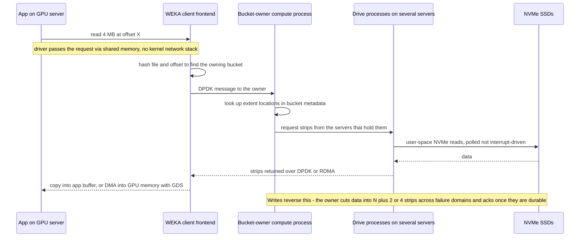
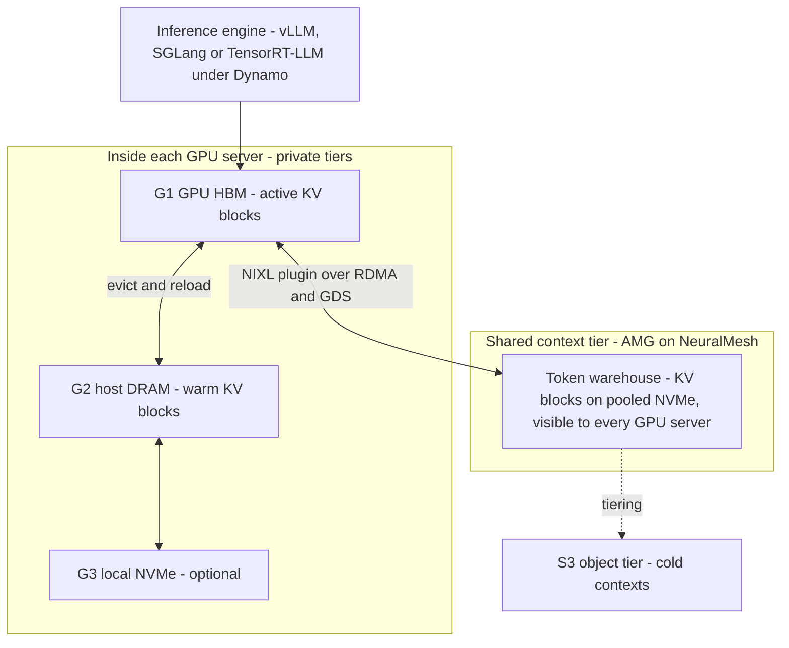
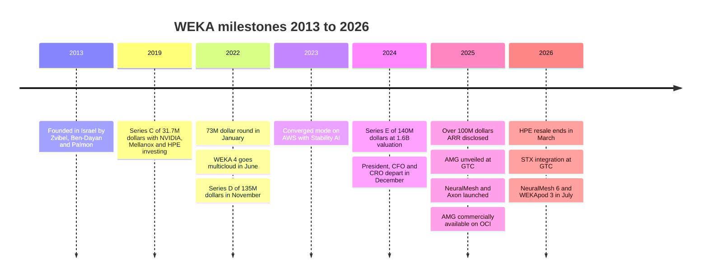

# 43. WEKA deep dive

> **Depth:** L2 · **Reading time:** ~17 min · **Last verified:** 2026-11-01
> **Prerequisites:** [Scale-out shared-nothing clusters](../03-system-architecture/15-scale-out-shared-nothing.md) · [Parallel and distributed file systems](../03-system-architecture/17-parallel-file-systems.md) · [The GPU data path](../02-protocols-and-networking/11-gpu-data-path.md) · [Inference and KV cache](../05-ai-storage/32-inference-and-kv-cache.md)

## TL;DR

- **WEKA sells software, not boxes.** Its product is a parallel, shared-nothing file system for NVMe flash. It began as WekaFS, was re-architected and renamed NeuralMesh in June 2025, and NeuralMesh 6 was announced in July 2026. It runs on commodity servers, on the GPU servers themselves, or in AWS, Azure, Google Cloud and OCI. Its technical signature is a user-space, kernel-bypass data path and metadata sharded across every node.
- **It was first to turn KV-cache offload into a product.** Augmented Memory Grid (AMG) was unveiled at GTC in March 2025 and became commercially available on 2025-11-18, with Oracle Cloud Infrastructure as launch partner. WEKA claims up to 20x faster time to first token (TTFT). The physics make that plausible, but no independent audit exists.
- **The business is real but smaller than the noise around it.** WEKA was founded in Israel in 2013 and has raised about US$415M. It passed US$100M ARR in 2024 *(company-stated)*. Its last priced round, in May 2024, valued it at US$1.6B. Since then VAST Data has repriced to US$30B and WEKA has raised nothing new.
- **The risks are scale, focus and channel.** WEKA replaced its president, CFO and CRO between December 2024 and April 2025. HPE stopped reselling WEKA software in March 2026. Its fortunes track NVIDIA and neocloud capex. It has not submitted to MLPerf Storage since v1.0 in 2024.
- **For Everpure, WEKA is the cleanest "software-anywhere" foil to FlashBlade//EXA.** The contrasts are a proprietary client versus standard pNFS, any hardware versus DirectFlash, and a KV-cache head start versus PureKVA. At a modest last valuation, WEKA is also a name any strategy team will be asked about.

## Why this matters for Everpure strategy

Every GPU-cluster storage deal Everpure (NYSE: P, formerly PSTG) contests with FlashBlade//EXA has a shortlist. WEKA is usually on it, beside VAST Data and DDN. WEKA wins differently from both. VAST sells a shared-everything platform with aggressive data reduction (see [Chapter 42](42-vast-data.md)). DDN sells Lustre heritage and NVIDIA's own reference installs (see [Chapter 44](44-ddn.md)). WEKA sells portability and latency: the same file system on a neocloud's GPU servers, on a customer's own servers or in four public clouds, with a data path tuned for microseconds. Understanding where that pitch is strong tells Everpure where EXA's standard-client, appliance-anchored design wins and loses.

WEKA also matters to corporate development as a reference point. It is a sub-scale, venture-backed AI storage software company. It has meaningful NVIDIA alignment, a first-mover KV-cache product and a valuation that has not moved in two and a half years. Whether that is a buying opportunity, a partner, or a cautionary tale about software-only storage is a live question, and only public information is used here to frame it. The head-to-head with all three rivals is in [Chapter 45](45-head-to-head.md). [Chapter 50](50-diligence-framework.md) gives the diligence checklist.

## Core concepts

### What the product is, and what the names mean

WEKA's founders, Liran Zvibel (CEO), Maor Ben-Dayan and Omri Palmon, started WekaIO in Israel in 2013 to build a file system for flash that would beat local disk[^1]. The company is now headquartered in Campbell, California, and calls itself WEKA. The product names have shifted three times, and buyers still use them interchangeably:

- **WekaFS / WEKA Data Platform (to mid-2025).** A POSIX parallel file system with an integrated S3-compatible object tier. WEKA 4, in June 2022, made the same software deployable natively on AWS, Google Cloud, Azure and OCI[^2].
- **NeuralMesh (June 2025).** WEKA describes NeuralMesh as a re-architecture, not just a rebrand. Each node runs containerised microservices for data access, metadata, auditing and observability, which join a dynamically connected mesh. WEKA pitches it as getting more resilient as it grows[^3]. It started in limited release, with GA planned for fall 2025[^4].
- **NeuralMesh Axon (July 2025).** The same software packaged to run *inside* GPU servers on their local NVMe. Cohere and CoreWeave were the launch references[^5].
- **NeuralMesh 6 (announced 2026-07-21).** This release adds native multi-tenancy, always-on data reduction, native object access, replication and an enhanced AMG. GA is due in 2H 2026, and existing customers upgrade at no extra cost[^6].

The engine underneath is still the WekaFS lineage. Shared-nothing scale-out ([Chapter 15](../03-system-architecture/15-scale-out-shared-nothing.md)) and parallel file system mechanics ([Chapter 17](../03-system-architecture/17-parallel-file-systems.md)) both apply, and are not re-derived here. This chapter covers what WEKA does differently inside those patterns.

### The architecture in one picture

*Figure 43.1 — WEKA runs the same set of user-space services on every backend server; metadata and data are both spread across all of them, so there is no metadata server to saturate.*

Three design choices define WEKA.

**1. Everything runs as user-space processes in containers.** WEKA's documentation lists the roles. *Frontend* processes serve client I/O. *Compute* processes run file-system logic and cluster functions. *Drive* processes own NVMe devices. A *management* process handles control. NFS, SMB and S3 services run as separate containers[^7]. A small cluster can put all roles on every server. A large one can separate them.

**2. Metadata is sharded, not centralised.** Lustre-style systems keep the namespace on dedicated metadata servers (MDS), which become the bottleneck at millions of small files ([Chapter 21](../03-system-architecture/21-metadata.md)). WEKA splits its metadata plane into thousands of small "buckets". Each bucket is handled by a virtual metadata server running inside the compute processes, spread across all nodes. A hash of each operation, not just the inode, decides which bucket owns it. Different block ranges of one file therefore land on different owners, so even one hot file spreads its load. Bucket owners journal to WEKA's own protected storage for durability[^8].

*Semiconductor bridge:* this is address interleaving across DRAM channels and banks. A hashed physical-address map keeps any one access pattern from hammering one bank. WEKA's bucket hash keeps any one directory or file from hammering one metadata core. The cost is the same in both worlds: an operation that touches many buckets, such as a rename across directories, becomes a distributed transaction.

**3. Protection is distributed erasure coding.** A stripe is 3 to 16 data strips plus 2 or 4 parity strips. Protection groups are spread "any-to-any" across servers rather than fixed to sets of hosts, and the geometry is set when the cluster is formed[^9]. Worked efficiency: 16+4 stores 16/20 = **80%** of raw capacity as data, while 5+2 stores 5/7 ≈ **71%**. WEKA's own guidance keeps stripe width under about a quarter of the cluster, so a 16+4 stripe implies roughly 80 or more backend servers. Small clusters therefore pay a higher parity tax. That is the usual shared-nothing trade, covered in [Chapter 15](../03-system-architecture/15-scale-out-shared-nothing.md).

### The kernel-bypass data path

WEKA's latency claims come from refusing to use the operating system's I/O plumbing. Backend servers run **DPDK**, which maps the NIC into user space with SR-IOV so packets never traverse the kernel network stack. Clients use DPDK too, or fall back to kernel UDP where DPDK is unavailable, for example on some AWS instance types. In *performance-optimised* mode, WEKA processes take dedicated CPU cores and busy-poll. A *CPU-optimised* mode added in release 5.0 uses receive interrupts and does not pin cores[^7]. Drive processes talk to NVMe directly from user space, in the style of SPDK.

*Figure 43.2 — A WEKA read never enters the kernel network or block stack; the price is CPU cores dedicated to polling. Simplified: the exact hop order inside WEKA is not public.*

Why it matters, with an **illustrative** budget (orders of magnitude, not WEKA measurements): suppose a kernel path burns ~5 µs of CPU per small I/O on syscalls, interrupts, context switches and copies, and a polled user-space path burns ~1 µs. Then 1 million IOPS needs ~5 cores in the kernel model and ~1 core polled. The polled design also cuts tail latency, because no interrupt coalescing or scheduler jitter sits between the NIC and the SSD. The catch is that a polling core is busy even when idle. On a dedicated storage server that is fine. On a GPU server running converged mode, each pinned core is one the training job's data loaders cannot use.

*Semiconductor bridge:* this is the difference between an interrupt-driven peripheral and a dedicated DMA or command engine that spins on a doorbell. You spend silicon (here, cores) to make latency deterministic. NVMe already moved the SSD side this way with deep submission queues and polled completions ([Chapter 7](../02-protocols-and-networking/07-block-protocols.md)). WEKA extends the same idea across the network.

One consequence buyers notice is that the full-performance path needs the **WEKA client** installed on every compute node. That is a kernel module plus user-space agent. Agentless access goes through NFS, SMB or S3 gateways, at lower performance. In locked-down GPU images, or where the platform team refuses third-party kernel modules, this is friction. Everpure's EXA and VAST both lean on standard NFS or pNFS clients instead.

### Four ways to deploy the same software

Portability is the strategic core of WEKA's pitch. The table shows how one binary becomes four products.

| Mode | Where WEKA runs | Who buys the hardware | Best for | Main cost or risk |
|---|---|---|---|---|
| Dedicated (on-premises) | Qualified storage servers from Supermicro, Dell, Lenovo, Hitachi and others[^10] | Customer, via OEM or reseller | Enterprise and HPC clusters wanting a separate storage tier | Customer integrates and supports a multi-vendor stack |
| WEKApod appliance | WEKA-branded servers, now WEKApod 3 (Nitro, Prime, Prime Max)[^11] | Customer, from WEKA | Buyers wanting one throat to choke and NVIDIA SuperPOD certification | WEKA takes on hardware margin and supply risk |
| Converged / Axon | Inside GPU servers, on their local NVMe and spare cores[^5] | Already bought with the GPUs | Neoclouds and large training fleets | Storage shares failure domains, CPU and NICs with compute |
| Public cloud | AWS, Azure, Google Cloud and OCI instances with local NVMe, plus marketplace listings[^2] | Cloud provider | Cloud-native AI and burst capacity | Instance NVMe is ephemeral, so durability depends on EC and object tiering |

*Table 43.1 — One software stack, four packaging models: this flexibility is WEKA's moat and also its support burden.*

**Worked example: converged economics.** A DGX H100-class server ships with eight 3.84 TB NVMe drives, about 30.7 TB of local flash that many training clusters use only as scratch. Across 128 servers that is 128 × 30.7 ≈ **3.9 PB raw**, or about **3.1 PB usable** at 16+4. That is a parallel file system that needed no storage-server capex, rack space or extra power. WEKA's first converged reference, Stability AI on AWS, claimed a 95% storage-cost reduction and 93% GPU utilisation *(company-stated)*[^12]. At the Axon launch, CoreWeave reported more than 30 GB/s read, 12 GB/s write and 1 million IOPS to a single GPU server *(vendor-supplied)*[^5].

The risks are equally concrete. A GPU server reboot for a driver update is now also a storage-node failure that triggers rebuild traffic. Rebuild traffic shares the NICs with the collective operations that keep GPUs in lockstep. And the "free" flash is only free until the job needs it for something else. Axon's answer is static pre-allocation of cores, memory, NVMe and NIC bandwidth per workload[^5]. That is a partitioning fix, not a physics fix.

### NVIDIA plumbing: GPUDirect Storage, Spectrum-X, NIXL

WEKA was among the file systems supporting **GPUDirect Storage (GDS)** when NVIDIA finalised GDS 1.0 in 2021[^13]. GDS DMAs data from the NIC or NVMe straight into GPU memory, skipping the CPU bounce buffer ([Chapter 11](../02-protocols-and-networking/11-gpu-data-path.md)). NVIDIA's Spectrum-X storage tests named WEKA alongside DDN and VAST, with NVIDIA claiming up to 48% faster reads from adaptive routing and congestion control[^14]. For inference, WEKA open-sourced a plugin for **NIXL**, NVIDIA's data-movement library, which lets Dynamo-based serving stacks treat WEKA as a KV-cache tier[^15]. NVIDIA also invested in the Series E[^16]. All of this counts for a lot in neocloud procurement, where "certified with NVIDIA" often outranks benchmark detail.

### Augmented Memory Grid: KV cache as a storage product

[Chapter 32](../05-ai-storage/32-inference-and-kv-cache.md) explains why the attention key/value (KV) cache, not model weights, is the memory problem of long-context and agentic inference. AMG is WEKA's productisation of the answer. KV blocks evicted from GPU memory are written to a NeuralMesh-managed "token warehouse" on pooled NVMe. When a later request shares the prefix, the blocks are streamed back over RDMA and GDS instead of being recomputed. WEKA unveiled AMG at GTC in March 2025[^17] and made it commercially available on 2025-11-18 as a NeuralMesh feature, with OCI as exclusive launch partner through Oracle Cloud Marketplace[^15].

*Figure 43.3 — AMG sits where NVIDIA's Dynamo KV Block Manager puts shared storage. Its value is that a prefix computed on one GPU server can be reused by any other, instead of being trapped in one server's DRAM.*

Dynamo's KV Block Manager names the tiers G1 (HBM), G2 (host DRAM), G3 (local SSD) and G4 (remote storage)[^18]. AMG is a G4 that aims to behave like a fast G3, and NVIDIA's later CMX platform calls the same slot "G3.5" (see below).

**Worked example (illustrative, Llama-3-70B geometry, FP16 KV).** Per token, KV size = 2 (K and V) × 80 layers × 8 KV heads × 128 head dim × 2 bytes = **327,680 bytes ≈ 320 KiB**. A 128,000-token context is therefore about **42 GB**, more than half of one 80 GB H100 before weights. Recomputing that prefill costs roughly 2 × 70×10⁹ parameters × 128,000 tokens ≈ 1.8×10¹⁶ FLOPs, ignoring attention's quadratic term. Eight H100s sustaining ~400 TFLOP/s each (about 40% of dense FP16 peak) take ~5.6 s. Reading 42 GB from a storage tier delivering 100 GB/s to the server takes ~0.4 s. That ratio of about **13x** is why vendor claims of "up to 20x faster TTFT" at 128K context are physically plausible. They are also highly workload-dependent: short prompts and low prefix reuse shrink the gain toward zero.

**What WEKA has claimed, and on what evidence.** The November 2025 launch claimed up to 20x faster TTFT at 128K tokens against a standard vLLM baseline on OCI, a "1000x" GPU memory extension and more concurrent users[^15]. In June 2026, WEKA and Oracle published a larger validation on a nine-node, 72-GPU bare-metal H100 cluster with 100,000-token contexts. The headline numbers were about 2 million tokens/s versus under 200,000 for a DRAM-only baseline, roughly 5,000 versus 600 concurrent users, and an active cache that grew from 8.64 TiB of DRAM to 287 TiB of NVMe *(vendor-run joint test)*[^19]. Using the 42 GB figure above, 287 TiB holds about 7,500 full 128K-token contexts against about 225 in 8.64 TiB of DRAM. The capacity ratio (~33x) is far larger than the throughput ratio (~10x). That tells you the bottleneck moved from cache capacity to something else, such as GPU decode or network. Note also that 5,000 ÷ 600 is ~8x, not the "10x" in the headline. NAND Research flagged that WEKA's later 10x claims came without a reproducible methodology[^20]. MLPerf Storage v3.0 added an audited KV-cache workload in September 2026, and WEKA did not enter it[^21].

### NeuralMesh 6 and WEKApod 3: closing feature gaps

NeuralMesh 6 reads as a catch-up list aimed at neoclouds and enterprises[^6]:

- **Multi-tenancy:** "composable clusters" for hardware isolation, plus virtual tenancy with private VLANs, per-tenant encryption keys and separate authentication. Coverage cites up to 50,000 logical tenants per cluster[^6].
- **Data reduction:** fingerprinting, similarity hashing, dedupe and compression, always on. WEKA claims up to 6x savings on AI training data with under 5% write overhead and contractually guarantees both[^6]. VAST built its business on reduction, and WEKA had lacked it.
- **Native object, replication, remote caching and Kubernetes-native operations**[^6].

**WEKApod 3** is WEKA's first hardware designed chassis-up for its software. It comes in three configurations: Nitro (performance), Prime (balanced) and Prime Max (density). Deliveries start in fall 2026[^6][^11]. The density claim is the eye-catcher: 1.1 EB *effective* per rack from 441.5 PB raw, built from about 1,800 Micron 245.76 TB SSDs[^11]. Check the arithmetic: 1,800 × 245.76 TB ≈ 442 PB raw, so "1.1 EB" assumes **~2.5:1** data reduction. Bandwidth is quoted at 10.2 TB/s per rack[^22] [VERIFY: 10.2 TB/s and 210M IOPS per rack from secondary coverage only]. The effective-capacity number is a reduction assumption, not a capacity spec. Everpure, which also quotes effective capacity, should hold WEKA to the same standard it holds itself.

### BlueField-4 and NVIDIA STX: storage moving onto the DPU

At GTC Washington in October 2025, WEKA said its next NeuralMesh release would run *directly on* NVIDIA BlueField-4 DPUs rather than on x86 storage servers. It cited BlueField-4's 800 Gb/s networking and about 6x the compute of BlueField-3, and projected over 100x better tokens per watt than CPU-attached storage. That figure is an expectation, not a measurement[^23]. At GTC in March 2026, NVIDIA launched **BlueField-4 STX**, a storage reference architecture whose first rack-scale implementation is the CMX context-memory platform. WEKA was among a dozen named storage partners, alongside Everpure, VAST, DDN and others[^24]. WEKA integrated NeuralMesh with STX, positioning AMG as the shared KV-cache layer and claiming 4–10x higher context-memory token throughput on Vera Rubin NVL72 configurations[^25] [VERIFY: whether validation used BlueField-3 or BlueField-4 hardware; sources conflict].

The strategic reading cuts both ways. A software-only vendor ports to a DPU more easily than an appliance vendor does, and WEKA's user-space, poll-mode design already resembles DPU firmware. But STX makes the KV tier a *standard NVIDIA slot* that every partner can fill. That erodes the first-mover advantage AMG enjoyed in 2025.

## Business model & financials

**Model.** WEKA sells capacity-based software subscriptions. Hardware comes from partners, from WEKApod or from the cloud provider. Most deals are custom-quoted. One reseller lists a Lenovo-branded WEKA edition at US$339 per TB per year in the 1–2.5 PB band[^26] [VERIFY: single reseller listing]. At that list price, 10 PB is about US$3.4M a year. Read the other way, US$100M of ARR at list would be ~295 PB under subscription, so with typical discounting the real installed base is plausibly well above that. Software-only revenue means high gross margin, but the company still carries the support cost of the hardware it does not sell.

*Figure 43.4 — WEKA's product cadence accelerated in 2025–26 while its funding clock stopped in May 2024.*

**Funding.** The company stated a cumulative US$66.7M after a US$31.7M Series C in May 2019. NVIDIA, Mellanox, HPE, Seagate, Western Digital Capital and Qualcomm participated in that round[^27]. A US$73M round led by Hitachi Ventures followed in January 2022, taking the total to about US$140M. Outlets disagree on whether it was a Series C extension or a Series D[^28]. In November 2022 came a US$135M Series D led by Generation Investment Management, at a ~US$750M valuation *(reported by Calcalist; WEKA did not disclose it)*[^29]. The May 2024 Series E raised US$140M at US$1.6B post-money: US$100M primary and US$40M of secondary share sales by long-serving employees. Valor Equity Partners led, with NVIDIA, Atreides, Generation, Qualcomm Ventures and Hitachi Ventures participating[^16]. The sum, about US$415M, matches PitchBook's estimate[^30]. No priced round since then was found. A 2026 Globes interview still treated the Series E as the latest[^31].

*Figure 43.5 — WEKA has raised about US$415M in total, but its US$1.6B mark is now a fifth of DDN's and about 5% of VAST's.*
Data: `data/ch43_funding.csv`

**Revenue and burn.** In February 2025, Zvibel wrote that WEKA passed US$100M ARR in 2024 and more than doubled revenue for the third year running *(company-stated)*[^32]. The same month WEKA cut about 50 go-to-market roles while still planning about 120 hires[^33]. Calcalist reported Zvibel expecting revenue to triple in 2025 and burn of about US$0.5M a month, near break-even *(reported by press)*[^34] [VERIFY: date and context of the tripling and burn figures]. Globes later cited AI-market executives estimating ARR at US$100–150M *(estimated)*[^31]. No audited or company-stated 2025 or 2026 figure has been found.

**Valuation arithmetic.** At the Series E, US$1.6B on roughly US$100M ARR was about **16x ARR**. VAST's April 2026 round priced it at US$30B against over US$500M of committed ARR *(company-stated)*, about **60x**[^35]. If WEKA really tripled in 2025, its 2024 mark would now be single-digit ARR multiples. That gap is either the market's verdict on scale and momentum, or an unpriced option, depending on whose numbers you believe.

**Leadership churn.** In December 2024, WEKA parted with its president, CFO and CRO while describing itself as in late-stage, pre-IPO growth[^36]. The replacement CFO left after about four months. In April 2025, WEKA hired a new CRO (Brian Froehling) and a new chief product officer (Ajay Singh), and moved the previous CPO into strategy and corporate development[^37]. A new CMO arrived in July 2026 as messaging shifted to "AI inferencing at scale"[^38]. Turnover at this rate is common before an IPO or a sale. It is also common when a growth plan misses.

## Customers & go-to-market

**Channels.** WEKA sells direct and through partners. Hardware partners include Supermicro, Dell, Lenovo and Hitachi[^10]. Hitachi Vantara first OEM'd WekaFS in 2020[^39]. There are cloud marketplace listings, and WEKApod is sold through distributors. The biggest channel change cut the other way. In November 2025, HPE told partners it would stop selling WEKA (along with Qumulo and Scality) software from 2026-03-03 to favour its own Alletra MP line, though resellers could still pair WEKA with HPE servers[^40]. This came only months after WEKA on HPE Alletra 4110 servers had topped all five SPECstorage Solution 2020 workloads[^41].

| Customer or partner | Relationship (as publicly described) | Evidence label |
|---|---|---|
| Oracle Cloud Infrastructure | AMG launch partner; joint inference validation in 2026[^15][^19] | Company-stated, joint releases |
| CoreWeave | Lists WEKA NeuralMesh as a dedicated-storage option; Axon launch reference[^42][^5] | Company-stated by both |
| Cohere | Deployed Axon in public cloud, then on CoreWeave[^5] | Company-stated |
| Nebius | WEKA chosen for premium AI Cloud storage tier, June 2025[^43] | Company-stated |
| Stability AI | Converged mode on AWS reference[^12] | Company-stated |
| Midjourney, Yotta (Shakti Cloud) | Listed on WEKA customer page[^44] | Company-stated, no detail |
| Memorial Sloan Kettering | IO500 submission on WEKA[^45] | Company-stated [VERIFY: against io500.org list] |
| Tesla | Named as a customer in Globes coverage[^31] | Reported by press |
| "30% of the Fortune 50" | WEKA marketing claim[^44] | Company-stated, unverifiable |

*Table 43.2 — WEKA's visible references skew to AI labs, neoclouds and one hyperscaler partner (OCI); few are independently corroborated.*

The pattern is clear. WEKA's growth engine since 2023 has been AI-native buyers: model builders (Stability, Cohere, Midjourney), GPU clouds (CoreWeave, Nebius, Yotta) and OCI. These buyers value speed of deployment and cloud portability over enterprise data services. Its HPC and life-sciences base (genomics, EDA, media) is older and stickier but grows more slowly. Note what is missing: no announced deal of the size of VAST's reported US$1.17B CoreWeave agreement[^46], and no flagship NVIDIA-internal reference like DDN's.

## Why it gained traction

1. **It solved the right problem early.** In 2014–2019 the GPU-starvation problem looked like a niche HPC issue. WEKA's bet that flash plus kernel bypass could beat local NVMe for shared data made it the default "fast file system that isn't Lustre" when GPU clusters arrived.
2. **Software-only fits the neocloud build pattern.** Neoclouds buy GPU servers by the thousand and hate stranded capex. Converged mode turns flash they already own into a file system. Marketplace listings let them buy capacity in the same billing motion as their cloud.
3. **Cloud portability is real.** Few high-performance file systems run the same code on-premises and natively in four clouds. For AI labs that train wherever GPUs are available, one namespace across sites matters.
4. **Metadata scaling beats classic parallel file systems on small files.** Sharded buckets avoid the MDS ceiling, which matters for image datasets and checkpoint shards ([Chapter 17](../03-system-architecture/17-parallel-file-systems.md)). WEKA backed this with SPECstorage leadership in early 2025[^41].
5. **It productised KV cache before anyone else.** AMG gave WEKA an inference story in 2025, when the market narrative pivoted from training to inference, months before NVIDIA standardised the tier with STX.

## Risks & open questions

- **Scale and capital asymmetry.** VAST's company-stated committed ARR is several times WEKA's last stated ARR, and its valuation is roughly 19x WEKA's[^35]. VAST can outspend WEKA on R&D, field engineering and neocloud credit terms. WEKA's flat valuation since May 2024 also complicates employee retention and any IPO path.
- **Dependence on one demand cycle.** WEKA's customer list is concentrated in GPU-cloud and AI-lab buyers whose spending follows NVIDIA product cycles and their own financing. A neocloud capex pause would hit WEKA harder than a diversified vendor.
- **NVIDIA giveth and taketh.** NVIDIA is an investor and certifier. But STX/CMX turns the KV-cache tier into a reference design every partner fills, and NVIDIA's own Dynamo KV Block Manager decides which tiers matter[^18][^24].
- **The hardware-agnostic support burden.** Supporting many server SKUs, NICs, kernels and four clouds is expensive, and partners can defect, as HPE showed[^40]. WEKApod 3 reduces that burden by pulling WEKA toward the appliance model it used to differentiate against.
- **Benchmark posture.** WEKA submitted to MLPerf Storage v0.5 in 2023[^47] and v1.0 in 2024[^48], but not to v2.0 (2025) or v3.0 (2026). The v3.0 round was the first to include a KV-cache workload, WEKA's flagship use case[^21]. Everpure's EXA displaced the HPE–WEKA configuration at the top of SPECstorage AI_IMAGE in 2026[^49]. Absence proves nothing about performance, but it leaves WEKA's inference claims resting on vendor-run tests.
- **Client friction.** The high-performance path needs WEKA's client stack on every GPU node. Rivals with standard NFS or pNFS clients can sell the absence of an agent as an operational advantage.
- **Open questions.** Did NeuralMesh 6 reach GA on schedule? What share of revenue now comes from WEKApod hardware versus software? Has WEKA tripled revenue as projected? Is there a new round, secondary or strategic process that has not surfaced publicly?

## Strategic relevance to Everpure

WEKA matters to Everpure in three ways. These are options a strategy team might evaluate, based on public information.

1. **As a competitor in EXA deals.** WEKA's portability and converged mode attack exactly where EXA is weakest: buyers who want storage on hardware they already own, in a cloud, or inside GPU servers. EXA's counters are a standard pNFS client, Purity's metadata engine, DirectFlash economics on the metadata tier, an Everpure-supported appliance experience and now audited MLPerf v3.0 results[^21]. A deal-desk playbook might lead with operational simplicity and audited numbers against WEKA, and with independent scaling against VAST.
2. **As a signal about software-only storage.** WEKA shows that pure software can win AI share, but also that it struggles to capture value at scale. It has had to build appliances (WEKApod 3), add data reduction and absorb the cost of partner defections. That supports Everpure's integrated hardware-software thesis without making it unassailable.
3. **As a corporate-development reference.** WEKA has a US$1.6B last mark, about US$415M raised, investors including NVIDIA and Qualcomm Ventures, a KV-cache product, cloud-native code and an engineering base in Israel. Any acquirer would weigh technology overlap with its own stack, client-agent and support liabilities, customer concentration in neoclouds, and how preference stacks behave at a flat valuation. For Everpure specifically, the overlap with Purity//FB and EXA is large. Lighter-weight alternatives include interoperability (for example, Everpure object storage as a WEKA tier) or competing directly on KV cache with PureKVA.

## How Everpure approaches it vs. competitors

| Dimension | WEKA NeuralMesh | VAST Data AI OS | Everpure FlashBlade//EXA |
|---|---|---|---|
| Architecture class | Shared-nothing parallel file system; metadata hashed into buckets on all nodes[^8] | Disaggregated shared-everything: stateless CNodes over shared SCM + QLC enclosures ([Ch 16](../03-system-architecture/16-disaggregated-shared-everything.md)) | Metadata/data split: Purity//FB metadata core on DFM blades plus Linux/NVMe data nodes[^50] |
| Hardware model | Software on qualified servers, GPU servers, clouds, or WEKApod | Software on certified partner hardware and OEMs | Everpure metadata blades plus third-party data nodes at launch |
| Client access | WEKA POSIX client with DPDK; NFS/SMB/S3 gateways | Standard NFS (including over RDMA), SMB, S3 | Standard pNFS (NFSv4.1); data over RDMA[^50] |
| Data reduction | New in NeuralMesh 6 (claimed up to 6x, guaranteed)[^6] | Core design feature (similarity-based, global) | Not a headline EXA claim; PureKVA compresses KV cache[^51] |
| Public cloud | Native on AWS, Azure, GCP, OCI since 2022[^2] | Google Cloud managed service, Azure listing (2025) | No public-cloud EXA offering found |
| KV-cache product | AMG, commercially available Nov 2025[^15] | BlueField-4-hosted CNodes in GPU servers (CES 2026)[^52] | PureKVA on FlashBlade incl. EXA (Oct 2026)[^51] |
| MLPerf Storage | v0.5, v1.0; absent v2.0 and v3.0 | Never submitted | First entry v3.0; top checkpoint and KV results among entrants[^21] |
| NVIDIA alignment | Investor; SuperPOD-certified WEKApod; STX partner | Investor; STX partner; CNode-X | STX partner; NVIDIA-Certified Storage (Mar 2026)[^53] |
| Scale signal | >US$100M ARR 2024 (company-stated); US$1.6B valuation | >US$500M CARR (company-stated); US$30B valuation[^35] | Part of a public company; first enterprise EXA customer in Q4 FY26 |

*Table 43.3 — WEKA leads on deployment flexibility and KV-cache maturity; EXA leads on standard clients and audited benchmarks; VAST leads on scale and data reduction.*

**Steelman WEKA.** WEKA is the only one of the three that can follow a customer anywhere: into a neocloud's GPU servers, into four clouds, onto customer-chosen hardware, and next onto a DPU. Its kernel-bypass path and bucket-sharded metadata are a serious latency and small-file architecture, not marketing. It had a production KV-cache tier a year before NVIDIA standardised one. For an AI lab that changes clouds every funding round, WEKA's portability can be worth more than any single benchmark.

**Where EXA's trade is better.** EXA needs no client agent. Its metadata runs on Everpure's own DFM hardware with Purity's maturity, and its data nodes scale independently. It also has independently audited MLPerf v3.0 numbers in exactly the workloads WEKA skipped. Its weaknesses against WEKA are cloud reach, converged deployment and a shorter KV-cache track record. [Chapter 27](../04-everpure/27-flasharray-and-flashblade.md) covers EXA in depth.

## History and trajectory

WEKA's arc has three phases. **2013–2019: the HPC file system that wasn't Lustre.** A small Israeli team built a user-space, flash-native parallel file system, financed by about US$67M from VCs and strategic investors including NVIDIA, Mellanox, HPE and the SSD makers[^27]. **2020–2024: cloud and AI scale-up.** Hitachi Vantara signed an OEM deal[^39], WEKA 4 went multicloud[^2], converged mode landed AI labs[^12], and two rounds totalling US$275M took the valuation to US$1.6B[^29][^16]. **2025–2026: inference pivot under pressure.** WEKA disclosed US$100M ARR and restructured[^32][^33], rebuilt the product as NeuralMesh[^3], launched AMG[^15], aligned with BlueField-4 and STX[^23][^25], and filled feature gaps with NeuralMesh 6[^6]. Meanwhile it lost HPE as a reseller[^40] and saw VAST's valuation run to US$30B[^35].

Signals to watch through 2027:

- **NeuralMesh 6 GA and WEKApod 3 shipments** (promised 2H 2026 and fall 2026). Slippage would matter more for a company now selling hardware.
- **A financing event.** A new priced round, a structured or secondary deal, or a strategic sale. Each would reprice the US$1.6B mark.
- **MLPerf Storage v4.0 participation**, especially the KV-cache workload.
- **STX/CMX deployments** naming WEKA as the shipped software, not just a design partner.
- **Neocloud wins at CoreWeave or Nebius scale**, or losses to VAST.

## Numbers that matter

| Metric | Value | Context | Source / date |
|---|---|---|---|
| Founded | 2013, Israel | HQ now Campbell, California | StorageNewsletter, 2016[^1] |
| Total capital raised | ≈ US$415M | Includes US$40M secondary in Series E | Derived from rounds; PitchBook estimate[^30] |
| Last priced valuation | US$1.6B post-money | Series E, May 2024; none since found | WEKA, 2024-05-15[^16] |
| ARR | >US$100M in 2024 *(company-stated)*; US$100–150M *(estimated)* | Revenue more than doubled three years running | WEKA CEO letter, 2025-02[^32]; Globes, 2026[^31] |
| Valuation / ARR at Series E | ≈ 16x | vs ≈ 60x for VAST in April 2026 | Worked example from cited figures[^16][^35] |
| Erasure-code range | 3–16 data + 2 or 4 parity | 16+4 = 80% efficiency | WEKA docs[^9] |
| AMG TTFT claim | Up to 20x faster at 128K tokens | Vendor-run on OCI vs vLLM baseline | WEKA, 2025-11-18[^15] |
| OCI inference validation | ~2M vs <200K tokens/s; 287 TiB NVMe vs 8.64 TiB DRAM cache | 9 nodes, 72 H100s, 100K-token contexts | WEKA/Oracle, 2026-06-09[^19] |
| KV cache per token (70B, FP16) | ≈ 320 KiB; ≈ 42 GB per 128K context | Why KV cache needs a storage tier | Worked example |
| WEKApod 3 Prime Max | 441.5 PB raw, 1.1 EB effective per rack | Implies ~2.5:1 reduction | StorageReview, 2026-07[^11] |
| List software price | US$339/TB/year (1–2.5 PB band) | One reseller listing; deals are custom | SHI, n.d.[^26] |

## Conversation playbook

**Three questions for a PM**

1. *"When we lose an EXA deal to WEKA, is it portability, converged mode or the KV-cache story?"* A strong answer separates the cases. Cloud-portability losses are structural, because EXA has no cloud SKU. Converged-mode losses are about capex optics and can be countered with TCO that includes failure-domain coupling and CPU tax. KV-cache losses should shrink now that PureKVA and audited MLPerf v3.0 KV numbers exist.
2. *"How do we position against NeuralMesh 6's guaranteed data reduction?"* A strong answer notes that a guaranteed ratio on AI training data, which is often already compressed, is a commercial instrument as much as a technical one. It asks what the guarantee excludes, and compares on audited, workload-specific effective capacity, as Everpure would want done for its own claims.
3. *"Does HPE's exit from reselling WEKA open a door for Everpure with HPE-centric buyers or resellers?"* A strong answer is cautious. HPE exited to push Alletra MP, not to make room for Everpure. But resellers that built WEKA practices may want another AI file platform, and that is a channel question worth tracking.

**Three questions for an engineer**

1. *"What does WEKA's kernel bypass buy that EXA's pNFS-over-RDMA path doesn't?"* A strong answer: both avoid the kernel on the data path where RDMA is used. WEKA's edge is polled user-space handling of *metadata and small I/O* across a sharded namespace. EXA's edge is a standard client and a metadata engine that is not on the data path. The deciding question is the workload's metadata-to-data ratio.
2. *"How does WEKA's bucket-sharded metadata compare with Purity//FB's metadata core under a million-file listing or a rename storm?"* A strong answer covers hash distribution versus a dedicated metadata tier, cross-bucket transactions, and where each design's tail latency comes from, with data from tests, not datasheets.
3. *"In converged deployments, what is the real cost of putting storage on GPU servers?"* A strong answer quantifies pinned cores, memory and NIC bandwidth per node. It covers rebuild behaviour when GPU servers reboot for maintenance, and the blast radius when a GPU server fails, versus a disaggregated tier.

**Don't say this:**

- "WEKA is just another Lustre." It has no dedicated MDS, runs in user space and is deployed very differently. See [Chapter 17](../03-system-architecture/17-parallel-file-systems.md).
- "WEKA is a hardware company now." WEKApod exists, but the business model is still software subscriptions on mostly partner hardware.
- "AMG gives 20x faster inference." The claim is up to 20x faster *time to first token* in vendor-run tests at very long context. Throughput gains in the OCI test were nearer 8–10x, and short-prompt workloads gain little.
- "WEKA is worth US$1.6B." That was the May 2024 post-money mark. No one outside the company knows today's price, in either direction.
- "WEKA doesn't do MLPerf because it would lose." It did submit in 2023 and 2024. The fair statement is that it has no audited results in the 2025 or 2026 rounds, including the KV-cache workload.

## Going deeper (optional, L3 pointers)

- WEKA's architecture white paper and "Architecture Key Concepts" PDF cover buckets, virtual metadata servers and the hashing scheme[^8]. The docs pages on networking (DPDK, core pinning, UDP fallback) and on capacity and redundancy (stripe geometry, failure domains) are useful too[^7][^9].
- NVIDIA Dynamo's KV Block Manager design doc, for where AMG plugs in through NIXL[^18].
- The WEKA/Oracle June 2026 validation release and the OCI methodology blog it cites. Compare its baseline with MLPerf Storage v3.0's KV-cache rules[^19][^21].
- SPECstorage Solution 2020 result pages for the HPE Alletra 4110 + WEKA submissions (January 2025) versus FlashBlade//EXA (2026)[^41][^49].

## Key terms

- **NeuralMesh** — WEKA's current name for its software-defined storage platform (June 2025 onward), successor to WekaFS / WEKA Data Platform.
- **NeuralMesh Axon** — WEKA's packaging of NeuralMesh to run inside GPU servers on their local NVMe.
- **Augmented Memory Grid (AMG)** — WEKA's KV-cache offload tier on NeuralMesh.
- **Converged mode** — running storage backends on the same servers as the applications or GPUs.
- **DPDK / kernel bypass** — user-space packet processing that skips the operating system's network stack.
- **Metadata bucket** — a WEKA shard of the namespace owned by one virtual metadata server.
- **WEKApod** — WEKA's branded appliance line.
- **Token warehouse** — WEKA's term for the pooled NVMe store of KV-cache blocks.
- **NVIDIA STX / CMX** — NVIDIA's BlueField-4 storage reference architecture and its context-memory rack implementation.

See the [glossary](../glossary.md) for full definitions.

## Sources

[^1]: StorageNewsletter, "Start-up profile: Weka.io," 2016-12-26. https://www.storagenewsletter.com/2016/12/26/start-up-profile-weka-io (retrieved 2026-11-01).
[^2]: HPCwire, "WEKA Unveils Multicloud Data Platform for AI and Next-Gen Workloads," 2022-06. https://www.hpcwire.com/off-the-wire/weka-unveils-multicloud-data-platform-for-ai-and-next-gen-workloads/ (retrieved 2026-11-01).
[^3]: WEKA, "WEKA Introduces NeuralMesh," 2025-06-17. https://www.weka.io/company/weka-newsroom/press-releases/weka-introduces-neuralmesh/ (retrieved 2026-11-01).
[^4]: Blocks & Files, "WEKA builds NeuralMesh for exascale AI," 2025-06-18. https://blocksandfiles.com/2025/06/18/weka-builds-neuralmesh-for-exascale-ai/ (retrieved 2026-11-01).
[^5]: Blocks & Files, "WEKA ports NeuralMesh to a GPU server's local SSDs," 2025-07-08. https://blocksandfiles.com/2025/07/08/weka-ports-neuralmesh-to-a-gpu-servers-local-ssds/ (retrieved 2026-11-01); StorageNewsletter, "RAISE Summit 2025: WEKA Unveils NeuralMesh Axon for Exascale AI Deployments," 2025-07-09. https://www.storagenewsletter.com/2025/07/09/raise-summit-2025-weka-unveils-neuralmesh-axon-for-exascale-ai-deployments/ (retrieved 2026-11-01).
[^6]: WEKA (via Yahoo Finance), "WEKA Debuts NeuralMesh 6 to Power Enterprise and Agentic AI Workloads at Production Scale," 2026-07-21. https://finance.yahoo.com/technology/ai/articles/weka-debuts-neuralmesh-6-power-130000874.html (retrieved 2026-11-01); HPCwire, "WEKA Launches NeuralMesh 6 and WEKApod as AI Inference Pushes Infrastructure Limits," 2026-07-22. https://www.hpcwire.com/2026/07/22/weka-launches-neuralmesh-6-and-wekapod-as-ai-inference-pushes-infrastructure-limits/ (retrieved 2026-11-01).
[^7]: WEKA documentation, "Networking in WEKA" (v5.0), n.d. https://docs.weka.io/5.0/weka-system-overview/networking-in-wekaio (retrieved 2026-11-01); WEKA documentation, "Glossary" (v4.1), n.d. https://docs.weka.io/4.1/overview/glossary (retrieved 2026-11-01).
[^8]: WEKA, "WEKA Architecture Key Concepts" (white paper), n.d. https://www.weka.io/wp-content/uploads/files/resources/WEKA-Architecture-Key-Concepts.pdf (retrieved 2026-11-01).
[^9]: WEKA documentation, "Cluster capacity and redundancy management," n.d. https://docs.weka.io/weka-system-overview/cluster-capacity-and-redundancy-management (retrieved 2026-11-01); WEKA documentation, "Optimize redundancy in WEKA deployments" (v4.3), n.d. https://docs.weka.io/4.3/weka-system-overview/about/optimize-redundancy-in-weka-deployments (retrieved 2026-11-01).
[^10]: WEKA, "Hardware + System Partners," n.d. https://www.weka.io/partners/system-partners/ (retrieved 2026-11-01).
[^11]: StorageReview, "WEKA's WEKApod 3 breaks the single-rack exabyte barrier as NeuralMesh 6 goes multi-tenant," 2026-07. https://www.storagereview.com/news/wekas-wekapod-3-breaks-the-single-rack-exabyte-barrier-as-neuralmesh-6-goes-multi-tenant (retrieved 2026-11-01); TechRadar, "Weka's new pod claims 1000PB in a 56U rack using 1,800 Micron 245.76TB SSDs…," 2026-07. https://techradar.com/pro/wekas-new-pod-claims-1000pb-in-a-56u-rack-using-1-800-micron-245-76tb-ssds-and-a-decades-old-compression-trick (retrieved 2026-11-01).
[^12]: AAP (Cision release), "WEKA and Stability AI Partner to Maximize Cloud Benefits for AI Model Training," 2023-09-14. https://www.aap.com.au/aapreleases/cision20230914ae06706 (retrieved 2026-11-01).
[^13]: Blocks & Files, "GPUDirect Storage hitting the streets to VAST acclaim," 2021-06-28. https://www.blocksandfiles.com/file/2021/06/28/gpudirect-storage-hitting-the-streets-to-vast-acclaim/1611092 (retrieved 2026-11-01).
[^14]: NVIDIA Developer Blog, "Accelerating AI Storage by up to 48% with NVIDIA Spectrum-X Networking Platform and Partners," 2025. https://developer.nvidia.com/blog/accelerating-ai-storage-by-up-to-48-with-nvidia-spectrum-x-networking-platform-and-partners/ (retrieved 2026-11-01).
[^15]: WEKA, "WEKA Breaks The AI Memory Barrier With Augmented Memory Grid on NeuralMesh," 2025-11-18. https://www.weka.io/news/weka-breaks-the-ai-memory-barrier-with-augmented-memory-grid (retrieved 2026-11-01); Oracle Blogs, "Scaling long-context inference on OCI with WEKA's Augmented Memory Grid," 2025-11. https://blogs.oracle.com/ai-and-datascience/scaling-long-context-inference-on-oci-with-wekas-augmented-memory-grid (retrieved 2026-11-01).
[^16]: WEKA, "WEKA Nets $140M in Series E Funding at $1.6B Valuation," 2024-05-15. https://www.weka.io/news/weka-nets-140m-in-series-e-funding-at-1-6b-valuation (retrieved 2026-11-01); Globes, "Weka raises $140m at $1.6b valuation," 2024-05. https://en.globes.co.il/en/article-1001478786 (retrieved 2026-11-01).
[^17]: AIwire/HPCwire, "WEKA Expands NVIDIA Integrations and Certifications, Unveils Augmented Memory Grid," 2025-03-19. https://www.hpcwire.com/aiwire/2025/03/19/weka-expands-nvidia-integrations-and-certifications-unveils-augmented-memory-grid/ (retrieved 2026-11-01).
[^18]: NVIDIA Docs, "KVBM design" (Dynamo v1.3.0), n.d. https://docs.nvidia.com/dynamo/v1.3.0/design-docs/component-design/kvbm-design.md (retrieved 2026-11-01).
[^19]: AAP (Cision release), "WEKA and Oracle Cloud Infrastructure Validate 10x Throughput Gains for Long-Context AI Inference," 2026-06-09. https://www.aap.com.au/aapreleases/cision20260609ae77787/ (retrieved 2026-11-01); StorageNewsletter, same title, 2026-06-11. https://www.storagenewsletter.com/2026/06/11/weka-and-oracle-cloud-infrastructure-validate-10x-throughput-gains-for-long-context-ai-inference/ (retrieved 2026-11-01).
[^20]: NAND Research, "WEKA NeuralMesh 6 & WEKApod 3: Density, KV Cache, and AI Economics," 2026-07. https://nand-research.com/weka-neuralmesh-6-and-wekapod-3-density-kv-cache-and-ai-economics/ (retrieved 2026-11-01).
[^21]: MLCommons via GlobeNewswire, "MLCommons Releases New MLPerf Storage v3.0 Benchmark Results," 2026-09-01. https://www.globenewswire.com/news-release/2026/09/01/3354412/0/en/mlcommons-releases-new-mlperf-storage-v3-0-benchmark-results.html (retrieved 2026-11-01); StorageReview, "MLPerf Storage v3.0: 877 GiB/s Checkpoints, a Cloud First, and a Leaderboard Turned Over," 2026-09. https://www.storagereview.com/news/mlperf-storage-v3-0-877-gib-s-checkpoints-a-cloud-first-and-a-leaderboard-turned-over (retrieved 2026-11-01).
[^22]: Unite.AI, "WEKA Launches NeuralMesh 6 and WEKApod 3 as AI Infrastructure Shifts Toward Inference," 2026-07. https://www.unite.ai/weka-launches-neuralmesh-6-and-wekapod-3-as-ai-infrastructure-shifts-toward-inference/ (retrieved 2026-11-01).
[^23]: AAP (Cision release), "WEKA Announces New NeuralMesh Architecture Built for NVIDIA BlueField-4," 2025-10-28. https://www.aap.com.au/aapreleases/cision20251028ae08469 (retrieved 2026-11-01); StorageNewsletter, "Nvidia GTC DC 2025: WEKA Unveils New NeuralMesh Architecture Built for Nvidia BlueField-4," 2025-10-30. https://www.storagenewsletter.com/2025/10/30/nvidia-gtc-dc-2025-weka-unveils-new-neuralmesh-architecture-built-for-nvidia-bluefield-4/ (retrieved 2026-11-01).
[^24]: NVIDIA Investor Relations, "NVIDIA Launches BlueField-4 STX Storage Architecture With Broad Industry Adoption," 2026-03-16. https://investor.nvidia.com/news/press-release-details/2026/NVIDIA-Launches-BlueField-4-STX-Storage-Architecture-With-Broad-Industry-Adoption/default.aspx (retrieved 2026-11-01).
[^25]: StorageReview, "WEKA Integrates NeuralMesh with NVIDIA STX to Address AI Inference Memory Bottlenecks," 2026-03. https://www.storagereview.com/news/weka-integrates-neuralmesh-with-nvidia-stx-to-address-ai-inference-memory-bottlenecks (retrieved 2026-11-01); AAP (Cision release), "WEKA Maximizes Token Output With Lower Cost Per Token on NVIDIA BlueField-4 STX," 2026-03-16. https://www.aap.com.au/aapreleases/cision20260316ae10377 (retrieved 2026-11-01).
[^26]: SHI, "WEKA Extreme Performance and Scale (XPS) Edition" (reseller listing), n.d. https://www.shi.com/product/45872663 (retrieved 2026-11-01).
[^27]: StorageNewsletter, "WekaIO Raises $31.7 Million in Series C Funding," 2019-05-15. https://www.storagenewsletter.com/2019/05/15/wekaio-raises-31-7-million-in-series-c-funding (retrieved 2026-11-01).
[^28]: Blocks & Files, "WekaIO ramps up its funding to $140 million," 2022-01-04. https://www.blocksandfiles.com/file/2022/01/04/wekaio-ramps-up-its-funding-to-140-million/1609553 (retrieved 2026-11-01).
[^29]: SiliconANGLE, "Distributed file system startup WekaIO closes bumper $135M Series D funding round," 2022-11-15. https://siliconangle.com/2022/11/15/distributed-file-system-startup-wekaio-closes-bumper-135m-series-d-funding-round/ (retrieved 2026-11-01); Calcalist, "Data management platform WEKA raises $135 million at $750 million valuation," 2022-11. https://www.calcalistech.com/ctechnews/article/h1tlqcx8o (retrieved 2026-11-01).
[^30]: PitchBook, "WEKA 2026 Company Profile," 2026. https://pitchbook.com/profiles/company/160815-16 (retrieved 2026-11-01).
[^31]: Globes, "Chip industry headache is this Israeli co's opportunity," 2026. https://en.globes.co.il/en/article-1001542294 (retrieved 2026-11-01).
[^32]: WEKA, "A Strategic Step Forward for WEKA: An Open Letter From Our CEO," 2025-02. https://www.weka.io/article/a-strategic-step-forward-for-weka-an-open-letter-from-our-ceo (retrieved 2026-11-01).
[^33]: Blocks & Files, "WEKA restructures for the GenAI era," 2025-02-07. https://www.blocksandfiles.com/ai-ml/2025/02/07/weka-restructures-for-the-genai-era/1599204 (retrieved 2026-11-01).
[^34]: Calcalist, "AI data platform WEKA achieves unicorn status with $140 million Series E at $1.6B valuation" (and later interview), 2024–2025. https://www.calcalistech.com/ctechnews/article/bkdbx4gmc (retrieved 2026-11-01).
[^35]: CNBC, "Nvidia backs AI company Vast Data at $30 billion valuation," 2026-04-22. https://www.cnbc.com/2026/04/22/nvidia-backs-ai-company-vast-data.html (retrieved 2026-11-01); Futuriom, "VAST Data Hits $30 Billion Valuation Amid 'AI Revolution'," 2026-04. https://www.futuriom.com/articles/news/vast-data-hits-30-billion-valuation-amid-ai-revolution/2026/04 (retrieved 2026-11-01).
[^36]: Blocks & Files, "WEKA replaces president, chief financial and revenue officers as it doubles down on late stage, pre-IPO growth," 2024-12-13. https://www.blocksandfiles.com/file/2024/12/13/weka-replaces-president-chief-financial-and-revenue-officers-as-it-doubles-down-on-late-stage-pre-ipo-growth/1596903 (retrieved 2026-11-01).
[^37]: WEKA, "WEKA Bolsters Executive Leadership Team With New CRO, CPO and CSO Appointments," 2025-04-23. https://www.weka.io/news/weka-bolsters-executive-leadership-team-with-new-cro-cpo-and-cso-appointments (retrieved 2026-11-01); Blocks & Files, "WEKA CFO exits four months into role," 2025-04-30. https://www.blocksandfiles.com/ai-ml/2025/04/30/weka-cfo-exits-four-months-into-role/1601839 (retrieved 2026-11-01).
[^38]: Blocks & Files, "WEKA changes marketing head as messaging moves to AI inferencing at scale," 2026-07-15. https://www.blocksandfiles.com/file/2026/07/15/weka-changes-marketing-head-as-messaging-moves-to-ai-inferencing-at-scale/5271663 (retrieved 2026-11-01).
[^39]: StorageNewsletter, "WekaIO Signs With Hitachi Vantara," 2020-07-27. https://www.storagenewsletter.com/2020/07/27/wekaio-signs-with-hitachi-vantara/ (retrieved 2026-11-01).
[^40]: Blocks & Files, "HPE stops selling Qumulo, Scality and WEKA software," 2025-11-07. https://www.blocksandfiles.com/file/2025/11/07/hpe-stops-selling-qumulo-scality-and-weka-software/1721655 (retrieved 2026-11-01).
[^41]: Blocks & Files, "WEKA tops SPECstorage Solution 2020 benchmark," 2025-02-11. https://www.blocksandfiles.com/ai-ml/2025/02/11/weka-tops-specstorage-solution-2020-benchmark/1595764 (retrieved 2026-11-01).
[^42]: CoreWeave, "Storage" (product page), n.d. https://coreweave.com/products/storage (retrieved 2026-11-01).
[^43]: WEKA, "WEKA and Nebius Partner to Deliver High-Performance AI Data Infrastructure," 2025-06. https://www.weka.io/news/weka-nebius-partner-high-performance-ai-data-infrastructure (retrieved 2026-11-01); StorageNewsletter, "WEKA and Nebius Partner to Deliver GPU-as-a-Service (GPUaaS) Solution," 2025-06-11. https://www.storagenewsletter.com/2025/06/11/weka-and-nebius-partner-to-delivers-gpu-as-a-service-gpuaas-solution/ (retrieved 2026-11-01).
[^44]: WEKA, "Our Customers," n.d. https://www.weka.io/customers/ (retrieved 2026-11-01).
[^45]: WEKA, "Revolutionizing Research: WEKA's IO500 Benchmark Success…," n.d. https://www.weka.io/?p=39859 (retrieved 2026-11-01).
[^46]: StorageNewsletter, "Vast Data Secures Commercial Partnership Deal with CoreWeave for $1.17 Billion…," 2025-11-07. https://www.storagenewsletter.com/2025/11/07/vast-data-secures-commercial-partnership-deal-with-coreweave-for-1-17-billion-to-power-the-next-generation-of-ai/ (retrieved 2026-11-01).
[^47]: Blocks & Files, "MLCommons publishes storage benchmark for AI," 2023-09-18. https://www.blocksandfiles.com/ai-ml/2023/09/18/mlcommons-publishes-storage-benchmark-for-ai/1586446 (retrieved 2026-11-01); WEKA, "WEKA Sets New Records with Unofficial MLPerf Storage v0.5 Benchmark," 2023. https://www.weka.io/article/weka-sets-new-records-with-unofficial-mlperf-storage-v0-5-benchmark (retrieved 2026-11-01).
[^48]: MLCommons, "New MLPerf Storage v1.0 Benchmark Results Show Storage Systems Play a Critical Role in AI Model Training Performance," 2024-09-25. https://mlcommons.org/2024/09/mlperf-storage-v1-0-benchmark-results/ (retrieved 2026-11-01); Blocks & Files, "MLPerf AI benchmark tests how storage systems keep GPUs busy," 2024-09-26. https://www.blocksandfiles.com/ai-ml/2024/09/26/mlperf-ai-benchmark-tests-how-storage-systems-keep-gpus-busy/1605043 (retrieved 2026-11-01).
[^49]: Blocks & Files, "Everpure tops SPECstorage Solution 2020 AI IMAGE benchmark charts," 2026-03-13. https://www.blocksandfiles.com/flash/2026/03/13/everpure-tops-specstorage-solution-2020-ai-image-benchmark-charts/5209245 (retrieved 2026-11-01).
[^50]: SiliconANGLE, "FlashBlade//EXA: Pure Storage helps enterprises avoid starving data-hungry GPUs," 2025-03-11. https://siliconangle.com/2025/03/11/flashblade-exa-pure-storage-helps-enterprises-avoid-starving-data-hungry-gpus-accelerate-ai-workloads/ (retrieved 2026-11-01); Blocks & Files, "How Pure Storage developed its disaggregated FlashBlade//EXA system," 2025-04-17. https://blocksandfiles.com/2025/04/17/how-pure-storage-developed-its-disaggregated-flashblade-exa-system/ (retrieved 2026-11-01).
[^51]: StorageReview, "Everpure Adds PureKVA to FlashBlade, Claims Up to 20x Faster Time to First Token, and Makes DeepReduce Always-On," 2026. https://www.storagereview.com/news/everpure-purekva-flashblade-20x-time-to-first-token-always-on-deepreduce (retrieved 2026-11-01).
[^52]: StorageNewsletter, "CES 2026: Vast Data Redesigns AI Inference Architecture for the Agentic Era with Nvidia," 2026-01-07. https://www.storagenewsletter.com/2026/01/07/ces-2026-vast-data-redesigns-ai-inference-architecture-for-the-agentic-era-with-nvidia/ (retrieved 2026-11-01).
[^53]: Blocks & Files, "Everpure dives deeper into AI," 2026-03-16. https://www.blocksandfiles.com/ai-ml/2026/03/16/everpure-dives-deeper-into-ai/5209351 (retrieved 2026-11-01).
