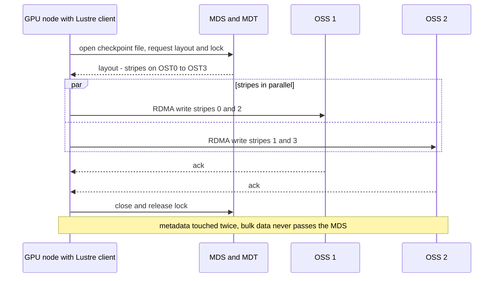
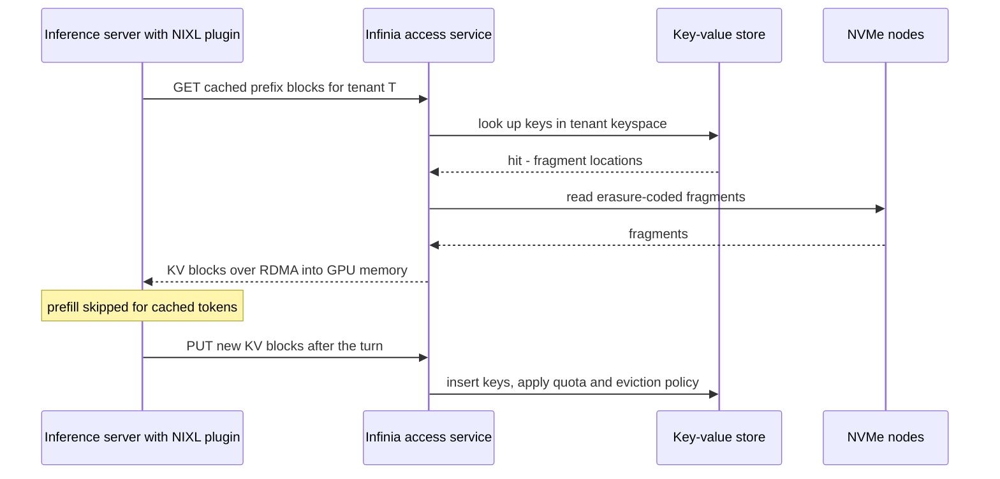
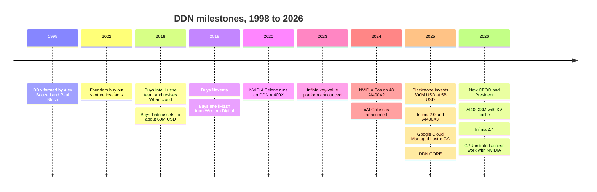

# 44. DDN deep dive

> **Depth:** L2 · **Reading time:** ~17 min · **Last verified:** 2026-11-01
> **Prerequisites:** [Parallel and distributed file systems](../03-system-architecture/17-parallel-file-systems.md) · [Object storage architecture](../03-system-architecture/18-object-storage-architecture.md) · [Inference and KV cache](../05-ai-storage/32-inference-and-kv-cache.md) · [The NVIDIA ecosystem](../05-ai-storage/34-nvidia-ecosystem.md)

## TL;DR

- **DDN is the 28-year-old incumbent of AI storage.** Founded in 1998 and still run by its two founders, it owns the commercial centre of gravity of Lustre and sold the storage inside NVIDIA's own Selene and Eos supercomputers[^1][^2].
- **It now runs two engines.** EXAScaler (Lustre in appliances) serves training and HPC bandwidth. Infinia, a key-value-store-based platform announced in 2023, targets inference, KV cache and multi-tenant object data[^3]. DDN CORE (November 2025) is the control plane over both[^4].
- **The money is real but opaque.** Blackstone paid $300M for a stake at a $5B valuation in January 2025, DDN's first institutional capital in about two decades[^5]. Press reports put revenue near $500M in 2025 with a ~$1B target for 2026, but the base figures conflict[^6][^7].
- **The moat is intimacy, not code.** Lustre is open source; DDN's edge is the engineers who maintain it, reference designs inside NVIDIA, and a profitable, government-friendly supplier record.
- **The risks are structural.** A kernel client on every GPU node, two platforms to fund, late enterprise features, hardware-heavy margins and founder succession. DDN, which entered every earlier MLPerf Storage round, sat out v3.0, as did VAST and WEKA[^8].

## Why this matters for Everpure strategy

In large AI and HPC deals, DDN is often already on the floor: the DGX SuperPOD reference architectures many GPU buyers copy were validated with DDN early[^9], and labs and governments have run Lustre for two decades. When Everpure (NYSE: P, formerly PSTG) pitches FlashBlade//EXA into those accounts, it is usually trying to displace or sit beside an EXAScaler system. EXA uses the same metadata-plus-data-nodes architecture but swaps the Lustre kernel client for standard pNFS ([Chapter 17](../03-system-architecture/17-parallel-file-systems.md)).

DDN is also changing shape in ways that move it closer to Everpure's home ground. It hired a former Pure Storage executive as President and Chief Revenue Officer to push into the enterprise[^10], built a new platform (Infinia) aimed at inference and KV cache, and is reportedly seeking strategic investors[^11]. Knowing where DDN is strong (bandwidth, NVIDIA reference status, sovereign HPC) and thin (enterprise operations, data reduction, simplicity) tells Everpure where to fight and where to coexist.

## Core concepts

### The company in one paragraph

DataDirect Networks was formed in 1998 by Alex Bouzari (CEO) and Paul Bloch, who had run a predecessor, MegaDrive Systems, since 1988[^12]. It took about $12M of venture money around 2002, fell out with the investors, and the founders bought them out[^13]. Until 2025 it grew on its own cash flow, selling high-bandwidth storage to supercomputing sites, and by Forbes' account each founder still owns about 40%[^6]. Hence DDN's character: engineering-led, lab-focused, frugal, profitable (company-stated), and run by two people who have made every major decision for 28 years.

### Two engines, one company

![Side-by-side diagram of DDN's two data engines. Left, EXAScaler: compute nodes with a Lustre kernel client cross an LNet fabric, get file layouts from a metadata server and stream striped data from object storage servers, packaged in AI400X-series appliances or as Google Cloud Managed Lustre. Right, Infinia: S3, SDK, KV-cache and limited POSIX access services sit as peers on a distributed key-value store with a hierarchical tenant keyspace, erasure coding and commodity NVMe servers. A DDN CORE control-plane band spans both.](../assets/diagrams/ch44-ddn-architecture.svg)

*Figure 44.1 — DDN sells two different architectures: a mature Lustre engine tuned for bandwidth, and a young key-value engine tuned for tenancy and inference, joined only at the control plane.*

The two engines share almost no code. EXAScaler descends from Lustre, a 1999 research project that DDN took over commercially in 2018[^14]. Infinia was written from scratch and announced in 2023 as "not a development of" EXAScaler[^3]. DDN's Chief Product Officer said in January 2026 that EXAScaler remains central, with the two products as partners under one control plane[^15]. In practice, training and simulation go to EXAScaler; data preparation, inference and multi-tenant service-provider work go to Infinia.

The semiconductor analogy is a foundry running a mature high-performance node and a new specialty node. The old node pays the bills and holds the reference customers; the new one is where demand is supposed to land, but it lacks yield history, and every engineer on it is one not working on the cash cow.

### EXAScaler: Lustre, productised

EXAScaler is DDN's distribution of Lustre plus management tooling, monitoring and DDN's own hardware[^16]. The mechanism is exactly the Lustre design of [Chapter 17](../03-system-architecture/17-parallel-file-systems.md). A metadata server (MDS) hands out a file's layout once. The client then moves data directly, in parallel, to and from many object storage servers (OSSs) over RDMA.

*Figure 44.2 — On EXAScaler the metadata server is consulted at open and close; the bulk bytes flow client-to-OSS in parallel, which is why aggregate bandwidth scales with the number of appliances.*

DDN adds packaging and people. Buying Intel's Lustre business in June 2018 brought the development team, support team and contracts, and revived the Whamcloud name[^14]. Owning the main Lustre engineering team lets DDN fix a client bug or backport a feature faster than any rival distributor; for a national lab, that is the product. Rivals ship Lustre too, including HPE and Microsoft (Azure Managed Lustre posted 642.2 GiB/s of checkpoint writes in MLPerf Storage v3.0[^8]). The code is open; the moat is the team.

The costs are those of any parallel file system: a client module matched to every GPU server's kernel, hot directories that bottleneck one metadata target, RAID under each target and little data reduction. Lustre buyers accept them for bandwidth and coherent POSIX semantics on shared files.

### The appliances: A³I and the AI400X line

DDN sells EXAScaler mostly as A³I ("Accelerated, Any-scale AI") appliances: 2U all-NVMe building blocks sized to slot into NVIDIA reference architectures.

| Product | What it is | Launched | Headline figures (vendor-stated) | Role in 2026 |
|---|---|---|---|---|
| AI400X | First A³I all-flash EXAScaler appliance | c. 2019–2020 | ~7 PB behind NVIDIA Selene[^1] | Installed base |
| AI400X2 / X2 Turbo | Second generation; Turbo refresh | 2022 / 2024-03 | 96 GB/s read, 65 GB/s write; Turbo up to 120 GB/s[^17][^18] | NVIDIA Eos (48 units)[^2] |
| AI400X3 | Third-generation 2U EXAScaler appliance | 2025-06 | +55% read, +70% write vs prior gen[^19]; reseller lists 140 GB/s read, 110 GB/s write[^20] | MLPerf Storage v2.0 entry[^21] |
| AI400X3M | Refresh with KV-cache support | 2026-06 | 190 GB/s read, 110 GB/s write, 8M IOPS in 2U[^22] | Current flagship |
| Infinia 2.0 → 2.4 | Software-defined key-value data platform | 2023; 2.0 2025-02; 2.4 2026-07 | Sub-ms metadata; up to 10x data reduction (claims)[^23][^24] | Inference, KV cache, tenancy |
| DDN CORE | Control plane and data fabric over both engines | 2025-11 | On-prem, Google Cloud, OCI, neoclouds[^4] | Unifying brand |
| Google Cloud Managed Lustre | First-party Google service built on EXAScaler | GA 2025-07 | Up to 1 TB/s per namespace[^25] | Cloud channel |
| Tintri VMstore / IntelliFlash | Enterprise virtualisation and primary storage | Acquired 2018 / 2019 | VMstore T7290 GA 2025-09[^26] | Separate enterprise unit |

*Table 44.1 — DDN's portfolio is a bandwidth appliance line, a young software platform and an enterprise sidecar; the AI400X generations double bandwidth roughly every two to three years.*

A worked check on Eos shows how DDN sells. Eos used 48 AI400X2 appliances for 576 DGX H100 systems, in under three racks and about 100 kW, delivering about 4 TB/s[^2]; one trade outlet gives 4.3 TB/s read and 3.1 TB/s write[^18]. At the 96 GB/s datasheet rate, 48 × 96 GB/s = 4.6 TB/s, so delivery was about 87–93% of the summed datasheets (4.0 or 4.3 TB/s): near-linear scaling. Density is 4 TB/s ÷ 100 kW ≈ 40 GB/s per kW, or 4.3 TB/s ÷ 576 ≈ 7.5 GB/s per DGX node.

Now size a checkpoint ([Chapter 31](../05-ai-storage/31-training-storage.md)). A 405B-parameter model with Adam state is about 6.5 TB. At the reseller's 110 GB/s write figure, eight AI400X3s (16U) give about 880 GB/s, so a synchronous checkpoint takes 6.5 ÷ 0.88 ≈ 7.4 seconds. That is the pitch: a few rack units keep a large cluster's checkpoint stall in single-digit seconds.

### Infinia: a key-value store wearing many protocols

Infinia's base layer is a distributed key-value store built on a Bε-tree (B-epsilon tree)[^3]. A Bε-tree is a write-optimised B-tree: each internal node holds a buffer of pending updates, which are pushed down the tree in batches. Small random writes therefore become large sequential ones, much as a DRAM controller's write queue coalesces scattered writes into full bursts. Data and metadata both live there, and S3, SDK, block, KV-cache and (since 2.4) limited POSIX access sit on it as peer services, not layers stacked on a file system[^3][^24].

Two design choices follow. First, **tenancy is in the keyspace.** Keys run realm, cluster, tenant, subtenant, dataset, and each tenant gets a fixed share of performance and capacity at creation, DDN's answer to noisy neighbours[^3]. Infinia 2.4 (July 2026) made this the headline: isolation, quotas and provisioning in about ten seconds via REST, aimed at NVIDIA cloud partners and managed AI services[^24]. Second, **it is hardware-agnostic.** Infinia runs on commodity NVMe servers and on Oracle Cloud, uses network erasure coding across nodes, and claims up to 10x always-on data reduction[^23][^4].

The claims need care. The 2.0 launch claimed up to 100x faster metadata and 10x better cost efficiency without a published baseline[^23]. POSIX in 2.4 is limited availability (RHEL and Ubuntu); GPUDirect Storage and POSIX ACLs remain roadmap items[^24]. The public materials reviewed do not say whether isolation extends to per-tenant encryption keys, which is a fair diligence question [VERIFY: Infinia per-tenant encryption]. The flagship proof point is scale: DDN says xAI runs a single 350 PB Infinia cluster (*company-stated*)[^15].

*Figure 44.3 — Infinia's path is a key lookup, not a file open: a cached prompt prefix comes back as KV blocks, saving the GPU from recomputing it (simplified logical view).*

### KV cache and GPU-initiated access: the inference bet

Why a second engine? Inference changes the I/O pattern ([Chapter 32](../05-ai-storage/32-inference-and-kv-cache.md)). Training wants a few huge streaming files; long-context inference wants billions of small KV-cache blocks keyed by prompt prefix, retrieved in milliseconds and shared across tenants. That is a key-value workload, and Lustre's MDS-centric design fits it poorly.

DDN's July 2025 benchmark is the reference claim. On Qwen3-32B with a 112K-token context, recomputing the prefill took 57 seconds; loading the cached KV from Infinia took 2.1 seconds, a 27x gain (*vendor test on two A100 GPUs*)[^27]. A sanity check: Qwen3-32B has 64 layers and 8 KV heads of dimension 128 [VERIFY: model config from public model card], so each token's KV is 2 × 64 × 8 × 128 × 2 bytes = 256 KiB in BF16. For 112K tokens that is about 29 GB, and loading it in 2.1 seconds implies roughly 14 GB/s to two GPUs, plausible for RDMA storage. But recompute is the weakest baseline; the more useful number is Nebul's, a European sovereign cloud reporting nearly 10x faster time to first token than its own CPU-memory cache (October 2026, joint release)[^28]. The semiconductor analogy is spill-to-memory versus recompute: a storage tier pays when fetching a byte costs less GPU time than regenerating it.

DDN has also moved down the stack. In June 2026 both EXAScaler and Infinia gained KV-cache support through NVIDIA Dynamo and NIXL[^22]. In August 2026 DDN and NVIDIA announced joint work, under NVIDIA's Storage-Next initiative, on GPU-initiated data access for Infinia, where GPU threads issue data operations without a CPU round-trip. No performance figures or availability dates were given[^29]. If it ships, the storage client moves into the GPU, favouring vendors with deep NVIDIA ties.

### Inside NVIDIA's clusters, and the xAI question

DDN's best marketing asset is that NVIDIA bought it for itself. Selene, NVIDIA's DGX A100 SuperPOD ranked seventh in the world in 2020, used about 7 PB of DDN AI400X storage[^1]. Eos used the 48 AI400X2s described above[^2]. DDN also claimed to be the first storage validated with DGX SuperPOD at any scale (*company-stated*)[^9]. When a GPU buyer copies NVIDIA's own design, DDN is in the bill of materials by default.

xAI is murkier. In November 2024 DDN announced that EXAScaler and Infinia support xAI's 100,000-GPU Colossus in Memphis[^30]. VAST Data has also claimed Colossus, saying xAI trains, checkpoints and stores data on VAST, and in October 2025 Blocks & Files reported VAST in xAI's Colossus expansion while noting DDN's continuing role[^31]. Both can be true at different tiers or phases; no public source settles the split. The honest statement: xAI references both, and Forbes credits xAI contracts as a driver of DDN's 2026 growth[^6].

### Benchmarks: present in v0.5 to v2.0, absent in v3.0

DDN has been a regular MLPerf Storage entrant: it was one of five submitters in the first round, v0.5 (September 2023)[^32]. In MLPerf Storage v2.0 (August 2025) a single AI400X3 sustained more than 110 GiB/s of reads, and DDN emphasised density (simulated GPUs fed per rack unit) over absolute cluster numbers[^21] [VERIFY: per-workload accelerator counts differ between DDN materials and secondary write-ups]. In v1.0 an AI400X2T posted 99,018 MiB/s on 3D U-Net with 36 simulated H100s[^33]. DDN skipped v3.0 (September 2026), which moved to simulated B200s and added KV-cache tests; VAST and WEKA also stayed out, while Everpure entered[^8]. On IO500 (June 2025) DDN claimed the top spot, but Argonne's DAOS systems held the first two places on the 10-node production list, with a Hudson River Trading EXAScaler system third[^34]. The pattern: DDN shows up where its density story is strongest ([Chapter 37](../05-ai-storage/37-reading-benchmarks.md)).

### The enterprise sidecar: Tintri, Nexenta, IntelliFlash

In 2018–2019 DDN bought three enterprise businesses: Tintri's assets out of bankruptcy for about $60M (September 2018)[^35], Nexenta, a software-defined storage vendor (May 2019, terms undisclosed)[^36], and Western Digital's IntelliFlash arrays (ex-Tegile, November 2019), with WD becoming a preferred drive supplier[^37]. These cheap, distressed assets bought enterprise revenue and customers. Tintri still ships (VMstore T7290, September 2025)[^26], but the units run separately and play little part in the AI story. They show DDN's enterprise experience sits in virtualisation niches, not mainstream primary storage.

## Business model & financials

DDN's model is classic systems vendor: integrated appliances (hardware, software, support) sold per deal, increasingly complemented by software licences (Infinia, CORE) and cloud royalties (Google Cloud Managed Lustre). Because it is private, every figure below is *company-stated* or *reported by press*, and they do not reconcile.

*Figure 44.4 — DDN's revenue history is a set of unaudited, partly contradictory data points; the only consistent message is a step-change from roughly US$0.4–0.5B toward a US$1B target in 2026.*
Data: `data/ch44_milestones.csv`

- **Revenue.** The Register gave $25M (2003), $45M (2005) and $188M (2010)[^13]; DDN said it reached $400M in 2020[^7]. In January 2025 Blocks & Files put 2023 at $500M and estimated 2024 at $750M[^7] [VERIFY: search-summary only]. Forbes' August 2026 profile, as syndicated, gives about $400M (2024) and $500M (2025), on track to double to about $1B in 2026, while the English original calls DDN historically a roughly $300M-a-year business[^6]. Treat ~$0.5B (2025) and a ~$1B 2026 target as a working range, not facts.
- **Momentum.** DDN's new President told an October 2026 press tour that bookings were growing about 3x year on year (*company-stated*)[^38].
- **Profitability.** Blackstone's release cites a self-funded, profitable record (*company-stated*)[^5]. No margins are public; appliance-heavy revenue usually means lower gross margin than software-only rivals.
- **Capital and valuation.** Blackstone Tactical Opportunities invested $300M at a $5B valuation in January 2025 and took a board seat[^5]. Coverage described it as a financial investment, with the founders keeping control[^39]. At $5B against ~$400–500M revenue, the implied multiple is about 10–12x. VAST's $30B valuation on more than $500M of committed ARR is roughly 60x[^40], and WEKA's $1.6B on ~$100M ARR (2024) about 16x[^41]. Investors valued DDN like a profitable hardware company, not an AI software platform. In June 2026 Bouzari told Bloomberg DDN wanted to raise again by year-end and bring in strategic investors. No size, valuation or close had been reported by 2026-11-01[^11].
- **Scale.** An outside estimate puts 2025 headcount near 1,334 (*estimated*)[^42], which on ~$500M revenue is roughly $375k per employee.

## Customers & go-to-market

DDN's customers fall into five groups:

- **Supercomputing and government.** National labs, defence and university HPC centres. Recent IO500 lists include SoftBank's CHIE-4, the University of Florida's HiPerGator and Hudson River Trading[^43].
- **NVIDIA itself.** Selene, Eos and Cambridge-1, and the SuperPOD reference designs that follow from them[^1][^2][^9].
- **AI labs.** xAI, plus an unnamed frontier lab where DDN says it runs Infinia as a managed service across roughly 200,000 GPUs (*company-stated*)[^38].
- **Sovereign and regional AI clouds.** DDN cites Yotta's Shakti Cloud in India, Singtel, Nebul and SCX.ai, and launched "Sovereign AI Blueprints" at SC25[^44][^28].
- **Hyperscalers and neoclouds.** Google, through Managed Lustre (GA July 2025, up to 1 TB/s per namespace)[^25], plus CoreWeave, Nebius and Scaleway via CORE, and Oracle via Infinia on OCI[^4].

DDN says its platforms support more than 500,000 NVIDIA GPUs (*company-stated*, January 2025)[^45]. Customer counts in DDN materials range from 5,000+ to 11,000+ [VERIFY: definitions differ][^38][^12].

Go-to-market has three routes. **NVIDIA-led**: DDN rides SuperPOD and NVIDIA Cloud Partner designs into GPU purchases. **Integrators and OEMs**: national HPC procurements go through prime contractors, and SC25 added a Supermicro-built "Enterprise AI HyperPOD"[^4]. **Cloud**: Google sells EXAScaler as a first-party service, giving DDN reach without a sales force. In 2026 DDN professionalised its leadership: Guido Torrini (ex-CFO of OneTrust and Celonis) became Chief Financial Operating Officer in February, a hire Bloomberg tied to a possible IPO[^46]; Kevin Delane (ex-Salesforce, Pure Storage and Cohesity) became President and Chief Revenue Officer in April to drive enterprise adoption[^10]; and a Vice Chair was named[^47].

## Why it gained traction

1. **It was already in the reference design.** NVIDIA ran its own clusters on DDN, so the "safe" choice for a SuperPOD buyer in 2020–2024 was DDN. Reference status works like a foundry's process design kit: switching costs appear before price is discussed.
2. **Bandwidth per rack when stalls were expensive.** Every second a checkpoint blocks thousands of GPUs is paid at GPU rental rates ([Chapter 11](../02-protocols-and-networking/11-gpu-data-path.md)); appliances with known GB/s per 2U let architects size storage by arithmetic.
3. **Open source with a throat to choke.** Sovereign and public buyers like Lustre because it is open (GPL); DDN employs most of its core developers, so buyers get open code plus a vendor that can fix it.
4. **A boring balance sheet.** A profitable, founder-owned supplier with 25 years of lab references passes government procurement and multi-year support tests that venture-funded rivals sometimes do not.
5. **Speed into inference.** Infinia, Dynamo/NIXL support and GPU-initiated access gave DDN a credible inference story quickly, so it was not trapped as a training-only vendor.

## Risks & open questions

- **Lustre complexity and the client.** The kernel client is both DDN's performance edge and its operational tax: it must be rebuilt and qualified for every kernel and GPU-server image. Standard-client designs (FlashBlade//EXA's pNFS, VAST's NFS) attack exactly this pain ([Chapter 8](../02-protocols-and-networking/08-file-protocols.md)).
- **Two platforms, one R&D budget.** EXAScaler and Infinia share a control plane, not a data path. DDN funds a mature parallel file system and a young KV platform where VAST and WEKA each fund one, and customers must pick which engine holds their data. Infinia's POSIX GA, ACLs and GPUDirect support were still on the roadmap in mid-2026[^24].
- **Enterprise feature gaps.** Enterprise buyers expect always-on data reduction, snapshots, replication, non-disruptive upgrades and simple multi-tenancy. EXAScaler was built for scratch bandwidth; Infinia adds tenancy and reduction but is young.
- **Appliance margins and supply.** Selling hardware means DDN carries NAND and server-cost swings that software-only vendors pass to OEMs ([Chapter 48](48-media-suppliers-and-nand-cycle.md)), and doubling revenue strains supply chains; Torrini's remit includes supply chain[^46].
- **Founder succession and governance.** Bouzari and Bloch have run DDN since 1998 and control roughly 80% of it[^6]. The 2026 hires look like institutionalisation ahead of an IPO or strategic round[^46][^10]; no succession plan is public.
- **Concentration and disclosure.** Growth leans on a few huge AI and sovereign contracts, xAI among them; revenue figures are unaudited and inconsistent; skipping MLPerf v3.0 leaves no like-for-like evidence against 2026 rivals.
- **Open questions.** Who joins the strategic round, and on what terms? Does Infinia reach POSIX GA and win training workloads, or stay an inference sidecar? How much of the 2026 revenue is one-off cluster builds versus recurring?

## Strategic relevance to Everpure

DDN matters to Everpure in three ways. First, it is the **incumbent EXA must displace** in Lustre-heritage accounts: Everpure offers the same metadata/data split without a kernel module, plus Purity's data reduction, Evergreen ownership and enterprise operations ([Chapter 27](../04-everpure/27-flasharray-and-flashblade.md)); DDN counters with exascale references, coherent shared-file writes and NVIDIA's own clusters. Second, DDN is **moving toward Everpure's ground**: Infinia's tenancy targets the neocloud buyers EXA's 2026 tenancy features target, its KV-cache tier competes with PureKVA, and an ex-Pure Storage executive runs its revenue organisation. Third, its **capital event** is a signal: a strategic investor such as NVIDIA, a hyperscaler or a sovereign fund would harden DDN's channel.

Options a strategy team might evaluate, based on public information:

- **Compete where Lustre hurts.** Target accounts whose pain is client management, metadata hot spots or capacity cost, not raw bandwidth, and publish per-rack, per-kW and per-TB figures beside DDN's density claims.
- **Coexist where it does not.** Where labs keep EXAScaler as scratch, position FlashBlade or EXA as the protected capacity and AI-data tier behind it.
- **Treat the round as intelligence.** Watch who invests, at what valuation, and whether CORE or Infinia gains an OEM. A full acquisition would face founder control, a multi-billion price and heavy overlap with EXA; narrower moves (for example, Lustre-to-EXA migration tooling) look more plausible.

## How Everpure approaches it vs. competitors

| Dimension | DDN EXAScaler / Infinia | Everpure FlashBlade//EXA | VAST Data | WEKA |
|---|---|---|---|---|
| Core architecture | Lustre MDS/OSS appliances; separate KV-store platform | Purity metadata core plus independent data nodes[^48] | DASE: stateless CNodes, shared SCM and QLC DBoxes[^49] | Shared-nothing NeuralMesh microservices[^50] |
| Client | Lustre kernel client; S3, SDK, NIXL for Infinia | Standard pNFS client[^48] | Standard NFS (incl. RDMA), S3, SMB[^49] | Proprietary user-space client (DPDK); NFS, S3[^51] |
| Data reduction | Minimal on EXAScaler; up to 10x claimed on Infinia[^23] | Purity reduction on metadata core; data-node scheme maturing | Similarity-based, global[^49] | Added in NeuralMesh 6 (2026)[^50] |
| Hardware model | DDN appliances; Infinia on commodity or cloud | DFM blades plus third-party data nodes[^48] | Software on OEM hardware (Supermicro, Cisco, HPE)[^49] | Software; WEKApod appliances |
| KV-cache tier | Infinia and EXAScaler via Dynamo/NIXL[^22] | PureKVA on FlashBlade//EXA (availability announced for Oct 2026)[^52] | VUA (open source, 2025)[^53]; BlueField-4-hosted CNodes for NVIDIA's context-memory tier (announced 2026); GPU-equipped CNode-X for vector search[^54] | Augmented Memory Grid[^55] |
| Cloud | Google Cloud Managed Lustre; Infinia on OCI[^25][^4] | No managed EXA service found in public sources | Google Cloud hybrid namespace (2025)[^56] | Native on AWS, GCP, Azure, OCI[^57] |
| Capital | Founder-owned; Blackstone $300M at $5B[^5] | Public (NYSE: P) | $30B valuation, Series F 2026[^40] | $1.6B valuation, Series E 2024[^41] |
| MLPerf Storage v3.0 | Did not submit | Submitted; top checkpoint write[^8] | Did not submit | Did not submit |

*Table 44.2 — DDN wins on bandwidth heritage and NVIDIA intimacy; Everpure, VAST and WEKA each attack it on a different axis: standard clients, shared-everything economics or a software-only mesh.*

**Steelman DDN.** For a 10,000-GPU training cluster whose owners already run Lustre, DDN is the low-risk answer: known GB/s per 2U, references inside NVIDIA, coherent POSIX writes from thousands of ranks, and an owner-operated supplier whose engineers wrote the code. Profitability means it need not win every deal, and its government relationships take years to replicate. **Where Everpure is stronger:** no client to install, data reduction and enterprise data services, an ownership model built around non-disruptive upgrades, and public, audited financials. **Where VAST and WEKA are stronger:** each runs one architecture across training and inference, with deeper software monetisation, and VAST has higher valuation currency for M&A.

## History and trajectory

*Figure 44.5 — DDN spent two decades as a self-funded HPC specialist, bought Lustre and enterprise assets in 2018–2019, then added outside capital, a second platform and a cloud channel in 2025–2026.*

Three phases: **1998–2017**, a bootstrapped bandwidth specialist growing from $25M (2003) to $188M (2010) revenue[^13]; **2018–2023**, consolidation around Lustre, cheap enterprise assets and NVIDIA's own clusters[^14][^1]; **2024–2026**, the AI step-change with xAI, Blackstone, Infinia, Google Cloud and a reported revenue doubling[^6]. Signals to watch: Infinia POSIX GA and GPUDirect support (roadmap after 2.4)[^24]; productisation of GPU-initiated access[^29]; the strategic round targeted for end-2026[^11]; and whether DDN returns to MLPerf Storage.

## Numbers that matter

| Metric | Value | Context | Source / date |
|---|---|---|---|
| Blackstone investment | $300M at $5B valuation | First institutional capital in ~two decades; board seat | Blackstone, 2025-01[^5] |
| Revenue | ~$500M (2025); ~$1B target (2026) | Reported by press; earlier estimates conflict ($750M for 2024) | Forbes, 2026-08[^6]; B&F, 2025-01[^7] |
| Implied valuation multiple | ~10–12x revenue | $5B ÷ $0.4–0.5B; VAST ~60x CARR, WEKA ~16x ARR | Worked example |
| Founder ownership | ~40% each | Bouzari and Bloch | Forbes, 2026-08[^6] |
| Bookings growth | ~3x year on year (2026) | Company-stated at press tour | vmblog, 2026-10[^38] |
| NVIDIA Eos storage | 48 AI400X2, ~4 TB/s, <3 racks, ~100 kW | 576 DGX H100; ≈40 GB/s per kW | DDN, 2024-03[^2] |
| AI400X3M | 190 GB/s read, 110 GB/s write, 8M IOPS per 2U | Vendor-stated, ISC 2026 | StorageReview, 2026-06[^22] |
| Infinia at xAI | 350 PB single cluster | Company-stated | Blocks & Files, 2026-01[^15] |
| KV-cache claim | 57 s recompute vs 2.1 s load (27x), 112K tokens | Vendor test, Qwen3-32B on 2 A100s | DDN, 2025-07[^27] |
| Google Cloud Managed Lustre | Up to 1 TB/s per namespace | First-party Google service on EXAScaler | Business Wire, 2025-07[^25] |

## Conversation playbook

**Questions for a PM**

1. *"In accounts where DDN shipped the first SuperPOD, what wins the second phase?"* Strong answer: names the trigger (a capacity tier, an inference build-out, a painful client upgrade), gives a win/loss pattern, and admits greenfield training pods often stay with DDN.
2. *"How do we answer DDN's 27x and 10x KV-cache numbers against PureKVA?"* Strong answer: normalises the baseline (recompute versus a CPU-memory cache versus another storage tier), context length, cache hit rate and cost per token, then quotes Everpure's own MLPerf v3.0 KV-cache results with their configuration.
3. *"Does Google Cloud Managed Lustre show up in our pipeline?"* Strong answer: knows which cloud-adjacent AI buyers are choosing a managed Lustre service over on-prem, and what Everpure offers them (data mobility, egress economics, subscription).

**Questions for an engineer**

1. *"What does a FlashBlade//EXA client give up against a Lustre client on shared-file writes and per-node bandwidth?"* Strong answer: separates file-per-rank checkpoints (safe on pNFS) from N-to-1 shared writes, quantifies per-client GB/s, and explains recovery when a client hangs.
2. *"Size EXA against an eight-node AI400X3 rack: per U, per kW, per usable TB."* Strong answer: uses datasheet and MLPerf figures, includes data reduction and protection overhead, and names the workload, not just peak reads.
3. *"Infinia keeps all metadata in a Bε-tree key-value store. How does the EXA metadata core compare, and where does each hit its limits?"* Strong answer: covers write amplification, small-object rates, tenant isolation and how metadata scales across blades versus nodes.

**Don't say this:**

- "DDN is just Lustre." Infinia is a separate, from-scratch platform, and CORE spans both.
- "DDN is the storage behind xAI." DDN and VAST both claim Colossus; say xAI references both.
- "DDN never took outside money." It had venture investors around 2002 and Blackstone in 2025.
- "DDN topped MLPerf Storage." It entered v0.5 to v2.0 and emphasised density in v2.0, but did not enter v3.0.
- "DDN does $1B in revenue." That is a reported 2026 target; 2025 figures conflict and are unaudited.
- "Lustre is legacy." It runs most of the world's largest systems, and Google sells DDN's version as a service.

## Going deeper (optional, L3 pointers)

- Lustre internals: ORNL's *Understanding Lustre Internals* and "Lustre Unveiled" (ACM TOS, 2025), as cited in [Chapter 17](../03-system-architecture/17-parallel-file-systems.md).
- Bε-trees: Bender et al., "An Introduction to Bε-trees and Write-Optimization," USENIX *;login:*, October 2015[^58].
- MLPerf Storage v2.0 and v3.0 results tables at MLCommons, and the IO500 lists, for DDN configurations and per-node numbers.

## Key terms

- **EXAScaler** — DDN's Lustre distribution plus management tooling, sold mostly in appliances.
- **A³I / AI400X series** — DDN's 2U all-NVMe EXAScaler appliances for GPU clusters.
- **Infinia** — DDN's software-defined data platform built on a distributed key-value store.
- **Bε-tree** — a write-optimised B-tree that buffers updates in internal nodes.
- **DDN CORE** — DDN's control plane and data fabric spanning EXAScaler and Infinia.
- **Whamcloud** — the Lustre engineering unit, owned by DDN since 2018.
- **KV-cache offload** — storing transformer key/value tensors outside GPU memory for reuse.
- **GPU-initiated data access** — GPUs issuing storage operations without a CPU round-trip.
- See the [glossary](../glossary.md) for the rest.

## Sources

[^1]: insideHPC, "DDN Data Storage in 7th-ranked Nvidia Supercomputer," 2020-07. https://insidehpc.com/2020/07/ddn-data-storage-in-7th-ranked-nvidia-supercomputer/ (retrieved 2026-11-01); insideHPC, "HPC at Scale Enabled by DDN A3i and NVIDIA SuperPOD," 2020-04. https://insidehpc.com/2020/04/hpc-at-scale-enabled-by-ddn-a3i-and-nvidia-superpod/ (retrieved 2026-11-01).
[^2]: DDN, "DDN Delivers 4 Terabytes/Second of Accelerated Storage Performance in Groundbreaking NVIDIA Eos AI Supercomputer," 2024-03. https://www.ddn.com/press-releases/ddn-delivers-4-terabytes-second-of-accelerated-storage-performance-in-groundbreaking-nvidia-eos-ai-supercomputer/ (retrieved 2026-11-01).
[^3]: Blocks & Files, "DDN's ground-up developed petabyte-scale and fast Infinia object store," 2023-11-08. https://blocksandfiles.com/2023/11/08/ddns-ground-up-developed-petabyte-scale-and-fast-infinia-object-store/ (retrieved 2026-11-01; search extract only).
[^4]: DDN via Business Wire, "DDN Launches DDN CORE—The Unified Data Engine Powering the AI Factory Era," 2025-11-17. https://www.businesswire.com/news/home/20251117882831/en/ (retrieved 2026-11-01); Blocks & Files, "DDN goes hard CORE," 2025-11-18. https://www.blocksandfiles.com/ai-ml/2025/11/18/ddn-goes-hard-core/1718766 (retrieved 2026-11-01).
[^5]: Blackstone, "Blackstone Invests $300 Million at a $5 Billion Valuation in DDN, AI and Data Intelligence Solutions Leader, to Fuel Further Rapid Growth," 2025-01-08. https://www.blackstone.com/news/press/blackstone-invests-300-million-at-a-5-billion-valuation-in-ddn-ai-and-data-intelligence-solutions-leader-to-fuel-further-rapid-growth/ (retrieved 2026-11-01).
[^6]: I. Martin, Forbes, "AI's Latest Rocket Ship Is An Old School, 28-Year-Old Data Company," 2026-08-06. https://www.forbes.com/sites/iainmartin/2026/08/06/ais-latest-rocket-ship-is-an-old-school-28-year-old-data-company/ (retrieved 2026-11-01; read via search extracts); Forbes Italia, "Chi è Alex Bouzari, il miliardario che rende più veloci i supercomputer dell'IA," 2026-08-10. https://forbes.it/2026/08/10/chi-e-alex-bouzari-il-miliardario-che-rende-piu-veloci-i-supercomputer-dellia/ (retrieved 2026-11-01).
[^7]: Blocks & Files, "Blackstone invests $300M in DDN to boost AI storage business," 2025-01-09. https://www.blocksandfiles.com/ai-ml/2025/01/09/blackstone-invests-300m-in-ddn-to-boost-ai-storage-business/1588925 (retrieved 2026-11-01; search extract only).
[^8]: MLCommons, "MLCommons Releases New MLPerf Storage v3.0 Benchmark Results," 2026-09-01. https://mlcommons.org/2026/09/mlperf-storage-v3-0-results/ (retrieved 2026-11-01); StorageReview, "MLPerf Storage v3.0: 877 GiB/s Checkpoints, a Cloud First, and a Leaderboard Turned Over," 2026-09. https://www.storagereview.com/news/mlperf-storage-v3-0-877-gib-s-checkpoints-a-cloud-first-and-a-leaderboard-turned-over (retrieved 2026-11-01).
[^9]: HPCwire, "DDN Announces Next-Gen Reference Architectures for NVIDIA DGX BasePOD and DGX SuperPOD," 2022-09. https://www.hpcwire.com/off-the-wire/ddn-announces-next-gen-reference-architectures-for-nvidia-dgx-basepod-and-dgx-superpod/ (retrieved 2026-11-01).
[^10]: DDN via Business Wire, "DDN Appoints Kevin Delane as President and Chief Revenue Officer to Scale Global AI Leadership," 2026-04-06. https://www.businesswire.com/news/home/20260406143422/en/ (retrieved 2026-11-01); Blocks & Files, "DDN hires chief revenue officer," 2026-04-08. https://www.blocksandfiles.com/ai-ml/2026/04/08/ddn-hires-chief-revenue-officer/5214793 (retrieved 2026-11-01).
[^11]: Bloomberg, "AI Data Firm DDN Eyeing a Fresh Funding Round by End of Year," 2026-06-10. https://www.bloomberg.com/news/articles/2026-06-10/ai-data-firm-ddn-eyeing-a-fresh-funding-round-by-end-of-year (retrieved 2026-11-01; paywalled, via search extract); Blocks & Files, "DDN wants strategic investors," 2026-06-12. https://www.blocksandfiles.com/ai-ml/2026/06/12/ddn-wants-strategic-investors/5254665 (retrieved 2026-11-01).
[^12]: Wikipedia, "DataDirect Networks," n.d. https://en.wikipedia.org/wiki/DataDirect_Networks (retrieved 2026-11-01).
[^13]: The Register, "Alex Bouzari on his big data storage firm: First, we got rid of the VCs," 2014-06-30. https://www.theregister.com/2014/06/30/a_ddn_chat/ (retrieved 2026-11-01; search extract only).
[^14]: TOP500.org, "DDN Acquires Lustre Business from Intel," 2018-06. https://www.top500.org/news/ddn-acquires-lustre-business-from-intel/ (retrieved 2026-11-01); HPCwire, "Storage Leader DDN Acquires Lustre File System Capability from Intel," 2018-06-25. https://www.hpcwire.com/off-the-wire/storage-leader-ddn-acquires-lustre-file-system-capability-from-intel/ (retrieved 2026-11-01).
[^15]: Blocks & Files, "DDN says Lustre-based EXAScaler remains central despite Infinia push," 2026-01-05. https://www.blocksandfiles.com/ai-ml/2026/01/05/ddn-says-lustre-based-exascaler-remains-central-despite-infinia-push/4090329 (retrieved 2026-11-01; search extract only).
[^16]: DDN, "DDN Boosts AI Storage Leadership with EXAScaler 6," n.d. https://www.ddn.com/press-releases/ddn-boosts-ai-leadership-with-exascaler-6 (retrieved 2026-11-01).
[^17]: TechTarget, "DDN launches high-performance AI storage with AI400X2," n.d. (2022). https://www.techtarget.com/searchstorage/news/252509515/DDN-launches-high-performance-AI-storage-with-AI400X2 (retrieved 2026-11-01); StorageNewsletter, "DDN Storage Appliance Doubles Performance for NVIDIA DGX AI Solutions," 2022-03-28. https://www.storagenewsletter.com/2022/03/28/ddn-storage-appliance-doubles-performance-for-nvidia-dgx-ai-solutions-and-speeds-up-analytics-and-ml-in-cloud-by-100/ (retrieved 2026-11-01).
[^18]: BigDATAwire, "DDN Cranks the Data Throughput with AI400X2 Turbo," 2024-03-18. https://www.hpcwire.com/bigdatawire/2024/03/18/ddn-cranks-the-data-throughput-with-ai400x2-turbo/ (retrieved 2026-11-01; search extract only).
[^19]: Blocks & Files, "DDN unwraps AI400X3, Infinia updates in Hamburg before AI world turns to Paris," 2025-06-11. https://www.blocksandfiles.com/architecture/2025/06/11/ddn-unwraps-ai400x3-infinia-updates-in-hamburg-before-ai-world-turns-to-paris/1599773 (retrieved 2026-11-01); DDN, "DDN launches AI400X3 and Infinia 2.1 at ISC 2025," 2025-06. https://www.ddn.com/blog/ddn-launches-ai400x3-and-infinia-2.1-at-isc-2025/ (retrieved 2026-11-01).
[^20]: Scan Computers (reseller), "DDN AI Storage Solutions" product listing, n.d. https://www.scan.co.uk/ai-solutions/ddn-storage (retrieved 2026-11-01; search extract only).
[^21]: HPCwire/AIwire, "DDN Showcases AI400X3 Performance in Latest MLPerf Storage Benchmarks," 2025-08-05. https://www.hpcwire.com/aiwire/2025/08/05/ddn-showcases-ai400x3-performance-in-latest-mlperf-storage-benchmarks/ (retrieved 2026-11-01); DDN via Business Wire, "DDN Powers the AI Factory of the Future with Record-Breaking Performance Density," 2025-08-04. https://www.businesswire.com/news/home/20250804607363/en/ (retrieved 2026-11-01).
[^22]: StorageReview, "DDN launches AI400X3M and Dynamo-integrated KV cache acceleration at ISC 2026," 2026-06. https://www.storagereview.com/news/ddn-launches-ai400x3m-and-dynamo-integrated-kv-cache-acceleration-at-isc-2026 (retrieved 2026-11-01); HPCwire, "DDN Preps for AI Wave with Speedy New Appliance, KV Cache Solution," 2026-06-24. https://www.hpcwire.com/2026/06/24/ddn-preps-for-ai-wave-with-speedy-new-appliance-kv-cache-solution/ (retrieved 2026-11-01).
[^23]: DDN via Business Wire, "DDN Unveils Infinia 2.0, The AI Data Intelligence Platform to Maximize Value for Enterprises, AI Factories and Sovereign AI," 2025-02-20. https://www.businesswire.com/news/home/20250220891434/en/ (retrieved 2026-11-01).
[^24]: DDN, "DDN Unveils Infinia 2.4 at RAISE, Establishing the Foundation Layer for Production AI Inference Economics and Sovereign AI Factories," 2026-07-07. https://www.ddn.com/press-releases/ddn-unveils-infinia-2-4-at-raise-establishing-the-foundation-layer-for-production-ai-inference-economics-and-sovereign-ai-factories/ (retrieved 2026-11-01); StorageReview, "DDN Infinia 2.4 adds multi-tenancy and POSIX support for production AI factories," 2026-07. https://www.storagereview.com/news/ddn-infinia-2-4-adds-multi-tenancy-and-posix-support-for-production-ai-factories (retrieved 2026-11-01); Blocks & Files, "DDN gets Infinia ready for production AI inferencing," 2026-07-08. https://www.blocksandfiles.com/object/2026/07/08/ddn-gets-infinia-ready-for-production-ai-inferencing/5268312 (retrieved 2026-11-01).
[^25]: DDN via Business Wire, "Google Cloud Managed Lustre Powered by DDN EXAScaler Offering High-Performance File System Now Generally Available for AI and HPC Workloads," 2025-07-08. https://www.businesswire.com/news/home/20250708259327/en/ (retrieved 2026-11-01); The New Stack, "Google brings the Lustre parallel file system to its cloud," 2025. https://thenewstack.io/google-brings-the-lustre-parallel-file-system-to-its-cloud/ (retrieved 2026-11-01).
[^26]: Tintri, "VMstore T7290 and TxOS 6.0 general availability," 2025-09-30, as summarised by Tintri blog and trade listings. https://tintri.com/blog/ (retrieved 2026-11-01; search extract only).
[^27]: DDN, "DDN Eliminates GPU Waste Spiral with Industry-Leading KV Cache Performance for AI Reasoning," 2025-07. https://www.ddn.com/press-releases/ddn-eliminates-gpu-waste-spiral-with-industry-leading-kv-cache-performance-for-ai-reasoning/ (retrieved 2026-11-01); insideHPC, "DDN Takes on GPU Waste with KV Cache Performance for AI Reasoning," 2025-07. https://insidehpc.com/2025/07/ddn-eliminates-gpu-waste-spiral-with-industry-leading-kv-cache-performance-for-ai-reasoning/ (retrieved 2026-11-01).
[^28]: DDN, "DDN, Nebul and NVIDIA Advance AI Inference Economics Through High-Performance KV Cache Acceleration," 2026-10. https://www.ddn.com/press-releases/ddn-nebul-and-nvidia-advance-ai-inference-economics-through-high-performance-kv-cache-acceleration/ (retrieved 2026-11-01; search extract only).
[^29]: DDN via Business Wire, "DDN Collaborates with NVIDIA to Advance GPU-Initiated Data Access for Next-Generation AI," 2026-08-04. https://www.businesswire.com/news/home/20260804345565/en/ (retrieved 2026-11-01).
[^30]: DDN, "DDN's Data Platform Propels xAI's Colossus to World-Class Performance," 2024-11-18. https://www.ddn.com/press-releases/ddns-data-platform-propels-xais-colossus-to-world-class-performance/ (retrieved 2026-11-01); Blocks & Files, "DDN supplying storage for xAI's Colossus supercomputer," 2024-11-19. https://www.blocksandfiles.com/ai-ml/2024/11/19/ddn-supplying-storage-for-xais-colossus-supercomputer/1604044 (retrieved 2026-11-01).
[^31]: VAST Data blog, "The story of VAST and xAI," n.d. https://www.vastdata.com/blog/the-story-of-vast-and-xai ; Blocks & Files, "VAST Data in xAI's frontier AI factory, Nscale's UK data centers and Williams F1 racing team," 2025-10-30. https://blocksandfiles.com/2025/10/30/vast-data-in-xais-frontier-ai-factory-nscales-uk-data-centers-and-williams-f1-racing-team/ (both retrieved 2026-11-01).
[^32]: Blocks & Files, "MLCommons publishes storage benchmark for AI," 2023-09-18. https://www.blocksandfiles.com/ai-ml/2023/09/18/mlcommons-publishes-storage-benchmark-for-ai/1586446 ; HPCwire/AIwire, "DDN Shows Strong Results in Inaugural MLPerf AI Storage Benchmark," 2023-09-13. https://aiwire.net/2023/09/13/ddn-shows-strong-results-in-inaugural-mlperf-ai-storage-benchmark (both retrieved 2026-11-01).
[^33]: Blocks & Files, "MLPerf AI benchmark tests how storage systems keep GPUs busy," 2024-09-26. https://www.blocksandfiles.com/ai-ml/2024/09/26/mlperf-ai-benchmark-tests-how-storage-systems-keep-gpus-busy/1605043 (retrieved 2026-11-01).
[^34]: Blocks & Files, "DDN tops IO500 10-node list for HPC storage," 2025-06-20. https://www.blocksandfiles.com/ai-ml/2025/06/20/ddn-tops-io500-10-node-list-for-hpc-storage/1609176 (retrieved 2026-11-01).
[^35]: Blocks & Files, "DDN buys Tintri biz remains for $60mn," 2018-09-05. https://blocksandfiles.com/2018/09/05/ddn-buys-tintri-biz-remains-for-60mn/ (retrieved 2026-11-01).
[^36]: HPCwire, "DDN to Acquire Nexenta," 2019-05-06. https://www.hpcwire.com/2019/05/06/ddn-to-acquire-nexenta/ (retrieved 2026-11-01); The Register, "DDN is buying Nexenta," 2019-05-07. https://www.theregister.com/2019/05/07/ddn_is_buying_nexenta/ (retrieved 2026-11-01).
[^37]: StorageNewsletter, "DDN Completes Acquisition of Western Digital IntelliFlash AFA Business," 2019-11-21. https://www.storagenewsletter.com/2019/11/21/ddn-completes-acquisition-of-western-digital-intelliflash-afa-business/ (retrieved 2026-11-01).
[^38]: vmblog (D. Marshall), "DDN says bookings are heading past 3x, and its pitch is simple: stop letting your GPUs sit around," 2026-10-14. https://vmblog.com/bylines/ddn-says-bookings-are-heading-past-3x-and-its-pitch-is-simple-stop-letting-your-gpus-sit-around/ (retrieved 2026-11-01; search extract only); iTWire, "70th IT Press Tour: DDN wants every GPU earning its keep," 2026-10. https://itwire.com/business-it-news/data/70th-it-press-tour-ddn-wants-every-gpu-earning-its-keep-and-nvidia-and-google-already-run-on-its-data-engines (retrieved 2026-11-01).
[^39]: Computer Weekly, "DDN seeks AI leadership as it bags $300m investment," 2025-01. https://www.computerweekly.com/news/366618008/DDN-seeks-AI-leadership-as-it-bags-300m-investment (retrieved 2026-11-01).
[^40]: CNBC, "Nvidia backs AI company Vast Data at $30 billion valuation," 2026-04-22. https://www.cnbc.com/2026/04/22/nvidia-backs-ai-company-vast-data.html (retrieved 2026-11-01); Futuriom, "VAST Data Hits $30 Billion Valuation Amid 'AI Revolution'," 2026-04. https://www.futuriom.com/articles/news/vast-data-hits-30-billion-valuation-amid-ai-revolution/2026/04 (retrieved 2026-11-01).
[^41]: WEKA, "WEKA Nets $140M in Series E Funding at $1.6B Valuation," 2024-05-15. https://www.weka.io/news/weka-nets-140m-in-series-e-funding-at-1-6b-valuation (retrieved 2026-11-01); WEKA, "A Strategic Step Forward for WEKA: An Open Letter From Our CEO," 2025-02. https://www.weka.io/article/a-strategic-step-forward-for-weka-an-open-letter-from-our-ceo (retrieved 2026-11-01).
[^42]: Revelio Labs, "How many employees work at DataDirect Networks?," 2025. https://www.reveliolabs.com/companies/datadirect-networks/employees/ (retrieved 2026-11-01).
[^43]: StorageNewsletter, "SC25: The IO500 lists show interesting results as usual," 2025-11-25. https://www.storagenewsletter.com/2025/11/25/sc25-the-io500-lists-show-interesting-results-as-usual/ (retrieved 2026-11-01).
[^44]: StorageNewsletter, "SC25: DDN Launches Sovereign AI Solutions Based on NVIDIA AI Data Platform Reference Design," 2025-11-21. https://www.storagenewsletter.com/2025/11/21/sc25-ddn-launches-sovereign-ai-solutions-based-on-nvidia-ai-data-platform-reference-design-trusted-tested-and-proven-for-sovereign-grade-ai/ (retrieved 2026-11-01).
[^45]: Benzinga, "Blackstone invests $300 million in AI data firm that powers Elon Musk's xAI supercomputer," 2025-01. https://www.benzinga.com/news/25/01/42892338/blackstone-invests-300-million-in-ai-data-firm-that-powers-elon-musks-xai-supercomputer (retrieved 2026-11-01).
[^46]: Bloomberg, "Nvidia Partner DDN Hires New Finance Chief Ahead of Possible IPO," 2026-02-24. https://news.bloomberglaw.com/capital-markets/nvidia-partner-ddn-hires-new-finance-chief-ahead-of-possible-ipo (retrieved 2026-11-01; search extract only); DDN via Business Wire, "DDN Appoints Guido Torrini as Chief Financial Operating Officer to Lead Next Phase of Global Growth," 2026-02-24. https://www.businesswire.com/news/home/20260224400498/en/ (retrieved 2026-11-01).
[^47]: StorageNewsletter, "DDN Names Veteran Technology and Global Markets Leader Mohsen Moazami as Vice Chair," 2026-02-05. https://www.storagenewsletter.com/2026/02/05/ddn-names-veteran-technology-and-global-markets-leader-mohsen-moazami-as-vice-chair/ (retrieved 2026-11-01).
[^48]: Everpure, "Technical Brief: FlashBlade//EXA," n.d. (2025). https://www.everpuredata.com/content/dam/pdf/en/technical-briefs/tb-flashblade-exa.pdf (retrieved 2026-11-01); Blocks & Files, "How Pure Storage developed its disaggregated FlashBlade//EXA system," 2025-04-17. https://blocksandfiles.com/2025/04/17/how-pure-storage-developed-its-disaggregated-flashblade-exa-system/ (retrieved 2026-11-01).
[^49]: VAST Data, "How it works," n.d. https://vastdata.com/how-it-works (retrieved 2026-11-01).
[^50]: HPCwire, "WEKA Launches NeuralMesh 6 and WEKApod as AI Inference Pushes Infrastructure Limits," 2026-07-22. https://www.hpcwire.com/2026/07/22/weka-launches-neuralmesh-6-and-wekapod-as-ai-inference-pushes-infrastructure-limits/ (retrieved 2026-11-01); WEKA, "WEKA Introduces NeuralMesh," 2025-06-17. https://www.weka.io/company/weka-newsroom/press-releases/weka-introduces-neuralmesh/ (retrieved 2026-11-01).
[^51]: WEKA, "Networking in WEKA" (docs v5.0), n.d. https://docs.weka.io/5.0/weka-system-overview/networking-in-wekaio (retrieved 2026-11-01).
[^52]: Everpure blog, "Everpure KVA Meets FlashBlade//EXA: Enterprise KV Caching at Neocloud Scale," 2026. https://blog.everpuredata.com/purely-technical/everpure-kva-meets-flashblade-exa-enterprise-kv-caching-at-neocloud-scale/ (retrieved 2026-11-01).
[^53]: Blocks & Files, "VAST's VUA flash caching virtually expands GPU server memory for AI token generation," 2025-04-25. https://blocksandfiles.com/2025/04/25/vasts-vua-flash-caching-virtually-expands-gpu-server-memory-for-ai-token-generation/ (retrieved 2026-11-01).
[^54]: Datacenter Dynamics, "VAST Data integrates AI OS into Nvidia GPU-powered servers," 2026-02-25. https://www.datacenterdynamics.com/en/news/vast-data-integrates-ai-os-into-nvidia-gpu-powered-servers/ (retrieved 2026-11-01).
[^55]: WEKA, "WEKA Breaks The AI Memory Barrier With Augmented Memory Grid on NeuralMesh," 2025-11-18. https://www.weka.io/news/weka-breaks-the-ai-memory-barrier-with-augmented-memory-grid-on-neuralmesh (retrieved 2026-11-01).
[^56]: SDxCentral, "Google Cloud enlists VAST Data to support AI multi-environment deployments," 2025-11. https://www.sdxcentral.com/news/google-cloud-enlists-vast-data-to-support-ai-multi-environment-deployments/ (retrieved 2026-11-01).
[^57]: HPCwire, "WEKA Unveils Multicloud Data Platform for AI and Next-Gen Workloads," 2022-06. https://www.hpcwire.com/off-the-wire/weka-unveils-multicloud-data-platform-for-ai-and-next-gen-workloads/ (retrieved 2026-11-01).
[^58]: M. A. Bender, M. Farach-Colton, W. Jannen, R. Johnson, B. C. Kuszmaul, D. E. Porter, J. Yuan, Y. Zhan, "An Introduction to Bε-trees and Write-Optimization," USENIX *;login:* 40(5), 2015-10. https://www.usenix.org/publications/login/oct15/bender (retrieved 2026-11-01).
