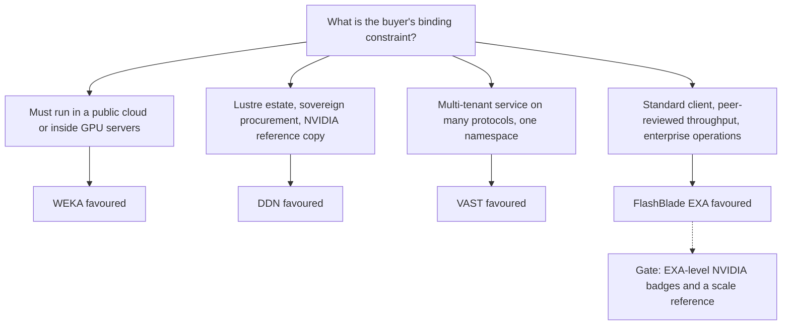
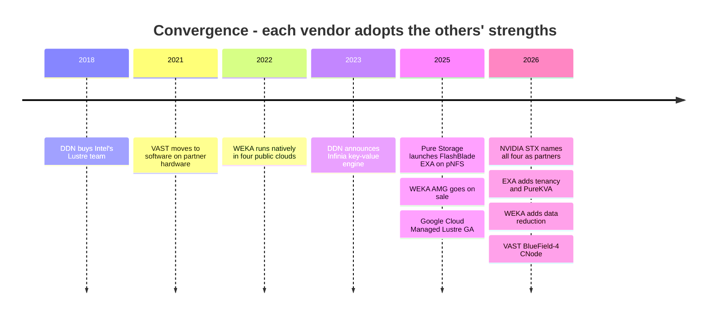

# 45. Head-to-head: FlashBlade//EXA vs. VAST vs. WEKA vs. DDN

> **Depth:** L2 · **Reading time:** ~12 min · **Last verified:** 2026-11-01
> **Prerequisites:** [Disaggregated shared-everything](../03-system-architecture/16-disaggregated-shared-everything.md) · [Parallel file systems](../03-system-architecture/17-parallel-file-systems.md) · [FlashArray and FlashBlade](../04-everpure/27-flasharray-and-flashblade.md) · [Reading benchmarks](../05-ai-storage/37-reading-benchmarks.md) · [VAST](42-vast-data.md) · [WEKA](43-weka.md) · [DDN](44-ddn.md)

## TL;DR

- **All four split metadata from data, but in different places.** EXA runs metadata on a Purity core and sends bulk data straight to data nodes over pNFS. VAST keeps every byte and all metadata on shared SCM and QLC behind stateless CNodes. WEKA hashes metadata into buckets on every node. DDN puts Lustre metadata on an MDS and data on OSS appliances, and runs a second key-value engine, Infinia, beside it.
- **No vendor wins every deal.** VAST leads where buyers want a multi-tenant, multiprotocol platform with references at 10,000+ GPUs. DDN leads where Lustre heritage, NVIDIA's own designs and sovereign procurement decide. WEKA leads where storage must follow the GPUs into clouds or into the GPU servers themselves. EXA leads on peer-reviewed throughput, standard clients and existing Everpure relationships.
- **EXA's evidence is strong but narrow.** It posted the top MLPerf Storage v3.0 checkpoint-write and KV-cache-read results in September 2026, in a round VAST, WEKA and DDN all skipped.
- **EXA is behind on references, badges, cloud reach and data-node maturity.** No public 10,000-GPU EXA reference exists. NVIDIA's SuperPOD and NCP badges belong to FlashBlade//S, not EXA. No public-cloud EXA exists, and data-node reduction and protection run on a young release train.
- **The features are converging, so the next fight is over proof and economics.** Every vendor is an NVIDIA STX partner, every one sells or has announced a KV-cache tier, and WEKA and DDN are adding the data reduction VAST built its business on. What separates vendors in 2027 is reference scale, $/TB under NAND inflation, and operations.

## Why this matters for Everpure strategy

FlashBlade//EXA is Everpure's entry ticket to the GPU-cluster market that VAST, WEKA and DDN built ([Chapter 41](41-why-ai-native-vendors-won.md)). The three rivals each won that market a different way, so a single "EXA vs. competitors" pitch fails. The architecture that beats Lustre on operations is not the one that beats VAST on platform breadth or WEKA on portability. A strategy team needs a map of which deals EXA should chase, which it should concede, and which gaps in product, certification or commercial terms change the odds.

This chapter is that map. It reuses the deep dives' facts ([Chapters 27](../04-everpure/27-flasharray-and-flashblade.md), [42](42-vast-data.md), [43](43-weka.md), [44](44-ddn.md)) and adds a common frame: one diagram, one matrix, one scoring chart and a deal-by-deal verdict. [Chapter 49](49-competitive-matrices.md) widens the lens to the whole field.

## Core concepts

### Four architectures in one picture

Every scale-out file system has to answer three questions. Where does the namespace (the metadata) live? How many network hops does a byte take from flash to GPU? What has to be installed on the client? The four vendors answer them differently.

![Four side-by-side panels drawn with the same grammar. FlashBlade//EXA: stock pNFS clients fetch layouts from a Purity//FB metadata core on DFM blades, then send bulk data directly over RDMA to Purity//DN data nodes on third-party Linux NVMe servers; PureKVA sits above. VAST: stock NFS clients reach stateless CNodes, which reach DBoxes of SCM (metadata) and QLC (data) over an all-to-all NVMe-oF fabric; the Element Store sits above. WEKA: clients with the WEKA driver hash each operation to metadata buckets that live on every backend node, with no metadata server; AMG and Axon sit above. DDN: Lustre kernel clients get layouts from an MDS/MDT and stream data to OSS appliances; Infinia, a separate key-value engine, sits alongside via DDN CORE. Summary lines give bulk-data hops, metadata location and scaling unit for each.](../assets/diagrams/ch45-four-way-architecture.svg)

*Figure 45.1 — EXA and DDN send bulk data one hop, straight to where it lives. VAST adds a CNode hop in exchange for shared, stateless compute. WEKA does away with the metadata server by spreading metadata across every node.*

**FlashBlade//EXA** is a parallel file system built on a standard protocol. The metadata core is FlashBlade hardware running Purity//FB on DirectFlash blades. Launch materials described one to ten chassis of ten blades each[^1]. Data nodes are third-party Linux servers with NVMe SSDs running Purity//DN. Clients fetch a file's layout over NFSv4.1 on TCP, then read and write data nodes directly over RDMA[^2]. [Chapter 16](../03-system-architecture/16-disaggregated-shared-everything.md) explains why this is a metadata/data split rather than DASE.

**VAST** is the DASE reference design. Stateless CNodes run every protocol and data service. All state, metadata included, sits on DBoxes: about 1% SCM and about 99% QLC, reached over NVMe-oF[^3][^4]. Any CNode can serve any request.

**WEKA NeuralMesh** is shared-nothing. Every backend node runs the same user-space processes. Metadata is split into thousands of buckets spread across all nodes, and a hash of each operation picks the bucket that owns it[^5]. The fast path needs WEKA's client driver and DPDK kernel bypass[^6].

**DDN** sells two engines. EXAScaler is Lustre: an MDS hands out layouts, and clients stream stripes to OSS appliances over RDMA. Infinia is a separate key-value platform built on a Bε-tree, serving S3, KV-cache and limited POSIX access[^7][^8]. The DDN CORE control plane spans both[^9].

**Semiconductor bridge.** Read the four as memory-system topologies. EXA and Lustre resemble a directory-based design: one lookup in a directory (the metadata server), then a direct transfer from the bank that holds the line. VAST is uniform memory access through a crossbar: every core is one hop from every bank, and the crossbar is always on the path. WEKA resembles address-interleaved channels with distributed tag ownership. There is no central directory, and the cost appears when one operation spans many owners.

### The multi-dimension matrix

| Dimension | Everpure FlashBlade//EXA | VAST Data | WEKA NeuralMesh | DDN EXAScaler / Infinia |
|---|---|---|---|---|
| Architecture class | Metadata/data split; parallel FS on pNFS[^2] | DASE: stateless CNodes, shared SCM + QLC DBoxes[^3] | Shared-nothing parallel FS, containerised microservices[^5] | Lustre MDS/OSS appliances; separate KV-store platform[^7] |
| Metadata design | Purity//FB on 1–10 chassis of DFM blades[^1] | Element Store in shared SCM, any CNode reads/writes it[^3] | Hashed buckets on every node; no metadata server[^5] | MDS/MDT, sharded with DNE; Infinia keeps all metadata in a Bε-tree[^7] |
| Bulk data path | Client → data node, RDMA, 1 hop[^2] | Client → CNode → DBox, 2 fabric hops[^3] | Client → bucket owner → drive processes; DPDK/RDMA[^6] | Client → OSS, LNet RDMA, 1 hop |
| Client | Stock Linux pNFS | Stock NFS (incl. RDMA), SMB, S3 | WEKA driver for fast path; NFS/SMB/S3 gateways | Lustre kernel client; S3/SDK/NIXL for Infinia |
| Protocols | pNFS (NFSv4.1 metadata, RDMA data) | NFS, SMB, S3, NVMe/TCP block, Kafka API, SQL[^3] | POSIX, NFS, SMB, S3 | POSIX (Lustre); S3, SDK, KV, limited POSIX (Infinia 2.4)[^8] |
| Protection / data reduction | Purity reduction on metadata core; data-node scheme on Purity//DN release train [VERIFY: data-node EC and reduction specifics] | Locally decodable codes to 146+4 (2.7%); global similarity reduction, ~2:1 median (company-stated)[^10][^11] | EC 3–16 data + 2 or 4 parity[^12]; reduction new in NeuralMesh 6, claimed up to 6x and guaranteed; GA not confirmed[^13] | RAID under OSTs, little reduction on EXAScaler; Infinia claims up to 10x[^8] |
| Media / hardware model | Everpure DFM blades for metadata; customer-sourced third-party NVMe data nodes; DFM data nodes not confirmed GA[^14] | Software on certified partner hardware at cost (Gemini) or via OEMs[^15] | Software on qualified servers, WEKApod appliances, GPU servers or clouds | DDN-built AI400X-series appliances; Infinia on commodity servers |
| Scale claims | >10 TB/s read, single namespace (vendor preliminary, 2025-03)[^16] | 2.7% overhead needs ≥75 DBoxes[^10]; TACC Horizon high-speed tier, 400 PB all-flash (TACC-stated)[^17] | WEKApod 3 Prime Max: 441.5 PB raw, 1.1 EB "effective" per rack (assumes ~2.5:1)[^18] | Eos: 48 AI400X2, ~4 TB/s[^19]; 350 PB Infinia cluster at xAI (company-stated)[^20] |
| Performance claims (benchmark, date) | MLPerf Storage v3.0: 877.5 GiB/s checkpoint write, 1,623.4 GiB/s KV read (2026-09)[^21]; SPEC AI_IMAGE 6,300 AI_Jobs (2026-02)[^22] | No MLPerf or SPEC entry in any round[^21] | SPECstorage 2020 #1 on all five workloads on HPE hardware (2025-02)[^23], AI_IMAGE since overtaken by EXA; MLPerf v0.5/v1.0 only | MLPerf v2.0: >110 GiB/s read from one AI400X3 (2025-08)[^24]; AI400X3M datasheet 190/110 GB/s per 2U (2026-06)[^25] |
| KV-cache offering | PureKVA on FlashBlade incl. EXA, availability announced for Oct 2026; "up to 20x" TTFT, test unpublished[^26] | VUA open-source KV software (Apr 2025)[^27]; BlueField-4 CNode inside GPU servers, hardware 2H 2026[^28] | Augmented Memory Grid, commercially available 2025-11-18 (OCI)[^29] | Infinia and EXAScaler via Dynamo/NIXL (2026-06)[^25]; 27x vendor test[^30] |
| NVIDIA certifications | FlashBlade//S: SuperPOD, NCP HPS, NVCS[^31][^32]. EXA: extension of NVCS validation announced Mar 2026 as a step to NCP level; no completed EXA certification or SuperPOD listing found by 2026-11[^33] | SuperPOD 2023[^34]; NCP HPS 2024; NVIDIA investor | WEKApod SuperPOD 2024; NCP HPS 2024[^35]; NVIDIA investor | SuperPOD reference since DGX A100; NCP HPS 2024[^36]; runs NVIDIA's Selene and Eos[^19] |
| Cloud availability | None found | Google Cloud managed service (Nov 2025)[^37]; Azure announced Nov 2025 [VERIFY: Azure GA][^38] | Native on AWS, Azure, GCP, OCI since 2022[^39] | Google Cloud Managed Lustre on EXAScaler, GA 2025-07[^40]; Infinia on OCI[^9] |
| Consumption / pricing | Capex or Evergreen//One for AI (extended to EXA Mar 2026)[^41]; 160 TiB entitlement per data node, then per-TB licence[^14] | Capacity subscription; hardware at cost; same-price renewal up to 10 years (company-stated)[^15] | Capacity subscription; one reseller lists US$339/TB/yr [VERIFY: single listing][^42] | Appliance per deal + software licences + cloud royalties; prices not public |
| GTM | Everpure direct and channel; CoreWeave equity stake and partner listing[^43] | Direct to neoclouds and labs; OEMs (HPE, Cisco, Supermicro); NVIDIA co-sell | Direct plus hardware partners; HPE resale ended 2026-03-03[^44] | NVIDIA-led reference designs; HPC integrators; Google Cloud |
| Ecosystem | NVIDIA STX partner[^45]; Dynamo/KVA | STX partner; CNode-X with Supermicro and Cisco[^46] | STX partner; NIXL plugin; OCI | STX partner; GPU-initiated access work with NVIDIA |
| Target customers | Enterprises scaling AI, neoclouds, HPC | Neoclouds, frontier labs, large enterprise data platforms | AI labs, GPU clouds, cloud-native AI | National labs, sovereign AI, NVIDIA-reference buyers, labs |

*Table 45.1 — The matrix in one line: EXA is strongest on peer-reviewed evidence and standard clients, and weakest on references, cloud reach and certification of the EXA product itself. Cells tagged VERIFY are not confirmed in public sources.*

### Five differences that decide deals

**1. The data path and the client.** EXA and Lustre move bulk data one hop. VAST takes two, and its write path multiplies back-end traffic. A 1 GB/s client write lands in SCM on two DBoxes (2 GB/s), is read back for migration (1 GB/s) and is written to QLC as a wide stripe (about 1.03 GB/s), so the fabric carries about 4 GB/s ([Chapter 16](../03-system-architecture/16-disaggregated-shared-everything.md)). VAST pays that tax for stateless compute and global reduction. The client choice runs the other way. EXA and VAST use the stock NFS client, while WEKA and Lustre need a kernel module qualified against every GPU-server image. A neocloud that rebuilds images weekly counts that as an operating cost, not a footnote.

**2. Where metadata lives.** At thousands of GPUs, metadata is usually the bottleneck, not bandwidth ([Chapter 21](../03-system-architecture/21-metadata.md)). EXA's bet is a dedicated, scale-out Purity metadata tier. VAST's is metadata in shared SCM, so it scales with DBoxes but costs a fabric round trip per lookup. WEKA's is hashing, which avoids hot spots but turns a cross-directory rename into a distributed transaction. Lustre's is an MDS that is sharded by hand (DNE) when one target saturates. No public benchmark compares the four on, say, a billion-file listing, so the strongest metadata claim belongs to whoever runs the buyer's proof of concept.

**3. Capacity economics.** Protection overhead compounds at scale. For 50 PB usable: VAST at 146+4 needs 50 ÷ 0.973 ≈ 51.4 PB raw; WEKA at 16+4 or a Lustre OST at 8+2 RAID needs 50 ÷ 0.8 = 62.5 PB. That is about 11 PB of raw flash between them before any data reduction. With NAND contract prices still rising (TrendForce forecast a further 15–20% for 4Q26)[^47], this is where VAST's design pays. EXA's data-node protection and reduction figures are not public. That is the single most important number for Everpure to publish.

**4. KV cache.** All four now sell, or have announced, a shared KV-cache tier ([Chapter 32](../05-ai-storage/32-inference-and-kv-cache.md)). WEKA shipped first: AMG became commercially available in November 2025[^29], and in June 2026 a joint OCI test grew the cache from 8.64 TiB of DRAM to 287 TiB of NVMe (vendor-run)[^48]. EXA has the only peer-reviewed number: 1,623.4 GiB/s of KV-cache read on 51 hosts[^21]. To put that in tokens: a 70B model's 128K-token context is about 42 GB in FP16 ([Chapter 43](43-weka.md)). 1,623.4 GiB/s ≈ 1,743 GB/s, so the system could reload about 41 such contexts per second (1,743 ÷ 42). But PureKVA itself was only announced on 30 September 2026, with availability slated for October[^26]. NVIDIA's STX reference architecture now names all four as partners[^45], which turns the KV tier into a standard slot and shortens any lead.

**5. Proof.** Each vendor proves itself differently. DDN points to NVIDIA's own clusters (Eos used 48 AI400X2s for about 4 TB/s[^19]). VAST points to CoreWeave's US$1.17B agreement (reported by Reuters)[^49]. WEKA points to portability and SPECstorage. EXA points to peer-reviewed benchmarks. [Chapter 37](../05-ai-storage/37-reading-benchmarks.md) explains why "absence is data" cuts both ways. Rivals skipping MLPerf v3.0 means EXA's first place came against a thin field, and a buyer running a 10,000-GPU proof of concept may trust a reference call over a leaderboard.

**Worked example: one checkpoint, two kinds of number.** Take a 405B-parameter model with Adam optimizer state, about 6.5 TB ([Chapter 31](../05-ai-storage/31-training-storage.md)). EXA's peer-reviewed 877.5 GiB/s is about 942 GB/s from 30 data nodes, so a synchronous save takes 6.5 ÷ 0.942 ≈ 6.9 seconds, or about 31 GB/s per data node. Eight DDN AI400X3 appliances at a reseller-listed 110 GB/s write each give about 880 GB/s, or 7.4 seconds ([Chapter 44](44-ddn.md)). The two times look equivalent, but they are different kinds of number. EXA's is a measured, peer-reviewed system result. DDN's is a sum of datasheet figures, though DDN's Eos install delivered about 93% of its summed datasheets. Neither tells a buyer the cost per usable TB or per kilowatt, which is the comparison that actually decides the purchase. A strategy team should insist that every competitive claim says which kind of number it is.

*Figure 45.2 — Deals are usually decided by one binding constraint, not by a weighted average. EXA's natural constraint still has a certification and reference gate in front of it.*

### Scoring the four

The radar below condenses the matrix into eight axes scored 1–5. These are the atlas's judgments, not measurements. Each score has a one-line rationale in the CSV.

![Four radar panels, one per vendor, scored 1 to 5 on eight axes: proven scale, peer-reviewed benchmark evidence, capacity economics, client and operational simplicity, deployment flexibility, KV-cache and inference maturity, NVIDIA ecosystem standing, and platform breadth. FlashBlade//EXA peaks on peer-reviewed evidence (5) and client simplicity (4) and scores 2 on scale, capacity economics, flexibility, NVIDIA standing and breadth. VAST scores 5 on scale, capacity economics, NVIDIA standing and breadth, and 1 on peer-reviewed evidence. WEKA peaks on deployment flexibility (5) and KV-cache maturity (4) with client simplicity at 2. DDN scores 5 on scale and NVIDIA standing and 2 on capacity economics and client simplicity.](../assets/charts/ch45-radar.svg)

*Figure 45.3 — The atlas's judgment: EXA has the most lopsided profile of the four, excellent on proof and simplicity and thin on scale, flexibility and ecosystem. VAST has the broadest shape.*
Data: `data/ch45_radar.csv`

Two cautions. The axes are unweighted, so summing them is meaningless: a sovereign lab may weight NVIDIA standing at zero and procurement record at everything. The scores also date quickly. Two EXA scores (NVIDIA standing, capacity economics) depend on pending items: NCP-level certification, which Everpure has said it is working toward, and DFM data nodes. Either could move a full point in one quarter.

### Who wins which deal, and why

| Deal archetype | Likely winner | Runner-up | Decisive factor | EXA's honest position |
|---|---|---|---|---|
| Neocloud, 10K+ GPU training cluster | VAST | DDN or WEKA | Reference at that scale, mature multi-tenancy, standard NFS, hardware bought at cost through partners | Credible challenger: one-hop path, customer-sourced data nodes, Evergreen//One for AI. Tenancy only from June 2026[^50]; no 10K-GPU reference |
| Enterprise AI factory on DGX SuperPOD | DDN | VAST | Being on NVIDIA's certified list for that GPU generation; copying NVIDIA's own design | Everpure competes with FlashBlade//S, which holds SuperPOD certification[^31], not with EXA |
| Sovereign / government HPC + AI | DDN | VAST | Open-source Lustre, decades of lab references, POSIX shared-file semantics, procurement track record; sovereign blueprints[^51] | Weak: no sovereign EXA reference found; Lustre shops resist client and semantics change |
| Inference / KV-cache-heavy service | WEKA (today) | EXA | Production KV tier wired into Dynamo/NIXL, measured TTFT at the buyer's context length | Best peer-reviewed KV numbers, but PureKVA availability only announced for Oct 2026; STX narrows everyone's lead |
| Enterprise consolidating file + object for analytics and AI | VAST | Everpure (FlashBlade//S or //E) | One namespace across NFS, S3 and SQL; reduction; enterprise operations | EXA is the wrong tool (pNFS only); FlashBlade//S is Everpure's entry, against Dell and NetApp too ([Chapter 46](46-incumbents.md)) |
| Existing Everpure FlashArray shop starting AI | Everpure | VAST | Incumbent relationship, Pure1/Fusion operations, Evergreen//One contract, one support desk | Strong: FlashBlade//S first, EXA as scale grows |

*Table 45.2 — Everpure is the likely winner in one archetype of six, runner-up in two more and a credible challenger in a third. The pattern says EXA's growth depends on converting the enterprise base and on closing the neocloud reference gap.*

The neocloud row deserves a closer look, because it is the largest pool of spend. Neoclouds rarely single-source. CoreWeave, VAST's largest customer, also lists WEKA and Everpure among its dedicated-storage options[^52], and Everpure holds an equity stake in it[^43]. EXA's realistic entry is therefore a second-source tier, won on per-rack throughput, power and data-node sourcing. The aim is a named reference by 2027, not displacing VAST at CoreWeave.

The table is a base rate, not a forecast. Specific deals flip on price, supply and timing. In a NAND shortage, a vendor that can guarantee delivery of media it designs may beat a cheaper software licence on hardware the buyer cannot source ([Chapter 48](48-media-suppliers-and-nand-cycle.md)). That favours Everpure's DFM supply chain only once data nodes use DFMs.

## How Everpure approaches it vs. competitors

Everpure's pitch is a parallel-file-system data path without the parallel-file-system client, backed by Purity metadata, Evergreen ownership and peer-reviewed numbers. Each rival has a credible counter.

**Steelman VAST.** Breadth compounds. One Element Store serves files, objects, tables, block and Kafka streams. Every new engine reuses the same data without copies, and the fleet of neoclouds running it is the largest in the category. VAST's company-stated committed ARR above US$500M and a US$30B valuation[^53] give it currency to outspend everyone on field engineering.

**Steelman WEKA.** It is the only one that follows the GPUs anywhere: on-premises, inside GPU servers, in four clouds, and next onto DPUs. Its KV-cache product, commercially available since November 2025, has the longest sales record of the four: about seven months ahead of DDN's Dynamo-integrated release and nearly a year ahead of PureKVA.

**Steelman DDN.** NVIDIA runs its own supercomputers on DDN. Lustre's coherent shared-file writes and open code suit labs and governments, and a profitable, founder-owned supplier passes procurement tests venture-backed rivals sometimes fail. Blackstone's US$300M at a US$5B valuation[^54] and a reported revenue doubling toward about US$1B in 2026 (reported by Forbes)[^55] show momentum.

**Where FlashBlade//EXA is behind, stated plainly:**

| Gap | Evidence | Why it matters | What would close it |
|---|---|---|---|
| Scale references | First enterprise EXA customer reported in Q4 FY26[^56]; no public 10K-GPU EXA reference | Buyers ask "who runs this at my scale?" before asking about speed | A named neocloud or lab reference |
| EXA-level NVIDIA badges | NVCS validation extension announced Mar 2026, NCP reported for "later this year"; neither confirmed by 2026-11-01; badges sit on FlashBlade//S[^33] | Gates NVIDIA-led deals | NCP and SuperPOD certification for EXA |
| Cloud reach | No EXA cloud offering found | Concedes cloud-native and burst buyers to WEKA, VAST, DDN | Partner-hosted EXA or software on cloud instances |
| Data-node maturity | Third-party NVMe; Purity//DN on its own release train; DFM nodes not confirmed GA[^14] | Weakens $/TB and Everpure's own-media story | DFM data nodes and published EC and reduction ratios |
| Protocol breadth | pNFS only on EXA | VAST wins multiprotocol consolidation | S3 and object paths on EXA, or a clear FlashBlade//S hand-off |
| Tenancy track record | Multi-tenancy and QoS added June 2026[^50] | Neoclouds sell tenancy | Production tenancy references |

*Table 45.3 — EXA's gaps are mostly maturity and proof, not architecture. That makes them closable, but only with time and reference wins.*

**Where EXA leads.** The bulk-data path is one hop. Clients need no module. The metadata core runs mature Purity software on Everpure's own DirectFlash. Data nodes can be customer-sourced, and EXA's peer-reviewed MLPerf results scale about 89% per node from 10 to 30 data nodes ([Chapter 27](../04-everpure/27-flasharray-and-flashblade.md)). Of the four, only Everpure is a public company (NYSE: P, formerly PSTG) with audited financials, a point procurement teams weigh.

## History and trajectory

*Figure 45.4 — The four started far apart (appliance Lustre, shared-everything, software-anywhere, Purity) and are converging on the same feature list. Differentiation is moving to proof, economics and operations.*

Three forces shape 2027. **NVIDIA standardisation.** STX and the Dynamo KV tiers make the inference storage slot a commodity interface[^45], and DDN's GPU-initiated access work could move the client into the GPU itself ([Chapter 34](../05-ai-storage/34-nvidia-ecosystem.md)). **Capital events.** A VAST IPO would give the first peer-reviewed view of AI-native storage economics, DDN is seeking strategic investors[^57], and WEKA's last priced round, US$1.6B, dates from May 2024[^58]. **Media.** NAND inflation rewards vendors with high reduction ratios (VAST) or their own module supply (Everpure, once DFM data nodes ship). Signals to watch: EXA NCP and SuperPOD badges; DFM data-node GA; NeuralMesh 6 GA; VAST's BlueField-4 CNode shipments; and whether VAST, WEKA or DDN enter MLPerf Storage v4.0.

## Numbers that matter

| Metric | Value | Context | Source / date |
|---|---|---|---|
| EXA checkpoint write | 877.5 GiB/s (≈942 GB/s) | 30 data nodes; top of MLPerf Storage v3.0; rivals absent | StorageReview, 2026-09[^21] |
| EXA KV-cache read | 1,623.4 GiB/s | 51 hosts; ≈41 128K-token 70B contexts per second (worked) | StorageReview, 2026-09[^21] |
| DDN Eos | 48 AI400X2, ~4 TB/s | NVIDIA's own 576-node DGX H100 cluster | DDN, 2024-03[^19] |
| VAST widest stripe | 146+4, 2.7% overhead | Needs ≥75 DBoxes | VAST blog[^10] |
| WEKA erasure code | 16+4 keeps 80% of raw | 3–16 data + 2 or 4 parity | WEKA docs[^12] |
| Raw flash for 50 PB usable | 51.4 PB (VAST) vs 62.5 PB (16+4 or 8+2) | ≈11 PB gap before reduction | Worked example |
| VAST CoreWeave deal | US$1.17B | Multi-year, reported by Reuters | Reuters, 2025-11-06[^49] |
| Latest valuations | VAST US$30B; DDN US$5B; WEKA US$1.6B | 2026-04, 2025-01, 2024-05 | [^53][^54][^58] |
| EXA data-node entitlement | 160 TiB usable per node | Larger capacity licensed per TB | Terms of use[^14] |

## Conversation playbook

**Questions for a PM**

1. *"Which of the six deal archetypes produced our last ten EXA wins and losses?"* A strong answer maps wins and losses to archetypes, names the decisive factor in each, and admits where EXA should not compete. Consolidation deals, for example, belong to FlashBlade//S.
2. *"What is EXA's effective $/TB against VAST at 50 PB, including protection and reduction on the data nodes?"* A strong answer gives measured ratios, the stripe geometry and the NAND cost assumption. It does not quote VAST's marketing median back at them.
3. *"When does EXA get its own NCP and SuperPOD badges, and which deals are we losing until then?"* A strong answer gives a level, a GPU generation and a quarter, and names the deals.

**Questions for an engineer**

1. *"Under a rename storm or a billion-file listing, how does the Purity metadata core compare with WEKA buckets and a DNE-sharded Lustre MDS?"* A strong answer cites test data, separates throughput from tail latency, and explains where each design serialises.
2. *"What does EXA give up against a Lustre client on N-to-1 shared-file writes?"* A strong answer separates file-per-rank checkpoints from shared files, covers pNFS layout recall, and quantifies the per-client GB/s.
3. *"With STX, what in our KV-cache path is still ours?"* A strong answer separates NVIDIA's interfaces (Dynamo, NIXL, BlueField-4) from Everpure's own software: metadata scale, tenancy and placement.

**Don't say this:**

- "EXA beat VAST, WEKA and DDN in MLPerf." They did not enter v3.0.
- "FlashBlade//EXA is SuperPOD-certified." The public record shows FlashBlade//S, not EXA.
- "VAST is a hardware company" or "WEKA is an appliance vendor." Both earn mostly software revenue on partner hardware, even though WEKA now sells WEKApod appliances.
- "DDN is legacy Lustre." It runs NVIDIA's clusters, sells Lustre as a Google service and ships a second, newer engine.
- "Everyone has KV cache, so it's a wash." Maturity, evidence and Dynamo integration differ by up to a year.

## Going deeper (optional, L3 pointers)

- The MLPerf Storage v3.0 results tables and Everpure's disclosure, read with [Chapter 37](../05-ai-storage/37-reading-benchmarks.md)'s checklist[^59].
- Each vendor's deep-dive "Going deeper" box: VAST's locally decodable codes ([Chapter 42](42-vast-data.md)), WEKA's bucket white paper ([Chapter 43](43-weka.md)), Lustre internals and Bε-trees ([Chapter 44](44-ddn.md)).
- RFC 8881 (NFSv4.1) for pNFS layouts and recall semantics ([Chapter 8](../02-protocols-and-networking/08-file-protocols.md)).

## Key terms

- **Metadata/data split** — a design that keeps the namespace on a dedicated tier and moves bulk data directly between clients and data servers.
- **Bulk-data hop** — one network traversal a data byte makes between flash and the client.
- **Purity//DN** — the software running on FlashBlade//EXA data nodes.
- **Deal archetype** — a recurring buyer profile whose binding constraint decides the vendor choice.
- **Binding constraint** — the single requirement that eliminates most options in a deal.
- **Evergreen//One for AI** — Everpure's storage-as-a-service offering for AI, extended to FlashBlade//EXA in 2026.
- See the [glossary](../glossary.md) for the rest.

## Sources

[^1]: Architecting IT, "FlashBlade//EXA analysis," 2025-03. https://www.architecting.it/?p=7294 (retrieved 2026-11-01); Pure Storage, "FlashBlade//EXA for AI" (solution brief), 2025. https://www.purestorage.com/content/dam/pdf/en/solution-briefs/sb-flashblade-exa-ai.pdf (retrieved 2026-11-01).
[^2]: Blocks & Files, "How Pure Storage developed its disaggregated FlashBlade//EXA system," 2025-04-17. https://blocksandfiles.com/2025/04/17/how-pure-storage-developed-its-disaggregated-flashblade-exa-system/ ; Everpure, "Technical Brief: FlashBlade//EXA," n.d. (2025). https://www.everpuredata.com/content/dam/pdf/en/technical-briefs/tb-flashblade-exa.pdf (retrieved 2026-11-01).
[^3]: VAST Data, "How it works," n.d. https://vastdata.com/how-it-works (retrieved 2026-11-01).
[^4]: VAST Data Knowledge Base, "DBox DF-3015V2/DF-3060V2 Ceres Datasheet," n.d. https://kb.vastdata.com/docs/dbox-df-3015v2df-3060v2-ceres-datasheet (retrieved 2026-11-01).
[^5]: WEKA, "WEKA Architecture Key Concepts" (white paper), n.d. https://www.weka.io/wp-content/uploads/files/resources/WEKA-Architecture-Key-Concepts.pdf (retrieved 2026-11-01).
[^6]: WEKA documentation, "Networking in WEKA" (v5.0), n.d. https://docs.weka.io/5.0/weka-system-overview/networking-in-wekaio (retrieved 2026-11-01).
[^7]: Blocks & Files, "DDN's ground-up developed petabyte-scale and fast Infinia object store," 2023-11-08. https://blocksandfiles.com/2023/11/08/ddns-ground-up-developed-petabyte-scale-and-fast-infinia-object-store/ (retrieved 2026-11-01; search extract only).
[^8]: DDN, "DDN Unveils Infinia 2.4 at RAISE, Establishing the Foundation Layer for Production AI Inference Economics and Sovereign AI Factories," 2026-07-07. https://www.ddn.com/press-releases/ddn-unveils-infinia-2-4-at-raise-establishing-the-foundation-layer-for-production-ai-inference-economics-and-sovereign-ai-factories/ ; StorageReview, "DDN Infinia 2.4 adds multi-tenancy and POSIX support for production AI factories," 2026-07. https://www.storagereview.com/news/ddn-infinia-2-4-adds-multi-tenancy-and-posix-support-for-production-ai-factories (retrieved 2026-11-01).
[^9]: DDN via Business Wire, "DDN Launches DDN CORE—The Unified Data Engine Powering the AI Factory Era," 2025-11-17. https://www.businesswire.com/news/home/20251117882831/en/ ; Blocks & Files, "DDN goes hard CORE," 2025-11-18. https://www.blocksandfiles.com/ai-ml/2025/11/18/ddn-goes-hard-core/1718766 (retrieved 2026-11-01).
[^10]: VAST Data blog, "Bringing rack-level resilience to VAST, part one," n.d. https://www.vastdata.com/blog/bringing-rack-level-resilience-to-vast-part-one (retrieved 2026-11-01).
[^11]: VAST Data, "Scaling Through Flash Scarcity" (webinar), n.d. https://www.vastdata.com/events/scaling-through-flash-scarcity (retrieved 2026-11-01).
[^12]: WEKA documentation, "Cluster capacity and redundancy management," n.d. https://docs.weka.io/weka-system-overview/cluster-capacity-and-redundancy-management (retrieved 2026-11-01).
[^13]: WEKA (via Yahoo Finance), "WEKA Debuts NeuralMesh 6 to Power Enterprise and Agentic AI Workloads at Production Scale," 2026-07-21. https://finance.yahoo.com/technology/ai/articles/weka-debuts-neuralmesh-6-power-130000874.html ; HPCwire, "WEKA Launches NeuralMesh 6 and WEKApod as AI Inference Pushes Infrastructure Limits," 2026-07-22. https://www.hpcwire.com/2026/07/22/weka-launches-neuralmesh-6-and-wekapod-as-ai-inference-pushes-infrastructure-limits/ (retrieved 2026-11-01).
[^14]: Everpure, "FlashBlade//EXA Terms of Use," n.d. https://www.everpuredata.com/legal/flashblade-exa-terms-of-use.html (retrieved 2026-11-01).
[^15]: VAST Data, "What is Gemini," n.d. https://vastdata.com/what-is-gemini (retrieved 2026-11-01).
[^16]: StorageReview, "FlashBlade//EXA: Pure Storage's new AI/HPC powerhouse with 10 TB/s performance," 2025-03-11. https://www.storagereview.com/news/flashblade-exa-pure-storages-new-ai-hpc-powerhouse-with-10-tb-s-performance (retrieved 2026-11-01).
[^17]: VAST Data via GlobeNewswire, "VAST Data and TACC Partner to Deliver Horizon, the Most Powerful National Science Foundation Supercomputer Ever Built," 2025-11-17. https://www.globenewswire.com/news-release/2025/11/17/3189623/0/en/VAST-Data-and-TACC-Partner-to-Deliver-Horizon-the-Most-Powerful-National-Science-Foundation-Supercomputer-Ever-Built.html ; TACC, "NSF LCCF Horizon Supercomputer To Power Breakthroughs for the Nation's Leading Scientists," 2025-11-17. https://tacc.utexas.edu/news/latest-news/2025/11/17/nsf-lccf-horizon-supercomputer-to-power-breakthroughs-for-the-nations-leading-scientists/ (retrieved via search 2026-11-01).
[^18]: StorageReview, "WEKA's WEKApod 3 breaks the single-rack exabyte barrier as NeuralMesh 6 goes multi-tenant," 2026-07. https://www.storagereview.com/news/wekas-wekapod-3-breaks-the-single-rack-exabyte-barrier-as-neuralmesh-6-goes-multi-tenant (retrieved 2026-11-01).
[^19]: DDN, "DDN Delivers 4 Terabytes/Second of Accelerated Storage Performance in Groundbreaking NVIDIA Eos AI Supercomputer," 2024-03. https://www.ddn.com/press-releases/ddn-delivers-4-terabytes-second-of-accelerated-storage-performance-in-groundbreaking-nvidia-eos-ai-supercomputer/ (retrieved 2026-11-01).
[^20]: Blocks & Files, "DDN says Lustre-based EXAScaler remains central despite Infinia push," 2026-01-05. https://www.blocksandfiles.com/ai-ml/2026/01/05/ddn-says-lustre-based-exascaler-remains-central-despite-infinia-push/4090329 (retrieved 2026-11-01; search extract only).
[^21]: StorageReview, "MLPerf Storage v3.0: 877 GiB/s Checkpoints, a Cloud First, and a Leaderboard Turned Over," 2026-09. https://www.storagereview.com/news/mlperf-storage-v3-0-877-gib-s-checkpoints-a-cloud-first-and-a-leaderboard-turned-over (retrieved 2026-11-01).
[^22]: SPEC, "SPECstorage Solution 2020_ai_image Result: Pure Storage FlashBlade//EXA (storage2020-20260130-00145)," published 2026-02-17. https://www.spec.org/storage2020/results/res2026q1/storage2020-20260130-00145.html (retrieved 2026-11-01).
[^23]: Blocks & Files, "WEKA tops SPECstorage Solution 2020 benchmark," 2025-02-11. https://www.blocksandfiles.com/ai-ml/2025/02/11/weka-tops-specstorage-solution-2020-benchmark/1595764 (retrieved 2026-11-01).
[^24]: HPCwire/AIwire, "DDN Showcases AI400X3 Performance in Latest MLPerf Storage Benchmarks," 2025-08-05. https://www.hpcwire.com/aiwire/2025/08/05/ddn-showcases-ai400x3-performance-in-latest-mlperf-storage-benchmarks/ (retrieved 2026-11-01).
[^25]: StorageReview, "DDN launches AI400X3M and Dynamo-integrated KV cache acceleration at ISC 2026," 2026-06. https://www.storagereview.com/news/ddn-launches-ai400x3m-and-dynamo-integrated-kv-cache-acceleration-at-isc-2026 ; HPCwire, "DDN Preps for AI Wave with Speedy New Appliance, KV Cache Solution," 2026-06-24. https://www.hpcwire.com/2026/06/24/ddn-preps-for-ai-wave-with-speedy-new-appliance-kv-cache-solution/ (retrieved 2026-11-01).
[^26]: Blocks & Files, "Everpure bulks up AI offer," 2026-09-30. https://blocksandfiles.com/flash/2026/09/30/everpure-bulks-up-ai-offer/5300162 ; StorageReview, "Everpure Adds PureKVA to FlashBlade, Claims Up to 20x Faster Time to First Token, and Makes DeepReduce Always-On," 2026. https://www.storagereview.com/news/everpure-purekva-flashblade-20x-time-to-first-token-always-on-deepreduce (retrieved 2026-11-01).
[^27]: VAST Data, "Open and Undivided Attention," 2025-04. https://www.vastdata.com/blog/open-and-undivided-attention ; Blocks & Files, "VAST's VUA flash caching virtually expands GPU server memory for AI token generation," 2025-04-25. https://blocksandfiles.com/2025/04/25/vasts-vua-flash-caching-virtually-expands-gpu-server-memory-for-ai-token-generation/ (retrieved 2026-11-01).
[^28]: StorageNewsletter, "CES 2026: Vast Data Redesigns AI Inference Architecture for the Agentic Era with Nvidia," 2026-01-07. https://www.storagenewsletter.com/2026/01/07/ces-2026-vast-data-redesigns-ai-inference-architecture-for-the-agentic-era-with-nvidia/ (retrieved 2026-11-01).
[^29]: WEKA, "WEKA Breaks The AI Memory Barrier With Augmented Memory Grid on NeuralMesh," 2025-11-18. https://www.weka.io/news/weka-breaks-the-ai-memory-barrier-with-augmented-memory-grid (retrieved 2026-11-01).
[^30]: DDN, "DDN Eliminates GPU Waste Spiral with Industry-Leading KV Cache Performance for AI Reasoning," 2025-07. https://www.ddn.com/press-releases/ddn-eliminates-gpu-waste-spiral-with-industry-leading-kv-cache-performance-for-ai-reasoning/ (retrieved 2026-11-01).
[^31]: Blocks & Files, "Pure Storage's FlashBlade//S500 gains Nvidia SuperPOD certification," 2024-11-18. https://www.blocksandfiles.com/ai-ml/2024/11/18/pure-storages-flashblade/s500-gains-nvidia-superpod-certification/1598641 (retrieved 2026-11-01).
[^32]: Blocks & Files, "Pure Storage expands AI capabilities with Nvidia certification," 2025-03-19. https://www.blocksandfiles.com/ai-ml/2025/03/19/pure-storage-expands-ai-capabilities-with-nvidia-certification/1595136 (retrieved 2026-11-01).
[^33]: Blocks & Files, "Everpure dives deeper into AI," 2026-03-16. https://www.blocksandfiles.com/ai-ml/2026/03/16/everpure-dives-deeper-into-ai/5209351 ; StorageReview, "Everpure aligns FlashBlade//EXA with NVIDIA AI Factory architectures, previews Data Stream," 2026-03-16. https://www.storagereview.com/news/everpure-aligns-flashblade-exa-with-nvidia-ai-factory-architectures-previews-data-stream (retrieved 2026-11-01).
[^34]: VAST Data (Business Wire), "VAST Data Achieves NVIDIA DGX SuperPOD Certification," 2023-05-17. https://www.businesswire.com/news/home/20230517005089/en ; Intelligent CIO, "VAST Data achieves high-performance storage solution certification," 2024-07-10. https://www.intelligentcio.com/north-america/2024/07/10/vast-data-achieves-high-performance-storage-solution-certification/ (retrieved 2026-11-01).
[^35]: WEKA (PR Newswire), "WEKA Unveils Powerful AI-Native Data Platform Appliance for NVIDIA DGX SuperPOD with NVIDIA DGX H100 Systems," 2024-03-18. https://www.prnewswire.com/il/news-releases/weka-unveils-powerful-ai-native-data-platform-appliance-for-nvidia-dgx-superpod-with-nvidia-dgx-h100-systems-302091876.html ; WEKA, "WEKA Achieves NVIDIA Cloud Network Partner Certification," 2024-09-25. https://www.weka.io/news/weka-achieves-nvidia-cloud-network-partner-certification (retrieved 2026-11-01).
[^36]: Blocks & Files, "DDN gets Nvidia nod to supply storage to GPU-serving cloud partners," 2024-08-21. https://www.blocksandfiles.com/ai-ml/2024/08/21/ddn-gets-nvidia-nod-to-supply-storage-to-gpu-serving-cloud-partners/1590712 (retrieved 2026-11-01).
[^37]: Blocks & Files, "VAST supports Google Cloud TPUs in managed service with Red Stapler's SW," 2025-11-11. https://blocksandfiles.com/2025/11/11/vast-supports-google-cloud-tpus-in-managed-service-with-red-staplers-sw/ (retrieved 2026-11-01).
[^38]: Blocks & Files, "Azure gets VAST's AI OS as VAST builds out global AI operations data fabric," 2025-11-18. https://blocksandfiles.com/2025/11/18/azure-gets-vasts-ai-os-as-vast-builds-out-global-ai-operations-data-fabric (retrieved 2026-11-01).
[^39]: HPCwire, "WEKA Unveils Multicloud Data Platform for AI and Next-Gen Workloads," 2022-06. https://www.hpcwire.com/off-the-wire/weka-unveils-multicloud-data-platform-for-ai-and-next-gen-workloads/ (retrieved 2026-11-01).
[^40]: DDN via Business Wire, "Google Cloud Managed Lustre Powered by DDN EXAScaler Offering High-Performance File System Now Generally Available for AI and HPC Workloads," 2025-07-08. https://www.businesswire.com/news/home/20250708259327/en/ (retrieved 2026-11-01).
[^41]: Dutch IT Channel (W. Hoeffnagel), "Everpure breidt Evergreen//One for AI uit naar FlashBlade//EXA," 2026-03-17. https://www.dutchitchannel.nl/news/727398/everpure-breidt-evergreen-one-for-ai-uit-naar-flashblade-exa (retrieved via search 2026-11-01).
[^42]: SHI, "WEKA Extreme Performance and Scale (XPS) Edition" (reseller listing), n.d. https://www.shi.com/product/45872663 (retrieved 2026-11-01).
[^43]: Pure Storage, "Pure Storage Announces Strategic Investment and Technology Partnership with CoreWeave," 2024-11. https://www.purestorage.com/company/newsroom/press-releases/pure-announces-strategic-investment-and-tech-partnership-with-coreweave.html (retrieved 2026-11-01).
[^44]: Blocks & Files, "HPE stops selling Qumulo, Scality and WEKA software," 2025-11-07. https://www.blocksandfiles.com/file/2025/11/07/hpe-stops-selling-qumulo-scality-and-weka-software/1721655 (retrieved 2026-11-01).
[^45]: NVIDIA Investor Relations, "NVIDIA Launches BlueField-4 STX Storage Architecture With Broad Industry Adoption," 2026-03-16. https://investor.nvidia.com/news/press-release-details/2026/NVIDIA-Launches-BlueField-4-STX-Storage-Architecture-With-Broad-Industry-Adoption/default.aspx (retrieved 2026-11-01).
[^46]: HPCwire, "VAST adds GPUs into clusters with CNode-X," 2026-02-25. https://www.hpcwire.com/2026/02/25/vast-adds-gpus-into-clusters-with-cnode-x/ (retrieved 2026-11-01).
[^47]: TrendForce, "AI Server Demand Sustains Memory Contract Price Increases in 4Q26, While Consumer-Side Pressure Persists," 2026-09-30. https://www.trendforce.com/presscenter/news/20260930-13258.html (retrieved 2026-11-01).
[^48]: AAP (Cision release), "WEKA and Oracle Cloud Infrastructure Validate 10x Throughput Gains for Long-Context AI Inference," 2026-06-09. https://www.aap.com.au/aapreleases/cision20260609ae77787/ (retrieved 2026-11-01).
[^49]: Reuters (via Yahoo Finance), "Exclusive: Nvidia-backed Vast Data inks $1.17 billion AI deal with CoreWeave," 2025-11-06. https://finance.yahoo.com/news/exclusive-nvidia-backed-vast-data-120456403.html (retrieved 2026-11-01).
[^50]: TechTarget, "7 highlights from Pure Accelerate 2026," 2026-06. https://www.techtarget.com/it-infrastructure/opinion/7-highlights-from-Pure-Accelerate-2026 (retrieved 2026-11-01).
[^51]: StorageNewsletter, "SC25: DDN Launches Sovereign AI Solutions Based on NVIDIA AI Data Platform Reference Design," 2025-11-21. https://www.storagenewsletter.com/2025/11/21/sc25-ddn-launches-sovereign-ai-solutions-based-on-nvidia-ai-data-platform-reference-design-trusted-tested-and-proven-for-sovereign-grade-ai/ (retrieved 2026-11-01).
[^52]: CoreWeave, "Storage" (product page), n.d. https://coreweave.com/products/storage (retrieved 2026-11-01).
[^53]: VAST Data, "VAST Data Valued at $30 Billion as AI Drives a New Infrastructure Stack" (press release), 2026-04-21. https://www.vastdata.com/press-releases/vast-series-f-financing-at-30-billion-valuation ; CNBC, "Nvidia backs AI company Vast Data at $30 billion valuation," 2026-04-22. https://www.cnbc.com/2026/04/22/nvidia-backs-ai-company-vast-data.html (retrieved 2026-11-01).
[^54]: Blackstone, "Blackstone Invests $300 Million at a $5 Billion Valuation in DDN, AI and Data Intelligence Solutions Leader, to Fuel Further Rapid Growth," 2025-01-08. https://www.blackstone.com/news/press/blackstone-invests-300-million-at-a-5-billion-valuation-in-ddn-ai-and-data-intelligence-solutions-leader-to-fuel-further-rapid-growth/ (retrieved 2026-11-01).
[^55]: I. Martin, Forbes, "AI's Latest Rocket Ship Is An Old School, 28-Year-Old Data Company," 2026-08-06. https://www.forbes.com/sites/iainmartin/2026/08/06/ais-latest-rocket-ship-is-an-old-school-28-year-old-data-company/ (retrieved 2026-11-01; read via search extracts).
[^56]: Futurum, "Everpure Q4 FY 2026 Revenue Passes $1 Billion as Platform Strategy Scales," 2026-02. https://futurumgroup.com/insights/everpure-q4-fy-2026-revenue-passes-1-billion-as-platform-strategy-scales (retrieved 2026-11-01).
[^57]: Bloomberg, "AI Data Firm DDN Eyeing a Fresh Funding Round by End of Year," 2026-06-10. https://www.bloomberg.com/news/articles/2026-06-10/ai-data-firm-ddn-eyeing-a-fresh-funding-round-by-end-of-year ; Blocks & Files, "DDN wants strategic investors," 2026-06-12. https://www.blocksandfiles.com/ai-ml/2026/06/12/ddn-wants-strategic-investors/5254665 (retrieved 2026-11-01).
[^58]: WEKA, "WEKA Nets $140M in Series E Funding at $1.6B Valuation," 2024-05-15. https://www.weka.io/news/weka-nets-140m-in-series-e-funding-at-1-6b-valuation (retrieved 2026-11-01).
[^59]: MLCommons via GlobeNewswire, "MLCommons Releases New MLPerf Storage v3.0 Benchmark Results," 2026-09-01. https://www.globenewswire.com/news-release/2026/09/01/3354412/0/en/mlcommons-releases-new-mlperf-storage-v3-0-benchmark-results.html (retrieved 2026-11-01).
