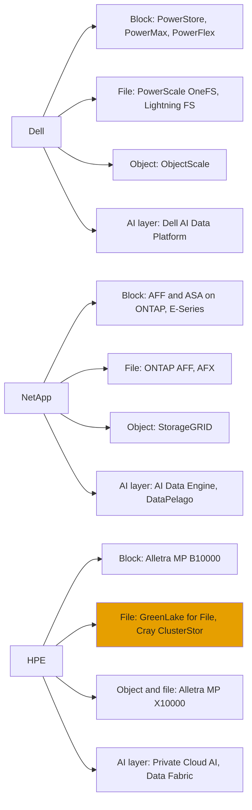
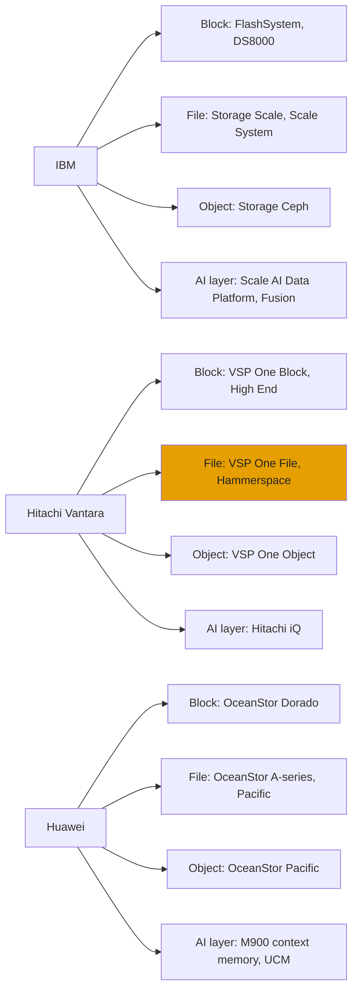
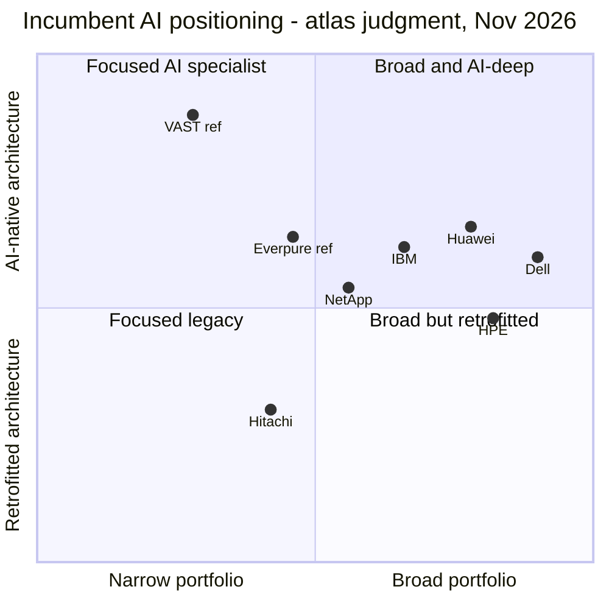
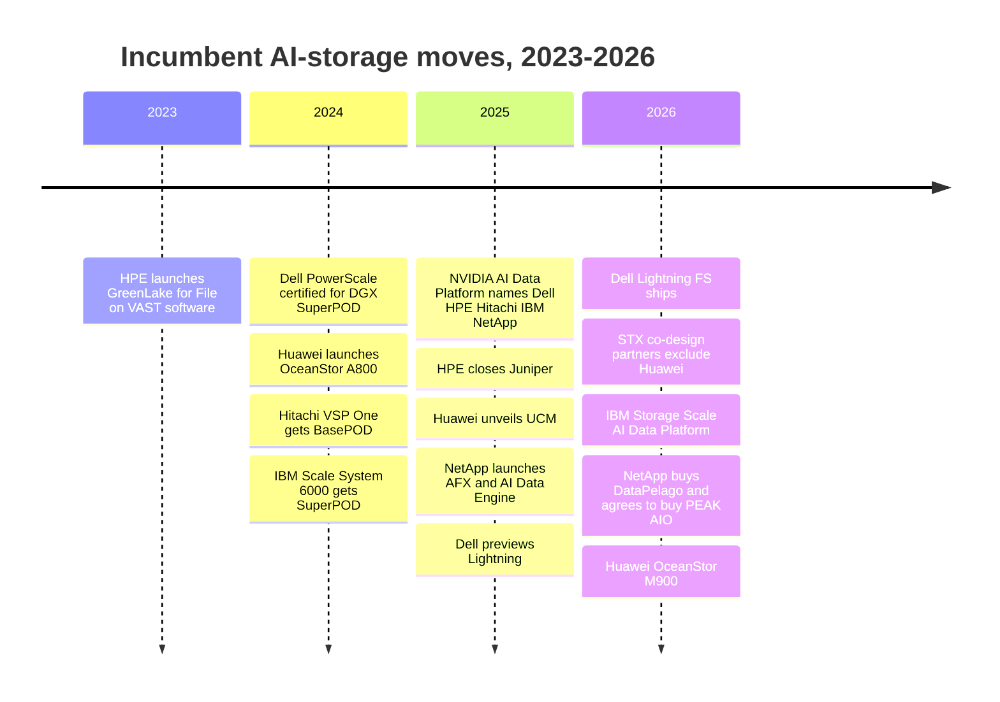

# 46. Incumbents

> **Depth:** L2 · **Reading time:** ~15 min · **Last verified:** 2026-11-01
> **Prerequisites:** [Market structure](40-market-structure.md) · [Scale-up dual-controller arrays](../03-system-architecture/14-scale-up-dual-controller.md) · [Disaggregated shared-everything](../03-system-architecture/16-disaggregated-shared-everything.md) · [Parallel file systems](../03-system-architecture/17-parallel-file-systems.md) · [The NVIDIA ecosystem](../05-ai-storage/34-nvidia-ecosystem.md)

## TL;DR

- **Six incumbents still hold most of the external storage market.** In IDC's 2Q26 count, Dell (23.8%), Huawei (11.3%), NetApp (9.6%) and HPE (6.8%) together held about 51%, with Everpure fourth at 8.1%[^1]. IBM and Hitachi Vantara are outside the top five.
- **Every incumbent is retrofitting AI onto an enterprise-era core.** Dell, NetApp and HPE built new systems (Lightning FS, AFX, X10000). HPE and Hitachi lean on partners (VAST, Hammerspace). NetApp bought software (DataPelago, PEAK:AIO). Huawei built an NVIDIA-free stack.
- **Their real weapons are commercial, not architectural:** installed base, channel, bundling with servers and networking, captive financing and, for Huawei, sovereign demand. Dell and HPE (now with Juniper) can fold storage into an AI-factory purchase order.
- **Their weaknesses are specific.** Dell runs five-plus storage operating systems. NetApp's WAFL core dates from the early 1990s and AFX is first-generation. HPE's AI file depends on VAST. IBM's AI strength rests on one product. Hitachi is block-heavy. Huawei is shut out of the US.
- **Against Everpure, the threat ranking is roughly Dell > NetApp > HPE > Huawei (outside the US) > IBM > Hitachi.** This is the atlas's judgment: Dell wins on bundling, NetApp on unified file and installed base, the rest in niches.

## Why this matters for Everpure strategy

The AI-storage debate centres on VAST, WEKA and DDN ([Chapter 42](42-vast-data.md)–[Chapter 44](44-ddn.md)), but most of Everpure's revenue is won from or lost to incumbents, whose arrays Pure Storage displaced for a decade. In the quarter to June 2026 it was the fastest grower in IDC's top five, at about +50% year on year[^1]. The next leg depends on enterprise AI bought by the CIOs who own today's arrays. There the incumbent is already in the room, often holding the server order too.

Strategy teams should treat each incumbent as a bundle of three assets. The first is an **installed base**, which sets refresh timing and switching costs. The second is a **route to market**: direct sales, channel, OEM, or a server attach. The third is an **AI architecture**, which decides whether the incumbent can keep the AI workload or must cede it to a specialist. Each profile below uses the same sub-structure so they compare line by line.

## Core concepts

### The incumbent playbook and the AI problem

An incumbent's moat is mostly commercial. Customers standardise on a vendor's tools, replication and support contracts, and resellers earn margin on the full stack. When the vendor also sells servers, it can price storage as an attachment rather than a standalone purchase. Captive finance arms (Dell Financial Services, HPE Financial Services, IBM Financing) turn capex into monthly payments. That competes directly with Everpure's Evergreen//One subscription ([Chapter 23](../03-system-architecture/23-consumption-models.md)).

The AI problem is architectural. Incumbent flagships were designed in the 1990s–2010s for transactional block I/O and enterprise NAS. They are usually [dual-controller, scale-up arrays](../03-system-architecture/14-scale-up-dual-controller.md) or [shared-nothing scale-out NAS](../03-system-architecture/15-scale-out-shared-nothing.md). AI training and inference need terabytes per second of parallel throughput, metadata at billions of files, GPU-direct data paths and, now, a [KV-cache tier](../05-ai-storage/32-inference-and-kv-cache.md). Incumbents can respond in four ways, and most use more than one:

1. **Build** a new disaggregated or parallel system beside the legacy core.
2. **Partner** with an AI-native specialist and resell or embed its software.
3. **Acquire** a start-up for a capability.
4. **Certify**, using NVIDIA's DGX SuperPOD, NVIDIA-Certified Storage and STX programmes as a credibility shortcut ([Chapter 34](../05-ai-storage/34-nvidia-ecosystem.md)).

All except Huawei were named NVIDIA STX co-design partners in March 2026[^2].

**Semiconductor bridge.** Incumbents resemble integrated device makers when fabless-plus-foundry took off: their fabs (installed base, field sales) stay valuable, but their process (architecture) trails the specialist, so they license IP or partner while protecting legacy margin.

| Incumbent | Architectures shipped (Part 3) | Flagship AI offering, 2025–26 | Business model and scale | Key strength | Key weakness |
|---|---|---|---|---|---|
| **Dell** | Scale-up block, SDS block, shared-nothing NAS, parallel FS, object | AI Data Platform: PowerScale + Lightning FS + ObjectScale | Storage $16.6B in FY26, inside ISG; server attach | Server + storage bundle, #1 share | Five-plus storage OSes; storage flat in FY26 |
| **NetApp** | Scale-up unified (ONTAP), disaggregated (AFX), object, parallel FS via E-Series | AFX + AI Data Engine; DataPelago, PEAK:AIO deals | Pure-play, $6.9B FY26 revenue, cloud services | One OS across on-prem and three hyperscalers | ONTAP core age; AFX first-generation |
| **HPE** | Disaggregated block (B10000), disaggregated object/file (X10000), Lustre (Cray), VAST-based file | X10000 KV-cache offload; Private Cloud AI | Storage ~$1.3B/quarter inside Cloud & AI; GreenLake | Servers + Juniper networking + GreenLake | File depends on VAST; storage growth lags servers |
| **IBM** | Scale-up block (FlashSystem), parallel FS (Storage Scale), SDS object (Ceph) | Storage Scale AI Data Platform, content-aware storage | Storage not disclosed; inside Infrastructure | Storage Scale at HPC/AI scale; mainframe estate | Narrow AI footprint; weak mid-market reach |
| **Hitachi Vantara** | Scale-up block (VSP One), NAS, object | Hitachi iQ with NVIDIA; planned STX support | Not disclosed; storage +45% in Q1 FY26 | High-end block reliability; Japan | Thin scale-out file for AI; partner reliance |
| **Huawei** | Scale-up block (Dorado), scale-out AI (A-series), distributed file/object (Pacific) | OceanStor A800, M900 context memory, UCM | Not disclosed; IDC #2 at 11.3% | China and sovereign markets; vertical stack | US Entity List; no NVIDIA programme |

*Figure 46.1 — Profile summary: every incumbent now ships at least one AI-oriented architecture, but only Dell, NetApp, HPE and Huawei built a new one themselves; sources in the profiles below.*

*Figure 46.2 — Portfolio map, US incumbents: Dell and NetApp own every layer, while HPE's mainstream file product (orange) runs partner VAST software.*

*Figure 46.3 — Portfolio map, IBM, Hitachi Vantara and Huawei: IBM's AI weight sits on one product, Storage Scale; Hitachi borrows its AI-scale file namespace from a partner.*

### Dell Technologies

**Architecture.** Dell has the broadest portfolio, much of it inherited from EMC. PowerStore and PowerMax are [scale-up block arrays](../03-system-architecture/14-scale-up-dual-controller.md). PowerFlex is [software-defined block](../03-system-architecture/19-software-defined-and-hci.md). PowerScale (OneFS, ex-Isilon) is a [shared-nothing scale-out NAS](../03-system-architecture/15-scale-out-shared-nothing.md). ObjectScale is [object storage](../03-system-architecture/18-object-storage-architecture.md). The new piece is the **Lightning File System**, previewed as Project Lightning: a [parallel file system](../03-system-architecture/17-parallel-file-systems.md) built on OneFS foundations, with a client that stripes I/O across nodes[^3][^4].

**AI strategy.** In 2024 Dell said PowerScale was the first Ethernet storage certified for DGX SuperPOD[^5]. At GTC 2026 it recast the Dell AI Data Platform as three storage engines on common hardware: PowerScale for file, Lightning for parallel "Tier 0" file and ObjectScale for object. Dell claims Lightning delivers 2x the throughput of competing parallel file systems and up to 150 GB/s per rack unit (vendor claim)[^6]. Exascale Storage for Dell PowerRack is slated for 2H 2026, with a PowerFlex-inclusive version in 1H 2027[^4].

**Business model.** Storage is a line inside the Infrastructure Solutions Group (ISG). In FY26 (ended 2026-01-30), storage revenue was $16.63B, up 1%, while ISG grew 40% to $60.8B on AI servers[^7]. Storage therefore fell to about 27% of ISG (16.63 ÷ 60.8), from roughly 38% a year earlier (16.46 ÷ 43.4, with prior-year ISG derived from the 40% growth). In Q2 FY27 (May–July 2026) storage was $4.85B, up 26%, and Dell guided full-year storage up mid-teens. Dell-IP products are a rising share of the mix[^8].

**Strengths.** Dell has the largest share (23.8% in 2Q26[^1]), an enormous channel, and AI servers it can attach storage to. Its Future-Proof Program bundles guarantees and upgrade options positioned against Evergreen[^9].

**Weaknesses.** Dell runs five or more storage operating systems with separate management and replication. Flat FY26 storage, while Everpure grew 16%, shows the franchise underperformed before AI demand and NAND-driven price rises arrived. Lightning's scale and customer base are not yet public.

**Against Everpure.** Dell is the most frequent opponent in block (PowerStore against FlashArray) and file/AI (PowerScale and Lightning against FlashBlade), and can quote GPUs, networking, storage and services on one purchase order. The rivalry has history: Pure Storage settled EMC's patent litigation in 2016[^10].

### NetApp

**Architecture.** NetApp is a storage pure-play built on one OS, ONTAP, which rests on the WAFL file system, first published in 1994[^11], and runs as HA pairs ([Chapter 14](../03-system-architecture/14-scale-up-dual-controller.md)) clustered into a scale-out namespace. AFF and ASA serve file and block, StorageGRID object, and E-Series with BeeGFS parallel HPC. In October 2025 NetApp launched **AFX**, a disaggregated ONTAP system in which AFX 1K controllers share NVMe enclosures over a fabric, so performance and capacity scale independently. An optional DX50 data-compute node hosts GPU work ([Chapter 16](../03-system-architecture/16-disaggregated-shared-everything.md))[^12].

**AI strategy.** First, the AI Data Engine (AIDE) adds metadata indexing, vectorisation and guardrail services to ONTAP, integrated with NVIDIA's AI Data Platform; launch coverage expected GA in calendar 1Q26[^13]. Second, acquisitions: NetApp bought DataPelago (a GPU-accelerated data-processing engine, price undisclosed) on 2026-07-16[^14], and in September 2026 announced its intent to buy PEAK:AIO, a maker of high-performance AI storage software[^15]. The AFF A90 was validated for DGX SuperPOD and NVIDIA Cloud Partner designs in March 2025[^16].

**Business model.** FY26 (ended April 2026) revenue was $6.93B (+5%), with all-flash arrays at $4.2B (+11%) and free cash flow of $1.87B[^17]. Q1 FY27 (to 2026-07-31) revenue was $2.03B (+30%, a 14-week quarter), with all-flash about $1.31B (+47%) and public cloud $206M. Full-year FY27 guidance is $7.975–8.225B[^18].

**Strengths.** NetApp's unique asset is ONTAP running as a first-party service inside all three hyperscalers, which gives true hybrid file. Add a huge NAS installed base and mature data-management features.

**Weaknesses.** ONTAP's write path and HA-pair design date from a pre-flash era. AFX is a first-generation product with little public field evidence. Two AI acquisitions in three months suggest NetApp is buying capability it did not build.

**Against Everpure.** NetApp is Everpure's closest like-for-like rival: a storage pure-play selling unified block/file, subscriptions (Keystone against Evergreen//One) and AI data services. AFX against FlashBlade//EXA is the cleanest head-to-head in disaggregated AI storage.

### Hewlett Packard Enterprise (HPE)

**Architecture.** HPE has consolidated onto **Alletra Storage MP**, a common hardware platform with two personalities. The B10000 runs block (3PAR/Primera lineage) and now scales out to six nodes[^19]. The X10000 is a disaggregated object store with native NFS, scaling to 16 compute and 16 storage nodes and 23 PB raw[^20]. File for enterprise AI came first from **GreenLake for File Storage**, VAST Data software on Alletra MP hardware (2023)[^21]. Cray ClusterStor serves Lustre; Nimble arrived by acquisition in 2017[^22].

**AI strategy.** HPE describes the X10000 as the first object platform to earn NVIDIA-Certified Storage (Foundation level)[^23]. A sponsored validation of X10000 KV-cache offload on H200 GPUs reported up to 20x faster time-to-first-token than no offload (partner content, not independent)[^24]. HPE closed its ~$14B Juniper acquisition on 2025-07-02, which adds data-centre and AI networking to the bundle[^25].

**Business model.** In FY25 (ended October 2025) the Hybrid Cloud segment, which held storage and GreenLake private cloud, had revenue of $5.75B (+4.9%). Its gross profit fell 2.5% as HPE moved to the software-defined Alletra platform[^26]. From FY26 storage is reported within Cloud & AI: Q3 FY26 storage was about $1.3B (+10.2%) against servers up 35%, with Alletra MP orders up strong double digits[^27]. HPE was named a Leader in Gartner's 2026 Magic Quadrant for Enterprise Storage Platforms[^28].

**Strengths.** Compute, networking and storage on one GreenLake contract with financing; a credible disaggregated platform; Cray/HPC heritage and public-sector reach.

**Weaknesses.** HPE depends on a partner for high-end AI file, and that partner competes with it in neoclouds. X10000 native file now overlaps GreenLake for File [VERIFY: whether GreenLake for File (VAST) is still actively sold in 2026]. Storage growth lags HPE's server growth by roughly 25 points, and HPE's share (6.8%) trails Everpure's[^1].

**Against Everpure.** HPE shows up in mid-range block refreshes, especially where GreenLake or HPE servers are already standard, and in sovereign and HPC AI deals.

### IBM

**Architecture.** IBM's AI weight sits on **Storage Scale** (ex-GPFS), a [shared-disk parallel file system](../03-system-architecture/17-parallel-file-systems.md) sold as software or as Storage Scale System appliances. Beside it are FlashSystem scale-up block arrays, which use IBM's own FlashCore Modules. A 2026 generation added 105 TB modules[^29], making these the closest analogue to Everpure's DirectFlash. IBM Storage Ceph provides software-defined object and block, after Red Hat's Ceph team moved to IBM in 2022[^30]. IBM Fusion packages storage for OpenShift.

**AI strategy.** The Storage Scale System 6000 was certified for DGX SuperPOD in 2024[^31]. Storage Scale 6.0.1 and Storage Scale System 7.0.1 (GA June 2026) fold in content-aware storage, which embeds and indexes data inside the file system, as the "Storage Scale AI Data Platform". IBM says it is certified for BasePOD, SuperPOD and NVIDIA Cloud Partner reference architectures[^32]. IBM added S3 over RDMA[^33] and demonstrated a 100-billion-vector database[^34].

**Business model.** IBM does not disclose storage revenue. Storage sits in Distributed Infrastructure within the Infrastructure segment. Infrastructure grew 12% in 2025 on the z17 mainframe cycle, but Distributed Infrastructure was only +3% in Q4[^35].

**Strengths.** Storage Scale has a long record at exabyte HPC scale. IBM has deep financial-services and mainframe accounts, custom flash modules, and Red Hat/OpenShift integration.

**Weaknesses.** IBM's AI strength is narrow: one parallel file system with an HPC-grade operational burden. Mid-market and channel reach are limited, and storage is an opaque line in a software-and-consulting company.

**Against Everpure.** IBM meets Everpure with FlashSystem in regulated enterprises and Storage Scale in large training and research clusters, rarely across the portfolio.

### Hitachi Vantara

**Architecture.** Hitachi's core is high-end and mid-range **[scale-up block](../03-system-architecture/14-scale-up-dual-controller.md)** under the VSP One brand, plus VSP One File and VSP One Object. VSP One Block High End launched in late 2025 for mission-critical and AI workloads[^36].

**AI strategy.** Hitachi's AI offer is **Hitachi iQ**, a full-stack NVIDIA-based AI platform. VSP One earned DGX BasePOD certification in 2024[^37]. In March 2026 Hitachi expanded iQ with agent blueprints and said it will support NVIDIA STX. Scale-out AI file comes partly through **Hammerspace**, which orchestrates data that VSP One holds[^38].

**Business model.** Hitachi Vantara is a subsidiary of Hitachi Ltd. and does not publish storage revenue. It reported revenue up 12% and storage revenue up 45% (block +49%) in Q1 FY2026 (April–June 2026)[^39].

**Strengths.** High-end block reliability, mainframe connectivity and a strong Japanese and Asia-Pacific base.

**Weaknesses.** It has no home-grown scale-out file system at AI scale and relies on partners for the AI data layer. Share outside Japan is low, and Hitachi is absent from IDC's top five.

**Against Everpure.** Hitachi meets Everpure mainly in high-end block consolidation and mainframe-adjacent estates. It is rarely in AI-factory file deals.

### Huawei

**Architecture.** Huawei sells a complete, vertically integrated range. OceanStor Dorado is all-flash block/unified scale-up. The OceanStor **A-series** is AI storage: the A800 scales to 512 controllers and more than 1 EB, with a claimed 500 GB/s per controller enclosure[^40]. OceanStor Pacific is distributed scale-out file and object. The A800 has replaced the retiring A600 as flagship[^41]. In September 2026 Huawei added the **OceanStor M900** context-memory system, which it says provides up to 64 PB of shared KV cache and 40 TB/s per SuperPod cluster (vendor claims)[^42].

**AI strategy.** Huawei pairs its storage with its own Ascend accelerators. It released **Unified Cache Manager (UCM)**, KV-cache tiering software intended to reduce dependence on scarce HBM, in August 2025 and said it would open-source it[^43]. Huawei is outside NVIDIA's STX programme[^2].

**Business model.** Huawei is privately held. Revenue in 2025 was CNY 880.9B (+2.2%)[^44], with storage inside ICT infrastructure, which reported CNY 375.0B [VERIFY: search-summary only][^45]. IDC ranks Huawei #2 in external storage (11.3% in 2Q26)[^1].

**Strengths.** A home market where US vendors are excluded from many accounts, plus sovereign-AI buyers in the Middle East, Southeast Asia, Latin America and Africa. Its stack is vertically integrated, from SSDs to accelerators, and its pricing is aggressive.

**Weaknesses.** Huawei has been on the US Entity List since May 2019[^46]. That restricts its access to US technology and makes it unsellable to many Western regulated buyers. It has no NVIDIA certification path, and its claims are rarely independently benchmarked.

**Against Everpure.** Huawei rarely meets Everpure in the US. It matters in EMEA, APJ and sovereign deals, and as proof that a full AI-storage stack can be built without NVIDIA.

### What the revenue numbers do and don't say

Only four companies disclose a storage-relevant line, each defined differently. The chart aligns them on the fiscal quarter ending July or early August 2026.

*Figure 46.4 — In the quarter to mid-2026 every disclosing vendor grew, but HPE's storage grew at a third of the others' pace; company-reported lines are roughly 1.5–2x what IDC's external-storage shares imply.*
Data: `data/ch46_storage_revenue.csv`

Work the IDC arithmetic to see the definitional gap. IDC sized 2Q26 external storage at $10.3B[^1]:

- Dell: 23.8% × $10.3B ≈ **$2.45B**, against $4.85B reported for a quarter offset by one month.
- HPE: 6.8% ≈ **$0.70B** against $1.29B.
- Everpure: 8.1% ≈ **$0.83B** against $1.19B. Everpure's total includes about $0.5B of subscription services[^47].

Company lines include maintenance, services, software and (for Dell) data-protection appliances; IDC counts external systems. The same method gives Huawei about $1.16B a quarter, or roughly $4.6B annualised (estimate, ×4). In external systems that is larger than NetApp's $0.99B (9.6%). Use IDC for share and filings for growth and margin; never mix them in one ratio.

### Positioning: breadth versus AI-native depth

*Figure 46.5 — Atlas judgment, not measured data: Dell and Huawei combine the broadest portfolios with credible home-grown AI systems, HPE's breadth outruns its own AI architecture, and no incumbent matches a specialist like VAST on AI-native depth.*

The x-axis scores the range of block, file, object, data-protection, compute and networking products sold under one contract. The y-axis scores how much of the AI data path runs on architecture the vendor owns and designed for AI. (parallel or disaggregated data paths, GPU-direct I/O, KV-cache tiers, in-storage data services). Partner-sourced capability is discounted, which is why HPE and Hitachi score below their catalogues.

## How Everpure approaches it vs. competitors

Everpure's pitch has been stable since the Pure Storage era: one OS (Purity) across FlashArray and FlashBlade, its own DirectFlash modules, Evergreen non-disruptive upgrades, and Fusion/Pure1 management ([Chapter 28](../04-everpure/28-platform-and-software.md)). The table sets it against each incumbent's best argument.

| Incumbent | Typical deal where it meets Everpure | Incumbent's best argument (steelman) | Everpure's counter | Where Everpure is exposed |
|---|---|---|---|---|
| Dell | Enterprise block refresh; AI factory with Dell servers | One vendor for GPUs, network, storage, services and financing; installed base | One OS vs five-plus; Evergreen upgrades; DirectFlash density and power | Cannot bundle servers; smaller field force |
| NetApp | Unified NAS consolidation; hybrid cloud file | ONTAP everywhere, including native in AWS, Azure and Google Cloud | Simpler operations; FlashBlade//EXA vs first-generation AFX | Cloud-native file presence weaker than ONTAP's |
| HPE | Mid-range block; GreenLake-standardised accounts; sovereign | Compute + Juniper networking + GreenLake, one contract | Mature subscription (Evergreen//One); own AI file system, not a partner's | Sovereign and HPC relationships |
| IBM | Regulated-industry block; research clusters | Storage Scale scale record; mainframe and Red Hat integration | Broader enterprise AI portfolio; simpler operations | Large-scale parallel FS heritage |
| Hitachi Vantara | High-end block consolidation | Reliability guarantees; mainframe; Japan relationships | Density, power and upgrade model | High-end mainframe-attached block |
| Huawei | EMEA, APJ, sovereign tenders | Price, full-stack China supply chain, financing | Trust, compliance, NVIDIA ecosystem | Price-led and sovereign deals |

*Figure 46.6 — Where each incumbent meets Everpure: incumbents mostly win on the commercial bundle, and Everpure mostly wins on architecture and operating model.*

Two implications follow. Server-attached bundling (Dell, HPE) is the hardest weapon to copy; Everpure's options are server and network partnerships, such as its NVIDIA and Cisco reference designs ([Chapter 34](../05-ai-storage/34-nvidia-ecosystem.md)), or making storage a separate consumption purchase. And incumbents' reliance on partners and acquisitions shows what AI-native IP is worth, which bears on Everpure's own build/buy/partner map ([Chapter 54](../07-history-and-future/54-strategic-option-map.md)).

## History and trajectory

*Figure 46.7 — Incumbents moved from certifying existing arrays (2024) to shipping new disaggregated and parallel architectures and buying AI software (2025–26).*

NVIDIA's 2025 AI Data Platform launch named Dell, HPE, Hitachi Vantara, IBM and NetApp alongside Pure Storage, VAST and WEKA[^48]. Within a year three incumbents shipped new architectures (Lightning, AFX, X10000). Three trends to watch:

1. **KV-cache tiers.** Huawei's M900 and HPE's X10000 offload work show incumbents now competing in [inference context memory](../05-ai-storage/32-inference-and-kv-cache.md), not only training throughput.
2. **Consolidation.** Expect more incumbent purchases of AI data software, following NetApp's two deals.
3. **The pricing cycle.** Memory and NAND contract prices kept rising through 2026[^trend]. Part of the growth in Figure 46.4 is likely price, not share ([Chapter 48](48-media-suppliers-and-nand-cycle.md)).

## Numbers that matter

| Metric | Value | Context | Source / date |
|---|---|---|---|
| IDC external storage, 2Q26 | $10.3B, +33.6% YoY | Dell 23.8%, Huawei 11.3%, NetApp 9.6%, Everpure 8.1%, HPE 6.8% | IDC via StorageReview, 2026-09[^1] |
| Dell storage revenue, FY26 | $16.63B, +1% | ISG $60.8B, +40%, on AI servers | Dell, 2026-02-26[^7] |
| Dell storage, Q2 FY27 | $4.85B, +26% | Full-year storage guided up mid-teens | Dell, 2026-08[^8] |
| NetApp revenue, FY26 | $6.93B, +5% | All-flash $4.2B, +11% | NetApp, 2026-05-28[^17] |
| NetApp revenue, Q1 FY27 | $2.03B, +30% | 14-week quarter; FY27 guide $7.975–8.225B | NetApp, 2026-09-02[^18] |
| HPE storage, Q3 FY26 | ~$1.3B, +10.2% | Servers +35% in the same quarter | HPE 8-K, 2026-09-02[^27] |
| Hitachi Vantara storage growth, Q1 FY2026 | +45% | Block +49% | Hitachi Vantara, 2026-08-12[^39] |
| Huawei external-storage revenue, implied | ~$1.16B/quarter | 11.3% × $10.3B; Huawei does not disclose | Worked example from IDC[^1] |
| HPE X10000 maximum scale | 16 + 16 nodes, 23 PB raw | Disaggregated object with native NFS | Blocks & Files, 2026-05-12[^20] |
| Everpure revenue, Q2 FY27 | $1.19B, +38% | FY27 guide $5.03–5.07B | Everpure, 2026-08-26[^47] |

## Conversation playbook

**Questions for a PM**

1. *"In AI-factory deals where Dell supplies the GPU servers, what is our win rate, and what changes it?"* A strong answer segments by who controls the purchase order (CIO, AI team, neocloud), names levers (NVIDIA reference designs, Evergreen//One pricing, power per petabyte) and says where Everpure walks away.
2. *"How do we position FlashBlade//EXA against NetApp AFX?"* A strong answer contrasts metadata/data separation with shared-media ONTAP, cites MLPerf or customer evidence, and concedes ONTAP's hybrid-cloud advantage rather than denying it.
3. *"Where does HPE's dependence on VAST help or hurt us?"* A strong answer grants that HPE+VAST is formidable in sovereign and HPC accounts, but notes the X10000/GreenLake for File overlap can confuse HPE's sales motion.

**Questions for an engineer**

1. *"What would it take for Dell Lightning FS to match FlashBlade//EXA's metadata scale?"* A strong answer asks whether Lightning's metadata is distributed or centralised, what OneFS heritage implies for small files, and separates vendor-claimed GB/s per rack unit from audited results.
2. *"How does IBM FlashCore compare with DirectFlash?"* A strong answer notes both are custom modules, then compares where compression and flash translation run (in the module for FlashCore, in Purity for DirectFlash) and the capacity roadmaps.
3. *"Is a KV-cache tier on X10000 or M900 the same product category as PureKVA?"* A strong answer compares data paths (NIXL, GDS, RDMA), shared namespace versus separate appliance, and flags that both rivals' claims are vendor or sponsored.

**Don't say this:**

- *"Incumbents can't do AI."* All six have AI-certified or AI-specific systems, and Dell, NetApp and HPE shipped new architectures in 2025–26.
- *"Dell's storage business is shrinking."* It was flat in FY26 and grew 26% in Q2 FY27.
- *"HPE sells VAST."* It sells GreenLake for File on VAST software, and its own X10000 with native file.
- *"Huawei isn't a competitor."* It is #2 worldwide by IDC's count, just absent from US deals.
- Comparing IDC share percentages directly with company-reported storage revenue.

## Going deeper (optional, L3 pointers)

- Dell Lightning FS spec sheet and OneFS technical overviews (Dell InfoHub).
- NetApp AFX technical reports and AIDE architecture docs (docs.netapp.com).
- IBM's GPFS paper (Schmuck and Haskin, FAST 2002) with the Storage Scale 6.0.1 release blog.
- Blocks & Files' X10000 architecture analysis (February 2025).

## Key terms

- **ISG (Infrastructure Solutions Group)** — Dell's segment containing servers, networking and storage.
- **Lightning File System** — Dell's parallel file system, formerly Project Lightning.
- **AFX** — NetApp's disaggregated ONTAP all-flash system.
- **GreenLake for File Storage** — HPE's file service built on VAST Data software.
- **FlashCore Module** — IBM's custom flash module with in-module compression.
- **OceanStor A-series** — Huawei's AI-oriented scale-out storage line.
- **Unified Cache Manager (UCM)** — Huawei's KV-cache tiering software.
- **Server attach** — selling storage as part of a server-led purchase.
- See the [glossary](../glossary.md) for the rest.

## Sources

[^1]: StorageReview, "IDC External Storage Tracker: $10.3 Billion in Q2 2026 as Server Market Tops $166 Billion on AI Demand," 2026-09. https://www.storagereview.com/news/idc-external-storage-tracker-q2-2026-10-3-billion-as-server-market-tops-166-billion ; Blocks & Files, "IDC's latest enterprise storage tracker shows booming storage market growth," 2026-09-23. https://www.blocksandfiles.com/flash/2026/09/23/idcs-latest-enterprise-storage-tracker-shows-booming-storage-market-growth/5298577 (both retrieved 2026-11-01).
[^2]: StorageNewsletter, "Nvidia GTC 2026: Nvidia Launches BlueField-4 STX Storage Architecture With Broad Industry Adoption," 2026-03-17. https://www.storagenewsletter.com/2026/03/17/nvidia-gtc-2026-nvidia-launches-bluefield-4-stx-storage-architecture-with-broad-industry-adoption/ (retrieved 2026-11-01).
[^3]: Blocks & Files, "Dell PowerScale gets struck by Lightning and goes parallel," 2025-11-17. https://www.blocksandfiles.com/ai-ml/2025/11/17/dell-powerscale-gets-struck-by-lightning-and-goes-parallel/1711291 (retrieved 2026-11-01).
[^4]: NAND Research, "Dell Technologies AI Data Platform and storage portfolio for the agentic enterprise," 2026. https://nand-research.com/dell-technologies-ai-data-platform-and-storage-portfolio-for-the-agentic-enterprise/ (retrieved 2026-11-01).
[^5]: Dell Technologies, "PowerScale: World's First Ethernet Storage Certified on NVIDIA SuperPOD," 2024-03. https://www.dell.com/fr-ca/blog/powerscale-worlds-first-ethernet-storage-certified-on-nvidia-superpod/ (retrieved 2026-11-01).
[^6]: Dell Technologies, "Dell AI Data Platform with NVIDIA Supercharges Enterprise AI with Breakthrough Data Orchestration and Storage Innovations," 2026-03-16. https://www.dell.com/en-us/dt/corporate/newsroom/announcements/detailpage.press-releases~usa~2026~03~dell-ai-data-platform-with-nvidia-supercharges-enterprise-ai-with-breakthrough-data-orchestration-and-storage-innovations.htm (retrieved 2026-11-01).
[^7]: Dell Technologies (Business Wire), "Dell Technologies Delivers Fourth Quarter and Full Year Fiscal 2026 Results," 2026-02-26. https://www.businesswire.com/news/home/20260226276981/en/Dell-Technologies-Delivers-Fourth-Quarter-and-Full-Year-Fiscal-2026-Results (retrieved 2026-11-01).
[^8]: StorageNewsletter, "Dell Technologies: Fiscal 2Q27 Financial Results," 2026-09-03. https://www.storagenewsletter.com/2026/09/03/dell-technologies-fiscal-2q27-financial-results/ ; Dell Technologies, "Record Results Reflect Compounding Advantages," 2026-08. https://www.dell.com/en-us/blog/record-results-reflect-compounding-advantages/ (both retrieved 2026-11-01).
[^9]: Dell Technologies, "Future-Proof Program," n.d. https://www.dell.com/en-uk/dt/products/future-proof-program.htm (retrieved 2026-11-01).
[^10]: SEC, "Pure Storage, Inc. Form 8-K (settlement with Dell/EMC)," 2016-10. https://www.sec.gov/Archives/edgar/data/1474432/000119312516741316/d275548d8k.htm (retrieved 2026-11-01).
[^11]: D. Hitz, J. Lau and M. Malcolm (NetApp), "File System Design for an NFS File Server Appliance," USENIX Winter 1994 Technical Conference, 1994-01. https://www.usenix.org/conference/usenix-winter-1994-technical-conference/file-system-design-nfs-file-server-appliance (retrieved 2026-11-01).
[^12]: Blocks & Files, "NetApp disaggregates ONTAP storage and provides an AI Data Engine," 2025-10-14. https://blocksandfiles.com/2025/10/14/netapp-disaggregates-ontap-storage-and-provides-an-ai-data-engine/ (retrieved 2026-11-01).
[^13]: TechTarget, "NetApp adds AI Data Engine, expands Nvidia partnership," 2025-10. https://www.techtarget.com/searchstorage/news/366632757/NetApp-adds-AI-Data-Engine-expands-Nvidia-partnership (retrieved 2026-11-01).
[^14]: NetApp, "NetApp Acquires DataPelago, Making Data AI-Ready at the Infrastructure Layer," 2026-07-16. https://www.netapp.com/en/newsroom/press-releases/news-rel-20260716-210092/ (retrieved 2026-11-01).
[^15]: NetApp, "NetApp Announces Intent to Acquire PEAK:AIO to Advance Scalable AI Infrastructure Architecture," 2026-09-25. https://s21.q4cdn.com/371534297/files/doc_news/NetApp-Announces-Intent-to-Acquire-PEAKAIO-to-Advance-Scalable-AI-Infrastructure-Architecture-2026.pdf (retrieved 2026-11-01).
[^16]: HPCwire/BigDATAwire, "NetApp Validated for NVIDIA DGX SuperPOD, Cloud Partners and Certified Systems," 2025-03-18. https://www.hpcwire.com/bigdatawire/this-just-in/netapp-validated-for-nvidia-dgx-superpod-cloud-partners-and-certified-systems/ (retrieved 2026-11-01).
[^17]: NetApp (Business Wire), "NetApp Reports Fourth Quarter and Fiscal Year 2026 Results," 2026-05-28. https://www.businesswire.com/news/home/20260528348500/en/NetApp-Reports-Fourth-Quarter-and-Fiscal-Year-2026-Results (retrieved 2026-11-01).
[^18]: NetApp, "NetApp Reports First Quarter of Fiscal Year 2027 Results," 2026-09-02. https://netapp.com/newsroom/press-releases/news-rel-20260902-results-607632 ; MarketBeat, "NetApp Q1 earnings call highlights," 2026-09-02. https://www.marketbeat.com/instant-alerts/transcript-netapp-q1-earnings-call-highlights-2026-09-02/ (both retrieved 2026-11-01).
[^19]: StorageReview, "HPE Alletra Storage MP B10000 10.6.0 arrives with six-node scale-out and agentic support automation," n.d. https://storagereview.com/news/hpe-alletra-storage-mp-b10000-10-6-0-arrives-with-six-node-scale-out-and-agentic-support-automation (retrieved 2026-11-01).
[^20]: Blocks & Files, "HPE updates Alletras X and B10000, Zerto and Data Fabric in GreenLake private cloud update blast," 2026-05-12. https://www.blocksandfiles.com/file/2026/05/12/hpe-updates-alletras-x-and-b10000-zerto-and-data-fabric-in-greenlake-private-cloud-update-blast/5239011 (retrieved 2026-11-01).
[^21]: HPCwire, "HPE taps VAST Data for fast file storage on GreenLake," 2023-04-04. https://www.hpcwire.com/2023/04/04/hpe-taps-vast-data-for-fast-file-storage-on-greenlake/ (retrieved 2026-11-01).
[^22]: HPE, "HPE Completes Acquisition of Nimble Storage," 2017-04-17. https://www.hpe.com/us/en/newsroom/press-release/2017/04/hpe-completes-acquisition-of-nimble-storage.html (retrieved 2026-11-01).
[^23]: HPE Newsroom, "HPE accelerates secure, scalable production-ready AI through new innovations with NVIDIA," 2026-03-16. https://www.hpe.com/us/en/newsroom/press-release/2026/03/hpe-accelerates-secure-scalable-production-ready-ai-through-new-innovations-with-nvidia.html (retrieved 2026-11-01).
[^24]: Blocks & Files (Partner Content), "HPE puts storage to work on AI's expensive memory problem," 2026-10-29. https://www.blocksandfiles.com/ai-ml/2026/10/29/partner-content-hpe-puts-storage-to-work-on-ais-expensive-memory-problem/5305788 (retrieved 2026-11-01).
[^25]: HPE Newsroom, "Hewlett Packard Enterprise closes acquisition of Juniper Networks to offer industry-leading comprehensive, cloud-native, AI-driven portfolio," 2025-07. https://www.hpe.com/us/en/newsroom/press-release/2025/07/hewlett-packard-enterprise-closes-acquisition-of-juniper-networks-to-offer-industry-leading-comprehensive-cloud-native-ai-driven-portfolio.html (retrieved 2026-11-01).
[^26]: SEC, "Hewlett Packard Enterprise Co. Form 10-K for fiscal year ended October 31, 2025," 2025-12. https://www.sec.gov/Archives/edgar/data/1645590/000164559025000130/hpe-20251031.htm (retrieved 2026-11-01).
[^27]: SEC, "Hewlett Packard Enterprise Co. Form 8-K, Exhibit 99.1 (fiscal 2026 third quarter results)," 2026-09-02. https://www.sec.gov/Archives/edgar/data/0001645590/000164559026000078/ex-991x922026x8k.htm ; Constellation Research, "HPE delivers strong Q3, ups fiscal 2026 outlook due to AI demand," 2026-09. https://www.constellationr.com/insights/news/hpe-delivers-strong-q3-ups-fiscal-2026-outlook-due-ai-demand (both retrieved 2026-11-01).
[^28]: HPE Newsroom, "HPE named a Leader in 2026 Gartner Magic Quadrant for Enterprise Storage Platforms," 2026-08. https://www.hpe.com/us/en/newsroom/press-release/2026/08/hpe-named-a-leader-in-2026-gartner-magic-quadrant-for-enterprise-storage-platforms.html (retrieved 2026-11-01).
[^29]: TechTarget, "IBM FlashSystem adds 105 TB modules with agentic AI smarts," 2026. https://www.techtarget.com/searchstorage/news/366639135/IBM-FlashSystem-adds-105-TB-modules-with-agentic-AI-smarts (retrieved 2026-11-01).
[^30]: Ceph, "Red Hat's Ceph team is moving to IBM," 2022-10. https://ceph.io/en/news/blog/2022/red-hats-ceph-team-is-moving-to-ibm/ (retrieved 2026-11-01).
[^31]: IBM Community, "IBM Storage Scale System 6000 receives NVIDIA DGX SuperPOD certification," 2024-08-29. https://community.ibm.com/community/user/blogs/mike-kieran/2024/08/29/ibm-storage-scale-system-6000-receives-nvidia-dgx (retrieved 2026-11-01).
[^32]: IBM Community, "Introducing IBM Storage Scale 6.0.1 and Storage Scale System 7.0.1: An AI-Ready Data Platform," 2026-06-08. https://community.ibm.com/community/user/blogs/mike-kieran/2026/06/08/introducing-ibm-storage-scale-601-and-storage-scal (retrieved 2026-11-01).
[^33]: IBM Community, "IBM Storage Scale announces support for S3 over RDMA," 2026-06-16. https://community.ibm.com/community/user/blogs/ted-hoover/2026/06/16/ibm-storage-scale-announces-support-for-s3-over-rd (retrieved 2026-11-01).
[^34]: HPCwire, "IBM Demonstrates Extreme Scale for Content-Aware Storage with 100B Vector Database," 2026. https://www.hpcwire.com/off-the-wire/ibm-demonstrates-extreme-scale-for-content-aware-storage-with-100b-vector-database/ (retrieved 2026-11-01).
[^35]: IBM Newsroom, "IBM Releases Fourth-Quarter Results," 2026-01-28. https://newsroom.ibm.com/2026-01-28-IBM-RELEASES-FOURTH-QUARTER-RESULTS (retrieved 2026-11-01).
[^36]: Hitachi Vantara (PR Newswire), "Hitachi Vantara Launches Virtual Storage Platform One Block High End Storage to Power the Next Era of AI and Mission-Critical Workloads," 2025. https://www.prnewswire.com/news-releases/hitachi-vantara-launches-virtual-storage-platform-one-block-high-end-storage-to-power-the-next-era-of-ai-and-mission-critical-workloads-302617559.html (retrieved 2026-11-01).
[^37]: Hitachi, "Hitachi Vantara achieves NVIDIA DGX BasePOD certification," 2024-07-29. https://www.hitachi.com/en/press/articles/2024/07/0729/ (retrieved 2026-11-01).
[^38]: iTWire, "Hitachi Vantara expands Hitachi iQ capabilities to help enterprises advance responsible agentic AI," 2026-03. https://itwire.com/business-it-news/data/hitachi-vantara-expands-hitachi-iq-capabilities-to-help-enterprises-advance-responsible-agentic-ai ; Impress Cloud Watch (Japanese), Hitachi iQ and Hammerspace coverage, 2026. https://cloud.watch.impress.co.jp/docs/news/2094445.html (both retrieved 2026-11-01).
[^39]: Hitachi Vantara, "Hitachi Vantara Achieves Strong Q1 Revenue Growth as VSP One Drives...," 2026-08-12. https://www.hitachivantara.com/en-us/news/gl260812 (retrieved 2026-11-01).
[^40]: Computer Weekly, "Huawei launches exabyte-scale OceanStor A800 at AI workloads," 2024. https://computerweekly.com/news/366583602/Huawei-launches-exabyte-scale-OceanStor-A800-at-AI-workloads (retrieved 2026-11-01).
[^41]: StorageNewsletter, "Recap Huawei IDI Forum 2026," 2026-05-27. https://www.storagenewsletter.com/2026/05/27/recap-huawei-idi-forum-2026/ (retrieved 2026-11-01).
[^42]: Huawei, "Huawei Introduces OceanStor M900 Context Memory Storage to Accelerate AI Inference in Hyperscale Data Centers," 2026-09. https://e.huawei.com/de/news/2026/solutions/storage/hc-context-memory-storage (retrieved 2026-11-01).
[^43]: TrendForce, "Huawei Unveils UCM Algorithm to Cut HBM Reliance, Reportedly Goes Open Source in September," 2025-08-13. https://www.trendforce.com/news/2025/08/13/news-huawei-unveils-ucm-algorithm-to-cut-hbm-reliance-reportedly-goes-open-source-in-september/ (retrieved 2026-11-01).
[^44]: TelecomTV, "Huawei releases 2025 Annual Report: Performance in line with forecast," 2026-03-31. https://www.telecomtv.com/content/access-evolution/huawei-releases-2025-annual-report-performance-in-line-with-forecast-55222/ (retrieved 2026-11-01).
[^45]: TrendForce, "Huawei 2025 revenue: cloud revenue slips," 2026-04-01. https://www.trendforce.com/news/2026/04/01/news-huawei-2025-r-cloud-revenue-slips/ (retrieved 2026-11-01).
[^46]: US Department of Commerce, Bureau of Industry and Security, "Addition of Entities to the Entity List," Federal Register 84 FR 22961, 2019-05-21. https://www.federalregister.gov/documents/2019/05/21/2019-10616/addition-of-entities-to-the-entity-list (retrieved 2026-11-01).
[^47]: Everpure, "Everpure Announces Second Quarter Fiscal 2027 Financial Results," 2026-08-26. https://investor.everpuredata.com/news-and-events/press-releases/press-release-details/2026/Everpure-Announces-Second-Quarter-Fiscal-2027-Financial-Results/default.aspx (retrieved 2026-11-01).
[^trend]: TrendForce, "AI Server Demand Sustains Memory Contract Price Increases in 4Q26, While Consumer-Side Pressure Persists," 2026-09-30. https://www.trendforce.com/presscenter/news/20260930-13258.html (retrieved 2026-11-01).
[^48]: NVIDIA Newsroom, "NVIDIA and Storage Industry Leaders Unveil New Class of Enterprise Infrastructure for the Age of AI," 2025-03-18. https://nvidianews.nvidia.com/news/nvidia-and-storage-industry-leaders-unveil-new-class-of-enterprise-infrastructure-for-the-age-of-ai (retrieved 2026-11-01).
