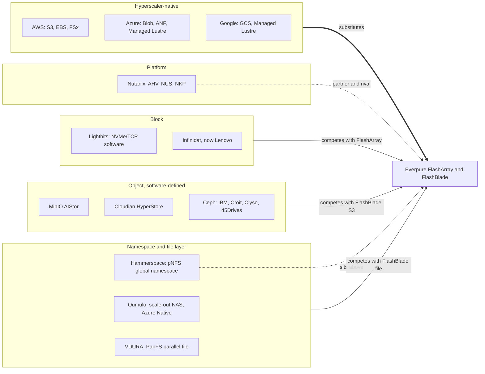
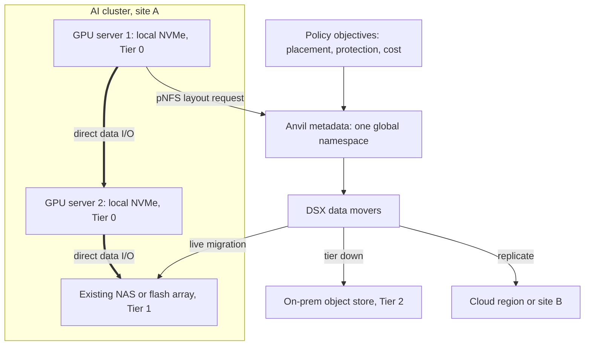
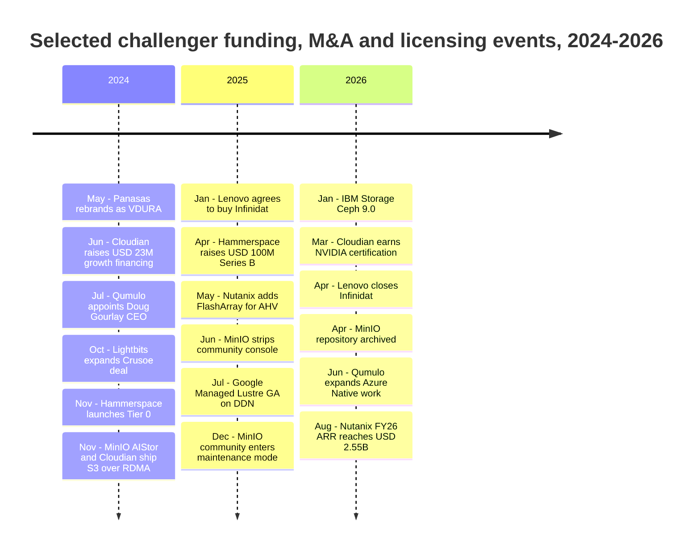

# 47. Other challengers and software-defined players

> **Depth:** L2 · **Reading time:** ~10 min · **Last verified:** 2026-11-01
> **Prerequisites:** [File protocols](../02-protocols-and-networking/08-file-protocols.md) · [Object storage and S3](../02-protocols-and-networking/09-object-storage-and-s3.md) · [Software-defined storage and HCI](../03-system-architecture/19-software-defined-and-hci.md) · [Incumbents](46-incumbents.md)

## TL;DR

- **The biggest challenger is the hyperscalers' own storage.** S3 alone holds over 500 trillion objects; cloud-born data rarely goes out to bid.
- **Hammerspace is the most strategic of the smaller players.** Its pNFS global namespace sits *above* everyone's arrays, and "Tier 0" turns idle GPU-server NVMe into shared storage. If it wins, arrays become interchangeable.
- **Open-source object broke in 2025–2026.** MinIO gutted its free edition and archived the repository in April 2026, pushing users to paid AIStor, Ceph, forks or supported S3 from other vendors.
- **Software-defined and platform vendors win on control and cost, not peak speed.** Ceph, Lightbits and Nutanix suit buyers who want to own hardware or leave VMware; Nutanix is also an Everpure partner.
- **Qumulo, Cloudian, VDURA and Lenovo-owned Infinidat are niche threats.** Each has a defensible base and caps Everpure's share in one segment.

## Why this matters for Everpure strategy

VAST, WEKA and DDN ([Chapters 42–45](45-head-to-head.md)) and the incumbents ([Chapter 46](46-incumbents.md)) get the attention, but much of the pressure on Everpure's (NYSE: P, formerly PSTG) margin comes from layers it does not control. Hammerspace and the hyperscalers compete for the *namespace and control plane* above the array. Ceph, MinIO and Lightbits put *software on commodity servers*, which caps what buyers will pay for an integrated system. Nutanix competes for the *platform* that VMware-exit budgets fund. Each tests Everpure's claim that integrated hardware plus Purity and Evergreen beats assembling parts. Most are also private, sub-scale or newly acquired: possible targets, partners or channels ([Chapter 54](../07-history-and-future/54-strategic-option-map.md)).

## Core concepts

### A map by architecture

Sort them by the *layer* they compete for.

*Figure 47.1 — Challengers grouped by the layer they attack: Hammerspace sits above the array, software-defined object and block compete on commodity hardware, and the hyperscalers substitute for the whole stack.*

### Hammerspace: a namespace over everyone's storage

Hammerspace separates *where a file appears* from *where its bytes live*. Metadata servers (Anvil) hold one global namespace. Data-services nodes (DSX) and existing NFS, object or cloud storage hold the bytes[^1]. Clients run the stock Linux NFSv4.2 client with the pNFS **Flex Files** layout: they get a layout from the metadata server, then do I/O directly against storage nodes ([Chapter 8](../02-protocols-and-networking/08-file-protocols.md)). Policies ("objectives") move open files between tiers and sites; only the layout changes.

**Semiconductor bridge.** This is virtual memory for files. The namespace is the page table; moving data is migrating a page from DRAM to CXL memory while the application keeps its address. The moat is that the "MMU" lives in the Linux kernel: CTO Trond Myklebust maintains the upstream Linux NFS client[^2].

**Tier 0.** Launched in November 2024, Tier 0 pools the local NVMe inside GPU servers into a shared, protected tier of the same namespace[^3]. Protection is client-side mirroring across availability zones; client-side erasure coding is roadmap[^4]. Version 5.2 added "affinitization", which writes a client's data to its own local Tier 0 volume[^5].

*Figure 47.2 — Hammerspace keeps file identity in one metadata layer and moves bytes freely across GPU-local NVMe, existing arrays, object and cloud, so the array becomes one tier among several.*

**Worked example (illustrative).** Take 1,000 GPU servers with eight 3.84 TB NVMe drives each, a common DGX-class configuration: 1,000 × 8 × 3.84 TB ≈ **30.7 PB raw**, already paid for, or about 15 PB mirrored. At about 6 GB/s per Gen4 drive, aggregate local bandwidth is 1,000 × 8 × 6 ≈ **48 TB/s**, far more than any shared array. The catches: reboots take drives offline, mirror traffic shares the GPU network, and capacity follows the server refresh cycle. So Tier 0 suits checkpoints and scratch, later drained to a shared tier ([Chapter 31](../05-ai-storage/31-training-storage.md)).

**Why it has customers.** Meta is the flagship. Its two 24,576-GPU GenAI clusters used parallel NFS co-developed with Hammerspace, alongside Tectonic[^6]. In April 2025 Hammerspace raised a US$100M Series B led by Altimeter, at a valuation above US$500M (*reported by press*), and talked of an IPO within about two years[^7]. Weak spots: no NVIDIA SuperPOD or NVIDIA-Certified Storage designation[^8], and performance bounded by the storage underneath.

### Qumulo and VDURA: file specialists that changed their business model

**Qumulo** sells a scale-out NAS with real-time capacity and activity analytics, popular in media, life sciences and research. Under CEO Doug Gourlay (from July 2024) it moved from its own hardware to software for cloud, on-premises and edge[^9]. Its distinctive asset is **Azure Native Qumulo**, a file service sold and billed inside Azure. In June 2026 it added tooling to migrate legacy NAS data into it[^10]. Its last priced round was a US$125M Series E at US$1.2B in July 2020 (*company-stated*)[^11] [VERIFY: Qumulo funding since 2020]. Customers buy simplicity and file analytics, not peak GPU throughput.

**VDURA** is Panasas, rebranded in May 2024 as a software-first company[^12]. In 2025 it relaunched PanFS as an AI/HPC platform aimed at VAST, WEKA and DDN, with a V5000 all-flash appliance and, from March 2026, hybrid flash-plus-disk options[^13]. It claims one of the largest defense GPU installations (*company-stated*)[^14]. It offers lab-proven PanFS and disk economics while flash is dear; its risk is scale [VERIFY: VDURA funding].

### MinIO: the open-source object store that closed itself

MinIO, a single fast, free binary, became the default S3-compatible store for developers, Kubernetes and many neoclouds. It raised US$103M at a US$1B valuation in January 2022, led by Intel Capital[^15]. Then it withdrew the community edition in stages:

1. **June 2025:** the admin console was removed, leaving a basic object browser; administration moved to the CLI or paid AIStor[^16].
2. **Late 2025:** official binaries and images stopped updating [VERIFY: reported as October 2025]. On 3 December 2025 the project entered maintenance mode, with security fixes only case by case[^17].
3. **2026:** the README was changed to say the repository is no longer maintained (reportedly 12 February [VERIFY: date]). GitHub shows `minio/minio` **archived on 25 April 2026**. The AGPLv3 source remains readable, and the README points to AIStor Free and AIStor Enterprise[^18].

**Semiconductor bridge:** a licensor changing terms after an ecosystem standardized on its architecture. Licensees pay, fork[^19] or port, here to Ceph RGW or commercial S3.

AIStor itself is serious: it shipped S3 over RDMA in November 2024[^20], and MinIO is an NVIDIA STX partner[^21]. **Worked example:** a neocloud migrating 50 PB off community MinIO at a sustained 100 GB/s needs 50 × 10¹⁵ ÷ 10¹¹ = 500,000 s ≈ **5.8 days** of saturated copying. With verification and cut-over it takes weeks, so many will simply pay MinIO.

### Cloudian and Ceph: object for people who want control

**Cloudian HyperStore** is S3-native object storage, sold as software, appliances or via HPE GreenLake, strong with regulated on-premises buyers. In June 2024 it raised US$23M of growth financing from Morgan Stanley Expansion Capital, citing 30% ARR growth, breakeven and about US$256M raised in total (*company-stated*)[^22]. It was early to GPUDirect for object (200+ GB/s claimed, November 2024)[^23]. Its HyperScale AI Data Platform adds in-storage vector search[^24]; HyperStore 8.2.6 became NVIDIA-Certified (Foundation) in March 2026[^25].

**Ceph** is the Linux of storage: one open-source system for block (RBD), file (CephFS) and object (RGW), free as code and costly to run well. Clyso tuned a 68-node NVMe cluster past 1 TiB/s[^26], showing both the ceiling and the skill required. It is commercialized three ways:

- **IBM Storage Ceph**, inherited from Red Hat, with release 9.0 in January 2026[^27].
- **Software and support specialists**, Croit (management software and support) and Clyso (engineering and consulting).
- **Hardware integrators** such as 45Drives, which ships servers with its Houston management UI for Ceph deployment[^28].

Think RISC-V: the ISA is free; value goes to whoever makes it reliable for telcos, universities, sovereign clouds and neoclouds.

### Block and platform: Lightbits, Infinidat, Nutanix

**Lightbits** sells software-defined block storage over NVMe/TCP, a standard it helped create ([Chapter 7](../02-protocols-and-networking/07-block-protocols.md)). Crusoe's AI-cloud block service runs on it at multi-petabyte scale[^29][^30]. Last disclosed funding was US$42M in 2022 (US$105.3M total)[^31]. Neoclouds use it to build EBS-like services.

**Infinidat** builds InfiniBox, a high-end block array serving most reads from DRAM in front of large HDD or flash pools. Lenovo announced the purchase in January 2025 and closed it in April 2026; Infinidat is now a unit of Lenovo's Infrastructure Solutions Group[^32]. Calcalist estimated the undisclosed price at over US$500M (*estimated*)[^33]. What changes is distribution.

**Nutanix** sells a platform: Nutanix Unified Storage (Files, Objects, Volumes) alongside the AHV hypervisor and NKP, its Kubernetes platform built from the D2iQ acquisition (2024)[^34]. Broadcom's VMware licensing changes are the tailwind. Nutanix reported more than 1,000 new logos in fiscal Q2 2026, its best in eight years, mostly ex-VMware [VERIFY: search-summary only][^35], and fiscal 2026 ARR of US$2.55B, up 16%[^36]. AHV now also accepts external arrays: Dell PowerFlex, Pure Storage FlashArray over NVMe/TCP (May 2025), then NetApp ONTAP and Dell PowerStore[^37][^38]. NUS also became NVIDIA-Certified in 2026[^39].

### The biggest challenger: hyperscaler-native storage

Each hyperscaler sells a full menu: AWS S3, EBS and FSx (Lustre, NetApp ONTAP, OpenZFS, Windows); Azure Blob, Azure NetApp Files and Azure Managed Lustre; Google Cloud Storage and Managed Lustre. S3 alone holds more than 500 trillion objects and serves more than 200 million requests per second across hundreds of exabytes[^40]. S3 Vectors (GA December 2025) shows them moving up the stack[^41].

The parallel is custom silicon: Graviton, Trainium and TPU did not beat merchant chips everywhere, but took the workloads already in the cloud. Clouds also rent partner technology as first-party services when that is faster than building. Google Cloud Managed Lustre runs on DDN EXAScaler and went GA in July 2025[^42], and NetApp's first-party and marketplace cloud storage revenue grew 27% in fiscal Q3 2026[^43]. And they compete on AI performance: Azure Managed Lustre was the first hyperscale cloud service in MLPerf Storage, at 642.2 GiB/s checkpoint write in v3.0[^44]. Google's DAOS-based Parallelstore is reportedly being phased out for Managed Lustre [VERIFY: partner source only][^45].

## How Everpure approaches it vs. competitors

| Company | Architecture | Model | Funding / ownership | Notable customers / proof points | Threat to Everpure (judgment) |
|---|---|---|---|---|---|
| Hyperscaler-native (AWS, Azure, Google) | Proprietary object, block, file; partner-built file services | Cloud service | Public parents | S3: 500T+ objects[^40]; Azure Managed Lustre in MLPerf v3.0[^44] | **High.** Substitutes for the whole stack for cloud-born data. Everpure can only partner (Azure Native) or win repatriation. |
| Hammerspace | pNFS Flex Files global namespace; Tier 0 on GPU-local NVMe | Software | Private; US$100M Series B 2025, >US$500M valuation (*reported*)[^7] | Meta GenAI clusters[^6] | **Medium-high.** Sits above arrays and commoditizes them, but can also run on FlashBlade. |
| Nutanix | HCI plus external arrays; NUS file and object | Software platform | Public (NASDAQ: NTNX); ARR US$2.55B[^36] | VMware-exit mid-market | **Medium.** Wins platform budgets, yet also a FlashArray channel. |
| MinIO AIStor | Hash-placed erasure-coded object | Software (commercial) | Private; US$103M at US$1B, 2022 (*company-stated*)[^15] | Developer and neocloud S3 | **Medium-low.** Licensing fallout creates openings for FlashBlade S3. |
| Ceph (IBM, Croit, Clyso, 45Drives) | Open-source unified block, file, object | Open source plus support/hardware | IBM (public); others private | Telcos, academia, sovereign clouds | **Medium** on price. Sets the floor for commodity object. |
| Lenovo Infinidat | DRAM-cached high-end block | Appliance | Lenovo-owned, closed April 2026[^32] | Large enterprises, service providers | **Medium** in high-end block, through Lenovo's reach. |
| Cloudian | S3-native object | Software / appliance | Private; ~US$256M raised (*company-stated*)[^22] | Regulated industries, HPE GreenLake | **Low-medium.** Strong on-premises S3 niche. |
| Qumulo | Scale-out NAS; Azure Native Qumulo | Software / cloud | Private; last round 2020, US$1.2B (*company-stated*)[^11] | Media, life sciences | **Low-medium.** Competes with FlashBlade file in mid-range. |
| Lightbits | NVMe/TCP software block | Software | Private; US$105.3M total by 2022[^31] | Crusoe[^29] | **Low-medium.** Neocloud block, where FlashArray rarely plays. |
| VDURA | PanFS parallel file, hybrid flash/HDD | Appliance / software | Private; funding unclear | HPC labs, defense (*company-stated*)[^14] | **Low.** Sub-scale, but credible in HPC deals. |

*Table 47.1 — The threat ranking follows layer, not size: whoever owns the namespace or the cloud account matters more than another box vendor.*

Against **hyperscalers**, Everpure puts Purity in the cloud: Pure Storage Cloud Azure Native is a jointly developed managed Azure service[^46]. Its second top-five-hyperscaler DirectFlash design win (August 2026) makes a hyperscaler a customer[^47]. The steelman is NetApp, whose ONTAP is first-party on all three clouds; Everpure has no AWS or Google equivalent. Against **Hammerspace**, FlashBlade//EXA uses the same pNFS idea with Everpure's own metadata engine. Is Hammerspace a partner over FlashBlade, or a layer that commoditizes it? Against **Ceph, MinIO and Lightbits**, it sells simplicity and Evergreen against "free plus engineers", winning where staff are scarce. With **Nutanix**, Everpure wins when VMware exits land on AHV with FlashArray.

## History and trajectory

*Figure 47.3 — Funding was small and sporadic. The defining events were a strategic acquisition, a licence retreat and the cloud and platform vendors moving in.*

Three signals stand out. **Capital went elsewhere.** Hammerspace's US$100M is the largest disclosed primary raise here, while VAST raised about US$1B in 2026 alone ([Chapter 42](42-vast-data.md)). CB Insights also lists a Hammerspace "Series B-II" in February 2026 with no amount [VERIFY: single aggregator][^48]. **Open source is being monetized harder**, which strengthens Ceph as the neutral default. **Platform owners are absorbing storage:** Lenovo bought Infinidat, Nutanix bundles storage with AHV, and the clouds rent Lustre and ONTAP as their own services. Expect more platform acquisitions of sub-scale storage software; an analyst quoted at Hammerspace's Series B thought a sale likelier than an IPO[^7].

## Numbers that matter

| Metric | Value | Context | Source / date |
|---|---|---|---|
| Amazon S3 scale | >500 trillion objects; >200M requests/s | Hundreds of exabytes | AWS, 2026-03-16[^40] |
| Hammerspace Series B | US$100M; valuation >US$500M (*reported*) | Led by Altimeter; IPO talk | TechCrunch, 2025-04-16[^7] |
| GPU-local NVMe in a 1,000-server cluster | ~30.7 PB raw; ~48 TB/s aggregate | 8 × 3.84 TB per server, ~6 GB/s per drive | Worked example |
| MinIO Series B | US$103M at US$1B valuation | Jan 2022, led by Intel Capital | SiliconANGLE, 2022-01-26[^15] |
| Nutanix ARR | US$2.55B, +16% YoY | FY ended 2026-07-31; methodology restated | Nutanix 8-K, 2026-08-26[^36] |
| NetApp first-party and marketplace cloud storage growth | +27% YoY | Fiscal Q3 2026 | NetApp, 2026-02[^43] |
| Cloudian total raised | ~US$256M; ARR +30% | June 2024, breakeven claimed (*company-stated*) | Blocks & Files, 2024-06-25[^22] |
| Azure Managed Lustre MLPerf v3.0 | 642.2 GiB/s checkpoint write | First hyperscale cloud submission | StorageReview, 2026-09[^44] |
| Ceph record cluster | >1 TiB/s on 68 nodes | Clyso tuning project | Ceph.io, 2024-01[^26] |

## Conversation playbook

**Questions for a PM**

1. *"When a customer runs Hammerspace over FlashBlade, who owns the account?"* Strong: separates namespace from capacity and says what EXA adds.
2. *"How many MinIO community users have we converted since December 2025, and with what?"* Strong: FlashBlade or FlashArray S3, typical size, the rival Ceph or AIStor quote.
3. *"What share of Nutanix AHV migrations attach FlashArray rather than Nutanix storage?"* Strong: an attach rate and how Nutanix sellers are paid.

**Questions for an engineer**

1. *"What does Tier 0 lose if a GPU server reboots mid-checkpoint, and how does EXA handle that failure?"* Strong: mirror placement, rebuild traffic on the GPU fabric, draining.
2. *"Where is our S3 slower than Ceph RGW or AIStor on small objects, and why?"* Strong: a measured objects-per-second figure and the metadata-path reason ([Chapter 18](../03-system-architecture/18-object-storage-architecture.md)).
3. *"Could Purity run as a first-party service on AWS, as ONTAP does in FSx?"* Strong: separates the engineering gap (control plane, multi-tenancy, billing) from the commercial one.

**Don't say this:**

- "MinIO is dead." The community repository is archived; AIStor is sold and NVIDIA-partnered.
- "Hammerspace is an array competitor." It is a namespace layer that can sit on top of Everpure.
- "Ceph is free." The code is; running it at scale costs engineers, which is what Everpure sells against.
- "Nutanix is just a competitor." Since May 2025 it is also a FlashArray route to market.
- "The cloud is just another competitor." It is the default home for new data.

## Going deeper (optional, L3 pointers)

- IETF RFC 8435 (pNFS Flexible File Layout); Myklebust's SNIA SDC 2024 talk[^2].
- Hammerspace's SNIA SDC 2025 Tier 0 slides[^4].
- Clyso's "Journey to 1 TiB/s", on Ceph tuning for NVMe[^26].
- Meta's GenAI infrastructure post, on mixing Tectonic with vendor parallel NFS[^6].

## Key terms

- **Global namespace** — one file tree spanning many systems and sites.
- **Tier 0** — Hammerspace's shared tier built from GPU servers' local NVMe.
- **pNFS Flex Files** — NFSv4.2 layout for direct client I/O to data servers.
- **AIStor** — MinIO's commercial object store.
- **Open-core relicensing** — shrinking a free edition to push users to paid ones.
- **Ceph RGW / RBD / CephFS** — Ceph's object, block and file interfaces.
- **NVMe/TCP** — NVMe over ordinary TCP/IP Ethernet.
- **First-party cloud storage service** — partner storage sold and billed by the cloud as its own.
- See the [glossary](../glossary.md) for the rest.

## Sources

[^1]: Hammerspace, "Hyperscale NAS," n.d. https://hammerspace.com/hyperscale-nas/ (retrieved 2026-11-01); Futurum, "Hammerspace shows storage acceleration for AI training at AI Field Day," n.d. https://futurumgroup.com/insights/hammerspace-shows-storage-acceleration-for-ai-training-at-ai-field-day (retrieved 2026-11-01).
[^2]: SNIA, Trond Myklebust (Hammerspace), "Advancements in pNFS and NFSv4.2," SDC 2024 (posted 2025-05). https://snia.org/sites/default/files/2025-05/SNIA-SDC2024-Myklebust-Advancements-in-PNFS-NFSv4.2.pdf (retrieved 2026-11-01).
[^3]: Hammerspace via Business Wire, "Hammerspace Transforms GPU Computing Infrastructure as First to Unlock a New Tier of Ultra-Fast Shared Storage," 2024-11-14. https://www.businesswire.com/news/home/20241114167051/en (retrieved 2026-11-01).
[^4]: SNIA, Christofferson (Hammerspace), "Activating Tier 0 Storage," SDC 2025 (posted 2025-10). https://www.snia.org/sites/default/files/2025-10/SNIA-SDC25-Christofferson-Activating-Tier0-Storage.pdf (retrieved 2026-11-01).
[^5]: Hammerspace, "Hammerspace Tier 0 Affinitization," 2026. https://hammerspace.com/hammerspace-tier-0-affinitization/ (retrieved 2026-11-01).
[^6]: Meta Engineering, "Building Meta's GenAI Infrastructure," 2024-03-12. https://engineering.fb.com/2024/03/12/data-center-engineering/building-metas-genai-infrastructure/ (retrieved 2026-11-01).
[^7]: TechCrunch, "Hammerspace, an unstructured data wrangler, raises $100M," 2025-04-16. https://techcrunch.com/2025/04/16/hammerspace-an-unstructured-data-wrangler-100m/ (retrieved 2026-11-01); TechTarget, "Hammerspace vacuums $100 million in Series B to gear for IPO," 2025-04. https://www.techtarget.com/searchstorage/news/366622858/Hammerspace-vacuums-100-million-in-Series-B-to-gear-for-IPO (retrieved 2026-11-01).
[^8]: StorageReview, "Best Storage Arrays 2026: AI Storage Leaders and Audited Results," updated 2026-09-01. https://www.storagereview.com/best/storage-arrays (retrieved 2026-11-01).
[^9]: GeekWire, "Former Arista and Cisco exec Douglas Gourlay named new CEO of data storage company Qumulo," 2024-07. https://www.geekwire.com/2024/former-arista-and-cisco-exec-douglas-gourlay-named-new-ceo-of-data-storage-company-qumulo/ (retrieved 2026-11-01).
[^10]: Qumulo via Business Wire, "Qumulo Announces Expanded Collaboration with Microsoft to Deliver Cloud Native Storage Relief for the Enterprise Hardware Crisis," 2026-06-03. https://secure.businesswire.com/news/home/20260603197198/en/Qumulo-Announces-Expanded-Collaboration-with-Microsoft-to-Deliver-Cloud-Native-Storage-Relief-for-the-Enterprise-Hardware-Crisis (retrieved 2026-11-01).
[^11]: HPCwire/AIwire, "Qumulo Locks Down $125M Financing, $1.2B Valuation," 2020-07-23. https://www.hpcwire.com/aiwire/2020/07/23/qumulo-locks-down-125m-financing-1-2b-valuation/ (retrieved 2026-11-01).
[^12]: VDURA via Business Wire, "Panasas becomes VDURA" (launch of the VDURA brand), 2024-05-07. https://www.businesswire.com/news/home/20240507806456/en (retrieved 2026-11-01).
[^13]: Blocks & Files, "VDURA takes aim at VAST, WEKA, DDN with AI-HPC storage reboot," 2025-06-28. https://www.blocksandfiles.com/ai-ml/2025/06/28/vdura-takes-aim-at-vast-weka-ddn-with-ai-hpc-storage-reboot/1586714 (retrieved 2026-11-01); Blocks & Files, "VDURA pairs V5000 flash with WD Data60 and Data102 disk shelves," 2026-03-11. https://www.blocksandfiles.com/disk/2026/03/11/vdura-pairs-v5000-flash-with-wd-data60-and-data102-disk-shelves/5208754 (retrieved 2026-11-01).
[^14]: VDURA via Business Wire, "VDURA Powers One of the World's Largest Defense GPU Installations," 2025-10-02. https://www.businesswire.com/news/home/20251002832210/en/VDURA-Powers-One-of-the-Worlds-Largest-Defense-GPU-Installations (retrieved 2026-11-01).
[^15]: SiliconANGLE, "MinIO raises $103M to expand multicloud data object store," 2022-01-26. https://siliconangle.com/2022/01/26/minio-raises-103m-expand-multicloud-data-object-store/ (retrieved 2026-11-01).
[^16]: Blocks & Files, "MinIO removes management features from basic community edition object storage code," 2025-06-19. https://blocksandfiles.com/2025/06/19/minio-removes-management-features-from-basic-community-edition-object-storage-code/ (retrieved 2026-11-01).
[^17]: Linuxiac, "MinIO Ends Active Development, Steers Users Toward Paid AIStor," 2025-12. https://linuxiac.com/minio-ends-active-development/ (retrieved 2026-11-01).
[^18]: GitHub, "minio/minio" repository page (archive banner dated 2026-04-25; README notice "no longer maintained"), n.d. https://github.com/minio/minio (retrieved 2026-11-01).
[^19]: Vonng, "MinIO Is Dead, Long Live MinIO" (community fork pgsty/minio), n.d. https://blog.vonng.com/en/db/minio-resurrect/ (retrieved 2026-11-01).
[^20]: Blocks & Files, "MinIO releases AIStor with GPUDirect-like S3 over RDMA," 2024-11-13. https://blocksandfiles.com/2024/11/13/minio-releases-aistor-with-gpudirect-like-s3-over-rdma/ (retrieved 2026-11-01).
[^21]: StorageNewsletter, "Nvidia GTC 2026: Nvidia Launches BlueField-4 STX Storage Architecture With Broad Industry Adoption," 2026-03-17. https://www.storagenewsletter.com/2026/03/17/nvidia-gtc-2026-nvidia-launches-bluefield-4-stx-storage-architecture-with-broad-industry-adoption/ (retrieved 2026-11-01).
[^22]: Blocks & Files, "Cloudian gets more funding as it reaches breakeven, bags HPE GreenLake wins," 2024-06-25. https://blocksandfiles.com/2024/06/25/cloudian-gets-more-funding-as-it-reaches-breakeven-bags-hpe-greenlake-wins/ (retrieved 2026-11-01); StorageNewsletter, "Cloudian Secures $23 Million, Total at $256 Million," 2024-06-25. https://www.storagenewsletter.com/2024/06/25/cloudian-secures-23-million-total-at-256-million/ (retrieved 2026-11-01).
[^23]: IT Brief, "Cloudian enhances AI processing with NVIDIA GPUDirect tie-up," 2024-11. https://itbrief.co.uk/story/cloudian-enhances-ai-processing-with-nvidia-gpudirect-tie-up (retrieved 2026-11-01).
[^24]: Blocks & Files, "Cloudian launches HyperScale AI platform built on Nvidia Blackwell GPUs," 2025-10-01. https://www.blocksandfiles.com/ai-ml/2025/10/01/cloudian-launches-hyperscale-ai-platform-built-on-nvidia-blackwell-gpus/1592771 (retrieved 2026-11-01).
[^25]: Cloudian, "Cloudian HyperStore Achieves NVIDIA-Certified Storage Designation," 2026-03-16. https://cloudian.com/press/cloudian-hyperstore-achieves-nvidia-certified-storage-designation.md (retrieved 2026-11-01).
[^26]: Ceph.io (Mark Nelson, Clyso), "Ceph: A Journey to 1 TiB/s," 2024-01. https://ceph.io/en/news/blog/2024/ceph-a-journey-to-1tibps (retrieved 2026-11-01).
[^27]: StorageNewsletter, "IBM Releases IBM Storage Ceph 9.0," 2026-01-30. https://www.storagenewsletter.com/2026/01/30/ibm-releases-ibm-storage-ceph-9-0/ (retrieved 2026-11-01).
[^28]: AIwire, "45Drives' new user interface helps manage open source storage software infrastructure," 2021-01-07. https://aiwire.net/2021/01/07/45drives-new-user-interface-helps-manage-open-source-storage-software-infrastructure (retrieved 2026-11-01).
[^29]: Lightbits via Business Wire, "Lightbits and Crusoe AI Announce Collaboration to Expand Elastic Block Storage Service for AI Workloads," 2024-10-29. https://www.businesswire.com/news/home/20241029168108/en/Lightbits-and-Crusoe-AI-Announce-Collaboration-to-Expand-Elastic-Block-Storage-Service-for-AI-Workloads (retrieved 2026-11-01).
[^30]: Lightbits via Business Wire, "Lightbits Labs Closes Q1 2025 with Record Breaking Growth," 2025-04-15. https://www.businesswire.com/news/home/20250415197129/en/Lightbits-Labs-Closes-Q1-2025-with-Record-Breaking-Growth (retrieved 2026-11-01).
[^31]: Blocks & Files, "Lightbits Labs funding," 2022-06-28. https://blocksandfiles.com/2022/06/28/lightbits-labs-funding/ (retrieved 2026-11-01).
[^32]: Lenovo, "Lenovo Completes Acquisition of Infinidat, Expanding Enterprise Storage Portfolio, Enhancing AI-Driven Data Infrastructure," 2026-04. https://news.lenovo.com/pressroom/press-releases/lenovo-completes-acquisition-of-infinidat-expanding-enterprise-storage-portfolio-enhancing-ai-driven-data-infrastructure/ (retrieved 2026-11-01); StorageNewsletter, same title, 2026-04-10. https://www.storagenewsletter.com/2026/04/10/lenovo-completes-acquisition-of-infinidat-expanding-enterprise-storage-portfolio-and-enhancing-ai-driven-data-infrastructure/ (retrieved 2026-11-01).
[^33]: Calcalist (CTech), report on the Lenovo–Infinidat deal value, n.d. https://www.calcalistech.com/ctechnews/article/bkjygubh11g (retrieved 2026-11-01).
[^34]: Nutanix, "Nutanix Announces Nutanix Kubernetes Platform," 2024-05. https://www.nutanix.com/blog/nutanix-announces-nutanix-kubernetes-platform (retrieved 2026-11-01).
[^35]: MarketBeat, "Nutanix Q2 Earnings Call Highlights," 2026-02-26. https://www.marketbeat.com/instant-alerts/nutanix-q2-earnings-call-highlights-2026-02-26/ (retrieved 2026-11-01).
[^36]: Nutanix, "Form 8-K, Exhibit 99.1: Fourth quarter and fiscal 2026 results," 2026-08-26. https://www.sec.gov/Archives/edgar/data/0001618732/000117184326005752/exh_991.htm (retrieved 2026-11-01); Earnings Whispers, "Nutanix Reports 16% YoY ARR Growth and Strong Free Cash Flow for Fiscal 2026," 2026-08-26. https://www.earningswhispers.com/article/NTNX/2608266552 (retrieved 2026-11-01).
[^37]: SDxCentral, "Nutanix partners with Pure Storage in latest VMware assault," 2025-05. https://www.sdxcentral.com/news/nutanix-partners-with-pure-storage-in-latest-vmware-assault/ (retrieved 2026-11-01).
[^38]: SDxCentral, "Dell, Nutanix launch their first external storage package," n.d. https://www.sdxcentral.com/news/dell-nutanix-launch-their-first-external-storage-package/ (retrieved 2026-11-01); IT Brief, "Nutanix links AHV with NetApp storage in new tie-up," n.d. https://itbrief.co.uk/story/nutanix-links-ahv-with-netapp-storage-in-new-tie-up (retrieved 2026-11-01); Blocks & Files, "Nutanix gets Dell PowerStore support," 2026-07-28. https://www.blocksandfiles.com/file/2026/07/28/nutanix-gets-dell-powerstore-support/5279629 (retrieved 2026-11-01).
[^39]: HPCwire/BigDATAwire, "Nutanix Unified Storage Achieves NVIDIA Certification as Enterprises Race to Build AI Factories," 2026-06. https://www.hpcwire.com/bigdatawire/this-just-in/nutanix-unified-storage-achieves-nvidia-certification-as-enterprises-race-to-build-ai-factories/ (retrieved 2026-11-01).
[^40]: AWS News Blog, "AWS Weekly Roundup: Amazon S3 turns 20, Amazon Route 53 Global Resolver general availability, and more," 2026-03-16. https://aws.amazon.com/blogs/aws/aws-weekly-roundup-amazon-s3-turns-20-amazon-route-53-global-resolver-general-availability-and-more-march-16-2026 (retrieved 2026-11-01).
[^41]: StorageNewsletter, "AWS re:Invent 2025: Amazon S3 Vectors is Now Generally Available with 40 Times the Scale of Preview," 2025-12-05. https://www.storagenewsletter.com/2025/12/05/aws-reinvent-2025-amazon-s3-vectors-is-now-generally-available-with-40-times-the-scale-of-preview/ (retrieved 2026-11-01).
[^42]: DDN, "DDN and Google Cloud bring high-performance parallel file systems to cloud AI workloads with Managed Lustre powered by DDN EXAScaler," 2025-07. https://www.ddn.com/blog/ddn-and-google-cloud-bring-high-performance-parallel-file-systems-to-cloud-ai-workloads-with-managed-lustre-powered-by-ddn-exascaler/ (retrieved 2026-11-01).
[^43]: NetApp, "Q3 FY26 Earnings Release," 2026-02. https://s21.q4cdn.com/371534297/files/doc_earnings/2026/q3/earnings-result/NetApp-Q3-26-Earnings-Release-final-final.pdf (retrieved 2026-11-01).
[^44]: StorageReview, "MLPerf Storage v3.0: 877 GiB/s checkpoints, a cloud first and a leaderboard turned over," 2026-09. https://storagereview.com/news/mlperf-storage-v3-0-877-gib-s-checkpoints-a-cloud-first-and-a-leaderboard-turned-over (retrieved 2026-11-01).
[^45]: innFactory, "Google Cloud Parallelstore," n.d. https://innfactory.de/en/cloud/gcp/products/parallelstore/ (retrieved 2026-11-01).
[^46]: Microsoft Learn, "Pure Storage Cloud overview," n.d. https://learn.microsoft.com/en-us/azure/partner-solutions/pure-storage/overview (retrieved 2026-11-01).
[^47]: Everpure, "Everpure Lands New Design Win with Second Top Five Hyperscaler," 2026-08-10. https://www.everpuredata.com/company/newsroom/press-releases/everpure-lands-new-design-win-with-second-top-five-hyperscaler.html (retrieved 2026-11-01).
[^48]: CB Insights, "Hammerspace financials," 2026. https://www.cbinsights.com/company/hammerspace/financials (retrieved 2026-11-01).
