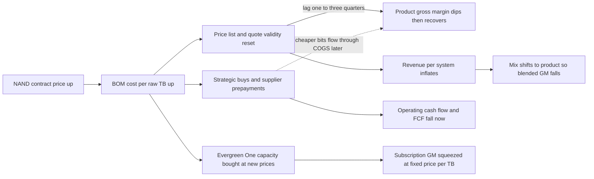
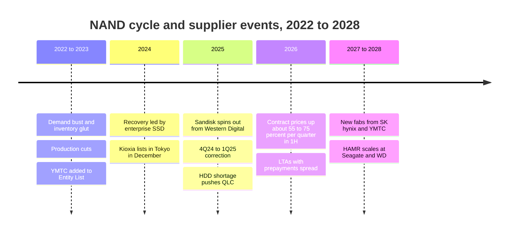

# 48. Media suppliers and the NAND cycle

> **Depth:** L2 · **Reading time:** ~10 min · **Last verified:** 2026-11-01
> **Prerequisites:** [Media physics](../01-storage-fundamentals/02-media-physics.md) · [Inside an SSD](../01-storage-fundamentals/03-inside-an-ssd.md) · [Purity and DirectFlash](../04-everpure/26-purity-and-directflash.md) · [Hyperscaler ecosystem and financials](../04-everpure/29-hyperscaler-ecosystem-financials.md) · [Consumption models](../03-system-architecture/23-consumption-models.md)

## TL;DR

- **Five companies sell about 88% of NAND by revenue.** In 2Q26 Samsung had 29.3%, SK hynix Group (with Solidigm) 18.2%, Micron 15.1%, Kioxia 13.6% and Sandisk 11.4%. Top-five revenue reached $68.87B, up 77% in one quarter[^tf2q26]. YMTC ships as many bits as Kioxia but ranks lower by revenue[^cp2q26].
- **2026 is a supply-side super-cycle, not just a demand spike.** Enterprise SSDs took about 48% of NAND bits[^cp2q26]. Suppliers added little wafer capacity, and the nearline HDD shortage pushed cloud buyers toward QLC[^tfhdd]. Compounding TrendForce's quarterly forecast midpoints gives contract prices about 4.7× their mid-2025 level by 4Q26.
- **Array vendors feel the cycle as a lag, not a level.** Costs reprice every quarter; list prices, quotes and installed-base contracts reprice slower. Product gross margin dips, then recovers as price increases land. Meanwhile revenue inflates and cash goes into inventory and prepayments.
- **Everpure's exposure is split three ways.** Enterprise arrays carry NAND on its books. Evergreen//One carries it at fixed contracted prices. The hyperscale DirectFlash business carries none, because the customer buys the NAND[^ephyper].
- **HDD vs QLC is now an allocation question as much as a price question.** Flash's $/TB premium over disk widened to roughly 15–22× in 2026 [VERIFY: single-vendor index][^vduraidx], far above the ~3× TrendForce says cloud buyers need[^tfhdd]. But nearline lead times also passed 52 weeks, so buyers take whatever media they can get.

## Why this matters for Everpure strategy

NAND is the largest single input in an all-flash array. Everpure buys raw NAND rather than finished SSDs, which makes it one of the few array vendors with a direct relationship to the fabs (see [Chapter 26](../04-everpure/26-purity-and-directflash.md)). In April 2026 the CEO wrote that input costs for many high-volume semiconductor components had risen 300–900% since mid-2025, and that Everpure's prices were up about 70% on average since January[^epletter]. A cost shock of that size moves revenue, gross margin, free cash flow and competitive pricing all at once. It also shapes which deal structures make sense: supply agreements, prepayments, multi-sourcing and subscription price protection.

For a strategy team the questions are concrete. How long does a NAND upcycle take to show up in product gross margin, and how fast does it reverse? Is negative free cash flow from strategic buying a hedge or a speculative inventory bet? Does a fixed-price Evergreen//One book become a liability when NAND quadruples? And does the HDD shortage widen Everpure's QLC-versus-disk opening, or close it? This chapter answers those from public information.

## Core concepts

### The supply base: five oligopolists and a fast-rising sixth

*Figure 48.1 — Samsung leads on both measures, but YMTC ships as many bits as Kioxia while earning far less per bit, because its mix is still mostly consumer.*
Data: `data/ch48_nand_share.csv`

The two panels measure different things. Revenue share rewards mix: enterprise SSD bits sell for far more than consumer ones. Micron grew 99% in a quarter and passed Kioxia for third place[^tf2q26]. Counterpoint ranks YMTC fifth by revenue, behind the four leaders, because data-centre SSDs are a small part of its mix[^cp2q26]. Counterpoint also calls 15% share the threshold at which a NAND maker can self-fund its capex[^cp2q26], and YMTC is close to it.

**Semiconductor bridge.** This is the DRAM playbook. The industry consolidated to a handful of IDMs. Each node shift is a capex cliff (new deck stacks, hybrid bonding), so the swing factor is wafer starts, not demand. Kioxia and Sandisk are a special case. They share fabs through joint ventures in Japan, so they are two brands on one manufacturing base.

| Company | NAND / HDD position | Latest layer node | Flagship enterprise capacity | Relationship to array vendors |
|---|---|---|---|---|
| Samsung | #1 NAND, 29.3% revenue share 2Q26[^tf2q26] | V10, 400+ layers, hybrid bonding (announced)[^samsungv10] | BM1743 QLC, 61.44 TB launched; 122.88 TB planned[^bm1743] | Drive supplier to server and array OEMs; no Everpure DFM qualification disclosed |
| SK hynix + Solidigm | #2, 18.2%[^tf2q26] | 321-layer TLC, largest share of its NAND output in Q2 2026[^skh321][^tomsroadmap] | Solidigm D5-P5336, 122.88 TB QLC[^solidigm] | LTAs with about 10 customers, with deposits[^skhcall] |
| Micron | #3, 15.1%; exited Crucial consumer business Dec 2025[^tf2q26][^crucial] | G9, 276 layers[^tomsroadmap] | 6600 ION, 245.76 TB QLC, shipping May 2026[^micron6600] | G8 QLC qualified for Everpure's 150 TB DFM; G9 for hyperscaler DFMs[^epmicron] |
| Kioxia | #4, 13.6%; TSE-listed Dec 2024[^tf2q26][^kioxiaipo] | BiCS10, 332 layers, sampling (with Sandisk)[^bics10] | LC9, 245.76 TB QLC, announced July 2025[^lc9] | Long-standing Everpure partner (BiCS8 2 Tb QLC)[^epkioxia]; targets 50% of shipments under LTAs by 2028[^kioxiacapex] |
| Sandisk | #5, 11.4%; spun from WD Feb 2025[^tf2q26][^sndkspin] | BiCS8 218 layers in product; BiCS10 with Kioxia[^sn670][^bics10] | UltraQLC SN670, 128/256 TB; 512 TB on 2027 roadmap[^sn670] | Most aggressive LTA seller: over a third of FY27 bits contracted by May 2026[^sndklta] |
| YMTC | ~14% of bits, #5 by revenue (Counterpoint)[^cp2q26] | Xtacking 4.0 [VERIFY: layer count] | Mostly consumer and Chinese domestic | US Entity List since Dec 2022; not a practical source for US vendors; adding fabs[^ymtcfabs] |
| Western Digital | HDD only after the Sandisk split; FQ1'27 revenue $4.38B, 58.1% non-GAAP GM, 88% cloud[^wdq1] | ePMR / UltraSMR; HAMR ramps 2027[^wdinnov] | 40 TB UltraSMR, volume 2H 2026[^wdinnov] | Sells mostly to hyperscalers; competes with QLC for nearline sockets |
| Seagate | HDD; FQ1'27 revenue $4.2B, 57.8% non-GAAP GM[^seagateq1] | HAMR Mozaic 4+ (4 TB/platter) | Up to 44 TB ramping at major hyperscalers[^seagateq1] | Expects HAMR ≈ 50% of nearline exabytes exiting 2026[^seagateq1] |

*Table 48.1 — Supplier profiles, autumn 2026: the NAND makers own the price, while Everpure's direct NAND relationships run through Micron and Kioxia.*

CXMT is DRAM-only, so it matters here only indirectly. The same AI pull has tightened DRAM, which arrays need for controllers and caches, and that compounds the NAND hit.

### Why 2025–26 became a super-cycle

Four forces lined up, and each is documented:

1. **AI pulled enterprise SSD bits.** Server enterprise SSDs reached about 48% of NAND bit shipments in 2Q26[^cp2q26]. Enterprise SSD is also the category whose contract prices TrendForce still sees accelerating in 4Q26, at +23–28%, against +15–20% for blended NAND[^tf4q26].
2. **Supply discipline after the 2022–23 bust.** In 1Q23 industry revenue fell to about $8.6B on a ~15% ASP drop[^tf1q23]; three years later the top five took $68.87B in a quarter. Having lived through that, suppliers have been slow to add wafers. Kioxia's FY26–28 capex plan averages about ¥470B a year, concentrated at Kitakami[^kioxiacapex]. SK hynix is building a new NAND fab (M17) but says it will stage ramps against demand visibility[^skhcall]. Meaningful new capacity is not expected before late 2027 or 2028.
3. **The HDD shortage spilled into QLC.** In September 2025 TrendForce reported nearline HDD lead times stretching from weeks to more than 52 weeks. It said North American cloud providers were evaluating QLC SSDs for cold data[^tfhdd], and it cited that spillover when it turned its 4Q25 NAND outlook from flat to up 5–10%[^tf4q25]. *Verified:* the HDD-to-QLC push is TrendForce's stated driver, not a later rationalisation.
4. **Supply became a contract, not a spot purchase.** Sandisk had over a third of FY27 bits under long-term agreements (LTAs) by May 2026, with some running up to five years[^sndklta]. Later reports put more than half of FY27 bits under contract [VERIFY: secondary source][^sndklta2]. These LTAs carry prepayments, price floors and ceilings[^sndklta]. Micron's exit from consumer Crucial products moved more bits toward strategic customers[^crucial].

![Bar-and-line chart of TrendForce quarterly NAND contract-price forecasts from 1Q23 to 4Q26. Blended NAND bars are negative through 3Q23 (about −12%, −7.5%, −5.5%), positive from 4Q23 to 3Q24 (+10% to +18%), negative in 4Q24 and 1Q25 (−5.5%, −12.5%), then rise to +7.5% in 3Q25, +22.5% in 4Q25 (revised from +7.5%), +57.5% in 1Q26 (revised from +35.5%), +72.5% in 2Q26, +12.5% in 3Q26 and +17.5% in 4Q26. Enterprise SSD bars are shown where published. A compounded index line rises from 100 to about 102 by 2Q25 and 482 by 4Q26.](../assets/charts/ch48-nand-price.svg)

*Figure 48.2 — Two quarters of 55–75% increases did more than the whole 2023–24 recovery; even the "slowing" 3Q26 and 4Q26 forecasts still compound on a much higher base.*
Data: `data/ch48_nand_price.csv`

Read the chart as forecasts, not invoices. TrendForce kept revising upward, and the 1Q26 and 2Q26 figures come from secondary coverage [VERIFY: confirm against TrendForce releases][^tf1q26rev][^tf2q26fc]. The index is our own arithmetic, so check it: 1.075 × 1.225 × 1.575 × 1.725 × 1.125 × 1.175 ≈ 4.7× from 2Q25 to 4Q26. That is the same order of magnitude as Everpure's "300–900%" component-cost statement[^epletter].

### How the cycle reaches an array vendor's P&L

*Figure 48.3 — One input-cost shock hits four lines at different speeds: cash immediately, margin with a lag, revenue upward, and the subscription book over the life of its contracts.*

**Worked example (illustrative).** Take an array sold for $100 with a $35 bill of materials (BOM), $20 of it NAND, so gross margin (GM) is 65%. NAND doubles, and the BOM goes to $55. The vendor now has three choices:

- **Hold price:** GM falls to 45%.
- **Pass through dollars only:** price $120 keeps gross profit at $65, but GM falls to 54%.
- **Hold GM at 65%:** price must rise to $55 ÷ 0.35 ≈ $157. Gross profit dollars rise 57%, which is the "revenue inflation" visible in 2026 prints.

The public evidence matches this shape. Everpure raised prices on 9 February 2026 and guided product GM to the low end of its 65–70% range[^epq4]. Product GM went from 67.3% in Q4 FY26[^epq4pr] to 65.5% in Q1 FY27[^epq1] and 66.2% in Q2[^epq2]. Product revenue grew 54% in Q2[^epq2], although Everpure shipped fewer systems; price, mix and capacity per system made up the difference[^trefis]. NetApp shows the lag more starkly. Its product GM fell 4.2 points to 55.3% in its January 2026 quarter[^ntapq3] and to 54.6% in its July quarter[^ntapq1]. Its FY27 GM guide moved from 68.5–69.5%[^ntapq4] to 68.1–69.1%. Products rose to 49% of revenue from 42%, which pulls the blended margin down even when product GM holds[^ntapq1]. One summary of NetApp's call describes roughly a three-quarter lag before price increases fully offset costs [VERIFY: secondary summary][^ntaplag]. Dell repriced ISG on 10 December 2025 and shortened quote validity[^dell].

**Cash.** Everpure's Q2 FY27 operating cash flow was −$136M and free cash flow −$238M, driven by strategic purchases of NAND and other components. A third party reads about $577M of this as prepaid expenses [VERIFY: confirm in 10-Q][^epq2fcf]. Management said supply coverage was sufficient "for the foreseeable future" and that pricing had roughly caught up with costs[^epq2call]. In derivatives language, the buying is a long forward position on NAND. It pays if 4Q26's forecast +15–20% arrives. It turns into an inventory write-down risk if the cycle breaks the way it did in 4Q24.

**Evergreen exposure.** Under Evergreen//One, Everpure owns the hardware and charges per TB used. Capacity added mid-contract is bought at today's NAND price but billed at yesterday's rate. That is a short position on NAND, which pays off in downcycles and hurts in upcycles. Management raised Evergreen//One prices far less than product prices[^trefis]; one partner reports roughly +5% for Evergreen//One against 30%+ for Evergreen//Forever quotes [VERIFY: partner blog][^daymark]. Subscription GM slipped from 75.6% to 74.9% between Q1 and Q2 FY27[^epq1][^epq2], a modest move given the scale of the shock. The hyperscale business sits outside all of this, since Everpure does not procure that NAND[^ephyper].

### HDD vs QLC economics in 2026

Before the shortage the gap was narrowing: enterprise SSDs cost about 10× nearline disk per TB in 2020[^bf2020] ([Chapter 2](../01-storage-fundamentals/02-media-physics.md) has the long-run curve). In 2026 one index put the premium at 22.6× in Q1 and 18.6× in Q3, with a 30 TB TLC SSD at about $22,600 against $1,216 for a 30 TB HDD [VERIFY: single-vendor index][^vduraidx]. TrendForce says cloud buyers need QLC within about 3× of HDD $/TB to break even[^tfhdd].

**Worked example: does power close the gap?** Store 10 PB raw. Micron's comparison gives about 8.2 TB/W for its 245 TB SSD and 4.4 TB/W for a 44 TB HDD[^micronrev]. Disk needs about 2.3 kW and flash about 1.2 kW, a 1.1 kW difference. Over five years at PUE 1.4 and $0.10/kWh, that saves 1.1 × 43,800 h × 1.4 × $0.10 ≈ $6.7k. At HDD prices of ~$40/TB, the media cost $0.4M. A 3× premium adds $0.8M; an 18× premium adds about $7M. Power alone never closes the gap. The case for flash rests on rack space, performance per TB, data reduction and failure handling. That is why array vendors sell *effective* $/TB after data reduction, and why Everpure argues total cost of ownership rather than media price ([Chapter 4](../01-storage-fundamentals/04-performance-and-economics-metrics.md)).

Disk makers are enjoying their own cycle. Seagate and Western Digital both posted roughly 58% non-GAAP gross margins in the September quarter[^seagateq1][^wdq1]. Both are adding exabytes through areal density (HAMR, UltraSMR), not new factories. So in 2026 neither medium is cheap and both are rationed. The flash-versus-disk decision is set as much by which supplier can deliver as by $/TB.

## How Everpure approaches it vs. competitors

| Vendor model | What it buys | Who carries NAND price risk | Pass-through tools | 2026 evidence |
|---|---|---|---|---|
| Everpure enterprise arrays | Raw NAND (Micron, Kioxia) → own DFMs | Everpure | List-price rises, 30-day quotes, strategic buys | ~70% average price rise; product GM 65.5–66.2%; Q2 FCF −$238M[^epletter][^epq2][^epq2fcf] |
| Everpure Evergreen//One | Same NAND, owned by Everpure | Everpure, at fixed $/TB | Smaller price changes on new contracts | Subscription GM 74.9% in Q2 FY27[^epq2] |
| Everpure hyperscale licence | Nothing: the customer buys NAND | Hyperscaler | Not needed | No NAND procured[^ephyper] |
| NetApp, Dell, HPE arrays | Finished SSDs from NAND makers | Vendor; the SSD maker takes its own margin first | Price increases, shorter quote validity | NetApp product GM 54.6%; Dell ISG repricing[^ntapq1][^dell] |
| Software-only (VAST, WEKA) | No media; hardware partners or the customer buy | Customer or hardware partner | Not on vendor P&L | Deal sizes and timing exposed instead |

*Table 48.2 — Everpure is unusual in holding all three exposures at once: direct NAND buyer, fixed-price subscription owner and royalty-only licensor.*

**Steelman the alternatives.** Buying finished SSDs lets NetApp or Dell switch between four or five suppliers without qualifying dies, and pushes yield and firmware risk onto the drive maker. Everpure's raw-NAND model cuts out the SSD maker's margin and controller cost, but each new die needs characterisation work, which limits how quickly it can add a supplier ([Chapter 26](../04-everpure/26-purity-and-directflash.md)). Software-only vendors keep NAND off their own P&L entirely, though their customers' budgets still absorb it. VDURA's CEO went further and accused Everpure of using the shortage to pad margins; Everpure rejected the claim[^vdura].

**Options a strategy team might evaluate (public information only):**

- **Supply agreements with collars.** Suppliers now offer multi-year LTAs with prepayments and price floors and ceilings[^sndklta][^skhcall]. A collar caps upside cost but locks in a floor, which turns into overpayment in the next bust.
- **A third NAND source.** Micron and Kioxia are qualified. Adding SK hynix/Solidigm, Samsung or Sandisk (on Kioxia's dies) would buy allocation leverage, at the cost of qualification effort. YMTC is ruled out by the Entity List.
- **Pricing mechanics.** Options include index-linked pricing on large deals, shorter quote validity (already adopted) and a published Evergreen//One reset clause. The trade-off is price predictability, which is Evergreen's main selling point.
- **Shift the exposure.** The hyperscale licence model has no NAND exposure at all. Sovereign or neocloud deals could also be structured so the customer procures the NAND.
- **Use the cycle commercially.** While flash rises, Evergreen//One's price stability is a competitive weapon, provided the balance sheet can carry the short position.

## History and trajectory

*Figure 48.4 — Each bust taught suppliers capex discipline, and 2026 is the first upcycle where much of the supply was sold forward under multi-year contracts.*

Kioxia listed on the Tokyo Stock Exchange on 18 December 2024[^kioxiaipo], and Sandisk began trading separately on 24 February 2025[^sndkspin]. That leaves Western Digital as a pure HDD company and creates two listed NAND pure-plays with reasons to keep supply tight. YMTC is planning new fabs despite US export controls[^ymtcfabs]. Signals to watch: whether 1Q27 contract forecasts turn flat; LTA share at Sandisk and Kioxia (more contracted bits mean a smoother cycle for buyers with contracts and a more volatile spot market for those without); YMTC's eSSD mix; Everpure's operating cash flow normalising as guided; and whether product GM moves back toward the middle of the 65–70% range.

## Numbers that matter

| Metric | Value | Context | Source / date |
|---|---|---|---|
| Top-5 NAND revenue, 2Q26 | $68.87B (+77% QoQ) | Samsung 29.3%, SK hynix 18.2%, Micron 15.1%, Kioxia 13.6%, Sandisk 11.4% | TrendForce, 2026-08-18[^tf2q26] |
| Enterprise SSD share of NAND bits | ~48% (2Q26) | AI servers absorb half of flash output | Counterpoint, 2026[^cp2q26] |
| 4Q26 contract-price forecast | NAND +15–20%; enterprise SSD +23–28% QoQ | Only memory category still accelerating | TrendForce, 2026-09-30[^tf4q26] |
| Compounded contract-price move, 2Q25→4Q26 | ~4.7× | Product of forecast midpoints | Worked example (Figure 48.2) |
| Everpure average price change, 2026 YTD | ~+70% | Input costs up 300–900% since mid-2025 | CEO letter, 2026-04-23[^epletter] |
| Everpure Q2 FY27 FCF | −$238M | Strategic NAND and component buys | Yahoo Finance, 2026-08[^epq2fcf] |
| NetApp product GM | 54.6% (Jul-26 qtr) | Component costs; products 49% of revenue | Nasdaq, 2026-09[^ntapq1] |
| SSD/HDD $/TB premium | ~18.6–22.6× (2026) vs ~10× (2020) | Single-vendor index | PCSP / B&F[^vduraidx][^bf2020] |
| QLC break-even vs HDD for cloud buyers | ≤ ~3× HDD $/TB | TrendForce's threshold | TrendForce, 2025-09[^tfhdd] |

## Conversation playbook

**Questions for a PM**

1. *"How much of this year's product growth is price versus units and capacity?"* A strong answer separates price, mix (more capacity per system, more QLC) and unit count, and admits that units fell in Q2[^trefis]. It explains how the comparison will look when NAND deflates.
2. *"What happens to Evergreen//One margins if NAND stays here for two more years?"* Strong: capacity added at today's cost against contracted $/TB rates is the exposure. It is offset by renewal repricing, data-reduction guarantees and rising DFM density. A strong answer also says when a reset clause or a new rate card applies.
3. *"Where does QLC beat disk in a 2026 deal, given a ~20× media premium?"* Strong: on effective $/TB after data reduction, plus floor space, power and performance per TB. QLC rarely wins pure cold archive at today's prices, and the PM should say so.

**Questions for an engineer**

1. *"What does it cost, in time and testing, to qualify a new NAND die for DFMs?"* Strong: names the characterisation steps (read thresholds, retention, program timing, endurance under Purity's write patterns) and a realistic timeline.
2. *"How does a die shrink or layer jump change DFM cost per TB versus a commodity SSD?"* Strong: separates NAND $/bit, which is identical for everyone, from controller, DRAM and over-provisioning savings, which are DirectFlash's own.
3. *"If a supplier's next node slips, how fast can you shift volume to the other?"* Strong: refers to dual-qualified module SKUs and to Purity handling mixed NAND generations in one array.

**Don't say this:**

- "Everpure is protected from NAND prices because it uses DirectFlash." It buys raw NAND at market prices. DirectFlash removes SSD controllers and margins, not the NAND cost.
- "Higher prices mean higher margins." Margin percentages usually fall first. Gross profit dollars can rise while GM% falls.
- "The NAND makers are just raising prices." Contract prices follow wafer supply. Low capex since the 2023 losses, AI demand and the HDD shortage all matter.
- "QLC has killed the hard drive." Disk makers posted record margins in 2026, and most data-centre data still sits on HDD.
- "YMTC is a cheap second source." For a US vendor it is effectively off the table under export controls.

## Going deeper (optional, L3 pointers)

- TrendForce quarterly NAND and enterprise SSD contract-price releases (press centre) are the industry benchmark. Read the segment tables, not just the headlines.
- Sandisk and Kioxia earnings materials on LTA structure: prepayments, floors and ceilings, and duration.
- Everpure's Q2 FY27 Form 10-Q (prepaid expenses, inventory, purchase commitments) for the size of the forward NAND position.
- NetApp FY26 and FY27 10-K/10-Q purchase-obligation notes, to compare how an SSD buyer discloses supply commitments.

## Key terms

- **Contract price** — the negotiated quarterly or monthly price large buyers pay NAND makers, as distinct from the volatile spot market.
- **Long-term agreement (LTA)** — a multi-year supply contract, now often with prepayments and price floors and ceilings.
- **Pass-through lag** — the delay between a component-cost change and the matching change in a vendor's selling prices.
- **Revenue inflation** — revenue growth driven by higher prices rather than more units.
- **Strategic purchase** — buying components ahead of need to secure supply and lock in cost, at the expense of near-term cash flow.
- **Nearline HDD** — high-capacity 7,200 rpm drives used for warm and cold data in data centres.
- **HAMR** — heat-assisted magnetic recording, which raises HDD platter density.
- **Bit share vs revenue share** — share of NAND capacity shipped versus share of NAND sales dollars; the gap reflects product mix.

## Sources

[^tf2q26]: TrendForce, "Combined Revenue of Top Five NAND Flash Brands Rises 77% QoQ in 2Q26; Micron Moves Up to Third Place, Says TrendForce," 2026-08-18. https://www.trendforce.com/presscenter/news/20260818-13186.html (retrieved 2026-11-01). Shares via search summary of the release, corroborated by Evertiq, 2026-08-18, https://evertiq.com/news/2026-08-18-top-five-nand-flash-brands-post-77-revenue-surge-in-q2 (retrieved 2026-11-01).
[^cp2q26]: Counterpoint Research, "Server-led eSSDs hit 48% of NAND shipments," 2026. https://counterpointresearch.com/de/insights/server-led-essds-hit-48-percent-of-nand-shipments (retrieved 2026-11-01). Figures via search summary.
[^tfhdd]: TrendForce, "Soaring Inference AI Demand Triggers Severe Nearline HDD Shortages; QLC SSD Shipments Poised for Breakout in 2026," 2025-09-15. https://www.trendforce.com/presscenter/news/20250915-12714.html (retrieved 2026-11-01).
[^ephyper]: Everpure, "Everpure Lands New Design Win with Second Top-Five Hyperscaler," 2026-08-10, https://www.everpuredata.com/company/newsroom/press-releases/everpure-lands-new-design-win-with-second-top-five-hyperscaler.html; Motley Fool, "Everpure (P) Q2 2027 Earnings Call Transcript," 2026-08-31, https://www.fool.com/earnings/call-transcripts/2026/08/31/everpure-p-q2-2027-earnings-call-transcript/ (both retrieved 2026-11-01).
[^vduraidx]: PC Server & Parts, "Enterprise SSD Prices 2026: How to Buy Server Storage Now," 2026 (citing VDURA price index via Forbes). https://pcserverandparts.com/news/enterprise-ssd-prices-2026-server-storage-buying-guide/ (retrieved 2026-11-01).
[^epletter]: The Register, "Everpure CEO letter on component costs," 2026-04-23. https://theregister.com/2026/04/23/everpure_letter_covid (retrieved 2026-11-01). Figures via search summary; also Blocks & Files, "Everpure reveals supply chain issues, warns customers," 2026-04-23, https://www.blocksandfiles.com/flash/2026/04/23/everpure-reveals-supply-chain-issues-warns-customers/5218662 (retrieved 2026-11-01).
[^samsungv10]: Tom's Hardware, "Samsung unveils 10th Gen V-NAND: 400+ layers, 5.6 GT/s and hybrid bonding," 2026. https://www.tomshardware.com/pc-components/ssds/samsung-unveils-10th-gen-v-nand-400-layers-5-6-gt-s-and-hybrid-bonding (retrieved 2026-11-01).
[^bm1743]: Blocks & Files, "Samsung takes on Solidigm with 61.44 TB QLC SSD," 2024-07-02. https://www.blocksandfiles.com/ai-ml/2024/07/02/samsung-takes-on-solidigm-with-6144-tb-qlc-ssd/1611674 (retrieved 2026-11-01).
[^skh321]: Blocks & Files, "SK hynix begins mass production of 321-layer 3D NAND," 2024-11-21. https://www.blocksandfiles.com/ai-ml/2024/11/21/sk-hynix-begins-mass-production-of-321-layer-3d-nand/1605947 (retrieved 2026-11-01).
[^tomsroadmap]: Tom's Hardware, "Inside the future of 3D NAND: The roadmap to 500 layers," 2026. https://www.tomshardware.com/pc-components/storage/inside-the-future-of-3d-nand-the-roadmap-to-500-layers (retrieved 2026-11-01).
[^solidigm]: StorageReview, "Solidigm 122.88TB D5-P5336 Review," 2025. https://www.storagereview.com/review/solidigm-122-88tb-d5-p5336-review-high-capacity-storage-meets-operational-efficiency (retrieved 2026-11-01).
[^skhcall]: LongPort (transcript summary), "SK hynix: LTAs include deposits; capacity adds won't cause immediate oversupply," 2026-07. https://longportapp.cn/news/294135299 (retrieved 2026-11-01).
[^crucial]: StorageNewsletter, "Micron Announces Exit from Crucial Consumer Business," 2025-12-05. https://www.storagenewsletter.com/2025/12/05/micron-announces-exit-from-crucial-consumer-business/ (retrieved 2026-11-01).
[^micron6600]: Micron, "Industry-Leading 245TB Micron 6600 ION Data Center SSD Now Shipping," 2026-05-05. https://investors.micron.com/news/press-release/2026/Industry-Leading-245TB-Micron-6600-ION-Data-Center-SSD-Now-Shipping/default.aspx (retrieved 2026-11-01).
[^epmicron]: Blocks & Files, "Pure qualifies Micron's 276-layer flash," 2025-01-08. https://blocksandfiles.com/2025/01/08/pure-qualifies-microns-276-layer-flash/ (retrieved 2026-11-01).
[^kioxiaipo]: Nippon.com (Jiji), "Chipmaker Kioxia Makes Solid Stock Market Debut," 2024-12-18. https://nippon.com/en/news/yjj2024121800877 (retrieved 2026-11-01).
[^bics10]: Tom's Hardware, "Kioxia and Sandisk sample world's densest 3D NAND — new 332-Layer beats Samsung's 400-Layer NAND," 2026. https://www.tomshardware.com/pc-components/ssds/kioxia-and-sandisk-sample-worlds-densest-3d-nand-new-332-layer-beats-samsungs-400-layer-nand (retrieved 2026-11-01).
[^lc9]: StorageReview, "245TB Kioxia LC9 SSD sets new SSD density record," 2025. https://www.storagereview.com/news/245tb-kioxia-lc9-ssd-sets-new-ssd-density-record (retrieved 2026-11-01).
[^epkioxia]: Blocks & Files, "Kioxia 2 terabit NAND," 2024-07-03. https://blocksandfiles.com/2024/07/03/kioxia-2-terabit-nand/ (retrieved 2026-11-01).
[^kioxiacapex]: TrendForce News, "Kioxia Adopts Cautious Capex Strategy Despite NAND Upcycle," 2026-06-18. https://www.trendforce.com/news/2026/06/18/news-kioxia-adopts-cautious-capex-strategy-despite-nand-upcycle-reportedly-10-below-fy23-peak-key-concerns-in-focus/ (retrieved 2026-11-01).
[^sndkspin]: Sandisk, "Sandisk Celebrates Nasdaq Listing After Completing Separation from Western Digital," 2025-02-24. https://investor.sandisk.com/news-releases/news-release-details/sandisk-celebrates-nasdaq-listing-after-completing-separation (retrieved 2026-11-01).
[^sn670]: Blocks & Files, "Sandisk unveils 256 TB SSD for AI workloads, shipping in 2026," 2025-08-05. https://www.blocksandfiles.com/ai-ml/2025/08/05/sandisk-unveils-256-tb-ssd-for-ai-workloads-shipping-in-2026/1589534 (retrieved 2026-11-01).
[^sndklta]: TrendForce News, "Sandisk Long-Term Deals Gain Scale: Over One-Third of FY27 Bits Reportedly Locked, 50% in Sight," 2026-05-05. https://www.trendforce.com/news/2026/05/05/news-sandisk-long-term-deals-gain-scale-over-one-third-of-fy27-bits-reportedly-locked-50-in-sight-hbf-advances/ (retrieved 2026-11-01).
[^ymtcfabs]: Evertiq, "YMTC plans new fabs to boost capacity amid rising US-China tensions," 2026-04-14. https://evertiq.com/design/2026-04-14-ymtc-plans-new-fabs-to-boost-capacity-amid-rising-us-china-tensions (retrieved 2026-11-01).
[^wdq1]: Western Digital, "WD Reports Fiscal First Quarter 2027 Financial Results," 2026-10-22. https://www.westerndigital.com/company/newsroom/press-releases/2026/2026-10-22-wd-reports-fiscal-first-quarter-2027-financial-results (retrieved 2026-11-01).
[^wdinnov]: Western Digital, "Western Digital Accelerates Storage Innovation for AI Era," 2026-02-03. https://www.westerndigital.com/company/newsroom/press-releases/2026/2026-02-03-western-digital-accelerates-storage-innovation-for-ai-era (retrieved 2026-11-01).
[^seagateq1]: Zacks, "Seagate Q1 Earnings Call Highlights Strong Demand and HAMR Expansion," 2026-10. https://www.zacks.com/stock/news/3017300/seagate-q1-earnings-call-highlights-strong-demand-and-hamr-expansion (retrieved 2026-11-01).
[^tf4q26]: TrendForce, "AI Server Demand Sustains Memory Contract Price Increases in 4Q26, While Consumer-Side Pressure Persists," 2026-09-30. https://www.trendforce.com/presscenter/news/20260930-13258.html (retrieved 2026-11-01).
[^tf1q23]: TrendForce, 1Q23 NAND Flash revenue release, 2023-06-01. https://trendforce.com/presscenter/news/20230601-11698.html (retrieved 2026-11-01). Industry revenue, not top-five only.
[^tf4q25]: TrendForce, "NAND Flash Prices to Rise 5–10% in 4Q25, Driven by Spillover Demand for QLC Products," 2025-09-25. https://www.trendforce.com/presscenter/news/20250925-12736.html (retrieved 2026-11-01).
[^sndklta2]: TIKR, "SanDisk Locked In $42 Billion in Contracts. Here's What Management Told JPMorgan About What Comes Next," 2026. https://www.tikr.com/blog/sandisk-locked-in-42-billion-in-contracts-heres-what-management-told-jpmorgan-about-what-comes-next (retrieved 2026-11-01).
[^tf1q26rev]: TechNews (citing TrendForce), 1Q26 memory contract-price revision, 2026-02-02. https://finance.technews.tw/2026/02/02/1q26-memory-price/ (retrieved 2026-11-01). Via search summary.
[^tf2q26fc]: TechNews (citing TrendForce), "AI server demand drives 2Q26 memory contract price increase; CSPs lock supply with long-term deals," 2026-03-31. https://technews.tw/2026/03/31/ai-server-demand-drives-2q26-memory-contract-price-increase-csps-lock-supply-long-term-deals/ (retrieved 2026-11-01). Via search summary.
[^epq4]: Alpha Spread, "P Q4-2026 Earnings Call," 2026-02-25. https://www.alphaspread.com/security/nyse/p/investor-relations/earnings-call/q4-2026 (retrieved 2026-11-01).
[^epq4pr]: Morningstar / PR Newswire, "Everpure Announces Fiscal Fourth Quarter and Full Year 2026 Financial Results," 2026-02-25. https://www.morningstar.com/news/pr-newswire/20260225sf95343/everpure-announces-fiscal-fourth-quarter-and-full-year-2026-financial-results (retrieved 2026-11-01).
[^epq1]: Nasdaq, "Everpure Q1 Earnings Call Highlights," 2026-05. https://www.nasdaq.com/articles/everpure-q1-earnings-call-highlights (retrieved 2026-11-01).
[^epq2]: Investing.com, "Everpure Q2 FY27 slides: 38% revenue growth, guidance raised sharply," 2026-08. https://www.investing.com/news/company-news/everpure-q2-fy27-slides-38-revenue-growth-guidance-raised-sharply-93CH-4878054 (retrieved 2026-11-01).
[^trefis]: Trefis, "What Are Everpure Stock Bulls Not Worried About?," 2026-09-24. https://www.trefis.com/articles/616473/what-are-everpure-stock-bulls-not-worried-about/2026-09-24 (retrieved 2026-11-01).
[^ntapq3]: MarketBeat, "NetApp Q3 Earnings Call Highlights," 2026-02-26. https://www.marketbeat.com/instant-alerts/netapp-q3-earnings-call-highlights-2026-02-26/ (retrieved 2026-11-01).
[^ntapq1]: Nasdaq, "NetApp Q1 Earnings Call Highlights Durable AI-Led Demand," 2026-09. https://www.nasdaq.com/articles/netapp-q1-earnings-call-highlights-durable-ai-led-demand (retrieved 2026-11-01).
[^ntapq4]: NetApp (Business Wire), "NetApp Reports Fourth Quarter and Fiscal Year 2026 Results," 2026-05-28. https://www.businesswire.com/news/home/20260528348500/en/NetApp-Reports-Fourth-Quarter-and-Fiscal-Year-2026-Results (retrieved 2026-11-01).
[^ntaplag]: Earnings Whispers, "NetApp (NTAP) earnings call summary," 2026-05. https://www.earningswhispers.com/article/NTAP/2605288500 (retrieved 2026-11-01).
[^dell]: MarketBeat, "Dell Technologies Q4 2026 Earnings Call Transcript," 2026-02-26. https://www.marketbeat.com/earnings/reports/2026-2-26-dell-technologies-inc-stock/ (retrieved 2026-11-01).
[^epq2fcf]: Yahoo Finance, "Everpure (P) Grew Revenue 38% but Free Cash Flow Was Negative," 2026-08. https://finance.yahoo.com/markets/stocks/articles/everpure-p-grew-revenue-38-023544268.html (retrieved 2026-11-01).
[^epq2call]: Nasdaq, "Everpure Q2 Earnings Call Highlights," 2026-08. https://www.nasdaq.com/articles/everpure-q2-earnings-call-highlights (retrieved 2026-11-01).
[^daymark]: Daymark Solutions, "The IT supply chain has changed. Your strategy should too," 2026-05. https://www.daymarksi.com/blog/the-it-supply-chain-has-changed.-your-strategy-should-too (retrieved 2026-11-01).
[^bf2020]: Blocks & Files, "Enterprise SSDs are ten times the price of nearline disk drives," 2020-05-15. https://blocksandfiles.com/2020/05/15/enterprise-ssds-are-ten-x-cost-of-nearline-disk-drives/ (retrieved 2026-11-01).
[^micronrev]: StorageReview, "Micron 6600 ION 245TB SSD Review: A Quarter Petabyte Per Drive Bay," 2026. https://www.storagereview.com/review/micron-6600-ion-245tb-ssd-review-a-quarter-petabyte-per-drive-bay (retrieved 2026-11-01). Vendor comparison.
[^vdura]: VDURA, "VDURA chief accuses Everpure of padding margins amid memory crunch price surge," 2026-04-28. https://www.vdura.com/2026/04/28/vdura-chief-accuses-everpure-of-padding-margins-amid-memory-crunch-price-surge/ (retrieved 2026-11-01); Everpure's rebuttal reported by SDxCentral, https://www.sdxcentral.com/news/everpure-ceo-defends-pricing-surge-and-banks-the-companys-future-on-data-primacy/ (retrieved 2026-11-01).
