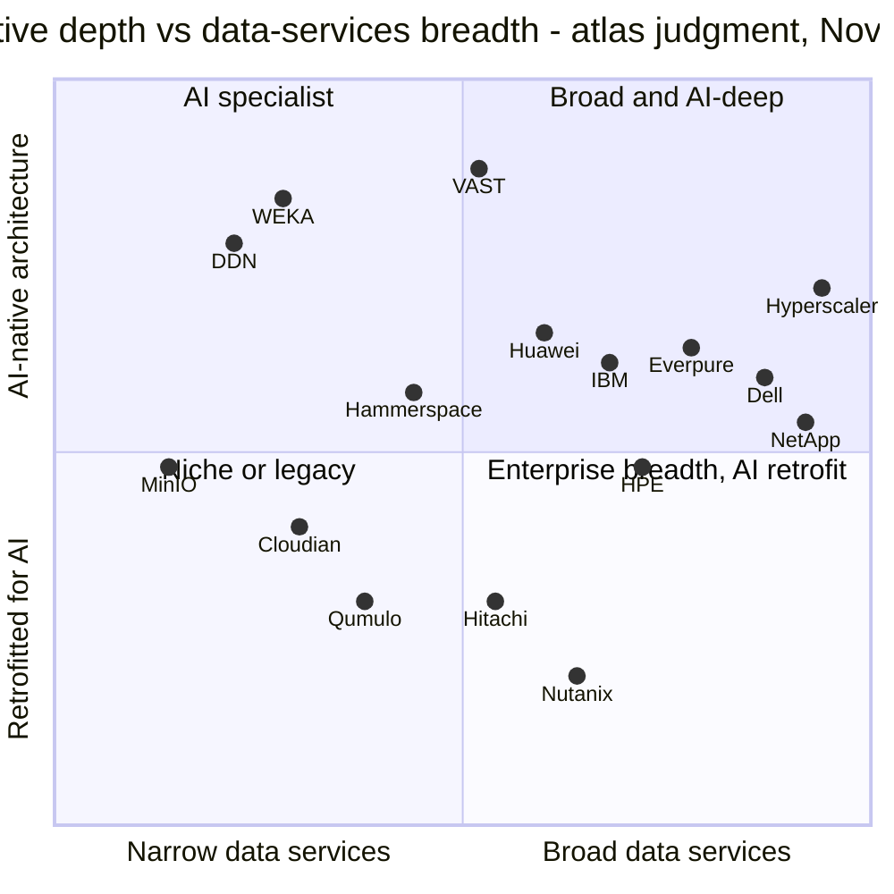
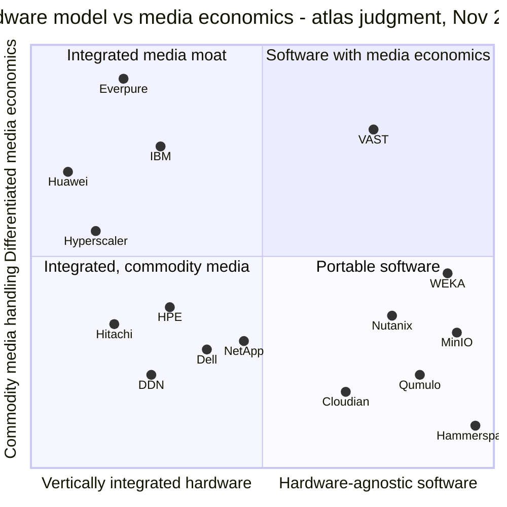
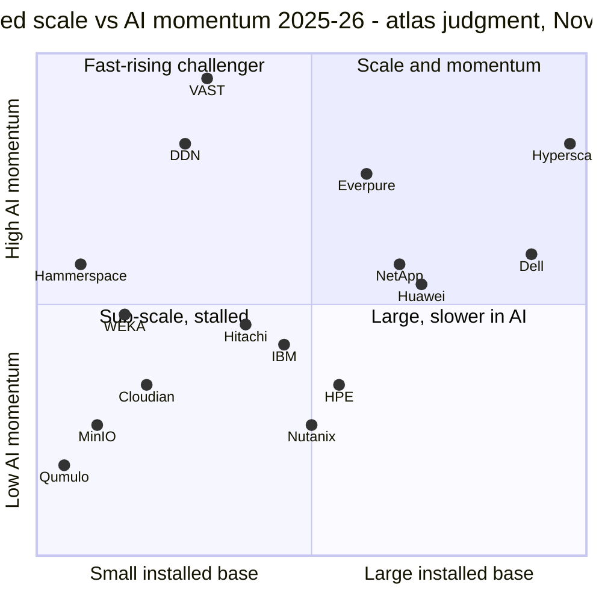

# 49. Competitive landscape matrices

> **Depth:** L2 · **Reading time:** ~7 min · **Last verified:** 2026-11-01
> **Prerequisites:** [Architecture decision matrix](../03-system-architecture/24-architecture-decision-matrix.md) · [Market structure](40-market-structure.md) · [VAST Data](42-vast-data.md) · [WEKA](43-weka.md) · [DDN](44-ddn.md) · [Incumbents](46-incumbents.md) · [Other challengers](47-other-challengers.md)

## TL;DR

- **These matrices are the atlas's judgment,** synthesising Chapters 24 and 40–47. Use them to structure a conversation, not as a ranking.
- **No vendor is top-right on all three quadrant charts.** VAST leads on AI depth and momentum but is thin on enterprise data services; Dell and NetApp lead on breadth and scale with retrofitted AI; hyperscalers serve mostly data already in their cloud.
- **Everpure's distinctive position is media economics.** It pairs vertical integration with differentiated flash management (DirectFlash) and is the only array vendor selling that IP into hyperscalers. Its weakest cells are cloud availability, sovereign presence and data intelligence (offered only since 2026).
- **2025–26 moved the whole field upward.** WEKA made KV-cache offload a commercial product in November 2025; by late 2026 nearly every serious vendor had one. NVIDIA's STX gave twelve partners one reference design, so certification differentiates less.
- **The matrices point to options a strategy team might evaluate:** convert benchmark leadership into neocloud share, widen cloud reach beyond Azure, make data intelligence a full-strength capability, and decide whether the namespace layer above arrays is a partner or a threat.

## Why this matters for Everpure strategy

A strategy team is asked "where do we sit against X?" in many forms. Chapters 42–47 answer vendor by vendor; these matrices give the overview. Each chart reduces the field to two dimensions that decide a class of deals, and the heatmaps show which capability or buyer segment drives each placement. They are also a discipline: a claim such as "Everpure is AI-native" or "Dell can't do AI" has to survive placement next to fifteen rivals, with stated reasons.

## Core concepts

### How the matrices are built

Every coordinate is an ordinal score from 0 to 1, assigned by the atlas from sourced facts in earlier chapters: 0.8 against 0.6 means "clearly ahead", not "33% better". Where an axis overlaps Figure 46.5 in [Chapter 46](46-incumbents.md), the same y-values are reused. Read the quadrant, not the decimal; everything is dated November 2026. "Hyperscaler" is one point for the native storage of AWS, Azure and Google, whose scale is not comparable with any vendor's: S3 alone holds more than 500 trillion objects[^1].

### Matrix 1: AI-native depth versus enterprise data-services breadth

*Figure 49.1 — The top-right is crowded but shallow; the AI-native specialists are deeper but narrower.*

The y-axis, shared with Figure 46.5, measures how much of the AI data path runs on architecture the vendor owns and designed for AI: parallel or disaggregated data paths, GPU-direct I/O, KV-cache tiers, in-storage data services. Partner-sourced capability is discounted. The x-axis differs. Figure 46.5 scored total portfolio breadth, including servers and networking; here it scores the data services a buyer gets *on the storage itself*: protocols, snapshots and replication, ransomware recovery, cloud editions, consumption contracts and cataloguing.

So Everpure moves from 0.46 to 0.78: it sells no servers, but Purity carries one data-services stack across FlashArray and FlashBlade ([Chapter 28](../04-everpure/28-platform-and-software.md)). NetApp ranks highest because ONTAP runs first-party in all three hyperscalers.

Three placements are contestable:

- **VAST at 0.52 breadth.** VAST would argue DataBase, DataSpace and DataEngine out-range any incumbent catalogue[^2]; the atlas discounts this because block arrived only in 2025[^3] and its replication and ransomware tooling have a shorter record.
- **DDN at 0.78 depth, despite Lustre being more than 20 years old.** "AI-native" here means designed for the GPU data path, not new.
- **Hyperscalers at 0.94 breadth.** It applies only to data already in their cloud.

### Matrix 2: integrated hardware versus portable software

*Figure 49.2 — Two routes to media economics: integrate flash management (Everpure, IBM, Huawei) or extract it in software from QLC (VAST); most vendors take neither.*

The x-axis measures how much of the hardware a vendor designs and supplies. The y-axis asks whether the vendor turns NAND into a cost or density advantage through its own flash modules, raw-NAND management, very wide erasure codes on QLC or global reduction. Everpure is the extreme top-left point. Purity managing raw NAND on DirectFlash modules is why two top-five hyperscalers licensed the design[^4] ([Chapter 36](../05-ai-storage/36-hyperscaler-ai-storage.md)); hyperscalers sit left because they build their own systems.

The semiconductor bridge is IDM versus fabless. Everpure, like an integrated device maker, controls the bill of materials but carries supply risk in a NAND shortage ([Chapter 48](48-media-suppliers-and-nand-cycle.md)). VAST is fabless: hardware passes through at cost, so customers absorb the spike[^5].

Three placements are contestable:

- **Everpure at x = 0.20.** Portworx, Cloud Dedicated and EXA's third-party data nodes would pull it right.
- **WEKA at y = 0.46.** It rests on NeuralMesh 6's unproven claim of up to 6x reduction[^6].
- **VAST** drifts left as it ships CNode-X with Supermicro and Cisco.

The main threat to the top-left corner is a standard, not a rival: Flexible Data Placement (FDP) SSDs could let hyperscalers rebuild DirectFlash-like economics.

### Matrix 3: installed scale versus AI momentum

*Figure 49.3 — Outside the hyperscalers, momentum and scale are inversely related; Everpure is the mid-scale vendor furthest above the midline.*

The x-axis is a roughly logarithmic ordering by storage revenue or installed base:

| Vendor | Storage scale |
|---|---|
| Dell | Storage revenue US$16.6B in FY26[^7] |
| NetApp | Revenue US$6.9B[^8] |
| Everpure | FY27 revenue guided above US$5B[^9] |
| HPE | Storage about US$1.3B a quarter[^10] |
| VAST | More than US$500M committed ARR *(company-stated)*[^11] |
| DDN | About US$500M revenue *(reported by Forbes)*[^12] |
| WEKA | More than US$100M ARR *(company-stated)*[^13] |

Huawei is placed by its 11.3% IDC share, above NetApp's 9.6%[^14].

The y-axis aggregates 2025–26 evidence: growth, bookings, valuation, design wins, benchmarks and shipping KV-cache products. VAST tripled its valuation to US$30B[^11] and signed a US$1.17B CoreWeave deal[^15]. DDN said bookings were heading past 3x[^16]. Everpure grew revenue 38% in Q2 FY27[^9], won a second hyperscaler[^4] and posted the top checkpoint result in MLPerf Storage v3.0[^17]. WEKA's valuation is unchanged since 2024, and HPE stopped reselling it in March 2026[^18].

Caution: IDC's 2Q26 market grew 33.6%, mostly from NAND price pass-through ([Chapter 40](40-market-structure.md)), so revenue growth overstates everyone's momentum. Two placements are contestable:

- **Hitachi at y = 0.46.** Storage grew 45%, but block-led[^19], so it is not counted as AI momentum.
- **Dell at y = 0.60.** Dell's storage grew 26% in Q2 FY27 after only 1% for all of FY26[^7].

### Capability heatmap

| Vendor | Block | File | Object | Parallel FS / pNFS | KV-cache offer | NVIDIA cert depth | Data reduction | Multiprotocol, one system | Cloud availability | STaaS | Data intelligence / catalog | Sovereign presence |
|---|---|---|---|---|---|---|---|---|---|---|---|---|
| **Everpure** | ● | ● | ● | ● | ◐ | ● | ● | ● | ◐ | ● | ◐ | ◐ |
| VAST | ◐ | ● | ● | ◐ | ◐ | ● | ● | ● | ◐ | ○ | ● | ● |
| WEKA | ○ | ● | ◐ | ● | ● | ● | ◐ | ◐ | ● | ○ | ○ | ◐ |
| DDN | ○ | ● | ● | ● | ● | ● | ◐ | ◐ | ◐ | ○ | ◐ | ● |
| Dell | ● | ● | ● | ● | ◐ | ● | ● | ◐ | ◐ | ● | ◐ | ● |
| NetApp | ● | ● | ● | ◐ | ◐ | ● | ● | ● | ● | ● | ◐ | ◐ |
| HPE | ● | ◐ | ● | ● | ◐ | ◐ | ● | ◐ | ○ | ● | ◐ | ● |
| IBM | ● | ● | ● | ● | ◐ | ● | ● | ◐ | ◐ | ◐ | ◐ | ◐ |
| Hitachi | ● | ◐ | ◐ | ○ | ○ | ◐ | ● | ◐ | ○ | ◐ | ◐ | ◐ |
| Huawei | ● | ● | ● | ● | ● | ○ | ● | ◐ | ◐ | ○ | ○ | ● |
| Hammerspace | ○ | ● | ◐ | ● | ○ | ○ | ○ | ◐ | ● | ○ | ◐ | ○ |
| Qumulo | ○ | ● | ◐ | ○ | ○ | ○ | ◐ | ◐ | ● | ◐ | ◐ | ○ |
| MinIO | ○ | ○ | ● | ○ | ○ | ○ | ◐ | ○ | ◐ | ○ | ○ | ◐ |
| Cloudian | ○ | ◐ | ● | ○ | ○ | ◐ | ◐ | ◐ | ◐ | ◐ | ◐ | ◐ |
| Nutanix | ● | ● | ● | ○ | ○ | ◐ | ● | ● | ◐ | ○ | ○ | ◐ |
| Hyperscaler | ● | ● | ● | ● | ◐ | – | ○ | ◐ | ● | ● | ● | ◐ |

**Legend:** ● shipping, mature or a core strength · ◐ partial, new, partner-dependent or limited in scope · ○ absent, or not found in the public sources the atlas reviewed · – not applicable. Ratings are the atlas's judgment as of November 2026.

*Figure 49.4 — Everpure's row is the most complete; its three ◐ cells are where VAST, NetApp and DDN are strongest.*

| Column | Evidence behind the ratings |
|---|---|
| KV-cache offer | Everpure Pure KVA with Dynamo since 2025, productised as PureKVA with availability announced for October 2026[^20] (rated ◐, like VAST: general availability was announced for October 2026 but not confirmed by 2026-11-01, although its peer-reviewed MLPerf v3.0 KV-cache results are the strongest public evidence in the field); WEKA Augmented Memory Grid first, November 2025[^21]; DDN Dynamo integration June 2026[^22]; Dell NIXL on PowerScale[^23]; NetApp LMCache offload to ONTAP and StorageGRID[^24]; IBM Storage Scale KV reference design[^25] [VERIFY: Dell, NetApp and IBM KV-cache items read from search summaries only]; HPE evidence sponsored[^26]; Huawei M900[^27]; VAST ◐ because its KV software (VUA, open source since April 2025) is a library rather than a product and its BlueField-4 design ships 2H 2026 |
| NVIDIA cert depth | ● = DGX SuperPOD plus certified storage: Everpure (FlashBlade//S500; FlashBlade//EXA had no completed NVIDIA certification by 2026-11-01)[^28], VAST, WEKA, DDN, NetApp, Dell, IBM. ◐ = narrower: HPE (X10000 Foundation), Hitachi (BasePOD), Nutanix[^29], Cloudian (Foundation)[^30]. ○ = Hammerspace[^31]; Huawei is outside NVIDIA's programmes. Per [Chapter 34](../05-ai-storage/34-nvidia-ecosystem.md) |
| STaaS | Vendor owns hardware, bills for consumption: Evergreen//One, Dell APEX, NetApp Keystone, HPE GreenLake[^32]; IBM[^33] and Hitachi EverFlex[^34] narrower and block-centred |
| Cloud availability | ● = native or first-party service in several clouds (NetApp; WEKA[^35]). Everpure ◐: Azure Native and Cloud Dedicated cover block, no managed EXA[^36] |
| Data intelligence | Everpure ◐: Data Intelligence (ex-1touch) GA only in June 2026[^37] |

*Table 49.5 — The evidence behind the most contested heatmap columns; uncited cells rest on the vendor profiles in Chapters 42–47.*

### Buyer-segment fit heatmap

| Vendor | Enterprise primary | Enterprise AI | Neocloud | Hyperscaler | HPC / government | Edge |
|---|---|---|---|---|---|---|
| **Everpure** | ● | ● | ◐ | ● | ◐ | ◐ |
| VAST | ◐ | ● | ● | ◐ | ◐ | ○ |
| WEKA | ○ | ◐ | ● | ◐ | ◐ | ○ |
| DDN | ○ | ◐ | ● | ◐ | ● | ○ |
| Dell | ● | ● | ◐ | ○ | ● | ● |
| NetApp | ● | ● | ◐ | ◐ | ◐ | ◐ |
| HPE | ● | ◐ | ◐ | ○ | ● | ◐ |
| IBM | ● | ◐ | ○ | ○ | ● | ○ |
| Hitachi | ● | ◐ | ○ | ○ | ◐ | ◐ |
| Huawei | ● | ● | ◐ | ○ | ● | ◐ |
| Hammerspace | ○ | ◐ | ◐ | ● | ◐ | ◐ |
| Qumulo | ◐ | ○ | ○ | ○ | ◐ | ◐ |
| MinIO | ○ | ◐ | ● | ○ | ◐ | ◐ |
| Cloudian | ◐ | ◐ | ◐ | ○ | ◐ | ◐ |
| Nutanix | ● | ◐ | ○ | ○ | ◐ | ● |
| Hyperscaler | ◐ | ● | ○ | – | ◐ | ◐ |

**Legend:** ● proven fit with named public references · ◐ credible but limited, regional or partner-led · ○ rarely competes · – self-supply. Hyperscaler fit means selling into hyperscalers' own infrastructure, not running on their marketplaces. Atlas judgment, November 2026.

*Figure 49.6 — Only Everpure is ● for both enterprise primary and hyperscaler supply; its gaps are neocloud and HPC.*

Everpure gets ● for hyperscaler fit because two top-five hyperscalers licensed DirectFlash[^4]; VAST and DDN reach them mainly through marketplace services or a cloud service's engine (Google Cloud Managed Lustre on EXAScaler)[^38]. Hammerspace gets ● because its parallel NFS runs inside Meta's GenAI clusters[^39]. Huawei's enterprise ● applies only outside the US, given its Entity List designation[^40].

## How Everpure approaches it vs. competitors

The matrices suggest options a strategy team might evaluate, based on public information; none describes Everpure plans.

| Option | Matrix cell it moves | Public evidence to build on | Main risk |
|---|---|---|---|
| Turn benchmark lead into neocloud share | Segment heatmap: neocloud ◐ → ● | MLPerf v3.0 checkpoint and KV-cache results[^17]; EXA multi-tenancy and QoS for neoclouds[^41] [VERIFY: secondary summary only] | VAST's CoreWeave lock-in; neocloud GPU-financing cycles |
| Widen cloud reach beyond Azure | Capability: cloud ◐ → ● | Pure Storage Cloud Azure Native co-developed with Microsoft[^36] | NetApp's three-cloud first-party position is a decade ahead |
| Make data intelligence full-strength | Capability: catalog ◐ → ●; Matrix 1 rightward | Data Intelligence GA, MCP support added October 2026[^37][^20] | Competing with VAST DataBase and NetApp's AI Data Engine plus DataPelago[^42] |
| Extend DirectFlash as merchant IP | Matrix 2 top-left; hyperscaler ● | Meta plus a second top-five design win[^4] | FDP SSDs as a substitute; only two customers |
| Decide on the namespace layer | Matrix 2 right edge | Hammerspace inside Meta[^39]; EXA uses the same pNFS idea | A namespace that commoditises arrays beneath it |
| Close sovereign and HPC gaps by partnering | Segment heatmap: HPC/government ◐ | DDN and HPE references show what is required[^43] | Long sales cycles; relationships held by incumbents |

*Table 49.7 — Most options move a ◐ to a ●; the namespace decision determines whether the array stays the control point.*

Steelman the rivals. VAST's Element Store, spanning files, tables and vectors, already occupies the data-intelligence cell Everpure is entering. NetApp can call Everpure's cloud ◐ structural: ONTAP is first-party on three clouds, Purity on one. Dell can argue that the server purchase order decides segment fit, a column no storage-only vendor fills ([Chapter 46](46-incumbents.md)).

## History and trajectory

What moved in 2025–26:

- **KV-cache tiers.** The column filled from one commercial product in late 2025 to most serious vendors by October 2026 ([Chapter 32](../05-ai-storage/32-inference-and-kv-cache.md)).
- **Certification.** NVIDIA's March 2026 STX programme named twelve storage co-design partners, including Everpure, VAST, WEKA and DDN, and excluded Huawei[^44]. Certification separates vendors less than in 2024.
- **Incumbents** moved up Matrix 1 with NetApp AFX, Dell Lightning and HPE X10000; NetApp also bought AI software[^42].
- **Open-source object.** MinIO's archived repository (April 2026)[^45] moved it down Matrix 3.
- **Everpure** moved up Matrix 3 on MLPerf, a second hyperscaler win and PureKVA.

Four signals to watch in 2027:

1. Whether VAST's database engines win public reference customers.
2. Whether WEKA raises a new priced round or is acquired.
3. Whether FDP adoption erodes DirectFlash's top-left position.
4. Whether NAND normalisation exposes how much 2026 "momentum" was price.

## Numbers that matter

| Metric | Value | Context | Source / date |
|---|---|---|---|
| IDC external storage share, 2Q26 | Dell 23.8%, Huawei 11.3%, NetApp 9.6%, Everpure 8.1%, HPE 6.8% | Scale axis of Matrix 3 | IDC via StorageReview, 2026-09[^14] |
| VAST valuation / committed ARR | US$30B / >US$500M (company-stated) | ~60x; top of the momentum axis | VAST, 2026-04[^11] |
| DDN valuation | US$5B (Blackstone, US$300M) | ~10x reported revenue | Blackstone, 2025-01[^46] |
| WEKA last priced valuation | US$1.6B (May 2024) | Flat while VAST tripled | WEKA, 2024-05[^13] |
| Everpure Q2 FY27 revenue | US$1.19B, +38% | Above-midline momentum at mid-scale | Everpure, 2026-08-26[^9] |
| STX storage co-design partners | 12 | NVIDIA certification now less differentiating | StorageNewsletter, 2026-03-17[^44] |
| Vendors with a shipping KV-cache tier | ~10 of 16 rows rated ● or ◐ | WEKA's AMG was the first commercial one, Nov 2025 | Worked from Figure 49.4 |

## Conversation playbook

**Questions for a PM**

1. *"Which ◐ cell in our row costs the most deals?"* A strong answer names one (cloud availability or neocloud fit), with lost deals and a plan, not a feature roadmap.
2. *"Why aren't we higher than VAST on AI-native depth?"* A strong answer concedes EXA's shorter field record, then cites audited MLPerf results VAST has not entered.
3. *"Is Hammerspace a partner or a threat?"* A strong answer separates accounts where it runs over FlashBlade from those where Tier 0 replaces shared storage.

**Questions for an engineer**

1. *"Is our data-reduction ● a lead on AI data?"* A strong answer cites DeepReduce's expected median 2:1 on FlashBlade[^20] and why compressed AI data reduces less.
2. *"Does DirectFlash still pay once FDP SSDs exist?"* A strong answer quantifies what host-side NAND management does that placement hints cannot: global garbage collection, module density.
3. *"What makes a KV-cache tier ● rather than ◐?"* Dynamo, vLLM and LMCache integration, RDMA into GPU memory, an independent benchmark and named production users.

**Don't say this:**

- "We're top-right on every chart." No vendor is, including Everpure.
- "Huawei doesn't matter." It is #2 by IDC share and a Gartner Leader[^47].
- "NVIDIA certification is our moat." Most rivals hold the same badges, EXA does not yet, and twelve vendors share the STX reference design.
- "Hyperscalers are customers, not competitors." Both statements are true at once.

## Going deeper (optional, L3 pointers)

- For one deal, rebuild a matrix on the two axes the buyer weighs, scoring only the shortlist.
- See the architecture heatmap in [Chapter 24](../03-system-architecture/24-architecture-decision-matrix.md), the NVIDIA certification table in [Chapter 34](../05-ai-storage/34-nvidia-ecosystem.md), the head-to-head in [Chapter 45](45-head-to-head.md), and the diligence scorecard in [Chapter 50](50-diligence-framework.md).

## Key terms

Competitive matrix · quadrant chart · capability heatmap · segment-fit heatmap · AI-native depth · data-services breadth · media economics · vertically integrated storage · hardware-agnostic software · AI momentum · Flexible Data Placement · NVIDIA STX · sovereign presence. See the [glossary](../glossary.md).

## Sources

[^1]: AWS News Blog, "AWS Weekly Roundup: Amazon S3 turns 20, Amazon Route 53 Global Resolver general availability, and more," 2026-03-16. https://aws.amazon.com/blogs/aws/aws-weekly-roundup-amazon-s3-turns-20-amazon-route-53-global-resolver-general-availability-and-more-march-16-2026 (retrieved 2026-11-01).
[^2]: VAST Data, "How it works," n.d. https://vastdata.com/how-it-works (retrieved 2026-11-01).
[^3]: Blocks & Files, "VAST Data expands into block storage and event broking," 2025-02-19. https://www.blocksandfiles.com/ai-ml/2025/02/19/vast-data-expands-into-block-storage-and-event-broking/1600470 (retrieved 2026-11-01).
[^4]: Everpure, "Everpure Lands New Design Win with Second Top Five Hyperscaler," 2026-08-10. https://www.everpuredata.com/company/newsroom/press-releases/everpure-lands-new-design-win-with-second-top-five-hyperscaler.html (retrieved 2026-11-01).
[^5]: Blocks & Files, "VAST Data exits hardware business, pivots to software subscriptions," 2021-04-06. https://blocksandfiles.com/2021/04/06/vast-data-software-subscriptions-pivot/ (retrieved 2026-11-01); HPCwire, "How the memory shortage is impacting AI and HPC projects," 2026-01-15. https://www.hpcwire.com/2026/01/15/how-the-memory-shortage-is-impacting-ai-and-hpc-projects/ (retrieved 2026-11-01).
[^6]: WEKA (via Yahoo Finance), "WEKA Debuts NeuralMesh 6 to Power Enterprise and Agentic AI Workloads at Production Scale," 2026-07-21. https://finance.yahoo.com/technology/ai/articles/weka-debuts-neuralmesh-6-power-130000874.html (retrieved 2026-11-01).
[^7]: Dell Technologies (Business Wire), "Dell Technologies Delivers Fourth Quarter and Full Year Fiscal 2026 Results," 2026-02-26. https://www.businesswire.com/news/home/20260226276981/en/Dell-Technologies-Delivers-Fourth-Quarter-and-Full-Year-Fiscal-2026-Results (retrieved 2026-11-01); StorageNewsletter, "Dell Technologies: Fiscal 2Q27 Financial Results," 2026-09-03. https://www.storagenewsletter.com/2026/09/03/dell-technologies-fiscal-2q27-financial-results/ (retrieved 2026-11-01).
[^8]: NetApp (Business Wire), "NetApp Reports Fourth Quarter and Fiscal Year 2026 Results," 2026-05-28. https://www.businesswire.com/news/home/20260528348500/en/NetApp-Reports-Fourth-Quarter-and-Fiscal-Year-2026-Results (retrieved 2026-11-01).
[^9]: Everpure, "Everpure Announces Second Quarter Fiscal 2027 Financial Results," 2026-08-26. https://investor.everpuredata.com/news-and-events/press-releases/press-release-details/2026/Everpure-Announces-Second-Quarter-Fiscal-2027-Financial-Results/default.aspx (retrieved 2026-11-01).
[^10]: SEC, "Hewlett Packard Enterprise Co. Form 8-K, Exhibit 99.1 (fiscal 2026 third quarter results)," 2026-09-02. https://www.sec.gov/Archives/edgar/data/0001645590/000164559026000078/ex-991x922026x8k.htm (retrieved 2026-11-01).
[^11]: CNBC, "Nvidia backs AI company Vast Data at $30 billion valuation," 2026-04-22. https://www.cnbc.com/2026/04/22/nvidia-backs-ai-company-vast-data.html (retrieved 2026-11-01); Futurum, "VAST Data Valuation Triples. Can a Unified Platform Scale AI Globally?," 2026-04. https://futurumgroup.com/insights/vast-data-valuation-triples-can-a-unified-platform-scale-ai-globally/ (retrieved 2026-11-01).
[^12]: I. Martin, Forbes, "AI's Latest Rocket Ship Is An Old School, 28-Year-Old Data Company," 2026-08-06. https://www.forbes.com/sites/iainmartin/2026/08/06/ais-latest-rocket-ship-is-an-old-school-28-year-old-data-company/ (retrieved 2026-11-01; read via search extracts).
[^13]: WEKA, "A Strategic Step Forward for WEKA: An Open Letter From Our CEO," 2025-02. https://www.weka.io/article/a-strategic-step-forward-for-weka-an-open-letter-from-our-ceo (retrieved 2026-11-01); WEKA, "WEKA Nets $140M in Series E Funding at $1.6B Valuation," 2024-05-15. https://www.weka.io/news/weka-nets-140m-in-series-e-funding-at-1-6b-valuation (retrieved 2026-11-01).
[^14]: StorageReview, "IDC External Storage Tracker: $10.3 Billion in Q2 2026 as Server Market Tops $166 Billion on AI Demand," 2026-09. https://www.storagereview.com/news/idc-external-storage-tracker-q2-2026-10-3-billion-as-server-market-tops-166-billion (retrieved 2026-11-01).
[^15]: Reuters (via Yahoo Finance), "Exclusive: Nvidia-backed Vast Data inks $1.17 billion AI deal with CoreWeave," 2025-11-06. https://finance.yahoo.com/news/exclusive-nvidia-backed-vast-data-120456403.html (retrieved 2026-11-01).
[^16]: vmblog (D. Marshall), "DDN says bookings are heading past 3x, and its pitch is simple: stop letting your GPUs sit around," 2026-10-14. https://vmblog.com/bylines/ddn-says-bookings-are-heading-past-3x-and-its-pitch-is-simple-stop-letting-your-gpus-sit-around/ (retrieved 2026-11-01; search extract only).
[^17]: MLCommons via GlobeNewswire, "MLCommons Releases New MLPerf Storage v3.0 Benchmark Results," 2026-09-01. https://www.globenewswire.com/news-release/2026/09/01/3354412/0/en/mlcommons-releases-new-mlperf-storage-v3-0-benchmark-results.html (retrieved 2026-11-01); StorageReview, "MLPerf Storage v3.0: 877 GiB/s Checkpoints, a Cloud First, and a Leaderboard Turned Over," 2026-09. https://www.storagereview.com/news/mlperf-storage-v3-0-877-gib-s-checkpoints-a-cloud-first-and-a-leaderboard-turned-over (retrieved 2026-11-01).
[^18]: Blocks & Files, "HPE stops selling Qumulo, Scality and WEKA software," 2025-11-07. https://www.blocksandfiles.com/file/2025/11/07/hpe-stops-selling-qumulo-scality-and-weka-software/1721655 (retrieved 2026-11-01).
[^19]: Hitachi Vantara, "Hitachi Vantara Achieves Strong Q1 Revenue Growth as VSP One Drives...," 2026-08-12. https://www.hitachivantara.com/en-us/news/gl260812 (retrieved 2026-11-01).
[^20]: Blocks & Files, "Everpure bulks up AI offer," 2026-09-30. https://blocksandfiles.com/flash/2026/09/30/everpure-bulks-up-ai-offer/5300162 (retrieved 2026-11-01); StorageReview, "Everpure Adds PureKVA to FlashBlade, Claims Up to 20x Faster Time to First Token, and Makes DeepReduce Always-On," 2026. https://www.storagereview.com/news/everpure-purekva-flashblade-20x-time-to-first-token-always-on-deepreduce (retrieved 2026-11-01).
[^21]: WEKA, "WEKA Breaks The AI Memory Barrier With Augmented Memory Grid on NeuralMesh," 2025-11-18. https://www.weka.io/news/weka-breaks-the-ai-memory-barrier-with-augmented-memory-grid (retrieved 2026-11-01).
[^22]: Blocks & Files, "DDN launches faster array HW and KV cache SW for AI," 2026-06-24. https://www.blocksandfiles.com/ai-ml/2026/06/24/ddn-launches-faster-array-hw-and-kv-cache-sw-for-ai/5261447 (retrieved 2026-11-01).
[^23]: Blocks & Files, "Dell PowerScale gets struck by Lightning and goes parallel," 2025-11-17. https://blocksandfiles.com/2025/11/17/dell-powerscale-gets-struck-by-lightning-and-goes-parallel/ (retrieved 2026-11-01; search-summary only); StorageReview, "Dell expands AI Factory with NVIDIA at GTC 2026: new data engines, Lightning File System and Exascale Storage," 2026-03. https://www.storagereview.com/news/dell-expands-ai-factory-with-nvidia-at-gtc-2026-new-data-engines-lightning-file-system-and-exascale-storage (retrieved 2026-11-01; search-summary only).
[^24]: NetApp, "KV cache offloading with NetApp," NetApp Solutions for AI documentation, n.d. (2026). https://docs.netapp.com/us-en/netapp-solutions-ai/software/ai-kv-cache-offloading-netapp.html (retrieved 2026-11-01; search-summary only).
[^25]: Blocks & Files, "Big Blue's Redbook on Storage Scale KV cache management," 2026-06-09. https://www.blocksandfiles.com/file/2026/06/09/big-blues-redbook-on-storage-scale-kv-cache-management/5252866 (retrieved 2026-11-01; search-summary only); IBM Redbooks, "Context Without Limits: A High-Performance KV Cache Platform for Large-Scale AI Inference," 2026-06. https://www.redbooks.ibm.com/docs/MD260021/MD260021.html (retrieved 2026-11-01; search-summary only).
[^26]: Blocks & Files (Partner Content), "HPE puts storage to work on AI's expensive memory problem," 2026-10-29. https://www.blocksandfiles.com/ai-ml/2026/10/29/partner-content-hpe-puts-storage-to-work-on-ais-expensive-memory-problem/5305788 (retrieved 2026-11-01).
[^27]: Huawei, "Huawei Introduces OceanStor M900 Context Memory Storage to Accelerate AI Inference in Hyperscale Data Centers," 2026-09. https://e.huawei.com/de/news/2026/solutions/storage/hc-context-memory-storage (retrieved 2026-11-01).
[^28]: Blocks & Files, "Pure Storage's FlashBlade//S500 gains Nvidia SuperPOD certification," 2024-11-18. https://www.blocksandfiles.com/ai-ml/2024/11/18/pure-storages-flashblade/s500-gains-nvidia-superpod-certification/1598641 (retrieved 2026-11-01); NVIDIA Docs, "List of NVIDIA-Certified Storage Systems," n.d. https://docs.nvidia.com/certification-programs/certified-storage/latest/systems-list.html (retrieved 2026-11-01; search-summary only).
[^29]: HPCwire/BigDATAwire, "Nutanix Unified Storage Achieves NVIDIA Certification as Enterprises Race to Build AI Factories," 2026-06. https://www.hpcwire.com/bigdatawire/this-just-in/nutanix-unified-storage-achieves-nvidia-certification-as-enterprises-race-to-build-ai-factories/ (retrieved 2026-11-01).
[^30]: Cloudian, "Cloudian HyperStore Achieves NVIDIA-Certified Storage Designation," 2026-03-16. https://cloudian.com/press/cloudian-hyperstore-achieves-nvidia-certified-storage-designation.md (retrieved 2026-11-01).
[^31]: StorageReview, "Best Storage Arrays 2026: AI Storage Leaders and Audited Results," updated 2026-09-01. https://www.storagereview.com/best/storage-arrays (retrieved 2026-11-01).
[^32]: StorageNewsletter, "HPE GreenLake, suite of pay-per-use solutions," 2017-12-06. https://www.storagenewsletter.com/2017/12/06/hpe-greenlake-suite-of-pay-per-use-solutions/ ; Blocks & Files, "NetApp adds Keystone subscription billing," 2019-10-29. https://blocksandfiles.com/2019/10/29/netapp-adds-keystone-subscription-billing/ ; TechTarget, "Dell Apex launches data storage, cloud as-a-service options," 2021-05. https://www.techtarget.com/searchstorage/news/252500268/Dell-Apex-launches-data-storage-cloud-as-a-service-options (all retrieved 2026-11-01).
[^33]: IBM, "IBM Storage as a Service," n.d. https://www.ibm.com/products/storage-as-a-service (retrieved 2026-11-01; search-summary only).
[^34]: Hitachi Vantara, "Top ten reasons why Hitachi EverFlex STaaS" (datasheet), n.d. https://www.hitachivantara.com/content/dam/hvac/pdfs/datasheet/top-ten-reasons-why-hitachi-everflex-staas.pdf (retrieved 2026-11-01; search-summary only).
[^35]: HPCwire, "WEKA Unveils Multicloud Data Platform for AI and Next-Gen Workloads," 2022-06. https://www.hpcwire.com/off-the-wire/weka-unveils-multicloud-data-platform-for-ai-and-next-gen-workloads/ (retrieved 2026-11-01).
[^36]: Microsoft Learn, "Pure Storage Cloud overview," n.d. https://learn.microsoft.com/en-us/azure/partner-solutions/pure-storage/overview (retrieved 2026-11-01); Pure Community, "Pure Cloud Block Store is now Pure Storage Cloud Dedicated," n.d. https://purecommunity.purestorage.com/tag/cloud (retrieved 2026-11-01).
[^37]: SEC, "Everpure Form 10-Q (Q1 FY27)," 2026-06. https://www.sec.gov/Archives/edgar/data/0001474432/000147443226000061/pstg-20260503.htm (retrieved 2026-11-01); HPCwire/BigDATAwire, "Everpure Announces Data Stream to Expand AI-Ready Data Offerings," 2026-06-17. https://www.hpcwire.com/bigdatawire/this-just-in/everpure-announces-data-stream-to-expand-ai-ready-data-offerings/ (retrieved 2026-11-01).
[^38]: DDN via Business Wire, "Google Cloud Managed Lustre Powered by DDN EXAScaler Offering High-Performance File System Now Generally Available for AI and HPC Workloads," 2025-07-08. https://www.businesswire.com/news/home/20250708259327/en/ (retrieved 2026-11-01).
[^39]: Meta Engineering, "Building Meta's GenAI Infrastructure," 2024-03-12. https://engineering.fb.com/2024/03/12/data-center-engineering/building-metas-genai-infrastructure/ (retrieved 2026-11-01).
[^40]: US Department of Commerce, Bureau of Industry and Security, "Addition of Entities to the Entity List," Federal Register 84 FR 22961, 2019-05-21. https://www.federalregister.gov/documents/2019/05/21/2019-10616/addition-of-entities-to-the-entity-list (retrieved 2026-11-01).
[^41]: Coolspirit, "Pure Accelerate 2026: What the latest announcements mean for enterprise storage," 2026-06. https://www.coolspirit.co.uk/blogs/pure-accelerate-2026-what-the-latest-announcements-mean-for-enterprise-storage (retrieved 2026-11-01).
[^42]: Blocks & Files, "NetApp disaggregates ONTAP storage and provides an AI Data Engine," 2025-10-14. https://blocksandfiles.com/2025/10/14/netapp-disaggregates-ontap-storage-and-provides-an-ai-data-engine/ (retrieved 2026-11-01); NetApp, "NetApp Acquires DataPelago, Making Data AI-Ready at the Infrastructure Layer," 2026-07-16. https://www.netapp.com/en/newsroom/press-releases/news-rel-20260716-210092/ (retrieved 2026-11-01).
[^43]: StorageNewsletter, "SC25: DDN Launches Sovereign AI Solutions Based on NVIDIA AI Data Platform Reference Design," 2025-11-21. https://www.storagenewsletter.com/2025/11/21/sc25-ddn-launches-sovereign-ai-solutions-based-on-nvidia-ai-data-platform-reference-design-trusted-tested-and-proven-for-sovereign-grade-ai/ (retrieved 2026-11-01).
[^44]: StorageNewsletter, "Nvidia GTC 2026: Nvidia Launches BlueField-4 STX Storage Architecture With Broad Industry Adoption," 2026-03-17. https://www.storagenewsletter.com/2026/03/17/nvidia-gtc-2026-nvidia-launches-bluefield-4-stx-storage-architecture-with-broad-industry-adoption/ (retrieved 2026-11-01).
[^45]: GitHub, "minio/minio" repository page (archive banner dated 2026-04-25), n.d. https://github.com/minio/minio (retrieved 2026-11-01).
[^46]: Blackstone, "Blackstone Invests $300 Million at a $5 Billion Valuation in DDN, AI and Data Intelligence Solutions Leader, to Fuel Further Rapid Growth," 2025-01-08. https://www.blackstone.com/news/press/blackstone-invests-300-million-at-a-5-billion-valuation-in-ddn-ai-and-data-intelligence-solutions-leader-to-fuel-further-rapid-growth/ (retrieved 2026-11-01).
[^47]: Everpure, "Everpure Named a Leader in the 2026 Gartner Magic Quadrant for Enterprise Storage Platforms," 2026-08-21. https://www.everpuredata.com/company/newsroom/press-releases/everpure-named-leader-2026-gmq-enterprise-storage-platforms.html (retrieved 2026-11-01); StorageReview, "Gartner MQ for Enterprise Storage 2026: Everpure tops both axes again as the six leaders hold," 2026-08. https://www.storagereview.com/news/gartner-magic-quadrant-for-enterprise-storage-2026-everpure-tops-both-axes-again-as-the-six-leaders-hold (retrieved 2026-11-01).
