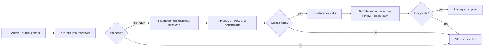
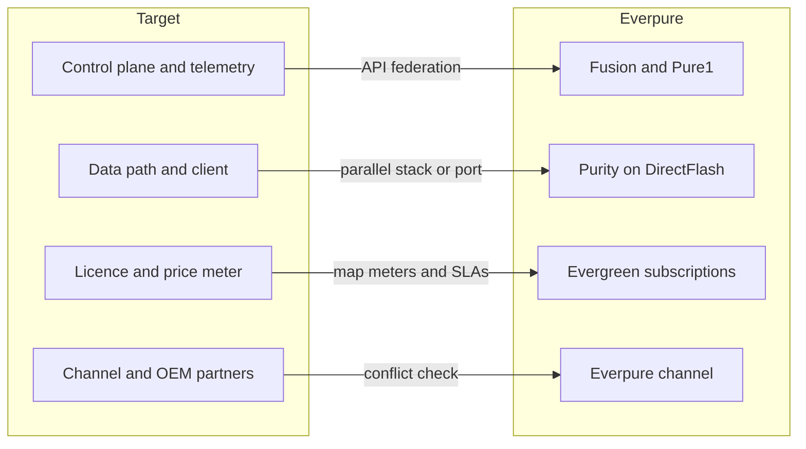
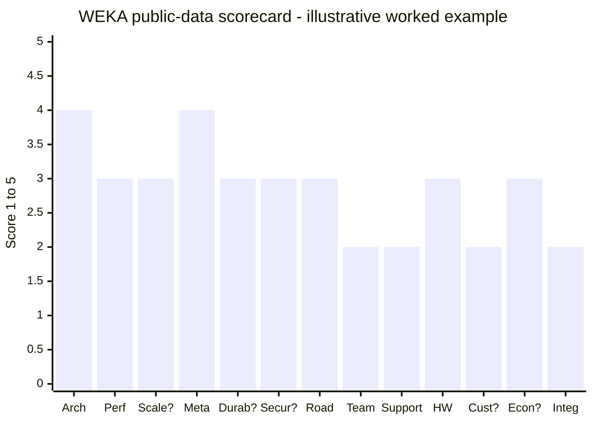

# 50. Technical diligence framework for storage/AI-data targets

> **Depth:** L2 · **Reading time:** ~10 min · **Last verified:** 2026-11-01
> **Prerequisites:** [Architecture decision matrix](../03-system-architecture/24-architecture-decision-matrix.md) · [Reading benchmarks](../05-ai-storage/37-reading-benchmarks.md) · [Distributed systems fundamentals](../03-system-architecture/20-distributed-systems-fundamentals.md) · [WEKA deep dive](43-weka.md)

## TL;DR

- **Storage diligence asks one question: will this code keep other people's data safe, fast and supportable at ten times today's scale?** The process is standard software M&A. The critical risks (durability bugs, metadata walls, support load) do not appear in a data room by default.
- **Treat every performance number as a claim until you reproduce it.** Normalise it per node, per rack unit, per kW and per usable TB. Then run your own proof of concept (PoC) on your own workload shape ([Chapter 37](../05-ai-storage/37-reading-benchmarks.md)).
- **Field data beats models.** Annualised failure rates, rebuild-time distributions, data-loss incident logs and phone-home telemetry tell you more than any "eleven nines" durability figure.
- **Integration fit with Everpure has four seams: control plane, data path, licensing and channel.** The data path is the expensive one. Purity and DirectFlash assume a single operating system managing raw NAND, so a second file system is a second product line, not a feature.
- **Public data can score a target, but only roughly.** In the WEKA worked example, 38% of the weight rests on low-confidence scores, four of them placeholders; the score is 2.8 of 5, with a plausible range of 2.1 to 3.7.

## Why this matters for Everpure strategy

The AI storage cycle has produced private companies with large valuations and immature evidence. WEKA was last priced at US$1.6B in May 2024[^1] and VAST at a reported US$30B in April 2026[^2]. Any build/buy/partner discussion at Everpure (NYSE: P, formerly PSTG) about AI data infrastructure ([Chapter 54](../07-history-and-future/54-strategic-option-map.md)) ends in questions a financial model cannot answer. Does it scale past the customer's next cluster? Has it ever lost data? Could it run under Fusion and on DirectFlash? Everpure's record is small and mid-sized software deals, such as Portworx at US$352.9M plus US$32.2M of retention payments[^3] and 1touch at US$125.0M in 2026[^4]. A frontier-AI target would be a different order of risk.

An ex-semis dealmaker already knows the analogous discipline. You would not buy a chip company on its datasheet. You would ask for characterisation across process corners, the errata list, RMA history, the tape-out record and third-party IP licences. Storage diligence maps onto each. Benchmarks are the datasheet. Data-loss incidents are the errata, except that they destroy customer data. Field failure rates are the RMA history, and open-source dependencies are the third-party IP.

## Core concepts

### The diligence flow

*Figure 50.1 — Technical diligence is a funnel with three kill gates; the cheap public teardown should kill most targets before anyone signs an NDA.*

Access gets more expensive at each stage. The **public-info teardown** reads documentation, patents, benchmark submissions, GitHub repositories, job postings and certification lists; vendor documentation is far more candid about limits than marketing. **Management technical sessions** under NDA should be run by your own architects, not the corp-dev team. **The PoC** is where most deals should die if they are going to: the acquirer's workload shape, ideally its hardware, and its engineers at the keyboard. **Reference calls** should include a churned customer and the largest deployment, not just the three the target offers. **Code review** comes last, under a clean-team protocol, because it exposes trade secrets and, if the deal fails, contaminates the acquirer's engineers.

### The dimensions that matter

**Architecture and its walls.** Every architecture class has a known first wall ([Chapter 24](../03-system-architecture/24-architecture-decision-matrix.md)). Shared-nothing clusters hit rebalancing and east-west traffic ([Chapter 15](../03-system-architecture/15-scale-out-shared-nothing.md)). Disaggregated shared-everything designs hit fabric and enclosure failure domains ([Chapter 16](../03-system-architecture/16-disaggregated-shared-everything.md)). Parallel file systems hit the metadata server ([Chapter 17](../03-system-architecture/17-parallel-file-systems.md)). Good teams name their own wall in the first session.

**Performance claims.** Normalise before comparing. Suppose a vendor claims 1 TB/s from 40 nodes. That is 25 GB/s per node. If each node has 2×400 GbE (100 GB/s of line rate), the system runs at 25% of wire speed. That is either honest headroom or a software ceiling, and only a PoC tells you which. [Chapter 37](../05-ai-storage/37-reading-benchmarks.md) lists the gaming techniques.

**Scalability and metadata.** Capacity, performance and metadata are three separate curves, and vendors usually quote only the flattering one ([Chapter 21](../03-system-architecture/21-metadata.md)). The semiconductor bridge is tag RAM. A centralised metadata server is a single tag array that every access must consult, so it saturates. Sharded metadata spreads the load, but operations spanning shards, such as renames and snapshots, become distributed transactions.

**Durability and data integrity.** This is the dimension most likely to destroy deal value, and the one data rooms least often cover. Durability in "nines" is a model output, a mean time to data loss (MTTDL) estimate ([Chapter 20](../03-system-architecture/20-distributed-systems-fundamentals.md)), not a field fact. Field evidence is what counts. As a public baseline, Backblaze reported a 1.36% annualised failure rate (AFR) across about 344,000 hard drives in 2025[^5]. Worked example: a target with 500 clusters averaging 200 drives has 100,000 drives in the field. At 1% AFR that is 1,000 failures a year, about three rebuilds a day somewhere in the fleet. The question is how many rebuilds overlapped a second fault, and what happened then. Telemetry is also how the industry measured silent corruption: a FAST '08 study used NetApp call-home data from 1.53 million drives over 41 months[^6]. A target without equivalent telemetry cannot answer at all.

**Security and roadmap.** Ransomware resilience means snapshots that an administrator credential cannot delete (Everpure's equivalent is SafeMode) and multi-party approval for destructive operations. Treat the roadmap as a tape-out record: dated announcements against dated general availability (GA). Slips are normal; re-announcements are not.

**Code base and team.** Map who wrote the data path and metadata engine, and whether they will stay. Run software composition analysis for open-source licences, because copyleft travels. Lustre is GPLv2[^7], so distributed modifications to its kernel modules carry source obligations. MinIO moved its server to AGPLv3 in 2021[^8], whose obligations can be triggered by network use. Disputes happen. In March 2023 MinIO said it had revoked WEKA's licences, and WEKA replied that its fork derived only from Apache 2.0 code[^9]. No public resolution was found.

**Support burden.** Supporting many servers, NICs, kernels and clouds means a large qualification matrix, a cost hidden in operating expenses rather than gross margin. Telemetry is itself an asset. HPE bought Nimble in 2017 largely for InfoSight[^10], and Pure1 META has run on phone-home data since 2017[^11].

**Hardware and supply chain.** An appliance vendor carries NAND exposure directly; Everpure raised prices in February 2026 as NAND costs surged[^12] ([Chapter 48](48-media-suppliers-and-nand-cycle.md)). A software-only vendor pushes that exposure to customers but depends on partners' goodwill.

**Customer concentration.** AI-native storage revenue clusters in a few neoclouds and model builders whose spend follows GPU deliveries ([Chapter 35](../05-ai-storage/35-ai-factories-and-neoclouds.md)).

**Unit economics.** Gross margin depends on what is sold. Illustratively, software at 85% gross margin and pass-through hardware at 20% blend to 0.6 × 85% + 0.4 × 20% = **59%** when hardware is 40% of revenue. Margin can move with packaging mix, independent of pricing power. For reference, Everpure's non-GAAP Q2 FY27 gross margin was 66.2% on product and 74.9% on subscription[^13] ([Chapter 29](../04-everpure/29-hyperscaler-ecosystem-financials.md)).

| Dimension | Key questions | Evidence to request | Red flags |
|---|---|---|---|
| Architecture and walls | Which wall does this class hit, and at what scale? | Architecture docs; largest-cluster topology; failure-domain map | Team cannot name its wall; largest customer already near it |
| Performance claims | Do the numbers survive normalisation and our workload? | Raw benchmark configs; audited submissions; PoC on our hardware | Vendor-run only; withdrawal from audited rounds; reduction assumed in headline |
| Scalability | How do capacity, throughput and metadata scale separately? | Node, file and metadata-op counts for the top five clusters | Only capacity quoted; sub-linear curve beyond tens of nodes |
| Metadata design | How is the namespace partitioned, and how are cross-shard operations kept atomic? | Design docs; small-file and rename benchmarks | Single metadata server; small-file collapse; no crash-consistency testing |
| Durability and integrity | Has it lost or corrupted customer data, and how do you know? | Data-loss incident log; field AFR; rebuild-time distribution; checksum design | No end-to-end checksums; no incident log; "nines" offered instead of field data |
| Security and ransomware | Can an admin credential destroy the data? | Immutability design; pen-test reports; CVE response times | Deletable snapshots; no external testing; weak tenant isolation |
| Roadmap credibility | Did announced features ship when promised? | Three years of dated announcements vs GA dates | Re-announced features; GA slips over a year |
| Code and team | Who wrote the core, and will they stay? Are licences clean? | Commit history by author; tenure and vesting; SBOM and licence scan | Core authors gone; copyleft in proprietary paths; open licence disputes |
| Support and telemetry | What does each installed system cost to support? | Tickets per system; severity mix; share detected by phone-home | Large qualification matrix; customers find most issues first |
| Hardware and supply chain | What breaks if a partner or component goes away? | Bill of materials; sole-source list; partner agreements | Single-sourced parts; partner with a competing product |
| Customer concentration | How much revenue sits in the top five? | Revenue by customer; contract terms; committed vs consumed capacity | One customer above 30%; exclusivity or most-favoured terms |
| Unit economics | What does margin look like by packaging mix? | Gross margin by software, appliance and cloud; burn; cohort expansion | Margin falling with mix; growth bought with hardware at cost |
| Integration fit | Which of the four seams must close, and how fast? | Target's APIs, drive assumptions, licence meters, channel contracts | Full Purity overlap; OEM channel conflict; change-of-control clauses |

*Table 50.1 — The reusable checklist: each row pairs the question with the evidence that answers it and the signal that should stop the deal.*

### Integration fit: the four seams

*Figure 50.2 — Control-plane federation takes months and data-path convergence years (illustrative), because Purity manages raw NAND that the target's software has never seen.*

**Control plane.** Fusion is the fleet control plane at the core of the Enterprise Data Cloud[^14] ([Chapter 22](../03-system-architecture/22-control-planes.md)); exposing a target's clusters to it through APIs is the cheapest integration. **Data path.** Purity runs the flash translation layer (FTL) across DirectFlash modules itself ([Chapter 26](../04-everpure/26-purity-and-directflash.md)). A target built for commodity SSDs runs as a parallel stack or is ported, a multi-year job. **Licensing.** Evergreen//One SLAs commit Everpure to performance and durability guarantees ([Chapter 28](../04-everpure/28-platform-and-software.md)); anything sold under them inherits that bar. **Channel.** A target's OEM partners may be Everpure's competitors.

### The scorecard

| Dimension | Weight | 1 = red flag | 3 = acceptable | 5 = best in class |
|---|---|---|---|---|
| Architecture and walls | 10 | Wall within the next customer's scale; team cannot name it | Known wall beyond the current largest deployment | Wall well beyond roadmap scale, with a published mitigation |
| Performance claims | 8 | Vendor-run only; not reproducible | Some audited results; PoC within 20% of claims | Audited results in current rounds; PoC matches claims |
| Scalability (capacity, perf) | 7 | Sub-linear beyond a few dozen nodes | Near-linear to the largest customer | Proven linear at multiples of the largest customer |
| Metadata design | 6 | Single metadata server; small-file collapse | Scale-out metadata with known hot spots | Sharded, with atomic cross-shard operations at scale |
| Durability and integrity | 10 | Unexplained data-loss incidents; no end-to-end checksums | End-to-end checksums; incidents disclosed and fixed | Fleet telemetry, scrubbing, clean multi-year incident log |
| Security and ransomware | 6 | Snapshots deletable by an admin credential | Immutable snapshots; encryption at rest | Multi-party authorisation, tenant isolation, external pen tests |
| Roadmap credibility | 6 | Re-announced features; GA slips over a year | Slips of a quarter or two | Ships on announced dates |
| Code base and team | 10 | Key authors gone; copyleft contamination | Core authors retained; licences clean | Deep bench, low attrition, clean SBOM |
| Support burden | 6 | Huge qualification matrix; vendor rarely detects first | Manageable matrix; partial telemetry | Narrow matrix, call-home on most systems |
| Hardware and supply chain | 6 | Single-sourced critical parts; partner can defect | Multiple qualified sources | Hardware-portable, or sourced at scale |
| Customer concentration | 7 | One customer above 30% of revenue | Top 10 below 50% | Broad base across segments |
| Unit economics | 8 | Gross margin falling with mix; heavy burn | Stable margin; burn funded | Software-like margin; self-funding |
| Integration fit with Everpure | 10 | Full overlap with Purity; channel conflict | Partial overlap; Fusion federation feasible | Complementary layer; clean channel fit |

*Table 50.2 — A reusable 13-dimension scorecard, weighted toward the dimensions where a mistake costs the most after close (architecture, durability, team, integration).*

### Worked example: WEKA, public data only

WEKA is the chosen case because its public record ([Chapter 43](43-weka.md)) is unusually documented for a private company. It is a software-only target, which exercises every dimension. *This is a method illustration, not a recommendation, and it implies nothing about non-public Everpure plans.* Where public data is silent, the dimension gets a **placeholder 3** with low confidence. Customer concentration is the one low-confidence dimension scored below 3, because the visible references lean on a few neoclouds and labs.

| Dimension (weight) | Score | Known from public sources | Unknown without diligence access | Confidence |
|---|---|---|---|---|
| Architecture (10) | 4 | Kernel-bypass data path; proprietary client on every compute node[^15]; EC stripe fixed at cluster formation[^16] | Behaviour at the largest production scale | Medium |
| Performance (8) | 3 | Topped SPECstorage 2020 in 2025[^17]; absent from MLPerf Storage v3.0[^18]; AMG 20x TTFT claim is vendor-run[^19] | PoC on the acquirer's workloads | Medium |
| Scalability (7) | 3 | 16+4 EC implies ~80+ servers[^16] | Largest cluster by nodes, files, metadata ops | Low |
| Metadata (6) | 4 | Metadata hashed into buckets on every node[^20] | Cross-shard operation cost at scale | Medium |
| Durability (10) | 3 | 2 or 4 parity strips per stripe[^16] | Field AFR, rebuild data, incident log | Low |
| Security (6) | 3 | NeuralMesh 6 adds per-tenant keys and isolation[^21] | Immutability, pen tests, CVE history | Low |
| Roadmap (6) | 3 | AMG: unveiled March 2025[^22], available November 2025[^19]; NeuralMesh 6 GA planned 2H 2026[^21], no GA announcement found by 2026-11-01 | Whether NeuralMesh 6 hit GA on time | Medium |
| Team and code (10) | 2 | President, CFO, CRO left December 2024[^23]; next CFO left after four months[^24]; MinIO licence dispute[^9] | Key-author retention, SBOM | Medium |
| Support (6) | 2 | Many hardware partners[^25] and four clouds; HPE stopped reselling March 2026[^26] | Tickets per system, telemetry coverage | Medium |
| Hardware (6) | 3 | Software-only, but WEKApod 3 adds direct SSD exposure[^27] | WEKApod revenue share, supply terms | Medium |
| Customers (7) | 2 | References skew to neoclouds, AI labs and OCI[^28] | Revenue by customer | Low |
| Economics (8) | 3 | >US$100M ARR in 2024 *(company-stated)*[^29]; list ~US$339/TB/yr[^30] [VERIFY: single reseller listing] | Gross margin, burn, mix | Low |
| Integration fit (10) | 2 | Overlaps Purity//FB and EXA; proprietary client vs pNFS; OEM partners compete with Everpure | Port effort to DirectFlash | Medium |

*Table 50.3 — Public data is decent on architecture and roadmap but silent on durability, customers and economics, the dimensions a buyer most needs.*

*Figure 50.3 — WEKA scores well on engineering and poorly on team stability, support load and Everpure fit; "?" marks low-confidence scores (four placeholder 3s and the customer score of 2).*

**Reading the result.** The weighted score is 283 ÷ 100 = **2.83**. The five low-confidence dimensions (scalability, durability, security, customers, economics) carry 38 points of weight. Scoring them all 1 gives 2.14, and scoring them all 5 gives 3.66. Public data cannot tell a mediocre target from a good one, but it does set the agenda: field durability data, customer concentration and margin mix come first.

**Options a strategy team might evaluate, based on public information.** The score favours lighter-touch options over a full acquisition. These include interoperability (Everpure object storage as a WEKA tier), competing head-on with PureKVA[^31] against AMG, or monitoring signals such as financing events and MLPerf participation ([Chapter 43](43-weka.md)). The integration score of 2 reflects data-path overlap, the costliest seam. The same template applied to VAST ([Chapter 42](42-vast-data.md)) or DDN ([Chapter 44](44-ddn.md)) would raise other questions: valuation and data-reduction IP for VAST, Lustre GPL obligations and appliance margin for DDN.

## How Everpure approaches it vs. competitors

| Acquirer | Deal | What was bought | Integration pattern | Diligence lesson |
|---|---|---|---|---|
| Pure Storage (now Everpure) | StorReduce, 2018, US$20.5M[^32] | Dedupe for cloud object storage | Technology tuck-in | Small deals are bets on code and team |
| Pure Storage | Portworx, 2020, US$352.9M + US$32.2M retention[^3] | Kubernetes data services that run on any storage | Separate brand, hardware-agnostic | Retention structure is part of the price |
| Everpure | 1touch, 2026, US$125.0M[^4] | Data discovery and classification | Relaunched as Everpure Data Intelligence[^33] | Control-plane fit is the cheap seam |
| HPE | Nimble, 2017, US$1.09B[^34] | Arrays plus InfoSight telemetry | InfoSight now spans HPE servers and storage[^35] | Installed-base data can be the asset |
| EMC | XtremIO, 2012, ~US$430M *(reported)*[^36] | Pre-revenue flash architecture | Separate product line | Pre-revenue bets need deep code review |
| EMC | Isilon, 2010, ~US$2.25B[^37] | Scale-out NAS | Separate product line | The architecture outlived the acquirer's independence |

*Table 50.4 — Storage acquirers have mostly kept acquired data paths as separate product lines rather than merging them, which is the pattern a diligence plan should price in.*

Dell and HPE run several data paths side by side. Everpure's moat is one OS (Purity) on one hardware architecture (DirectFlash) under one subscription model (Evergreen), so the data-path seam costs Everpure more than it costs Dell: a second file system weakens the one-platform story. The steelman for the portfolio approach is speed, since a portfolio vendor owns a segment the day a deal closes. Everpure's approach, building EXA in-house and buying software around the edges (Portworx, 1touch), keeps the platform coherent at the cost of time to market.

## History and trajectory

The focus of storage diligence has shifted with each wave. When EMC bought XtremIO before it had product revenue[^36], the bet was almost entirely architecture and team. HPE's Nimble deal made installed-base telemetry an asset in its own right[^10]. Portworx moved the focus to cloud-native software and engineer retention[^3]. AI targets add three layers: GPU-path claims such as KV-cache offload, which are rarely audited; NVIDIA certification status, which partners do not control ([Chapter 34](../05-ai-storage/34-nvidia-ecosystem.md)); and neocloud concentration. Valuations have outrun evidence. Audited KV-cache benchmarks began only with MLPerf Storage v3.0 in September 2026[^18], so expect the PoC and reference-call stages to carry more weight through 2027.

## Numbers that matter

| Metric | Value | Context | Source / date |
|---|---|---|---|
| HDD annualised failure rate, 2025 | 1.36% (about 344,000 drives) | Public baseline for a target's field claims | Backblaze, 2026-02[^5] |
| Silent-corruption field study | 1.53M drives over 41 months | Vendor telemetry is how corruption gets measured | USENIX FAST '08[^6] |
| Portworx consideration | US$352.9M + US$32.2M retention | Everpure's largest software deal precedent | Pure Storage 10-K FY2021[^3] |
| 1touch price | US$125.0M cash | Control-plane-layer acquisition, 2026 | Everpure 10-Q Q1 FY27[^4] |
| Everpure non-GAAP gross margin, Q2 FY27 | Product 66.2%; subscription 74.9% | Benchmark for a target's margin structure | Investing.com, 2026-08[^13] |
| WEKA Series E | US$1.6B post-money, ≈ 16x 2024 ARR | Last priced round found | WEKA, 2024-05-15[^1][^29] |
| Blended margin example | 59% at 40% hardware mix | Mix can move margin without any change in pricing | Worked example |
| WEKA public-data score | 2.83 of 5; range 2.1–3.7 | 38% of weight rests on low-confidence scores | Worked example (below) |

## Conversation playbook

**Questions for a PM**

1. *"If we sold this under Evergreen//One, which SLAs could we sign on day one?"* A strong answer names the metrics (performance per TB, durability, uptime), the telemetry needed to measure them, and the gap.
2. *"Which of the target's top customers are in our pipeline, and who resells it today?"* A strong answer identifies overlap and flags OEM partners that compete with Everpure.
3. *"What does the target ship that our roadmap won't have within 18 months?"* A strong answer names one dated capability and compares build time against deal time.

**Questions for an engineer**

1. *"Where does this architecture hit its first wall, and how close is the largest customer?"* A strong answer names the wall by architecture class and gives the largest deployment's metadata operation rate, not only its capacity.
2. *"Walk me through the worst data-integrity bug they shipped."* A strong answer covers how it was found, how many systems it affected, and whether a fleet-wide scan confirmed the fix.
3. *"What would it take to run their data path on DirectFlash and under Fusion?"* A strong answer separates API federation (months) from FTL assumptions (years) and names the modules to rewrite.

**Don't say this:**

- *"Their benchmark proves it scales."* One hero configuration proves only that configuration.
- *"Software-only means no hardware risk."* The risk moves into the qualification matrix, partner defection and support cost.
- *"Eleven nines is their field record."* Nines come from an MTTDL model; field data is incident logs.
- *"Open source means free."* GPL and AGPL obligations are diligence items, and licence disputes happen.
- *"We'll plug it into Fusion."* That covers the control plane only, the cheapest of the four seams.

## Going deeper (optional, L3 pointers)

- Bairavasundaram et al., FAST '08, the field study of checksum mismatches across a vendor fleet[^6].
- Backblaze Drive Stats datasets, a model for what field-failure data requests should look like[^5].
- [Chapter 56](../08-conversation-toolkit/56-talking-with-engineering-and-cto.md) covers architecture-review questions, and [Chapter 49](49-competitive-matrices.md) has cross-vendor matrices.
- SPDX-format software bills of materials (SBOMs).

## Key terms

- **Technical due diligence** — verifying a target's technology claims, risks and integration cost before a deal (see the [glossary](../glossary.md)).
- **Proof of concept (PoC)** — a hands-on test of the target's system on the buyer's workloads.
- **Clean team** — a ring-fenced group allowed to see competitively sensitive material such as source code.
- **Software composition analysis** — automated scanning of code for open-source components and their licences.
- **Copyleft** — licence terms (GPL, AGPL) requiring derived works to be shared under the same terms.
- **Data-loss incident log** — a vendor's record of every case of lost or corrupted customer data.
- **Key-person risk** — dependence on a few engineers whose departure would stall the product.
- **Integration seam** — one of the four places a target must join Everpure: control plane, data path, licensing, channel.
- **Placeholder score** — a neutral score assigned where public data is silent, flagged for diligence.

## Sources

[^1]: WEKA, "WEKA Nets $140M in Series E Funding at $1.6B Valuation," 2024-05-15. https://www.weka.io/news/weka-nets-140m-in-series-e-funding-at-1-6b-valuation (retrieved 2026-11-01).
[^2]: CNBC, "Nvidia backs AI company Vast Data at $30 billion valuation," 2026-04-22. https://www.cnbc.com/2026/04/22/nvidia-backs-ai-company-vast-data.html (retrieved 2026-11-01).
[^3]: SEC, "Pure Storage, Inc. Form 10-K for fiscal year 2021," 2021-03. https://www.sec.gov/Archives/edgar/data/1474432/000162828021005538/pstg-20210131.htm (retrieved 2026-11-01).
[^4]: SEC, "Everpure, Inc. Form 10-Q for the quarter ended May 3, 2026," 2026-06. https://www.sec.gov/Archives/edgar/data/0001474432/000147443226000061/pstg-20260503.htm (retrieved 2026-11-01).
[^5]: Backblaze, "Backblaze Drive Stats for 2025," 2026-02. https://www.backblaze.com/blog/backblaze-drive-stats-for-2025/ (retrieved 2026-11-01, via search summary); corroborated by StorageReview, "Backblaze 2025 year-end drive stats: annual AFR falls to 1.36% as high-capacity drives dominate fleet," 2026-02. https://www.storagereview.com/news/backblaze-2025-year-end-drive-stats-annual-afr-falls-to-1-36-as-high-capacity-drives-dominate-fleet (retrieved 2026-11-01).
[^6]: L. Bairavasundaram, G. Goodson, B. Schroeder, A. Arpaci-Dusseau, R. Arpaci-Dusseau, "An Analysis of Data Corruption in the Storage Stack," USENIX FAST '08, 2008-02. https://www.usenix.org/conference/fast-08/analysis-data-corruption-storage-stack (retrieved 2026-11-01).
[^7]: Launchpad, "Lustre" project page (licence: GNU GPL v2), n.d. https://launchpad.net/lustre (retrieved 2026-11-01); Wikipedia, "Lustre (file system)," n.d. https://en.wikipedia.org/wiki/Lustre_(file_system) (retrieved 2026-11-01).
[^8]: MinIO, "From Open Source to Free and Open Source, MinIO is now fully licensed under GNU AGPLv3," 2021-05. https://blog.min.io/from-open-source-to-free-and-open-source-minio-is-now-fully-licensed-under-gnu-agplv3 (retrieved 2026-11-01).
[^9]: Blocks & Files, "We object! MinIO says no more open license for you, Weka," 2023-03-26. https://blocksandfiles.com/2023/03/26/we-object-minio-says-no-more-open-license-for-you-weka/ (retrieved 2026-11-01, via search summary); WEKA, "WEKA Responds to Unfounded Allegations Made by MinIO Regarding Open Source Licensing," 2023-03. https://www.weka.io/article/weka-responds-to-unfounded-allegations-made-by-minio-regarding-open-source-licensing (retrieved 2026-11-01, via search summary).
[^10]: HPE, "HPE Completes Acquisition of Nimble Storage," 2017-04-17. https://www.hpe.com/us/en/newsroom/press-release/2017/04/hpe-completes-acquisition-of-nimble-storage.html (retrieved 2026-11-01).
[^11]: Pure Storage, "Pure Storage Delivers Industry-First Performance and Capacity Prediction Capabilities Powered by Machine Learning" (Pure1 META press release), 2017-06. https://www.everpuredata.com/company/news-and-events/press/ps_release_accelerate2017_meta.html (retrieved 2026-11-01).
[^12]: Alpha Spread, "P Q4-2026 Earnings Call," 2026-02-25. https://www.alphaspread.com/security/nyse/p/investor-relations/earnings-call/q4-2026 (retrieved 2026-11-01).
[^13]: Investing.com, "Everpure Q2 FY27 slides: 38% revenue growth, guidance raised sharply," 2026-08. https://www.investing.com/news/company-news/everpure-q2-fy27-slides-38-revenue-growth-guidance-raised-sharply-93CH-4878054 (retrieved 2026-11-01).
[^14]: Blocks & Files, "Pure debuts Enterprise Data Cloud with Fusion updates and new FlashArray systems," 2025-06-18. https://www.blocksandfiles.com/ai-ml/2025/06/18/pure-debuts-enterprise-data-cloud-with-fusion-updates-and-new-flasharray-systems/100996 (retrieved 2026-11-01).
[^15]: WEKA documentation, "Networking in WEKA" (v5.0), n.d. https://docs.weka.io/5.0/weka-system-overview/networking-in-wekaio (retrieved 2026-11-01).
[^16]: WEKA documentation, "Cluster capacity and redundancy management," n.d. https://docs.weka.io/weka-system-overview/cluster-capacity-and-redundancy-management (retrieved 2026-11-01); WEKA documentation, "Optimize redundancy in WEKA deployments" (v4.3), n.d. https://docs.weka.io/4.3/weka-system-overview/about/optimize-redundancy-in-weka-deployments (retrieved 2026-11-01).
[^17]: Blocks & Files, "WEKA tops SPECstorage Solution 2020 benchmark," 2025-02-11. https://www.blocksandfiles.com/ai-ml/2025/02/11/weka-tops-specstorage-solution-2020-benchmark/1595764 (retrieved 2026-11-01).
[^18]: MLCommons via GlobeNewswire, "MLCommons Releases New MLPerf Storage v3.0 Benchmark Results," 2026-09-01. https://www.globenewswire.com/news-release/2026/09/01/3354412/0/en/mlcommons-releases-new-mlperf-storage-v3-0-benchmark-results.html (retrieved 2026-11-01).
[^19]: WEKA, "WEKA Breaks The AI Memory Barrier With Augmented Memory Grid on NeuralMesh," 2025-11-18. https://www.weka.io/news/weka-breaks-the-ai-memory-barrier-with-augmented-memory-grid (retrieved 2026-11-01).
[^20]: WEKA, "WEKA Architecture Key Concepts" (white paper), n.d. https://www.weka.io/wp-content/uploads/files/resources/WEKA-Architecture-Key-Concepts.pdf (retrieved 2026-11-01).
[^21]: HPCwire, "WEKA Launches NeuralMesh 6 and WEKApod as AI Inference Pushes Infrastructure Limits," 2026-07-22. https://www.hpcwire.com/2026/07/22/weka-launches-neuralmesh-6-and-wekapod-as-ai-inference-pushes-infrastructure-limits/ (retrieved 2026-11-01).
[^22]: AIwire/HPCwire, "WEKA Expands NVIDIA Integrations and Certifications, Unveils Augmented Memory Grid," 2025-03-19. https://www.hpcwire.com/aiwire/2025/03/19/weka-expands-nvidia-integrations-and-certifications-unveils-augmented-memory-grid/ (retrieved 2026-11-01).
[^23]: Blocks & Files, "WEKA replaces president, chief financial and revenue officers as it doubles down on late stage, pre-IPO growth," 2024-12-13. https://www.blocksandfiles.com/file/2024/12/13/weka-replaces-president-chief-financial-and-revenue-officers-as-it-doubles-down-on-late-stage-pre-ipo-growth/1596903 (retrieved 2026-11-01).
[^24]: Blocks & Files, "WEKA CFO exits four months into role," 2025-04-30. https://www.blocksandfiles.com/ai-ml/2025/04/30/weka-cfo-exits-four-months-into-role/1601839 (retrieved 2026-11-01).
[^25]: WEKA, "Hardware + System Partners," n.d. https://www.weka.io/partners/system-partners/ (retrieved 2026-11-01).
[^26]: Blocks & Files, "HPE stops selling Qumulo, Scality and WEKA software," 2025-11-07. https://www.blocksandfiles.com/file/2025/11/07/hpe-stops-selling-qumulo-scality-and-weka-software/1721655 (retrieved 2026-11-01).
[^27]: StorageReview, "WEKA's WEKApod 3 breaks the single-rack exabyte barrier as NeuralMesh 6 goes multi-tenant," 2026-07. https://www.storagereview.com/news/wekas-wekapod-3-breaks-the-single-rack-exabyte-barrier-as-neuralmesh-6-goes-multi-tenant (retrieved 2026-11-01).
[^28]: WEKA, "Our Customers," n.d. https://www.weka.io/customers/ (retrieved 2026-11-01); AAP (Cision release), "WEKA and Oracle Cloud Infrastructure Validate 10x Throughput Gains for Long-Context AI Inference," 2026-06-09. https://www.aap.com.au/aapreleases/cision20260609ae77787/ (retrieved 2026-11-01).
[^29]: WEKA, "A Strategic Step Forward for WEKA: An Open Letter From Our CEO," 2025-02. https://www.weka.io/article/a-strategic-step-forward-for-weka-an-open-letter-from-our-ceo (retrieved 2026-11-01).
[^30]: SHI, "WEKA Extreme Performance and Scale (XPS) Edition" (reseller listing), n.d. https://www.shi.com/product/45872663 (retrieved 2026-11-01).
[^31]: StorageReview, "Everpure Adds PureKVA to FlashBlade, Claims Up to 20x Faster Time to First Token, and Makes DeepReduce Always-On," 2026. https://www.storagereview.com/news/everpure-purekva-flashblade-20x-time-to-first-token-always-on-deepreduce (retrieved 2026-11-01).
[^32]: SEC, "Pure Storage, Inc. Form 10-K for fiscal year 2020," 2020-03. https://www.sec.gov/Archives/edgar/data/1474432/000162828020004133/pstg-20200202.htm (retrieved 2026-11-01).
[^33]: HPCwire, "Everpure Wants to Improve Data Management for the Coming AI Wave," 2026-06-20. https://www.hpcwire.com/aiwire/2026/06/20/everpure-wants-to-improve-data-management-for-the-coming-ai-wave/ (retrieved 2026-11-01).
[^34]: Fortune (Reuters), "Hewlett Packard Enterprise to buy Nimble Storage," 2017-03-07. https://fortune.com/2017/03/07/hewlett-packard-enterprise-nimble-storage (retrieved 2026-11-01).
[^35]: HPE, "HPE InfoSight," n.d. https://www.hpe.com/infosight (retrieved 2026-11-01).
[^36]: Globes, "EMC buys XtremIO for $430m," 2012-05. https://en.globes.co.il/en/article-1000747655 (retrieved 2026-11-01). EMC did not disclose terms; price as reported by press.
[^37]: eWeek, "EMC Acquires Scale-Out NAS Maker Isilon for $2.25 Billion," 2010-11-15. https://www.eweek.com/storage/emc-acquires-scale-out-nas-maker-isilon-for-2.25-billion/ (retrieved 2026-11-01).
