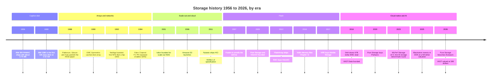

# 51. History of storage, 1956–2026

> **Depth:** L2 · **Reading time:** ~12 min · **Last verified:** 2026-11-01
> **Prerequisites:** [The storage stack](../03-system-architecture/13-storage-stack.md) · [Scale-up dual-controller arrays](../03-system-architecture/14-scale-up-dual-controller.md) · [Disaggregated shared-everything](../03-system-architecture/16-disaggregated-shared-everything.md) · [Everpure company history](../04-everpure/25-company-history-and-strategy.md)

## TL;DR

- **Seventy years, six eras:** captive disk, arrays and networks, scale-out and cloud, flash, software-defined, and AI. Each was organized around the most expensive resource of its time: the disk itself, then administrators and stranded capacity, then scale, then latency, now GPU time.
- **Cost fell by nearly nine orders of magnitude.** Disk went from about US$10,000 per MB (1956) to US$0.014 per GB (2022), about 26% a year. Flash fell faster. In 2026 both curves are rising.
- **New media creates new vendors, but only when software captures the media's economics.** Pure Storage (now Everpure) survived independently by selling data reduction and a business model, not speed. Violin sold speed and filed for Chapter 11.
- **Incumbents rarely die. They get acquired, usually after buying their way into the new wave.** EMC bought Isilon and XtremIO, then was itself bought by Dell for about US$67B in 2016.
- **Architecture swings like a pendulum** between centralized and distributed designs, and software-defined waves recur whenever commodity CPUs and networks catch up with proprietary controllers. AI-era disaggregation is the latest swing, not the last.

## Why this matters for Everpure strategy

Storage has run the same plot several times. A media or interconnect shift opens a gap, start-ups pour in, one or two independents survive, incumbents buy the rest, and the survivors become the next incumbents. Pure Storage was the flash wave's surviving independent. Everpure is now an incumbent being attacked by AI-native vendors (VAST, WEKA, a re-energized DDN) that were founded on the next shift. Product-only responses lose. Acquisitions buy time. Business-model and platform responses last longest.

"Disaggregation", "software-defined" and "data platform" all have precedents, and so do the ways earlier waves ended. [Chapter 52](52-history-of-flash.md) covers flash cost curves in depth, [Chapter 53](53-future-trends.md) looks forward, and [Chapter 46](../06-industry-and-competition/46-incumbents.md) profiles today's incumbents.

## Core concepts

### Seventy years in one picture

*Figure 51.1 — Each era starts with a technology shift and ends with acquisitions; the eras overlap because a new wave begins before the previous one has finished consolidating.*

Sources for Figure 51.1: [^1][^2][^3][^4][^5][^6][^7][^8][^9][^10][^11][^12][^13][^14][^15][^16][^17][^18][^19][^20][^21][^22].

### Era 1, 1956–1987: the disk as a captive, costly peripheral

IBM's 350 disk unit shipped with the 305 RAMAC in 1956. It held about 3.75 MB on fifty 24-inch platters[^1], and its cost worked out to roughly US$10,000 per MB[^23]. Disk was the scarce resource, so systems were designed to waste no byte. In June 1980 IBM's 3380 became the first gigabyte-class drive. It held 2.52 GB, was the size of a refrigerator, and listed at US$81,000–142,400[^2], or about **US$32,000 per GB** at the low end (81,000 ÷ 2.52).

The business model was the IDM model in semiconductors. IBM designed the heads and media, built the drives, owned the channel interface and sold the whole system. Margins were set by the system, not by the disk.

### Era 2, 1988–2005: arrays, cache and networks

The break came from below. In 1988 Patterson, Gibson and Katz argued that many small PC disks, protected by parity, could beat one "single large expensive disk" on cost, performance and reliability[^3]. Their Table I is the thesis in two numbers. An IBM 3380 cost US$18–10 per MB including controller, and a small Conners CP3100 cost US$10–7[^3]. **Semiconductor bridge:** this is the "killer micros" argument applied to storage, and it rests on the same economics that make chiplets attractive. Many small, cheap, high-volume units plus clever redundancy beat one large, expensive, low-volume unit.

RAID turned the disk into a component and moved value into the **controller**: cache, parity, mirroring and later snapshots and replication. EMC's Symmetrix, launched in 1990, put a large cache in front of commodity disks and attached it to IBM mainframes[^4]. It is the storage equivalent of putting SRAM in front of DRAM: most reads hit the cache, so cheap disks behind it look fast. By 1995, by one account, Symmetrix held 41% of mainframe disk terabytes against IBM's 35%[^24]. A start-up selling software and cache beat the company that invented the disk.

Networking then made arrays shareable. NetApp was founded in 1992 to build file-serving "appliances" that did nothing but serve NFS, and it shipped its first systems in 1993[^5]. Fibre Channel's physical standard was approved in 1994[^6], which let many servers share one block array over a SAN. The economic driver was **utilization and administration**. Disks scattered across hundreds of servers strand capacity and need hundreds of backup jobs. Consolidating them behind two controllers fixes both problems. That is the dual-controller array of [Chapter 14](../03-system-architecture/14-scale-up-dual-controller.md).

### Era 3, 2001–2012: scale-out and the cloud

The next limit was the controller pair itself. Unstructured data outgrew any two-controller box. Isilon, founded in 2001, clustered x86 nodes behind a single file namespace. EMC bought it in 2010 for about US$2.25B[^7]. Google published GFS in 2003[^25], and Amazon launched S3 on 14 March 2006[^8]. By 2023 it held more than 280 trillion objects[^26]. Nutanix shipped hyperconverged infrastructure (HCI) in 2011, which put the storage software on the same x86 servers as the virtual machines[^9] ([Chapter 19](../03-system-architecture/19-software-defined-and-hci.md)).

The shared enabler was **cheap x86 cores and Ethernet**. Once commodity servers could run erasure coding and metadata services in software, the proprietary controller stopped being necessary for scale. This was the first software-defined wave, and its biggest winner (AWS) was not a storage vendor at all.

### Era 4, 2007–2017: flash makes new vendors

Flash attacked the remaining scarce resource, which was latency. A 15K RPM disk delivers a few hundred random IOPS. A single SSD delivers tens of thousands or more. Fusion-io unveiled its ioDrive PCIe card in 2007[^11]. A wave of array start-ups followed: Violin, Nimble, XtremIO and Pure Storage (incorporated October 2009, FlashArray shipped May 2012)[^12]. The NVMe 1.0 specification, published in March 2011, replaced a disk-era command interface with one designed for parallel flash[^10].

The cohort's outcomes are the most useful dataset in this chapter:

- **Fusion-io** (server flash) was sold to SanDisk in 2014 for about US$1.1B[^27]. A NAND maker integrated forward.
- **XtremIO** was bought by EMC in May 2012, before it had any product revenue, for a reported US$430M[^13].
- **Nimble** was bought by HPE in 2017 for US$1.09B[^15].
- **Violin**, the early speed leader, IPO'd in 2013 and filed for Chapter 11 in December 2016[^14].
- **Pure Storage** stayed independent, IPO'd in 2015 and settled EMC's litigation for US$30M in 2016[^28] ([Chapter 25](../04-everpure/25-company-history-and-strategy.md)).

The difference was not raw performance, because flash made every array fast. Pure used inline deduplication and compression to bring low-cost MLC flash close to the effective price of performance disk. It wrapped that in a non-disruptive upgrade subscription (Evergreen) that attacked incumbents' forklift-refresh revenue. **Speed is a property of the media and gets commoditized. Economics and business model are properties of the software and the contract, and they compound.** [Chapter 52](52-history-of-flash.md) explains why flash won primary storage.

### Era 5, 2014–2020: software-defined again, and the incumbent exits

While flash start-ups fought for arrays, the buying centre moved. Developers on public cloud and Kubernetes wanted storage that came from an API, not a ticket. Pure bought Portworx, a Kubernetes data-services company, in September 2020 for about US$370M[^18]. EMC, the defining array company of the 1990s and 2000s, had bought into each new wave (Isilon for scale-out, XtremIO for flash). Dell nonetheless agreed to buy it in October 2015 for about US$67B and closed the deal on 7 September 2016[^16]. Its products live on: Dell led the external storage market in 2Q26 with 23.8% share[^29]. What disappeared was EMC's independence and its ability to set the agenda.

### Era 6, 2019–2026: AI and the return of throughput

GPUs made a new resource the most expensive one in the data centre, so storage is now judged by how fully it keeps accelerators busy ([Chapter 31](../05-ai-storage/31-training-storage.md)). That favoured designs born for parallel throughput. VAST Data (founded 2016, out of stealth 2019) built disaggregated shared-everything[^17]. WEKA (founded 2013) built a parallel file system in software[^30]. DDN, founded in 1998 and long an HPC niche player, became an AI supplier. Blackstone invested US$300M at a US$5B valuation in January 2025[^20], and DDN told Forbes it expected about US$1B of revenue in 2026 (*reported by press*)[^31]. MLCommons published the first MLPerf Storage round in September 2023[^19]. VAST raised capital at a US$30B valuation in April 2026[^22]. In February 2026 Pure Storage renamed itself Everpure to signal a shift from flash arrays to data management[^21].

### The cost curve underneath every era

![Log-scale scatter of US dollars per GB from 1956 to 2026. Hard-disk points fall from about 10 million dollars per GB for the 1956 RAMAC through 32,000 dollars for the 1980 IBM 3380, 7,000 to 10,000 dollars in the 1988 RAID paper, 1 dollar in 2003 and 0.0144 dollars in 2022, then rise to about 0.04 dollars in a 2026 price index. Flash points fall from about 50,000 dollars per GB in 1991 to 7.44 dollars for the 2008 Intel X25-M, about 1 dollar in 2012 and 0.185 dollars for enterprise SSD in 2020, then rise to about 0.75 dollars in 2026.](../assets/charts/ch51-cost-per-gb.svg)

*Figure 51.2 — Nearly nine orders of magnitude of cost decline drove every architectural shift; 2026 is the first time both curves have turned up together.*
Data: `data/ch51_cost_per_gb.csv`

**Worked numbers.** Disk went from about US$10,000,000 per GB in 1956 to US$0.0144 per GB in November 2022[^23][^32]. That is a factor of about 6.9 × 10⁸ over 66 years, so the annual factor is (6.9 × 10⁸)^(1/66) ≈ 1.36. Prices fell about **26% a year**, in nominal dollars, before any inflation adjustment. Flash fell from about US$50,000 per GB (a 20 MB SunDisk drive at about US$1,000 in 1991)[^33] to US$0.185 per GB for enterprise SSD in Q2 2020[^34]. That works out to about **35% a year**. The faster slope is what let flash overtake disk for primary storage. In 2026 the curves turned up: a single-vendor index put a 30 TB TLC SSD at US$753 per TB, 18.6× the per-TB price of a 30 TB nearline HDD[^35]. The bases differ, so read the chart for direction and orders of magnitude, not decimals.

**Semiconductor bridge.** The disk curve is storage's Moore's law. Like Moore's law, it changed architecture more than it changed products. Cheap capacity removed the need to economize on bytes, so designs shifted to economizing on whatever cost more: people (consolidation), scale (scale-out), latency (flash) and now accelerator time (AI).

### The architectural pendulum

```mermaid
flowchart LR
    A["Centralized<br/>1956-1980s<br/>mainframe DASD"] -->|"cheap PC and mini disks"| B["Distributed<br/>1980s<br/>server-attached DAS"]
    B -->|"stranded capacity, admin cost, SANs"| C["Centralized arrays<br/>1990s-2000s<br/>SAN and NAS"]
    C -->|"x86 clusters, Ethernet, web scale"| D["Distributed<br/>2000s-2010s<br/>scale-out, HCI, cloud"]
    D -->|"flash, NVMe-oF, GPU throughput"| E["Disaggregated<br/>2016-2026<br/>shared media over a fabric"]
    E -.->|"next swing?"| F["CXL memory pools,<br/>DPUs, KV-cache tier"]
```

*Figure 51.3 — Storage swings between consolidating media for efficiency and spreading it for scale; each swing is triggered by whichever component (media, network or CPU) just got cheap.*

The swing has a mechanism. **Centralize** when the media is expensive and the network is cheap enough, because pooling raises utilization. **Distribute** when commodity compute is cheaper than the controller and the network becomes the bottleneck, because locality avoids the network. **Disaggregate** when the network becomes nearly as fast as local media. NVMe-oF adds roughly 5–15 µs to a ~100 µs flash read ([Chapter 16](../03-system-architecture/16-disaggregated-shared-everything.md)), so it gives you pooling without giving up scale. The next swing is visible one level down, where CXL applies the same logic to memory ([Chapter 12](../02-protocols-and-networking/12-interfaces-and-emerging-tech.md)).

### What each era teaches

| Era | Enabling tech | Winners | Losers | Lesson for strategy today |
|---|---|---|---|---|
| Captive disk, 1956–87 | Magnetic recording; mainframe channels | IBM | Anyone without a system to attach to | Owning media plus system holds margin until a cheaper media class arrives from below |
| Arrays and networks, 1988–2005 | RAID, large caches, Fibre Channel, NFS appliances | EMC, NetApp | IBM's mainframe disk share | Controller software on commodity disks beat better hardware; the attach point moved value |
| Scale-out and cloud, 2001–12 | x86 clusters, Ethernet, erasure coding, HTTP APIs | Isilon (exited to EMC), AWS S3, Nutanix | Monolithic NAS for big unstructured data | When the unit of scale changes from shelf to node, the buyer and the business model change too |
| Flash, 2007–17 | NAND, PCIe, NVMe | Pure Storage; exits for Fusion-io, XtremIO, Nimble | Violin; disk-centric arrays | New media creates vendors only if software converts media cost into customer economics |
| Software-defined, 2014–20 | Containers, Kubernetes, public cloud | AWS, Portworx (exited to Pure), Dell as consolidator | EMC's independence | SDS waves recur and are mostly absorbed by platforms; consolidation follows slowing growth |
| AI, 2019–26 | GPUs, RDMA, NVMe-oF, QLC, NVIDIA certification | VAST, WEKA, DDN; Everpure via EXA (contested) | Dual-controller designs in GPU-scale deals | The scarce resource (GPU time) sets requirements, and the ecosystem gatekeeper matters as much as the box |

*Table 51.1 — Every era rewarded whoever turned the newly cheap component into a lower cost for the newly scarce one.*

### Three recurring patterns, and the semiconductor parallel

**1. How incumbents lose: slowly, then by acquisition.** No storage leader collapsed. Each lost its agenda first. IBM lost mainframe disk share to EMC's cache-and-software design. EMC bought into each new wave, but buying products did not change a business built on large, refresh-driven hardware sales. The end was a sale, not a failure. Media went the other way, to three survivors each. Micron paid US$615M for bankrupt Elpida's equity in 2013[^36], and Samsung, SK hynix and Micron held about 90% of DRAM revenue in 4Q25 (36.0 + 32.1 + 22.4)[^37]. Hard-disk makers narrowed to Seagate, Western Digital and Toshiba[^38].

**2. Why storage *systems* never consolidated like media.** The capital intensity sits in the media: fabs and head/disk plants. Array vendors resemble fabless chip companies. They buy NAND or drives, add controller software and sell a system. Entry costs are venture rounds, not a multi-billion-dollar fab, so every technology shift produces a new crop of entrants. Everpure's DirectFlash strategy, which buys raw NAND and manages it in its own software, is like a fabless company designing its own memory controller. It captures media economics without owning the fab.

**3. Why software-defined waves recur.** Whenever commodity CPUs and networks catch up with the proprietary controller, someone runs storage as software on standard servers: scale-out in the 2000s, HCI and cloud in the 2010s, Kubernetes-native storage and VAST's 2021 exit from hardware[^39] in the 2020s. These waves rarely displace arrays. Arrays absorb the model (subscriptions, cloud editions, container integration), while hyperscalers keep the pure-software prize. **Implication for the AI era:** expect the current AI-native leaders to face the same cycle. They will be validated, imitated by incumbents (NetApp AFX, HPE X10000 and Everpure EXA already ship disaggregated designs), and then consolidated or forced into platforms. The open question is who does the consolidating.

## How Everpure approaches it vs. competitors

Every major vendor still carries the architecture of the era it was born in.

| Vendor | Born in era | Architectural inheritance | AI-era response | Steelman |
|---|---|---|---|---|
| Dell (EMC lineage) | Arrays (Symmetrix, 1990) | Symmetrix lineage (PowerMax), Isilon (PowerScale) | Parallel NFS on PowerScale[^40]; broad portfolio | Largest installed base and channel; #1 share[^29] |
| NetApp | Arrays, 1992 | ONTAP unified file/block OS | AFX disaggregated ONTAP (2025)[^41] | Decades of enterprise data-management features |
| HPE | Arrays, via 3PAR/Nimble buys | Alletra (3PAR, Nimble lineage) | X10000 shared-everything; GreenLake for File runs VAST software[^42] | Server plus storage plus GreenLake bundle |
| Everpure | Flash, 2009 | Purity, DirectFlash, Evergreen subscription | FlashBlade//EXA metadata/data split | One OS and one upgrade model; raw-NAND economics |
| DDN | HPC, 1998 | Lustre-based EXAScaler | Infinia object platform; AI400X3 | Large GPU-cluster deployments, e.g. xAI Colossus (company-stated)[^43]; HPC know-how |
| VAST Data | AI/disaggregated, 2016 | DASE on shared QLC and SCM | Positions itself as an "AI operating system"[^44] | Built for this era from the start |
| WEKA | Software-defined, 2013 | Parallel file system as software | NeuralMesh (2025)[^45]; cloud and neocloud deals | Hardware-agnostic; strong in public cloud |

*Table 51.2 — Founding era predicts architecture; in the AI era the founding-era advantage belongs to VAST and WEKA, not Everpure.*

The honest read: Everpure sits where EMC sat around 2012, a successful incumbent of the previous wave with the cash and installed base to respond to the next one. EMC's responses were acquisitions on top of a hardware-refresh business. Everpure's are built in-house (EXA), subscription-led (Evergreen) and extended into hyperscale data centres by licensing DirectFlash (Meta in 2024, a second top-five hyperscaler in August 2026)[^46]. That is closer to the business-model defence that let Pure itself survive in 2012–2016. The steelman for the challengers: VAST and WEKA did not retrofit anything, and the history of storage says architectural fit for the scarce resource usually beats installed base within one refresh cycle. Options a strategy team might evaluate, based on public information, include where EXA wins outright, which capabilities to buy rather than build (Portworx is the template), and how to avoid an EMC-style end state ([Chapter 54](54-strategic-option-map.md)).

## History and trajectory

Three dated signals frame the next chapter of this history:

- **Costs reversed.** Enterprise SSD went from US$185/TB (Q2 2020) to an index price of US$753/TB in Q3 2026, and nearline HDD from US$19/TB to about US$40/TB[^34][^35]. Every earlier era assumed falling media prices; tight NAND supply rewards the data reduction Pure Storage built its first decade on ([Chapter 48](../06-industry-and-competition/48-media-suppliers-and-nand-cycle.md)).
- **The market grew with the cycle.** In 2Q26 external storage revenue reached US$10.3B (+33.6% YoY), and all-flash arrays were 52.1% of it. Everpure was #4 at 8.1% share and, at +50.0% YoY, the fastest grower among the top five vendors[^29].
- **Benchmarks and ecosystems became the gatekeepers.** MLPerf Storage v3.0 had 19 submitters, 11 of them first-time, including Everpure[^47]. As in the Fibre Channel and VMware eras, certification by the dominant platform (now NVIDIA) decides who gets considered ([Chapter 34](../05-ai-storage/34-nvidia-ecosystem.md)).

Where it goes next, with CXL, KV-cache tiers and PLC NAND, is covered in [Chapter 53](53-future-trends.md).

## Numbers that matter

| Metric | Value | Context | Source / date |
|---|---|---|---|
| IBM 350 RAMAC capacity / cost | ~3.75 MB; ~US$10,000 per MB | First commercial disk, 1956 | CHM; History of Information[^1][^23] |
| IBM 3380 | 2.52 GB; US$81,000–142,400 | First GB-class drive, June 1980 (≈US$32k/GB) | MSDN / StorageNewsletter[^2] |
| RAID paper $/MB | 3380 US$18–10 vs PC disk US$10–7 | The economics behind arrays, 1988 | SIGMOD 1988[^3] |
| Disk $/GB decline | ~26% per year, 1956–2022 | 10,000,000 → 0.0144 US$/GB, nominal | Worked example[^23][^32] |
| Flash $/GB decline | ~35% per year, 1991–2020 | 50,000 → 0.185 US$/GB, mixed bases | Worked example[^33][^34] |
| Enterprise SSD vs HDD, Q3 2026 | 18.6× per TB | US$753/TB vs US$40.5/TB, single-vendor index | Hardware Busters[^35] |
| Dell–EMC | ~US$67B; closed 2016-09-07 | Incumbent exit by acquisition | PCWorld / TweakTown[^16] |
| DRAM top-three share | ~90.5% (4Q25) | Media consolidation comparison | TrendForce via Evertiq[^37] |
| Dell external storage share | 23.8% (2Q26); Everpure 8.1% | Incumbent still #1 | IDC via StorageReview[^29] |

## Conversation playbook

**Questions for a PM**

1. *"Which part of our value proposition is media speed, and which is economics or business model?"* A strong answer separates them, admits speed claims erode within a generation, and names the durable parts: reduction ratios, Evergreen renewal economics, power per TB.
2. *"What could make an AI-native architecture irrelevant, as flash commoditized Violin's speed lead?"* A strong answer names a concrete shift (KV-cache moving to CXL memory, storage services on DPUs) and how the product would ride it.
3. *"Which past deal is our template, Portworx or EMC's XtremIO?"* A strong answer judges integration, not price: did the technology join the platform or stay a separate product line?

**Questions for an engineer**

1. *"Where does today's bottleneck sit: media, network, CPU or metadata?"* A strong answer gives numbers (fabric µs versus flash µs, metadata operations per second) and which way that pushes the pendulum.
2. *"Which design decisions assume falling NAND prices?"* Strong: over-provisioning, erasure-coding width, reduction assumptions, and what changes if $/TB rises for two years.
3. *"What from Purity's 2012 design would a 2026 clean-sheet design keep?"* Strong: log-structured writes, global reduction, non-disruptive upgrades, plus what it would discard.

**Don't say this:**

- "Flash killed disk." Disk still stores most bytes; flash took primary storage ([Chapter 52](52-history-of-flash.md)).
- "EMC failed." It was sold for about US$67B, and its products still lead the market inside Dell.
- "Disaggregation is new." SANs pooled storage decades ago; what is new is NVMe-oF making remote flash nearly local.
- "Storage prices always fall." 2026 is a counter-example on both curves.
- "Software-defined storage will replace arrays." Three waves have tried; arrays absorbed each one.

## Going deeper (optional, L3 pointers)

- Patterson, Gibson and Katz, the 1988 RAID paper: Table I and the reliability argument.
- Computer History Museum "Storage Engine" timeline and its IBM 3380 oral history.
- Ghemawat et al., "The Google File System" (SOSP 2003), the scale-out template.
- Clayton Christensen, *The Innovator's Dilemma* (1997): disk-drive incumbents losing each form-factor transition.

## Key terms

- **DASD** — direct-access storage device, IBM's term for mainframe disk.
- **SLED** — single large expensive disk, the RAID paper's foil.
- **Cached disk array** — an array that fronts disks with a large RAM cache (EMC Symmetrix).
- **Filer / NAS appliance** — a dedicated file server (NetApp).
- **SAN** — storage area network, a block network such as Fibre Channel.
- **Architectural pendulum** — the recurring swing between centralized, distributed and disaggregated storage.
- **Software-defined wave** — a period when storage software moves onto commodity servers.
- See the [glossary](../glossary.md) for the rest.

## Sources

[^1]: Computer History Museum, "1956: First commercial hard disk drive shipped," n.d. https://www.computerhistory.org/storageengine/first-commercial-hard-disk-drive-shipped/ (retrieved 2026-11-01).
[^2]: A. Thomas (Microsoft MSDN blog), "History of Data Storage," 2008-04-10. https://blogs.msdn.microsoft.com/alfredth/2008/04/10/history-of-data-storage/ (retrieved 2026-11-01); StorageNewsletter, "History 1992: Key dates on mainframes DASD technology," 2020-05-29. https://storagenewsletter.com/2020/05/29/history-1992-key-dates-on-mainframes-dasd-technology (retrieved 2026-11-01). Price range seen via search summary; StorageNewsletter gives the upper bound as US$142,200.
[^3]: D. Patterson, G. Gibson, R. Katz, "A Case for Redundant Arrays of Inexpensive Disks (RAID)," SIGMOD 1988, Table I. https://dl.acm.org/doi/10.1145/50202.50214 ; copy at https://web.mit.edu/6.033/2015/wwwdocs/papers/Patterson88.pdf (retrieved 2026-11-01).
[^4]: StorageNewsletter, "History 1990: EMC Symmetrix 4200," 2018-08-24. https://www.storagenewsletter.com/2018/08/24/history-1990-emc-symmetrix-4200/ (retrieved 2026-11-01).
[^5]: NetApp, "Our history," n.d. https://www.netapp.com/en/company/history/ (retrieved 2026-11-01); FundingUniverse, "Network Appliance, Inc. History," n.d. https://www.fundinguniverse.com/company-histories/network-appliance-inc-history/ (retrieved 2026-11-01).
[^6]: ANSI, "ANSI X3.230-1994, Fibre Channel Physical and Signaling Interface (FC-PH)," 1994. https://webstore.ansi.org/standards/incits/ansiincits2301994am1996r2001 (retrieved 2026-11-01).
[^7]: eWeek, "EMC Acquires Scale-Out NAS Maker Isilon for $2.25 Billion," 2010-11-15. https://www.eweek.com/storage/emc-acquires-scale-out-nas-maker-isilon-for-2.25-billion/ (retrieved 2026-11-01); EMC/Isilon joint press release (Exhibit 99.1), 2010-11-15. https://www.sec.gov/Archives/edgar/data/1373671/000119312510259827/dex991.htm (retrieved 2026-11-01). Founding year 2001 per Wikipedia, "Dell EMC Isilon," https://en.wikipedia.org/wiki/Dell_EMC_Isilon (retrieved 2026-11-01; via search summary).
[^8]: Amazon Web Services, "Announcing Amazon S3 - Simple Storage Service," 2006-03-14. https://aws.amazon.com/about-aws/whats-new/2006/03/announcing-amazon-s3---simple-storage-service (retrieved 2026-11-01).
[^9]: Nutanix, Inc., "Form S-1 Registration Statement," 2015-12. https://www.sec.gov/Archives/edgar/data/0001618732/000119312515411021/d937439ds1.htm (retrieved 2026-11-01).
[^10]: University of New Hampshire InterOperability Laboratory, "Emerging NVM Express spec has busy year," 2014-12-15. https://iol.unh.edu/news/2014/12/15/emerging-nvm-express-spec-has-busy-year (retrieved 2026-11-01); EE Times Japan, NVM Express 1.0 report, 2011-03-10. https://eetimes.itmedia.co.jp/ee/articles/1103/10/news116.html (retrieved 2026-11-01).
[^11]: TechPowerUp, "Fusion-io ioDrive" (DEMOfall 2007 unveiling), 2007-10-10. https://www.techpowerup.com/41779/ (retrieved 2026-11-01); StorageMojo, "Fusion-io does the hard part," 2008-01-02. https://storagemojo.com/2008/01/02/fusion-io-does-the-hard-part/ (retrieved 2026-11-01).
[^12]: Pure Storage, Inc., "Form S-1 Registration Statement," 2015-08-27. https://www.sec.gov/Archives/edgar/data/0001474432/000119312515287576/d895532ds1.htm (retrieved 2026-11-01).
[^13]: Globes, "EMC buys XtremIO for $430m," 2012-05. https://en.globes.co.il/en/article-1000747655 (retrieved 2026-11-01). EMC did not disclose terms; price as reported by press.
[^14]: Violin Memory, Inc., "Form 8-K, Exhibit 99.1 (Chapter 11 filing)," 2016-12-14. https://www.sec.gov/Archives/edgar/data/0001407190/000119312516797241/d313497dex991.htm (retrieved 2026-11-01); The Register, "Violin Memory share collapse as Chapter 11 filing made," 2016-12-15. https://www.theregister.com/2016/12/15/violin_memory_share_collapse_as_chapter_11_filing_made/ (retrieved 2026-11-01).
[^15]: Fortune (Reuters), "Hewlett Packard Enterprise to buy Nimble Storage," 2017-03-07. https://fortune.com/2017/03/07/hewlett-packard-enterprise-nimble-storage (retrieved 2026-11-01).
[^16]: PCWorld, "Say hello to old friend Dell Technologies on Sept. 7," 2016-08. https://www.pcworld.com/article/3114143/say-hello-to-old-friend-dell-technologies-on-sept-7.html (retrieved 2026-11-01); TweakTown, "Dell buys EMC for $67 billion, largest tech deal in history," 2015-10-12. https://www.tweaktown.com/news/47956/dell-buys-firm-emc-67-billion-largest-tech-deal-history/index.html (retrieved 2026-11-01).
[^17]: Blocks & Files, "VAST Data's business sitrep," 2019-02-26. https://blocksandfiles.com/2019/02/26/vast-datas-business-sitrep/ (retrieved 2026-11-01); Blocks & Files, "VAST Data's universal filesystem," 2019-02-26. https://blocksandfiles.com/2019/02/26/vast-datas-universal-filesystem/ (retrieved 2026-11-01).
[^18]: SiliconANGLE, "Pure Storage buys Portworx to expand cloud-native storage," 2020-09-16. https://siliconangle.com/2020/09/16/pure-storage-buys-portworx-expand-cloud-native-storage/ (retrieved 2026-11-01).
[^19]: Blocks & Files, "MLCommons publishes storage benchmark for AI," 2023-09-18. https://blocksandfiles.com/2023/09/18/mlcommons-storage-benchmark/ (retrieved 2026-11-01).
[^20]: Blackstone, "Blackstone Invests $300 Million at a $5 Billion Valuation in DDN," 2025-01. https://www.blackstone.com/news/press/blackstone-invests-300-million-at-a-5-billion-valuation-in-ddn-ai-and-data-intelligence-solutions-leader-to-fuel-further-rapid-growth/ (retrieved 2026-11-01).
[^21]: World Wide Technology, "Pure Storage Rebrands To Everpure And Announces Intent To Acquire 1touch," 2026-02-23. https://www.wwt.com/news/pure-storage-rebrands-to-everpure-and-announces-intent-to-acquire-1touch (retrieved 2026-11-01).
[^22]: CNBC, "Nvidia backs AI company Vast Data at $30 billion valuation," 2026-04-22. https://www.cnbc.com/2026/04/22/nvidia-backs-ai-company-vast-data.html (retrieved 2026-11-01).
[^23]: History of Information, "The IBM 305 RAMAC, the First Computer with a Hard Drive: $10,000 per Megabyte," n.d. https://historyofinformation.com/detail.php?entryid=952 (retrieved 2026-11-01; figure seen via search summary) [VERIFY: search-summary only].
[^24]: The Register, "Symmetrix daddy Moshe Yanai on chair-throwing and storage," 2017-04-10. https://www.theregister.com/2017/04/10/moshe_the_storage_mensch/?page=2 (retrieved 2026-11-01).
[^25]: S. Ghemawat, H. Gobioff, S.-T. Leung, "The Google File System," SOSP 2003. https://www.cs.rochester.edu/meetings/sosp2003/papers/p125-ghemawat.pdf (retrieved 2026-11-01).
[^26]: AWS News Blog, "Celebrate Amazon S3's 17th birthday at AWS Pi Day 2023," 2023-03. https://aws.amazon.com/blogs/aws/celebrate-amazon-s3s-17th-birthday-at-aws-pi-day-2023/ (retrieved 2026-11-01).
[^27]: Fusion-io, Inc., "Schedule TO-C (SanDisk merger agreement)," 2014-06. https://www.sec.gov/Archives/edgar/data/0001383729/000110465914046106/a14-15500_18k.htm (retrieved 2026-11-01); Bloomberg, "SanDisk to Buy Fusion-io for $1.1 Billion," 2014-06-16. https://www.bloomberg.com/news/articles/2014-06-16/sandisk-to-buy-fusion-io-in-deal-valued-at-about-1-1-billion (retrieved 2026-11-01).
[^28]: Pure Storage, Inc., "Form 8-K (settlement with Dell/EMC)," 2016-10. https://www.sec.gov/Archives/edgar/data/1474432/000119312516741316/d275548d8k.htm (retrieved 2026-11-01).
[^29]: StorageReview, "IDC External Storage Tracker: $10.3 Billion in Q2 2026 as Server Market Tops $166 Billion on AI Demand," 2026-09. https://www.storagereview.com/news/idc-external-storage-tracker-q2-2026-10-3-billion-as-server-market-tops-166-billion (retrieved 2026-11-01).
[^30]: StorageNewsletter, "Start-up profile: Weka.io," 2016-12-26. https://www.storagenewsletter.com/2016/12/26/start-up-profile-weka-io (retrieved 2026-11-01).
[^31]: Forbes Italia, "Chi è Alex Bouzari, il miliardario che rende più veloci i supercomputer dell'IA," 2026-08-10. https://forbes.it/2026/08/10/chi-e-alex-bouzari-il-miliardario-che-rende-piu-veloci-i-supercomputer-dellia/ (retrieved 2026-11-01).
[^32]: Backblaze, "Hard Drive Cost Per Gigabyte," 2022-11. https://www.backblaze.com/blog/hard-drive-cost-per-gigabyte/ (retrieved 2026-11-01); corroborated by Blocks & Files, "Backblaze predicts HDD prices will fall to 1¢/GB by mid-2025," 2022-12-12. https://www.blocksandfiles.com/disk/2022/12/12/backblaze-predicts-hdd-prices-will-fall-to-1/gb-by-mid-2025/1604477 (retrieved 2026-11-01).
[^33]: IEEE ETHW, "Sanjay Mehrotra," n.d. https://ethw.org/Sanjay_Mehrotra (retrieved 2026-11-01); Computer Hope, "SanDisk history," n.d. https://www.computerhope.com/comp/sandisk.htm (retrieved 2026-11-01). Price seen via search summary [VERIFY: search-summary only].
[^34]: Blocks & Files, "Enterprise SSDs cost ten times more than nearline disk drives," 2020-08-24. https://blocksandfiles.com/2020/08/24/10x-enterprise-ssd-price-premium-over-nearline-disk-drives/ (retrieved 2026-11-01).
[^35]: Hardware Busters, "Enterprise SSD Prices Now Run 18.6x Hard Drives, and the Cheap Alternative Is Sold Out Until 2027," 2026. https://hwbusters.com/news/enterprise-ssd-prices-now-run-18-6x-hard-drives-and-the-cheap-alternative-is-sold-out-until-2027/ (retrieved 2026-11-01).
[^36]: Micron Technology, Inc., "Form 10-K for fiscal year 2013," 2013-10. https://www.sec.gov/Archives/edgar/data/0000723125/000072312513000228/a2013q4.htm (retrieved 2026-11-01).
[^37]: Evertiq (citing TrendForce), "Price rally lifts 4Q25 DRAM revenue 29.4% QoQ," 2026-02-26. https://evertiq.com/news/2026-02-26-price-rally-lifts-4q25-dram-revenue-294-qoq (retrieved 2026-11-01).
[^38]: Electronic Design, "Hard Disk Vendors - And Then There Were Three," n.d. https://www.electronicdesign.com/technologies/embedded/article/21793116/hard-disk-vendors-and-then-there-were-three (retrieved 2026-11-01).
[^39]: Blocks & Files, "VAST Data exits hardware business, pivots to software subscriptions," 2021-04-06. https://blocksandfiles.com/2021/04/06/vast-data-software-subscriptions-pivot/ (retrieved 2026-11-01).
[^40]: Blocks & Files, "Dell PowerScale gets struck by Lightning and goes parallel," 2025-11-17. https://www.blocksandfiles.com/ai-ml/2025/11/17/dell-powerscale-gets-struck-by-lightning-and-goes-parallel/1711291 (retrieved 2026-11-01).
[^41]: Blocks & Files, "NetApp disaggregates ONTAP storage and provides an AI Data Engine," 2025-10-14. https://blocksandfiles.com/2025/10/14/netapp-disaggregates-ontap-storage-and-provides-an-ai-data-engine/ (retrieved 2026-11-01).
[^42]: Blocks & Files, "HPE Alletra X10000 analysis," 2025-02-13. https://blocksandfiles.com/2025/02/13/hpe-alletra-x10000-analysis/ (retrieved 2026-11-01); HPCwire, "HPE taps VAST Data for fast file storage on GreenLake," 2023-04-04. https://www.hpcwire.com/2023/04/04/hpe-taps-vast-data-for-fast-file-storage-on-greenlake/ (retrieved 2026-11-01).
[^43]: Benzinga, "Blackstone invests $300 million in AI data firm that powers Elon Musk's xAI supercomputer," 2025-01. https://www.benzinga.com/news/25/01/42892338/blackstone-invests-300-million-in-ai-data-firm-that-powers-elon-musks-xai-supercomputer (retrieved 2026-11-01).
[^44]: Blocks & Files, "VAST Data launches AI operating system," 2025-05-21. https://www.blocksandfiles.com/ai-ml/2025/05/21/vast-data-launches-ai-operating-system/1613219 (retrieved 2026-11-01).
[^45]: Blocks & Files, "WEKA builds NeuralMesh for exascale AI," 2025-06-18. https://blocksandfiles.com/2025/06/18/weka-builds-neuralmesh-for-exascale-ai/ (retrieved 2026-11-01).
[^46]: Everpure, "Everpure Lands New Design Win with Second Top-Five Hyperscaler," 2026-08-10. https://www.everpuredata.com/company/newsroom/press-releases/everpure-lands-new-design-win-with-second-top-five-hyperscaler.html (retrieved 2026-11-01).
[^47]: MLCommons via GlobeNewswire, "MLCommons Releases New MLPerf Storage v3.0 Benchmark Results," 2026-09-01. https://www.globenewswire.com/news-release/2026/09/01/3354412/0/en/mlcommons-releases-new-mlperf-storage-v3-0-benchmark-results.html (retrieved 2026-11-01).
