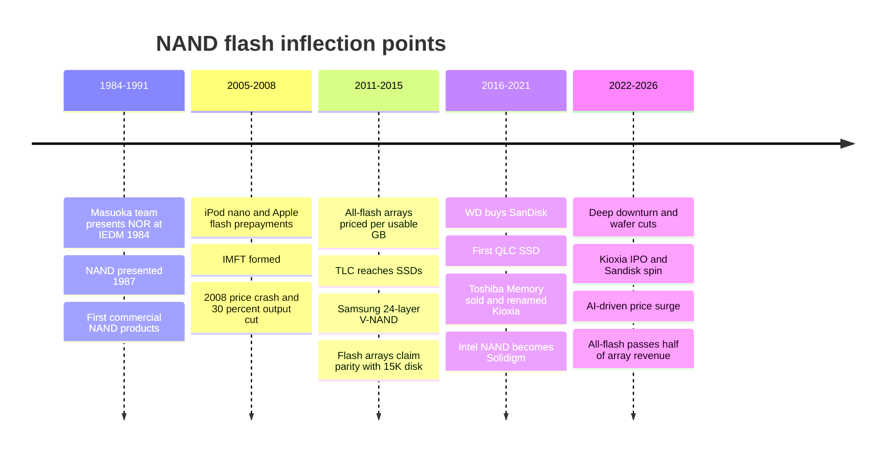
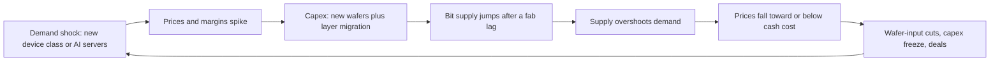

# 52. History of flash and NAND economics

> **Depth:** L2 · **Reading time:** ~11 min · **Last verified:** 2026-11-01
> **Prerequisites:** [Media physics for a semis person](../01-storage-fundamentals/02-media-physics.md) · [Data reduction](../01-storage-fundamentals/05-data-reduction.md) · [History of storage, 1956–2026](51-history-of-storage.md)

## TL;DR

- **Consumers paid for flash's learning curve.** Cameras, music players and phones funded NAND's scale from the mid-2000s. Enterprise arrays inherited a cost curve they did not pay to build. NAND fell from roughly $45/GB in 2005 to about 2¢/GB at the 2023 trough, around 35% a year.
- **The cost levers ran out one after another.** Lithography carried the 2000s. Bits per cell (SLC→MLC→TLC→QLC) gave 50%, then 33%, then 25% cuts in cost per bit. 3D layers took over after Samsung's 24-layer V-NAND in 2013, and each new layer step now adds fewer bits per wafer and costs more capex.
- **Flash never beat nearline disk on raw $/TB.** It beat *performance* disk (15K/10K RPM) on *effective* $/GB between about 2011 and 2015, because inline data reduction is cheap on flash and costly on disk. Latency, consistency, power and simpler operations then made all-flash the default for primary storage.
- **NAND consolidated by changing owners, not by exits.** Intel's fabs went to SK hynix (Solidigm), Toshiba's went to a Bain group (Kioxia), and SanDisk went to WD and was spun out again in 2025. DRAM consolidated through bankruptcies, to three players with ~88% of revenue. NAND still has five large suppliers, which partly explains its harsher cycles.
- **The cycle is a bit-growth-versus-wafer story.** Booms bring capex, then supply overshoots and prices fall below cash cost (2008, 2012, 2018–19, 2022–23). The 2025–26 AI surge took spot NAND prices up roughly 13–15× from the 2023 trough. Suppliers are adding layers, not wafers.

## Why this matters for Everpure strategy

Everpure's whole history sits on this curve. Pure Storage was founded in 2009, when NAND was still about $1/GB. It sold all-flash arrays priced per *usable* gigabyte after data reduction, against 15K disk, and won the effective-$/GB argument before the raw one was close. The company's DirectFlash strategy is a bet on capturing more of each NAND generation's cost decline than SSD vendors pass through ([Chapter 26](../04-everpure/26-purity-and-directflash.md)). Its gross margin and pricing power still move with the NAND cycle ([Chapter 48](../06-industry-and-competition/48-media-suppliers-and-nand-cycle.md)).

The history matters for three present-day decisions. The first is how to read the 2026 price spike: earlier spikes ended in overbuild, but this time suppliers are disciplined. The second is how far the "flash replaces disk" thesis can go when the raw premium over nearline disk has widened to ~18×. The third is how to value supplier relationships in an industry where the fab owners have changed four times in a decade. A strategy team that knows the 2008–2023 pattern can tell which features of 2026 are new.

## Core concepts

### Five inflections in one picture

*Figure 52.1 — Flash went from invention to consumer scale in two decades, then won enterprise primary storage in about five years once data reduction made usable $/GB competitive.*

### Invention, and why Toshiba did not own the economics (1984–2000)

Fujio Masuoka's team at Toshiba presented a flash EEPROM, the NOR type, at IEDM in December 1984[^shmj]. Kioxia, Toshiba's former memory unit, dates the invention of NAND to 1987[^kioxia35]. The Semiconductor History Museum of Japan places the NAND announcement in 1988[^shmj], so "1987" is the company's date, not an undisputed one. NAND's point was density. Cells in series share contacts, so the array is far smaller than NOR's, at the price of slow random reads. That trade only pays when the controller handles errors and mapping in firmware, an early version of the [FTL](../01-storage-fundamentals/03-inside-an-ssd.md) problem.

Masuoka later sued Toshiba over compensation for the invention, and the case settled in 2006[^masuoka]. Kioxia's own retrospective puts 1990s NAND at about $10,000 per gigabyte (company-stated)[^kioxiainfo]. Another industry recollection suggests nearer $1,250/GB in the mid-1990s[^designnews]. Either way, flash was then a niche for BIOS chips, camera cards and industrial devices.

### Consumers paid for the learning curve (2005–2012)

Apple's iPod nano launched on 7 September 2005 at 2 GB for $199 and 4 GB for $249[^nano]. Analysts estimated the 2 GB model held about $90 of flash, or roughly $45/GB, at a time when 1 GB sold for about $45 in the volume market[^nanoflash]. Ten weeks later Apple signed supply agreements running to 2010 with Hynix, Intel, Micron, Samsung and Toshiba. It prepaid $1.25 billion[^applesupply]. Intel and Micron formed IM Flash Technologies (IMFT), 51% owned by Micron, with Apple expected as its first customer[^eweekimft].

To an M&A reader this is a customer-funded capacity build, as when Apple later prepaid for TSMC capacity. The consumer device became the volume driver, and smartphones followed. Volume drove the learning curve. The analyst data in Figure 52.2 shows the result: about $45/GB in 2005, ~$0.90/GB for consumer NAND by Q4 2008[^mactech2010], ~$1 in January 2011, ~$0.30 by July 2012 and ~$0.25 in early 2015[^eetj].

*Figure 52.2 — NAND fell roughly 35% a year on average from 2005 to the 2023 trough. Each downturn steepened the decline, and the 2025–26 surge reversed about five years of it in months.*
Data: `data/ch52_flash_cost.csv`

The bases differ: retrospective claims, a retail card in 2003[^mccallum], analyst market prices[^tt2019][^tt2021] and TrendForce 512Gb TLC wafer spot quotes divided by 64 GB[^tf2023][^tf2024][^tf2025][^tftag]. Read the slope, not the decimals. Worked trend: $45 ÷ $0.0219 ≈ 2,050× over 17.9 years, so ln(2,050)/17.9 ≈ 0.43 per year, which is about a 35% annual decline.

### The four cost levers, and how each ran out

Cost per bit = wafer cost ÷ (good dies per wafer × bits per die). Every era of NAND history leans on one term.

**Lithography (to ~2013).** Planar NAND shrank faster than logic because the array is regular. At around 15 nm, cells held so few electrons that cell-to-cell interference and endurance became limiting ([Chapter 2](../01-storage-fundamentals/02-media-physics.md) covers the physics).

**Bits per cell.** Storing more bits per cell multiplies bits per die at almost the same area, but the first step gives the most:

| Transition | Landmark product | Bits per cell | Cost-per-bit cut (worked, ideal) | What it cost |
|---|---|---|---|---|
| SLC → MLC | Mainstream by the 2000s [VERIFY: first MLC NAND product and date] | 1 → 2 | 50% | 4 voltage states; slower program, lower endurance |
| MLC → TLC | Samsung SSD 840, 2012 (first TLC consumer SSD)[^anand840] | 2 → 3 | 33% | 8 states; Samsung put TLC ~50% slower than its MLC |
| TLC → QLC | Micron 5210 ION, May 2018 (first QLC SSD)[^ion] | 3 → 4 | 25% | 16 states; launched as an HDD replacement for read-heavy work |
| QLC → PLC | Research only (SK hynix split-cell, IEDM 2025)[^plc] | 4 → 5 | 20% | 32 states; needs new cell tricks to be usable |

*Table 52.1 — Each extra bit per cell buys a smaller cost cut (1 − n/(n+1)) and costs more in speed and endurance, so bits per cell is a diminishing lever. Ideal figures ignore extra ECC and spare area.*

**Layers (2013 onward).** Toshiba announced its BiCS 3D concept in June 2007[^bics], but Samsung reached mass production first, with 24-layer, 128 Gb V-NAND on 6 August 2013[^vnand]. Leading layer counts reached 321 (SK hynix, November 2024)[^skh321] and 400+ (Samsung V10, 2026)[^v10]. Applied Materials' analysis shows why layers are no free lunch. Going from 32 to 64 layers roughly doubled bits per wafer, but 96 to 128 layers added only ~33%. Meanwhile the greenfield cost per 3D NAND wafer start rose from ~1.5× planar to ~2.2× by 2021[^amat]. Layer steps also need far more deposition and etch time per wafer.

**Wafers.** Whatever the layers do not deliver, new fabs must. That makes the fourth lever the cyclical one.

### Bit growth versus wafer capacity: the engine of the cycle

Bit supply growth ≈ (1 + wafer-start growth) × (1 + bits-per-wafer growth) − 1. For years the industry's bit demand grew about 30% a year[^amat]. While a node or layer step delivered +30–40% bits per wafer, suppliers could meet demand with flat wafer starts. As migrations yield less, keeping up with 30% demand means adding wafers. That is expensive, lumpy capex with a 2–3 year lag, so it overshoots.

*Figure 52.3 — The NAND cycle is a capacity-lag loop: margins fund wafers, wafers arrive late, and each bust ends with output cuts and ownership changes.*

**Semiconductor bridge: NAND versus DRAM.** Both are commodity memories with the same loop, but the structures differ. DRAM consolidated through exits. Qimonda filed for insolvency in January 2009, and Elpida filed for bankruptcy in February 2012 with 15.4% share[^elpida]; Micron then took over Elpida[^micron10k2012]. In 2Q26, Samsung, SK hynix and Micron held 39.4%, 24.9% and 23.3% of DRAM revenue, about 88% together[^tfdram]. NAND kept five large suppliers. In 2008, TrendForce put Samsung at 40.4%, Toshiba 28.1%, Hynix 15.1%, Micron 7.9% and Intel 5.8%[^tf2008]. In 2Q26 the top five were Samsung, SK hynix Group, Micron, Kioxia and Sandisk, with $68.87B of revenue between them[^tf0818]. On a top-five basis the Herfindahl index is about 2,750 for 2008 and about 2,260 for 2Q26 (worked: 33.5² + 20.7² + 17.2² + 15.6² + 13.0²). DRAM's top three alone score about 2,715. So NAND has become *less* concentrated, and its pricing is less disciplined. Kioxia and Sandisk share fabs under a joint venture, so there are fewer independent capacity decisions than there are brands.

### Boom and bust, 2008–2026

- **2008:** Toshiba agreed in October to pay $1 billion for 30% of SanDisk's output. In December the two cut joint-venture output by 30%[^toshiba1b][^engadget2008].
- **2012:** Toshiba cut Yokkaichi NAND output by ~30% in July after card and USB prices fell more than 20%[^toshiba2012]. In DRAM, the same year's bust killed Elpida.
- **2018–19:** Prices that had held near 25¢/GB in 2016–17 collapsed to about 5¢ spot[^tt2019]. A 13-minute power cut at Yokkaichi in June 2019 cost about 6 EB of wafer supply but did not reverse the slide[^bfpower].
- **2022–23:** SK hynix posted its first loss in a decade in Q4 2022[^dcdhynix]. In April 2023 Samsung joined SK hynix, Micron and Kioxia in cutting output[^reg2023]. The 512Gb TLC wafer spot price bottomed at about $1.40 (≈2.2¢/GB) in mid-2023[^tf2023].
- **2025–26:** AI servers absorbed enterprise SSD bits. TrendForce reported top-five NAND revenue up 77% QoQ to $68.87B in 2Q26[^tf0818]. It forecast 4Q26 contract prices up another 15–20%, with most new supply already committed[^tf0930]. Suppliers reportedly added almost no wafer capacity in 2026 [VERIFY: secondary source][^capcomp].

The pattern for a deal team is that every bust ended in a transaction (below).

### Consolidation: the same fabs, new owners

| Deal | Year | Value | Consequence |
|---|---|---|---|
| Apple prepays five NAND suppliers | 2005 | $1.25B[^applesupply] | Consumer demand underwrites capacity; IMFT's first anchor |
| WD acquires SanDisk | Signed 2015, closed May 2016 | ~$19B at signing[^wdsandisk19][^wd8k] | HDD leader buys a seat in the Toshiba fab JV |
| Intel–Micron end joint NAND development | Jan 2018 | n/a[^hpcwire2018] | Intel's NAND strategy drifts; IMFT left making 3D XPoint |
| Toshiba Memory sold to Bain-led consortium | Closed Jun 2018 | ~¥2tn (~$18B)[^kioxiawiki] | Distressed-parent carve-out; SK hynix becomes an indirect investor; renamed Kioxia Oct 2019 |
| Micron buys Intel's IMFT stake | Closed Oct 2019 | ~$1.5B cash[^reg2018][^imftwiki] | IMFT unwound; Lehi fab sold to TI in 2021 for $900M[^ti] |
| SK hynix buys Intel NAND/SSD (Solidigm) | Signed 2020; closings Dec 2021 and Mar 2025 | $7B + ~$1.9B net[^intelskh][^digitimes2025] | Intel exits; SK hynix gets enterprise QLC SSD share |
| WD–Kioxia merger talks end | Oct 2023 | n/a[^wdkioxia] | SK hynix, a Kioxia investor, did not consent; the JV stays a JV |
| Kioxia IPO | Dec 2024 | ~¥784B at pricing[^kioxiaipo] | Bain gets a partial exit |
| Sandisk spun from WD | Feb 2025 | Nasdaq: SNDK[^sandiskspin] | Pure-play NAND again; WD back to HDD only |
| Kioxia–Sandisk JV extended to 2034 | Jan 2026 | n/a[^jv2034] | Shared Yokkaichi/Kitakami fabs locked in for another cycle |

*Table 52.2 — In twenty years almost every NAND fab outside Samsung changed owner or ownership structure, but the number of fab bases barely moved. Consolidation redistributed capacity rather than removing it.*

Two exits stand out. Intel left despite having good technology, because NAND was a cyclical, non-core business inside a logic company; that is a familiar portfolio-pruning story. Toshiba sold because its parent needed cash after its nuclear losses. The SanDisk round trip, bought in 2016 and spun in 2025, suggests that public markets preferred a pure play over an HDD/NAND conglomerate.

### The enterprise inflection: raw versus effective $/GB

The enterprise question was never "flash versus disk" in general. It was flash versus the *performance* disk that served databases and VMs: 10K and 15K RPM drives that were short-stroked, over-provisioned for IOPS and priced per usable GB.

| Year | Flash claim or market price | Disk comparator | Raw or effective? | Source type |
|---|---|---|---|---|
| 2011–12 | Pure Storage FA-300: $5–10 per usable GB after ~5:1 reduction | Performance disk ~$5/GB (vendor claim) | Effective (flash) vs raw (disk) | Trade press[^reg2012pure] |
| 2014 | HP 3PAR 7450: <$2 per usable GB at 4:1 "compaction"; ~$15/GB without | 15K disk arrays ~$2 per usable GB, no reduction | Effective vs raw | Vendor claim[^pcworld2014]; Pure quoted at $3–4[^reg2014] |
| 2015 | All-flash array: $16,500 per usable TB raw, $1,875 effective | Tier-1 disk + flash tier: $8,000 per usable TB | Both shown | Analyst (Wikibon)[^wikibon] |
| Q2 2020 | Enterprise SSD $185/TB | Nearline HDD $19/TB | Raw media: 9.7× | TrendForce via Wells Fargo[^bf2020] |
| Q3 2026 | 30 TB TLC SSD ~$753/TB | 30 TB HDD ~$41/TB | Raw media: 18.6× | Single-vendor index[^hwb] |

*Table 52.3 — Flash crossed performance disk on an effective basis around 2012–2015. Against nearline disk it never crossed on raw $/TB, and at 4:1 reduction the 2026 premium is still about 4.6× (worked: 18.6 ÷ 4).*

Data reduction was the decisive asymmetry. Deduplication turns sequential reads into random ones, and fingerprint lookups need fast metadata. On flash that is nearly free. On disk it costs seeks that performance arrays could not afford. So flash arrays could quote effective capacity and disk arrays largely could not ([Chapter 5](../01-storage-fundamentals/05-data-reduction.md)). Both 2014 and 2015 claims are vendor or analyst constructions with assumed reduction ratios. The robust conclusion is the direction, not the parity date.

### Why all-flash won primary storage, and disk kept the bulk tier

A worked example shows the economics. Delivering 100,000 random IOPS from 15K drives at ~200 IOPS each takes ~500 spindles. At 600 GB each that is ~300 TB raw to serve perhaps 20–30 TB of hot data, plus the power, rack space and failure rate of 500 motors. A single shelf of SSDs does the same with headroom. The other advantages compound:

- **Latency and consistency.** ~100 µs reads instead of 5–8 ms seeks. More important, tail latency no longer depends on queue depth and head position, so database and VDI performance became predictable.
- **Power and density.** Fewer, denser devices. Today's 245 TB QLC drive rates at ~8.2 TB/W against ~4.4 TB/W for a 44 TB HDD (vendor comparison)[^micron245].
- **Operational simplicity.** No short-stroking, no tiering policies and no hot-spot tuning, which cut the storage-admin labour that disk arrays consumed.
- **Reduction economics.** As above, flash made dedupe and compression safe to run inline.

The 15K drive died first; ServeTheHome called Seagate's 15K.6 the likely final 15K series [VERIFY: article date][^sth15k]. By 1Q26 all-flash arrays were 52.6% of IDC's external enterprise storage revenue, the first time above half[^idc1q26]. That is a reminder of how long hybrid arrays lasted.

Nearline disk survived because its competitor is not latency but raw $/TB at exabyte scale. Backup, archive and hyperscale bulk data reduce less or are already deduplicated upstream. At a 10–20× raw premium, power and density savings rarely close the gap. Coughlin estimates over 85% of data-centre data still sits on HDD [VERIFY: sponsored source][^coughlin]. [Chapter 2](../01-storage-fundamentals/02-media-physics.md) has the media-level curves.

## How Everpure approaches it vs. competitors

| Model | Who | How NAND cost reaches them | Cycle exposure | Strength | Weakness |
|---|---|---|---|---|---|
| Raw NAND in proprietary modules | Everpure (DirectFlash) | Buys NAND from qualified fabs (Micron, Kioxia)[^qual] | Direct on arrays; hyperscaler licences avoid NAND procurement[^everpure2nd] | Captures more of each generation's cost cut; 300 TB modules[^dfm300] | Carries qualification and inventory risk itself |
| Commodity SSD arrays | Dell, NetApp, HPE, VAST, WEKA, DDN | Buys finished SSDs | Pass-through with lag; SSD vendor margin stacked on NAND | Multi-source, quick to adopt 245 TB drives | Paying for drive-level FTL and spare area |
| Vertically integrated NAND+SSD | Samsung, SK hynix/Solidigm, Micron, Kioxia, Sandisk | Owns fabs | Full cycle: windfall in 2026, losses in 2023 | Cost leadership and supply priority | Commodity volatility; array vendors are customers, not partners |
| Disk-heavy capacity tiers | Seagate, WD, hyperscaler bulk tiers | n/a | Benefit when the flash premium widens | Lowest raw $/TB | IOPS per TB keep falling as drives grow |

*Table 52.4 — Where a company sits in this stack decides whether a NAND spike is a windfall, a pass-through or a margin squeeze.*

The steelman for commodity-SSD vendors is that, in a shortage, the SSD makers' allocation and multi-sourcing matter more than FTL efficiency. Options a strategy team might evaluate, based on public information: long-term supply agreements or prepayments of the kind Apple used in 2005; whether the hyperscaler licensing model (customer buys the NAND) should extend to more segments while prices are high; and how much a structurally wider flash premium slows HDD-replacement deals.

## History and trajectory

The long-run lesson is that NAND cost declines resume after every spike, but not on a fixed schedule. Signals to watch: whether suppliers convert 2026 profits into new wafer starts (the classic precursor to a bust) or keep migrating layers only. Kioxia/Sandisk's 332-layer BiCS10 out-densities Samsung's 400+-layer part, so density beats layer count[^bics10]. PLC remains research[^plc]. Standard SSDs have reached 245 TB[^micron245], and Sandisk has shown a 512 TB roadmap. Consolidation is not over either. A Kioxia–Sandisk combination failed once, and Solidigm's integration into SK hynix finished only in March 2025[^digitimes2025]. [Chapter 53](53-future-trends.md) takes up the 2026–2032 outlook.

## Numbers that matter

| Metric | Value | Context | Source / date |
|---|---|---|---|
| NAND price, 2005 | ~$45/GB | 1 GB in the volume market; iPod nano era | Semico/iSuppli via press, 2005[^nanoflash] |
| NAND price, 2023 trough | ~2.2¢/GB | 512Gb TLC wafer spot $1.404 ÷ 64 | TrendForce, 2023-07-26[^tf2023] |
| Average annual decline 2005–23 | ~35% | Worked from the two rows above | Worked example |
| 2026 spot level | ~29–33¢/GB | $18.8–21.2 per 512Gb wafer unit | TrendForce, 2026[^tftag] |
| First 3D NAND mass production | 24 layers, Aug 2013 | Samsung V-NAND | Samsung, 2013[^vnand] |
| Intel NAND to SK hynix | $7B + ~$1.9B | Two closings, 2021 and 2025 | Intel, 2021; Digitimes, 2025[^intelskh][^digitimes2025] |
| Toshiba Memory sale | ~¥2tn | Bain-led consortium, 2018 | Wikipedia (Kioxia)[^kioxiawiki] |
| DRAM top-3 share vs NAND top-5 revenue | ~88% vs $68.87B | 2Q26 | TrendForce, 2026[^tfdram][^tf0818] |
| All-flash share of external storage | 52.6% | 1Q26, first time above half | IDC, 2026[^idc1q26] |
| Enterprise SSD ÷ nearline HDD $/TB | 9.7× (2020) → 18.6× (Q3 2026) | Raw media premium | Blocks & Files; Hardware Busters[^bf2020][^hwb] |

## Conversation playbook

**Questions for a PM**

1. *"In past NAND spikes, how long did it take for array pricing to catch up, and what is different with Evergreen subscriptions?"* Strong: separates list-price moves from contracted subscription pricing, gives a lag in quarters, and names which product lines absorb cost versus pass it through.
2. *"Against nearline disk at an 18× raw premium, which workloads still convert, and on what effective ratio?"* Strong: names reduction ratios by data type (AI data reduces poorly) and a power or space constraint that makes the TCO case, not "flash is cheaper".
3. *"If NAND suppliers overbuild in 2027–28 as they did after 2017, how do we turn cheaper bits into share?"* Strong: capacity-tier products, bigger DFMs and pricing per effective TB, with a view on how fast competitors' SSD costs follow.

**Questions for an engineer**

1. *"What does each bits-per-cell step cost you in write path design, and is PLC worth it at a 20% bit gain?"* Strong: quantifies endurance and program-time penalties against the 20% and describes how the system-level FTL hides them.
2. *"How do you compare suppliers' generations: layers, Gb/mm² or $/GB at module level?"* Strong: density, yield and module-level cost, with layer count dismissed as a proxy.
3. *"How much raw NAND per effective TB do you save versus a commodity-SSD array, and where does it come from?"* Strong: splits the gain into over-provisioning, write amplification and reduction, with numbers per workload.

**Don't say this:**

- "Flash got cheaper than disk." Not on raw $/TB against nearline disk, ever. It beat 15K/10K performance disk on effective $/GB.
- "NAND is like DRAM, a three-player market." DRAM has three; NAND has five large suppliers plus China's YMTC, and the structure has become less concentrated since 2008.
- "More layers means cheaper bits." Each layer step adds fewer bits per wafer and more capex per wafer; density and yield decide.
- "The 2026 shortage is a technology problem." It is supply discipline plus AI demand meeting a wafer-capacity freeze.
- "Toshiba invented NAND in 1987, full stop." Sources differ (1987 vs 1988), and Masuoka's NOR work dates from 1984.

## Going deeper (optional, L3 pointers)

- IEDM proceedings 1984 and 1987 for the original NOR and NAND cell papers.
- Applied Materials' 3D NAND wafer-fab-equipment intensity analysis[^amat].
- TrendForce quarterly NAND and DRAM revenue rankings, for share and HHI tracking.
- Intel 8-K filings on the SK hynix closings and the Kioxia IPO prospectus for JV terms.

## Key terms

- **NOR / NAND flash** — two flash array architectures: parallel cells (fast random reads) versus series strings (dense, cheap).
- **Bits per cell (SLC/MLC/TLC/QLC/PLC)** — 1 to 5 bits stored per cell by distinguishing 2 to 32 voltage states.
- **V-NAND / 3D NAND** — NAND built as vertical strings through stacked layers.
- **Wafer spot price** — open-market price for unpackaged NAND wafers, quoted per die-equivalent.
- **Effective $/GB** — price divided by logical capacity after data reduction.
- **Short-stroking** — using only a disk's outer tracks to cut seek time, wasting capacity.
- **HHI** — Herfindahl–Hirschman Index of market concentration.
- See the [glossary](../glossary.md) for the rest.

## Sources

[^shmj]: Semiconductor History Museum of Japan, "Flash memory," n.d. https://shmj.or.jp/english/pdf/ic/exhibi741E.pdf (retrieved 2026-11-01).
[^kioxia35]: Kioxia / Business Wire, "KIOXIA Celebrates 35th Anniversary of Invention of NAND Flash Memory," 2022-02-10. https://www.businesswire.com/news/home/20220210005043/en/KIOXIA-Celebrates-35th-Anniversary-of-Invention-of-NAND-Flash-Memory (retrieved 2026-11-01).
[^masuoka]: Wikipedia, "Fujio Masuoka," accessed 2026-11-01. https://en.wikipedia.org/wiki/Fujio_Masuoka (retrieved 2026-11-01).
[^kioxiainfo]: Kioxia America, "35 Years of NAND Flash Memory" (infographic), 2022. https://americas.kioxia.com/content/dam/kioxia/en-us/about/asset/KIOXIA_35th_Anniv_Applications_Infographic.pdf (retrieved 2026-11-01).
[^designnews]: Design News, "NAND Flash Memory: After 35 Years, Technology Remains a Game Changer," 2022. https://www.designnews.com/electronics/nand-flash-memory-after-35-years-technology-remains-game-changer (retrieved 2026-11-01). [VERIFY: search-summary only]
[^nano]: Apple, "Apple Introduces iPod nano," 2005-09-07. https://www.apple.com/newsroom/2005/09/07Apple-Introduces-iPod-nano/ (retrieved 2026-11-01).
[^nanoflash]: MacDailyNews, "Chip analyst: Apple is probably losing money on iPod nano," 2005-09-19, citing Semico and iSuppli via CNET. https://macdailynews.com/2005/09/19/chip_analyst_apple_is_probably_losing_money_on_ipod_nano/ (retrieved 2026-11-01). [VERIFY: search-summary only]
[^applesupply]: Apple, "Apple Announces Long-Term Supply Agreements for Flash Memory," 2005-11-21. https://www.apple.com/newsroom/2005/11/21Apple-Announces-Long-Term-Supply-Agreements-for-Flash-Memory/ (retrieved 2026-11-01).
[^eweekimft]: eWeek, "Intel, Micron Start to Flash Dance," 2005. https://www.eweek.com/networking/intel-micron-start-to-flash-dance/ (retrieved 2026-11-01).
[^mactech2010]: MacTech, "Will $1 per gigabyte NAND resuscitate solid state drives?," 2010-08-20, citing iSuppli. https://www.mactech.com/2010/08/20/will-1-per-gigabyte-nand-resuscitate-solid-state-drives (retrieved 2026-11-01). [VERIFY: search-summary only]
[^eetj]: EE Times Japan, report on an Objective Analysis (Jim Handy) NAND price presentation, 2015-10-09. https://eetimes.itmedia.co.jp/ee/articles/1510/09/news034.html (retrieved 2026-11-01). [VERIFY: search-summary only; values read from a chart]
[^mccallum]: PhotographyTalk, "SD Card Price History: 2000 to 2026," 2026, citing J. C. McCallum's flash price log. https://www.photographytalk.com/sd-card-price-history/ (retrieved 2026-11-01).
[^tt2019]: TechTarget, "NAND flash pricing drop slows; experts disagree on forecasts," 2019. https://www.techtarget.com/searchstorage/news/252470220/NAND-flash-pricing-drop-slows-experts-disagree-on-forecasts (retrieved 2026-11-01). [VERIFY: publication date and 5¢ figure, search-summary only]
[^tt2021]: TechTarget, "Rising NAND flash prices should start to fall in 2022," 2021. https://www.techtarget.com/searchstorage/news/252505700/Rising-NAND-flash-prices-should-start-to-fall (retrieved 2026-11-01).
[^tf2023]: TrendForce, "Memory Spot Price Update: Stagnant Demand; 512Gb TLC Wafer Sees Increase," 2023-07-26. https://www.trendforce.com/news/2023/07/26/memory-spot-price-update-stagnant-demand-512gb-tlc-wafer-sees-increase/ (retrieved 2026-11-01).
[^tf2024]: TrendForce, "Insights: Memory Spot Price Update: NAND Price Declines Linked to Potential Supplier Wafer Provision Expansion," 2024-11-06. https://www.trendforce.com/news/2024/11/06/insights-memory-spot-price-update-nand-price-declines-linked-to-potential-supplier-wafer-provision-expansion/ (retrieved 2026-11-01).
[^tf2025]: TrendForce, "Insights: Memory Spot Price Update: DRAM Chip Prices Surpass Module Prices, Signaling Imminent Surge," 2025-11-12. https://www.trendforce.com/news/2025/11/12/insights-memory-spot-price-update-dram-chip-prices-surpass-module-prices-signaling-imminent-surge/ (retrieved 2026-11-01).
[^tftag]: TrendForce, 512Gb TLC wafer spot-price updates (tag index; March, August and October 2026 readings), 2026. https://trendforce.com/news/tag/512gb-tlc-wafer (retrieved 2026-11-01). [VERIFY: search-summary only]
[^anand840]: AnandTech, "Samsung Releases TLC NAND Based 840 SSD," 2012-09. https://www.anandtech.com/show/6329 (retrieved 2026-11-01).
[^ion]: Micron / GlobeNewswire, "Micron Ships Industry's First Quad-Level Cell NAND SSD," 2018-05-21. https://www.globenewswire.com/news-release/2018/05/21/1509612/14450/en/Micron-Ships-Industry-s-First-Quad-Level-Cell-NAND-SSD.html (retrieved 2026-11-01).
[^plc]: Blocks & Files, "SK hynix developing split-cell 5-bit flash," 2026-01-15. https://www.blocksandfiles.com/flash/2026/01/15/sk-hynix-developing-split-cell-5-bit-flash/4090388 (retrieved 2026-11-01).
[^bics]: Tom's Hardware, "Toshiba Unveils 48-Layer BiCS 3D NAND," 2015. https://www.tomshardware.com/news/toshiba-bics-nand-3d,28830.html (retrieved 2026-11-01).
[^vnand]: Samsung Newsroom, "Samsung Starts Mass Producing Industry's First 3D Vertical NAND Flash," 2013-08-06. https://news.samsung.com/global/samsung-starts-mass-producing-industrys-first-3d-vertical-nand-flash (retrieved 2026-11-01).
[^skh321]: Blocks & Files, "SK hynix begins mass production of 321-layer 3D NAND," 2024-11-21. https://www.blocksandfiles.com/ai-ml/2024/11/21/sk-hynix-begins-mass-production-of-321-layer-3d-nand/1605947 (retrieved 2026-11-01).
[^v10]: Tom's Hardware, "Samsung unveils 10th Gen V-NAND: 400+ layers, 5.6 GT/s and hybrid bonding," 2026. https://www.tomshardware.com/pc-components/ssds/samsung-unveils-10th-gen-v-nand-400-layers-5-6-gt-s-and-hybrid-bonding (retrieved 2026-11-01).
[^amat]: Applied Materials, "WFE Intensity Step-Up: 3D NAND Case Study," n.d. https://www.appliedmaterials.com/us/en/blog/blog-posts/wfe-intensity-step-up-3d-nand-case-study.html (retrieved 2026-11-01). [VERIFY: search-summary only; ~30% long-run bit growth also cited by SemiAnalysis]
[^elpida]: Computerworld, "DRAM maker Elpida files for bankruptcy," 2012-02-27. https://www.computerworld.com/article/1549504/dram-maker-elpida-files-for-bankruptcy.html (retrieved 2026-11-01).
[^micron10k2012]: Micron Technology, "Form 10-K for fiscal year 2012" (Elpida sponsor agreement, July 2012), 2012-10. https://www.sec.gov/Archives/edgar/data/0000723125/000072312512000156/a2012q4.htm (retrieved 2026-11-01). [VERIFY: 2013 completion date not retrieved]
[^tfdram]: TrendForce, "DRAM Revenue Rises 59.5% QoQ in 2Q26 as Supply Trails Demand," 2026-09-07. https://www.trendforce.com/presscenter/news/20260907-13219.html (retrieved 2026-11-01).
[^tf2008]: TrendForce, 2008 branded NAND flash sales ranking, 2009-02-06. https://trendforce.com/presscenter/news/20090206-7004.html (retrieved 2026-11-01). [VERIFY: full-year 2008 shares, search-summary only]
[^tf0818]: TrendForce, "Combined Revenue of Top Five NAND Flash Brands Rises 77% QoQ in 2Q26; Micron Moves Up to Third Place," 2026-08-18. https://www.trendforce.com/presscenter/news/20260818-13186.html (retrieved 2026-11-01).
[^toshiba1b]: eWeek, "Toshiba Ups Flash Production for $1B, Then Cuts It Back," 2008-12. https://www.eweek.com/blogs/storage-station/toshiba-ups-flash-production-for-1b-then-cuts-it-back/ (retrieved 2026-11-01).
[^engadget2008]: Engadget, "Toshiba and SanDisk temporarily slash NAND Flash production by 30% in Yokkaichi," 2008-12-16. https://www.engadget.com/2008-12-16-toshiba-and-sandisk-temporarily-hack-nand-flash-production-by-30.html (retrieved 2026-11-01).
[^toshiba2012]: Toshiba (Kioxia archive), NAND production adjustment at Yokkaichi, 2012-07-24. https://www.kioxia.com/en-jp/about/news/2012/20120724-1.html (retrieved 2026-11-01); eWeek, "Toshiba Cuts NAND Flash Production by 30 Percent," 2012-07. https://www.eweek.com/storage/toshiba-cuts-nand-flash-production-by-30-percent/ (retrieved 2026-11-01).
[^bfpower]: Blocks & Files, "13-minute power cut blacks out global flash chip supply," 2019-06-28. https://www.blocksandfiles.com/flash/2019/06/28/13-minute-power-cut-blacks-out-global-flash-chip-supply/1606210 (retrieved 2026-11-01).
[^dcdhynix]: DatacenterDynamics, "SK hynix posts first loss in 10 years as memory market struggles," 2023-02. https://www.datacenterdynamics.com/en/news/sk-hynix-posts-first-loss-in-10-years-as-memory-market-struggles (retrieved 2026-11-01).
[^reg2023]: The Register, "Samsung, SK hynix losses as memory slump bites," 2023-04-27. https://www.theregister.com/2023/04/27/samsung_sk_hynix_losses/ (retrieved 2026-11-01).
[^tf0930]: TrendForce, "AI Server Demand Sustains Memory Contract Price Increases in 4Q26, While Consumer-Side Pressure Persists," 2026-09-30. https://www.trendforce.com/presscenter/news/20260930-13258.html (retrieved 2026-11-01).
[^capcomp]: Capital & Compute, "Why SSDs Are So Expensive in 2026: The NAND Squeeze," 2026, citing TrendForce. https://capitalandcompute.net/blog/why-are-ssds-so-expensive/ (retrieved 2026-11-01).
[^wdsandisk19]: Windows Central, "Western Digital to acquire SanDisk for $19 billion," 2015-10-21. https://www.windowscentral.com/western-digital-acquire-sandisk-19-billion (retrieved 2026-11-01).
[^wd8k]: Western Digital, "Form 8-K, Exhibit 99.1: Western Digital completes acquisition of SanDisk," 2016-05-12. https://www.sec.gov/Archives/edgar/data/0000106040/000119312516588382/d154176dex991.htm (retrieved 2026-11-01).
[^hpcwire2018]: HPCwire, "Micron, Intel Announce End to NAND Memory Joint Development Program," 2018-01-08. https://www.hpcwire.com/off-the-wire/micron-intel-announce-end-nand-memory-joint-development-program/ (retrieved 2026-11-01).
[^kioxiawiki]: Wikipedia, "Kioxia," accessed 2026-11-01. https://en.wikipedia.org/wiki/Kioxia (retrieved 2026-11-01); AnandTech, "Toshiba Memory to Rebrand as Kioxia," 2019-07. https://www.anandtech.com/show/14652/toshiba-memory-to-rebrand-as-kioxia (retrieved 2026-11-01).
[^reg2018]: The Register, "Micron to buy out Intel's share of flash joint venture," 2018-10-19. https://www.theregister.com/2018/10/19/micron_buy_out_intel_flash_joint_venture/ (retrieved 2026-11-01).
[^imftwiki]: Wikipedia, "IM Flash Technologies," accessed 2026-11-01. https://en.wikipedia.org/wiki/IM_Flash_Technologies (retrieved 2026-11-01).
[^ti]: AnandTech, "Micron Sells Lehi 3D XPoint Fab to Texas Instruments for $900M," 2021-06-30. https://www.anandtech.com/show/16800 (retrieved 2026-11-01).
[^intelskh]: Intel, "Intel Sells SSD Business and Dalian Facility to SK hynix," 2021-12-29. https://www.intc.com/news-events/press-releases/detail/1513/intel-sells-ssd-business-and-dalian-facility-to-sk-hynix (retrieved 2026-11-01).
[^digitimes2025]: Digitimes, "SK hynix completes acquisition of Intel's NAND business," 2025-03-28. https://www.digitimes.com/news/a20250328PD225.html (retrieved 2026-11-01). [VERIFY: ~$1.9B net final payment from secondary filing summaries]
[^wdkioxia]: StorageNewsletter, "Negotiations between WD and Kioxia terminated," 2023-10-27. https://www.storagenewsletter.com/2023/10/27/negociations-between-wd-and-kioxia-terminated/ (retrieved 2026-11-01).
[^kioxiaipo]: Nippon.com (Jiji), "Kioxia Sets IPO Price at 1,455 Yen," 2024-12-09. https://nippon.com/en/news/yjj2024120900937 (retrieved 2026-11-01).
[^sandiskspin]: Sandisk, "Sandisk Celebrates Nasdaq Listing After Completing Separation from Western Digital," 2025-02-24. https://investor.sandisk.com/news-releases/news-release-details/sandisk-celebrates-nasdaq-listing-after-completing-separation (retrieved 2026-11-01).
[^jv2034]: Sandisk, "Kioxia and Sandisk Extend Yokkaichi Joint Venture Agreement Through 2034," 2026-01-29. https://www.sandisk.com/ja-jp/company/newsroom/press-releases/2026/2026-01-29-kioxia-and-sandisk-extend-yokkaichi-joint-venture-agreement-through-2034 (retrieved 2026-11-01).
[^reg2012pure]: The Register, review of the Pure Storage FlashArray, 2012-05-16. https://www.theregister.com/2012/05/16/pue_storage_flash_array/ (retrieved 2026-11-01).
[^pcworld2014]: PCWorld, "HP says its all-flash array now matches fast disks on price," 2014-06. https://www.pcworld.com/article/439720/hp-says-its-allflash-array-now-matches-fast-disks-on-price.html (retrieved 2026-11-01).
[^reg2014]: The Register, "HP takes gloves off in fight against Pure," 2014-06-09. https://www.theregister.com/2014/06/09/hp_takes_gloves_off_in_fight_against_pure/ (retrieved 2026-11-01).
[^wikibon]: SiliconANGLE, "Flash will soon be cheaper than disk, Wikibon research confirms," 2015-04-09. https://siliconangle.com/2015/04/09/flash-will-soon-be-cheaper-than-disk-wikibon-research-confirms/ (retrieved 2026-11-01).
[^bf2020]: Blocks & Files, "Enterprise SSDs cost ten times more than nearline disk drives," 2020-08-24. https://blocksandfiles.com/2020/08/24/10x-enterprise-ssd-price-premium-over-nearline-disk-drives/ (retrieved 2026-11-01).
[^hwb]: Hardware Busters, "Enterprise SSD Prices Now Run 18.6x Hard Drives, and the Cheap Alternative Is Sold Out Until 2027," 2026. https://hwbusters.com/news/enterprise-ssd-prices-now-run-18-6x-hard-drives-and-the-cheap-alternative-is-sold-out-until-2027/ (retrieved 2026-11-01).
[^micron245]: Micron, "Industry-Leading 245TB Micron 6600 ION Data Center SSD Now Shipping," 2026-05-05. https://investors.micron.com/news/press-release/2026/Industry-Leading-245TB-Micron-6600-ION-Data-Center-SSD-Now-Shipping/default.aspx (retrieved 2026-11-01); StorageReview, "Micron 6600 ION 245TB SSD Review," 2026. https://www.storagereview.com/review/micron-6600-ion-245tb-ssd-review-a-quarter-petabyte-per-drive-bay (retrieved 2026-11-01).
[^sth15k]: ServeTheHome, "Seagate Launches the Final 15K rpm Hard Drive: RIP 15K HDDs," n.d. https://www.servethehome.com/seagate-launches-final-15k-rpm-hard-drive-rip-15k-hdds/ (retrieved 2026-11-01).
[^idc1q26]: IDC, "Worldwide External Enterprise Storage Systems Market Accelerates to 22.7% Growth in the First Quarter of 2026," 2026-06-15. https://www.idc.com/resource-center/press-releases/worldwide-external-enterprise-storage-systems-market-accelerates-to-22-7-growth-in-the-first-quarter-of-2026-driven-by-ai-infrastructure-demand-and-deferred-refresh-spending-according-to-idc/ (retrieved 2026-11-01).
[^coughlin]: Washington Post Creative Group (Solidigm-sponsored), "Is 2026 finally the year for data center storage to crossover to SSDs?," 2026, citing Coughlin Associates. https://www.washingtonpost.com/creativegroup/solidigm/is-2026-finally-the-year-for-data-center-storage-to-crossover-to-ssds (retrieved 2026-11-01).
[^qual]: Blocks & Files, "Pure qualifies Micron's 276-layer flash," 2025-01-08. https://blocksandfiles.com/2025/01/08/pure-qualifies-microns-276-layer-flash/ (retrieved 2026-11-01); Blocks & Files, "Kioxia 2 terabit NAND," 2024-07-03. https://blocksandfiles.com/2024/07/03/kioxia-2-terabit-nand/ (retrieved 2026-11-01).
[^everpure2nd]: Everpure, "Everpure Lands New Design Win with Second Top-Five Hyperscaler," 2026-08-10. https://www.everpuredata.com/company/newsroom/press-releases/everpure-lands-new-design-win-with-second-top-five-hyperscaler.html (retrieved 2026-11-01); Motley Fool, "Everpure (P) Q2 2027 Earnings Call Transcript," 2026-08-31. https://www.fool.com/earnings/call-transcripts/2026/08/31/everpure-p-q2-2027-earnings-call-transcript/ (retrieved 2026-11-01).
[^dfm300]: Blocks & Files, "Second hyperscaler plumps for Everpure's flash technology," 2026-08-11. https://www.blocksandfiles.com/flash/2026/08/11/second-hyperscaler-plumps-for-everpures-flash-technology/5285903 (retrieved 2026-11-01).
[^bics10]: Tom's Hardware, "Kioxia and Sandisk sample world's densest 3D NAND — new 332-Layer beats Samsung's 400-Layer NAND," 2026. https://www.tomshardware.com/pc-components/ssds/kioxia-and-sandisk-sample-worlds-densest-3d-nand-new-332-layer-beats-samsungs-400-layer-nand (retrieved 2026-11-01).
