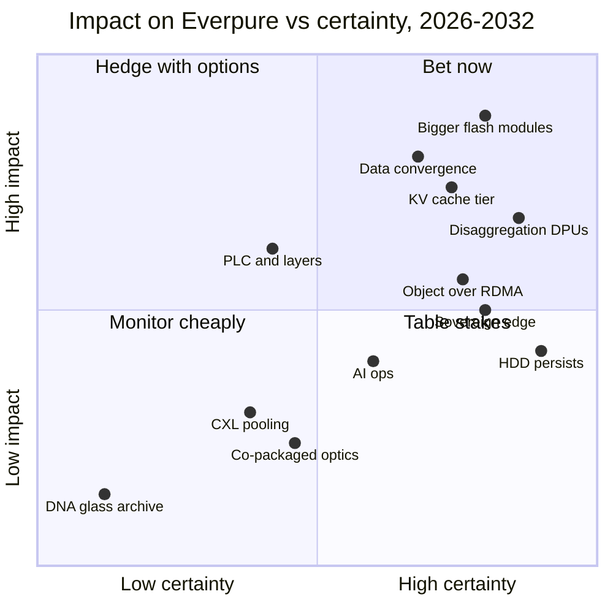
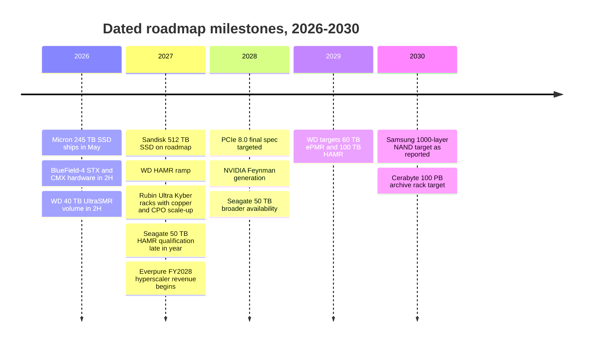

# 53. Future trends, 2026–2032

> **Depth:** L2 · **Reading time:** ~14 min · **Last verified:** 2026-11-01
> **Prerequisites:** [Media physics](../01-storage-fundamentals/02-media-physics.md) · [Interfaces and emerging tech](../02-protocols-and-networking/12-interfaces-and-emerging-tech.md) · [Inference and KV cache](../05-ai-storage/32-inference-and-kv-cache.md) · [Power and density](../05-ai-storage/38-power-and-density.md) · [History of flash](52-history-of-flash.md)

## TL;DR

- **Capacity per device is the most certain trend, and Everpure's main lever.** DirectFlash Modules (DFMs) are at 300 TB, standard SSDs at 245.76 TB, and 512 TB drives are on 2027 roadmaps. The scarce resources are rebuild time, NAND supply and watts, not slots.
- **Disk is not dying this decade.** HAMR takes nearline drives from 44 TB toward 100 TB by about 2029, and Seagate says its output is largely sold out through 2028. Flash takes performance and power-constrained AI capacity; disk keeps cold bulk.
- **AI inference creates a new tier between HBM and shared storage.** NVIDIA's KV cache hierarchy (Dynamo KVBM, BlueField-4 STX/CMX) makes context memory a purchasable category from 2H 2026. Every storage vendor, Everpure included, is fighting to be its backend.
- **The value is moving up into data services and down into the fabric.** Catalogs, governance and vector search are converging with storage. DPUs, Ultra Ethernet and S3 over RDMA are commoditizing the data path.
- **Be calibrated.** CXL pooling, co-packaged optics in storage and PLC flash are real but later and smaller than vendor decks imply. DNA and glass archives are pre-commercial. Several of today's "certainties" are vendor roadmaps that have slipped before.

## Why this matters for Everpure strategy

Everpure (NYSE: P, formerly PSTG) has built its strategy on three bets that run through this window: flash replaces disk at hyperscale, its own flash modules stay ahead of commodity SSDs, and it can move up from storage into data management (the 1touch acquisition, Data Intelligence, the Everpure rename itself). Each bet depends on the trends below. A NAND cost curve that stalls, a HAMR ramp that holds, or a commodity 512 TB SSD that arrives on time each change the economics of the hyperscaler licensing model. KV cache tiers and sovereign AI decide which new buyers exist.

This chapter gives each of twelve trends a likelihood, a timing call, winners and losers, and options a strategy team might evaluate, based on public information. It separates **vendor roadmaps** (what a supplier says it will ship) from **independent forecasts** (analysts, standards bodies and observed adoption). The strategic responses are developed in [Chapter 54](54-strategic-option-map.md).

## Core concepts

### How to read the calls

Each trend gets three calls. **Likelihood** is the probability that the trend is *material by 2032*, meaning it changes a meaningful share of storage buying decisions. High means 70% or more, Medium 40–70%, Low under 40%. **Timing** is when it becomes material, which is usually two to four years after the first product ships. **Evidence** is labelled as vendor roadmap or independent signal. Vendor roadmaps slip, but unevenly. Seagate's 50 TB HAMR drive was once planned for 2026 and now enters qualification in late 2027[^1], and the LTO tape consortium cut its future capacities in 2025[^2]. Roadmaps a vendor controls end to end fare better: Pure Storage set a 300 TB DFM target for 2026 in March 2023[^3] and met it.

![Radar diagram with four concentric rings (adopt now, 2027–28, 2029–32, watch) and four quadrants (media, interconnect and architecture, data services, deployment and operating models). Twelve numbered dots coloured by likelihood: HDD persistence, disaggregation and sovereign AI in the inner ring; larger flash modules, KV cache tier, data-management convergence, object over RDMA and AI-driven operations in the second ring; PLC and high-layer NAND, CXL pooling and co-packaged optics in the third ring; DNA, glass and ceramic archives in the watch ring.](../assets/diagrams/ch53-trends-radar.svg)

*Figure 53.1 — Most of what matters to Everpure lands in 2027–28; the exotic technologies cluster in the outer rings.*

### Media

**1. Larger flash modules: 300 TB, then 600 TB, then 1 PB.** Everpure's DFMs are at 300 TB per module[^4]. The largest standard SSD, Micron's 6600 ION, shipped at 245.76 TB in May 2026[^5]. A co-founder has described 600 TB and then 1 PB-plus modules, without dates[^6] [VERIFY: search-summary only]. The commodity side is closing in: Sandisk's roadmap shows 512 TB in 2027[^7], and Meta has said it plans QLC drives up to 512 TB[^8] [VERIFY: source reused from Ch 26; confirm Meta statement]. *Vendor roadmap* on both sides. The *independent* signal is TrendForce's report that hyperscalers are buying QLC for AI workloads in 4Q26[^9].

The constraint shifts from slots to failure physics. Take 24 modules per enclosure. At 300 TB that is 7.2 PB raw; at 1 PB it is 24 PB. Rebuilding one failed module at 1 GB/s takes 300,000 s (about 83 hours) at 300 TB and 1,000,000 s (about 11.6 days) at 1 PB. Spread across many modules at an aggregate 20 GB/s, the same rebuilds take about 4.2 and 13.9 hours. So bigger modules reward vendors who own the FTL and the rebuild path, which is the DirectFlash argument ([Chapter 26](../04-everpure/26-purity-and-directflash.md)). **Call: High likelihood; 600 TB-class in 2027–28; 1 PB-class by 2029–30.**

**2. PLC and 400–1,000-layer NAND.** Samsung's V10 passes 400 layers using hybrid bonding[^10], while Kioxia/Sandisk's 332-layer BiCS10 claims higher density per mm²[^11]. Bit density, not layer count, is the metric. Kioxia has described a technical path to 1,000 layers by 2027[^12], and Samsung was reported to target 1,000 layers by 2030[^13]. *Vendor roadmaps*, and they conflict. PLC (5 bits per cell) adds only 25% more bits than QLC, against 33% for TLC to QLC, and halves the voltage margin again (32 states versus 16). SK hynix's split-cell PLC is research presented at IEDM in December 2025[^14]. No product is announced. **Call: layer scaling High and continuous; PLC Medium at best, 2029–32, and probably first in read-mostly archive flash.** The semis frame: layer count is the new node name. It is a marketing number that diverges from cost per bit once string stacking and bonding add process steps.

**3. HDD's future: HAMR, nearline and archive.** Seagate says its Mozaic 5 platform (more than 5 TB per platter, so 50 TB-plus drives) enters customer qualification in late 2027, with nearline output largely committed through 2028[^1]. Western Digital targets HAMR ramping in 2027, 60 TB ePMR and 100 TB HAMR by 2029[^15]. *Vendor roadmaps*, but the sold-out order books are an *independent-ish* demand signal. In 2026 enterprise SSDs cost roughly 18.6× HDD per TB[^16], far above the ~10× of 2020. The weakness is access density. A 50 TB drive at roughly 250–300 MB/s takes about 50 hours to read end to end, so IOPS and bandwidth per TB fall with every generation. **Call: High that disk keeps the nearline bulk tier through 2032; flash takes the performance and power-constrained share.** The winners are the two HAMR suppliers and the object and tiering vendors that blend disk with flash. The loser is any flash vendor whose case rests on purchase price rather than watts, density and operations ([Chapter 38](../05-ai-storage/38-power-and-density.md)).

**11. DNA, glass and ceramic archival.** Microsoft says Project Silica's research phase finished in 2025, with lifetime claims beyond 10,000 years, but has announced no product[^17]. Cerabyte targets 100 PB-plus ceramic archive racks by 2030 and counts Western Digital as an investor[^18]. Atlas Data Storage spun out of Twist Bioscience in May 2025 with US$155 million to commercialize DNA storage[^19]. Write throughput is the gating problem: DNA synthesis needs orders-of-magnitude gains. **Call: Low likelihood of material impact by 2032. Watch for hyperscaler production use, not lab capacity records.**

### Interconnect and architecture

**4. CXL memory pooling and tiers.** CXL 4.0 (November 2025) runs at 128 GT/s on the PCIe 7.0 PHY[^20], and PCIe 8.0 targets a 2028 final spec[^21]. Direct-attached CXL memory expanders ship, while switched pooling is only starting ([Chapter 12](../02-protocols-and-networking/12-interfaces-and-emerging-tech.md)). The independent evidence is sobering. Microsoft's Pond study found pooling across 16 sockets cut DRAM needs by about 7%[^22]. Forecasts for the CXL market in 2028 range from about US$3.5 billion to more than US$15 billion[^23]. The new use case is KV cache: Samsung and AMD showed CXL pooling cutting time to first token by 38% at OCP 2026 (vendor demo)[^24]. CXL memory is still DRAM priced like DRAM, so it is a faster tier, not a cheaper one. **Call: Medium; 2029–32 for storage relevance; it competes with flash for KV cache only at the hot edge.**

**5. Disaggregation everywhere, including DPUs.** Disaggregated designs are now mainstream. VAST built the category, NetApp's AFX scales controllers and capacity independently[^25], and Everpure's FlashBlade//EXA splits metadata from data ([Chapter 16](../03-system-architecture/16-disaggregated-shared-everything.md)). The next step moves storage software onto DPUs. NVIDIA's BlueField-4 STX reference architecture launched in March 2026 with twelve storage co-design partners, Everpure among them[^26][^27]. VAST runs its controller software on BlueField-4 inside GPU servers, with hardware due in 2H 2026[^28]. The semis analogy is the chiplet I/O die. Control moves into a standard part whose roadmap the platform owner, NVIDIA, sets. **Call: High; adopt now. Disaggregation itself becomes table stakes. The open question is who owns the DPU software slot.**

**6. Photonic interconnects and co-packaged optics (CPO).** CPO puts the optical engine next to the switch ASIC, cutting pluggable-module power and lasers. NVIDIA says Spectrum-X Photonics switches are in production in 2026, with "4x fewer lasers" (vendor claim)[^29] [VERIFY: shipping status conflicts across reports]. Its Kyber racks for Rubin Ultra (2027) will scale up over copper and CPO[^30]. Broadcom ships 102.4 Tb/s Tomahawk 6 silicon[^31]. *Vendor roadmaps throughout.* Storage rides on the same switches but rarely drives them, and storage NICs and arrays stay pluggable for serviceability. **Call: Medium; CPO in AI scale-out switches by 2027–28; storage-side optics changes 2029–32. Few direct consequences for array vendors beyond rack power budgets.**

**7. KV cache as a new tier ("context memory").** Inference keeps each session's attention keys and values. A Llama 3.1 70B-class model needs 320 KiB per token, so a 128K-token session is about 43 GB ([Chapter 32](../05-ai-storage/32-inference-and-kv-cache.md)). Keeping 10,000 such sessions warm takes about 430 TB, or one to two 300 TB modules. NVIDIA's Dynamo KV Block Manager defines tiers G1 (HBM) to G4 (networked storage)[^32], and BlueField-4 context memory storage (CMX) adds a pod-level tier, with availability in 2H 2026[^33]. The *independent* signals are MLPerf Storage v3.0 adding a KV cache workload in September 2026[^34] and TrendForce linking QLC demand to KV cache[^9]. Everpure (PureKVA)[^35], WEKA (Augmented Memory Grid)[^36], DDN, VAST and HPE all ship offerings. The semis bridge is a victim cache. Blocks evicted from HBM drop into host DRAM, then into pod flash, then into shared storage, and a hit at any level saves recomputing the prefill. As with an L3 cache, value depends on hit rate and fill bandwidth, not capacity alone. **Call: High; material in 2027–28. The risk is that NVIDIA's reference design turns the tier into a commodity flash box.**

### Data services

**8. Data-management convergence: storage, catalog, governance and vector.** Storage vendors are absorbing the layers above them. Everpure bought 1touch for US$125.0 million[^37] and shipped Data Stream on NVIDIA's AI Data Platform design[^38]. VAST sells a database and agent engine, and AWS put vector indexes (S3 Vectors, generally available December 2025) inside object storage[^39]. Gartner predicts that by 2029 more than 80% of on-premises unstructured data will sit on consolidated file-and-object platforms, up from 50% in 2025[^40] [VERIFY: search-summary only]. That is an *independent forecast*, and Gartner's 2023 version predicted 70% by 2028[^41], so the date has already moved out a year. The steelman against: Databricks, Snowflake and the security vendors own the buyer and see every vendor's storage ([Chapter 39](../05-ai-storage/39-agentic-ai-and-data-intelligence.md)). **Call: High that storage vendors ship these features; Medium that they capture the economics; 2027–28.**

**10. Object as the primary AI interface; S3 over RDMA.** S3 over RDMA keeps HTTP for authentication and moves bulk bytes over RDMA into GPU memory. MinIO shipped it in November 2024[^42], NVIDIA productized the pattern for Cloudian, Dell and HPE in 2025[^43], and Pure Storage announced it for FlashBlade[^44]. About one-sixth of MLPerf Storage v3.0 submissions used S3[^34] ([Chapter 9](../02-protocols-and-networking/09-object-storage-and-s3.md)). A 400 GbE port moves 50 GB/s, which classic S3 over TCP and TLS cannot fill per client without heavy CPU. RDMA removes the reason to buy a parallel file system for many AI reads. **Call: High; 2027–28. It erodes the file-system moat of AI-native vendors and commoditizes object.**

### Deployment and operating models

**9. Sovereign and edge AI storage.** Gartner forecasts sovereign cloud IaaS spending of about US$80 billion in 2026, up 35.6%, with Europe overtaking North America in 2027[^45]. IDC reports the fastest AI infrastructure growth in Saudi Arabia and the UAE, driven by sovereign programs[^46]. These are *independent forecasts*. DDN launched sovereign AI blueprints at SC25[^47], and Portworx added an edge SKU in 2026[^48]. Sovereign buyers want on-premises control, local support, air-gap options and no dependence on a US hyperscaler control plane. That favors appliance vendors and open, portable software. **Call: High; adopt now. Volumes are lumpy national deals; edge AI storage stays small per site.**

**12. AI-driven operations.** Storage AIOps is two decades old. What is new is agents that act. Everpure made Pure1 "agentic" through read-only MCP servers, with Copilot moving toward guided triage[^49]. Gartner reportedly predicts that fewer than 1% of storage leaders run agentic storage management today, rising to 20% by 2028[^50] [VERIFY: search-summary only]. Trust, not capability, is the bottleneck: agents that change production state need audit, rollback and blast-radius limits. **Call: Medium; assistive agents now, write-capable autonomy for routine tasks in 2027–28.**

### Impact versus certainty

*Figure 53.2 — Four trends sit in "bet now"; PLC is the one high-impact, low-certainty hedge, and the exotic media are cheap to monitor.*

### Dated milestones

Only items with a dated, sourced roadmap appear below. Each is a vendor or standards-body target, not an independent forecast.

*Figure 53.3 — The dated milestones bunch in 2026–28; beyond 2029 the only dated items are media targets that have slipped before.*

Sources for the timeline: Micron[^5], NVIDIA[^33], Western Digital[^15], Sandisk[^7], NVIDIA GTC 2026[^30], Seagate[^1], Everpure[^51], PCI-SIG via The Register[^21], TrendForce[^13] and Cerabyte[^18].

### What would change my mind on the top four

| Trend | Base case | Would raise the call | Would lower the call |
|---|---|---|---|
| Bigger flash modules | 600 TB-class DFMs 2027–28; commodity 512 TB SSDs follow within a year | A dated 600 TB DFM launch; NAND contract prices falling in 2027 | Commodity 512 TB SSDs shipping first; hyperscalers standardizing on FDP SSDs instead of licensed modules |
| KV cache tier | Shared flash backs G3.5/G4 at scale in 2027–28 | MLPerf KV results tied to production cost per token; Dynamo defaults offloading to network storage | Long-context models that shrink the cache sharply; CXL or HBM price drops that keep KV in memory |
| Data convergence | Storage vendors ship catalog, governance and vector features | Customers buying Data Intelligence for data on other vendors' arrays | Databricks, Snowflake or hyperscalers bundling these features free |
| Disaggregation and DPUs | Table stakes; DPU-hosted storage software in AI pods | Production STX/CMX deployments in more than a few neoclouds | Customers rejecting NVIDIA-locked storage nodes; DPU software slot captured by one vendor |

*Table 53.1 — Signposts for the four highest-impact trends; each is observable in public data within 12–18 months.*

## How Everpure approaches it vs. competitors

| # | Trend | Likelihood | Timing | Winners | Losers | Everpure implication (options to evaluate) |
|---|---|---|---|---|---|---|
| 1 | Larger flash modules | High | 2027–28 | Owners of the FTL and rebuild path; NAND makers | Disk in warm tiers; vendors on stock SSDs | Publish a dated 600 TB roadmap; extend licensing to more hyperscalers |
| 2 | PLC, 400–1,000 layers | Medium | 2029–32 | Bit-density leaders; controller IP owners | Late NAND movers; endurance-sensitive designs | Qualify PLC early for archive tiers; keep two NAND sources |
| 3 | HDD persists (HAMR) | High | Now | Seagate, WD; hybrid and object vendors | "Flash replaces all disk" timelines | Position flash on watts and density, not $/TB; partner for cold tiers |
| 4 | CXL pooling | Medium | 2029–32 | Memory makers, switch vendors | Cheap DRAM-cache designs | Track; consider CXL inside controllers, not as a product |
| 5 | Disaggregation, DPUs | High | Now | NVIDIA; software-defined vendors | Fixed dual-controller-only lines | Port data services to BlueField-class DPUs; keep EXA's open data nodes |
| 6 | Co-packaged optics | Medium | 2029–32 | NVIDIA, Broadcom, optics suppliers | Pluggable-module vendors | Watch rack power budgets; little direct action |
| 7 | KV cache tier | High | 2027–28 | Fast shared-flash vendors; NVIDIA | Recompute-heavy stacks | Make PureKVA a default Dynamo/NIXL backend; publish cost per token |
| 8 | Data convergence | High (features), Medium (economics) | 2027–28 | Platform vendors with neutral catalogs | Point tools; storage-only vendors | Make Data Intelligence work on others' storage; partner with lakehouses |
| 9 | Sovereign and edge AI | High | Now | Appliance vendors, open software, local integrators | Hyperscaler-only stacks | Sovereign reference designs; local-cloud partners |
| 10 | Object primary, S3 over RDMA | High | 2027–28 | Fast-object vendors; NVIDIA | Parallel-file-system-only vendors | Ship cuObject-compatible RDMA S3 across FlashBlade and EXA |
| 11 | DNA, glass, ceramic | Low | Watch | Hyperscalers' archives | Tape, eventually | No action beyond monitoring |
| 12 | AI-driven operations | Medium | 2027–28 | Vendors with fleet telemetry | Manual-ops vendors | Move Pure1 agents from read-only to bounded write actions |

*Table 53.2 — Trend scorecard: Everpure is well placed on module capacity and convergence, and most exposed where NVIDIA's reference designs set the terms.*

The steelman for competitors cuts several ways. **VAST** is most aligned with disaggregation, DPUs and convergence. It already runs on BlueField-4 and sells a database layer, so trends 5, 7 and 8 play to its strengths. **WEKA and DDN** hold the strongest KV cache and HPC positions. **Dell, NetApp and HPE** have the reach for sovereign deals and full-stack bundles. **Hyperscalers** pull convergence into S3 itself. Everpure's distinct asset is trend 1. No competitor ships a proprietary flash module at 300 TB, and the hyperscaler design wins monetize it without NAND exposure[^51]. Its main exposure is that NVIDIA's STX turns trends 5 and 7 into reference designs where storage software is a feature on someone else's hardware.

The options sort into two groups. **No-regret moves** pay off under almost any scenario: dated module roadmaps, default integration with Dynamo and NIXL, RDMA-capable S3 everywhere, and publishing cost-per-token rather than TTFT multipliers. **Real options** are cheap to hold now and valuable only if a trend breaks favorably: early PLC qualification for archive flash, running Purity services on DPUs, and sovereign reference designs with local partners. CXL, co-packaged optics and DNA or glass archives need monitoring, not investment. A strategy team might rank build, buy or partner choices for each group in [Chapter 54](54-strategic-option-map.md).

## History and trajectory

Storage forecasts have a poor record, and in a consistent direction. Every new tier was predicted to arrive faster than it did. Intel's Optane was meant to be the persistent-memory tier; Intel wound it down in 2022 with a US$559 million charge[^52]. ZNS SSDs were meant to remake flash management; the gentler Flexible Data Placement (FDP), driven by Meta and Google, has drawn more hyperscaler support[^53]. "Flash kills disk by 2026" missed because NAND prices rose: enterprise SSD premiums over disk widened in 2026 instead of narrowing[^16]. Forecasts based on supply-side physics (density, layers, PCIe doubling) have held up better than those based on demand-side adoption (new tiers, new interfaces).

The demand backdrop is not in question. IDC raised its 2026 AI infrastructure forecast to US$497 billion and expects spending to pass US$1 trillion in 2029[^46]. Storage is a small share of that, so the issue is not whether storage demand grows. It is which tiers and which business models capture it.

That history sets the calibration here. Capacity trends get High. New tiers get High only where a dominant platform owner (NVIDIA with Dynamo and STX) is standardizing them. Tiers that need a whole ecosystem to move (CXL pooling, PLC, DNA) get Medium or Low. The 2026 NAND shortage is a reminder that the cycle can override the roadmap for two years at a time ([Chapter 48](../06-industry-and-competition/48-media-suppliers-and-nand-cycle.md)).

## Numbers that matter

| Metric | Value | Context | Source / date |
|---|---|---|---|
| Largest DFM | 300 TB | Everpure proprietary module | Blocks & Files, 2026-08-11[^4] |
| Largest shipping standard SSD | 245.76 TB | Micron 6600 ION, PCIe 5.0 QLC | Micron, 2026-05-05[^5] |
| Next commodity SSD step | 512 TB | Sandisk roadmap, 2027 | Blocks & Files, 2025-08-05[^7] |
| HAMR 50 TB-class | Qualification late 2027 | Seagate Mozaic 5 | Tom's Hardware, 2026-07[^1] |
| HDD roadmap ceiling | 100 TB HAMR by 2029 | Western Digital target | WD, 2026-02-03[^15] |
| Enterprise SSD vs HDD $/TB | ~18.6× | 2026; ~10× in 2020 | Hardware Busters, 2026[^16] |
| CXL 4.0 link rate | 128 GT/s | On PCIe 7.0 PHY | CXL Consortium, 2025-11[^20] |
| CXL pooling DRAM saving | ~7% | 16-socket pool, Azure study | Pond, ASPLOS 2023[^22] |
| Sovereign cloud IaaS spend | ~US$80 B in 2026 (+35.6%) | Gartner forecast | Gartner, 2026-02-09[^45] |
| KV cache for 10,000 128K sessions | ~430 TB | 70B-class model, 43 GB per session | Worked example |
| 1 PB module rebuild at 20 GB/s | ~13.9 h | vs ~4.2 h at 300 TB | Worked example |

## Conversation playbook

**Questions for a PM**

1. *"What has to be true for a 600 TB DFM to ship before commodity 512 TB SSDs?"* Strong: names the NAND generation and die capacity, the rebuild design and the qualification lead time. It says whether the gap to commodity drives is widening or narrowing.
2. *"In a sovereign AI deal, what do we lose on today?"* Strong: names specifics such as local support, air-gap, certification or a domestic partner, and which competitor wins (often Dell, Huawei or DDN).
3. *"How does PureKVA make money if NVIDIA's CMX becomes the default context tier?"* Strong: positions PureKVA as the G4 shared tier behind CMX, or as a CMX-compatible software layer, and gives a cost-per-token comparison, not a TTFT multiplier.

**Questions for an engineer**

1. *"At 1 PB per module, what is the rebuild time and the exposure window to a second failure?"* Strong: gives aggregate rebuild GB/s, the erasure-code geometry and the probability of data loss during rebuild.
2. *"Which parts of Purity could run on a BlueField-4 DPU, and what breaks?"* Strong: separates data path from metadata and global deduplication, and names memory and core limits.
3. *"What does PLC do to our write path and endurance budget?"* Strong: quantifies P/E cycles, read-retry latency and how much log structuring and wear leveling absorb.

**Don't say this:**

- "Disk is dead." HAMR order books run through 2028 and flash costs about 18× more per TB in 2026.
- "CXL will replace storage tiers." CXL memory is DRAM at DRAM prices; it is a memory tier.
- "DNA storage is coming soon." No production system exists, and write throughput needs orders-of-magnitude gains.
- "1,000-layer NAND means 3× cheaper flash." Cost per bit depends on bonding and process steps, not layer count.
- "Our KV cache gives 20× faster TTFT." Without the baseline and cost per token, that number persuades no one.

## Going deeper (optional, L3 pointers)

- CXL Consortium, CXL 4.0 white paper; Li et al., "Pond" (ASPLOS 2023) for pooling economics.
- NVIDIA Dynamo KVBM design docs for the G1–G4 tier model; MLPerf Storage v3.0 KV cache rules.
- IEDM 2025 SK hynix multi-site-cell PLC paper; VLSI 2026 papers on 1,000-layer NAND.
- Microsoft Research publications on Project Silica; the DNA Data Storage Alliance specifications.

## Key terms

- **Context memory** — storage tier holding inference KV cache between GPU memory and shared storage.
- **CMX / STX** — NVIDIA's BlueField-4 context memory storage platform and storage reference architecture.
- **Co-packaged optics (CPO)** — optical engines packaged next to a switch or processor die instead of pluggable modules.
- **HAMR** — heat-assisted magnetic recording, which lets disks write smaller bits.
- **PLC** — penta-level cell, 5 bits per NAND cell.
- **Sovereign AI** — AI infrastructure built to keep data, control and operations within a jurisdiction.
- **Technology radar** — chart placing trends by maturity ring and category.
- See the [glossary](../glossary.md) for the rest.

## Sources

[^1]: Tom's Hardware, "Seagate to start qualifying record-setting 50TB HDDs in 2027 — most drives are sold out through 2028," 2026-07. https://www.tomshardware.com/pc-components/hdds/seagate-to-start-qualifying-record-setting-50tb-hdds-in-2027-most-drives-are-sold-out-through-2028 ; corroborated by TechRadar, "Seagate reveals more on its 50TB HDD plans," 2026. https://techradar.com/pro/seagate-reveals-more-on-its-50tb-hdd-plans-but-looks-like-well-still-have-a-long-wait-to-buy-one (both seen via search, retrieved 2026-11-01).
[^2]: Blocks & Files, "LTO-10 bumped to 40 TB as future tape capacities get cut," 2025-11-13. https://www.blocksandfiles.com/tape/2025/11/13/lto-10-bumped-to-40-tb-as-future-tape-capacities-get-cut/1711787 (seen via search, retrieved 2026-11-01).
[^3]: Gigazine, "Pure Storage sets goal of realizing 300 TB SSD by 2026," 2023-03-08. https://gigazine.net/gsc_news/en/20230308-pure-storage-300-tb-ssd (retrieved 2026-11-01).
[^4]: Blocks & Files, "Second hyperscaler plumps for Everpure's flash technology," 2026-08-11. https://www.blocksandfiles.com/flash/2026/08/11/second-hyperscaler-plumps-for-everpures-flash-technology/5285903 (retrieved 2026-11-01).
[^5]: Micron Technology, "Industry-Leading 245TB Micron 6600 ION Data Center SSD Now Shipping," 2026-05-05. https://investors.micron.com/news/press-release/2026/Industry-Leading-245TB-Micron-6600-ION-Data-Center-SSD-Now-Shipping/default.aspx (retrieved 2026-11-01).
[^6]: Pure Storage, "Eliminating Disk for Good" (webinar with co-founder John Colgrove), 2025. https://www.everpuredata.com/video/webinars/eliinating-disk-for-good/6374611414112.html (seen via search summary, 2026-11-01).
[^7]: Blocks & Files, "Sandisk unveils 256 TB SSD for AI workloads, shipping in 2026," 2025-08-05. https://www.blocksandfiles.com/ai-ml/2025/08/05/sandisk-unveils-256-tb-ssd-for-ai-workloads-shipping-in-2026/1589534 (retrieved 2026-11-01).
[^8]: TechRadar Pro, "Facebook engineers say bigger hard disk drives is making one critical metric far, far worse," 2025. https://www.techradar.com/pro/facebook-engineers-say-that-bigger-hard-disk-drives-is-making-one-critical-metric-far-far-worse (retrieved via search 2026-11-01).
[^9]: TrendForce, "AI Server Demand Sustains Memory Contract Price Increases in 4Q26, While Consumer-Side Pressure Persists," 2026-09-30. https://www.trendforce.com/presscenter/news/20260930-13258.html (retrieved 2026-11-01).
[^10]: Tom's Hardware, "Samsung unveils 10th Gen V-NAND: 400+ layers, 5.6 GT/s and hybrid bonding," 2026. https://www.tomshardware.com/pc-components/ssds/samsung-unveils-10th-gen-v-nand-400-layers-5-6-gt-s-and-hybrid-bonding (retrieved 2026-11-01).
[^11]: Tom's Hardware, "Kioxia and Sandisk sample world's densest 3D NAND — new 332-Layer beats Samsung's 400-Layer NAND," 2026. https://www.tomshardware.com/pc-components/ssds/kioxia-and-sandisk-sample-worlds-densest-3d-nand-new-332-layer-beats-samsungs-400-layer-nand (retrieved 2026-11-01).
[^12]: Blocks & Files, "Kioxia plots tech route to 1,000 layer 3D NAND by 2027," 2024-06-19. https://blocksandfiles.com/2024/06/19/kioxia-1000-layer-3d-nand/ ; TechRadar Pro, "SSD rival to Samsung reveals road to petabyte SSDs… Kioxia wants 1000-layer NAND in 3 years," 2024. https://www.techradar.com/pro/ssd-rival-to-samsung-reveals-road-to-petabyte-ssds-at-major-engineering-conference-kioxia-wants-1000-layer-nand-in-3-years-and-discusses-helc-molybdenum-100gbmm2-densities (both seen via search, retrieved 2026-11-01).
[^13]: TrendForce, "Samsung Reportedly Targets 1000-Layer NAND by 2030, Rolls Out Wafer Bonding at 400 Layers," 2025-02-26. https://www.trendforce.com/news/2025/02/26/news-samsung-reportedly-targets-1000-layer-nand-by-2030-rolls-out-wafer-bonding-at-400-layers/ (seen via search, retrieved 2026-11-01).
[^14]: Blocks & Files, "SK hynix developing split-cell 5-bit flash," 2026-01-15. https://www.blocksandfiles.com/flash/2026/01/15/sk-hynix-developing-split-cell-5-bit-flash/4090388 (retrieved 2026-11-01).
[^15]: Western Digital, "Western Digital Accelerates Storage Innovation for AI Era," 2026-02-03. https://www.westerndigital.com/company/newsroom/press-releases/2026/2026-02-03-western-digital-accelerates-storage-innovation-for-ai-era (retrieved 2026-11-01).
[^16]: Hardware Busters, "Enterprise SSD Prices Now Run 18.6x Hard Drives, and the Cheap Alternative Is Sold Out Until 2027," 2026. https://hwbusters.com/news/enterprise-ssd-prices-now-run-18-6x-hard-drives-and-the-cheap-alternative-is-sold-out-until-2027/ (retrieved 2026-11-01); 2020 baseline: Blocks & Files, "Enterprise SSDs cost ten times more than nearline disk drives," 2020-08-24. https://blocksandfiles.com/2020/08/24/10x-enterprise-ssd-price-premium-over-nearline-disk-drives/ (retrieved 2026-11-01).
[^17]: Blocks & Files, "Project Silica's glass storage archive tech progress," 2025-12-23. https://blocksandfiles.com/2025/12/23/project-silicas-glass-storage-archive-tech-progress/ ; Microsoft Research, "Project Silica" briefing to the Library of Congress, 2026-03-09. https://www.digitalpreservation.gov/meetings/DSA2026/0124_Silica-2026-03-09-Library-of-Congress-sharing.pdf (both seen via search, retrieved 2026-11-01).
[^18]: Blocks & Files, "Cerabyte promises fast, dense, low-cost tape alternative by 2030," 2025-07-02. https://www.blocksandfiles.com/data-management/2025/07/02/cerabyte-promises-fast-dense-low-cost-tape-alternative-by-2030/1595617 ; Hardware Busters, "Lasers, Ceramics, and 100PB Dreams: Cerabyte Wants to Ditch Tape… by 2030," 2025. https://hwbusters.com/news/lasers-ceramics-and-100pb-dreams-cerabyte-wants-to-ditch-tape-and-rewrite-data-storage-physics-by-2030/ (both seen via search, retrieved 2026-11-01).
[^19]: Twist Bioscience, "Twist Bioscience Spins Out DNA Data Storage as Independent Company," 2025-05. https://investors.twistbioscience.com/news-releases/news-release-details/twist-bioscience-spins-out-dna-data-storage-independent-company ; Blocks & Files, "DNA storage gets a new twist with Atlas Data Storage," 2025-05-06. https://blocksandfiles.com/2025/05/06/dna-storage-gets-a-new-twist-with-atlas-data-storage/ (both seen via search, retrieved 2026-11-01).
[^20]: CXL Consortium, "CXL 4.0 White Paper," 2025-11. https://computeexpresslink.org/wp-content/uploads/2025/11/CXL_4.0-White-Paper_FINAL.pdf (retrieved 2026-11-01).
[^21]: The Register, "Confirmed: PCIe 8.0 will double version 7.0's speed and reach 256.0 GT/s," 2025-08-08. https://www.theregister.com/2025/08/08/pcie_8_spec_speed_announced/ (retrieved 2026-11-01).
[^22]: H. Li et al., "Pond: CXL-Based Memory Pooling Systems for Cloud Platforms," ASPLOS '23, 2023. https://www.microsoft.com/en-us/research/publication/pond-cxl-based-memory-pooling-systems-for-cloud-platforms/ (retrieved 2026-11-01).
[^23]: J. Handy and T. Coughlin, "Big Architectural Changes Are Coming," SNIA SDC 2024 (posted 2025-05). https://www.snia.org/sites/default/files/2025-05/SNIA-SDC2024-Handy-Coughlin-Big-Architectural-Changes-Are-Coming_0.pdf ; HPCwire, "What Hyperscalers Should Know About CXL," 2026-08-20. https://www.hpcwire.com/2026/08/20/what-hyperscalers-should-know-about-cxl/ (both seen via search, retrieved 2026-11-01).
[^24]: StorageReview, "Samsung CXL Memory Pooling Demo With AMD at OCP 2026 Claims 38 Percent Lower TTFT and 3.3x Goodput for Agentic AI," 2026-10. https://www.storagereview.com/news/samsung-cxl-memory-pooling-amd-ocp-2026-cmm-d-agentic-ai (retrieved 2026-11-01).
[^25]: Blocks & Files, "NetApp disaggregates ONTAP storage and provides an AI Data Engine," 2025-10-14. https://blocksandfiles.com/2025/10/14/netapp-disaggregates-ontap-storage-and-provides-an-ai-data-engine/ (retrieved 2026-11-01).
[^26]: NVIDIA, "NVIDIA Launches BlueField-4 STX Storage Architecture With Broad Industry Adoption," 2026-03-16. https://investor.nvidia.com/news/press-release-details/2026/NVIDIA-Launches-BlueField-4-STX-Storage-Architecture-With-Broad-Industry-Adoption/default.aspx (retrieved 2026-11-01).
[^27]: StorageNewsletter, "Nvidia GTC 2026: Nvidia Launches BlueField-4 STX Storage Architecture With Broad Industry Adoption," 2026-03-17. https://www.storagenewsletter.com/2026/03/17/nvidia-gtc-2026-nvidia-launches-bluefield-4-stx-storage-architecture-with-broad-industry-adoption/ (retrieved 2026-11-01).
[^28]: StorageNewsletter, "CES 2026: Vast Data Redesigns AI Inference Architecture for the Agentic Era with Nvidia," 2026-01-07. https://www.storagenewsletter.com/2026/01/07/ces-2026-vast-data-redesigns-ai-inference-architecture-for-the-agentic-era-with-nvidia/ (retrieved 2026-11-01).
[^29]: StorageReview, "NVIDIA Spectrum-X Ethernet Photonics Enters Full Production With 4x Fewer Lasers and a Five-Vendor CPO Supply Chain," 2026. https://www.storagereview.com/zh-TW/news/nvidia-spectrum-x-ethernet-photonics-enters-full-production-with-4x-fewer-lasers-and-a-five-vendor-cpo-supply-chain (seen via search summary, retrieved 2026-11-01).
[^30]: Jon Peddie Research, "NVIDIA GTC 2026 keynote," 2026-03. https://www.jonpeddie.com/news/nvidia-gtc-2026-keynote/ ; TweakTown, "NVIDIA updates roadmap with new details on its next-gen GPU architecture coming in 2028," 2026. https://www.tweaktown.com/news/110521/nvidia-updates-roadmap-with-new-details-on-its-next-gen-gpu-architecture-coming-in-2028/index.html (both seen via search, retrieved 2026-11-01).
[^31]: Broadcom, "Broadcom Ships Tomahawk 6: World's First 102.4 Tbps Switch," 2025-06-03. https://investors.broadcom.com/news-releases/news-release-details/broadcom-ships-tomahawk-6-worlds-first-1024-tbps-switch (retrieved 2026-11-01).
[^32]: NVIDIA, "KVBM design," Dynamo documentation v1.3.0, n.d. https://docs.nvidia.com/dynamo/v1.3.0/design-docs/component-design/kvbm-design.md (retrieved 2026-11-01).
[^33]: NVIDIA, "NVIDIA BlueField-4 Powers New Class of AI-Native Storage Infrastructure for the Next Frontier of AI," 2026-01-05. https://nvidianews.nvidia.com/news/nvidia-bluefield-4-powers-new-class-of-ai-native-storage-infrastructure-for-the-next-frontier-of-ai (retrieved 2026-11-01).
[^34]: MLCommons via GlobeNewswire, "MLCommons Releases New MLPerf Storage v3.0 Benchmark Results," 2026-09-01. https://www.globenewswire.com/news-release/2026/09/01/3354412/0/en/mlcommons-releases-new-mlperf-storage-v3-0-benchmark-results.html (retrieved 2026-11-01).
[^35]: Blocks & Files, "Everpure bulks up AI offer," 2026-09-30. https://blocksandfiles.com/flash/2026/09/30/everpure-bulks-up-ai-offer/5300162 (retrieved 2026-11-01).
[^36]: WEKA, "WEKA Breaks The AI Memory Barrier With Augmented Memory Grid on NeuralMesh," 2025-11-18. https://www.weka.io/news/weka-breaks-the-ai-memory-barrier-with-augmented-memory-grid (retrieved 2026-11-01).
[^37]: SEC, "Everpure, Inc. Form 10-Q for the quarter ended May 3, 2026," 2026-06. https://www.sec.gov/Archives/edgar/data/0001474432/000147443226000061/pstg-20260503.htm (retrieved 2026-11-01).
[^38]: HPCwire/BigDATAwire, "Everpure Announces Data Stream to Expand AI-Ready Data Offerings," 2026-06-17. https://www.hpcwire.com/bigdatawire/this-just-in/everpure-announces-data-stream-to-expand-ai-ready-data-offerings/ (retrieved 2026-11-01).
[^39]: StorageNewsletter, "AWS re:Invent 2025: Amazon S3 Vectors is Now Generally Available with 40 Times the Scale of Preview," 2025-12-05. https://www.storagenewsletter.com/2025/12/05/aws-reinvent-2025-amazon-s3-vectors-is-now-generally-available-with-40-times-the-scale-of-preview/ (retrieved 2026-11-01).
[^40]: Blocks & Files, "Gartner weaves enterprise storage magic spells again," 2026-08-24. https://www.blocksandfiles.com/block/2026/08/24/gartner-weaves-enterprise-storage-magic-spells-again/5291600 (seen via search summary, retrieved 2026-11-01).
[^41]: Blocks & Files, "Gartner unveils hottest storage trends for 2023," 2023-09-07. https://www.blocksandfiles.com/ai-ml/2023/09/07/gartner-unveils-hottest-storage-trends-for-2023/1603359 (seen via search summary, retrieved 2026-11-01).
[^42]: Blocks & Files, "MinIO releases AIStor with GPUDirect-like S3 over RDMA," 2024-11-13. https://blocksandfiles.com/2024/11/13/minio-releases-aistor-with-gpudirect-like-s3-over-rdma/ (retrieved 2026-11-01).
[^43]: NVIDIA Blog, "How to Unlock Accelerated AI Storage Performance With RDMA for S3-Compatible Storage," n.d. (reported November 2025). https://blogs.nvidia.com/blog/s3-compatible-ai-storage/ (retrieved 2026-11-01).
[^44]: Everpure blog, "FlashBlade Augments its Fast Object Store with S3 over RDMA for AI/ML Workflows," n.d. https://blog.everpuredata.com/purely-technical/pure-storage-flashblade-fast-object-store-s3-rdma-for-ai-ml-workflows/ (retrieved 2026-11-01).
[^45]: Gartner, "Gartner Says Worldwide Sovereign Cloud IaaS Spending Will Total $80 Billion in 2026," 2026-02-09. https://www.gartner.com/en/newsroom/press-releases/2026-02-09-gartner-says-worldwide-sovereign-cloud-iaas-spending-will-total-us-dollars-80-billion-in-2026 ; corroborated by HPCwire reprint. https://www.hpcwire.com/off-the-wire/gartner-says-worldwide-sovereign-cloud-iaas-spending-will-total-80b-in-2026/ (both seen via search, retrieved 2026-11-01).
[^46]: IDC, "AI Infrastructure Spending Holds Near $90 Billion in Q1 2026 as Arm Overtakes x86 in Accelerated Servers; 2026 Forecast Raised to $497 Billion," 2026-07-21. https://www.idc.com/resource-center/blog/ai-infrastructure-spending-holds-near-90-billion-in-q1-2026-as-arm-overtakes-x86-in-accelerated-servers-2026-forecast-raised-to-497-billion/ ; IDC, "AI Infrastructure Spending Caps Historic Year at $90 Billion in Q4 2025; 2029 Spending to Eclipse $1 Trillion," 2026-04-16. https://www.idc.com/resource-center/blog/ai-infrastructure-spending-caps-historic-year-at-90-billion-in-q4-2025-2029-spending-to-eclipse-1-trillion/ (both seen via search, retrieved 2026-11-01).
[^47]: StorageNewsletter, "SC25: DDN Launches Sovereign AI Solutions Based on NVIDIA AI Data Platform Reference Design," 2025-11-21. https://www.storagenewsletter.com/2025/11/21/sc25-ddn-launches-sovereign-ai-solutions-based-on-nvidia-ai-data-platform-reference-design/ (retrieved 2026-11-01).
[^48]: Efficiently Connected, "Portworx at Red Hat Summit 2026," 2026-05. https://www.efficientlyconnected.com/portworx-edge-kubernetes-storage-red-hat-summit-2026/ (retrieved 2026-11-01).
[^49]: Everpure blog, "Pure1, Now Agentic," 2026. https://blog.everpuredata.com/products/pure1-now-agentic/ (seen via search summary, retrieved 2026-11-01).
[^50]: Blocks & Files, "Gartner's storage sermon for 2026–2028," 2025-12-02. https://blocksandfiles.com/2025/12/02/gartners-storage-sermon-for-2026-2028 (seen via search summary, retrieved 2026-11-01).
[^51]: Everpure, "Everpure Lands New Design Win with Second Top-Five Hyperscaler," 2026-08-10. https://www.everpuredata.com/company/newsroom/press-releases/everpure-lands-new-design-win-with-second-top-five-hyperscaler.html (retrieved 2026-11-01).
[^52]: AnandTech, "Intel To Wind Down Optane Memory Business – 3D XPoint Storage Tech Reaches Its End," 2022-07-28. https://www.anandtech.com/show/17515 (retrieved 2026-11-01).
[^53]: NVM Express, "Overcoming the Write Amplification Problem with NVM Express Flexible Data Placement," n.d. https://nvmexpress.org/nvmeflexible-data-placement-fdp-blog/ (retrieved 2026-11-01).
