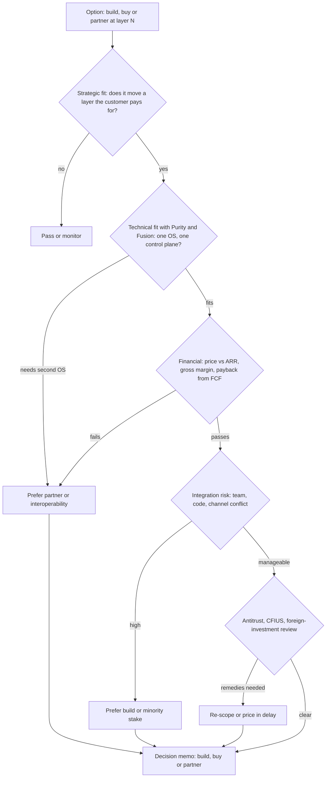
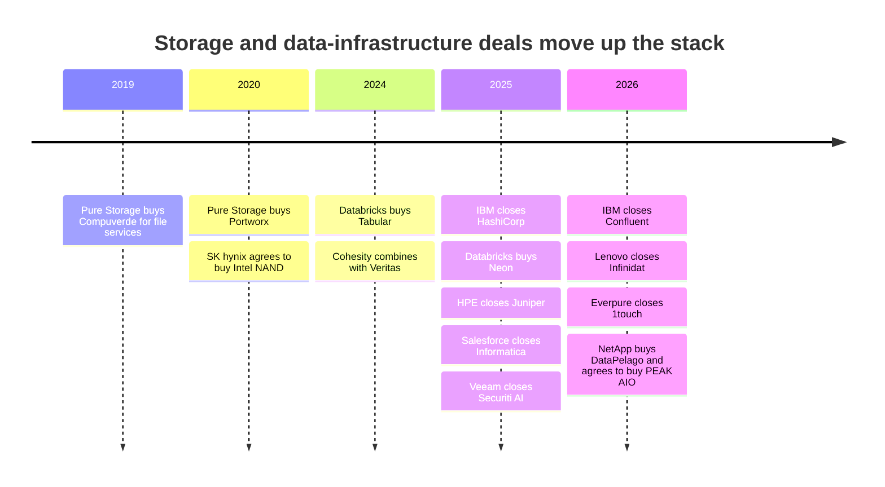

# 54. Strategic option map

> **Depth:** L2 · **Reading time:** ~11 min · **Last verified:** 2026-11-01
> **Prerequisites:** [The storage stack](../03-system-architecture/13-storage-stack.md) · [Company history and strategy](../04-everpure/25-company-history-and-strategy.md) · [Platform and software](../04-everpure/28-platform-and-software.md) · [Hyperscaler business and financials](../04-everpure/29-hyperscaler-ecosystem-financials.md) · [Technical diligence framework](../06-industry-and-competition/50-diligence-framework.md)

## TL;DR

- **Read the industry as an eight-layer value stack**, from NAND media to AI data platforms and agents. Everpure (NYSE: P, formerly PSTG) owns the middle (flash modules, flash management and array software), competes in file, object and fleet management, and entered the top three layers only in 2026.
- **Each layer has a natural mode.** Media is hedged, modules and array software are built, and buy and partner options cluster in the AI-data layers, where the scarce assets and neutral buyers sit.
- **Prices rise steeply up the stack.** Everpure's largest deal was Portworx, at about $370M. Recent data-management and AI-data deals ran from $28M to $11B. A Securiti-sized deal ($1.725B) would cost almost three years of Everpure's FY26 free cash flow.
- **A good option clears five gates, not one:** strategic fit, fit with Purity and Fusion, valuation against ARR and margin, integration risk (above all, a second operating system), and antitrust or foreign-investment review. Most options fail the second or fourth gate, not the first.
- **"Do nothing new" is a serious option.** Revenue guidance implies ~38% growth, NAND is consuming cash, and Everpure's record favours small tuck-ins. The case against it is neutrality: whoever owns the catalog above the array owns the customer.

## Why this matters for Everpure strategy

The rest of this atlas describes layers, architectures and competitors one at a time. A corporate-development conversation needs them on one page. Strategists ask "where do we play, how do we get there, and what does it cost?", and those questions differ by layer. The answer for NAND (hedge supply, never buy a fab) is the opposite of the answer for data intelligence (Everpure bought 1touch for $125.0M in cash in 2026[^1]). The 2026 rebrand to Everpure and the "Data Primacy" pitch ([Chapter 28](../04-everpure/28-platform-and-software.md)) have moved strategy discussion toward the upper layers, which are also the most expensive and contested.

This chapter is a synthesis. It contains **options a strategy team might evaluate, based on public information**, and nothing about non-public Everpure plans. Company names in the matrices illustrate a *category* of target or partner, or a past public transaction; no deal, approach or partnership is implied.

## Core concepts

### From the I/O stack to a value stack

[Chapter 13](../03-system-architecture/13-storage-stack.md) traced a write through eight technical layers. The strategy stack below regroups them by *who captures value*. The bottom three hold Pure Storage's founding insight: consumer-grade NAND managed by Purity's global FTL inside DirectFlash Modules (DFMs). The middle three layers are where storage systems compete. The top two are where storage meets data management and AI software, the claim the Everpure name makes.

**Semiconductor bridge.** Media is the fab: capital-intensive, cyclical and owned by IDMs. DirectFlash is the integrated memory controller, IP that makes commodity silicon behave better than a standard part. Purity is the firmware stack customers standardise on. The top layers resemble EDA plus cloud software, with higher multiples, more vendors and buyers who value neutrality. As in semis, value migrates toward whichever layer is scarce. Today that is trusted context about data, and GPU-adjacent memory capacity.

*Figure 54.1 — Everpure owns the middle of the stack. Its 2026 launches put it early in the top three layers, where public deal prices are highest and partner neutrality matters most.*

### Where Everpure stands, zone by zone

**The owned core (layers 1–3).** Everpure does not make NAND. It buys raw flash, with qualified parts from Micron and Kioxia[^2][^3], and turns it into DFMs reaching 300 TB per module in 2026[^4]. The middle layers are also licensable on their own: Meta and, from August 2026, a second top-five hyperscaler license DirectFlash technology while buying their own NAND[^5]. Everpure was fourth in IDC's 2Q26 external-storage tracker with 8.1% share, the fastest grower in the top five[^6]. Nobody is likely to sell Everpure a better FTL, so the open question for layers 2–3 is how far to *license* them. Layer 1 is a supply-chain question: strategic NAND buying turned Q2 FY27 free cash flow to –$238M[^7].

**The contested middle (layers 4–6).** FlashBlade//EXA is Everpure's entry into GPU-cluster file storage. It posted the top results among MLPerf Storage v3.0 entrants[^8], but VAST, WEKA and DDN sat that round out, and EXA still lacks DFM-based data nodes, NCP certification and very-large-cluster references ([Chapter 27](../04-everpure/27-flasharray-and-flashblade.md)). For KV cache, PureKVA (September 2026)[^9] and a named role in NVIDIA's BlueField-4 STX architecture[^10] put Everpure in a tier that NVIDIA itself defines ([Chapter 32](../05-ai-storage/32-inference-and-kv-cache.md)). In the control plane, Pure1 and Fusion manage the fleet; Fusion users passed 1,200 in Q1 FY27, still under a tenth of the base[^11]. Portworx, bought in 2020, carries Everpure into Kubernetes and VMware-exit projects.

**The frontier (layers 7–8).** Data Intelligence (ex-1touch) classifies content and entities. Data Stream, generally available in June 2026, feeds GPU pipelines on NVIDIA's AI Data Platform design[^12]. Both are early, mostly sold with arrays, and face much larger catalog, data-security and lakehouse vendors ([Chapter 39](../05-ai-storage/39-agentic-ai-and-data-intelligence.md)).

### The build/buy/partner matrix

| Layer | Everpure's public position | Build option | Buy option: category, with public examples of companies in that category (no deal implied) | Partner option | Key trade-offs |
|---|---|---|---|---|---|
| 8. AI data platform / agents | Early: Data Stream; no database or agent runtime | Storage-native services: event triggers, ingest pipelines, MCP-style access | Serverless-database, table-format and data-engine companies; Neon, Tabular and Crunchy Data were bought in this category (Table 54.2) | NVIDIA AI Data Platform; lakehouse and model-platform vendors | Buying puts Everpure against Databricks and Snowflake; partnering keeps it neutral but makes it a substrate |
| 7. Data management | Early: Data Intelligence (1touch); strong snapshot immutability (SafeMode) | Index write-path metadata; cover non-Everpure storage; price DI separately | Lineage, semantic-layer, DSPM and classification companies; Cyera is a category leader at a reported $12B mark[^13] | Backup ISVs (Veeam, Rubrik, Cohesity); catalogs (Purview, Unity Catalog, Polaris) | Category leaders cost 10–100× the 1touch price; partners own the buyer |
| 6. Control plane / fleet / AIOps | Present: Pure1 (agentic), Fusion, Portworx | Fusion over third-party arrays; agentic operations | Automation, observability and Kubernetes-data software; IBM bought HashiCorp and Palo Alto Networks bought Chronosphere in this category | Red Hat OpenShift[^14]; Nutanix AHV[^15] | Control-plane stickiness is real, but buyers resist single-vendor consoles |
| 5. KV cache / context memory | Early: PureKVA; STX partner; MLPerf v3.0 KV results | Upstream NIXL and LMCache connectors; GB-hour or per-token pricing | Memory-tiering and inference-cache software (AMD bought MEXT in this category[^16]) | NVIDIA Dynamo/KVBM and STX; inference-serving stacks | NVIDIA sets the interfaces; owning the tier may be impossible, being the best backend is not |
| 4. File / object / parallel | Present, contested: FlashBlade //S, //E, //EXA | DFM data nodes, tenancy, NCP and SuperPOD badges | Parallel-metadata and global-namespace software; WEKA (last mark $1.6B[^17]) and Hammerspace (>$500M, *reported*[^18]) are category examples | Neoclouds as second source (CoreWeave stake, 2024[^19]); coexist with Lustre scratch | Buying a second file system duplicates EXA; building costs time in a fast market |
| 3. Array / storage software | Owns: Purity, one OS; IDC #4 | Core competence | Array vendors with installed bases (Lenovo bought Infinidat in this category[^20]) | Converged and OEM: Cisco FlashStack[^21]; Everpure Cloud on Azure[^22] | Installed base comes with a second OS, the thing Everpure's model avoids |
| 2. Flash modules / FTL | Owns: DirectFlash, global FTL; licensed to two hyperscalers | Larger DFMs; stay ahead of FDP commodity SSDs | Controller and FTL engineering teams (rarely for sale) | License to more hyperscalers or OEMs | Licensing scales IP, but customers can learn and insource |
| 1. Media (NAND) | Depends: buys raw NAND; no fabs | Not viable | NAND makers (SK hynix paid $9B for Intel's NAND business[^23]) | Long-term agreements with collars; a third NAND source | Capex cliffs and cycles; hyperscale model already shifts NAND to the customer |

*Table 54.1 — Build dominates the owned core; buy and partner options cluster at the top, where targets are expensive and partners own the buyer.*

Three patterns stand out. First, **the natural mode changes with the layer.** Below layer 4, Everpure's advantage is integration, so buying rarely adds anything that building cannot. Above layer 6, the scarce asset is reach into data Everpure does not store, which building cannot easily supply. Second, **prices rise up the stack** (Table 54.2). Third, **partnering is cheapest but least defensible at the top.** A catalog vendor that reads Everpure metadata also reads everyone else's.

### Five gates for evaluating any option

*Figure 54.2 — Most options clear the strategic-fit gate; the real filters are Purity fit, price against ARR and integration risk.*

**Gate 1, strategic fit.** Does the option strengthen a layer customers pay for separately, or one that protects a layer they do pay for? KV cache passes if it is paid from the GPU budget ([Chapter 32](../05-ai-storage/32-inference-and-kv-cache.md)); a feature only sold inside array deals passes only as defence.

**Gate 2, fit with Purity and Fusion.** Everpure's distinctive claim is one OS and one subscription model across products ([Chapter 28](../04-everpure/28-platform-and-software.md)). An asset that brings a second data path or OS breaks that claim; Dell's five-plus storage operating systems are the cautionary example ([Chapter 46](../06-industry-and-competition/46-incumbents.md)). Ask whether the asset can run *on* Purity, *beside* it under Fusion, or only *instead of* it. The [diligence framework](../06-industry-and-competition/50-diligence-framework.md) turns this into a checklist.

**Gate 3, financial.** FY26 free cash flow was $616M[^24], year-end cash and marketable securities $1.5B[^25], and management guides FY27 free cash flow to $600–800M after the NAND build[^7]. **Worked example (illustrative):** a target with $50M ARR at 15× costs $750M. For a five-year payback from gross profit alone, it must add $150M of gross profit a year; at the ~75% subscription gross margin Everpure reports[^26], that is about $200M of revenue a year, roughly 9% of Q2 FY27 subscription ARR of $2.13B[^26]. The bar is high because private AI-data marks are high: WEKA's last round valued it at ~16× ARR, and VAST's at ~60× committed ARR, both on company-stated figures ([Chapter 43](../06-industry-and-competition/43-weka.md)).

**Gate 4, integration risk.** Everpure's record is mixed. Compuverde became FlashArray file services within about a year. StorReduce's ObjectEngine was quietly withdrawn ([Chapter 25](../04-everpure/25-company-history-and-strategy.md)). Risks rise with channel conflict, for example a target that sells through Everpure's competitors, and with client-side software that customers must install on every GPU node.

**Gate 5, antitrust and regulatory.** Small software tuck-ins rarely draw review. Larger deals do. The DOJ challenged HPE's ~$14B Juniper deal, which closed in July 2025 after a settlement[^27]; IBM–HashiCorp waited about ten months for US and UK clearance[^28]. Intel's NAND sale to SK hynix closed in two steps between 2021 and 2025[^23]. Cross-border targets add foreign-investment screening.

### Public precedents, 2019–2026

| Acquirer | Target | Year | Disclosed or reported value | Layer | Rationale |
|---|---|---|---|---|---|
| Pure Storage | Compuverde | 2019 | $47.9M net, plus $15.9M to former holders[^29] | 4 | File-system team for FlashArray |
| Pure Storage | Portworx | 2020 | $352.9M plus $32.2M retention[^29] | 6 | Kubernetes data services |
| SK hynix | Intel NAND and SSD business | 2020 → 2025 | $9B, two closings[^23] | 1 | NAND scale; became Solidigm |
| Databricks | Tabular | 2024 | >$1B (CEO); ~$2B *reported*[^30] | 8 | Control of the Iceberg table format |
| Cohesity | Veritas data protection | 2024 | Combined company >$7B (*company-stated*)[^31] | 7 | Scale in data protection |
| IBM | HashiCorp | 2025 | $6.4B enterprise value[^28] | 6 | Infrastructure automation |
| Databricks | Neon | 2025 | ~$1B (*reported*)[^32] | 8 | Postgres for agent-created databases |
| Snowflake | Crunchy Data | 2025 | ~$250M (*reported*)[^33] | 8 | Enterprise Postgres |
| HPE | Juniper Networks | 2025 | ~$14B[^27] | Adjacent | Networking for AI-factory bundles |
| Commvault | Satori Cyber | 2025 | $28.1M[^34] | 7 | Data and AI security |
| Salesforce | Informatica | 2025 | $8B equity value[^35] | 7 | Catalog, governance, MDM |
| Veeam | Securiti AI | 2025 | $1.725B[^36] | 7 | DSPM, privacy and AI governance |
| Dell | Dataloop | 2025–26 | ~$120M (*reported*)[^37] | 8 | AI data orchestration |
| Palo Alto Networks | Chronosphere | 2026 | $3.35B (*reported*)[^38] | 6 | Observability for agentic operations |
| IBM | Confluent | 2026 | ~$11B enterprise value[^39] | 8 | Real-time data streaming for AI |
| Everpure | 1touch | 2026 | $125.0M cash[^1] | 7 | Data discovery and classification |
| Lenovo | Infinidat | 2025 → 2026 | Undisclosed; >$500M (*estimated*)[^20][^40] | 3 | High-end block installed base |
| AMD | MEXT | 2026 | Undisclosed[^16] | 5 | Flash as memory extension |
| NetApp | DataPelago | 2026 | Undisclosed[^41] | 8 | GPU-accelerated data processing |
| NetApp | PEAK:AIO | 2026 (announced) | Undisclosed[^42] | 4 | Parallel file and metadata |

*Table 54.2 — The money has moved up the stack: 2024–2026 deals in data management and AI data dwarf the array and file deals of the same period.*

Four lessons follow. **Storage incumbents are buying small and specific:** NetApp's two 2026 deals and Dell's Dataloop are undisclosed or around $120M, the same scale as 1touch. **Data and security companies pay platform prices** for governance and DSPM: $1.7B to $8B. That makes them likelier partners, or rival bidders, than targets. **Arrays consolidate through installed bases**, as with Lenovo–Infinidat, and buy distribution rather than technology. **Memory-tier software is attracting chip companies**, as AMD–MEXT shows, which hints that the KV-cache tier could be captured from the silicon side.

### Steelmanning "do nothing new"

The strongest option may be to stay focused. **Growth is already high.** FY27 guidance of $5.03–5.07B implies ~38% growth[^26], driven by arrays, Evergreen and hyperscale licensing. Management attention is the scarcest input. **Cash is committed:** strategic NAND purchases pushed Q2 FY27 free cash flow negative[^7], and that hedge is a bigger bet than any tuck-in. **The record favours restraint.** Four deals in 17 years cost about $594M in total[^29][^1], and the smallest one failed ([Chapter 25](../04-everpure/25-company-history-and-strategy.md)). **Neutrality is an asset.** A storage vendor that partners with every catalog, backup and lakehouse vendor gets carried into deals by all of them. One that buys into those layers becomes their competitor. **Single-OS discipline is the moat**, and most targets would dilute it.

The counter-argument is the one [Chapter 39](../05-ai-storage/39-agentic-ai-and-data-intelligence.md) makes. In an agentic enterprise, whoever answers "what is this data, and who may use it?" owns the customer relationship. If that is a catalog vendor, Everpure risks becoming a fast S3 endpoint under someone else's control plane. "Do nothing new" is defensible only if Data Intelligence and Fusion can reach non-Everpure data organically, quickly enough to matter.

### How to use this map in conversation

- **Start from the layer, not the deal.** Ask "how strong are we on layer 7 without new spending?" rather than "should we buy X?". People can answer the first without discussing non-public plans.
- **Use category language.** Say "a DSPM-type asset" or "a parallel-metadata team", never a named private company as a target. Named companies are for precedents and competitive benchmarks.
- **Bring the five gates.** PMs engage on gates 1–2, engineers on gate 2 and gate 4, finance on gate 3.
- **Treat partnering as a real option, not a consolation.** At layers 5–8, being the best backend for NVIDIA, catalog or backup ecosystems may beat owning a layer outright.
- **Name the do-nothing case first.** It signals respect for the core business.

## How Everpure approaches it vs. competitors

| Company | Dominant mode, 2024–2026 | Public evidence | What it signals |
|---|---|---|---|
| Everpure | Build the core; small buys at the top; partner for distribution | 1touch $125.0M[^1]; Data Stream on NVIDIA design[^12]; Cisco FlashStack[^21] | Capability tuck-ins, funded from free cash flow |
| NetApp | Buy specialist software | DataPelago (July 2026)[^41]; PEAK:AIO (announced September 2026)[^42] | Fill AI gaps in ONTAP fast |
| Dell | Build plus small buys, bundled with servers | Lightning FS and AI Data Platform[^43]; Dataloop[^37] | Portfolio breadth over a single OS |
| HPE | Partner, then buy adjacent | VAST-based GreenLake for File (2023)[^44]; Juniper ~$14B[^27] | Win the AI-factory purchase order, not the storage layer |
| Lenovo | Buy installed base | Infinidat[^20] | Enterprise storage via acquisition |
| VAST | Build everything, raise capital | $30B valuation, NVIDIA a backer[^45] | Up-stack by building; equity as currency |
| IBM | Buy data-in-motion and automation software | HashiCorp $6.4B[^28]; Confluent ~$11B[^39] | Data platform owned through software, not arrays |

*Table 54.3 — Peers have chosen different modes: NetApp buys, VAST builds, HPE partners and IBM buys at platform prices; Everpure's record is build-centric with small tuck-ins.*

The steelmen differ. **NetApp's buying spree** is the strongest argument for speed. Two AI-software deals in about ten weeks (DataPelago in July, PEAK:AIO announced in September 2026) put GPU data processing and parallel metadata beside ONTAP while Everpure builds EXA's equivalents. **VAST** is the strongest argument for building. One codebase that reaches from DASE to agent runtimes avoids every gate-2 problem. **HPE** shows that partnering can carry a vendor into AI deals while it builds, but HPE's AI file still depends on a partner that also competes with it. Everpure sits between them: more integration discipline than NetApp, far less capital than VAST, so tuck-ins plus deep partnering is its revealed preference to date.

## History and trajectory

*Figure 54.3 — Between 2019 and 2026 the centre of gravity of deal activity moved from storage plumbing (file systems, NAND) to data management and AI data platforms.*

In 2019–2020 Pure Storage bought capabilities (file, then Kubernetes) to widen what Purity could serve. From 2024 the largest deals moved to table formats, databases, streaming and governance, bought by data-platform and security companies, not storage vendors. Storage vendors responded with small AI-data buys in 2025–2026. The signals to watch next: a VAST S-1, which would give audited AI-native storage economics ([Chapter 42](../06-industry-and-competition/42-vast-data.md)); the outcome of DDN's reported search for strategic investors ([Chapter 44](../06-industry-and-competition/44-ddn.md)); whether NVIDIA's STX turns the KV-cache tier into a commodity shelf; and whether Data Intelligence wins standalone, non-Everpure deployments.

## Numbers that matter

| Metric | Value | Context | Source / date |
|---|---|---|---|
| Everpure's largest acquisition | Portworx, $352.9M + $32.2M retention | Every other deal has been ≤$125M | FY2021 10-K[^29] |
| 1touch price | $125.0M cash | ≈20% of FY26 free cash flow (125 ÷ 616) | 10-Q Q1 FY27[^1] |
| FY26 free cash flow | $616M | Funding ceiling for cash tuck-ins | Q4 FY26 release[^24] |
| Q2 FY27 free cash flow | –$238M | NAND prepayments; FY27 guided $600–800M | Yahoo Finance, 2026-08[^7] |
| Subscription ARR | $2.13B (+20%) | Base against which up-stack deals are judged | Q2 FY27 release[^26] |
| Veeam–Securiti price | $1.725B | ≈2.8 years of Everpure FY26 FCF (1,725 ÷ 616) | Business Wire, 2025-12-11[^36] |
| Salesforce–Informatica | $8B | ≈13 years of FY26 FCF; governance at platform prices | Salesforce, 2025-11-18[^35] |
| VAST valuation | ~$30B (*reported*) | Rules out a whole-company acquisition for most incumbents | CNBC, 2026-04-22[^45] |
| Everpure external-storage share | 8.1%, #4 | Leader Dell holds 23.8%; Everpure is the fastest grower in the top five | IDC via StorageReview, 2Q26[^6] |

## Conversation playbook

**Questions for a PM**

1. *"Which layer above the array do customers pay for separately today?"* Strong answer: names standalone deals (Fusion or Data Intelligence on non-Everpure storage) and admits where attach is mostly inside array deals.
2. *"Where would a partner get you to market faster than building?"* Strong answer: names an ecosystem (NVIDIA Dynamo, a catalog, a backup vendor), the integration needed and a success metric.
3. *"What would make Data Intelligence credible on data that is not on Everpure?"* Strong answer: connectors, a separate price, reference customers with mixed estates, and a timeline.

**Questions for an engineer**

1. *"If you had to absorb outside code, where in Purity or Fusion could it live without a second data path?"* Strong answer: separates control-plane plug-ins, sidecar services and the data path, and says which are off-limits.
2. *"What would it take for PureKVA to be the default backend in NVIDIA's KV stack?"* Strong answer: upstream NIXL and LMCache work, STX conformance, published latency and hit-rate figures.
3. *"Which DirectFlash capabilities could a hyperscaler replicate with FDP SSDs, and how fast?"* Strong answer: separates global scheduling and density, which are hard to copy, from features FDP already covers ([Chapter 26](../04-everpure/26-purity-and-directflash.md)).

**Don't say this:**

- "Everpure should buy VAST" (or any named private company). It is speculative, ignores a ~$30B mark and channel conflict, and breaks the public-information rule.
- "Partnering is what you do when you can't afford to buy." At layers 5–8, neutrality is often worth more than ownership.
- "Storage vendors can't climb the stack." NetApp, Dell and Everpure are all trying; the open question is reach beyond their own arrays, not permission.
- "M&A is how Everpure grows." Four deals in 17 years says otherwise; organic product and the Evergreen model built the business.
- "A bigger array share is the obvious next deal." It buys an installed base on a second OS, which Everpure's model is built to avoid.

## Going deeper (optional, L3 pointers)

- Purchase-price allocation notes for Portworx (FY2021 10-K) and 1touch (Q1 FY27 10-Q): goodwill share, retention structures and earn-outs as templates for future tuck-ins.
- DOJ and HPE filings on the Juniper settlement, a recent model of behavioural and divestiture remedies in IT infrastructure.
- NVIDIA Dynamo/KVBM and NIXL plug-in interfaces: where a storage backend integrates, and how much is open source.
- [Chapter 50](../06-industry-and-competition/50-diligence-framework.md)'s scorecard, applied to any category in Table 54.1.

## Key terms

- **Value stack** — industry layers ranked by where profit is captured, not by the I/O path.
- **Build / buy / partner** — develop a capability in-house, acquire it, or contract for it.
- **Tuck-in acquisition** — a small purchase of a team or product absorbed into an existing platform.
- **Strategic fit** — whether an option strengthens a layer customers pay for, or protects one.
- **Technical fit** — whether an asset runs on or beside the existing OS without a second data path.
- **Second-OS problem** — the cost and confusion of running two storage operating systems after a deal.
- **Neutrality** — a vendor's ability to serve data stored on rivals' systems.
- **ARR multiple** — purchase price or valuation divided by annual recurring revenue.
- **Antitrust remedy** — a divestiture or behavioural commitment required by regulators to clear a deal.
- **Foreign-investment review** — government screening of cross-border deals, such as CFIUS in the US.
- **DSPM** — data security posture management: software that finds sensitive data and checks who can access it.
- **Do-nothing option** — the current plan with no new deals or major partnerships, judged as a real alternative.

## Sources

[^1]: SEC, "Everpure, Inc. Form 10-Q for the quarter ended May 3, 2026," 2026-06. https://www.sec.gov/Archives/edgar/data/0001474432/000147443226000061/pstg-20260503.htm (retrieved 2026-11-01).
[^2]: Blocks & Files, "Pure qualifies Micron's 276-layer flash," 2025-01-08. https://blocksandfiles.com/2025/01/08/pure-qualifies-microns-276-layer-flash/ (retrieved 2026-11-01).
[^3]: Blocks & Files, "Kioxia 2 terabit NAND," 2024-07-03. https://blocksandfiles.com/2024/07/03/kioxia-2-terabit-nand/ (retrieved 2026-11-01).
[^4]: Blocks & Files, "Second hyperscaler plumps for Everpure's flash technology," 2026-08-11. https://www.blocksandfiles.com/flash/2026/08/11/second-hyperscaler-plumps-for-everpures-flash-technology/5285903 (retrieved 2026-11-01).
[^5]: Everpure, "Everpure Lands New Design Win with Second Top-Five Hyperscaler," 2026-08-10. https://www.everpuredata.com/company/newsroom/press-releases/everpure-lands-new-design-win-with-second-top-five-hyperscaler.html (retrieved 2026-11-01).
[^6]: StorageReview, "IDC External Storage Tracker: $10.3 Billion in Q2 2026 as Server Market Tops $166 Billion on AI Demand," 2026-09. https://www.storagereview.com/news/idc-external-storage-tracker-q2-2026-10-3-billion-as-server-market-tops-166-billion (retrieved 2026-11-01).
[^7]: Yahoo Finance, "Everpure (P) Grew Revenue 38% but Free Cash Flow Was Negative," 2026-08. https://finance.yahoo.com/markets/stocks/articles/everpure-p-grew-revenue-38-023544268.html (retrieved 2026-11-01).
[^8]: Everpure Blog, "Everpure FlashBlade//EXA Tops MLPerf Storage v3.0 Checkpointing and KV cache Benchmarks," 2026-09. https://blog.everpuredata.com/purely-technical/everpure-flashblade-exa-tops-mlperf-storage-v3-benchmarks/ (retrieved 2026-11-01).
[^9]: Blocks & Files, "Everpure bulks up AI offer," 2026-09-30. https://blocksandfiles.com/flash/2026/09/30/everpure-bulks-up-ai-offer/5300162 (retrieved 2026-11-01).
[^10]: NVIDIA Investor Relations, "NVIDIA Launches BlueField-4 STX Storage Architecture With Broad Industry Adoption," 2026-03-16. https://investor.nvidia.com/news/press-release-details/2026/NVIDIA-Launches-BlueField-4-STX-Storage-Architecture-With-Broad-Industry-Adoption/default.aspx (retrieved 2026-11-01).
[^11]: Everpure, "Q1 FY27 Prepared Remarks," 2026-05-27. https://s21.q4cdn.com/687136699/files/doc_financials/2027/q1/Everpure-Q1FY27-Prepared-Remarks.pdf (retrieved 2026-11-01).
[^12]: HPCwire/BigDATAwire, "Everpure Announces Data Stream to Expand AI-Ready Data Offerings," 2026-06-17. https://www.hpcwire.com/bigdatawire/this-just-in/everpure-announces-data-stream-to-expand-ai-ready-data-offerings/ (retrieved 2026-11-01).
[^13]: SecurityWeek, "Cyera Raises $600 Million at $12 Billion Valuation," 2026-06. https://www.securityweek.com/cyera-raises-600-million-at-12-billion-valuation/amp/ (retrieved 2026-11-01).
[^14]: Efficiently Connected, "Portworx at Red Hat Summit 2026," 2026-05. https://www.efficientlyconnected.com/portworx-edge-kubernetes-storage-red-hat-summit-2026/ (retrieved 2026-11-01).
[^15]: SDxCentral, "Nutanix partners with Pure Storage in latest VMware assault," 2025-05. https://www.sdxcentral.com/news/nutanix-partners-with-pure-storage-in-latest-vmware-assault/ (retrieved 2026-11-01).
[^16]: Tom's Hardware, "AMD takes over MEXT to address growing memory constraints in the data center," 2026-06. https://www.tomshardware.com/pc-components/cpus/amd-takes-over-mext-to-address-growing-memory-constraints-in-the-data-center-memory-tiering-technology-enables-flash-to-appear-as-dram-to-applications ; TrendForce, "AMD Acquires MEXT to Address AI Memory Bottlenecks," 2026-06-16. https://www.trendforce.com/news/2026/06/16/news-amd-acquires-mext-to-address-ai-memory-bottlenecks-with-tech-that-makes-nand-act-like-dram/ (both retrieved 2026-11-01; read via search summary).
[^17]: WEKA, "WEKA Nets $140M in Series E Funding at $1.6B Valuation," 2024-05-15. https://www.weka.io/news/weka-nets-140m-in-series-e-funding-at-1-6b-valuation (retrieved 2026-11-01).
[^18]: TechCrunch, "Hammerspace, an unstructured data wrangler, raises $100M," 2025-04-16. https://techcrunch.com/2025/04/16/hammerspace-an-unstructured-data-wrangler-100m/ (retrieved 2026-11-01).
[^19]: Pure Storage, "Pure Storage Announces Strategic Investment and Technology Partnership with CoreWeave," 2024-11. https://www.purestorage.com/company/newsroom/press-releases/pure-announces-strategic-investment-and-tech-partnership-with-coreweave.html (retrieved 2026-11-01).
[^20]: Lenovo, "Lenovo Completes Acquisition of Infinidat, Expanding Enterprise Storage Portfolio, Enhancing AI-Driven Data Infrastructure," 2026-04. https://news.lenovo.com/pressroom/press-releases/lenovo-completes-acquisition-of-infinidat-expanding-enterprise-storage-portfolio-enhancing-ai-driven-data-infrastructure/ (retrieved 2026-11-01).
[^21]: StorageNewsletter, "Pure Storage and Cisco Deliver AI Factories for the Enterprise with Nvidia," 2025-11-07. https://www.storagenewsletter.com/2025/11/07/pure-storage-and-cisco-deliver-ai-factories-for-the-enterprise-with-nvidia/ (retrieved 2026-11-01).
[^22]: Microsoft Learn, "Pure Storage Cloud overview," n.d. https://learn.microsoft.com/en-us/azure/partner-solutions/pure-storage/overview (retrieved 2026-11-01).
[^23]: StorageReview, "Intel will sell its NAND memory business to SK hynix," 2020-10. https://www.storagereview.com/news/intel-will-sell-its-nand-memory-business-to-sk-hynix ; Intel Newsroom, "NAND memory news highlights," n.d. https://www.intel.com/content/www/us/en/newsroom/news/nand-memory-news.html ; Tiger Brokers, "Intel Completes $9B NAND Memory Sale to SK hynix, Receives $1.9B," 2025-03. https://www.itiger.com/news/2523926685 (all retrieved 2026-11-01; final closing date via search summary).
[^24]: SEC, "Everpure Q4 FY2026 press release (Exhibit 99.1)," 2026-02-25. https://www.sec.gov/Archives/edgar/data/1474432/000147443226000015/pstg-ex991q4fy2026.htm (retrieved 2026-11-01).
[^25]: SEC, "Everpure, Inc. Form 10-K for fiscal year ended February 1, 2026," 2026-03-24. https://www.sec.gov/Archives/edgar/data/1474432/000147443226000027/pstg-20260201.htm (retrieved 2026-11-01).
[^26]: Everpure, "Everpure Announces Second Quarter Fiscal 2027 Financial Results," 2026-08-26. https://investor.everpuredata.com/news-and-events/press-releases/press-release-details/2026/Everpure-Announces-Second-Quarter-Fiscal-2027-Financial-Results/default.aspx ; Investing.com, "Everpure Q2 FY27 slides: 38% revenue growth, guidance raised sharply," 2026-08. https://www.investing.com/news/company-news/everpure-q2-fy27-slides-38-revenue-growth-guidance-raised-sharply-93CH-4878054 (both retrieved 2026-11-01).
[^27]: HPE Newsroom, "Hewlett Packard Enterprise closes acquisition of Juniper Networks to offer industry-leading comprehensive, cloud-native, AI-driven portfolio," 2025-07. https://www.hpe.com/us/en/newsroom/press-release/2025/07/hewlett-packard-enterprise-closes-acquisition-of-juniper-networks-to-offer-industry-leading-comprehensive-cloud-native-ai-driven-portfolio.html (retrieved 2026-11-01).
[^28]: TechRepublic, "IBM Completes HashiCorp Acquisition for $6.4 Billion, Expanding Hybrid Cloud Offerings," 2025-02-27. https://www.techrepublic.com/article/ibm-hashicorp-acquisition-completed/ (retrieved 2026-11-01).
[^29]: SEC, "Pure Storage, Inc. Form 10-K for fiscal 2021," 2021-03. https://www.sec.gov/Archives/edgar/data/1474432/000162828021005538/pstg-20210131.htm (retrieved 2026-11-01).
[^30]: Blocks & Files, "Databricks buys Tabular to win the Iceberg war," 2024-06-05. https://blocksandfiles.com/2024/06/05/databricks-buys-tabular-to-win-the-iceberg-war/ ; TechCrunch, "Databricks reportedly paid $2 billion in Tabular acquisition," 2024-08-14. https://techcrunch.com/2024/08/14/databricks-reportedly-paid-2-billion-in-tabular-acquisition (both retrieved 2026-11-01).
[^31]: Cohesity, "Cohesity Becomes World's Largest Data Protection Provider After Completing Combination with Veritas' Enterprise Data Protection Business," 2024-12-10. https://www.cohesity.com/press/cohesity-becomes-worlds-largest-data-protection-provider-after-completing-combination-with-veritas-enterprise-data-protection-business/ (retrieved 2026-11-01).
[^32]: SiliconANGLE, "Databricks buys serverless database startup Neon for a reported $1B," 2025-05-14. https://siliconangle.com/2025/05/14/databricks-buys-serverless-database-startup-neon-reported-1b/ ; BigDATAwire, "Databricks Nabs Neon to Solve AI Database Bottleneck," 2025-05-14. https://www.hpcwire.com/bigdatawire/2025/05/14/databricks-nabs-neon-to-solve-ai-database-bottleneck/ (both retrieved 2026-11-01).
[^33]: Blocks & Files, "Snowflake digs out $250M to buy Crunchy to plug Postgres gap," 2025-06-03. https://blocksandfiles.com/2025/06/03/snowflake-digs-out-250m-to-buy-crunchy-to-plug-postgres-gap/ ; NBC San Diego (CNBC), "Snowflake to buy database startup Crunchy Data for about $250 million," 2025-06. https://www.nbcsandiego.com/news/business/money-report/snowflake-to-buy-database-startup-crunchy-data-for-about-250-million/3838522/ (both retrieved 2026-11-01).
[^34]: SEC, "Commvault Systems, Inc. Form 10-Q for the quarter ended September 30, 2025," 2025-10. https://www.sec.gov/Archives/edgar/data/1169561/000116956125000089/cvlt-20250930.htm ; final consideration of $28.057M per Form 10-K FY2026, https://www.sec.gov/Archives/edgar/data/0001169561/000116956126000017/cvlt-20260331.htm (both retrieved 2026-11-01; via search summary).
[^35]: Salesforce via Business Wire, "Salesforce Completes Acquisition of Informatica," 2025-11-18. https://markets.financialcontent.com/clarkebroadcasting.mymotherlode/article/bizwire-2025-11-18-salesforce-completes-acquisition-of-informatica (retrieved 2026-11-01).
[^36]: Business Wire, "Veeam Completes Acquisition of Securiti AI to Create the Industry's First Trusted Data Platform for Accelerating Safe AI at Scale," 2025-12-11. https://www.businesswire.com/news/home/20251211040418/en/ (retrieved 2026-11-01).
[^37]: StorageNewsletter, "Dell Acquired Dataloop AI for $120 Million," 2026-01-02. https://www.storagenewsletter.com/2026/01/02/dell-acquired-dataloop-ai-for-120-million/ (retrieved 2026-11-01).
[^38]: Palo Alto Networks, "Palo Alto Networks Completes Chronosphere Acquisition, Unifying Observability and Security for the AI Era," 2026-01-29. https://investors.paloaltonetworks.com/news-releases/news-release-details/palo-alto-networks-completes-chronosphere-acquisition-unifying ; Channel Insider, "What Chronosphere Adds to Palo Alto Networks' AI Push," 2026-01. https://www.channelinsider.com/channel-business/mergers-and-acquisitions/palo-alto-completes-chronosphere-deal/ (both retrieved 2026-11-01; price via Channel Insider, search summary).
[^39]: SEC, "International Business Machines Corp. Form 10-Q for the quarter ended March 31, 2026," 2026-04. https://www.sec.gov/Archives/edgar/data/0000051143/000005114326000038/ibm-20260331.htm ; Zonebourse via Boursorama, "IBM finalise l'acquisition de Confluent," 2026-03-17. https://www.boursorama.com/bourse/actualites-amp/ibm-finalise-l-acquisition-de-confluent-9ff2320b42c01a50d107757c23256abe (both retrieved 2026-11-01; via search summary).
[^40]: Calcalist (CTech), report on the Lenovo–Infinidat deal value, n.d. https://www.calcalistech.com/ctechnews/article/bkjygubh11g (retrieved 2026-11-01).
[^41]: NetApp, "NetApp Acquires DataPelago, Making Data AI-Ready at the Infrastructure Layer," 2026-07-16. https://www.netapp.com/en/newsroom/press-releases/news-rel-20260716-210092/ (retrieved 2026-11-01).
[^42]: NetApp, "NetApp Announces Intent to Acquire PEAK:AIO to Advance Scalable AI Infrastructure Architecture," 2026-09-25. https://s21.q4cdn.com/371534297/files/doc_news/NetApp-Announces-Intent-to-Acquire-PEAKAIO-to-Advance-Scalable-AI-Infrastructure-Architecture-2026.pdf (retrieved 2026-11-01).
[^43]: Dell Technologies, "Dell AI Data Platform with NVIDIA Supercharges Enterprise AI with Breakthrough Data Orchestration and Storage Innovations," 2026-03-16. https://www.dell.com/en-us/dt/corporate/newsroom/announcements/detailpage.press-releases~usa~2026~03~dell-ai-data-platform-with-nvidia-supercharges-enterprise-ai-with-breakthrough-data (retrieved 2026-11-01).
[^44]: HPCwire, "HPE taps VAST Data for fast file storage on GreenLake," 2023-04-04. https://www.hpcwire.com/2023/04/04/hpe-taps-vast-data-for-fast-file-storage-on-greenlake/ (retrieved 2026-11-01).
[^45]: CNBC, "Nvidia backs AI company Vast Data at $30 billion valuation," 2026-04-22. https://www.cnbc.com/2026/04/22/nvidia-backs-ai-company-vast-data.html (retrieved 2026-11-01).
