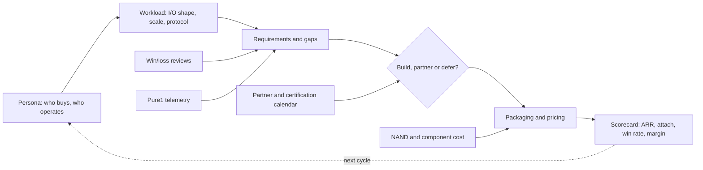
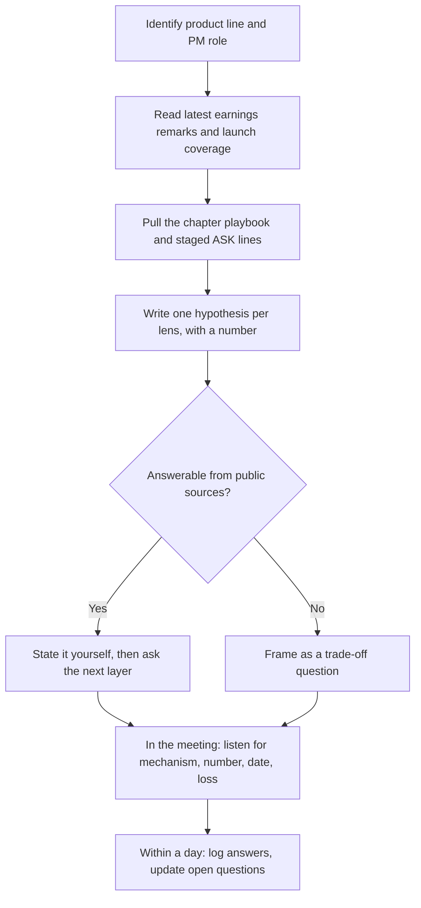

# 55. Talking with product managers

> **Depth:** L2 · **Reading time:** ~8 min · **Last verified:** 2026-11-01
> **Prerequisites:** [Product portfolio: FlashArray and FlashBlade](../04-everpure/27-flasharray-and-flashblade.md) · [Platform and software](../04-everpure/28-platform-and-software.md) · [Hyperscaler business, ecosystem and financials](../04-everpure/29-hyperscaler-ecosystem-financials.md) · [Consumption models](../03-system-architecture/23-consumption-models.md)

## TL;DR

- **A storage PM is the general manager of a trade-off, not of a feature list.** Every roadmap item is a bet on one persona and one workload, made with a known cost in engineering capacity, margin or partner dependence.
- **Know what they are measured on.** Public Everpure metrics include subscription ARR, net dollar retention, product versus subscription gross margin, and adoption counts such as Fusion customers.
- **Ask about losses, not wins.** A PM who can name the last three lost deals, the competitor and the deciding attribute is worth the meeting. One who answers with logos is not.
- **Bring a hypothesis with a number.** "If DeepReduce yields 1.5:1 on checkpoints, EXA's $/usable TB beats X; what do you actually see?" gets a real answer. "Tell me about EXA" gets the pitch deck.
- **Each product line has a different scorecard.** FlashArray PMs defend share and margin, FlashBlade//EXA PMs race certification and benchmarks, Portworx and Data Intelligence PMs fight for a buyer outside storage, and the hyperscale PM sells IP, not boxes.

## Why this matters for Everpure strategy

Corporate development work at Everpure runs through product managers. They own the gap analyses that justify a build, partner or buy decision. They have the win/loss data that tells you whether a target's product would close a real hole. They will also run the integration roadmap after a deal closes. 1touch, closed in May 2026 for $125.0M[^1], is now a PM-owned product line, Everpure Data Intelligence. Whether it was a good acquisition will be judged on metrics that a PM sets and reports.

PMs are also the fastest route to ground truth that is not in filings. The earnings release says subscription ARR was $2.13B, up 20%[^2]. A PM can tell you which SKU, persona and competitive motion produced the growth, and which one is stalling. That conversation works only if you speak their language. You need to understand the workload, respect the trade-offs, and ask questions they cannot answer with a slide. This chapter is the method; [Chapter 57](57-question-bank.md) is the full question bank, and [Chapter 56](56-talking-with-engineering-and-cto.md) covers engineers and the Office of the CTO.

## Core concepts

### How a storage PM thinks

A storage PM's mental model runs from **persona** to **scorecard**. The persona is who buys and who operates: a VMware admin, an AI platform team, a neocloud's infrastructure lead, a CISO. The persona's **workload** fixes the I/O shape: small random block writes, multi-GB/s sequential checkpoint bursts, billions of small objects, KV-cache reads on every inference request ([Chapter 24](../03-system-architecture/24-architecture-decision-matrix.md)). The workload produces **requirements**, the PM compares them with the product, and the gaps compete for engineering capacity. Every gap ends in one of three answers: build it, get it from a partner, or defer it and accept the losses.

Four inputs constantly reshape the model. **Win/loss reviews** show which gaps actually cost deals. **Pure1 telemetry** shows how the installed base really behaves, for example reduction ratios, fill rates and protocol mix. **Partner calendars** decide when a feature matters: an NVIDIA GPU generation, a VMware licensing change, a Nutanix integration. **Component costs**, above all NAND, feed straight into pricing and packaging ([Chapter 48](../06-industry-and-competition/48-media-suppliers-and-nand-cycle.md)).

*Figure 55.1 — A PM's world runs from persona to scorecard; your questions land best when they target one arrow, such as why a gap was deferred or how NAND cost reached a price.*

**Semiconductor bridge.** This is the same discipline as a chip product line. The persona is the design-win target, the workload is the benchmark suite, "build, partner or defer" is the tape-out feature freeze, and certification cycles play the role of a hyperscaler's qualification calendar. Miss the window and you wait a generation.

### What they are measured on

Everpure does not publish PM scorecards, but its disclosures show what the company rewards. Subscription ARR ($2.13B) and remaining performance obligations ($4.1B, up 44%) measure recurring commitment[^2]. Net dollar retention among subscribers was 113% in FY26, down from 117%[^3]. That moves PMs who own Evergreen//One and Portworx expansion. Gross margin differs by line: in Q2 FY27, non-GAAP product margin was 66.2% and subscription margin 74.9%[^4]. A PM who shifts a customer from capex to subscription changes the margin mix, not just the revenue timing.

**Attach** is the metric for platform products. Fusion passed 1,200 customers[^5]. *Worked, illustrative:* against a base of roughly 15,000 customers [VERIFY: current Everpure customer count], that is about 8% attach. A good question is not "how many customers?" but "how many run Fusion presets in production via API?" ([Chapter 28](../04-everpure/28-platform-and-software.md)).

| PM phrase | What it usually means | Follow-up that earns respect |
|---|---|---|
| "Attach" | Share of array deals that also buy the software line | Attached at signature, or deployed and renewed? |
| "Effective capacity" | Usable TB × an assumed data-reduction ratio | Which ratio, measured on which workload class? |
| "Design win" | A customer chose the technology; revenue may be years out | When does revenue start, and what could stop it? |
| "Certified" | Passed a partner's floor test at one tier and GPU generation | Which program, which level, which GPU generation? |
| "GA" | Orderable and supported, not necessarily feature-complete | What is still in preview or on a support exception? |
| "On the roadmap" | Anything from funded to a slide | Is it staffed, and is it dated externally? |
| "Platform" | Shared OS, control plane or contract across SKUs | Which deal did the platform win that a point product would have lost? |
| "We don't lose on architecture" | Losses are blamed on price or relationship | Name the last loss where price was *not* the reason. |

*Table 55.1 — PM vocabulary often hides the qualifier; the follow-up question restores it.*

### Partner and certification cycles

AI product lines run on NVIDIA's calendar. NVIDIA-Certified Storage launched at GTC in March 2025, with Foundation, Enterprise and NCP levels[^6]. SuperPOD certification is tied to a GPU generation; its B200 "enhanced" storage tier works out to roughly 0.5 GB/s of read per GPU[^7]. FlashBlade//S500 gained SuperPOD certification in November 2024[^8]. FlashBlade//EXA's certification was not on the public record as of this writing ([Chapter 34](../05-ai-storage/34-nvidia-ecosystem.md)). For an EXA PM, the certification date is a pipeline gate. For you it is a diligence question: in which deals is the gap used against us, and when does it close?

### Question sets by product line

Each line below has a different scorecard, so the questions differ. The second column is the PM's likely optimisation target, inferred from public positioning.

| Product line | What the PM is optimising | Questions to ask | A strong answer sounds like |
|---|---|---|---|
| **FlashArray** (//X, //XL, //C, //E, //ST) | Share in VMware-exit and database refreshes; margin under NAND inflation | Where does //ST win that //XL190 with Purity Turbo loses? How much NAND inflation was passed through versus absorbed? | Separates latency-bound from IOPS-bound buyers; gives pass-through on new sales versus absorption in fixed-price contracts |
| **FlashBlade** (//S, //E) | Unstructured-data share against PowerScale, ONTAP and HDD object | On what metric do we lose to HDD object, and at what capacity and term does TCO flip? | A $/TB gap, plus power, rack and refresh numbers at a stated capacity |
| **FlashBlade//EXA** | AI training and neocloud wins; benchmark leadership; certification | What share of pipeline is gated on DFM data nodes or NCP certification? Which deal profiles do we lose to VAST, and why? | Splits enterprise from neocloud, names the gate and a quarter; names an architectural loss, not only price |
| **Portworx** | Container and KubeVirt attach, including on non-Everpure storage | Where did Portworx win: cloud-native, VM migration, or both? What do customers lose on third-party disks? | Customer counts per motion; candid about reduction and replication gaps off FlashArray |
| **Fusion / Pure1** | Fleet automation that raises retention and lowers support cost | How many customers automate presets via API or Terraform, and do they renew or expand faster? | "Enabled" separated from "in production", tied to NDR |
| **Evergreen//Forever, //One** | Recurring revenue and margin under SLAs | What does the 25% buffer cost in deployed capacity? How does margin behave when reduction falls short? | Quantified buffer and reduction risk; the contract lever that recovers it |
| **Everpure Cloud** (Dedicated, Azure Native) | Hybrid footprint; marketplace consumption | Which workloads run there in production, and is it a land motion or a disaster-recovery add-on? | Named workloads, consumption trend, and the AWS gap versus FSx for ONTAP |
| **Data Intelligence** (ex-1touch) | A new buyer (CDO, CISO) and separate ARR | What share of bookings cover data not on Everpure? Who carries the quota? | A number, named estates (Oracle, M365, rival NAS), and how it feeds Purview or Collibra |
| **KV cache** (PureKVA on FlashBlade, EXA) | Inference attach to existing FlashBlade; a recurring workload | What baseline, hit rate and context length sit behind "up to 20×" TTFT? How would we price a KV tier? | Baseline and model stated; price anchored to the customer's recompute cost |
| **Hyperscale / DirectFlash licensing** | Exabytes deployed, licence economics, the next design win | What keeps a licensee from in-sourcing the FTL? How does pricing behave as module capacity doubles? | Software updates and NAND qualification as the dependency; per-TB versus per-module economics |

*Table 55.2 — Ten product lines, ten scorecards; the strong answers share a pattern: a number, a named loss, and a date.*

A few lines deserve extra care. **Data Intelligence** went GA in June 2026[^9], so its PMs are still defining the persona. Questions about who signs and who is paid will be welcome. **KV cache** is new: PureKVA's GA and its "up to 20×" time-to-first-token claim date from September–October 2026[^10], so the useful question is the baseline, not the multiple ([Chapter 32](../05-ai-storage/32-inference-and-kv-cache.md)). **Hyperscale** PMs sell a licence. The first customer, Meta, passed 2 EB in FY26[^11], and a second, unnamed top-five hyperscaler signed in August 2026[^12], so their scorecard is exabytes and design wins, not arrays.

### Preparing for a PM meeting

*Figure 55.2 — Do the public homework first, so meeting time goes to what only the PM knows.*

Three habits make the flow work. First, never spend meeting time on a question the 10-Q answers; state the fact and ask what it hides. Second, frame questions as trade-offs ("if you had one more team, would it go to DFM data nodes or to NCP features?"), because a trade-off forces a priority. Third, ask for the loss; PMs rehearse wins.

## How Everpure approaches it vs. competitors

PMs and executives across the industry frame their products publicly in ways that shape what they will push on in a meeting, including a target's PMs during diligence.

| Vendor | Public framing | What their PMs will push | Your counter-question |
|---|---|---|---|
| **Everpure** | One OS (Purity) across arrays and cloud; Evergreen ownership; "Data Primacy" | Simplicity, non-disruptive upgrades, subscription economics | Where does one-OS consistency *cost* you a feature a specialist has? |
| **VAST Data** | "AI Operating System" since May 2025[^13] | One system for files, objects, tables and agents | Which layers are production-proven, and which are new? |
| **WEKA** | NeuralMesh microservices (June 2025)[^14]; KV-cache memory grid | Software on any hardware or cloud; GPU-server convergence | What does the customer own operationally when hardware is theirs? |
| **DDN** | EXAScaler for HPC; Infinia for inference and object (2023)[^15] | Largest-scale AI references, NVIDIA's own clusters | How much code do the two platforms share? |
| **NetApp** | ONTAP unified, plus AFX and the AI Data Engine[^16] | Installed base, data services, hybrid cloud reach | Is AI Data Engine GA in production, and on which hardware? |

*Table 55.3 — Each vendor's public story predicts its PMs' talking points; counter-questions target the edge of the story.*

The steelman for competitors' PMs is real. VAST's PMs can argue that one system for every data type removes integration work Everpure leaves to partners. WEKA's can argue that customers who own their hardware or run in public cloud are a market Everpure's appliance model under-serves. Everpure's PMs answer with operational simplicity and Evergreen economics. Your job is to test where each story stops being true, not to pick a side ([Chapter 45](../06-industry-and-competition/45-head-to-head.md)).

## History and trajectory

Storage product management has moved through three scorecards. In the disk era, PMs competed on IOPS, capacity and price per GB, sold in three-to-five-year forklift cycles. Pure Storage changed the commercial axis: Forever Flash (2014) and Evergreen Storage (2015) turned controller refresh into a subscription entitlement[^17], and the 2022 relaunch as //Forever, //Flex and //One made consumption terms a PM-owned product[^18]. Since 2023 the AI cycle has added a third axis, partner certification and benchmark position. EXA's MLPerf Storage v3.0 checkpoint result, 877.52 GiB/s on 30 data nodes, is now part of the sales motion[^19].

The next shift is already visible. Data Intelligence, MCP servers and KV cache all sell to buyers outside the storage team. That requires PMs who can price software separately from arrays and defend a non-storage persona. Watch whether Everpure starts disclosing per-line software metrics ([Chapter 25](../04-everpure/25-company-history-and-strategy.md)).

## Numbers that matter

| Metric | Value | Context | Source / date |
|---|---|---|---|
| Subscription ARR | $2.13B (+20%) | Evergreen, Portworx, Pure1, cloud | Q2 FY27 release, 2026-08-26[^2] |
| Remaining performance obligations | $4.1B (+44%) | Contracted, not yet recognised | Q2 FY27 release, 2026-08-26[^2] |
| Subscription net dollar retention | 113% (FY25: 117%) | Expansion within subscribers | FY26 10-K[^3] |
| Non-GAAP gross margin, product / subscription | 66.2% / 74.9% | Q2 FY27 | Slides, 2026-08[^4] |
| Fusion customers | >1,200 | ≈8% attach on ~15,000 base (worked, illustrative) | Q1 FY27 remarks[^5] |
| 1touch purchase price | $125.0M | Closed 2026-05-07 | 10-Q Q1 FY27[^1] |
| Evergreen//One availability SLA | 99.9999%, 25% capacity buffer | Terms PMs must price | SLA brief[^20] |
| SuperPOD B200 enhanced tier | ≈0.5 GB/s read per GPU | Certification floor, not ranking | NVIDIA RA[^7] |

## Conversation playbook

**Questions for a PM**

1. *"What were the last three deals you lost, to whom, and on which attribute?"* Strong: names competitor, workload and the deciding attribute (certification, per-node throughput, price per usable TB). It also says whether the fix is roadmap, partner or walk away.
2. *"If you got one more engineering team next quarter, where would it go, and what would you stop?"* Strong: a ranked choice with the deals or ARR at stake on each side. "Everything is a priority" is a weak answer.
3. *"Which number on your scorecard would you most like to see disclosed, and why isn't it?"* Strong: candid about maturity, for example an attach rate not yet stable enough to report.

**Questions for an engineer (to test what the PM said)**

1. *"Which PM requirement was hardest to build, and what did it cost elsewhere?"* Strong: names the displaced feature and the architectural constraint behind it.
2. *"Is the roadmap item the PM mentioned staffed today?"* Strong: team size, dependency (NAND die, NIC, NVIDIA software), and the first date that slips.
3. *"Where does telemetry disagree with what sales hears?"* Strong: a concrete gap, such as reduction ratios on AI data versus the quoted ratio.

**Don't say this:**

- "Which features are on the roadmap?" PMs will not share non-public dates. Ask about trade-offs and gating dependencies instead.
- "Everpure is NVIDIA-certified, so that's solved." Name the program, level and GPU generation.
- "Evergreen means free upgrades." Entitlements depend on subscription terms.
- "Data Intelligence is a storage feature." It targets a different buyer and data beyond Everpure arrays.
- Quoting "up to 20×" or "10 TB/s" without the baseline. The PM will know you have read only the headline.

## Going deeper (optional, L3 pointers)

- Everpure earnings prepared remarks and 10-K segment discussion: the closest public view of what management rewards.
- Evergreen//One product guide and SLA briefs: the contractual terms PMs price against.
- NVIDIA-Certified Storage and SuperPOD storage reference architectures: the gates AI PMs plan around.
- [Chapter 57](57-question-bank.md) for 150 tagged questions, and [Chapter 50](../06-industry-and-competition/50-diligence-framework.md) for turning answers into a diligence scorecard.

## Key terms

- **Persona** — the buyer or operator a product is designed for.
- **Attach rate** — share of customers or deals that also buy a given add-on product.
- **Net dollar retention (NDR)** — this year's recurring revenue from last year's customers, divided by last year's.
- **Win/loss review** — structured analysis of why deals were won or lost.
- **Design win** — a customer's commitment to adopt a technology, with revenue possibly years away.
- **Gating requirement** — the one capability without which a deal cannot close.
- **Packaging** — how features are bundled into SKUs, tiers and contracts.
- See the [glossary](../glossary.md) for the rest.

## Sources

[^1]: SEC, "Everpure, Inc. Form 10-Q for the quarter ended May 3, 2026," 2026-06. https://www.sec.gov/Archives/edgar/data/0001474432/000147443226000061/pstg-20260503.htm (retrieved 2026-11-01).
[^2]: Everpure, "Everpure Announces Second Quarter Fiscal 2027 Financial Results," 2026-08-26. https://investor.everpuredata.com/news-and-events/press-releases/press-release-details/2026/Everpure-Announces-Second-Quarter-Fiscal-2027-Financial-Results/default.aspx (retrieved 2026-11-01).
[^3]: SEC, "Everpure, Inc. Form 10-K for fiscal year ended February 1, 2026," 2026-03-24. https://www.sec.gov/Archives/edgar/data/1474432/000147443226000027/pstg-20260201.htm (retrieved 2026-11-01).
[^4]: Investing.com, "Everpure Q2 FY27 slides: 38% revenue growth, guidance raised sharply," 2026-08. https://www.investing.com/news/company-news/everpure-q2-fy27-slides-38-revenue-growth-guidance-raised-sharply-93CH-4878054 (retrieved 2026-11-01).
[^5]: Everpure, "Q1 FY27 Prepared Remarks," 2026-05-27. https://s21.q4cdn.com/687136699/files/doc_financials/2027/q1/Everpure-Q1FY27-Prepared-Remarks.pdf (retrieved 2026-11-01).
[^6]: NVIDIA Blog, "Full Steam Ahead: NVIDIA-Certified Program Expands to Enterprise Storage for Faster AI Factory Deployment," 2025-03. https://blogs.nvidia.com/blog/nvidia-certified-enterprise-storage/ (retrieved 2026-11-01; search-summary only); NVIDIA Docs, "NVIDIA-Certified Storage," n.d. https://docs.nvidia.com/certification-programs/certified-storage/latest/nvidia-certified-storage.html (retrieved 2026-11-01).
[^7]: NVIDIA Docs, "Storage Architecture — NVIDIA DGX SuperPOD Reference Architecture featuring DGX B200," Table 6, n.d. https://docs.nvidia.com/dgx-superpod/reference-architecture-scalable-infrastructure-b200/latest/storage-architecture.html (retrieved 2026-11-01; per-GPU figure derived in Chapter 34 from the table).
[^8]: Blocks & Files, "Pure Storage's FlashBlade//S500 gains Nvidia SuperPOD certification," 2024-11-18. https://www.blocksandfiles.com/ai-ml/2024/11/18/pure-storages-flashblade/s500-gains-nvidia-superpod-certification/1598641 (retrieved 2026-11-01).
[^9]: HPCwire, "Everpure Wants to Improve Data Management for the Coming AI Wave," 2026-06-20. https://www.hpcwire.com/aiwire/2026/06/20/everpure-wants-to-improve-data-management-for-the-coming-ai-wave/ (retrieved 2026-11-01).
[^10]: Blocks & Files, "Everpure bulks up AI offer," 2026-09-30. https://blocksandfiles.com/flash/2026/09/30/everpure-bulks-up-ai-offer/5300162 (retrieved 2026-11-01); StorageReview, "Everpure Adds PureKVA to FlashBlade, Claims Up to 20x Faster Time to First Token, and Makes DeepReduce Always-On," 2026. https://www.storagereview.com/news/everpure-purekva-flashblade-20x-time-to-first-token-always-on-deepreduce (retrieved 2026-11-01).
[^11]: Blocks & Files, "Pure Storage hikes full-year forecast after solid Q3," 2025-12-03. https://www.blocksandfiles.com/2025/12/03/pure-storage-hikes-full-year-forecast-after-solid-q3/1720082 (retrieved 2026-11-01).
[^12]: Everpure, "Everpure Lands New Design Win with Second Top-Five Hyperscaler," 2026-08-10. https://www.everpuredata.com/company/newsroom/press-releases/everpure-lands-new-design-win-with-second-top-five-hyperscaler.html (retrieved 2026-11-01).
[^13]: Blocks & Files, "VAST Data launches AI operating system," 2025-05-21. https://www.blocksandfiles.com/ai-ml/2025/05/21/vast-data-launches-ai-operating-system/1613219 (retrieved 2026-11-01).
[^14]: WEKA, "WEKA Introduces NeuralMesh," 2025-06-17. https://www.weka.io/company/weka-newsroom/press-releases/weka-introduces-neuralmesh/ (retrieved 2026-11-01).
[^15]: Blocks & Files, "DDN's ground-up developed petabyte-scale and fast Infinia object store," 2023-11-08. https://blocksandfiles.com/2023/11/08/ddns-ground-up-developed-petabyte-scale-and-fast-infinia-object-store/ (retrieved 2026-11-01).
[^16]: TechTarget, "NetApp adds AI Data Engine, expands Nvidia partnership," 2025-10. https://www.techtarget.com/searchstorage/news/366632757/NetApp-adds-AI-Data-Engine-expands-Nvidia-partnership (retrieved 2026-11-01).
[^17]: Pure Storage, "Pure Storage Reinvents the Enterprise Storage Business Model with Forever Flash," 2014-02. https://purestorage.com/company/news-and-events/press/pure-storage-reinvents-the-enterprise-storage-business-model-with-forever-flash.html (retrieved 2026-11-01; search-summary only); GeekFluent, "Pure Storage Announces New Program, New Hardware, New Software Services," 2015-06-01. https://geekfluent.com/2015/06/01/pure-storage-announces-new-program-new-hardware-new-software-services/ (retrieved 2026-11-01; search-summary only).
[^18]: Blocks & Files, "Pure Storage Evergreen rework," 2022-06-08. https://blocksandfiles.com/2022/06/08/pure-storage-evergreen-rework/ (retrieved 2026-11-01).
[^19]: HPCwire (Everpure release), "Everpure Leads MLPerf Storage Tests for Large Model Checkpointing and KV Cache," 2026-09-02. https://hpcwire.com/off-the-wire/everpure-leads-mlperf-storage-tests-for-large-model-checkpointing-and-kv-cache (retrieved 2026-11-01).
[^20]: Everpure, "Evergreen//One Advanced SLAs" (solution brief), n.d. https://www.everpuredata.com/content/dam/pdf/en/solution-briefs/sb-evergreen-one-advanced-slas.pdf (retrieved 2026-11-01).
