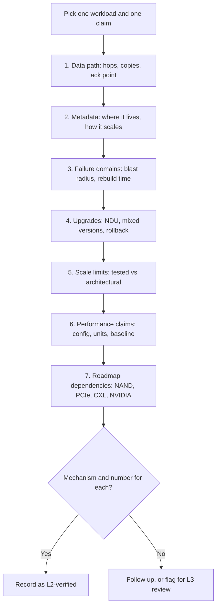
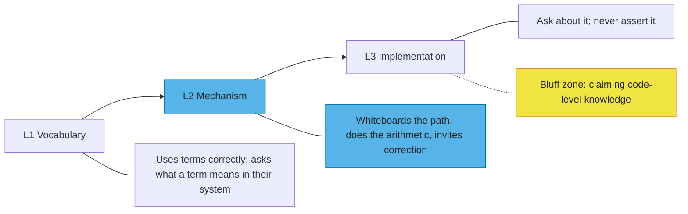

# 56. Talking with engineering leaders and the CTO office

> **Depth:** L2 · **Reading time:** ~8 min · **Last verified:** 2026-11-01
> **Prerequisites:** [The storage stack, layer by layer](../03-system-architecture/13-storage-stack.md) · [Distributed-systems fundamentals](../03-system-architecture/20-distributed-systems-fundamentals.md) · [Metadata](../03-system-architecture/21-metadata.md) · [Purity and DirectFlash](../04-everpure/26-purity-and-directflash.md) · [Reading benchmarks critically](../05-ai-storage/37-reading-benchmarks.md)

## TL;DR

- **An architecture review is seven questions in a fixed order:** data path, metadata, failure domains, upgrades, scale limits, performance claims, roadmap dependencies. Each answer should carry a mechanism and a number.
- **Good answers are specific and admit limits.** They name the bottleneck, the tested (not theoretical) maximum, and the failure that hurts most. Red flags are the reverse: "it scales linearly", "no single point of failure", benchmarks without configurations.
- **Your credibility comes from L2, not from faking L3.** Whiteboard the path, do the arithmetic, then ask the engineer to correct you. Engineers forgive "I don't know the on-disk format"; they never forgive a bluff.
- **Your own reasoning has red flags too:** GiB read as GB, certification read as ranking, a launch claim read as a published result, and architecture assumed to beat execution.
- **Engage the Office of the CTO with falsifiable 3–5-year theses,** each with a signpost and a date, not with "what's next?".

## Why this matters for Everpure strategy

Every build, partner or buy decision ends with an engineering judgment: is the target's architecture sound, and could its code meet Purity's quality bar? Engineering leaders give that verdict candidly only to people they respect. If you can trace a write, estimate a rebuild window and spot a cherry-picked benchmark, you get the candid view; otherwise you get the polite one.

The Office of the CTO matters for a different reason: it frames the long bets. Everpure's CTO, Rob Lee, has an official bio that gives a combined technology-and-growth title[^1] [VERIFY: current title and remit], which suggests technical and commercial strategy sit close together. That is where questions such as "does DirectFlash licensing survive FDP on commodity SSDs?" get argued. [Chapter 55](55-talking-with-pms.md) covers PMs; [Chapter 50](../06-industry-and-competition/50-diligence-framework.md) turns these conversations into a diligence scorecard.

## Core concepts

### The architecture review in seven questions

The order matters: jump to performance before you understand the data path and the slides steer the review.

*Figure 56.1 — Anchor the review in one workload and walk the stack in order; a missing number at any step is the follow-up list.*

**1. Data path.** Ask the engineer to trace one write and one read: how many network hops, how many copies before acknowledgement, and where the acknowledgement happens. In a dual-controller array, a write is acknowledged once it sits in mirrored NVRAM ([Chapter 14](../03-system-architecture/14-scale-up-dual-controller.md)). In FlashBlade//EXA, clients get a layout from the metadata core and then talk to data nodes directly[^2]. In a DASE design, every I/O crosses a back-end fabric, and NVMe over RDMA adds roughly 5–15 µs per access[^3]. Hops set the latency floor; copies set the bandwidth tax.

**2. Metadata.** Where does it live (DRAM, NVRAM, SCM, flash)? How is it partitioned, and what happens with a single hot directory? AI checkpointing makes this concrete. If 16,384 ranks each write one shard file into one directory, that is 16,384 creates in a burst. A design that serialises them on one directory lock turns a bandwidth problem into a metadata stall ([Chapter 21](../03-system-architecture/21-metadata.md)).

**3. Failure domains.** What is the largest unit that can fail together: a drive, a node, an enclosure, a rack? How long until full redundancy returns? *Worked example:* a 300 TB DirectFlash Module at 80% full holds 240 TB. At a 2 GB/s rebuild rate, restoring it takes 240,000 GB ÷ 2 GB/s = 120,000 s ≈ 33 hours. Declustered across the array at 10 GB/s, it takes about 6.7 hours. Ask which of the two the system achieves under production load.

**4. Upgrades and NDU.** Non-disruptive upgrade is a Purity signature. Pure Storage reported more than 7,000 non-disruptive controller upgrades for over 2,700 customers between 2015 and mid-2021[^4]. The questions that matter for a target are how long mixed-version clusters are supported, what can be rolled back, and what an upgrade costs in performance while one controller or node is out.

**5. Scale limits.** Separate the architectural maximum from the tested and supported one. NetApp's AFX is a clean example: a design maximum of 128 controllers[^5], with 32 supported in an early ONTAP release, per WWT[^6]. Neither number is wrong, but only the second belongs in a deal model.

**6. Performance claims.** Ask for configuration, units and baseline. EXA's MLPerf Storage v3.0 checkpoint write of 877.52 GiB/s on 30 data nodes[^7] is about 942 GB/s, or roughly 31 GB/s per node. That is an audited result. The ">10 TB/s" figure at launch came from preliminary testing, not a published configuration[^8]. Both came from the same vendor, but they carry very different weight ([Chapter 37](../05-ai-storage/37-reading-benchmarks.md)).

**7. Roadmap dependencies.** Which outside roadmaps does the plan assume? NAND density sets module capacity: DFMs reached 300 TB in 2025[^9], while the steps to 600 TB and 1 PB are undated. PCIe 6.0 doubles drive-link bandwidth to about 29.5 GB/s per x4 direction (64 GT/s × 4 lanes ÷ 8, less flit overhead), but front-end networking usually binds first ([Chapter 12](../02-protocols-and-networking/12-interfaces-and-emerging-tech.md)). CXL matters for controller memory, not for flash. NVIDIA's BlueField-4 STX, launched in March 2026, could move storage services onto a DPU[^10]. The sharp question is which dependency is single-sourced, and what happens if it slips a year.

**Semiconductor bridge.** This is a chip design review: dataflow, tag and directory structures, redundancy, field-upgradable firmware, characterised versus simulated corners, datasheet versus silicon, and process and IP dependencies.

### Good answers and red flags

| Topic | A good answer sounds like | Red flag in the target | Red flag in your own reasoning |
|---|---|---|---|
| Data path | "Two hops, two NVRAM copies, ack after both persist" | "It's all RDMA, so latency isn't an issue" | Treating fewer hops as always better, ignoring copy and reduction cost |
| Metadata | "Hash-partitioned; one hot directory caps at N creates/s, here's why" | "Metadata is distributed, so it scales" | Assuming metadata scales with data nodes |
| Failure domains | "Enclosure loss is survivable; rebuild is about 6 h at 80% fill under load" | "No single point of failure" with no rebuild time | Counting nines without correlated failures |
| Upgrades | "Mixed versions supported for N releases; rollback within one" | "Upgrades are seamless" with no rollback story | Assuming NDU on arrays carries over to an acquired codebase |
| Scale limits | "Tested to 30 nodes; architecture allows more; we'd re-test past 60" | "Linear scaling" with no tested ceiling | Using the design maximum in a deal model |
| Performance | "Config, client count, units and baseline are in the report" | Multipliers ("20×") without baseline | Reading GiB/s as GB/s, or certification as a ranking |
| Roadmap | "If PCIe 6.0 NICs slip, we lose X but ship Y" | Every dependency described as "on track" | Assuming architecture beats execution |
| Team | "Three people know the allocator; here's the succession plan" | Key-person risk denied | Rating code you have not seen |

*Table 56.1 — Good answers carry a number and a limit; the last column is the mistake you make, not the target.*

The last column matters most in diligence, where self-inflicted errors are usually arithmetic. GiB is about 7% larger than GB. NVIDIA certification sets a throughput floor, roughly 0.5 GB/s of read per GPU at the SuperPOD B200 enhanced tier, not a ranking[^11].

### The credibility ladder

*Figure 56.2 — Operate at L2 and treat L3 as territory you ask about; credibility collapses the moment you assert an implementation detail you cannot defend.*

L2 behaviour has a recognisable script. Draw your understanding, put a number on it, and hand over the marker: "My mental model is a log-structured layout with a global FTL, so write amplification should sit well below a standard SSD's. Where is that wrong for your system?" At L3, the move is a precise question: "Is the dedup index in controller DRAM or paged from flash?" Never offer an opinion on code paths. Engineers spot bluffs by vague adjectives and borrowed numbers.

### Ten whiteboard prompts

| # | Prompt | Expected sketch | What it tests |
|---|---|---|---|
| 1 | Trace a 4 KB write on a dual-controller array | Host → active controller → mirrored NVRAM → ack → later flush and reduction to flash | Ack point, mirroring |
| 2 | Trace a read on FlashBlade//EXA | Client gets layout from metadata core, then RDMA reads directly from data nodes | Metadata/data split |
| 3 | Compare DASE, shared-nothing and EXA | Three boxes-and-arrows: shared media, owner nodes, direct-to-data-node | Who owns data, hop counts |
| 4 | Show where the FTL lives: SSD vs DFM | Per-drive FTL and DRAM vs one global FTL in Purity over raw NAND | DirectFlash thesis |
| 5 | Rebuild a failed module | Stripe layout, survivors read in parallel, rebuild time = data ÷ aggregate rate | Failure-domain arithmetic |
| 6 | Size a checkpoint write | Model state ÷ target stall window = GB/s; then GB/s per node | Burst sizing |
| 7 | Draw the KV-cache hierarchy | HBM → host DRAM → local NVMe → shared flash tier, with capacity and bandwidth per tier | Inference tiering |
| 8 | Walk a non-disruptive controller swap | Fail over to partner, replace, resync, fail back; performance during the window | NDU mechanics |
| 9 | Show a checkpoint create storm | Thousands of ranks → one directory → lock or partition → creates/s | Metadata scaling |
| 10 | Draw the GPU-direct path | Storage → NIC → GPU memory via RDMA, bypassing CPU bounce buffers | GDS, PCIe topology |

*Table 56.2 — If you can draw these ten in under two minutes each, you can hold an L2 conversation with any Everpure engineering team.*

### Engaging the Office of the CTO

The CTO office thinks in three-to-five-year bets, so bring theses, not questions about next quarter. A useful thesis has four parts: a claim, a mechanism, a signpost and a date. For example: "FDP on standard QLC SSDs narrows DirectFlash's write-amplification lead by 2028, so the remaining moat is density and watts per TB. The signpost is FDP adoption in hyperscaler procurement specs." Then ask what would prove it wrong.

Good bets to bring, all grounded in public signals:

- **HDD displacement.** In 2023 a Pure executive predicted no new hard drives would be sold after 2028[^12]. Analysts disputed it[^13]. Ask what share of hyperscaler nearline capacity DirectFlash can realistically displace, and at what HDD capacity point the argument fails ([Chapter 53](../07-history-and-future/53-future-trends.md)).
- **DPU-resident storage.** If BlueField-4 STX makes the controller a commodity, which Purity services move to the DPU, and which stay on x86?
- **Memory tiers.** Does CXL-attached memory belong inside controllers for dedup and metadata, or as a KV-cache tier?
- **Benchmarks as strategy.** VAST, WEKA and DDN did not submit to MLPerf Storage v3.0[^14]. Does audited benchmarking stay a differentiator, or do POCs decide?

## How Everpure approaches it vs. competitors

What an engineering organisation publishes determines what you can verify before a meeting.

| Vendor | How engineering speaks publicly | Evidence you can check | What to probe in person |
|---|---|---|---|
| **Everpure** | Peer-reviewed design paper (Purity, SIGMOD 2015)[^15]; audited MLPerf v3.0 submissions[^7] | Paper, MLPerf configurations, technical briefs | Data-node protection on EXA; FDP response |
| **VAST Data** | Architecture white papers; independent HPC benchmarking (PDSW'21)[^16] | White papers, third-party lab studies | Fabric and enclosure blast radius |
| **WEKA** | Microservices re-architecture as NeuralMesh (2025)[^17] | Cloud marketplace deployments | Operational burden on customer-owned hardware |
| **DDN** | Lustre stewardship since acquiring it from Intel in 2018[^18] | Open-source Lustre code, HPC site reports | Code sharing between EXAScaler and Infinia |

*Table 56.3 — Public engineering evidence varies by vendor; in diligence, weight what you can verify above what you are told.*

Steelman the alternatives. VAST's engineers can argue that shared media makes global data reduction and wide erasure codes natural, which EXA's split design must work harder to match. Everpure's strongest engineering argument is maturity: one OS hardened across a large installed base, with a published design rationale.

## History and trajectory

Review questions have shifted with each media era: RAID rebuild windows and seek-bound IOPS for disk; write amplification and endurance for flash, which Purity's log-structured design addressed[^15]; software and network latency for NVMe-oF; GPU-direct paths, metadata storms and incast for AI. The next shift is already under way: storage services moving onto DPUs, as with BlueField-4 STX in March 2026[^10], and memory tiers spanning HBM to shared flash for KV cache ([Chapter 32](../05-ai-storage/32-inference-and-kv-cache.md)).

## Numbers that matter

| Metric | Value | Context | Source / date |
|---|---|---|---|
| NVMe-oF RDMA added latency | ~5–15 µs per access | Fabric cost per hop vs local drive | SNIA, 2016[^3] |
| EXA MLPerf v3.0 checkpoint write | 877.52 GiB/s (≈942 GB/s) | 30 data nodes, ≈31 GB/s per node | Everpure, 2026-09[^7] |
| Non-disruptive controller upgrades | >7,000 for >2,700 customers | 2015 to mid-2021, company-stated | Pure Storage, 2021[^4] |
| NetApp AFX controllers | 128 design max; 32 supported early | Architectural vs supported limit | NetApp; WWT[^5][^6] |
| Largest DFM | 300 TB | Released 2025 | Everpure, 2026-08[^9] |
| SuperPOD B200 enhanced tier | ≈0.5 GB/s read per GPU | Certification floor | NVIDIA RA[^11] |
| Rebuild, 240 TB at 2 vs 10 GB/s | ≈33 h vs ≈6.7 h | 300 TB DFM at 80% full | Worked example |
| PCIe 6.0 x4 per direction | ≈29.5 GB/s | After flit overhead | Worked arithmetic |

## Conversation playbook

**Questions for a PM**

1. *"Which engineering constraint most often forces you to defer a requirement?"* Strong: names it (controller memory, metadata core count, certification cycle) and a deal it cost.
2. *"Which competitor claims do your engineers dispute most, and with what evidence?"* Strong: a specific claim plus an internal or third-party test.
3. *"Which roadmap item depends on an outside vendor's schedule?"* Strong: the dependency (NAND die, NIC, NVIDIA software) and the fallback.

**Questions for an engineer**

1. *"Trace the write path for me, and tell me where I've drawn it wrong."* Strong: corrects specifics such as ack point and copy count, then volunteers the bottleneck.
2. *"What failure took longest to diagnose in the field last year?"* Strong: a real incident, its root cause and the fix that went into the code or the process.
3. *"What is the tested limit, and what breaks first past it?"* Strong: a number plus the first resource to saturate (metadata, fabric ports, controller memory).

**Don't say this:**

- "It scales linearly." Ask for the tested ceiling and efficiency; EXA's 10-to-30-node scaling worked out to about 89%, not 100% ([Chapter 27](../04-everpure/27-flasharray-and-flashblade.md)).
- "No single point of failure, so it's safe." Ask about correlated failures: firmware batches, enclosures, power domains.
- "877 GB/s." It is 877 GiB/s, about 942 GB/s.
- "CXL will replace flash for this." CXL is memory at DRAM economics.
- Any claim about code you have not read.

## Going deeper (optional, L3 pointers)

- Colgrove et al., SIGMOD 2015, on Purity's log-structured, highly available design[^15].
- MLPerf Storage v3.0 submission configurations, to practise reading performance claims[^14].
- [Chapter 20](../03-system-architecture/20-distributed-systems-fundamentals.md) on consensus and failure models; [Chapter 57](57-question-bank.md) for the full question bank.

## Key terms

- **Architecture review** — a structured walk through a system's data path, metadata, failure domains, upgrades, limits, claims and dependencies.
- **Acknowledgement point** — the moment a storage system tells the host a write is durable.
- **Blast radius** — the data or service affected when one component fails.
- **Tested limit** — the largest configuration a vendor has validated and supports, as opposed to the architectural maximum.
- **Credibility ladder** — the progression from vocabulary (L1) through mechanism (L2) to implementation (L3).
- See the [glossary](../glossary.md) for the rest.

## Sources

[^1]: Pure Storage, "Rob Lee" (executive bio), n.d. https://www.purestorage.com/content/dam/pdf/en/bios/rob-lee.pdf (retrieved 2026-11-01; search-summary only).
[^2]: Everpure, "Technical Brief: FlashBlade//EXA," n.d. (2025). https://www.everpuredata.com/content/dam/pdf/en/technical-briefs/tb-flashblade-exa.pdf (retrieved 2026-11-01).
[^3]: R. Davis (Mellanox), "Demonstrating NVMe Performance over Ethernet," SNIA Data Storage Innovation Conference, 2016. https://www.snia.org/sites/default/files/DSI/2016/presentations/stor_networks/Rob_Davis_Demonstrating_NVMe_Performance_Ethernet.pdf (retrieved 2026-11-01).
[^4]: Pure Storage, "Pure's Evergreen Subscription to Innovation Reaches New Milestone," 2021-07. https://www.purestorage.com/company/newsroom/press-releases/pure-evergreen-subscription-reaches-new-milestone.html (retrieved 2026-11-01); corroborated by ITWeb, 2021-07. https://www.itweb.co.za/article/pures-evergreen-subscription-to-innovation-reaches-new-milestone-delivers-over-7-000-non-disruptive-controller-upgrades-since-2015/raYAyModA85qJ38N (retrieved 2026-11-01).
[^5]: NetApp, "FAQ for AFX storage systems," n.d. https://docs.netapp.com/us-en/ontap-afx/faq-ontap-afx.html (retrieved 2026-11-01); Blocks & Files, "NetApp disaggregates ONTAP storage and provides an AI Data Engine," 2025-10-14. https://blocksandfiles.com/2025/10/14/netapp-disaggregates-ontap-storage-and-provides-an-ai-data-engine/ (retrieved 2026-11-01).
[^6]: World Wide Technology, "NetApp AFX 2K: What's New in AFX for Scalable AI Storage," n.d. https://www.wwt.com/blog/netapp-afx-2k-whats-new-in-afx-for-scalable-ai-storage (retrieved 2026-11-01; seen via search summary).
[^7]: HPCwire (Everpure release), "Everpure Leads MLPerf Storage Tests for Large Model Checkpointing and KV Cache," 2026-09-02. https://hpcwire.com/off-the-wire/everpure-leads-mlperf-storage-tests-for-large-model-checkpointing-and-kv-cache (retrieved 2026-11-01).
[^8]: StorageReview, "FlashBlade//EXA: Pure Storage's New AI & HPC Powerhouse with 10+ TB/s Performance," 2025-03-11. https://www.storagereview.com/news/flashblade-exa-pure-storages-new-ai-hpc-powerhouse-with-10-tb-s-performance (retrieved 2026-11-01).
[^9]: Blocks & Files, "Second hyperscaler plumps for Everpure's flash technology," 2026-08-11. https://www.blocksandfiles.com/flash/2026/08/11/second-hyperscaler-plumps-for-everpures-flash-technology/5285903 (retrieved 2026-11-01); SEC, "Everpure, Inc. Form 10-K for fiscal year ended February 1, 2026," 2026-03-24. https://www.sec.gov/Archives/edgar/data/1474432/000147443226000027/pstg-20260201.htm (retrieved 2026-11-01).
[^10]: NVIDIA Investor Relations, "NVIDIA Launches BlueField-4 STX Storage Architecture With Broad Industry Adoption," 2026-03-16. https://investor.nvidia.com/news/press-release-details/2026/NVIDIA-Launches-BlueField-4-STX-Storage-Architecture-With-Broad-Industry-Adoption/default.aspx (retrieved 2026-11-01).
[^11]: NVIDIA Docs, "Storage Architecture — NVIDIA DGX SuperPOD Reference Architecture featuring DGX B200," Table 6, n.d. https://docs.nvidia.com/dgx-superpod/reference-architecture-scalable-infrastructure-b200/latest/storage-architecture.html (retrieved 2026-11-01; per-GPU figure derived in Chapter 34 from the table).
[^12]: Blocks & Files, "Pure: no more hard drives will be sold after 2028," 2023-05-09. https://blocksandfiles.com/2023/05/09/pure-no-more-hard-drives-2028/ (retrieved 2026-11-01).
[^13]: Blocks & Files, "Analyst forecasts continued HDD sales beyond 2028," 2024-05-13. https://blocksandfiles.com/2024/05/13/coughlin-associates-hdd/ (retrieved 2026-11-01).
[^14]: MLCommons via GlobeNewswire, "MLCommons Releases New MLPerf Storage v3.0 Benchmark Results," 2026-09-01. https://www.globenewswire.com/news-release/2026/09/01/3354412/0/en/mlcommons-releases-new-mlperf-storage-v3-0-benchmark-results.html (retrieved 2026-11-01).
[^15]: J. Colgrove et al., "Purity: Building Fast, Highly-Available Enterprise Flash Storage from Commodity Components," ACM SIGMOD 2015. https://doi.org/10.1145/2723372.2742798 (retrieved 2026-11-01).
[^16]: G. K. Lockwood et al., "New Challenges of Benchmarking All-Flash Storage for HPC," PDSW'21, 2021. https://pdsw.org/pdsw21/papers/ws_pdsw_paper_S2_P1_paper-lockwood.pdf (retrieved 2026-11-01).
[^17]: WEKA, "WEKA Introduces NeuralMesh," 2025-06-17. https://www.weka.io/company/weka-newsroom/press-releases/weka-introduces-neuralmesh/ (retrieved 2026-11-01).
[^18]: TOP500.org, "DDN Acquires Lustre Business from Intel," 2018-06. https://www.top500.org/news/ddn-acquires-lustre-business-from-intel/ (retrieved 2026-11-01).
