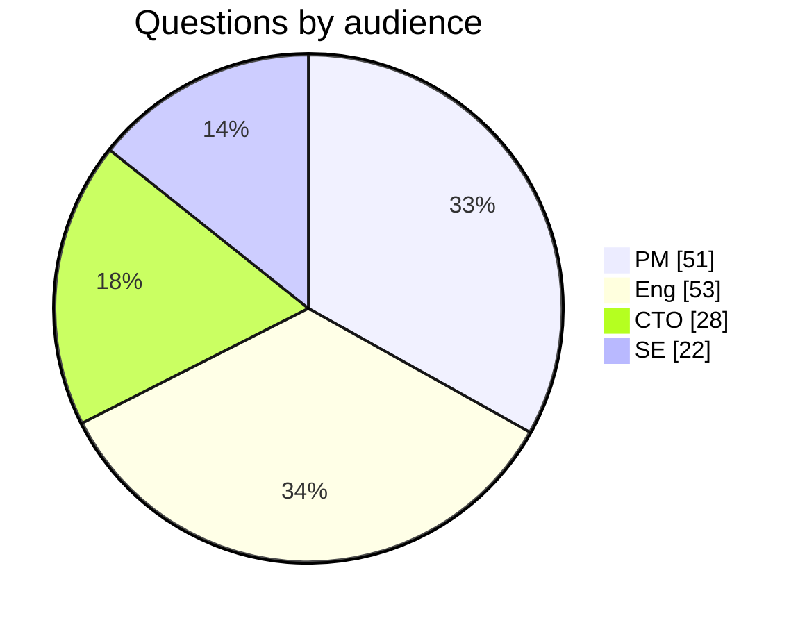
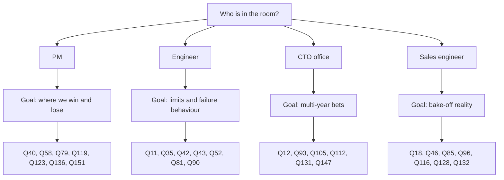

# 57. Question bank: 150 questions

> **Depth:** L2 · **Reading time:** ~10 min · **Last verified:** 2026-11-01
> **Prerequisites:** [Talking with product managers](55-talking-with-pms.md) · [Talking with engineering leaders and the CTO office](56-talking-with-engineering-and-cto.md) · the Conversation playbook in any chapter

## TL;DR

- **154 numbered questions across 14 topics, each tagged by audience.** They are harvested from the playbooks of Chapters 1–53 and the ASK lines in the open-questions staging files, then cut down and sharpened.
- **Bring five to seven questions to a meeting, not thirty.** Pick one audience and one goal, then use the flowchart below.
- **A strong answer has a number, its conditions and its baseline.** The 40 "Listen for" notes show what that looks like for the questions that matter most.
- **The questions that tell vendors apart** are DirectFlash versus FDP, EXA versus shared media, pNFS versus a proprietary client, and where Everpure sits relative to NVIDIA's context-memory tier.
- **These are internal questions for Everpure colleagues.** Many ask for telemetry or win/loss data that is not public. Ask them as a new insider; never use them to fish for competitors' non-public data.

## Why this matters for Everpure strategy

In the first 90 days, a strategy hire's credibility rests on the questions they ask more than on the answers they give. "How fast is rebuild?" marks a tourist. "What is time to full redundancy at 80% fill, under production load, and what does the host see?" tells an engineer you know where systems break. It also produces an answer you can put in a model.

The bank also serves as a diligence scaffold. The same questions that test Everpure's own position apply to an acquisition target or partner ([Chapter 50](../06-industry-and-competition/50-diligence-framework.md)): swap "Purity" for the target's software and most still cut.

## Core concepts

### How the bank is built

Each question starts with an audience tag. A tag names who can answer best, not the only person you may ask.

| Tag | Audience | Typical owner | Ask them about | Avoid asking them |
|---|---|---|---|---|
| `[PM]` | Product manager | Product line or product marketing | Win/loss, buyers, pricing, roadmap gates, telemetry | Code paths |
| `[Eng]` | Engineering leader or architect | Purity, FlashBlade, DirectFlash teams | Mechanisms, limits, failure behaviour, measured numbers | List pricing |
| `[CTO]` | Office of the CTO | CTO staff, chief architects | Multi-year bets, standards, build/partner/buy | Quarter-level pipeline |
| `[SE]` | Sales engineer / field CTO | Pre-sales, POC teams | Sizing, bake-offs, objections, deployment friction | Corporate strategy |

*Figure 57.1 — The tag tells you who holds the evidence; a PM question asked of an engineer usually gets an opinion, not data.*

### Coverage

| Topic | PM | Eng | CTO | SE | Total |
|---|---|---|---|---|---|
| 1. Media & NAND | 3 | 4 | 2 | 1 | 10 |
| 2. SSD / DirectFlash | 3 | 6 | 2 | 1 | 12 |
| 3. Protocols & networking | 3 | 5 | 1 | 3 | 12 |
| 4. Architecture | 3 | 6 | 1 | 2 | 12 |
| 5. Data services & protection | 2 | 6 | 1 | 1 | 10 |
| 6. Everpure products | 4 | 4 | 2 | 2 | 12 |
| 7. Platform, Evergreen & consumption | 4 | 3 | 2 | 1 | 10 |
| 8. AI training & checkpointing | 2 | 5 | 1 | 2 | 10 |
| 9. Inference & KV cache | 3 | 5 | 1 | 1 | 10 |
| 10. RAG & data intelligence | 4 | 4 | 2 | 0 | 10 |
| 11. NVIDIA & ecosystem | 3 | 1 | 3 | 3 | 10 |
| 12. Competition | 7 | 3 | 1 | 5 | 16 |
| 13. Market & financials | 8 | 0 | 2 | 0 | 10 |
| 14. Future & strategy | 2 | 1 | 7 | 0 | 10 |
| **Total** | **51** | **53** | **28** | **22** | **154** |

*Figure 57.2 — Engineers and PMs get most of the questions; CTO questions cluster in future and strategy, where multi-year bets are made.*

*Figure 57.3 — The mix leans to PM and engineering because those are the meetings a strategy hire has most often.*

### Picking questions for a meeting

*Figure 57.4 — One audience, one goal, five to seven questions: depth on a few beats coverage of many.*

### The bank

Questions are written in the first person plural, as an insider would ask them.

#### 1. Media and NAND

1. [PM] At today's flash-over-disk premium, which workloads still convert, and why?
   ↳ *Listen for:* the binding constraint per segment (power, rack, rebuild) and a break-even premium ([Ch 52](../07-history-and-future/52-history-of-flash.md)).
2. [PM] How much of the NAND price rise is passed through versus absorbed?
3. [CTO] Does managing raw NAND let us adopt PLC before SSD-based rivals?
4. [Eng] How do you handle read disturb on read-mostly AI datasets?
5. [Eng] What does PLC cost the write path, and is the extra bit worth it?
6. [Eng] How long does qualifying a new NAND die take, and what fails most?
7. [CTO] Which components are single-sourced, and what did Optane teach us?
8. [PM] How many quarters does the strategic NAND purchase cover, at what price?
   ↳ *Listen for:* the prepaid-versus-inventory split and the contract-price assumption ([Ch 48](../06-industry-and-competition/48-media-suppliers-and-nand-cycle.md)).
9. [SE] Where nearline disk was unavailable, did QLC win on availability or price?
10. [Eng] How does a NAND layer jump change DFM cost per TB versus a commodity SSD?
    ↳ *Listen for:* NAND $/bit (same for everyone) separated from controller, DRAM and over-provisioning savings ([Ch 48](../06-industry-and-competition/48-media-suppliers-and-nand-cycle.md)).

#### 2. SSD and DirectFlash

11. [Eng] What field write amplification does Purity see on QLC, by workload?
    ↳ *Listen for:* measured ranges near 1, converted into DWPD headroom per module size ([Ch 3](../01-storage-fundamentals/03-inside-an-ssd.md)).
12. [CTO] If FDP becomes standard on QLC SSDs, which DirectFlash advantages survive?
    ↳ *Listen for:* conceding the narrower write-amplification gap, then quantifying DRAM avoided, pooled spare flash and W/TB ([Ch 26](../04-everpure/26-purity-and-directflash.md)).
13. [Eng] Without module DRAM, where does the map live, and how does it scale per PB?
14. [PM] When 512 TB standard SSDs ship, what keeps DFMs ahead?
    ↳ *Listen for:* a dated next module step and the system-level gap in TB/RU and W/TB ([Ch 26](../04-everpure/26-purity-and-directflash.md)).
15. [Eng] How are LDPC read retries kept off the tail on aged QLC?
16. [Eng] What is the blast radius of a DFM firmware or FTL bug?
17. [PM] Why does FlashArray//ST use commercial SSDs, and when does DirectFlash win?
18. [SE] How do we explain usable-per-raw-TB differences against an SSD-based array?
    ↳ *Listen for:* drive over-provisioning, array reserve, parity and reduction separated ([Ch 3](../01-storage-fundamentals/03-inside-an-ssd.md)).
19. [Eng] How much raw NAND per effective TB do we save, and from where?
20. [CTO] Could a hyperscaler licensee internalise the global FTL?
    ↳ *Listen for:* what keeps it dependent (updates, NAND qualification), and conceding that AWS built Nitro SSDs ([Ch 13](../03-system-architecture/13-storage-stack.md)).
21. [PM] What limits the step to 600 TB modules: dies, packaging, power or rebuild?
22. [Eng] What changes at 300 TB per module: rebuild time, blast radius, performance per TB?

#### 3. Protocols and networking

23. [PM] What is the FlashArray host-attach mix, and how fast is NVMe/TCP growing?
24. [Eng] What is the NVMe/TCP versus NVMe/RoCE latency gap at QD1 and saturation?
25. [Eng] What are our NVMe-oF connection limits with thousands of Kubernetes hosts?
26. [PM] Why pNFS for EXA rather than a proprietary client, and what does it cost?
    ↳ *Listen for:* no kernel module on GPU nodes, plus candour on shared-file writes and kernel versions ([Ch 8](../02-protocols-and-networking/08-file-protocols.md)).
27. [SE] Which distros and kernels are validated for the EXA client?
28. [Eng] A data node fails mid-write: what happens to the layout and in-flight I/O?
29. [PM] Is S3 over RDMA generally available, on which models, and cuObject-compatible?
30. [Eng] In S3 over RDMA, how are tokens scoped, and what replaces TLS?
31. [SE] Do we require PFC for RoCE, and what happens on a lossy fabric?
32. [Eng] How does a synchronized checkpoint burst behave at our storage ports?
33. [PM] How often do we lose because the compute fabric is InfiniBand?
34. [CTO] How would NFS, NVMe-oF and S3 over RDMA map onto Ultra Ethernet?

#### 4. Architecture

35. [Eng] Walk a 4 KB write: where is the persistence point, and each layer's p99?
    ↳ *Listen for:* the NVRAM mirror point, per-layer microseconds, and which layer degrades first ([Ch 13](../03-system-architecture/13-storage-stack.md)).
36. [PM] What does a customer lose while one controller is out during an Evergreen swap?
37. [Eng] With Purity Turbo, how is the secondary's read cache kept coherent?
38. [PM] When a block customer outgrows one //XL, what do we sell?
39. [Eng] Is the next FlashArray ceiling CPU, memory bandwidth, PCIe or NVRAM?
40. [PM] Where does EXA beat a shared-media design, and where does it lose?
    ↳ *Listen for:* thresholds in throughput, GPU count and namespace size, with credit for VAST's strengths ([Ch 16](../03-system-architecture/16-disaggregated-shared-everything.md)).
41. [Eng] Trace an EXA write: how many fabric crossings, landing in which failure domains?
42. [Eng] An EXA data node dies at 80% full mid-checkpoint: what do clients see?
    ↳ *Listen for:* the named protection scheme, degraded throughput as a percentage and rebuild time ([Ch 27](../04-everpure/27-flasharray-and-flashblade.md)).
43. [Eng] What happens when 16,384 ranks create files in one directory at once?
    ↳ *Listen for:* directory hashing, lock granularity, creates per second and p99 ([Ch 21](../03-system-architecture/21-metadata.md)).
44. [CTO] Is the metadata/data split a permanent bet, or is a shared-media mode conceivable?
45. [Eng] Which services run consensus, with how many voters, and what stalls without quorum?
46. [SE] A neocloud says "we'll just run Ceph": what is our TCO counter?
    ↳ *Listen for:* staff, rebuild windows, free-space reserve and watts per usable TB, not list price ([Ch 15](../03-system-architecture/15-scale-out-shared-nothing.md)).

#### 5. Data services and protection

47. [PM] What are fleet median and 25th-percentile reduction ratios by workload?
    ↳ *Listen for:* a distribution excluding thin provisioning and snapshots, with candour on AI data ([Ch 5](../01-storage-fundamentals/05-data-reduction.md)).
48. [Eng] How big is the dedupe index per PB, and where does it live?
49. [Eng] Under what load does inline reduction defer, and how fast does it catch up?
50. [Eng] What is the read amplification of a random 4 KB read on similarity-encoded data?
51. [SE] How does the Right-Size Guarantee treat datasets that barely reduce?
52. [Eng] A large DFM fails outright: what is time to full redundancy at 80% fill under load?
    ↳ *Listen for:* hours, host-visible impact, and whether rebuild is declustered ([Ch 6](../01-storage-fundamentals/06-data-protection-and-resilience.md)).
53. [Eng] How does ActiveCluster behave if mediator and inter-site link fail together?
54. [Eng] What stops a stolen-credential attacker from shortening SafeMode retention?
    ↳ *Listen for:* out-of-band authentication, multiple approvers and an audit trail ([Ch 6](../01-storage-fundamentals/06-data-protection-and-resilience.md)).
55. [PM] In a ransomware recovery, what fraction of the RTO is storage?
56. [CTO] What is in the denominator of our six nines?

#### 6. Everpure products

57. [PM] Where does //ST win deals that //XL190 with Purity Turbo would lose?
58. [PM] What share of EXA pipeline waits on DFM data nodes or NCP certification?
    ↳ *Listen for:* enterprise and neocloud split, with the gating requirement and a date for each ([Ch 27](../04-everpure/27-flasharray-and-flashblade.md)).
59. [Eng] How are EXA data nodes protected today: HA pairs or erasure coding?
60. [SE] Which competitor shows up against FlashBlade//E, and on what metric do we lose?
61. [PM] For VMs moving to KubeVirt, where does Portworx win?
62. [Eng] When Portworx runs on non-Everpure disks, what do customers lose?
63. [PM] Is Fusion adoption counted as enabled, or as presets in production?
    ↳ *Listen for:* "turned on" separated from "automating against it", tied to renewal ([Ch 28](../04-everpure/28-platform-and-software.md)).
64. [Eng] How does Fusion choose an array for a new workload?
65. [SE] If Pure1 and Fusion are both unreachable, what still works?
66. [CTO] What may an agent do through the MCP server without human approval?
    ↳ *Listen for:* read-only defaults, scoped credentials, approval gates and immutable snapshots underneath ([Ch 22](../03-system-architecture/22-control-planes.md)).
67. [PM] What share of Sev-1 cases does Pure1 open before the customer notices?
68. [CTO] Which Purity code came from acquisitions, and how much was rewritten?

#### 7. Platform, Evergreen and consumption

69. [PM] What is Evergreen//One gross margin by contract year?
    ↳ *Listen for:* a curve with early hardware drag, later payback, and the utilization assumption ([Ch 23](../03-system-architecture/23-consumption-models.md)).
70. [PM] How much headroom above commitment do we deploy, and who pays when it idles?
71. [CTO] What happens to //One margin when reduction falls short of the assumed ratio?
72. [PM] How is capacity growth inside existing //One contracts priced after NAND inflation?
    ↳ *Listen for:* the exposure, then offsets: renewal repricing, density and reduction ([Ch 48](../06-industry-and-competition/48-media-suppliers-and-nand-cycle.md)).
73. [PM] Why do customers choose Evergreen//Forever over //One?
74. [Eng] What breaks a non-disruptive upgrade at a generation boundary?
75. [Eng] Is consumption metered on provisioned, written or effective capacity?
76. [SE] Which //One SLAs need phone-home telemetry, and what happens at dark sites?
77. [Eng] Is the watts-per-TiB guarantee measured at the wall or modelled?
    ↳ *Listen for:* the measurement method, the reduction basis and the incompressible case ([Ch 38](../05-ai-storage/38-power-and-density.md)).
78. [CTO] How does subscription reweight the roadmap between density, watts and peak speed?

#### 8. AI training and checkpointing

79. [PM] In lost training deals, was checkpointing specified as burst, drain or time-to-resume?
    ↳ *Listen for:* the customer's framework (sync or async), checkpoint size and the deciding metric ([Ch 31](../05-ai-storage/31-training-storage.md)).
80. [Eng] For a ~6 TB checkpoint, where does the burst land, and how long are GPUs blocked?
81. [Eng] In a cold 16K-rank restore, what are opens/s, read GB/s and time to first step?
    ↳ *Listen for:* metadata and data numbers kept separate, plus the slowest-client tail ([Ch 31](../05-ai-storage/31-training-storage.md)).
82. [Eng] Why was EXA's MLPerf Storage v3.0 checkpoint read below its write?[^1]
    ↳ *Listen for:* the cache-clearing rule, client DRAM sizes and the source of the gap ([Ch 37](../05-ai-storage/37-reading-benchmarks.md)).
83. [Eng] In the 30-node run, what limited per-node throughput?
84. [SE] Does a sizing tool turn model size, GPU count and interval into EXA nodes?
85. [SE] How do we size for a customer checkpointing asynchronously to local NVMe?
    ↳ *Listen for:* drain rate, restore bandwidth and retained capacity, not peak write ([Ch 31](../05-ai-storage/31-training-storage.md)).
86. [CTO] As async checkpointing spreads, where does training-storage differentiation move?
87. [Eng] What happens when billions of small files are reshuffled every epoch?
88. [PM] Why did we enter checkpointing and KV cache in v3.0, but not training?

#### 9. Inference and KV cache

89. [PM] What baseline, context length and hit rate sit behind PureKVA's 20× TTFT claim?[^2]
    ↳ *Listen for:* model, concurrency and baseline named: recompute, local NVMe or DRAM ([Ch 32](../05-ai-storage/32-inference-and-kv-cache.md)).
90. [Eng] What restore GB/s per GPU and p99 per block at 1,000 concurrent sessions?
    ↳ *Listen for:* GB/s per GPU above the recompute break-even, and the block size ([Ch 32](../05-ai-storage/32-inference-and-kv-cache.md)).
91. [Eng] Is there an upstream NIXL backend, and which plugin path does it use?
92. [Eng] What happens to cached KV when model weights or tokenizer change?
93. [CTO] Versus NVIDIA's CMX racks, are we supplier, G4 tier behind them, or competitor?[^3]
    ↳ *Listen for:* a position per deal type and what Everpure adds beyond a flash shelf ([Ch 34](../05-ai-storage/34-nvidia-ecosystem.md)).
94. [PM] How should a KV tier be priced: per TB, per GB-hour or per token?
    ↳ *Listen for:* price anchored to the customer's recompute cost ([Ch 32](../05-ai-storage/32-inference-and-kv-cache.md)).
95. [Eng] Does DeepReduce find anything in fp16 or fp8 KV tensors?
96. [SE] How do we answer DDN's and WEKA's KV-cache multiples?
    ↳ *Listen for:* normalising baseline, context length and concurrency before comparing ([Ch 44](../06-industry-and-competition/44-ddn.md)).
97. [PM] Does PureKVA attach to existing FlashBlade deals or need a new buyer?
98. [Eng] For a KV fetch, where does the latency budget break first?

#### 10. RAG and data intelligence

99. [PM] In RAG on FlashBlade, where does the vector index live, and whose software is it?
100. [Eng] For a billion-vector DiskANN index on FlashBlade, what per-hop latency results?
101. [PM] Which engines read and write Iceberg on FlashBlade in production?
102. [Eng] How do Lance random reads and Parquet scans share one bucket without starvation?
103. [PM] What share of Data Intelligence bookings cover data not on Everpure?[^4]
     ↳ *Listen for:* a number, named estates and separate pricing ([Ch 39](../05-ai-storage/39-agentic-ai-and-data-intelligence.md)).
104. [PM] Who buys Data Intelligence, and who carries the quota?
105. [CTO] Catalog of record, or neutral feeder into Unity Catalog and Purview?
     ↳ *Listen for:* an explicit choice with reasons, and coexistence without rip-out ([Ch 33](../05-ai-storage/33-rag-vector-lakehouse.md)).
106. [Eng] How does the MCP server handle user identity and revocation?
     ↳ *Listen for:* token exchange, per-agent scopes and revocation measured in seconds ([Ch 39](../05-ai-storage/39-agentic-ai-and-data-intelligence.md)).
107. [Eng] Is classification on the write path, snapshot-triggered or scanned?
108. [CTO] Is agent memory a distinct storage workload beyond KV cache?

#### 11. NVIDIA and ecosystem

109. [PM] When does EXA reach NVIDIA's certified list, at which level?
     ↳ *Listen for:* a level, a GPU generation, a quarter and the deals waiting ([Ch 34](../05-ai-storage/34-nvidia-ecosystem.md)).
110. [SE] What headroom over the SuperPOD storage tier per SU, and what limits first?
111. [Eng] What did certification not exercise that customers hit in production?
112. [CTO] Which Purity services could run on a BlueField-4 DPU?
     ↳ *Listen for:* data path separated from metadata and global dedupe, with core and memory limits ([Ch 53](../07-history-and-future/53-future-trends.md)).
113. [PM] In a Dell- or HPE-led AI factory, how do we get in?
114. [PM] What share of AI pipeline arrives NVIDIA-led, OEM-led or direct?
115. [CTO] How long does re-certifying each NVIDIA GPU generation take?
116. [SE] Which tenancy features still block EXA in neocloud bake-offs?
     ↳ *Listen for:* keys, VRF separation, QoS floors, metering and Terraform, each with a date ([Ch 35](../05-ai-storage/35-ai-factories-and-neoclouds.md)).
117. [SE] How do we stop one tenant's checkpoint starving another's reads?
118. [CTO] How do we become a named design in NCP references, not just certified?

#### 12. Competition: VAST, WEKA, DDN and incumbents

119. [PM] In the last ten EXA-versus-VAST deals, what decided each?
     ↳ *Listen for:* outcomes split by buyer type, each with a deciding factor ([Ch 42](../06-industry-and-competition/42-vast-data.md)).
120. [Eng] Walk a write on VAST versus EXA: crossings, persistence point, reduction point.
     ↳ *Listen for:* the back-end traffic multiple and where reduction happens ([Ch 42](../06-industry-and-competition/42-vast-data.md)).
121. [Eng] Is similarity reduction a real advantage on AI training data?
122. [CTO] Which VAST AI OS layers will buyers require from storage by 2028?
123. [PM] When we lose to WEKA, is it portability, converged mode or KV cache?
     ↳ *Listen for:* the three causes separated, with counts ([Ch 43](../06-industry-and-competition/43-weka.md)).
124. [Eng] What does converged mode cost per GPU node in cores and NIC bandwidth?
125. [SE] How do we answer WEKA's guaranteed data reduction?
126. [PM] Where DDN shipped the first SuperPOD, what wins phase two?
     ↳ *Listen for:* a named trigger and the Lustre-administrator objection ([Ch 44](../06-industry-and-competition/44-ddn.md)).
127. [Eng] What does a pNFS client give up versus Lustre on shared-file writes?
128. [SE] Size EXA against an AI400X3 rack per U, per kW and per usable TB.
129. [PM] How do we position EXA against NetApp AFX and Dell Lightning FS?
130. [PM] Which incumbent installed bases produced the most displacements?
131. [CTO] Which challenger advantages are copyable, and which are structural?
     ↳ *Listen for:* certification copyable; NVIDIA equity and CoreWeave-scale references structural ([Ch 41](../06-industry-and-competition/41-why-ai-native-vendors-won.md)).
132. [SE] How do we answer "VAST and WEKA didn't need MLPerf"?
133. [PM] When Hammerspace runs over FlashBlade, who owns the account?
134. [SE] How many MinIO community users have we converted, and what decided it?

#### 13. Market and financials

135. [PM] When we claim share gains, which tracker, period and definition?
     ↳ *Listen for:* IDC named, its published versus Everpure's modified figure, four-quarter rolling ([Ch 40](../06-industry-and-competition/40-market-structure.md)).
136. [PM] How much of product growth is price per TB versus capacity shipped?
     ↳ *Listen for:* price, mix and units split, with units admitted where down ([Ch 48](../06-industry-and-competition/48-media-suppliers-and-nand-cycle.md)).
137. [PM] What happens to growth if NAND contract prices fall 30%?
138. [CTO] What fraction of an AI-factory bill of materials is shared storage?
139. [PM] How is hyperscale revenue priced: per TB, per module or per licence tier?
     ↳ *Listen for:* the pricing basis, and what happens as module capacity doubles ([Ch 29](../04-everpure/29-hyperscaler-ecosystem-financials.md)).
140. [PM] How do the hyperscaler design wins change gross-margin mix?[^5]
141. [PM] Does our AI-storage TAM include hyperscaler self-build?
142. [PM] What metric will show Data Intelligence traction, and when?
143. [CTO] Which hyperscaler storage functions are licensable rather than self-built?
144. [PM] What is gross profit per deal, not margin %, against a software-only rival?
     ↳ *Listen for:* dollars split into hardware and software, plus NAND risk ([Ch 19](../03-system-architecture/19-software-defined-and-hci.md)).

#### 14. Future and strategy

145. [PM] What must be true for a 600 TB DFM to precede 512 TB SSDs?
146. [Eng] At 1 PB per module, what keeps second-failure exposure acceptable?
     ↳ *Listen for:* aggregate rebuild GB/s, code geometry and a loss probability ([Ch 53](../07-history-and-future/53-future-trends.md)).
147. [CTO] Which stack layer commoditizes next, and what does that do to licensing?
148. [CTO] What could make AI-native architecture irrelevant, as flash erased Violin's lead?
     ↳ *Listen for:* a concrete shift, such as KV cache in CXL memory, and a response ([Ch 51](../07-history-and-future/51-history-of-storage.md)).
149. [CTO] Which past deal is our template: Portworx or EMC's XtremIO?
150. [CTO] What from Purity's 2012 design would a clean sheet keep?
151. [PM] In sovereign AI deals, what do we lose on today?
     ↳ *Listen for:* support, air-gap, certification or a domestic partner, with the winner named ([Ch 53](../07-history-and-future/53-future-trends.md)).
152. [CTO] Is a first-party Purity service on AWS or Google feasible?
153. [CTO] Does NetApp's DataPelago purchase change our build-versus-buy view?[^6]
154. [CTO] Does DirectFlash reach archive-adjacent tiers, or stop at warm ones?

## How Everpure approaches it vs. competitors

Some questions get similar answers from every vendor; these get different ones, so they carry the most signal. Asked inside Everpure, the competitor column is the steelman you should expect to hear back.

| Q | Question | Everpure's answer rests on | Strongest competitor answer |
|---|---|---|---|
| 12 | What survives FDP? | System-level FTL, no module DRAM, density | Commodity QLC with FDP plus multi-supplier pricing (VAST, incumbents) |
| 26 | Why a standard client? | No kernel module, faster security review | Proprietary clients win per-node bandwidth and shared writes (WEKA, DDN) |
| 40 | Direct path or shared media? | Metadata/data split, independent scaling | Shared media gives any node any byte, wider codes (VAST) |
| 93 | Position versus CMX? | Shared, reduced, managed KV tier | DPU-resident software inside NVIDIA racks (VAST, WEKA) |
| 131 | Copyable or structural? | Hardware supply, Evergreen, enterprise base | NVIDIA equity and neocloud anchors (VAST, WEKA) |

*Figure 57.5 — The differentiating questions are the ones where an honest Everpure answer has to concede something.*

## History and trajectory

The playbooks behind this bank were written in 2026, so their questions skew to that year's issues: NAND inflation, NVIDIA's BlueField-4 STX launch in March[^3] and MLPerf Storage v3.0 in September[^7]. Before 2023, a comparable bank would have been mostly block-array questions on latency, reduction and Evergreen. Expect Q8, Q72 and Q137 to date fastest; the mechanism questions (Q35, Q43, Q52) should keep for years.

## Numbers that matter

| Metric | Value | Context | Source / date |
|---|---|---|---|
| Questions in bank | 154 | Numbered continuously | Worked count, this chapter, 2026-11-01 |
| PM / Eng / CTO / SE | 51 / 53 / 28 / 22 | Figure 57.2 | Worked count, this chapter |
| Topics | 14 | Largest: competition (16) | Worked count, this chapter |
| "Listen for" notes | 40 | One per key question | Worked count, this chapter |
| Source pool | ~540 | ~300 playbook questions plus 240 ASK lines | Worked count of repo files, 2026-11-01 |
| Questions per meeting | 5–7 | Figure 57.4 | Editorial guideline |

## Conversation playbook

**Questions for a PM** (follow-ups for any answer)

1. *"What's in the denominator?"* Strong: names the population, period and exclusions.
2. *"Compared with what baseline?"* Strong: names recompute, disk, or a competitor's configuration.
3. *"Which deals did that decide?"* Strong: gives counts, not anecdotes.

**Questions for an engineer**

1. *"Under what conditions?"* Strong: fill level, load and failure state stated.
2. *"What saturates first?"* Strong: names one resource with a number.
3. *"What happens if it fails halfway?"* Strong: describes recovery and what clients see.

**Don't say this:**

- Reading questions verbatim from a list; rephrase them in your own words.
- Accepting a number without asking its conditions.
- Treating "we don't measure that" as evasion; sometimes it is the finding.

## Going deeper (optional, L3 pointers)

- [Chapter 50](../06-industry-and-competition/50-diligence-framework.md) turns these questions into a diligence scorecard.
- [Chapter 59](59-self-test-flashcards.md) tests the answers.

## Key terms

- **Listen-for note** — what a strong answer contains.
- **Baseline question** — a follow-up asking what a claim is measured against.
- See the [glossary](../glossary.md).

## Sources

[^1]: StorageReview, "MLPerf Storage v3.0: 877 GiB/s Checkpoints, a Cloud First, and a Leaderboard Turned Over," 2026-09. https://www.storagereview.com/news/mlperf-storage-v3-0-877-gib-s-checkpoints-a-cloud-first-and-a-leaderboard-turned-over (retrieved 2026-11-01).
[^2]: Blocks & Files, "Everpure bulks up AI offer," 2026-09-30. https://blocksandfiles.com/flash/2026/09/30/everpure-bulks-up-ai-offer/5300162 (retrieved 2026-11-01); StorageReview, "Everpure Adds PureKVA to FlashBlade, Claims Up to 20x Faster Time to First Token, and Makes DeepReduce Always-On," 2026. https://www.storagereview.com/news/everpure-purekva-flashblade-20x-time-to-first-token-always-on-deepreduce (retrieved 2026-11-01).
[^3]: NVIDIA Investor Relations, "NVIDIA Launches BlueField-4 STX Storage Architecture With Broad Industry Adoption," 2026-03-16. https://investor.nvidia.com/news/press-release-details/2026/NVIDIA-Launches-BlueField-4-STX-Storage-Architecture-With-Broad-Industry-Adoption/default.aspx (retrieved 2026-11-01).
[^4]: World Wide Technology, "Pure Storage Rebrands To Everpure And Announces Intent To Acquire 1touch," 2026-02-23. https://www.wwt.com/news/pure-storage-rebrands-to-everpure-and-announces-intent-to-acquire-1touch (retrieved 2026-11-01).
[^5]: Everpure, "Everpure Lands New Design Win with Second Top-Five Hyperscaler," 2026-08-10. https://www.everpuredata.com/company/newsroom/press-releases/everpure-lands-new-design-win-with-second-top-five-hyperscaler.html (retrieved 2026-11-01).
[^6]: NetApp, "NetApp Acquires DataPelago, Making Data AI-Ready at the Infrastructure Layer," 2026-07-16. https://www.netapp.com/en/newsroom/press-releases/news-rel-20260716-210092/ (retrieved 2026-11-01).
[^7]: MLCommons via GlobeNewswire, "MLCommons Releases New MLPerf Storage v3.0 Benchmark Results," 2026-09-01. https://www.globenewswire.com/news-release/2026/09/01/3354412/0/en/mlcommons-releases-new-mlperf-storage-v3-0-benchmark-results.html (retrieved 2026-11-01).
