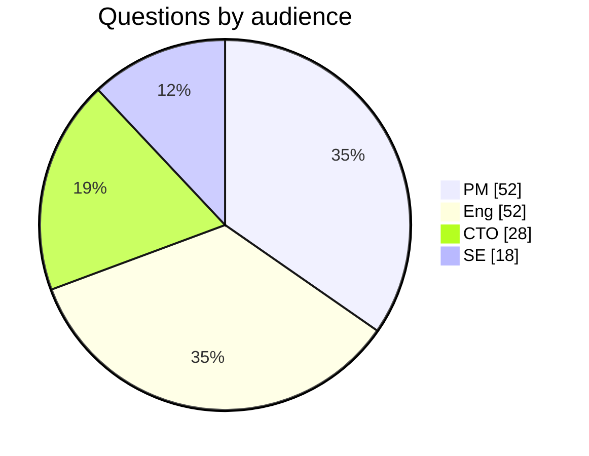
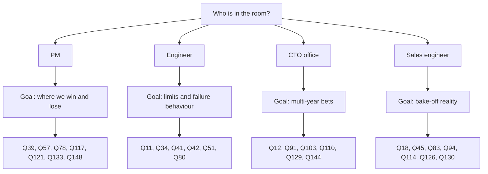

# 57. Question bank: 150 questions

> **Depth:** L2 · **Reading time:** ~10 min · **Last verified:** 2026-11-01
> **Prerequisites:** [Talking with product managers](55-talking-with-pms.md) · [Talking with engineering leaders and the CTO office](56-talking-with-engineering-and-cto.md)

## TL;DR

- **150 questions in 14 topics, each tagged by audience,** distilled from every chapter's playbook and the staged ASK lines.
- **Bring five to seven to a meeting:** one audience, one goal (Figure 57.4).
- **Strong answers carry a number, its conditions and its baseline.** Forty "Listen for" notes show what to expect.
- **Differentiating questions** sit on DirectFlash versus FDP, EXA versus shared media, and NVIDIA's context tier.
- **These are for colleagues.** Many ask for internal telemetry; never use them to fish for competitors' non-public data.

## Why this matters for Everpure strategy

A new strategy hire is judged by the questions they ask. "How fast is rebuild?" marks a tourist; "time to full redundancy at 80% fill, under load?" earns an engineer's respect and a number for the model. Most questions also transfer to diligence on a target ([Chapter 50](../06-industry-and-competition/50-diligence-framework.md)).

## Core concepts

### Tags and coverage

| Tag | Audience | Ask them about | Avoid asking them |
|---|---|---|---|
| `[PM]` | Product manager | Win/loss, buyers, pricing, roadmap gates | Code paths |
| `[Eng]` | Engineering leader or architect | Mechanisms, limits, failure behaviour | List pricing |
| `[CTO]` | Office of the CTO | Multi-year bets, standards, build/partner/buy | Quarterly pipeline |
| `[SE]` | Sales engineer or field CTO | Sizing, bake-offs, objections | Corporate strategy |

*Figure 57.1 — The tag names who holds the evidence; ask a PM question of an engineer and you get opinion, not data.*

| Topic | PM | Eng | CTO | SE | Total |
|---|---|---|---|---|---|
| 1. Media and NAND | 3 | 4 | 2 | 1 | 10 |
| 2. SSD and DirectFlash | 3 | 5 | 2 | 1 | 11 |
| 3. Protocols and networking | 4 | 5 | 1 | 2 | 12 |
| 4. Architecture | 3 | 7 | 1 | 1 | 12 |
| 5. Data services and protection | 2 | 6 | 1 | 1 | 10 |
| 6. Everpure products | 5 | 3 | 2 | 2 | 12 |
| 7. Platform, Evergreen and consumption | 4 | 3 | 2 | 1 | 10 |
| 8. AI training and checkpointing | 2 | 4 | 1 | 2 | 9 |
| 9. Inference and KV cache | 3 | 5 | 1 | 1 | 10 |
| 10. RAG and data intelligence | 4 | 4 | 2 | 0 | 10 |
| 11. NVIDIA and ecosystem | 3 | 1 | 3 | 3 | 10 |
| 12. Competition: VAST, WEKA, DDN and incumbents | 6 | 4 | 2 | 3 | 15 |
| 13. Market and financials | 8 | 0 | 2 | 0 | 10 |
| 14. Future and strategy | 2 | 1 | 6 | 0 | 9 |
| **Total** | **52** | **52** | **28** | **18** | **150** |

*Figure 57.2 — Engineering and PM questions dominate; CTO questions cluster in future and strategy.*

*Figure 57.3 — The mix tracks the meetings a strategy hire attends most.*

### Picking questions for a meeting

*Figure 57.4 — Depth on six questions beats coverage of thirty.*

### The bank
#### 1. Media and NAND

1. [PM] At today's flash premium, which workloads still convert from disk?
   ↳ *Listen for:* binding constraint per segment, break-even premium ([Ch 52](../07-history-and-future/52-history-of-flash.md)).
2. [PM] How much NAND inflation is passed through versus absorbed?
3. [CTO] Does owning raw NAND management let us adopt PLC first?
4. [Eng] How do you manage read disturb on read-mostly AI data?
5. [Eng] What does PLC cost the write path and endurance budget?
6. [Eng] How long does qualifying a new NAND die take?
7. [CTO] Which components are single-sourced, and what did Optane teach?
8. [PM] How many quarters of demand does the strategic NAND buy cover?
   ↳ *Listen for:* prepaid-versus-inventory split, contract-price assumption ([Ch 48](../06-industry-and-competition/48-media-suppliers-and-nand-cycle.md)).
9. [SE] Where disk was unavailable, did QLC win on availability?
10. [Eng] What does a layer jump do to DFM versus SSD cost per TB?

#### 2. SSD and DirectFlash

11. [Eng] What field write amplification does Purity see on QLC?
    ↳ *Listen for:* measured ranges by workload, converted to DWPD headroom ([Ch 3](../01-storage-fundamentals/03-inside-an-ssd.md)).
12. [CTO] If FDP goes mainstream, which DirectFlash advantages survive?
    ↳ *Listen for:* concedes the WAF gap; quantifies DRAM avoided, pooled spare, W/TB ([Ch 26](../04-everpure/26-purity-and-directflash.md)).
13. [Eng] Without module DRAM, where does the map live, per PB?
14. [PM] When 512 TB standard SSDs ship, what keeps DFMs ahead?
15. [Eng] How are LDPC read retries kept off the latency tail?
16. [Eng] What is the blast radius of a DFM firmware bug?
17. [PM] Why does FlashArray//ST use commercial SSDs?
18. [SE] How do we explain usable-per-raw-TB against SSD-based arrays?
    ↳ *Listen for:* over-provisioning, reserve, parity and reduction separated ([Ch 3](../01-storage-fundamentals/03-inside-an-ssd.md)).
19. [Eng] How much raw NAND per effective TB do we save, and where?
20. [CTO] Could a hyperscaler licensee internalise the global FTL?
    ↳ *Listen for:* what keeps it dependent, and the AWS Nitro precedent ([Ch 13](../03-system-architecture/13-storage-stack.md)).
21. [PM] What limits 600 TB modules: dies, packaging, power or rebuild?

#### 3. Protocols and networking

22. [PM] What is the host-attach mix, and how fast is NVMe/TCP growing?
23. [Eng] What is the NVMe/TCP versus RoCE gap at QD1 and saturation?
24. [Eng] What are NVMe-oF connection limits with thousands of Kubernetes hosts?
25. [PM] Why pNFS for EXA, and what does it cost us?
    ↳ *Listen for:* no kernel module; candour on shared-file writes ([Ch 8](../02-protocols-and-networking/08-file-protocols.md)).
26. [SE] Which distros and kernels does the EXA client support?
27. [Eng] A data node fails mid-write: what happens to in-flight I/O?
28. [PM] Is S3 over RDMA generally available, and cuObject-compatible?
29. [Eng] In S3 over RDMA, how are tokens scoped without TLS?
30. [SE] Do we require PFC for RoCE, and what if the fabric drops packets?
31. [Eng] How do our storage ports absorb synchronized checkpoint incast?
32. [PM] How often does an InfiniBand compute fabric cost us deals?
33. [CTO] How would our RDMA protocols map onto Ultra Ethernet?

#### 4. Architecture

34. [Eng] Walk a 4 KB write: persistence point and per-layer p99?
    ↳ *Listen for:* NVRAM mirror point, per-layer microseconds ([Ch 13](../03-system-architecture/13-storage-stack.md)).
35. [PM] What does a customer lose during an Evergreen controller swap?
36. [Eng] Under Purity Turbo, how does the secondary's read cache stay coherent?
37. [PM] When a block customer outgrows one //XL, what do we sell?
38. [Eng] Is the next FlashArray ceiling CPU, memory, PCIe or NVRAM?
39. [PM] Where does EXA beat shared-media designs, and where not?
    ↳ *Listen for:* throughput, GPU-count and namespace thresholds; credit to VAST ([Ch 16](../03-system-architecture/16-disaggregated-shared-everything.md)).
40. [Eng] How many fabric crossings precede an EXA write acknowledgement?
41. [Eng] An EXA data node dies mid-checkpoint: what do clients see?
    ↳ *Listen for:* protection scheme, degraded-throughput percentage, rebuild time ([Ch 27](../04-everpure/27-flasharray-and-flashblade.md)).
42. [Eng] 16,384 ranks create files in one directory: what happens?
    ↳ *Listen for:* directory hashing, lock granularity, creates/s at p99 ([Ch 21](../03-system-architecture/21-metadata.md)).
43. [CTO] Is the metadata/data split permanent, or could shared media return?
44. [Eng] Which services run consensus, and what stalls without quorum?
45. [SE] A neocloud says "we'll run Ceph": what's our TCO counter?
    ↳ *Listen for:* staff, rebuild windows, free-space reserve, watts per usable TB ([Ch 15](../03-system-architecture/15-scale-out-shared-nothing.md)).

#### 5. Data services and protection

46. [PM] What are fleet median reduction ratios by workload?
    ↳ *Listen for:* distributions excluding thin provisioning; candour on AI data ([Ch 5](../01-storage-fundamentals/05-data-reduction.md)).
47. [Eng] How big is the dedupe index per PB, and where?
48. [Eng] When does inline reduction defer, and how fast does it catch up?
49. [Eng] What read amplification does similarity encoding add?
50. [SE] How does the Right-Size Guarantee treat irreducible data?
51. [Eng] A large DFM dies at 80% fill: time to full redundancy?
    ↳ *Listen for:* hours under load, host impact, declustered or not ([Ch 6](../01-storage-fundamentals/06-data-protection-and-resilience.md)).
52. [Eng] What if ActiveCluster's mediator and link fail together?
53. [Eng] What stops stolen credentials shortening SafeMode retention?
    ↳ *Listen for:* out-of-band authentication, multiple approvers, audit trail ([Ch 6](../01-storage-fundamentals/06-data-protection-and-resilience.md)).
54. [PM] In ransomware recovery, how much of the RTO is storage?
55. [CTO] What is in the denominator of our six nines?

#### 6. Everpure products

56. [PM] Where does //ST win deals that //XL190 would lose?
57. [PM] What share of EXA pipeline awaits DFM nodes or certification?
    ↳ *Listen for:* enterprise and neocloud gates, each with a date ([Ch 27](../04-everpure/27-flasharray-and-flashblade.md)).
58. [Eng] How are EXA data nodes protected today?
59. [SE] Who beats FlashBlade//E, and on what metric?
60. [PM] For VMs moving to KubeVirt, where does Portworx win?
61. [Eng] What does Portworx lose on non-Everpure disks?
62. [PM] Is Fusion adoption "enabled" or "presets in production"?
    ↳ *Listen for:* turned-on versus automating, tied to renewal ([Ch 28](../04-everpure/28-platform-and-software.md)).
63. [Eng] How does Fusion pick an array for a workload?
64. [SE] If Pure1 and Fusion are unreachable, what still works?
65. [CTO] What may an agent do via MCP without human approval?
    ↳ *Listen for:* read-only defaults, scoped credentials, approval gates ([Ch 22](../03-system-architecture/22-control-planes.md)).
66. [PM] What share of Sev-1 cases does Pure1 open first?
67. [CTO] Which Purity code came from acquisitions, and how much was rewritten?

#### 7. Platform, Evergreen and consumption

68. [PM] What is Evergreen//One gross margin by contract year?
    ↳ *Listen for:* early hardware drag, later payback, utilization assumption ([Ch 23](../03-system-architecture/23-consumption-models.md)).
69. [PM] How much deployed headroom sits idle, at whose cost?
70. [CTO] What happens to //One margin when reduction underdelivers?
71. [PM] How is //One capacity growth priced after NAND inflation?
    ↳ *Listen for:* exposure first, then repricing and density offsets ([Ch 48](../06-industry-and-competition/48-media-suppliers-and-nand-cycle.md)).
72. [PM] Why do customers pick Evergreen//Forever over //One?
73. [Eng] What breaks non-disruptive upgrades at generation boundaries?
74. [Eng] Is consumption metered on provisioned, written or effective capacity?
75. [SE] Which //One SLAs fail at dark sites?
76. [Eng] Is the watts-per-TiB guarantee measured or modelled?
77. [CTO] Does subscription reweight the roadmap toward density and watts?

#### 8. AI training and checkpointing

78. [PM] In lost training deals, how was checkpointing specified?
    ↳ *Listen for:* framework, checkpoint size, burst versus time-to-resume ([Ch 31](../05-ai-storage/31-training-storage.md)).
79. [Eng] For a ~6 TB checkpoint, how long are GPUs blocked?
80. [Eng] Cold 16K-rank restore: opens/s, GB/s, time to first step?
    ↳ *Listen for:* metadata and data separated; slowest-client tail ([Ch 31](../05-ai-storage/31-training-storage.md)).
81. [Eng] Why was EXA's MLPerf v3.0 checkpoint read below write?[^1]
    ↳ *Listen for:* cache-clear rule, client DRAM, bottleneck named ([Ch 37](../05-ai-storage/37-reading-benchmarks.md)).
82. [SE] Which tool turns model size and GPU count into EXA nodes?
83. [SE] How do we size for async checkpointing to local NVMe?
    ↳ *Listen for:* drain rate, restore bandwidth, retention, not peak write ([Ch 31](../05-ai-storage/31-training-storage.md)).
84. [CTO] As async checkpointing spreads, where does differentiation move?
85. [Eng] What happens when billions of small files reshuffle each epoch?
86. [PM] Why enter MLPerf checkpointing and KV cache, but not training?

#### 9. Inference and KV cache

87. [PM] What baseline sits behind PureKVA's 20× TTFT claim?[^2]
    ↳ *Listen for:* model, context, concurrency; recompute or local NVMe ([Ch 32](../05-ai-storage/32-inference-and-kv-cache.md)).
88. [Eng] What GB/s per GPU and p99 per block at 1,000 sessions?
89. [Eng] Is our NIXL backend upstream, and which plugin path?
90. [Eng] What happens to cached KV when weights change?
91. [CTO] Versus NVIDIA CMX: supplier, tier behind it, or rival?[^3]
    ↳ *Listen for:* a position per deal type, value beyond flash ([Ch 34](../05-ai-storage/34-nvidia-ecosystem.md)).
92. [PM] Price a KV tier per TB, per GB-hour or per token?
93. [Eng] Does DeepReduce shrink fp8 KV tensors at all?
94. [SE] How do we answer DDN's and WEKA's KV-cache multiples?
    ↳ *Listen for:* baseline, context and concurrency normalised first ([Ch 44](../06-industry-and-competition/44-ddn.md)).
95. [PM] Does PureKVA ride existing FlashBlade deals?
96. [Eng] Where does a KV fetch's latency budget break first?

#### 10. RAG and data intelligence

97. [PM] In RAG on FlashBlade, where does the vector index live?
98. [Eng] How does a billion-vector DiskANN index perform on FlashBlade?
99. [PM] Which engines run Iceberg on FlashBlade in production?
100. [Eng] Can random Lance reads and Parquet scans share a bucket?
101. [PM] What share of Data Intelligence covers non-Everpure data?[^4]
     ↳ *Listen for:* a number, named estates, separate pricing ([Ch 39](../05-ai-storage/39-agentic-ai-and-data-intelligence.md)).
102. [PM] Who buys Data Intelligence, and who carries quota?
103. [CTO] Catalog of record, or neutral feeder to Unity Catalog?
     ↳ *Listen for:* an explicit choice; coexistence without rip-out ([Ch 33](../05-ai-storage/33-rag-vector-lakehouse.md)).
104. [Eng] How does the MCP server handle identity and revocation?
105. [Eng] Is classification on the write path or off it?
106. [CTO] Is agent memory a storage workload beyond KV cache?

#### 11. NVIDIA and ecosystem

107. [PM] When, and at which level, will EXA be NVIDIA-certified?
     ↳ *Listen for:* level, GPU generation, quarter, waiting deals ([Ch 34](../05-ai-storage/34-nvidia-ecosystem.md)).
108. [SE] What headroom over SuperPOD storage sizing, and what limits it?
109. [Eng] What did certification skip that production hits?
110. [CTO] Which Purity services fit on a BlueField-4 DPU?
     ↳ *Listen for:* data path versus metadata and dedupe; memory limits ([Ch 53](../07-history-and-future/53-future-trends.md)).
111. [PM] How do we enter a Dell- or HPE-led AI factory?
112. [PM] What share of AI pipeline is NVIDIA-led, OEM-led or direct?
113. [CTO] How long does each GPU-generation recertification take?
114. [SE] Which tenancy gaps block EXA in neocloud bake-offs?
     ↳ *Listen for:* keys, VRF, QoS floors, metering, each dated ([Ch 35](../05-ai-storage/35-ai-factories-and-neoclouds.md)).
115. [SE] How do we stop one tenant's checkpoint starving another?
116. [CTO] How do we become a named NCP design, not just certified?

#### 12. Competition: VAST, WEKA, DDN and incumbents

117. [PM] In recent EXA-versus-VAST deals, what decided each?
     ↳ *Listen for:* outcomes by buyer type, one deciding factor each ([Ch 42](../06-industry-and-competition/42-vast-data.md)).
118. [Eng] VAST versus EXA write: crossings, persistence, reduction point?
119. [Eng] Does similarity reduction help on AI training data?
120. [CTO] Which VAST AI OS layers will buyers demand from storage?
121. [PM] Losses to WEKA: portability, converged mode or KV cache?
     ↳ *Listen for:* the three causes separated, with counts ([Ch 43](../06-industry-and-competition/43-weka.md)).
122. [Eng] What does WEKA's converged mode cost per GPU node?
123. [SE] How do we answer WEKA's guaranteed data reduction?
124. [PM] Where DDN shipped the first SuperPOD, what wins phase two?
     ↳ *Listen for:* a named trigger; the Lustre-admin objection ([Ch 44](../06-industry-and-competition/44-ddn.md)).
125. [Eng] What does pNFS concede to Lustre on shared-file writes?
126. [SE] Size EXA against a DDN AI400X3 rack per U and kW.
127. [PM] How do we position against NetApp AFX and Dell Lightning?
128. [PM] Which incumbent bases yield the most displacements?
129. [CTO] Which challenger advantages are copyable, which structural?
     ↳ *Listen for:* certification copyable; NVIDIA equity and anchor neoclouds not ([Ch 41](../06-industry-and-competition/41-why-ai-native-vendors-won.md)).
130. [SE] How do we answer "VAST didn't need MLPerf"?
131. [PM] With Hammerspace over FlashBlade, who owns the account?

#### 13. Market and financials

132. [PM] When we claim share gains, which tracker and definition?
     ↳ *Listen for:* IDC named; published versus modified share; period ([Ch 40](../06-industry-and-competition/40-market-structure.md)).
133. [PM] How much growth is price per TB versus capacity?
134. [PM] What happens to growth if NAND falls 30%?
135. [CTO] What share of an AI-factory bill is shared storage?
136. [PM] Is hyperscale revenue priced per TB, module or licence?
137. [PM] How do hyperscaler design wins shift gross-margin mix?[^5]
138. [PM] Does our AI-storage TAM include hyperscaler self-build?
139. [PM] Which metric will show Data Intelligence traction?
140. [CTO] Which hyperscaler storage functions are licensable?
141. [PM] Gross profit per deal versus a software-only rival?
     ↳ *Listen for:* hardware and software dollars, plus NAND risk ([Ch 19](../03-system-architecture/19-software-defined-and-hci.md)).

#### 14. Future and strategy

142. [PM] What must be true for 600 TB DFMs to ship first?
143. [Eng] At 1 PB per module, is second-failure exposure acceptable?
     ↳ *Listen for:* rebuild GB/s, code geometry, loss probability ([Ch 53](../07-history-and-future/53-future-trends.md)).
144. [CTO] Which stack layer commoditizes next?
145. [CTO] What could strand AI-native designs, as flash stranded Violin?
     ↳ *Listen for:* one concrete shift, such as CXL-resident KV ([Ch 51](../07-history-and-future/51-history-of-storage.md)).
146. [CTO] Is Portworx or XtremIO our acquisition template?
147. [CTO] What would a clean-sheet Purity keep from 2012?
148. [PM] In sovereign AI deals, what do we lose on?
     ↳ *Listen for:* support, air-gap, certification or partner; winner named ([Ch 53](../07-history-and-future/53-future-trends.md)).
149. [CTO] Is a first-party Purity cloud service feasible?
150. [CTO] Does NetApp buying DataPelago change build-versus-buy?[^6]

## How Everpure approaches it vs. competitors

These questions draw the most divergent vendor answers. The right column is the steelman to expect back.

| Q | Question | Everpure's answer rests on | Strongest competitor answer |
|---|---|---|---|
| 12 | What survives FDP? | System-level FTL, no module DRAM, density | Commodity QLC plus multi-supplier pricing (VAST, incumbents) |
| 25 | Why a standard client? | No kernel module, easier security review | Proprietary clients win per-node bandwidth (WEKA, DDN) |
| 39 | Direct path or shared media? | Metadata/data split, independent scaling | Any node reaches any byte; wider codes (VAST) |
| 91 | Position versus CMX? | Shared, reduced, managed KV tier | DPU-resident software inside NVIDIA racks (VAST, WEKA) |
| 129 | Copyable or structural? | NAND supply, Evergreen, enterprise base | NVIDIA equity, neocloud anchors (VAST, WEKA) |

*Figure 57.5 — An honest Everpure answer to each of these must concede something.*

## History and trajectory

The source playbooks date from 2026, so they skew to NAND inflation, NVIDIA's BlueField-4 STX launch[^3] and MLPerf Storage v3.0[^7]. Q8, Q71 and Q134 will date fastest; mechanism questions (Q34, Q42, Q51) will keep.

## Numbers that matter

| Metric | Value | Context | Source / date |
|---|---|---|---|
| Questions | 150 | Numbered continuously | Worked count, this chapter, 2026-11-01 |
| PM / Eng / CTO / SE | 52 / 52 / 28 / 18 | Figure 57.2 | Worked count, this chapter |
| Topics | 14 | Largest: competition (15) | Worked count, this chapter |
| "Listen for" notes | 41 | Key questions only | Worked count, this chapter |
| Source pool | ~540 | ~300 playbook questions plus 240 ASK lines | Worked count of repo files, 2026-11-01 |
| Questions per meeting | 5–7 | Figure 57.4 | Editorial guideline |

## Conversation playbook

**Questions for a PM** (follow-ups to any answer)

1. *"What's the denominator?"* Strong: population, period, exclusions.
2. *"Against what baseline?"* Strong: recompute, disk, or a named rival.
3. *"Which deals did it decide?"* Strong: counts, not anecdotes.

**Questions for an engineer**

1. *"Under what conditions?"* Strong: fill, load, failure state.
2. *"What saturates first?"* Strong: one resource, one number.
3. *"What if it fails halfway?"* Strong: recovery path and client view.

**Don't say this:**

- Reading questions verbatim from a list.
- Accepting a number without its conditions.
- Treating "we don't measure that" as evasion; it may be the finding.

## Going deeper (optional, L3 pointers)

- [Chapter 59](59-self-test-flashcards.md) tests the answers.

## Key terms

- **Listen-for note** — what a strong answer contains.
- See the [glossary](../glossary.md).

## Sources

[^1]: StorageReview, "MLPerf Storage v3.0: 877 GiB/s Checkpoints, a Cloud First, and a Leaderboard Turned Over," 2026-09. https://www.storagereview.com/news/mlperf-storage-v3-0-877-gib-s-checkpoints-a-cloud-first-and-a-leaderboard-turned-over (retrieved 2026-11-01).
[^2]: Blocks & Files, "Everpure bulks up AI offer," 2026-09-30. https://blocksandfiles.com/flash/2026/09/30/everpure-bulks-up-ai-offer/5300162 (retrieved 2026-11-01); StorageReview, "Everpure Adds PureKVA to FlashBlade, Claims Up to 20x Faster Time to First Token, and Makes DeepReduce Always-On," 2026. https://www.storagereview.com/news/everpure-purekva-flashblade-20x-time-to-first-token-always-on-deepreduce (retrieved 2026-11-01).
[^3]: NVIDIA Investor Relations, "NVIDIA Launches BlueField-4 STX Storage Architecture With Broad Industry Adoption," 2026-03-16. https://investor.nvidia.com/news/press-release-details/2026/NVIDIA-Launches-BlueField-4-STX-Storage-Architecture-With-Broad-Industry-Adoption/default.aspx (retrieved 2026-11-01).
[^4]: World Wide Technology, "Pure Storage Rebrands To Everpure And Announces Intent To Acquire 1touch," 2026-02-23. https://www.wwt.com/news/pure-storage-rebrands-to-everpure-and-announces-intent-to-acquire-1touch (retrieved 2026-11-01).
[^5]: Everpure, "Everpure Lands New Design Win with Second Top-Five Hyperscaler," 2026-08-10. https://www.everpuredata.com/company/newsroom/press-releases/everpure-lands-new-design-win-with-second-top-five-hyperscaler.html (retrieved 2026-11-01).
[^6]: NetApp, "NetApp Acquires DataPelago, Making Data AI-Ready at the Infrastructure Layer," 2026-07-16. https://www.netapp.com/en/newsroom/press-releases/news-rel-20260716-210092/ (retrieved 2026-11-01).
[^7]: MLCommons via GlobeNewswire, "MLCommons Releases New MLPerf Storage v3.0 Benchmark Results," 2026-09-01. https://www.globenewswire.com/news-release/2026/09/01/3354412/0/en/mlcommons-releases-new-mlperf-storage-v3-0-benchmark-results.html (retrieved 2026-11-01).
