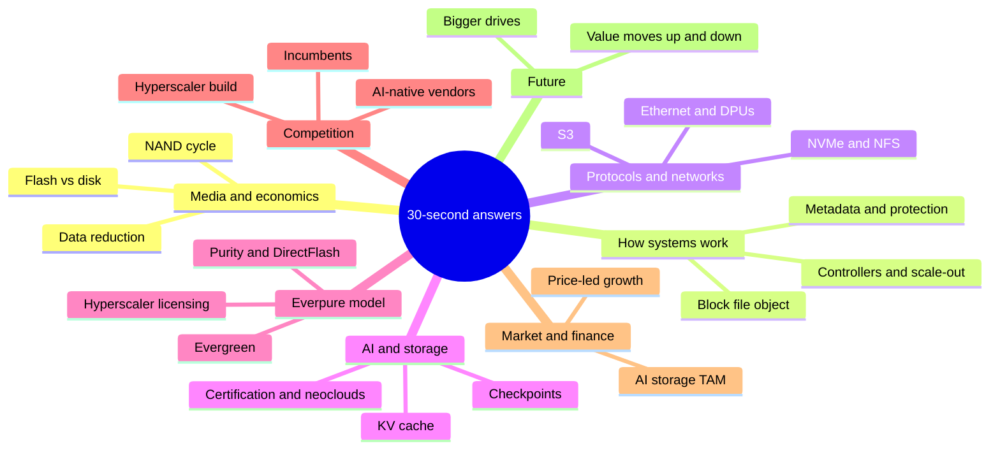
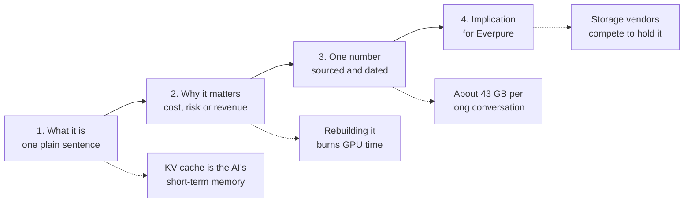

# 58. Explain it in 30 seconds

> **Depth:** L1 · **Reading time:** ~8 min · **Last verified:** 2026-11-01
> **Prerequisites:** None; each line links to its source chapter.

## TL;DR

- **Use these 66 one-liners when a CFO or director asks "what is X, and why care?"**
- **Four beats:** what it is, why it matters, one number, what it means for us.
- **Quote only sourced, dated numbers;** flag private-vendor figures as *company-stated*.
- **Keep the trade-off.** "Flash costs ~18× more per terabyte yet wins on density" beats "flash is better."
- **Memorise the eight numbers at the end.**

## Why this matters for Everpure strategy

Corporate development carries the technology story to people who approve capital, and they give each concept half a minute. Everpure (NYSE: P, formerly PSTG) is hard to explain: its value sits in software (Purity), its own flash module (DirectFlash), a business model (Evergreen) and hyperscaler licensing, none visible from the hardware.

## Core concepts

One-liners are numbered across eight themes.

*Figure 58.1 — Eight themes cover nearly every board-level storage question.*

*Figure 58.2 — A 30-second answer has four beats, shown here for KV cache.*

### Media and economics

1. **Flash vs disk.** Chips versus spinning platters. Flash wins speed, power and space; disk wins cold-data price ([Ch 2](../01-storage-fundamentals/02-media-physics.md)).
2. **Flash price premium.** Enterprise SSDs cost ~18.6× disk per terabyte in Q3 2026, up from ~10× in 2020[^1], so flash sells on density ([Ch 53](../07-history-and-future/53-future-trends.md)).
3. **NAND.** The chip inside every SSD. Five suppliers earned $68.87B in 2Q26[^2], and also sell competing drives ([Ch 48](../06-industry-and-competition/48-media-suppliers-and-nand-cycle.md)).
4. **NAND cycle.** Forecasts compound to ~4.7× mid-2025 contract prices by 4Q26[^3]. Revenue inflates first; margins recover later ([Ch 48](../06-industry-and-competition/48-media-suppliers-and-nand-cycle.md)).
5. **QLC.** Four bits per cell: cheapest flash, but less durable. Purity makes it work by writing large sequential chunks ([Ch 2](../01-storage-fundamentals/02-media-physics.md)).
6. **Data reduction.** Deduplication and compression multiply usable capacity. Purity averages ~5:1[^4]; AI data barely shrinks ([Ch 5](../01-storage-fundamentals/05-data-reduction.md)).
7. **Raw, usable, effective.** Three prices: before protection, after it, and after assumed reduction. Compare like with like ([Ch 4](../01-storage-fundamentals/04-performance-and-economics-metrics.md)).
8. **Watts.** AI sites are power-capped, so storage watts displace GPUs. A rack of the largest SSDs holds ~5× the petabytes of a disk rack, at 2–3× the power ([Ch 38](../05-ai-storage/38-power-and-density.md)).

### How storage systems work

9. **Block, file, object.** Blocks for databases, folders for people, keys for cloud and AI; each has its own buyer ([Ch 1](../01-storage-fundamentals/01-what-storage-does.md)).
10. **Array.** A computer that pools, protects and serves drives over a network; customers really pay for its software ([Ch 13](../03-system-architecture/13-storage-stack.md)).
11. **Dual controller.** Two servers share drives, so either can fail without downtime, as in FlashArray ([Ch 14](../03-system-architecture/14-scale-up-dual-controller.md)).
12. **Scale-out.** Add boxes rather than enlarge one. It reaches petabytes but loads the network ([Ch 15](../03-system-architecture/15-scale-out-shared-nothing.md)).
13. **Disaggregation.** Buy engines and fuel tanks separately. VAST pioneered it; rivals now ship versions ([Ch 16](../03-system-architecture/16-disaggregated-shared-everything.md)).
14. **Parallel file system.** One lookup, then clients read from many servers at once. Lustre runs over 60% of the Top500[^5] ([Ch 17](../03-system-architecture/17-parallel-file-systems.md)).
15. **Metadata.** The card catalogue: names, folders, permissions. AI's millions of small files make it the usual bottleneck ([Ch 21](../03-system-architecture/21-metadata.md)).
16. **Erasure coding.** Parity math that survives drive failures: eight-plus-two costs 25% extra capacity, a mirror 100% ([Ch 6](../01-storage-fundamentals/06-data-protection-and-resilience.md)).
17. **Immutable snapshots.** Copies even an administrator cannot delete, so ransomware victims restore instead of paying ([Ch 6](../01-storage-fundamentals/06-data-protection-and-resilience.md)).
18. **Synchronous replication.** Every write lands at two sites first, so a site loss loses nothing; distance limits it to metros ([Ch 6](../01-storage-fundamentals/06-data-protection-and-resilience.md)).
19. **"Eleven nines."** A modelled durability figure, not a measurement. Correlated failures are what actually lose data ([Ch 20](../03-system-architecture/20-distributed-systems-fundamentals.md)).
20. **Non-disruptive upgrade.** Swapping controllers while data keeps flowing: the engineering behind Evergreen ([Ch 14](../03-system-architecture/14-scale-up-dual-controller.md)).
21. **Control plane.** Fleet-management software. More systems reporting telemetry predict more failures, so the moat compounds ([Ch 22](../03-system-architecture/22-control-planes.md)).

### Protocols and networks

22. **Protocol.** The language servers and storage speak; it decides which buyers a product reaches ([Ch 7](../02-protocols-and-networking/07-block-protocols.md)).
23. **NVMe.** The protocol built for flash, with thousands of parallel queues. It replaced SCSI as the speed standard ([Ch 7](../02-protocols-and-networking/07-block-protocols.md)).
24. **NVMe over Fabrics.** NVMe across a network, so shared flash feels local; the TCP version is becoming the default ([Ch 7](../02-protocols-and-networking/07-block-protocols.md)).
25. **NFS and pNFS.** NFS is Linux's file language; pNFS reads many servers in parallel. FlashBlade//EXA uses it to avoid special clients ([Ch 8](../02-protocols-and-networking/08-file-protocols.md)).
26. **S3.** Amazon's object interface, now the standard. AWS S3 holds over 500 trillion objects[^6] ([Ch 9](../02-protocols-and-networking/09-object-storage-and-s3.md)).
27. **RDMA.** Network cards copying memory between machines, skipping the CPU, to keep GPUs fed ([Ch 10](../02-protocols-and-networking/10-datacenter-networking.md)).
28. **Ethernet vs InfiniBand.** Ethernet took over two-thirds of AI back-end switch sales in 2025[^7], favouring vendors built on standard networks ([Ch 10](../02-protocols-and-networking/10-datacenter-networking.md)).
29. **DPU.** A network card that runs storage software. NVIDIA's BlueField-4 STX named 12 storage partners, Everpure included[^8] ([Ch 34](../05-ai-storage/34-nvidia-ecosystem.md)).

### AI and storage

30. **Storage for AI.** Keeping GPUs busy. At about $2–6 per GPU-hour[^9][^10], an idle 1,024-GPU cluster burns ~$0.6–1.7 a second ([Ch 11](../02-protocols-and-networking/11-gpu-data-path.md)).
31. **"AI storage."** At least eight workloads, from bulk ingest to inference. Ask vendors which stage they actually win ([Ch 30](../05-ai-storage/30-ai-data-pipeline.md)).
32. **Checkpoint.** Saving the game. A 405B-parameter model's state is ~6.5 TB; saving it in a minute needs ~108 GB/s ([Ch 31](../05-ai-storage/31-training-storage.md)).
33. **Failure rate.** Meta's Llama 3 run had 419 unexpected interruptions in 54 days[^11], so fast restores protect GPU spend ([Ch 31](../05-ai-storage/31-training-storage.md)).
34. **GPUDirect Storage.** Data straight into GPU memory; nearly every vendor claims it, so it no longer differentiates ([Ch 11](../02-protocols-and-networking/11-gpu-data-path.md)).
35. **KV cache.** The AI's short-term memory: ~43 GB per long session on a 70B model[^12], so fleets reach petabytes ([Ch 32](../05-ai-storage/32-inference-and-kv-cache.md)).
36. **Context memory.** NVIDIA's new flash tier between GPU memory and shared storage; every vendor wants to supply it ([Ch 53](../07-history-and-future/53-future-trends.md)).
37. **RAG.** AI looking up company documents before answering, turning storage into search and governance ([Ch 33](../05-ai-storage/33-rag-vector-lakehouse.md)).
38. **Agents and MCP.** Agents need findable, permitted data. MCP passed 10,000 servers[^13], turning metadata into a product ([Ch 39](../05-ai-storage/39-agentic-ai-and-data-intelligence.md)).
39. **NVIDIA certification.** NVIDIA's approved-vendor list: absence usually means no deal, but it proves a floor, not a ranking ([Ch 34](../05-ai-storage/34-nvidia-ecosystem.md)).
40. **Neocloud.** A GPU-specialist cloud; CoreWeave guides 2026 capex to $35–39B[^14]. The largest disclosed storage contract is about 1% a year of a neocloud's capex, yet storage can idle every GPU ([Ch 35](../05-ai-storage/35-ai-factories-and-neoclouds.md)).
41. **MLPerf Storage.** A peer-reviewed benchmark with simulated GPUs. EXA led v3.0 checkpoint writes at 877.5 GiB/s[^15] (read was 588 GiB/s); VAST, WEKA and DDN skipped the round[^16] ([Ch 37](../05-ai-storage/37-reading-benchmarks.md)).

### Everpure's model

42. **FlashArray and FlashBlade.** Block for databases and VMs; file and object at scale. Both run Purity ([Ch 27](../04-everpure/27-flasharray-and-flashblade.md)).
43. **Purity.** Everpure's storage operating system. It writes like a database log, which makes cheap flash last ([Ch 26](../04-everpure/26-purity-and-directflash.md)).
44. **DirectFlash.** Raw flash modules run by Purity, without SSD controllers. Modules reach 300 TB[^17] versus 245.76 TB for standard SSDs[^18] ([Ch 26](../04-everpure/26-purity-and-directflash.md)).
45. **Evergreen.** Hardware refreshes in place, without migration; over 10,000 such upgrades by 2022[^19] anchor retention ([Ch 23](../03-system-architecture/23-consumption-models.md)).
46. **Evergreen//One.** Storage on a utility bill; Everpure owns the hardware. It lowers reported growth while raising contracted revenue ([Ch 23](../03-system-architecture/23-consumption-models.md)).
47. **ARR and RPO.** Subscription ARR $2.13B (+20%) and RPO $4.1B (+44%) at Q2 FY27[^20]: the recurring base under the hardware ([Ch 29](../04-everpure/29-hyperscaler-ecosystem-financials.md)).
48. **Hyperscaler licensing.** Hyperscalers license DirectFlash and buy their own NAND. Meta passed 2 EB in FY26[^21]; a second signed August 2026[^17] ([Ch 29](../04-everpure/29-hyperscaler-ecosystem-financials.md)).
49. **FlashBlade//EXA.** Purity runs metadata, third-party servers hold data, clients use standard pNFS: Everpure's AI-scale answer to VAST and WEKA ([Ch 27](../04-everpure/27-flasharray-and-flashblade.md)).
50. **Pure1 and Fusion.** Fleet analytics and policy control. Fusion passed 1,200 customers[^22], moving switching costs into software ([Ch 28](../04-everpure/28-platform-and-software.md)).
51. **Portworx and 1touch.** Kubernetes storage, and data classification bought for $125.0M[^23]. Both bet on selling software above the array ([Ch 28](../04-everpure/28-platform-and-software.md)).
52. **Margin squeeze.** Q2 FY27 non-GAAP product margin was 66.2% versus 74.9% for subscription[^24]; strategic NAND and component purchases made Q2 free cash flow −$238M[^25] ([Ch 29](../04-everpure/29-hyperscaler-ecosystem-financials.md)).
53. **The rename.** A bid for a data-platform valuation while revenue is still mostly arrays ([Ch 25](../04-everpure/25-company-history-and-strategy.md)).

### Competition

54. **Market share.** In 2Q26: Dell 23.8%, Huawei 11.3%, NetApp 9.6%, Everpure 8.1%, HPE 6.8%[^26]. One share point is a big year ([Ch 40](../06-industry-and-competition/40-market-structure.md)).
55. **Incumbents.** Dell, NetApp and HPE win on installed base, channel and server bundles. Their weakness is pre-AI software estates ([Ch 46](../06-industry-and-competition/46-incumbents.md)).
56. **VAST.** The AI-native leader, valued at $30B[^27] on over $500M committed ARR (company-stated)[^28]. Its $1.17B CoreWeave deal[^29] anchors the segment ([Ch 42](../06-industry-and-competition/42-vast-data.md)).
57. **WEKA.** Software-only parallel file system, last valued at $1.6B in 2024[^30]. Early in KV cache, smaller than its profile ([Ch 43](../06-industry-and-competition/43-weka.md)).
58. **DDN.** The Lustre incumbent inside NVIDIA's own supercomputers; Blackstone invested at a $5B valuation[^31] ([Ch 44](../06-industry-and-competition/44-ddn.md)).
59. **Hyperscaler self-build.** At their volume, building beats buying arrays; they buy parts and IP, Everpure's licensing seam ([Ch 36](../05-ai-storage/36-hyperscaler-ai-storage.md)).
60. **Hammerspace.** A namespace layer above everyone's arrays. If it wins, arrays look interchangeable ([Ch 47](../06-industry-and-competition/47-other-challengers.md)).

### Market and financial dynamics

61. **Market size.** IDC's external storage market was $33.0B in 2025[^32], branded arrays only; hyperscaler self-builds sit outside ([Ch 40](../06-industry-and-competition/40-market-structure.md)).
62. **Price-led growth.** The market grew 33.6% in 2Q26[^33], mostly flash costs passing through, not more capacity ([Ch 40](../06-industry-and-competition/40-market-structure.md)).
63. **AI storage TAM.** No credible figure. Storage is 2.4% of IDC's AI infrastructure spend[^34]; the atlas estimates ~$9–25B for 2026 ([Ch 40](../06-industry-and-competition/40-market-structure.md)).

### Future

64. **Bigger drives.** 512 TB SSDs are on 2027 roadmaps[^35]. Rebuild time and watts become the limits ([Ch 53](../07-history-and-future/53-future-trends.md)).
65. **Disk's future.** Not dying: Western Digital targets 100 TB drives by 2029[^36]. Disk keeps cold bulk ([Ch 53](../07-history-and-future/53-future-trends.md)).
66. **Where value moves.** Up into data services and down into the network; the box matters less ([Ch 53](../07-history-and-future/53-future-trends.md)).

### Translating jargon

| Jargon | Board language | Why a director cares |
|---|---|---|
| IOPS, latency | Small requests per second, and how long the slowest wait | Database and application speed |
| Throughput (GB/s) | How fast large files move | Utilization of a multi-million-dollar GPU cluster |
| Data reduction ratio | Customer terabytes stored per terabyte bought | Effective price; guarantee risk |
| Erasure coding | Insurance math against drive failure | Capacity overhead in the bill of materials |
| Non-disruptive upgrade | Replacing the engine in flight | No migration projects; sticky customers |
| Evergreen//One | Storage on a utility bill | Opex for the customer, ratable revenue for us |
| DirectFlash | Our own SSD brain, written in software | Density, margin and licensable IP |
| NVMe-oF | Shared flash that feels local | Pooling without a speed penalty |
| Disaggregation | Buy engines and fuel tanks separately | No stranded spend |
| Checkpoint | Saving the game | Protects the GPU investment |
| KV cache | The AI's short-term memory | Inference cost per answer |
| Metadata | The card catalogue | AI bottleneck and governance control point |
| NVIDIA certification | Approved-vendor stamp | Entry ticket to GPU deals |

*Figure 58.3 — Jargon maps to four board concerns: speed, cost, risk, revenue quality.*

### Which one-liners answer which board question

| Board question | Chain these one-liners | The answer in a sentence |
|---|---|---|
| "Why are we growing ~38% in a mature market?" | 4, 47, 54, 62 | Price pass-through plus share gain, on a recurring base |
| "Is AI a real opportunity for us?" | 30, 31, 35, 36, 63 | Yes, but storage is a small, gating slice of AI spend |
| "Why would a hyperscaler license rather than build?" | 44, 48, 59 | They build software at scale but buy proven flash IP |
| "How do we compare with VAST?" | 13, 41, 49, 56 | Similar goal, different client design and business model |
| "What does the flash shortage do to us?" | 2, 3, 4, 52 | Revenue up; margin and cash down until prices catch up |
| "Is disk dead?" | 1, 2, 8, 65 | No: flash takes hot and power-capped data, disk keeps cold bulk |
| "Why does the subscription matter?" | 20, 45, 46, 47 | Upgrades without migration make revenue recurring and customers sticky |
| "What is our biggest competitive threat?" | 54, 55, 59, 60 | Dell's bundling today; commoditisation by software layers tomorrow |

*Figure 58.4 — Each common board question chains three to five one-liners.*

## How Everpure approaches it vs. competitors

Asked "why us?", steelman the rival first.

| Rival | Their 30-second pitch | Everpure's 30-second counter | Honest caveat |
|---|---|---|---|
| Dell | One vendor for servers, network and storage | One OS and Evergreen versus a portfolio of many | Bundling wins procurement |
| NetApp | Unified file and block, deep installed base | Simpler operations, denser flash | ONTAP's file features are mature |
| VAST | AI-native platform at neocloud scale | Standard pNFS client, DirectFlash density, public financials | VAST holds the anchor neocloud deals |
| WEKA | Software anywhere, KV cache first | Integrated hardware, MLPerf results | WEKA runs where Everpure hardware cannot |
| Hyperscalers | Build it ourselves at cost | License our flash design instead | They can switch to commodity drives |

*Figure 58.5 — Everpure's counters rest on integration and the subscription model.*

## History and trajectory

The pitch has had three versions: flash at disk-like effective prices at the October 2015 IPO[^37]; Evergreen subscriptions; and, from Meta's December 2024 licensing win[^38][^39], hyperscaler IP and data management.

## Numbers that matter

| Metric | Value | Context | Source / date |
|---|---|---|---|
| Subscription ARR | $2.13B (+20%) | Recurring base, Q2 FY27 | Everpure, 2026-08-26[^20] |
| Remaining performance obligations | $4.1B (+44%) | Contracted future revenue | Everpure, 2026-08-26[^20] |
| FY27 revenue guidance | $5.03–5.07B (about +38%) | Initial guide $4.3–4.4B (Feb 2026), raised in May and August | Everpure, 2026-08-26[^20] |
| Everpure share of external storage | 8.1% (#4) | 2Q26; Dell 23.8% | IDC via StorageReview, 2026-09[^26] |
| Non-GAAP gross margin, product vs subscription | 66.2% vs 74.9% | Q2 FY27; NAND squeeze | Investing.com, 2026-08[^24] |
| Enterprise SSD ÷ nearline HDD $/TB | ~18.6× (~10× in 2020) | Why flash sells on power and density | Hardware Busters, 2026[^1] |
| VAST valuation vs committed ARR | $30B vs >$500M | Company-stated; AI-native benchmark | CNBC, 2026-04[^27]; Futurum, 2026-04[^28] |
| Storage share of AI infrastructure spend | 2.4% | 1Q26; small, but gates GPUs | IDC, 2026-07-21[^34] |

## Conversation playbook

**Three questions for a PM**

1. *"Explain your product to our CFO in one sentence."* Strong: buyer, problem and one dated number, with no adjectives.
2. *"Which board question worries you most?"* Strong: names a real gap, such as EXA's pending NCP certification, and the plan.
3. *"Which number belongs on one slide?"* Strong: a customer outcome, not a peak benchmark.

**Three questions for an engineer**

1. *"What do skeptics get wrong about DirectFlash?"* Strong: system-level, not datasheet, gains.
2. *"Where does my disaggregation one-liner break?"* Strong: fabric and minimum size.
3. *"Is the KV-cache opportunity storage or memory?"* Strong: only cache not being decoded can leave GPU memory, so it is a bandwidth tier.

**Don't say this:**

- "Flash is cheaper than disk." Not per raw terabyte in 2026.
- "We're #1 in MLPerf." Say first among those who entered.
- "AI storage is a $50B market." Nothing credible supports that.
- "Evergreen means free upgrades." It is a paid subscription.

## Going deeper (optional, L3 pointers)

See the [question bank](57-question-bank.md), [flashcards](59-self-test-flashcards.md) and [cheat sheets](60-cheat-sheets.md).

## Key terms

- **One-liner** — a 30-second answer with one sourced number.
- **Board language** — jargon restated as cost, risk or revenue.
- See the [glossary](../glossary.md).

## Sources

[^1]: Hardware Busters, "Enterprise SSD Prices Now Run 18.6x Hard Drives, and the Cheap Alternative Is Sold Out Until 2027," 2026. https://hwbusters.com/news/enterprise-ssd-prices-now-run-18-6x-hard-drives-and-the-cheap-alternative-is-sold-out-until-2027/ (retrieved 2026-11-01); 2020 baseline: Blocks & Files, "Enterprise SSDs cost ten times more than nearline disk drives," 2020-08-24. https://blocksandfiles.com/2020/08/24/10x-enterprise-ssd-price-premium-over-nearline-disk-drives/ (retrieved 2026-11-01).
[^2]: TrendForce, "Combined Revenue of Top Five NAND Flash Brands Rises 77% QoQ in 2Q26; Micron Moves Up to Third Place, Says TrendForce," 2026-08-18. https://www.trendforce.com/presscenter/news/20260818-13186.html (retrieved 2026-11-01). Shares via search summary of the release, corroborated by Evertiq, 2026-08-18, https://evertiq.com/news/2026-08-18-top-five-nand-flash-brands-post-77-revenue-surge-in-q2 (retrieved 2026-11-01).
[^3]: TrendForce, "AI Server Demand Sustains Memory Contract Price Increases in 4Q26, While Consumer-Side Pressure Persists," 2026-09-30. https://www.trendforce.com/presscenter/news/20260930-13258.html (retrieved 2026-11-01).
[^4]: Pure Storage, "FlashArray Datasheet," n.d. https://info.purestorage.com/rs/225-USM-292/images/Pure_Storage_FlashArray_Datasheet.pdf (retrieved 2026-11-01); corroborated by Pure Storage, "Pure Storage vs Dell EMC PowerMax" white paper, n.d. https://www.purestorage.com/content/dam/pdf/en/white-papers/protected/wp-pure-storage-vs-dell-emc-powermax.pdf (retrieved 2026-11-01).
[^5]: R. S. George, A. Dilger et al. (ORNL and others), "Lustre Unveiled: Evolution, Design, Advancements, and Current Trends," *ACM Transactions on Storage* 21(3), 2025-06. DOI 10.1145/3736583. https://www.ornl.gov/publication/lustre-unveiled-evolution-design-advancements-and-current-trends (retrieved 2026-11-01).
[^6]: AWS News Blog, "AWS Weekly Roundup: Amazon S3 turns 20, Amazon Route 53 Global Resolver general availability, and more," 2026-03-16. https://aws.amazon.com/blogs/aws/aws-weekly-roundup-amazon-s3-turns-20-amazon-route-53-global-resolver-general-availability-and-more-march-16-2026 (retrieved 2026-11-01).
[^7]: Dell'Oro Group, "Ethernet more than doubles size of InfiniBand as the leading fabric for AI scale-out networks in 2025," 2026; and "2026 predictions: data center switch, front-end and AI back-end networks," 2026. https://www.delloro.com/news/ethernet-more-than-doubles-size-of-infiniband-as-the-leading-fabric-for-ai-scale-out-networks-in-2025/ ; https://www.delloro.com/2026-predictions-data-center-switch-frontend-ai-backed-networks/ (retrieved 2026-11-01; search-summary only: the 4Q25 release says Ethernet took more than two-thirds of AI-cluster switch sales in the quarter and the full year, against InfiniBand's ~80% two years earlier; corroborated by insideHPC, "Report: AI Back-End Networks Continue Shift to Ethernet," 2025-12, https://insidehpc.com/2025/12/report-ai-back-end-networks-continue-shift-to-ethernet/).
[^8]: StorageNewsletter, "Nvidia GTC 2026: Nvidia Launches BlueField-4 STX Storage Architecture With Broad Industry Adoption," 2026-03-17. https://www.storagenewsletter.com/2026/03/17/nvidia-gtc-2026-nvidia-launches-bluefield-4-stx-storage-architecture-with-broad-industry-adoption/ (retrieved 2026-11-01).
[^9]: CoreWeave, "Pricing," n.d. (2026); 8× HGX H100 on-demand US$49.24/hr as reported consistently by multiple price trackers. https://www.coreweave.com/pricing (retrieved 2026-11-01).
[^10]: Intuition Labs, "H100 Rental Prices Compared: $1.49–$6.98/hr Across 15+ Cloud Providers (2026)," 2026. https://intuitionlabs.ai/articles/h100-rental-prices-cloud-comparison (retrieved 2026-11-01).
[^11]: Llama Team, AI @ Meta, "The Llama 3 Herd of Models," arXiv:2407.21783, 2024-07-31. https://arxiv.org/abs/2407.21783 (retrieved 2026-11-01).
[^12]: Meta, `llama-models` repository, "models/sku_list.py" (Llama 3.1 8B/70B/405B architecture arguments: dim, n_layers, n_heads, n_kv_heads), n.d. https://github.com/meta-llama/llama-models/blob/main/models/sku_list.py (retrieved 2026-11-01).
[^13]: Anthropic, "Donating the Model Context Protocol and establishing the Agentic AI Foundation," 2025-12-09. https://www.anthropic.com/news/donating-the-model-context-protocol-and-establishing-of-the-agentic-ai-foundation (retrieved 2026-11-01; read via search summary).
[^14]: Channelchek, "CoreWeave Q2 2026 Earnings: CRWV Stock Jumps 14% on Record Revenue and Raised AI Capex Guidance," 2026-08. https://dashboard.channelchek.com/?p=104902 ; corroborated by TrendSpider, "CoreWeave Stock Jumps After Q2 Earnings Beat," 2026-08. https://trendspider.com/blog/coreweave-stock-q2-earnings-guidance-2026/ (both retrieved 2026-11-01).
[^15]: HPCwire (Everpure release), "Everpure Leads MLPerf Storage Tests for Large Model Checkpointing and KV Cache," 2026-09-02. https://hpcwire.com/off-the-wire/everpure-leads-mlperf-storage-tests-for-large-model-checkpointing-and-kv-cache (retrieved 2026-11-01).
[^16]: MLCommons via GlobeNewswire, "MLCommons Releases New MLPerf Storage v3.0 Benchmark Results," 2026-09-01. https://www.globenewswire.com/news-release/2026/09/01/3354412/0/en/mlcommons-releases-new-mlperf-storage-v3-0-benchmark-results.html ; StorageReview, "MLPerf Storage v3.0: 877 GiB/s Checkpoints, a Cloud First, and a Leaderboard Turned Over," 2026-09. https://www.storagereview.com/news/mlperf-storage-v3-0-877-gib-s-checkpoints-a-cloud-first-and-a-leaderboard-turned-over (retrieved 2026-11-01).
[^17]: Blocks & Files, "Second hyperscaler plumps for Everpure's flash technology," 2026-08-11. https://www.blocksandfiles.com/flash/2026/08/11/second-hyperscaler-plumps-for-everpures-flash-technology/5285903 (retrieved 2026-11-01).
[^18]: Micron Technology, "Industry-Leading 245TB Micron 6600 ION Data Center SSD Now Shipping," 2026-05-05. https://investors.micron.com/news/press-release/2026/Industry-Leading-245TB-Micron-6600-ION-Data-Center-SSD-Now-Shipping/default.aspx (retrieved 2026-11-01).
[^19]: Blocks & Files, "Pure Storage reworks Evergreen subscription service," 2022-06-08. https://www.blocksandfiles.com/block/2022/06/08/pure-storage-reworks-evergreen-subscription-service/1591308 (retrieved 2026-11-01).
[^20]: Everpure, "Everpure Announces Second Quarter Fiscal 2027 Financial Results," 2026-08-26. https://investor.everpuredata.com/news-and-events/press-releases/press-release-details/2026/Everpure-Announces-Second-Quarter-Fiscal-2027-Financial-Results/default.aspx (retrieved 2026-11-01).
[^21]: Blocks & Files, "Pure Storage hikes full-year forecast after solid Q3," 2025-12-03. https://www.blocksandfiles.com/2025/12/03/pure-storage-hikes-full-year-forecast-after-solid-q3/1720082 (retrieved 2026-11-01).
[^22]: Everpure, "Q1 FY27 Prepared Remarks," 2026-05-27. https://s21.q4cdn.com/687136699/files/doc_financials/2027/q1/Everpure-Q1FY27-Prepared-Remarks.pdf (retrieved 2026-11-01); prior figure (>600 customers) from Everpure, "Q4FY26 Prepared Remarks," 2026-02-25. https://s21.q4cdn.com/687136699/files/doc_financials/2026/q4/Q4FY26-Everpure-Prepared-Remarks.pdf (retrieved 2026-11-01).
[^23]: SEC, "Everpure, Inc. Form 10-Q for the quarter ended May 3, 2026," 2026-06. https://www.sec.gov/Archives/edgar/data/0001474432/000147443226000061/pstg-20260503.htm (retrieved 2026-11-01).
[^24]: Investing.com, "Everpure Q2 FY27 slides: 38% revenue growth, guidance raised sharply," 2026-08. https://www.investing.com/news/company-news/everpure-q2-fy27-slides-38-revenue-growth-guidance-raised-sharply-93CH-4878054 (retrieved 2026-11-01).
[^25]: Yahoo Finance, "Everpure (P) Grew Revenue 38% but Free Cash Flow Was Negative," 2026-08. https://finance.yahoo.com/markets/stocks/articles/everpure-p-grew-revenue-38-023544268.html (retrieved 2026-11-01).
[^26]: StorageReview, "IDC External Storage Tracker: $10.3 Billion in Q2 2026 as Server Market Tops $166 Billion on AI Demand," 2026-09. https://www.storagereview.com/news/idc-external-storage-tracker-q2-2026-10-3-billion-as-server-market-tops-166-billion (retrieved 2026-11-01).
[^27]: CNBC, "Nvidia backs AI company Vast Data at $30 billion valuation," 2026-04-22. https://www.cnbc.com/2026/04/22/nvidia-backs-ai-company-vast-data.html (retrieved 2026-11-01).
[^28]: Futurum, "VAST Data Valuation Triples. Can a Unified Platform Scale AI Globally?," 2026-04. https://futurumgroup.com/insights/vast-data-valuation-triples-can-a-unified-platform-scale-ai-globally/ ; VAST Data, "VAST Data Valued at $30 Billion as AI Drives a New Infrastructure Stack" (press release), 2026-04-21. https://www.vastdata.com/press-releases/vast-series-f-financing-at-30-billion-valuation (retrieved 2026-11-01).
[^29]: Reuters (via Yahoo Finance), "Exclusive: Nvidia-backed Vast Data inks $1.17 billion AI deal with CoreWeave," 2025-11-06. https://finance.yahoo.com/news/exclusive-nvidia-backed-vast-data-120456403.html (retrieved 2026-11-01).
[^30]: WEKA, "WEKA Nets $140M in Series E Funding at $1.6B Valuation," 2024-05-15. https://www.weka.io/news/weka-nets-140m-in-series-e-funding-at-1-6b-valuation (retrieved 2026-11-01).
[^31]: Blackstone, "Blackstone Invests $300 Million at a $5 Billion Valuation in DDN, AI and Data Intelligence Solutions Leader, to Fuel Further Rapid Growth," 2025-01-09. https://www.blackstone.com/news/press/blackstone-invests-300-million-at-a-5-billion-valuation-in-ddn-ai-and-data-intelligence-solutions-leader-to-fuel-further-rapid-growth/ (retrieved 2026-11-01).
[^32]: IDC, "Worldwide External Enterprise Storage Systems Market Closed with a Solid 3.9% Year-over-Year Growth in Revenue," 2026-03-12. https://www.idc.com/resource-center/press-releases/worldwide-external-enterprise-storage-systems-market-closed-with-a-solid-3-9-year-over-year-growth-in-revenue-according-to-idc/ (retrieved 2026-11-01).
[^33]: IDC, "2Q2026 ESS Tracker" press release, 2026-09-10. https://www.idc.com/resource-center/press-releases/2q2026-ess-tracker/ (retrieved 2026-11-01).
[^34]: IDC, "AI Infrastructure Spending Holds Near $90 Billion in Q1 2026 as Arm Overtakes x86 in Accelerated Servers; 2026 Forecast Raised to $497 Billion," 2026-07-21. https://www.idc.com/resource-center/blog/ai-infrastructure-spending-holds-near-90-billion-in-q1-2026-as-arm-overtakes-x86-in-accelerated-servers-2026-forecast-raised-to-497-billion/ (retrieved 2026-11-01).
[^35]: Blocks & Files, "Sandisk unveils 256 TB SSD for AI workloads, shipping in 2026," 2025-08-05. https://www.blocksandfiles.com/ai-ml/2025/08/05/sandisk-unveils-256-tb-ssd-for-ai-workloads-shipping-in-2026/1589534 (retrieved 2026-11-01).
[^36]: Western Digital, "Western Digital Accelerates Storage Innovation for AI Era," 2026-02-03. https://www.westerndigital.com/company/newsroom/press-releases/2026/2026-02-03-western-digital-accelerates-storage-innovation-for-ai-era (retrieved 2026-11-01).
[^37]: Pure Storage / Business Wire, "Pure Storage Prices Initial Public Offering," 2015-10-06. https://investor.purestorage.com/news-and-events/press-releases/press-release-details/2015/Pure-Storage-Prices-Initial-Public-Offering/default.aspx (retrieved 2026-11-01).
[^38]: SiliconANGLE, "Shares of Pure Storage jump on impressive earnings beat and strong guidance," 2024-12-03. https://siliconangle.com/2024/12/03/shares-pure-storage-jump-impressive-earnings-beat-strong-guidance/ (retrieved 2026-11-01).
[^39]: SEC, "Pure Storage, Inc. Form 10-K for fiscal year ended February 2, 2025," 2025-04. https://www.sec.gov/Archives/edgar/data/1474432/000162828025015044/pstg-20250202.htm (retrieved 2026-11-01; Meta named as the December 2024 design win, seen via search summary); also in the FY2025 Form ARS, https://www.sec.gov/Archives/edgar/data/1474432/000162828025021855/a10kfy2025.htm.
