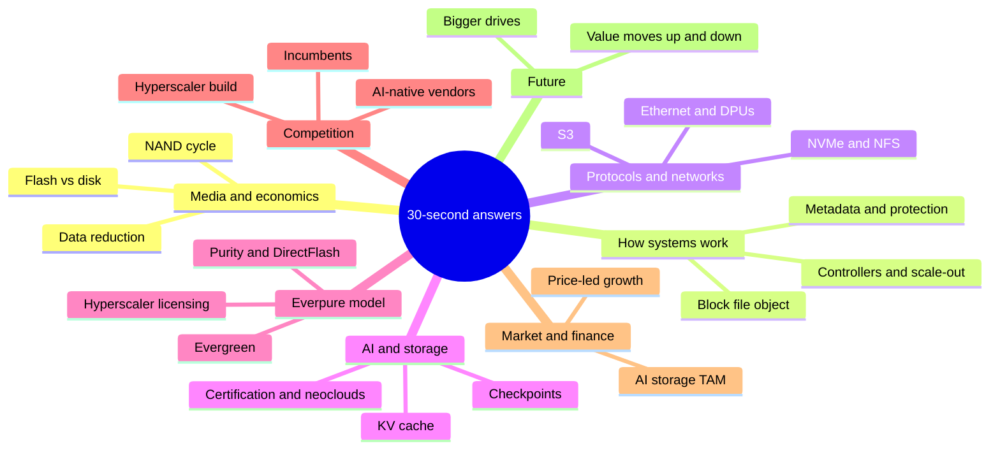
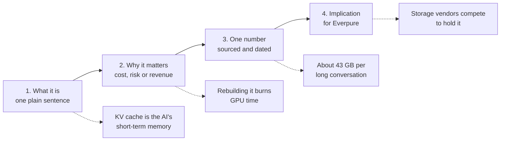

# 58. Explain it in 30 seconds

> **Depth:** L1 · **Reading time:** ~8 min · **Last verified:** 2026-11-01
> **Prerequisites:** None. This is a synthesis of the whole atlas; each line links to the chapter that explains and sources it. See also the [question bank](57-question-bank.md) and [cheat sheets](60-cheat-sheets.md).

## TL;DR

- **Use these 64 one-liners when a CFO, board member or investor asks "what is X and why should I care?"** Each states what it is, why it matters, and at most one number.
- **Follow the four-beat shape.** What it is, why it matters, one number, what it means for us. If you need a fifth beat, the answer is no longer 30 seconds.
- **Quote only numbers you can source.** Every number below links to the chapter that sourced it. Say the date, and say *company-stated* for private vendors.
- **Translate, don't simplify away the trade-off.** Board members respect "flash costs ~18× more per terabyte, and we still win on power and density" more than "flash is better."
- **Know the eight numbers in the table at the end.** They answer most board questions about growth, margin, share and AI.

## Why this matters for Everpure strategy

Strategy and corporate development teams carry the technology story to people who approve capital: the CFO, the board, bankers and investors. These audiences decide on deals, budgets and valuation narratives, and they rarely get more than half a minute per concept. A strategy professional who can turn "disaggregated shared-everything with NVMe-oF" into "they let customers buy engines and fuel tanks separately" earns the room's trust. One who cannot gets talked over by the engineer.

Everpure (NYSE: P, formerly PSTG) makes this harder than most. Its value rests on a software layer (Purity), its own flash module (DirectFlash), a business model (Evergreen) and an IP-licensing line with hyperscalers. None of those is obvious from the hardware, and the AI story is crowded with louder private competitors.

## Core concepts

The one-liners are grouped into eight themes and numbered continuously. Each one should survive a skeptical follow-up; the linked chapter has the depth.

*Figure 58.1 — Eight themes cover almost every board-level storage question; most board questions touch two of them at once.*

### The shape of a 30-second answer

*Figure 58.2 — Every one-liner follows four beats; the dotted path shows the KV-cache answer built that way.*

### Media and economics

1. **Why flash and not disk?** Flash is chips, disk is spinning platters. Flash wins on speed, power and space; disk still wins on purchase price for cold data ([Ch 2](../01-storage-fundamentals/02-media-physics.md)).
2. **How much more does flash cost?** Enterprise SSDs ran about 18.6× nearline disk per terabyte in Q3 2026, against roughly 10× in 2020[^1]. The flash pitch now rests on power, density and operations, not price ([Ch 53](../07-history-and-future/53-future-trends.md)).
3. **What is NAND?** The memory chip inside every SSD. Five suppliers took $68.87B of NAND revenue in 2Q26[^2], and Everpure buys from companies that also sell competing drives ([Ch 48](../06-industry-and-competition/48-media-suppliers-and-nand-cycle.md)).
4. **What is the NAND cycle?** Prices swing as chipmakers add or withhold capacity. Compounding TrendForce forecasts put 4Q26 contract prices near 4.7× mid-2025 levels[^3], so revenue inflates before margins recover ([Ch 48](../06-industry-and-competition/48-media-suppliers-and-nand-cycle.md)).
5. **What is QLC?** Flash storing four bits per cell: cheapest per terabyte but slower and less durable. It works only when software turns small writes into large sequential ones, which is what Purity does ([Ch 2](../01-storage-fundamentals/02-media-physics.md)).
6. **What is data reduction?** Deduplication and compression let one physical terabyte hold several logical ones. Purity averages about 5:1[^4], but AI data barely shrinks, so ask which data a ratio assumes ([Ch 5](../01-storage-fundamentals/05-data-reduction.md)).
7. **Raw, usable or effective?** Three prices for one terabyte: before protection, after protection, and after an assumed reduction ratio. Comparing vendors on different bases is the most common pricing trick ([Ch 4](../01-storage-fundamentals/04-performance-and-economics-metrics.md)).
8. **Why do watts matter?** AI datacenters are power-limited, so every storage watt is a watt not running a GPU. Flash's edge is density: a rack of the largest SSDs holds roughly 5× the raw petabytes of a disk rack ([Ch 38](../05-ai-storage/38-power-and-density.md)).

### How storage systems work

9. **Block, file, object?** Three ways to address data: numbered blocks for databases, folders for people and research, flat keys for cloud and AI. Each has a different buyer and budget ([Ch 1](../01-storage-fundamentals/01-what-storage-does.md)).
10. **What is an array?** A purpose-built computer that pools many drives, protects them and serves them over the network. Customers pay for the software inside, not the drives ([Ch 13](../03-system-architecture/13-storage-stack.md)).
11. **What is a dual-controller array?** Two servers sharing one set of drives, so one can fail without downtime. FlashArray works this way; the limit is one pair's horsepower ([Ch 14](../03-system-architecture/14-scale-up-dual-controller.md)).
12. **Scale-up versus scale-out?** Make the box bigger, or add more boxes. Scale-out handles petabytes but moves data across the network for every read and rebuild ([Ch 15](../03-system-architecture/15-scale-out-shared-nothing.md)).
13. **What is disaggregation?** Buying the engines and the fuel tanks separately: compute nodes and flash shelves scale independently. VAST built a company on it; now every major vendor ships a version ([Ch 16](../03-system-architecture/16-disaggregated-shared-everything.md)).
14. **What is a parallel file system?** Each client reads from many servers at once after one lookup. Lustre runs on more than 60% of the Top500 supercomputers[^5], which is why AI storage has HPC roots ([Ch 17](../03-system-architecture/17-parallel-file-systems.md)).
15. **What is metadata?** The card catalogue: names, folders, permissions and locations. AI's millions of small files make it the bottleneck, so ask for file operations per second, not just bandwidth ([Ch 21](../03-system-architecture/21-metadata.md)).
16. **What is erasure coding?** Insurance math: spread data plus parity so any few drives can fail. Eight data plus two parity costs 25% extra capacity, against 100% for a mirror ([Ch 6](../01-storage-fundamentals/06-data-protection-and-resilience.md)).
17. **Why is storage a ransomware product now?** Snapshots that even an administrator cannot delete let a company restore instead of pay. Vendors now attach recovery guarantees to the sale ([Ch 6](../01-storage-fundamentals/06-data-protection-and-resilience.md)).
18. **What is synchronous replication?** Every write lands at two sites before it counts, so a site loss loses nothing. Light adds about a millisecond per 100 km round trip, so it only works across a metro ([Ch 6](../01-storage-fundamentals/06-data-protection-and-resilience.md)).
19. **What does "eleven nines" mean?** A modelled durability probability, not a measurement. Correlated failures lose data in practice, so ask how the number was calculated ([Ch 20](../03-system-architecture/20-distributed-systems-fundamentals.md)).
20. **What is a non-disruptive upgrade?** Replacing the array's controllers while it keeps serving data. It is the engineering that makes Evergreen subscriptions possible ([Ch 14](../03-system-architecture/14-scale-up-dual-controller.md)).
21. **What is a control plane?** The software that manages a fleet: provisioning, policy, telemetry. More installed systems means more failure data, so this moat compounds with scale ([Ch 22](../03-system-architecture/22-control-planes.md)).

### Protocols and networks

22. **What is a storage protocol?** The language servers and storage speak. Changing it is slow, so protocol support decides which buyers a product can even reach ([Ch 7](../02-protocols-and-networking/07-block-protocols.md)).
23. **What is NVMe?** The protocol built for flash, with thousands of parallel queues instead of one line. It replaced SCSI and set the speed floor for every modern array ([Ch 7](../02-protocols-and-networking/07-block-protocols.md)).
24. **What is NVMe over Fabrics?** NVMe stretched across a network so shared flash feels local. The TCP flavour runs on ordinary Ethernet and is becoming the enterprise default ([Ch 7](../02-protocols-and-networking/07-block-protocols.md)).
25. **What are NFS and pNFS?** NFS is the file language of Linux and AI clusters; pNFS lets one client read from many servers in parallel. FlashBlade//EXA bets on it because it needs no special client software ([Ch 8](../02-protocols-and-networking/08-file-protocols.md)).
26. **What is S3?** Amazon's object interface, now the industry standard. AWS S3 holds more than 500 trillion objects[^6], and most AI tools read and write through it ([Ch 9](../02-protocols-and-networking/09-object-storage-and-s3.md)).
27. **What is RDMA?** Network cards copying data straight between machines' memory, skipping the processor. It keeps GPUs fed and is why AI storage is sold with a network design ([Ch 10](../02-protocols-and-networking/10-datacenter-networking.md)).
28. **Ethernet or InfiniBand?** Ethernet took more than two-thirds of AI back-end switch sales in 2025[^7]. Storage vendors that run well on standard Ethernet face fewer objections ([Ch 10](../02-protocols-and-networking/10-datacenter-networking.md)).
29. **What is a DPU?** A network card with its own processors that can run storage software. NVIDIA's BlueField-4 STX design named 12 storage co-design partners, Everpure included[^8] ([Ch 34](../05-ai-storage/34-nvidia-ecosystem.md)).

### AI and storage

30. **Why does storage matter for AI?** GPUs are the expensive asset; storage's job is keeping them busy. At $2–6 per GPU-hour[^9][^10], a 1,024-GPU cluster waiting on data burns about $0.57–1.75 every second ([Ch 11](../02-protocols-and-networking/11-gpu-data-path.md)).
31. **Is "AI storage" one market?** No: at least eight workloads, from cheap bulk ingest to latency-critical inference. Ask any vendor which stage they actually win ([Ch 30](../05-ai-storage/30-ai-data-pipeline.md)).
32. **What is a checkpoint?** Saving the game during training. A 405B-parameter model's full state is about 6.5 TB, so saving it in a minute needs ~108 GB/s ([Ch 31](../05-ai-storage/31-training-storage.md)).
33. **Why checkpoint so often?** Big clusters fail constantly: Meta's Llama 3 run had 419 unexpected interruptions in 54 days[^11]. Faster saves and restores mean less wasted GPU time ([Ch 31](../05-ai-storage/31-training-storage.md)).
34. **What is GPUDirect Storage?** Data moving straight into GPU memory, bypassing the CPU. It is table stakes: nearly every vendor claims it, so it no longer differentiates ([Ch 11](../02-protocols-and-networking/11-gpu-data-path.md)).
35. **What is the KV cache?** The AI's short-term memory of a conversation. One long session on a 70B-class model needs about 43 GB[^12], so fleets of retained sessions reach petabytes ([Ch 32](../05-ai-storage/32-inference-and-kv-cache.md)).
36. **What is context memory?** A new flash tier between GPU memory and shared storage, standardised by NVIDIA in 2026. Every storage vendor wants to be its backend; it is inference's biggest new storage opportunity ([Ch 53](../07-history-and-future/53-future-trends.md)).
37. **What is RAG?** Letting an AI look up company documents before answering. It turns storage into a search and governance problem, where catalogs and databases also compete ([Ch 33](../05-ai-storage/33-rag-vector-lakehouse.md)).
38. **What do AI agents need from storage?** Data they can find, understand and are permitted to use. MCP, the agent tool standard, passed 10,000 servers[^13], making metadata a product ([Ch 39](../05-ai-storage/39-agentic-ai-and-data-intelligence.md)).
39. **What is NVIDIA certification?** NVIDIA's approved-vendor list for AI storage. Missing from it usually means missing from the deal, but it proves a floor, not a ranking ([Ch 34](../05-ai-storage/34-nvidia-ecosystem.md)).
40. **What is a neocloud?** A GPU-specialist cloud such as CoreWeave, which guides 2026 capex to $35–39B[^14]. Storage is about 1% of that spend but can idle every GPU, so reliability beats price ([Ch 35](../05-ai-storage/35-ai-factories-and-neoclouds.md)).
41. **What is MLPerf Storage?** A peer-reviewed benchmark using simulated GPUs. FlashBlade//EXA led v3.0 checkpointing at 877.5 GiB/s[^15], but VAST, WEKA and DDN did not enter[^16] ([Ch 37](../05-ai-storage/37-reading-benchmarks.md)).

### Everpure's model

42. **What does Everpure sell?** FlashArray for block storage behind databases and VMs, FlashBlade for file and object at scale. Both run Purity and Everpure's own flash modules ([Ch 27](../04-everpure/27-flasharray-and-flashblade.md)).
43. **What is Purity?** The operating system on every Everpure array. It writes like a database log, which makes cheap flash last and lets one codebase serve the whole portfolio ([Ch 26](../04-everpure/26-purity-and-directflash.md)).
44. **What is DirectFlash?** Raw flash modules managed by Purity, without each SSD's own controller. Modules reach 300 TB[^17] against 245.76 TB for the largest standard SSD[^18] ([Ch 26](../04-everpure/26-purity-and-directflash.md)).
45. **What is Evergreen?** Subscribing to an architecture: controllers and media refresh in place, with no data migration. Over 10,000 such upgrades had been done by 2022[^19], which is why customers rarely leave ([Ch 23](../03-system-architecture/23-consumption-models.md)).
46. **What is Evergreen//One?** Storage on a utility bill: Everpure owns the hardware and charges for use against service levels. It lowers reported growth today while raising contracted future revenue ([Ch 23](../03-system-architecture/23-consumption-models.md)).
47. **What are ARR and RPO here?** Subscription ARR was $2.13B (+20%) and RPO $4.1B (+44%) at Q2 FY27[^20]. They measure the recurring base the hardware story is built on ([Ch 29](../04-everpure/29-hyperscaler-ecosystem-financials.md)).
48. **What is the hyperscaler deal?** Everpure licenses DirectFlash design to hyperscalers, who buy their own flash. Meta passed 2 EB in FY26[^21]; a second top-five hyperscaler signed in August 2026[^17] ([Ch 29](../04-everpure/29-hyperscaler-ecosystem-financials.md)).
49. **What is FlashBlade//EXA?** Everpure's AI-scale system: Purity runs the metadata, third-party servers hold the data, and clients use standard pNFS. It answers VAST and WEKA without proprietary client software ([Ch 27](../04-everpure/27-flasharray-and-flashblade.md)).
50. **What are Pure1 and Fusion?** Fleet analytics and a policy engine that manage arrays as one pool. Fusion passed 1,200 customers[^22], moving switching costs from hardware into software ([Ch 28](../04-everpure/28-platform-and-software.md)).
51. **Why Portworx and 1touch?** Portworx extends storage to Kubernetes; 1touch, bought for $125.0M[^23], classifies what data contains. Both bet storage owners can sell software above the array ([Ch 28](../04-everpure/28-platform-and-software.md)).
52. **What is squeezing margins?** Flash prices. Non-GAAP product gross margin was 66.2% against 74.9% for subscriptions in Q2 FY27[^24], and NAND stockpiling turned free cash flow to −$238M[^25] ([Ch 29](../04-everpure/29-hyperscaler-ecosystem-financials.md)).
53. **Why the rename to Everpure?** A bid to be valued as a data platform, not an array maker. Revenue is still mostly arrays and attached subscriptions, so it is a claim to prove ([Ch 25](../04-everpure/25-company-history-and-strategy.md)).

### Competition

54. **Who has share?** In 2Q26, Dell held 23.8%, Huawei 11.3%, NetApp 9.6%, Everpure 8.1% and HPE 6.8% of external storage[^26]. Share moves slowly; one point is a big year ([Ch 40](../06-industry-and-competition/40-market-structure.md)).
55. **Why are incumbents dangerous?** Dell, NetApp and HPE win on installed base, channel and bundling storage into server and network orders. Their weakness is many operating systems built for the pre-AI era ([Ch 46](../06-industry-and-competition/46-incumbents.md)).
56. **Who is VAST?** The AI-native leader, valued at $30B in April 2026[^27] on more than $500M of committed ARR (company-stated)[^28]. Its $1.17B CoreWeave deal[^29] is the market's anchor contract ([Ch 42](../06-industry-and-competition/42-vast-data.md)).
57. **Who is WEKA?** Software-only parallel file system on any hardware or cloud, last valued at $1.6B in 2024[^30]. It led KV-cache products, but is far smaller than its noise ([Ch 43](../06-industry-and-competition/43-weka.md)).
58. **Who is DDN?** The 28-year-old Lustre incumbent inside NVIDIA's own supercomputers. Blackstone invested at a $5B valuation in 2025[^31] ([Ch 44](../06-industry-and-competition/44-ddn.md)).
59. **Why do hyperscalers build?** At their volume, owning software beats buying arrays. They buy parts and IP instead, the seam where Everpure's licensing fits ([Ch 36](../05-ai-storage/36-hyperscaler-ai-storage.md)).
60. **Who is Hammerspace?** A software namespace sitting above everyone's arrays. If it wins, arrays look interchangeable, so it is the commoditisation risk to watch ([Ch 47](../06-industry-and-competition/47-other-challengers.md)).

### Market and financial dynamics

61. **How big is the market?** IDC's external enterprise storage market was $33.0B in 2025[^32], counting branded arrays only; hyperscaler self-builds sit outside it ([Ch 40](../06-industry-and-competition/40-market-structure.md)).
62. **Why is everyone growing 30%+?** Mostly price. The market grew 33.6% in 2Q26[^33] as flash costs passed through, while customers bought less capacity ([Ch 40](../06-industry-and-competition/40-market-structure.md)).
63. **How big is AI storage?** No credible public figure exists. Storage is 2.4% of IDC's AI infrastructure spend[^34]; the atlas triangulates roughly $9–25B for 2026 ([Ch 40](../06-industry-and-competition/40-market-structure.md)).
64. **Will disk die, and where does value go next?** Not this decade: disk makers target 100 TB drives by 2029[^35]. Value is moving up into data services and down into the network, away from the box ([Ch 53](../07-history-and-future/53-future-trends.md)).

### Translating jargon

| Jargon | Board language | Why a director cares |
|---|---|---|
| IOPS, latency | How many small requests per second, and how long the slowest ones wait | Database and application speed |
| Throughput (GB/s) | How fast large files move | GPU utilization on a multi-million-dollar cluster |
| Data reduction ratio | Customer terabytes stored per terabyte bought | Effective price; guarantee risk |
| Erasure coding | Insurance math against drive failure | Capacity overhead in the bill of materials |
| Non-disruptive upgrade | Replacing the engine in flight | No migration projects, sticky customers |
| Evergreen//One | Storage on a utility bill | Opex for the customer, ratable revenue for us |
| DirectFlash | Our own SSD brain, written in software | Density, margin and licensable IP |
| NVMe-oF | Shared flash that feels local | Pooling without a speed penalty |
| Disaggregation | Buy engines and fuel tanks separately | No stranded spend |
| Checkpoint | Saving the game | Protects the GPU investment |
| KV cache | The AI's short-term memory | Inference cost per answer |
| Metadata | The card catalogue | AI bottleneck and governance control point |
| NVIDIA certification | Approved-vendor stamp | Entry ticket to GPU deals |

*Figure 58.3 — Most storage jargon maps to one of four board concerns: speed, cost, risk or revenue quality.*

### Which one-liners answer which board question

| Board question | Use one-liners | The answer in a sentence |
|---|---|---|
| "Why are we growing ~38% if the market is mature?" | 4, 47, 54, 62 | Price pass-through plus share gain, on a recurring base |
| "Is AI a real opportunity for us?" | 30, 31, 35, 36, 41, 63 | Yes, but storage is a small, gating slice of AI spend |
| "Why would a hyperscaler license instead of build?" | 44, 48, 59 | They build software at scale but buy proven flash IP |
| "How do we compare to VAST?" | 13, 49, 56, 41 | Similar architecture goal, different client and business model |
| "What does the flash shortage do to us?" | 2, 3, 4, 52 | Revenue up, margins and cash down until prices catch up |
| "Is disk dead?" | 1, 2, 8, 64 | No; flash wins hot and power-limited data, disk keeps cold bulk |
| "Why does the subscription matter?" | 20, 45, 46, 47 | Upgrades without migration make revenue recurring and customers sticky |
| "What is our biggest competitive threat?" | 54, 55, 59, 60 | Dell's bundling today; commoditisation by software layers tomorrow |

*Figure 58.5 — Eight recurring board questions each need three or four one-liners chained in order.*

## How Everpure approaches it vs. competitors

Board members often ask "why us and not them?" Give a fair answer that steelmans the rival.

| Rival | Their 30-second pitch | Everpure's 30-second counter | Honest caveat |
|---|---|---|---|
| Dell | One vendor for servers, network and storage | One OS and Evergreen versus a portfolio of many | Bundling wins procurement |
| NetApp | Unified file and block, deep installed base | Simpler operations, denser flash | ONTAP's file features are mature |
| VAST | AI-native platform at neocloud scale | Standard pNFS client, DirectFlash density, public financials | VAST owns the anchor neocloud deals |
| WEKA | Software anywhere, KV-cache first | Integrated hardware, MLPerf results | WEKA runs where Everpure hardware cannot |
| Hyperscalers | Build it yourself at cost | License our flash design instead | They can switch to commodity drives |

*Figure 58.4 — Each rival's best argument is commercial or architectural; Everpure's counters rest on integration and the subscription model.*

## History and trajectory

The 30-second Everpure story has changed three times. Pure Storage IPO'd in October 2015[^36] on "flash at disk-like prices through data reduction." The second version was the subscription: Evergreen made upgrades a service. The third, from Meta's December 2024 licensing win[^37] to the 2026 rename, adds hyperscaler IP and data management. Each version sits on the previous one, so a good answer still begins with Purity and DirectFlash.

## Numbers that matter

| Metric | Value | Context | Source / date |
|---|---|---|---|
| Subscription ARR | $2.13B (+20%) | Recurring base, Q2 FY27 | Everpure, 2026-08-26[^20] |
| Remaining performance obligations | $4.1B (+44%) | Contracted future revenue | Everpure, 2026-08-26[^20] |
| FY27 revenue guidance | $5.03–5.07B (about +38%) | Raised from $4.3–4.4B | Everpure, 2026-08-26[^20] |
| Everpure share of external storage | 8.1% (#4) | 2Q26; Dell 23.8% | IDC via StorageReview, 2026-09[^26] |
| Non-GAAP gross margin, product vs subscription | 66.2% vs 74.9% | Q2 FY27; NAND squeeze | Investing.com, 2026-08[^24] |
| Enterprise SSD ÷ nearline HDD $/TB | ~18.6× (~10× in 2020) | Why flash sells on power and density | Hardware Busters, 2026[^1] |
| VAST valuation vs committed ARR | $30B vs >$500M | Company-stated; AI-native benchmark | CNBC, 2026-04[^27]; Futurum, 2026-04[^28] |
| Storage share of AI infrastructure spend | 2.4% | 1Q26; storage is small but gates GPUs | IDC, 2026-07-21[^34] |

## Conversation playbook

**Three questions for a PM**

1. *"How would you explain your product to our CFO in one sentence?"* Strong answer: a buyer, a problem and a number, such as "FlashBlade//EXA keeps large GPU clusters fed using standard Linux clients."
2. *"Which board question about your product worries you most?"* Strong answer: names a real gap, such as certification timing or a missing anchor customer.
3. *"Which number would you put on one slide?"* Strong answer: a customer-outcome metric, not a peak benchmark.

**Three questions for an engineer**

1. *"What would a skeptical analyst get wrong about DirectFlash?"* Strong answer: separates real system-level gains from datasheet comparisons.
2. *"Where does my 30-second version of disaggregation break?"* Strong answer: names the fabric and minimum-size limits.
3. *"Is the KV-cache opportunity storage, or memory?"* Strong answer: says only cache not being decoded can leave GPU memory.

**Don't say this:**

- "Flash is cheaper than disk." Not per raw terabyte in 2026.
- "We're #1 in MLPerf." Say first among those who entered.
- "AI storage is a $50B market." No credible public figure supports it.
- "Evergreen means free upgrades." It is a paid subscription.

## Going deeper (optional, L3 pointers)

Build longer answers from the [question bank](57-question-bank.md), test recall with the [flashcards](59-self-test-flashcards.md), and use the [cheat sheets](60-cheat-sheets.md) for acronyms.

## Key terms

- **One-liner** — a 30-second answer with one number.
- **Board language** — jargon translated into cost, risk or revenue.
- See the [glossary](../glossary.md) for every term above.

## Sources

[^1]: Hardware Busters, "Enterprise SSD Prices Now Run 18.6x Hard Drives, and the Cheap Alternative Is Sold Out Until 2027," 2026. https://hwbusters.com/news/enterprise-ssd-prices-now-run-18-6x-hard-drives-and-the-cheap-alternative-is-sold-out-until-2027/ (retrieved 2026-11-01); 2020 baseline: Blocks & Files, "Enterprise SSDs cost ten times more than nearline disk drives," 2020-08-24. https://blocksandfiles.com/2020/08/24/10x-enterprise-ssd-price-premium-over-nearline-disk-drives/ (retrieved 2026-11-01).
[^2]: TrendForce, "Combined Revenue of Top Five NAND Flash Brands Rises 77% QoQ in 2Q26; Micron Moves Up to Third Place, Says TrendForce," 2026-08-18. https://www.trendforce.com/presscenter/news/20260818-13186.html (retrieved 2026-11-01). Shares via search summary of the release, corroborated by Evertiq, 2026-08-18, https://evertiq.com/news/2026-08-18-top-five-nand-flash-brands-post-77-revenue-surge-in-q2 (retrieved 2026-11-01).
[^3]: TrendForce, "AI Server Demand Sustains Memory Contract Price Increases in 4Q26, While Consumer-Side Pressure Persists," 2026-09-30. https://www.trendforce.com/presscenter/news/20260930-13258.html (retrieved 2026-11-01).
[^4]: Pure Storage, "FlashArray Datasheet," n.d. https://info.purestorage.com/rs/225-USM-292/images/Pure_Storage_FlashArray_Datasheet.pdf (retrieved 2026-11-01); corroborated by Pure Storage, "Pure Storage vs Dell EMC PowerMax" white paper, n.d. https://www.purestorage.com/content/dam/pdf/en/white-papers/protected/wp-pure-storage-vs-dell-emc-powermax.pdf (retrieved 2026-11-01).
[^5]: R. S. George, A. Dilger et al. (ORNL and others), "Lustre Unveiled: Evolution, Design, Advancements, and Current Trends," *ACM Transactions on Storage* 21(3), 2025-06. DOI 10.1145/3736583. https://www.ornl.gov/publication/lustre-unveiled-evolution-design-advancements-and-current-trends (retrieved 2026-11-01).
[^6]: AWS News Blog, "AWS Weekly Roundup: Amazon S3 turns 20, Amazon Route 53 Global Resolver general availability, and more," 2026-03-16. https://aws.amazon.com/blogs/aws/aws-weekly-roundup-amazon-s3-turns-20-amazon-route-53-global-resolver-general-availability-and-more-march-16-2026 (retrieved 2026-11-01).
[^7]: Dell'Oro Group, "Ethernet more than doubles size of InfiniBand as the leading fabric for AI scale-out networks in 2025," 2026; and "2026 predictions: data center switch, front-end and AI back-end networks," 2026. https://www.delloro.com/news/ethernet-more-than-doubles-size-of-infiniband-as-the-leading-fabric-for-ai-scale-out-networks-in-2025/ ; https://www.delloro.com/2026-predictions-data-center-switch-frontend-ai-backed-networks/ (retrieved 2026-11-01; search-summary only: the 4Q25 release says Ethernet took more than two-thirds of AI-cluster switch sales in the quarter and the full year, against InfiniBand's ~80% two years earlier; corroborated by insideHPC, "Report: AI Back-End Networks Continue Shift to Ethernet," 2025-12, https://insidehpc.com/2025/12/report-ai-back-end-networks-continue-shift-to-ethernet/).
[^8]: StorageNewsletter, "Nvidia GTC 2026: Nvidia Launches BlueField-4 STX Storage Architecture With Broad Industry Adoption," 2026-03-17. https://www.storagenewsletter.com/2026/03/17/nvidia-gtc-2026-nvidia-launches-bluefield-4-stx-storage-architecture-with-broad-industry-adoption/ (retrieved 2026-11-01).
[^9]: CoreWeave, "Pricing," n.d. (2026); 8× HGX H100 on-demand US$49.24/hr as reported consistently by multiple price trackers. https://www.coreweave.com/pricing (retrieved 2026-11-01).
[^10]: Intuition Labs, "H100 Rental Prices Compared: $1.49–$6.98/hr Across 15+ Cloud Providers (2026)," 2026. https://intuitionlabs.ai/articles/h100-rental-prices-cloud-comparison (retrieved 2026-11-01).
[^11]: Llama Team, AI @ Meta, "The Llama 3 Herd of Models," arXiv:2407.21783, 2024-07-31. https://arxiv.org/abs/2407.21783 (retrieved 2026-11-01).
[^12]: Meta, `llama-models` repository, "models/sku_list.py" (Llama 3.1 8B/70B/405B architecture arguments: dim, n_layers, n_heads, n_kv_heads), n.d. https://github.com/meta-llama/llama-models/blob/main/models/sku_list.py (retrieved 2026-11-01).
[^13]: Anthropic, "Donating the Model Context Protocol and establishing the Agentic AI Foundation," 2025-12-09. https://www.anthropic.com/news/donating-the-model-context-protocol-and-establishing-of-the-agentic-ai-foundation (retrieved 2026-11-01; read via search summary).
[^14]: Channelchek, "CoreWeave Q2 2026 Earnings: CRWV Stock Jumps 14% on Record Revenue and Raised AI Capex Guidance," 2026-08. https://dashboard.channelchek.com/?p=104902 ; corroborated by TrendSpider, "CoreWeave Stock Jumps After Q2 Earnings Beat," 2026-08. https://trendspider.com/blog/coreweave-stock-q2-earnings-guidance-2026/ (both retrieved 2026-11-01).
[^15]: HPCwire (Everpure release), "Everpure Leads MLPerf Storage Tests for Large Model Checkpointing and KV Cache," 2026-09-02. https://hpcwire.com/off-the-wire/everpure-leads-mlperf-storage-tests-for-large-model-checkpointing-and-kv-cache (retrieved 2026-11-01).
[^16]: MLCommons via GlobeNewswire, "MLCommons Releases New MLPerf Storage v3.0 Benchmark Results," 2026-09-01. https://www.globenewswire.com/news-release/2026/09/01/3354412/0/en/mlcommons-releases-new-mlperf-storage-v3-0-benchmark-results.html ; StorageReview, "MLPerf Storage v3.0: 877 GiB/s Checkpoints, a Cloud First, and a Leaderboard Turned Over," 2026-09. https://www.storagereview.com/news/mlperf-storage-v3-0-877-gib-s-checkpoints-a-cloud-first-and-a-leaderboard-turned-over (retrieved 2026-11-01).
[^17]: Blocks & Files, "Second hyperscaler plumps for Everpure's flash technology," 2026-08-11. https://www.blocksandfiles.com/flash/2026/08/11/second-hyperscaler-plumps-for-everpures-flash-technology/5285903 (retrieved 2026-11-01).
[^18]: Micron Technology, "Industry-Leading 245TB Micron 6600 ION Data Center SSD Now Shipping," 2026-05-05. https://investors.micron.com/news/press-release/2026/Industry-Leading-245TB-Micron-6600-ION-Data-Center-SSD-Now-Shipping/default.aspx (retrieved 2026-11-01).
[^19]: Blocks & Files, "Pure Storage reworks Evergreen subscription service," 2022-06-08. https://www.blocksandfiles.com/block/2022/06/08/pure-storage-reworks-evergreen-subscription-service/1591308 (retrieved 2026-11-01).
[^20]: Everpure, "Everpure Announces Second Quarter Fiscal 2027 Financial Results," 2026-08-26. https://investor.everpuredata.com/news-and-events/press-releases/press-release-details/2026/Everpure-Announces-Second-Quarter-Fiscal-2027-Financial-Results/default.aspx (retrieved 2026-11-01).
[^21]: Blocks & Files, "Pure Storage hikes full-year forecast after solid Q3," 2025-12-03. https://www.blocksandfiles.com/2025/12/03/pure-storage-hikes-full-year-forecast-after-solid-q3/1720082 (retrieved 2026-11-01).
[^22]: Everpure, "Q1 FY27 Prepared Remarks," 2026-05-27. https://s21.q4cdn.com/687136699/files/doc_financials/2027/q1/Everpure-Q1FY27-Prepared-Remarks.pdf (retrieved 2026-11-01); prior figure (>600 customers) from Everpure, "Q4FY26 Prepared Remarks," 2026-02-25. https://s21.q4cdn.com/687136699/files/doc_financials/2026/q4/Q4FY26-Everpure-Prepared-Remarks.pdf (retrieved 2026-11-01).
[^23]: SEC, "Everpure, Inc. Form 10-Q for the quarter ended May 3, 2026," 2026-06. https://www.sec.gov/Archives/edgar/data/0001474432/000147443226000061/pstg-20260503.htm (retrieved 2026-11-01).
[^24]: Investing.com, "Everpure Q2 FY27 slides: 38% revenue growth, guidance raised sharply," 2026-08. https://www.investing.com/news/company-news/everpure-q2-fy27-slides-38-revenue-growth-guidance-raised-sharply-93CH-4878054 (retrieved 2026-11-01).
[^25]: Yahoo Finance, "Everpure (P) Grew Revenue 38% but Free Cash Flow Was Negative," 2026-08. https://finance.yahoo.com/markets/stocks/articles/everpure-p-grew-revenue-38-023544268.html (retrieved 2026-11-01).
[^26]: StorageReview, "IDC External Storage Tracker: $10.3 Billion in Q2 2026 as Server Market Tops $166 Billion on AI Demand," 2026-09. https://www.storagereview.com/news/idc-external-storage-tracker-q2-2026-10-3-billion-as-server-market-tops-166-billion (retrieved 2026-11-01).
[^27]: CNBC, "Nvidia backs AI company Vast Data at $30 billion valuation," 2026-04-22. https://www.cnbc.com/2026/04/22/nvidia-backs-ai-company-vast-data.html (retrieved 2026-11-01).
[^28]: Futurum, "VAST Data Valuation Triples. Can a Unified Platform Scale AI Globally?," 2026-04. https://futurumgroup.com/insights/vast-data-valuation-triples-can-a-unified-platform-scale-ai-globally/ ; VAST Data, "VAST Data Valued at $30 Billion as AI Drives a New Infrastructure Stack" (press release), 2026-04-21. https://www.vastdata.com/press-releases/vast-series-f-financing-at-30-billion-valuation (retrieved 2026-11-01).
[^29]: Reuters (via Yahoo Finance), "Exclusive: Nvidia-backed Vast Data inks $1.17 billion AI deal with CoreWeave," 2025-11-06. https://finance.yahoo.com/news/exclusive-nvidia-backed-vast-data-120456403.html (retrieved 2026-11-01).
[^30]: WEKA, "WEKA Nets $140M in Series E Funding at $1.6B Valuation," 2024-05-15. https://www.weka.io/news/weka-nets-140m-in-series-e-funding-at-1-6b-valuation (retrieved 2026-11-01).
[^31]: Blackstone, "Blackstone Invests $300 Million at a $5 Billion Valuation in DDN, AI and Data Intelligence Solutions Leader, to Fuel Further Rapid Growth," 2025-01-09. https://www.blackstone.com/news/press/blackstone-invests-300-million-at-a-5-billion-valuation-in-ddn-ai-and-data-intelligence-solutions-leader-to-fuel-further-rapid-growth/ (retrieved 2026-11-01).
[^32]: IDC, "Worldwide External Enterprise Storage Systems Market Closed with a Solid 3.9% Year-over-Year Growth in Revenue," 2026-03-12. https://www.idc.com/resource-center/press-releases/worldwide-external-enterprise-storage-systems-market-closed-with-a-solid-3-9-year-over-year-growth-in-revenue-according-to-idc/ (retrieved 2026-11-01).
[^33]: IDC, "2Q2026 ESS Tracker" press release, 2026-09-10. https://www.idc.com/resource-center/press-releases/2q2026-ess-tracker/ (retrieved 2026-11-01).
[^34]: IDC, "AI Infrastructure Spending Holds Near $90 Billion in Q1 2026 as Arm Overtakes x86 in Accelerated Servers; 2026 Forecast Raised to $497 Billion," 2026-07-21. https://www.idc.com/resource-center/blog/ai-infrastructure-spending-holds-near-90-billion-in-q1-2026-as-arm-overtakes-x86-in-accelerated-servers-2026-forecast-raised-to-497-billion/ (retrieved 2026-11-01).
[^35]: Western Digital, "Western Digital Accelerates Storage Innovation for AI Era," 2026-02-03. https://www.westerndigital.com/company/newsroom/press-releases/2026/2026-02-03-western-digital-accelerates-storage-innovation-for-ai-era (retrieved 2026-11-01).
[^36]: Pure Storage / Business Wire, "Pure Storage Prices Initial Public Offering," 2015-10-06. https://investor.purestorage.com/news-and-events/press-releases/press-release-details/2015/Pure-Storage-Prices-Initial-Public-Offering/default.aspx (retrieved 2026-11-01).
[^37]: SiliconANGLE, "Shares of Pure Storage jump on impressive earnings beat and strong guidance," 2024-12-03. https://siliconangle.com/2024/12/03/shares-pure-storage-jump-impressive-earnings-beat-strong-guidance/ (retrieved 2026-11-01).
